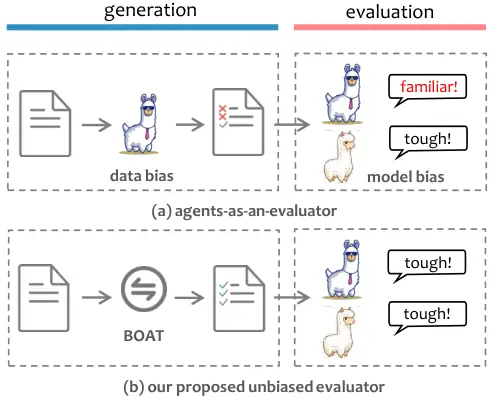
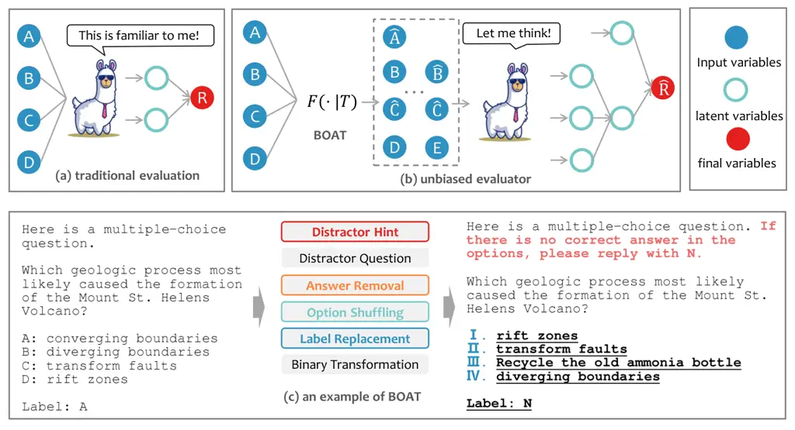
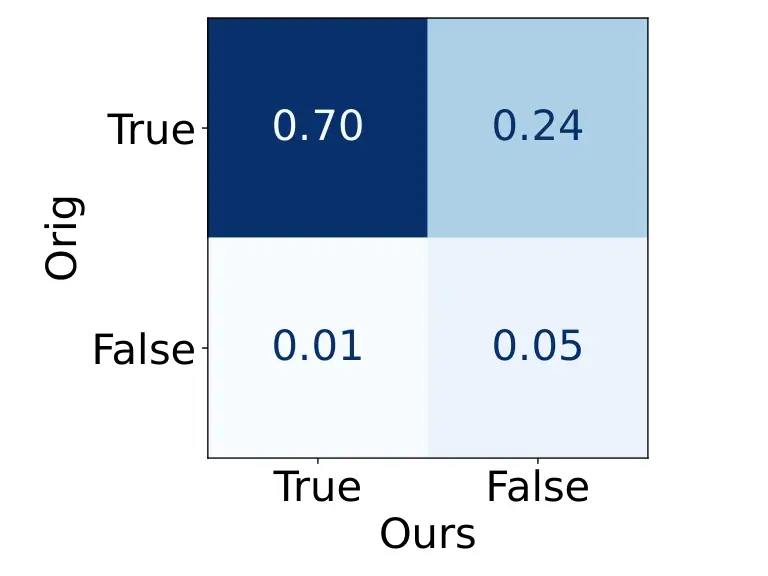
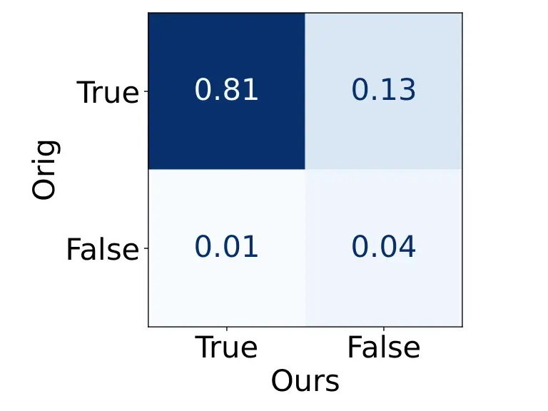

# Unbiased Evaluation of Large Language Models from a Causal Perspective

Meilin Chen Affiliation: Hikvision Research Institute Correspondence to:
<merlinarer@gmail.com>    Jian Tian Affiliation: Hikvision Research
Institute    Liang Ma Affiliation: Hikvision Research Institute
Correspondence to: <maliang6@hikvision.com>    Di Xie
Affiliation: Hikvision Research Institute    Weijie Chen
Affiliation: Hikvision Research Institute    Jiang Zhu
Affiliation: Hikvision Research Institute

###### Abstract

Benchmark contamination has become a significant concern in the LLM
evaluation community. Previous Agents-as-an-Evaluator address this issue
by involving agents in the generation of questions. Despite their
success, the biases in Agents-as-an-Evaluator methods remain largely
unexplored. In this paper, we present a theoretical formulation of
evaluation bias, providing valuable insights into designing unbiased
evaluation protocols. Furthermore, we identify two type of bias in
Agents-as-an-Evaluator through carefully designed probing tasks on a
minimal Agents-as-an-Evaluator setup. To address these issues, we
propose the Unbiased Evaluator, an evaluation protocol that delivers a
more comprehensive, unbiased, and interpretable assessment of LLMs.
Extensive experiments reveal significant room for improvement in current
LLMs. Additionally, we demonstrate that the Unbiased Evaluator not only
offers strong evidence of benchmark contamination but also provides
interpretable evaluation results.

###### Keywords: 

Machine Learning, ICML

^(†)^(†)affiliationnotice: Equal contribution

## 1 Introduction

Recently, proprietary models such as GPT-4 (Achiam et al., 2023),
Claude(Anthropic, 2024), Gemini(Team et al., 2023), and open-source
ones, such as Llama(Touvron et al., 2023), Mistral(Jiang et al., 2023),
Qwen(Bai et al., 2023), Yi(AI et al., 2024) have demonstrated remarkable
capabilities in natural language processing tasks and beyond. As the
capabilities of community models continue to grow, the importance of
robust and fair model evaluation becomes increasingly critical. The
community has made great efforts to evaluate model performance by
expanding the comprehensiveness of benchmarks(Wang, 2018; Wang et al.,
2019; Srivastava et al., 2022; Hendrycks et al., 2021; Liang et al.,
2022; White et al., 2024), or by introducing more complex and
challenging tasks to push the boundaries of model capabilities(Wei
et al., 2024; He et al., 2024b; Lightman et al., 2023; AI-MO, 2024;
AI-MO, 2023; He et al., 2024a).

Despite their success, public benchmarks, most widely used to assess and
compare model performance, are particularly vulnerable to contamination
issues(Lovin, 2023; Bender et al., 2021; Kocoń et al., 2023; Li, 2023;
Zhou et al., 2023; Ni et al., 2024), which are increasingly inevitable
due to the scale of training data used in modern models. Recently,
agent-based evaluation have been proposed to address contamination
issue(Zhu et al., 2024; Liu et al., ). Among them, MPA (Zhu et al., 2024) proposes to involve probing and judging agents to automatically
transform existing problems in benchmarks into new ones. CogMath(Liu
et al., ) decouple questions into several evaluation dimensions via an
multi-agent system for evaluating LLM’s mathematical abilities.



Figure 1: (a) Agents-as-an-Evaluator suffers from data and model bias.
(b) Our proposed Unbiased Evaluator dynamically evaluate the LLMs with
designed *B*ags *O*f *A*tomic In*T*erventions (BOAT).

Figure 2: Model bias visualizations. Left: $`\mathcal{R}_{OC}`$ vs.
Strength on ARC-C and MMLU datasets. Right: $`\mathcal{R}_{UC}`$ vs.
Strength on ARC-C and MMLU datasets. Strength refers to the probability
defined in Equation 3. A higher strength value indicates a greater
proportion of ”processed” samples within the dataset (”process” denotes
rephrasing and BOAT in Agents-as-an-Evaluator and Unbiased Evaluator,
respectively). The point where strength=0 represents the original
datasets. Mistral, Yi, Llama, Qwen represents Mistral-Large-2411,
Yi1.5-34B-Chat, Llama3.1-70B-Instruct and Qwen2.5-72B-Instruct,
respectively. For Agents-as-an-Evaluator, we observe a significant
increase in $`\mathcal{R}_{OC}`$ with growing strength, while
$`\mathcal{R}_{UC}`$ remains relatively stable, indicating the existence
of model bias. Compared with Agents-as-an-Evaluator, our Unbiased
Evaluator remains relatively stable on both $`\mathcal{R}_{OC}`$ and
$`\mathcal{R}_{UC}`$.

We termed this paradigm as _Agents-as-an-Evaluator_. Formally,
Agents-as-an-Evaluator refers to an LLM-based evaluation paradigm in
which LLMs (or Agents) not only assess responses but also actively
contribute to generating evaluation criteria and questions. Different
from previous LLM-as-a-Judge (Zheng et al., 2023), which operates on the
evaluation side by solely determining whether something falls within the
scope of a given rule, Agents-as-an-Evaluator extends beyond assessment
to the generation side, where LLMs actively contribute to the design of
the very questions involved in the task. Considering that prior works
have revealed that LLM-as-a-Judge posses certain biases(Blodgett et al.,
2020; Ahn et al., 2022; Ferrara, 2023; Gallegos et al., 2024), compared
to LLM-as-a-Judge, the critical step of question generation in
Agents-as-an-Evaluator may introduce a greater potential for bias.
Therefore, an important question rises:

_To what extent are Agents-as-an-Evaluator biased and is there a simple,
unbiased alternative for benchmark contamination?_

In this paper, we begin with a theoretical formulation of evaluation
bias, followed by an in-depth analysis of the potential bias in
designing evaluation protocols. Our results demonstrate that evaluation
bias can be decomposed into three components: original, independent and
related terms. Therefore, the key takeaway for future research in
designing evaluation protocols is that any newly introduced biases
should ideally mitigate and, more importantly, counteract existing
biases in the original benchmark.

To conduct bias analysis, we design a minimum Agents-as-an-Evaluator,
i.e. an LLM is tasked to rephrase the questions without changing their
meaning. Build upon this, together with our designed bias probing task,
we empirically reveal that Agents-as-an-Evaluator exhibit two biases:
data bias and model bias. As shown in Fig. 1 (a), data bias emerges from
accuracy imbalance across different domains during generation, while
model bias stems from inherent unfairness during evaluation.

To mitigate the bias in existing methods, we propose the _Unbiased
Evaluator_, as shown in Fig. 1 (b), an evaluation protocol grounded in a
causal perspective. Drawing inspiration from interventions in causal
inference, where AI systems are tasked with responding to manipulated
pairs to understand how altering one factor ( “intervention”) impacts
other variables in a complex system. Specifically, the evaluation
process is formulated as a causal diagram, where LLMs reason over input
variables to arrive at the final answer. Taking advantage of this, we
design *B*ags *O*f *A*tomic In*T*erventions (BOAT) to dynamically
evaluate the LLMs. By combining these interventions, the Unbiased
Evaluator provides a more comprehensive, unbiased and interpretable
assessment.

In summary, our contributions are three-fold: (1) A theoretical
formulation of evaluation bias, offering valuable findings for the
importance of minimizing the relative term when designing evaluation
protocols. (2) The first comprehensive bias analysis for
Agents-as-an-Evaluator, revealing data and model bias which undermine
the reliability and trustworthiness of Agents-as-an-Evaluator. (3) An
unbiased evaluation protocol, Unbiased Evaluator, provides a more
comprehensive, unbiased and interpretable assessment for benchmark
contamination.

|                       |                        |                        |         |                         |          |             |         |             |
| --------------------- | ---------------------- | ---------------------- | ------- | ----------------------- | -------- | ----------- | ------- | ----------- |
| Models                | Agents-as-an-Evaluator |                        |         |                         | Ours     |             |         |             |
|                       | Kendall                |                        | Pearson |                         | Kendall  |             | Pearson |             |
|                       | $`\tau`$               | $`p`$-value            | $`c`$   | $`p`$-value             | $`\tau`$ | $`p`$-value | $`c`$   | $`p`$-value |
| Mistral-Large-2411    | -0.38                  | 2.73$`\times 10^{-5}`$ | -0.47   | 2.18$`\times 10^{-4}`$  | 0.02     | 0.76        | 0.07    | 0.59        |
| Yi1.5-34B-Chat        | -0.17                  | 5.86$`\times 10^{-3}`$ | -0.38   | 3.52 $`\times 10^{-3}`$ | 0.10     | 0.24        | 0.16    | 0.20        |
| Llama3.1-70B-Instruct | -0.39                  | 1.81$`\times 10^{-5}`$ | -0.45   | 4.86$`\times 10^{-4}`$  | 0.14     | 0.10        | 0.15    | 0.05        |
| Qwen2.5-72B-Instruct  | -0.25                  | 5.51$`\times 10^{-3}`$ | -0.41   | 1.44$`\times 10^{-3}`$  | 0.07     | 0.41        | 0.10    | 0.12        |

Table 1: Data bias. The Pearson and Kendall correlation between domain
acc. of MMLU and $`\mathcal{R}_{CE}`$ across four LLMs.

## 2 Related Works

### 2.1 LLMs Evaluation

The rapid growth of large language models (LLMs) underscores the need
for increasingly robust and fair evaluation methods. Benchmarks offer an
effective alternative for model evaluation. The research community has
made significant strides in expanding the comprehensiveness of
benchmarks (Wang, 2018; Wang et al., 2019; Srivastava et al., 2022;
Hendrycks et al., 2021; Liang et al., 2022; White et al., 2024), while
also introducing more complex and challenging tasks to push the
boundaries of model capabilities (Wei et al., 2024; He et al., 2024b;
Lightman et al., 2023; AI-MO, 2024; AI-MO, 2023; He et al., 2024a).

Complementing these evaluation benchmarks, our proposed Unbiased
Evaluator introduces an evaluation protocol grounded in a causal
perspective, offering a more comprehensive and unbiased assessment.

### 2.2 Benchmark Contamination

Recent research has attached great importance to contamination in LLMs.
In particular, (Lee et al., 2021; Sainz et al., 2023; McIntosh et al.,
2024; Riddell et al., 2024; Jiang et al., 2024) knowledged that
contamination poses significant challenges to the reliability and
validity of LLM evaluations. Several research studies (Ni et al., 2024)
developed various methods to detect data contamination.

Several works (Fan et al., 2023; Lei et al., 2023; Zhu et al., 2023; Zhu
et al., 2024; Liu et al., ) have been proposed to address the
contamination issue. Among these, protocols like (Fan et al., 2023; Zhu
et al., 2023; Liu et al., ) are specifically designed for mathematical
tasks, while (Lei et al., 2023) focuses on long-context evaluation.
Among the research of Agents-as-an-Evaluator(Zhu et al., 2024; Liu
et al., ), MPA (Zhu et al., 2024) proposes to involve paraphrasing and
judging agents to automatically transform existing problems in
benchmarks into new ones. CogMath(Liu et al., ) decouple questions into
several evaluation dimensions via an multi-agent system for evaluating
LLM’s mathematical abilities.

Our proposed Unbiased Evaluator stands in contrast to these, as it is
designed to be generalized for a wide range of tasks and ensures an
unbiased evaluation.

### 2.3 Evaluation Bias

Recent studies have highlighted that LLM-as-a-Judge exhibit various
types of biases across various tasks(Dai et al., 2024; Gallegos et al.,
2024; Chen et al., ; Ye et al., 2024), such as position bias, length
bias, self-enhancement bias etc. These internal biases of LLMs may also
affect LLM-as-a-judge, leading to unfair evaluation outcomes and
subsequently impacting the development of LLMs.

Unlike prior research that mainly focuses on biases in LLM-as-a-Judge,
this paper addresses the biases inherent in the generation of
Agents-as-an-Evaluator, an area largely unexplored but critical to
understanding the fairness and impact of LLMs in evaluative roles.

## 3 Bias Analysis

### 3.1 Theoretical Analysis

Formulation of Evaluation Bias. Consider in an LLM evaluation, where the
true capability of a model is parameterized by $`\phi`$, which is a
fixed but unknown quantity we aim to estimate. Given evaluation data
$`\mathcal{X}=\{x_{1},x_{2},\dots,x_{n}\}`$, the estimator
$`\hat{\phi}=\mathcal{E}(\mathcal{X})`$ is a function of the data and
provides an approximation of $`\phi`$. Then, the difference between
expectation of $`\hat{\phi}`$ and $`\phi`$ can be defined as evaluation
bias:

```math
\displaystyle\epsilon(\hat{\phi})=\mathbb{E}[\hat{\phi}]-\phi \tag{1}
```

where $`\mathbb{E}[\hat{\phi}]`$ is the expected value of the estimator
over $`\mathcal{X}`$. A bias greater than 0 indicates that the estimator
overestimates $`\phi`$, often due to contaminated data. A bias of 0
means the estimator is unbiased, providing a perfect estimate. A bias
less than 0 suggests the estimator underestimates $`\phi`$, which can
occur when a model is evaluated on a limited dataset that fails to
capture the task’s complexity.

Proposition 3.1. (_Proof in Appendix D.1_) Given a new designed
evaluation protocol, which transforms original benchmark $`D`$ into
$`D^{\prime}`$. Then, the strength of bias with the new evaluation
protocol can be decomposed into three terms: original, related and
independent term.

```math
\displaystyle\mathbb{E}[\epsilon(\hat{\phi}_{D^{\prime}})^{2}] \displaystyle=\underbrace{\mathbb{E}[\epsilon(\hat{\phi}_{D})^{2}]}_{\texttt{original}}+\underbrace{2\text{Cov}(\epsilon(\hat{\phi}_{D}),\Delta)}_{\texttt{related}}
```

```math
\displaystyle+\underbrace{2\mathbb{E}[\epsilon(\hat{\phi}_{D})]\mathbb{E}[\Delta]+\mathbb{E}[\Delta^{2}]}_{\texttt{independent}} \tag{2}
```

where, $`\Delta`$ is the delta bias which arises from the introduction
of new evaluation protocol.

- •
  $`\mathbb{E}[\epsilon(\hat{\phi}_{D})^{2}]`$ is an original term that
  is associated with the original bias existing in the original
  benchmark $`D`$.
- •
  $`2\text{Cov}(\epsilon(\hat{\phi}_{D}),\Delta)`$ is a related term
  which pertains to biases that newly introduced biases are correlated
  with the pre-existing biases in the original benchmark.
- •
  $`2\mathbb{E}[\epsilon(\hat{\phi}_{D})]\mathbb{E}[\Delta]+\mathbb{E}[\Delta^{2}]`$
  is an independent term, stemming from biases inherent to the
  methodology itself.

Proposition 3.1 offers a pivotal perspective for future research in
designing evaluation protocols that any newly introduced biases should
ideally mitigate and, more importantly, counteract existing biases in
the original benchmark.



Figure 3: (a) Traditional evaluation methods rely on static and fixed
variables, suffering from contamination issues. (b) Unbiased Evaluator
enhance the evaluation process by augmenting these variables through
carefully designed *B*ags *O*f *A*tomic In*T*erventions (BOAT). (c) An
example of BOAT. Underlined contents are derived from multiple
interventions.

### 3.2 Bias in Agents-as-an-Evaluator

In addition to our theoretical analysis, we conduct extensive
experiments in this section to demonstrate that Agents-as-an-Evaluator
exhibit two types of bias: data bias and model bias.

- •
  Data bias arises from an imbalance in accuracy across different
  domains during generation. For example, in tasks involving diverse
  domains, such as various subjects in MMLU, LLMs tend to excel in
  domains where they already perform well while struggling significantly
  in domains where their performance is weaker.
- •
  Model bias originates from inherent unfairness during evaluation. an
  LLM tends to generate content that aligns more with its implicit
  strengths, giving it an unfair advantage.

Discussion. Previous works(Chen et al., ; Ye et al., 2024) have revealed
the self-enhanced bias in LLM-as-a-Judge, i.e. LLM judges may favor the
answers generated by themselves. Model bias, however, focus more on the
bias of generation side in Agents-as-an-Evaluator, which still remain
unexplored.

### 3.3 Probing Task

In this section, we design a probing task to detect the potential bias
in Agents-as-an-Evaluator.

Minimum Agents-as-an-Evaluator. To perform bias analysis, following (Zhu
et al., 2024), we design a minimal Agents-as-an-Evaluator framework.
Specifically, given an original benchmark $`\mathcal{D}`$, an LLM is
tasked with rephrasing the questions in $`\mathcal{D}`$ without altering
their meaning. Formally, this process generates a new benchmark,
$`\mathcal{D^{\prime}}=LLM(\mathcal{D})`$.

Task Design. Given an original benchmark $`\mathcal{D}`$ on with $`m`$
evaluation problems $`\{x_{1},x_{2},\dots,x_{m}\}`$, and $`n`$ cutting
edged LLMs $`\mathcal{M}=\{\theta_{1},\theta_{2},\dots,\theta_{n}\}`$,
$`\mathcal{D^{\prime}}_{i}`$ denotes the rephrased benchmark using
$`i`$-th LLM $`\theta_{i}`$, rephrased $`j`$-th evaluation problem
$`x^{\prime}_{ij}`$ in $`\mathcal{D^{\prime}}_{i}`$ is rephrased from
$`d_{j}`$ with probability $`p`$, i.e.

```math
\displaystyle\mathcal{D^{\prime}}_{i} \displaystyle=\{x^{\prime}_{i1},x^{\prime}_{i2},\dots,x^{\prime}_{im}\}
```

```math
\displaystyle x^{\prime}_{ij} \displaystyle=\begin{cases}\theta_{i}(x_{j})&\texttt{random}\leq p\\
x_{j}&\texttt{random}>p\end{cases} \displaystyle\forall x^{\prime}_{ij}\in\mathcal{D^{\prime}}_{i} \tag{3}
```

Note that during probing task, the ground truth label of each problem
remains unchanged. With $`\mathcal{D^{\prime}}_{i}`$, we perform
LLM-as-a-Judge using all models in $`\mathcal{M}`$. Specifically, we ask
each model to assess its confidence that it thinks the ground truth
label is still the right answer for the rephrased question, i.e.

```math
\displaystyle\mathcal{S}_{ijk} \displaystyle=\theta_{k}(x^{\prime}_{ij})
```

```math
\displaystyle\forall i\in[1,n];\forall \displaystyle j\in[1,m];\forall k\in[1,n] \tag{4}
```

where $`\mathcal{S}_{ijk}`$ is the confidence score assessed by
$`\theta_{k}`$ for question $`x^{\prime}_{ij}`$. The score
$`\mathcal{S}_{ijk}`$ lies within the range $`[1,10]`$, where a higher
score indicates that the model has greater confidence in the ground
truth label being the correct answer, while a lower score suggests
stronger confidence that the ground truth label is not the correct
answer. Detailed prompt is presented in Appendix  B.

Metric design. To quantify bias during LLMs evaluation, we draw
inspiration from group consensus in human society, where collective
opinions are often regarded as more reliable and fair compared to
individual perspectives. Building on this idea, we propose three
metrics: $`\mathcal{R}_{CE}`$(Consensus-Error Rate),
$`\mathcal{R}_{OC}`$(Over-Confidence Rate) and
$`\mathcal{R}_{UC}`$(Under-Confidence Rate), incorporating both self and
collective judgment.

```math
\displaystyle\mathcal{R}_{CE}=\frac{1}{m}\sum_{j=1}^{m}[\underbrace{(10-\mathcal{S}_{iji})*(10-\hat{\mathcal{S}}_{ij})}_{\text{\shortstack{{consensus}\\
{intensity}}}}]*\underbrace{\prod_{k=1}^{n}\textit{sgn}({\mathcal{S}_{ijk}<tu})}_{\texttt{all consensus}} \tag{5}
```

where sgn is a sign function. $`tu`$ is a upper threshold of “NO”. In
this paper, following prompt in probing task, $`tu`$ is set to 5.
$`\hat{\mathcal{S}}_{ij}`$ is the averaged score among the other models:
$`\hat{\mathcal{S}}_{ij}=\frac{1}{n-1}\sum_{k=1~k!=i}^{n}(\mathcal{S}_{ijk})`$.

```math
\displaystyle\mathcal{R}_{OC}=\frac{1}{m}\sum_{j=1}^{m}[\underbrace{\mathcal{S}_{iji}*(10-\hat{\mathcal{S}}_{ij})}_{\texttt{conflict intensity}}]
```

```math
\displaystyle*\underbrace{\textit{sgn}\left[\mathcal{S}_{iji}>tl\right]}_{\texttt{self confidence}}*\underbrace{\prod_{k=1~k!=i}^{n}\textit{sgn}({\mathcal{S}_{ijk}<tu})}_{\texttt{collective consensus}} \tag{6}
```

```math
\displaystyle\mathcal{R}_{UC}=\frac{1}{m}\sum_{j=1}^{m}[\underbrace{(10-\mathcal{S}_{iji})*\hat{\mathcal{S}}_{ij}}_{\texttt{conflict intensity}}]
```

```math
\displaystyle*\underbrace{\textit{sgn}\left[\mathcal{S}_{iji}<tu\right]}_{\texttt{self confidence}}*\underbrace{\prod_{k=1~k!=i}^{n}\textit{sgn}({\mathcal{S}_{ijk}>tl})}_{\texttt{collective consensus}} \tag{7}
```

where $`tl`$ is lower threshold of “Yes”, and $`tl`$ is set to 6.

The Consensus-Error Rate $`\mathcal{R}_{CE}`$ quantifies the overall
consensus in predicting “NO”, with a weight that increases as the
confidence values $`\mathcal{S}_{iji}`$ and $`\hat{\mathcal{S}}_{ij}`$
decrease, reflecting higher confidence in predicting “NO”. On the other
hand, the Over-Confidence Rate $`\mathcal{R}_{OC}`$ measures the
scenario where a LLM exhibits high self-confidence in predicting “Yes”,
while the collective consensus predicts “NO”. In contrast, the
Under-Confidence Rate $`\mathcal{R}_{UC}`$ quantifies the scenario where
a LLM exhibits high confidence in predicting “NO”, while the collective
consensus predicts “Yes”.

Data Bias. We treat each subject in MMLU as a domain and calculate the
Pearson and Kendall correlation between domain accuracy and
$`\mathcal{R}_{CE}`$ across four LLMs. The results, presented in
Table 1, reveal a relatively strong negative correlation with small
$`p`$-values. This indicates that LLMs tend to perform better in domains
with lower $`\mathcal{R}_{CE}`$ values while facing greater challenges
in domains where their performance is weaker.

Model Bias. In Fig. 2, we visualize how $`\mathcal{R}_{OC}`$ and
$`\mathcal{R}_{UC}`$ evolve as the strength parameter $`p`$ in Eq. (4)
increases. We observe a significant increase in $`\mathcal{R}_{OC}`$
with growing strength, particularly for models like
Llama3.1-70b-Instruct and Yi-34B-Chat. In contrast, $`\mathcal{R}_{UC}`$
remains relatively stable. This suggests that transitioning from the
original evaluation protocol ($`p=0`$) to the Agents-as-Evaluator
($`p=1`$) causes LLMs to generate content that aligns closer with their
implicit strengths ($`\mathcal{R}_{OC}`$), rather than diverging from
them ($`\mathcal{R}_{UC}`$), ultimately providing themselves with an
unfair advantage.

## 4 Unbiased Evaluator

### 4.1 General formulation

Consider evaluating an LLM $`\theta`$, where the model is tasked with
generating answers for a set of evaluation problems
$`\mathcal{X}=\{x_{1},x_{2},\dots,x_{n}\}`$. The ground truth labels
$`\mathcal{Y}=\{y_{1},y_{2},\dots,y_{n}\}`$ are then used to calculate
performance metrics. For each problem $`x_{i}\in\mathcal{X}`$ and its
corresponding label $`y_{i}\in\mathcal{Y}`$, the evaluation process can
be framed as a causal analysis, where the input $`\mathcal{X}`$ and the
output $`\mathcal{Y}`$ represent the cause and effect, respectively.

The evaluation process for a question $`x`$ can generally be represented
as a causal diagram, specifically a causal directed acyclic graph (DAG)
$`\mathcal{G}=(E,V)`$. In this representation, the nodes or vertices
$`V=\{V_{\text{input}},V_{\text{latent}},R\}`$ correspond to the
observed input variables $`V_{\text{input}}`$, unobserved latent
variables $`V_{\text{latent}}`$, and the ground truth label $`R`$. The
edges $`E`$ capture the direct causal relationships between these
variables.

Specifically, $`V_{\text{input}}=\{A,B,C,D\}`$ represents the input
variables, which are composed of several atomic elements derived from
the input samples. In widely used multiple-choice questions, atomic
variables may include elements such as the instruction, answer labels,
and other context-specific components. For instance, consider the
question: “Is 9.8 bigger than 9.11? A: True, B: False”. Here, the atomic
variables include “9.8”, “bigger”, “9.11”, “A”, “B”, “True”, and
“False”. A large language model (LLM) reasons over these atomic
variables to arrive at the final answer.

Traditional evaluation methods, as depicted in Figure 3 (a), rely on
static and fixed inputs, i.e., input variables, to investigate causal
effects. However, this rigid framework may inadvertently introduce
contamination issues, limiting the validity and robustness of the causal
analysis. In contrast, our proposed approach, termed the Unbiased
Evaluator, adopts a more dynamic and adaptive strategy, as shown in
Figure 3 (b). Specifically, given input variables and ground truth label
pairs $`\{\{A,B,C,D\},R\}`$ for a task $`\mathcal{T}`$, we enhance the
evaluation by augmenting variables through carefully designed *B*ags
*O*f *A*tomic In*T*erventions (BOAT), i.e. new input variable
configurations, such as $`\{\{\hat{A},B,\hat{C},D\},\hat{R}\}`$ and
$`\{\{\hat{B},\hat{C},E\},\hat{R}\}`$, are intervened with
$`\mathcal{F}(\cdot|\mathcal{T})`$. More intervened examples are
presented in Appendix E.

Our Unbiased Evaluator aims to assess whether models can genuinely
answer a question correctly by employing causal interventions that align
with human recognition. Unbiased Evaluator not only mitigates potential
contamination by incorporating diverse interventions but also offers an
interpretable framework for evaluating LLMs. By examining counterfactual
scenarios, such as comparing the effects of $`\hat{A}`$ versus $`A`$,
our method fosters a deeper and more transparent understanding of model
performance. We demonstrate this in the following experiments
procedures.

|                       |         |                    |            |         |                    |            |         |                    |            |
| --------------------- | ------- | ------------------ | ---------- | ------- | ------------------ | ---------- | ------- | ------------------ | ---------- |
| Model                 | ARC-C   |                    |            | MMLU    |                    |            | GSM8K   |                    |            |
|                       | Vanilla | Ours               | $`\Delta`$ | Vanilla | Ours               | $`\Delta`$ | Vanilla | Ours               | $`\Delta`$ |
| GPT-4o                | 94.51   | 89.36 $`\pm`$ 0.26 | 5.15       | 83.51   | 68.82 $`\pm`$ 0.42 | 14.69      | 96.21   | 86.01 $`\pm`$ 0.64 | 10.20      |
| GPT-4-Turbo           | 96.48   | 89.74 $`\pm`$ 0.13 | 6.74       | 84.10   | 71.81 $`\pm`$ 0.28 | 12.29      | 97.73   | 90.18 $`\pm`$ 0.34 | 7.55       |
| Gemini-2.0            | 95.71   | 88.15 $`\pm`$ 0.26 | 7.56       | 86.20   | 73.57 $`\pm`$ 0.09 | 12.63      | 97.88   | 89.35 $`\pm`$ 0.04 | 8.53       |
| Qwen2.5-72B-Instruct  | 94.33   | 85.69 $`\pm`$ 0.86 | 8.64       | 84.07   | 69.56 $`\pm`$ 0.39 | 14.51      | 98.41   | 88.86 $`\pm`$ 0.89 | 9.55       |
| Llama3.1-70B-Instruct | 93.99   | 81.23 $`\pm`$ 0.74 | 12.76      | 80.70   | 61.93 $`\pm`$ 0.12 | 18.77      | 95.98   | 82.97 $`\pm`$ 0.66 | 13.01      |
| Yi1.5-34B-Chat        | 93.91   | 71.79 $`\pm`$ 0.45 | 22.12      | 77.72   | 56.70 $`\pm`$ 0.18 | 21.02      | 91.96   | 69.60 $`\pm`$ 0.92 | 22.36      |
| Mistral-Large-2411    | 94.85   | 81.89 $`\pm`$ 0.31 | 12.96      | 82.37   | 61.63 $`\pm`$ 0.09 | 20.74      | 97.73   | 90.04 $`\pm`$ 0.68 | 7.69       |

Table 2: The performance of different LLMs on vanilla benchmarks and
Unbiased Evaluator.

### 4.2 Bags of Atomic Interventions

Based on the general formulation described above, we provide a demo in
Table 6 for a clear demonstration of our designed Bags of Atomic
Interventions. Specifically, we focus on two widely used tasks: Multiple
Choice Questions (MCQ) and Mathematics. For Multiple Choice Questions,
we have designed six atomic interventions targeting different
intervention positions within the task.

- •
  Distractor Hint. A hint is introduced in the form of an additional
  option indicating that no correct answer exists for the question.
- •
  Distractor Question. To ensure the model thoroughly understands the
  question, a distractor question is introduced, randomly selected from
  the same dataset.
- •
  Answer Removal. Building upon the first strategy, some answers
  (including correct or not) is removed and replaced with an unrelated
  option from other questions.
- •
  Option Shuffling. The order of the options is randomly shuffled to
  investigate whether the model’s performance is influenced by their
  positional arrangement.
- •
  Label Replacement. The conventional option labels (A, B, C, D) are
  replaced with numerical labels (1, 2, 3, 4 or I, II, III, IV) to
  explore whether the labeling format affects the model’s output
  tendencies.
- •
  Binary Transformation. The stem of a multiple-choice question is
  combined with each of the four options to create four true/false
  questions.

For mathematics, we design two interventions to transform questions into
True/False question and MCQ, and then combined with aforementioned MCQ
interventions.

- •
  Question Jitter. Slightly altering the numbers in a question allows an
  open-ended math problem to be reframed as a True/False question.
- •
  Answer Jitter. To transform an open-ended math problem into a
  multiple-choice question, the numerical answer can be adjusted with
  minor variations.


(a) Qwen2.5-72B-Instruct


(b) Llama3.1-70B-Instruct



(c) Yi1.5-34B-Chat



(d) Mistral-Large-2411

Figure 4: The confusion matrix of original benchmarks and Unbiased
Evaluator on ARC-C.

(a) ARC-C(Qwen1.5)

(b) MMLU(Qwen1.5)

(c) ARC-C(Llama2)

(d) MMLU(Llama2)

Figure 5: The performance of Qwen1.5 series and Llama2 series models on
ARC-C and MMLU, considering both original benchmarks and Unbiased
Evaluator.

Note that these atomic interventions can be organically combined to form
complex interventions, providing a more comprehensive evaluation of
large language models. For instance, Distractor Hint can be seamlessly
integrated with Answer Removal, Option Shuffling, and Label Replacement
to create a more sophisticated and targeted intervention.

Discussion. The design of BOAT is guided by the findings from
Proposition 3.1. Specifically, the mechanisms of Answer Removal and
Binary Transformation are introduced to address biases inherent in the
original benchmark, thereby mitigating related term. For instance,
public benchmarks like MMLU are known to exhibit ambiguities, which will
be alleviated with these interventions. Additionally, we have made
effort to minimize independent term introduced by our method (refer to
the implementation details).

## 5 Experiments

### 5.1 Experimental Setup

Evaluated Datasets and LLMs. Following (Zhu et al., 2024), we evaluate
on two widely used benchmarks for multiple-choice questions:
ARC-Challenge (ARC-C) (Clark et al., 2018) and MMLU (Hendrycks et al.,
2021). For mathematical problem-solving, we utilize the GSM8K dataset
(Cobbe et al., 2021). The evaluation includes three proprietary large
language models (LLMs): GPT-4o (OpenAI, 2024), GPT-4-Turbo (Achiam
et al., 2023), and Gemini 2.0 (Team et al., 2023). Additionally, we
assess several open-source models, including Llama (Touvron et al.,
2023), Mistral (Jiang et al., 2023), Qwen (Bai et al., 2023), and Yi (AI
et al., 2024).

Implementation Details. We build our method on the widely-used
OpenCompass (Contributors, 2023) evaluation framework. Following the
approach in (Zhu et al., 2024), we set the generation temperature to 0
for all models and cap the output length at a maximum of 1000 tokens.
All evaluations are conducted in a 5-shot setting, with results averaged
over 5 runs. Moreover, the interventions in BOAT are not randomly
combined but follow specific constraints. We regulate the probability of
each intervention to ensure balance. When applying a binary
transformation to questions, modifications involving phrases such as
“which” or “following” were excluded. Furthermore, during the Answer
Removal process, we ensured that the answers extracted from different
questions were not identical. For additional details, please refer to
Appendix C.

### 5.2 Main Results

Table 2 presents the evaluation results of different LLMs on the
original protocol and our Unbiased Evaluator, showing all LLMs
experienced performance degradation on the Unbiased Evaluator.
Specifically, GPT-4-Turbo and Gemini 2.0 demonstrated the smallest
relative performance drop, maintaining their position as the strongest
models. In contrast, GPT-4o performed similarly to GPT-4-Turbo on the
original protocol but exhibited a larger average performance decline,
particularly on MMLU and GSM8K. We hypothesize that the omni design of
GPT-4o may hinder its performance on NLP tasks. Compared to proprietary
models, open-source ones showed a more significant average drop, with
Yi1.5-34B-Chat standing out as particularly affected, suggesting a
substantial potential for improvement.

## 6 Ablations

### 6.1 Bias Analysis

Following Sec. 3.3, we conduct an analysis of data and model bias for
our proposed method, with the results presented in Table 1 and Fig. 2.
Regarding data bias, our method exhibits a smaller coefficient and a
large $`p`$-value, indicating reduced data bias. In terms of model bias,
compared to Agents-as-Evaluator, our Unbiased Evaluator remains
relatively stable in both $`\mathcal{R}_{OC}`$ and $`\mathcal{R}_{UC}`$
as the strength increases, suggesting lower model bias.

### 6.2 Contamination Analysis

Our Unbiased Evaluator aims to assess whether models can genuinely
answer a question correctly by employing causal interventions that align
with human recognition. Therefore, Unbiased Evaluator provides a more
accurate measure of a model’s true and robust performance on a given
benchmark by eliminating performance inflation caused by data
contamination. The decline of accuracy in Table 2 actually reflects the
decrease of contamination. To validate this, following (Yang et al.,
2023), we further provide an additional fine-tuning ablation study.
Specifically, we fine-tune Llama2-13B on the original samples from the
MMLU test set and evaluate it on MMLU test set under two conditions:
with and without our Unbiased Evaluator.

| train set                      | w/o  | w/   |
| ------------------------------ | ---- | ---- |
| Llama2-13B                     | 55.6 | 33.7 |
| Llama2-13B + original test set | 96.6 | 37.1 |

Table 3: Contamination analysis. We fine-tune Llama2-13B on the original
samples from the MMLU test set and evaluate it on MMLU test set under
two conditions: with and without our Unbiased Evaluator.

Results in 3 highlight that our Unbiased Evaluator provides a more
rigorous assessment of benchmark contamination. Even when trained
directly on the original test set, the model struggles to perform well
under the Unbiased Evaluator, suggesting that it effectively mitigates
data contamination and ensures a more robust evaluation.

### 6.3 Evaluation Reliability

Our Unbiased Evaluator demonstrates a significantly stronger alignment
with human expert judgments. Since obtaining comprehensive expert
evaluations across multiple models is both costly and impractical, we
instead benchmark our method against LiveBench (White et al., 2025), a
continuously updated and widely recognized evaluation platform.
Specifically, we compute both Pearson and Kendall correlation
coefficients between our averaged results of Table 2 and the global
average scores reported in the latest LiveBench release (2024-11-25). To
ensure a fair comparison, we exclude two models—GPT-4-Turbo and
Yi1.5-34B-Chat—as they are not covered in the corresponding LiveBench
update.

|                    | Pearson | Kendall |
| ------------------ | ------- | ------- |
| Vanilla            | 0.918   | 0.600   |
| Unbiased Evaluator | 0.949   | 1.000   |

Table 4: Evaluation Reliability. We compute both Pearson and Kendall
correlation coefficients between our averaged results of Table 2 and the
global average scores reported in the latest LiveBench release.

Results in Table 4 confirm that our method aligns more closely with
LiveBench. Notably, it achieves a perfect ranking correlation with
LiveBench (as measured by Kendall), a significant improvement over
baseline. Unlike LiveBench, which covers diverse tasks and requires
substantial resources to update questions regularly, ours leverages
existing benchmarks and requires almost no additional resources.

### 6.4 Confusion Matrix Analysis

We present a comprehensive confusion matrix in Fig. 4, which evaluates
performance across four dimensions: “True/False” labels from the
original protocol and our Unbiased Evaluator. For instance, the category
labeled “Original True” and “Unbiased Evaluator False” highlights
scenarios where the model performs correctly under the original protocol
but fails when assessed with the Unbiased Evaluator. A striking
observation across all models is the high frequency of “Original True”
and “Unbiased Evaluator False” instances. This trend suggests issues
with data contamination and inherent capability limitations within the
models. Notably, the “Original True” and “Unbiased Evaluator False” of
Yi1.5-34B-Chat are significantly higher compared to other larger models.
This indicates that it may be more susceptible to data contamination and
capability constraints.

### 6.5 Effect of Interventions & Evaluation Interpretability

Figure 6 illustrates the accuracy of Qwen2.5-7B-Instruct when each
single atomic interventions are applied. The results show that the
model’s performance varies significantly depending on the type of
intervention. Notably, compared to the original protocol, the Binary
Transformation intervention poses the greatest challenge, leading to a
substantial decline in accuracy. This suggests that the model may not
fully comprehend every option in a MCQ but instead might rely on certain
heuristic shortcuts to arrive at an answer. Moreover, even with
relatively simple interventions, such as Option Shuffling and Label
Replacement, the model’s performance exhibits a slight degradation. This
provides strong evidence of potential data contamination.

Figure 6: Accuracy of Qwen2.5-7B-Instruct on ARC-C when each single
atomic interventions are applied. Orig denotes the original benchmark.
DQ, DH, AE, OS, LR and BT represents Distractor Hint, Distractor
Question, Answer Removal, Option Shuffling, Label Replacement and Binary
Transformation, respectively.

### 6.6 Effect of the Scaling

As shown in Figure 5, we evaluate the Qwen1.5 and Llama2 series models
with Unbiased Evaluator on MMLU and ARC-C. The results indicate that as
the model parameters increase, performance gradually improves. Notably,
under the original evaluation protocol, the larger Qwen1.5 models
achieved over 90% performance, nearing saturation and limiting the
ability to evaluate larger models, such as 32/72/110B. In contrast,
Unbiased Evaluator demonstrate a consistent performance improvement from
32B to 110B.

### 6.7 Human Verification

To ensure the correctness of proposed method, we randomly selected 300
samples from the MMLU and 100 samples from the ARC-C and GSM8K, 500
questions in total. 9 human experts (with bachelor or higher degree) are
divided into 3 groups, each with 3 person. They were asked to judge the
following question: Whether the answers to the intervened questions are
correct. As shown in Table 6.7, the human verification demonstrates an
overall accuracy rate of 99.3%, 99.9% and 99.7% for ARC-C, MMLU and
GSM8K, respectively, indicating the effectiveness of our methodology.

|         |       |       |       |         |
| ------- | ----- | ----- | ----- | ------- |
|         | ARC-C | MMLU  | GSM8K | Average |
| Group 1 | 1.000 | 0.997 | 0.990 | 0.996   |
| Group 2 | 0.990 | 1.000 | 1.000 | 0.997   |
| Group 3 | 0.990 | 1.000 | 1.000 | 0.997   |
| Average | 0.993 | 0.999 | 0.997 | /       |

Table 5: Results of human verification on ARC-C, MMLU and GSM8K
datasets.

## 7 Future Work

Our proposed method can be easily extended towards open-ended tasks.
Most tasks (e.g., multiple-choice, math), as demonstrated in this paper,
inherently follow natural rules in either the questions or answers, and
rule-based interventions can be automatically applied. The other small
percentage of tasks, can use a debiased Agents-as-Evaluator version.
Concretely, our study has revealed the data and model biases of previous
version, inspiring two designs to mitigate them: (1) Cross-generation:
to reduce model bias, we can break down question generation into
multiple chunks, using different models for each. (2) Cross-checking:
multiple advanced models can be used to cross-check the output to
mitigate data bias and enhance quality. Overall, our method is easily
scaled to most tasks, and our insights will provide valuable inspiration
for future advancements in evaluation methodologies. We leave these
directions to future work.

## 8 Conclusions

This paper present a theoretical analysis of evaluation bias, offering
valuable findings for designing protocols. Moreover, two types of bias
in Agents-as-an-Evaluator are identified with probing task. To mitigate
the bias, guided with previous findings, an new evaluation protocol,
Unbiased Evaluator, is proposed to offer unbiased and interpretable
assessment for benchmark contamination. We look forward that our method
may bring inspirations for future design for LLMs evaluation.

## Impact Statement

Bias in the evaluation of LLMs is a crucial issue for ensuring
responsible AI development in society. This work conduct a detailed bias
analysis on previous protocol, followed by a novel evaluation protocol
designed to fairly measure the true capabilities of LLMs. By providing a
more precise assessment framework, this protocol aims to enhance our
understanding of these models, ultimately contributing to more
transparent, fair, and reliable AI systems.

## References

- Achiam et al. (2023) Achiam, J., Adler, S., Agarwal, S., Ahmad, L.,
  Akkaya, I., Aleman, F. L., Almeida, D., Altenschmidt, J., Altman, S.,
  Anadkat, S., et al. Gpt-4 technical report. _arXiv preprint
  arXiv:2303.08774_, 2023.
- Ahn et al. (2022) Ahn, J., Lee, H., Kim, J., and Oh, A. Why knowledge
  distillation amplifies gender bias and how to mitigate from the
  perspective of distilbert. In _Proceedings of the 4th Workshop on
  Gender Bias in Natural Language Processing (GeBNLP)_, pp.
  266–272, 2022.
- AI et al. (2024) AI, ., :, Young, A., Chen, B., Li, C., Huang, C.,
  Zhang, G., Zhang, G., Li, H., Zhu, J., Chen, J., Chang, J., Yu, K.,
  Liu, P., Liu, Q., Yue, S., Yang, S., Yang, S., Yu, T., Xie, W., Huang,
  W., Hu, X., Ren, X., Niu, X., Nie, P., Xu, Y., Liu, Y., Wang, Y., Cai,
  Y., Gu, Z., Liu, Z., and Dai, Z. Yi: Open foundation models by
  01.ai, 2024.
- AI-MO (2023) AI-MO. amc 2023.
  [https://huggingface.co/datasets/AI-MO/aimo-validation-amc](https://huggingface.co/datasets/AI-MO/aimo-validation-amc), 2023.
- AI-MO (2024) AI-MO. Aime 2024.
  [https://huggingface.co/datasets/AI-MO/aimo-validation-aime](https://huggingface.co/datasets/AI-MO/aimo-validation-aime), 2024.
- Anthropic (2024) Anthropic. The claude 3 model family: Opus, sonnet,
  haiku. 2024. URL
  [https://api.semanticscholar.org/CorpusID:268232499](https://api.semanticscholar.org/CorpusID:268232499).
- Bai et al. (2023) Bai, J., Bai, S., Chu, Y., Cui, Z., Dang, K., Deng,
  X., Fan, Y., Ge, W., Han, Y., Huang, F., et al. Qwen technical report.
  _arXiv preprint arXiv:2309.16609_, 2023.
- Bender et al. (2021) Bender, E. M., Gebru, T., McMillan-Major, A., and
  Shmitchell, S. On the dangers of stochastic parrots: Can language
  models be too big? In _Proceedings of the 2021 ACM conference on
  fairness, accountability, and transparency_, pp. 610–623, 2021.
- Blodgett et al. (2020) Blodgett, S. L., Barocas, S., Daumé III, H.,
  and Wallach, H. Language (technology) is power: A critical survey of”
  bias” in nlp. _arXiv preprint arXiv:2005.14050_, 2020.
- (10) Chen, G. H., Chen, S., Liu, Z., Jiang, F., and Wang, B. Humans or
  llms as the judge? a study on judgement biases, 2024. _URL
  https://arxiv. org/abs/2402_, 10669.
- Clark et al. (2018) Clark, P., Cowhey, I., Etzioni, O., Khot, T.,
  Sabharwal, A., Schoenick, C., and Tafjord, O. Think you have solved
  question answering? try arc, the ai2 reasoning challenge. _arXiv
  preprint arXiv:1803.05457_, 2018.
- Cobbe et al. (2021) Cobbe, K., Kosaraju, V., Bavarian, M., Chen, M.,
  Jun, H., Kaiser, L., Plappert, M., Tworek, J., Hilton, J., Nakano, R.,
  et al. Training verifiers to solve math word problems. _arXiv preprint
  arXiv:2110.14168_, 2021.
- Contributors (2023) Contributors, O. Opencompass: A universal
  evaluation platform for foundation models.
  [https://github.com/open-compass/opencompass](https://github.com/open-compass/opencompass), 2023.
- Dai et al. (2024) Dai, S., Xu, C., Xu, S., Pang, L., Dong, Z., and
  Xu, J. Unifying bias and unfairness in information retrieval: A survey
  of challenges and opportunities with large language models. _arXiv
  preprint arXiv:2404.11457_, 2024.
- Fan et al. (2023) Fan, L., Hua, W., Li, L., Ling, H., and Zhang, Y.
  Nphardeval: Dynamic benchmark on reasoning ability of large language
  models via complexity classes. _arXiv preprint
  arXiv:2312.14890_, 2023.
- Ferrara (2023) Ferrara, E. Should chatgpt be biased? challenges and
  risks of bias in large language models. _arXiv preprint
  arXiv:2304.03738_, 2023.
- Gallegos et al. (2024) Gallegos, I. O., Rossi, R. A., Barrow, J.,
  Tanjim, M. M., Kim, S., Dernoncourt, F., Yu, T., Zhang, R., and Ahmed,
  N. K. Bias and fairness in large language models: A survey.
  _Computational Linguistics_, pp. 1–79, 2024.
- He et al. (2024a) He, C., Luo, R., Bai, Y., Hu, S., Thai, Z. L., Shen,
  J., Hu, J., Han, X., Huang, Y., Zhang, Y., et al. Olympiadbench: A
  challenging benchmark for promoting agi with olympiad-level bilingual
  multimodal scientific problems. _arXiv preprint arXiv:2402.14008_,
  2024a.
- He et al. (2024b) He, Y., Li, S., Liu, J., Tan, Y., Wang, W., Huang,
  H., Bu, X., Guo, H., Hu, C., Zheng, B., et al. Chinese simpleqa: A
  chinese factuality evaluation for large language models. _arXiv
  preprint arXiv:2411.07140_, 2024b.
- Hendrycks et al. (2021) Hendrycks, D., Burns, C., Basart, S., Zou, A.,
  Mazeika, M., Song, D., and Steinhardt, J. Measuring massive multitask
  language understanding. _Proceedings of the International Conference
  on Learning Representations (ICLR)_, 2021.
- Jiang et al. (2023) Jiang, A. Q., Sablayrolles, A., Mensch, A.,
  Bamford, C., Chaplot, D. S., Casas, D. d. l., Bressand, F., Lengyel,
  G., Lample, G., Saulnier, L., et al. Mistral 7b. _arXiv preprint
  arXiv:2310.06825_, 2023.
- Jiang et al. (2024) Jiang, M., Liu, K., Zhong, M., Schaeffer, R.,
  Ouyang, S., Han, J., and Koyejo, S. Does data contamination make a
  difference? insights from intentionally contaminating pre-training
  data for language models. In _ICLR 2024 Workshop on Navigating and
  Addressing Data Problems for Foundation Models_, 2024.
- Kocoń et al. (2023) Kocoń, J., Cichecki, I., Kaszyca, O., Kochanek,
  M., Szydło, D., Baran, J., Bielaniewicz, J., Gruza, M., Janz, A.,
  Kanclerz, K., et al. Chatgpt: Jack of all trades, master of none.
  _Information Fusion_, 99:101861, 2023.
- Lee et al. (2021) Lee, K., Ippolito, D., Nystrom, A., Zhang, C., Eck,
  D., Callison-Burch, C., and Carlini, N. Deduplicating training data
  makes language models better. _arXiv preprint arXiv:2107.06499_, 2021.
- Lei et al. (2023) Lei, F., Liu, Q., Huang, Y., He, S., Zhao, J., and
  Liu, K. S3eval: A synthetic, scalable, systematic evaluation suite for
  large language models. _arXiv preprint arXiv:2310.15147_, 2023.
- Li (2023) Li, Y. An open source data contamination report for llama
  series models. _arXiv preprint arXiv:2310.17589_, 2023.
- Liang et al. (2022) Liang, P., Bommasani, R., Lee, T., Tsipras, D.,
  Soylu, D., Yasunaga, M., Zhang, Y., Narayanan, D., Wu, Y., Kumar, A.,
  et al. Holistic evaluation of language models. _arXiv preprint
  arXiv:2211.09110_, 2022.
- Lightman et al. (2023) Lightman, H., Kosaraju, V., Burda, Y., Edwards,
  H., Baker, B., Lee, T., Leike, J., Schulman, J., Sutskever, I., and
  Cobbe, K. Let’s verify step by step. _arXiv preprint
  arXiv:2305.20050_, 2023.
- (29) Liu, J., Huang, Z., Dai, W., Cheng, C., Wu, J., Sha, J., Liu, Q.,
  Wang, S., and Chen, E. Cogmath: Evaluating llms’ authentic
  mathematical ability from a cognitive perspective.
- Lovin (2023) Lovin, B. Gpt-4 performs significantly worse on coding
  problems not in its training data, 2023.
- McIntosh et al. (2024) McIntosh, T. R., Susnjak, T., Arachchilage, N.,
  Liu, T., Watters, P., and Halgamuge, M. N. Inadequacies of large
  language model benchmarks in the era of generative artificial
  intelligence. _arXiv preprint arXiv:2402.09880_, 2024.
- Ni et al. (2024) Ni, S., Kong, X., Li, C., Hu, X., Xu, R., Zhu, J.,
  and Yang, M. Training on the benchmark is not all you need. _arXiv
  preprint arXiv:2409.01790_, 2024.
- OpenAI (2024) OpenAI. Chatgpt, 2024. URL
  [https://openai.com/index/hello-gpt-4o/](https://openai.com/index/hello-gpt-4o/).
- Riddell et al. (2024) Riddell, M., Ni, A., and Cohan, A. Quantifying
  contamination in evaluating code generation capabilities of language
  models. _arXiv preprint arXiv:2403.04811_, 2024.
- Sainz et al. (2023) Sainz, O., Campos, J. A., García-Ferrero, I.,
  Etxaniz, J., de Lacalle, O. L., and Agirre, E. Nlp evaluation in
  trouble: On the need to measure llm data contamination for each
  benchmark. _arXiv preprint arXiv:2310.18018_, 2023.
- Srivastava et al. (2022) Srivastava, A., Rastogi, A., Rao, A.,
  Shoeb, A. A. M., Abid, A., Fisch, A., Brown, A. R., Santoro, A.,
  Gupta, A., Garriga-Alonso, A., et al. Beyond the imitation game:
  Quantifying and extrapolating the capabilities of language models.
  _arXiv preprint arXiv:2206.04615_, 2022.
- Team et al. (2023) Team, G., Anil, R., Borgeaud, S., Alayrac, J.-B.,
  Yu, J., Soricut, R., Schalkwyk, J., Dai, A. M., Hauth, A., Millican,
  K., et al. Gemini: a family of highly capable multimodal models.
  _arXiv preprint arXiv:2312.11805_, 2023.
- Touvron et al. (2023) Touvron, H., Martin, L., Stone, K., Albert, P.,
  Almahairi, A., Babaei, Y., Bashlykov, N., Batra, S., Bhargava, P.,
  Bhosale, S., et al. Llama 2: Open foundation and fine-tuned chat
  models. _arXiv preprint arXiv:2307.09288_, 2023.
- Wang (2018) Wang, A. Glue: A multi-task benchmark and analysis
  platform for natural language understanding. _arXiv preprint
  arXiv:1804.07461_, 2018.
- Wang et al. (2019) Wang, A., Pruksachatkun, Y., Nangia, N., Singh, A.,
  Michael, J., Hill, F., Levy, O., and Bowman, S. Superglue: A stickier
  benchmark for general-purpose language understanding systems.
  _Advances in neural information processing systems_, 32, 2019.
- Wei et al. (2024) Wei, J., Karina, N., Chung, H. W., Jiao, Y. J.,
  Papay, S., Glaese, A., Schulman, J., and Fedus, W. Measuring
  short-form factuality in large language models. _arXiv preprint
  arXiv:2411.04368_, 2024.
- White et al. (2024) White, C., Dooley, S., Roberts, M., Pal, A.,
  Feuer, B., Jain, S., Shwartz-Ziv, R., Jain, N., Saifullah, K., Naidu,
  S., et al. Livebench: A challenging, contamination-free llm benchmark.
  _arXiv preprint arXiv:2406.19314_, 2024.
- White et al. (2025) White, C., Dooley, S., Roberts, M., Pal, A.,
  Feuer, B., Jain, S., Shwartz-Ziv, R., Jain, N., Saifullah, K., Dey,
  S., Shubh-Agrawal, Sandha, S. S., Naidu, S. V., Hegde, C., LeCun, Y.,
  Goldstein, T., Neiswanger, W., and Goldblum, M. Livebench: A
  challenging, contamination-free LLM benchmark. In _The Thirteenth
  International Conference on Learning Representations_, 2025.
- Yang et al. (2023) Yang, S., Chiang, W.-L., Zheng, L., Gonzalez,
  J. E., and Stoica, I. Rethinking benchmark and contamination for
  language models with rephrased samples. _arXiv preprint
  arXiv:2311.04850_, 2023.
- Ye et al. (2024) Ye, J., Wang, Y., Huang, Y., Chen, D., Zhang, Q.,
  Moniz, N., Gao, T., Geyer, W., Huang, C., Chen, P.-Y., et al. Justice
  or prejudice? quantifying biases in llm-as-a-judge. _arXiv preprint
  arXiv:2410.02736_, 2024.
- Zheng et al. (2023) Zheng, L., Chiang, W.-L., Sheng, Y., Zhuang, S.,
  Wu, Z., Zhuang, Y., Lin, Z., Li, Z., Li, D., Xing, E., et al. Judging
  llm-as-a-judge with mt-bench and chatbot arena. _Advances in Neural
  Information Processing Systems_, 36:46595–46623, 2023.
- Zhou et al. (2023) Zhou, K., Zhu, Y., Chen, Z., Chen, W., Zhao, W. X.,
  Chen, X., Lin, Y., Wen, J.-R., and Han, J. Don’t make your llm an
  evaluation benchmark cheater. _arXiv preprint arXiv:2311.01964_, 2023.
- Zhu et al. (2023) Zhu, K., Chen, J., Wang, J., Gong, N. Z., Yang, D.,
  and Xie, X. Dyval: Graph-informed dynamic evaluation of large language
  models. _arXiv preprint arXiv:2309.17167_, 2023.
- Zhu et al. (2024) Zhu, K., Wang, J., Zhao, Q., Xu, R., and Xie, X.
  Dynamic evaluation of large language models by meta probing agents. In
  _Forty-first International Conference on Machine Learning_, 2024.

## Appendix A Demo Case of BOAT

[TABLE]

Table 6: Bags of Atomic Interventions (BOAT). This is a demo case for a
clear demonstration. For further details, please refer to Sec. 5.1. For
each intervention, we present a simple question to show its effect. The
”intervened” column only displays the part that has changed, highlighted
in the same color as the original part it replaces. The other parts of
the content remain unchanged.

## Appendix B Prompt in Probing Task

I have a question with a possible answer.

\### Question:

{question}

\### Possible Answer:

{answer}

You need to rate the given possible answer on a scale of 1 to 10 based
on the confidence of its correctness for the question, using the
following rating rules:

Score 1 to 2: You are very confident that the given possible answer is
completely incorrect for the question.

Score 3 to 4: You are fairly confident that the given possible answer is
incorrect, but there is a small chance it could be partially correct.

Score 5 to 6: You are uncertain about the correctness of the given
possible answer; it could be right or wrong.

Score 7 to 8: You are fairly confident that the given possible answer is
correct, but there is a small chance it could be partially incorrect.

Score 9 to 10: You are very confident that the given possible answer is
completely correct for the question.

Finally, you must rate the answer strictly on a scale of 1 to 10 with in
the format of ‘‘\<\<\< \>\>\>’’, for example, ‘‘\<\<\<5\>\>\>.’’

## Appendix C Implementation Details

### C.1 Hyperparameter

To ensure a balance of interventions in BOAT, the probability for each
intervention was set to 0.5, except for Binary Transformation, which was
assigned a probability of 0.1. Under the 5-shot evaluation setting, we
introduced the same combinations of atomic interventions to the few-shot
samples as those in the final question. An exception was made for
questions affected by Answer Removal: in such cases, we randomly
selected half of the few-shot samples for intervention to prevent the
model from repeating the output corresponding to option N.

### C.2 BOAT constraints

As shown in 7, there are constraints among different interventions, and
not all interventions can be combined arbitrarily. For example, the
Answer Removal can only be introduced when the Distractor Hint
intervention exists. Moreover, the binary transformation intervention
cannot be combined with other interventions.

Please note that the instructions will change depending on the
interventions. The detailed instructions are presented in 8.

|                           |                    |                |                |                |                |     |
| ------------------------- | ------------------ | -------------- | -------------- | -------------- | -------------- | --- |
| First/Second Intervention | DH                 | DQ             | AR             | OS             | LR             | BT  |
| DH                        |                    | $`\checkmark`$ | $`\checkmark`$ | $`\checkmark`$ | $`\checkmark`$ |     |
| DQ                        | $`\checkmark`$     |                |                | $`\checkmark`$ | $`\checkmark`$ |     |
| AR                        | $`\blacktriangle`$ |                |                | $`\checkmark`$ | $`\checkmark`$ |     |
| OS                        | $`\checkmark`$     | $`\checkmark`$ | $`\checkmark`$ |                | $`\checkmark`$ |     |
| LR                        | $`\checkmark`$     | $`\checkmark`$ | $`\checkmark`$ | $`\checkmark`$ |                |     |
| BT                        |                    |                |                |                |                |     |

Table 7: The BOAT constraints are represented in a matrix where each
cell indicates whether the second intervention (column) can be applied
when the first intervention (row) is introduced. A check mark (✓)
denotes that the second intervention can be combined with the first one,
while a black triangle ($`\blacktriangle`$) indicates that the second
intervention is a required addition. DQ, DH, AE, OS, LR and BT
represents Distractor Hint, Distractor Question, Answer Removal, Option
Shuffling, Label Replacement and Binary Transformation, respectively.

| Intervention | Instruction                                                                                                    |
| ------------ | -------------------------------------------------------------------------------------------------------------- |
| DH           | If there is no correct answer in the options, please reply with N.                                             |
| DQ           | Here are two questions and only one of them corresponds to the options. Please select the correct answer.      |
| AR           | Here is a multiple choice question.                                                                            |
| OS           | Here is a multiple choice question.                                                                            |
| LR           | Here is a multiple choice question.                                                                            |
| BT           | The following are true/false questions. If the answer is correct, please reply with T, otherwise reply with F. |

Table 8: The detailed instructions under different interventions. DQ,
DH, AE, OS, LR and BT represents Distractor Hint, Distractor Question,
Answer Removal, Option Shuffling, Label Replacement and Binary
Transformation, respectively.

## Appendix D Proof of Proposition

### D.1 Proof of Proposition 3.1

Given the definition in 3.1, the evaluation bias on benchmark $`D`$ is
given by:

```math
\displaystyle\epsilon(\hat{\phi}_{D})=\mathbb{E}[\hat{\phi}_{D}]-\phi \tag{8}
```

Similarly, the evaluation bias on rephased one $`D^{\prime}`$ from $`D`$
is defined as $`\epsilon_{D^{\prime}}`$, then

```math
\displaystyle\epsilon(\hat{\phi}_{D^{\prime}}) \displaystyle=\mathbb{E}[\hat{\phi}_{D^{\prime}}]-\phi
```

```math
\displaystyle=\mathbb{E}[\hat{\phi}_{D^{\prime}}]-(\mathbb{E}[\hat{\phi}_{D}]-\epsilon(\hat{\phi}_{D}))
```

```math
\displaystyle=(\mathbb{E}[\hat{\phi}_{D^{\prime}}]-\mathbb{E}[\hat{\phi}_{D}])+\epsilon(\hat{\phi}_{D})
```

```math
\displaystyle=\Delta+\epsilon(\hat{\phi}_{D}) \tag{9}
```

where $`\Delta`$ is the delta bias which arises from the introduction of
new evaluation protocol.

Consider that $`\epsilon(\hat{\phi}_{D^{\prime}})`$ could be positive,
negative, and ideally, zero. Therefore, we seek to analyze the its mean
squared term:

```math
\displaystyle\mathbb{E}[\epsilon(\hat{\phi}_{D^{\prime}})^{2}] \displaystyle=\mathbb{E}[(\Delta+\epsilon(\hat{\phi}_{D}))^{2}]
```

```math
\displaystyle=\mathbb{E}[\Delta^{2}]+\mathbb{E}[\epsilon(\hat{\phi}_{D})^{2}]+2\mathbb{E}[\Delta\epsilon(\hat{\phi}_{D})] \tag{10}
```

Because,

```math
\displaystyle\text{Cov}(\epsilon(\hat{\phi}_{D}),\Delta) \displaystyle=\mathbb{E}[(\epsilon(\hat{\phi}_{D})-\mathbb{E}[\epsilon(\hat{\phi}_{D})])(\Delta-\mathbb{E}[\Delta])]
```

```math
\displaystyle=\mathbb{E}[\epsilon(\hat{\phi}_{D})\Delta-\epsilon(\hat{\phi}_{D})\mathbb{E}[\Delta]-\Delta\mathbb{E}[\epsilon(\hat{\phi}_{D})]+\mathbb{E}[\epsilon(\hat{\phi}_{D})]\mathbb{E}[\Delta]]
```

```math
\displaystyle=\mathbb{E}[\epsilon(\hat{\phi}_{D})\Delta]-\mathbb{E}[\epsilon(\hat{\phi}_{D})]\mathbb{E}[\Delta]-\mathbb{E}[\Delta]\mathbb{E}[\epsilon(\hat{\phi}_{D})]+\mathbb{E}[\epsilon(\hat{\phi}_{D})]\mathbb{E}[\Delta]
```

```math
\displaystyle=\mathbb{E}[\epsilon(\hat{\phi}_{D})\Delta]-\mathbb{E}[\epsilon(\hat{\phi}_{D})]\mathbb{E}[\Delta] \tag{11}
```

Therefore,

```math
\displaystyle\mathbb{E}[\epsilon(\hat{\phi}_{D})\Delta]=\text{Cov}(\epsilon(\hat{\phi}_{D}),\Delta)+\mathbb{E}[\epsilon(\hat{\phi}_{D})]\mathbb{E}[\Delta] \tag{12}
```

Substitute the expression into Equation (10),

```math
\displaystyle\mathbb{E}[\epsilon(\hat{\phi}_{D^{\prime}})^{2}]=\mathbb{E}[\epsilon(\hat{\phi}_{D})^{2}]+2\text{Cov}(\epsilon(\hat{\phi}_{D}),\Delta)+2\mathbb{E}[\epsilon(\hat{\phi}_{D})]\mathbb{E}[\Delta]+\mathbb{E}[\Delta^{2}] \tag{13}
```

Here,

- •
  $`\mathbb{E}[\epsilon(\hat{\phi}_{D})^{2}]`$ is an original term that
  is associated with the original bias existing in the original
  benchmark $`D`$.
- •
  $`2\text{Cov}(\epsilon(\hat{\phi}_{D}),\Delta)`$ is a related term
  which pertains to biases that newly introduced biases are correlated
  with the pre-existing biases in the original benchmark.
- •
  $`2\mathbb{E}[\epsilon(\hat{\phi}_{D})]\mathbb{E}[\Delta]+\mathbb{E}[\Delta^{2}]`$
  is an independent term, stemming from biases inherent to the
  methodology itself.

## Appendix E Intervened Examples

Here is a multiple choice question. If there is no correct answer in the
options, please reply with N.

Question:

The end result in the process of photosynthesis is the production of
sugar and oxygen. Which step signals the beginning of photosynthesis?

I. Chemical energy is absorbed through the roots.

II. Light energy is converted to chemical energy.

III. Chlorophyll in the leaf captures light energy.

IV. Sunlight is converted into chlorophyll.

Answer:

III

Example \#1

Here are two questions and only one of them corresponds to the options.
Please select the correct answer.

Question:

A group of engineers wanted to know how different building designs would
respond during an earthquake. They made several models of buildings and
tested each for its ability to withstand earthquake conditions. Which
will most likely result from testing different building designs?

The voltage is held constant in an electric circuit. What will happen to
the current in this circuit if the resistance is doubled?

A. buildings will be built faster

B. buildings will be made safer

C. building designs will look nicer

D. building materials will be cheaper

Answer:

B

Example \#2

Here are two questions and only one of them corresponds to the options.
Please select the correct answer. If there is no correct answer in the
options, please reply with N.

Question:

Which statement best explains why a tree branch floats on water?

What happens to a wooden log when it is burned?

I. Wood is light.

II. parasitism

III. Wood is magnetic.

IV. Wood is porous.

Answer:

N

Example \#3

The following are true/false questions. If the answer is correct, please
reply with T, otherwise reply with F.

Question:

Statement 1: A polished metal ball looks very shiny and bright on a
sunny day. What makes the ball look shiny? The ball makes light.

Statement 2: A polished metal ball looks very shiny and bright on a
sunny day. What makes the ball look shiny? The ball reflects light.

Statement 3: A polished metal ball looks very shiny and bright on a
sunny day. What makes the ball look shiny? The ball absorbs light and
then releases it.

Statement 4: A polished metal ball looks very shiny and bright on a
sunny day. What makes the ball look shiny? The ball absorbs light and
keeps it inside.

Answer:

F T F F

Example \#4
