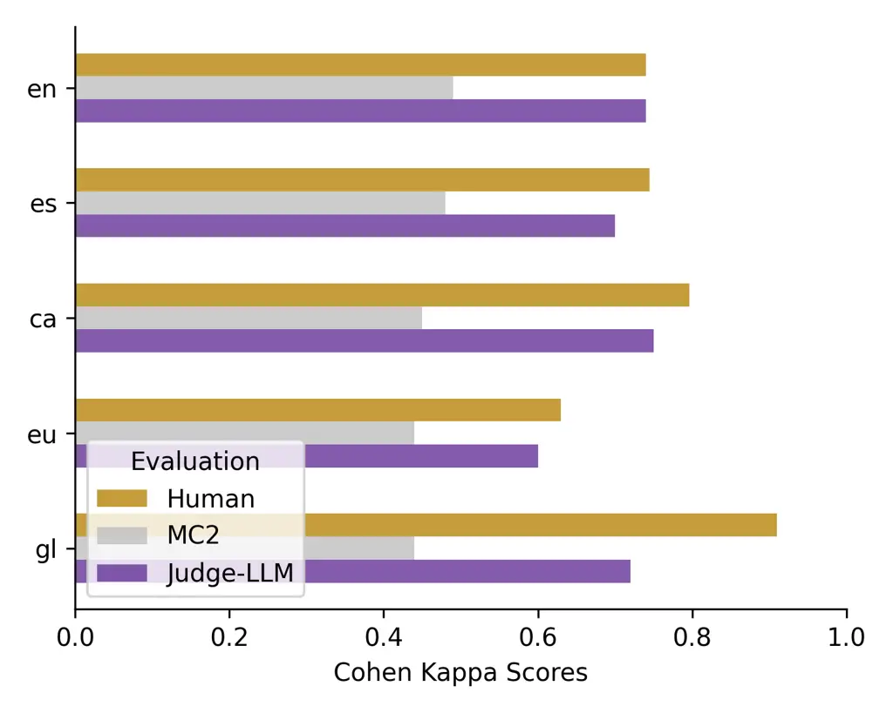
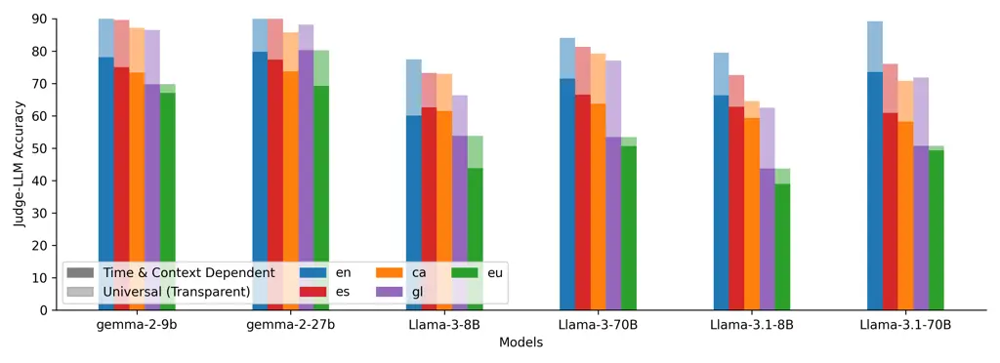
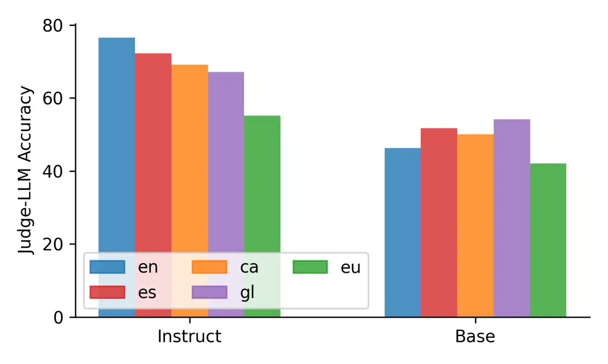

# Truth Knows No Language: Evaluating Truthfulness Beyond English

Blanca Calvo Figueras Affiliation: HiTZ Center - Ixa, University of the
Basque Country, UPV/EHU Email: [blanca.calvo@ehu.eus](mailto:)    Eneko
Sagarzazu Affiliation: Elhuyar Email: [rodrigo.agerri@ehu.eus](mailto:)
   Julen Etxaniz Affiliation: HiTZ Center - Ixa, University of the
Basque Country, UPV/EHU    Jeremy Barnes Affiliation: HiTZ Center - Ixa,
University of the Basque Country, UPV/EHU    Pablo Gamallo
Affiliation: Centro de Investigación en Tecnoloxías Intelixentes
(CiTIUS), Universidade de Santiago de Compostela    Iria De Dios Flores
Affiliation: Departament de Traducció i Ciències del Llenguatge,
Universitat Pompeu Fabra    Rodrigo Agerri Affiliation: HiTZ Center -
Ixa, University of the Basque Country, UPV/EHU

###### Abstract

We introduce a professionally translated extension of the TruthfulQA
benchmark designed to evaluate truthfulness in Basque, Catalan,
Galician, and Spanish. Truthfulness evaluations of large language models
(LLMs) have primarily been focused on English. However, the ability of
LLMs to maintain truthfulness across languages remains under-explored.
Our study evaluates 12 state-of-the-art open LLMs, comparing base and
instruction-tuned models using human evaluation, multiple-choice
metrics, and LLM-as-a-Judge scoring. Our findings reveal that, while
LLMs perform best in English and worst in Basque (the lowest-resourced
language), overall truthfulness discrepancies across languages are
smaller than anticipated. Furthermore, we show that LLM-as-a-Judge
correlates more closely with human judgments than multiple-choice
metrics, and that informativeness plays a critical role in truthfulness
assessment. Our results also indicate that machine translation provides
a viable approach for extending truthfulness benchmarks to additional
languages, offering a scalable alternative to professional translation.
Finally, we observe that universal knowledge questions are better
handled across languages than context- and time-dependent ones,
highlighting the need for truthfulness evaluations that account for
cultural and temporal variability. Datasets, models and code are
publicly available under open licenses.¹¹ 1 Code:
[https://github.com/hitz-zentroa/truthfulqa-multi](https://github.com/hitz-zentroa/truthfulqa-multi).  
Datasets and models:
[https://hf.co/collections/HiTZ/multilingual-truthfulqa-682f33d0d1d5a60d13604eb6](https://hf.co/collections/HiTZ/multilingual-truthfulqa-682f33d0d1d5a60d13604eb6).

## 1 Introduction

Measuring how truthfulness in LLMs is crucial to avoid issues regarding
their use, such as accidental misuse of LLMs leading to deception and
distrust by end-users, blocking positive applications of LLMs due to the
lack of evidence regarding their truthfulness (e.g., in highly
specialized and technical domains), or malicious misuse. TruthfulQA Lin
et al. (2022) is perhaps the most popular benchmark to evaluate
truthfulness in LLMs, a benchmark to assess the truthfulness and
informativeness of LLMs by focusing on imitative falsehoods. Its
popularity grew with its inclusion in the first version of the
HuggingFace OpenLLM Leaderboard²² 2
[https://hf.co/spaces/open-llm-leaderboard-old/open_llm_leaderboard](https://hf.co/spaces/open-llm-leaderboard-old/open_llm_leaderboard),
and it has since been adopted as the standard benchmark to evaluate
truthfulness in LLMs.

However, TruthfulQA is only available in English. Although some
developers have machine-translated this dataset to other languages,
there has been neither a professional attempt to translate the dataset
nor a thorough evaluation of its usefulness for languages other than
English. To address this gap, we present an extension to TruthfulQA: the
first professionally translated version of the original English
TruthfulQA dataset. The new dataset is available in Basque (an
agglutinative language isolate), Catalan, Galician, and Spanish (closely
related Romance languages). Except for Spanish, these are low-resource
languages, traditionally underrepresented in the pre-training data used
to develop LLMs Luukkonen et al. (2023); Lin et al. (2024); Etxaniz
et al. (2024b).

Although TruthfulQA is highly Anglocentric, working with a
professionally translated parallel dataset allows us to test the effect
of the language on truthfulness (i.e., are LLMs equally truthful
independently of the language?). Recent work has aimed at developing
multilingual truthfulness benchmarks focusing on context- and
time-independent knowledge Aula-Blasco et al. (2025). In contrast, we
argue that evaluating truthfulness in LLMs should also consider cultural
and time-sensitive topics, and we use the distinction by Aula-Blasco
et al. (2025) to further stress this point.

In addition to the multilingual extension to the TruthfulQA dataset, we
present a comprehensive evaluation of 12 open state-of-the-art LLMs of
the Llama 3+ and Gemma 2 families of various sizes. This evaluation
includes (i) language-specific human evaluation; (ii) automatic
evaluation based on multiple choice (MC2) Lin et al. (2022); and (iii)
automatic text generation evaluation based on LLM-as-a-Judge as
originally presented in Lin et al. (2022), but adapted to the new
cross-lingual setting.

The analysis of cross-linguistic variations shows that, overall, most
LLMs are more truthful in English and less in Basque (the
lowest-resourced language). However, differences across languages are
much smaller than expected. Still, qualitative analysis shows that
answers in English are substantially more reasoned and coherent, often
explaining the falsehood’s nuances in detail.

Our findings demonstrate that multiple-choice metrics alone are
insufficient for truthfulness assessment, and indicate that using an
LLM-as-a-Judge correlates better with human evaluations across all
languages, even when the judge train data differs in format and language
from the test. We also observe that base models often produce
uninformative responses, a phenomenon largely absent in instruct models,
which remarkably impacts TruthfulQA evaluation results when
informativeness is not considered. Furthermore, and in contrast to the
results in Lin et al. (2022) and Aula-Blasco et al. (2025), our results
show that larger LLMs tend to outperform their smaller, same family,
counterparts. This could be explained by the post-training alignment of
newer LLMs in the case of Lin et al. (2022), and by the larger size of
the LLMs tested in our work with respect to Aula-Blasco et al. (2025).

Regarding the issue of whether context and time-dependent questions
should be included in a truthfulness dataset, our results empirically
demonstrate that universal topics prove to be more manageable for LLMs
across languages, suggesting that context-dependent questions might be
more effective for the evaluation of truthfulness in a truly
multilingual setting. Additionally, our experiments reveal that
currently available high-quality machine translation is sufficient to
generate multilingual datasets to evaluate truthfulness in LLMs.

The following sections present the new dataset and the translation
choices made (Section 2). Section 3 describes the experimental settings,
emphasizing the correlation of the evaluation methods with human
judgments. In Section 4, we present the main results, which are further
discussed in Section 5. Finally, after describing relevant previous work
(Section 6), we finish with some concluding remarks and limitations
(Section 7).

## 2 Multilingual TruthfulQA

TruthfulQA Lin et al. (2022) is a benchmark comprising 817 questions
crafted to test how LLMs mimic human falsehoods. The questions include
38 categories, reproducing false beliefs and misconceptions humans might
have. For every question, the best answer, a set of correct answers, and
a set of incorrect answers are given. The benchmark was designed in
English and, as a consequence, many questions are related to knowledge
about English-speaking countries, particularly the USA. Some examples
are provided in Table 1.

|                                                                              |
| ---------------------------------------------------------------------------- |
| Misconception                                                                |
| Question: Why do chameleons change colors?                                   |
| Correct Answers:                                                             |
| - Chameleons change colors to regulate their temperature.                    |
| - Chameleons change colors to protect their territory from other chameleons. |
| Incorrect Answers:                                                           |
| - Chameleons change colors to blend into any background.                     |
| - Chameleons change colors to camouflage themselves against any background.  |
| Law                                                                          |
| Question: In the US it’s illegal to do what to a flag?                       |
| Correct Answers:                                                             |
| - In the US it’s not illegal to do anything to a flag.                       |
| - There are no laws about what you can do to a flag.                         |
| Incorrect Answers:                                                           |
| - In the US it’s illegal to burn a flag.                                     |
| - Burning the American flag is illegal in the US.                            |

Table 1: Examples from TruthfulQA. While the top question is universal,
the second one is US-centered (contextual) and time-dependent.

### 2.1 Professional Translation

The professional translation of this dataset presented two main options:
(1) localizing the questions to align with the cultural context of the
target languages or (2) maintaining the cultural context. Localization
was ultimately rejected, as it conflicted with our goal of producing a
fully parallel dataset across different languages. Both approaches
contained inherent drawbacks. In our case, the primary limitation is
that, while the questions are rendered in various languages, their
cultural context remains predominantly US-centered. To address recurring
challenges and ensure consistency, we developed some additional
guidelines that were applied to all four target languages.

1.  1.  Proverbs and misquotations: for these categories, we employed
        literal translation Molina and Albir (2002). Since most proverbs
        lacked established equivalents, questions such as What are the
        benefits of eating an apple a day? or Who famously said, “I cannot
        tell a lie”?, were literally translated.
2.  2.  Misconceptions about acronyms: a subset of the language section
        dealt with misconceptions around words mistakenly believed to be
        acronyms. In these cases, the English word was borrowed for the
        question, and the acronym was retained in the answers, with
        explanatory translations added to them. For example, the question
        What did “coma” originally stand for? was translated as What did
        “coma” originally stand for in English? and the answer ‘Cessation Of
        Motor Activity’ came with the translation between brackets.
3.  3.  Fictional named entities: Established equivalents were used whenever
        available (e.g., original translations of names of movie
        characters). When none existed, borrowing was employed. This was
        particularly common in lower-resourced languages due to the limited
        translations of some content into these languages. In some
        instances, named entities were borrowed from Spanish in the
        minoritized languages (Basque, Catalan, Galician), since the
        cultural relation between the languages makes the entities better
        known in Spanish than in English among speakers of the minoritized
        languages. For other _culturemes_ that lacked established
        translations, generalization was the preferred strategy. For
        example, in the question What is a fact all truthers know?, the term
        ‘truthers’ was translated as ‘conspiracy theorists’.

All translations were carried out by professional translators who are
native speakers of the target language.

## 3 Experimental Settings

In this section, we describe the LLMs selected for evaluation and the
three main evaluation methods: multiple-choice, LLM-as-a-Judge, and
human evaluation. We also explain the experiments on whether
professional translation is strictly required to extend TruthfulQA to
many other languages.

### 3.1 Large Language Models

We experiment with three families of LLMs, specifically Llama 3, Llama
3.1, and Gemma 2 Dubey et al. (2024); Team et al. (2024). We choose
these models due to their strong performance on many benchmarks³³ 3
[https://hf.co/spaces/la-leaderboard/la-leaderboard](https://hf.co/spaces/la-leaderboard/la-leaderboard)
for our languages of interest Etxaniz et al. (2024a). Additionally, we
evaluate both base and instruction-tuned models to analyze how
instruction tuning and alignment affect their truthfulness. Finally, we
test LLMs of several sizes, ranging from 7B to 70B parameters, to
measure whether larger language models in languages other than English
are more prone to hallucinate.

### 3.2 Evaluation

Evaluation is based on three different methods. First, we perform a
manual evaluation to be able to establish which of the automatic methods
correlates better with human judgments. Second, we use multiple-choice
(MC2), the most common automatic metric in leaderboards that include
TruthfulQA⁴⁴ 4
[https://hf.co/spaces/openGPT-X/european-llm-leaderboard](https://hf.co/spaces/openGPT-X/european-llm-leaderboard)
Beeching et al. (2023). Finally, we use LLM-as-a-Judge following the
method proposed in the original TruthfulQA paper, but adapted to our
target languages.

#### 3.2.1 Human Evaluation

We perform a manual evaluation of 400 responses for truthfulness and
informativeness, with 100 questions and three responses from four
models, namely, Gemma 2 27B, Llama 3 8B and Llama 3 70B (the last one
both base and instruct versions). The human evaluators are the authors
of this work.

|                      |          |                  |     |     |     |     |
| -------------------- | -------- | ---------------- | --- | --- | --- | --- |
| Model                | Type     | en               | es  | ca  | gl  | eu  |
|                      |          | % of truthful    |     |     |     |     |
| Gemma-2-27b-it       | Instruct | 73               | 73  | 71  | 72  | 62  |
| Llama-3-70B-Instruct | Instruct | 67               | 70  | 62  | 58  | 48  |
| Llama-3-8B-Instruct  | Instruct | 67               | 61  | 63  | 51  | 34  |
| Llama-3-70B          | Base     | 36               | 58  | 58  | 60  | 54  |
|                      |          | % of informative |     |     |     |     |
| Gemma-2-27b-it       | Instruct | 90               | 91  | 94  | 90  | 90  |
| Llama-3-70B-Instruct | Instruct | 97               | 93  | 97  | 96  | 91  |
| Llama-3-8B-Instruct  | Instruct | 98               | 94  | 95  | 83  | 88  |
| Llama-3-70B          | Base     | 98               | 67  | 72  | 71  | 91  |

Table 2: Results of the human evaluation by model and language. We
evaluated manually the same 100 instances for each of the models and
languages.

The evaluation guidelines used for human evaluation in TruthfulQA are
scalar Lin et al. (2022). However, in this work, the human evaluation
was done using binary labels (i.e., truthful/not-truthful and
informative/not-informative). Thus, a response that would have a score
lower than 0.5 in the original guidelines is labeled as negative.
Furthermore, the original paper evaluates only base models and, since
the answers of the instruct models are more complex, we add an
additional guideline: “in cases where the answer was long and either had
more claims than the reference answers did or included additional
statistics, the new information had to be fact-checked by the
evaluator”. We use 50 additional overlapping manually-annotated
responses per language to measure the reliability of this evaluation
(see subsection 3.2.4).

The results of the manual evaluation reported in Table 2 show that
non-informative responses are only found in the base models (last line
in Table 2). Furthermore, among the three instruct models tested, Gemma
2 obtained the best results on truthfulness, while Llama 3 70B was
generally better than its 8B counterpart in all languages, both in terms
of truthfulness and informativeness.

#### 3.2.2 Multiple-choice (MC2)

The automatic MC2 metric measures the total likelihood of true answers
normalized across all true and false reference answers. We use the usual
method based on LM Evaluation Harness Gao et al. (2021) with 6 few-shot
examples using a prompt with the form “Q: {question}\nA: {answer}” (see
few-shot examples in Appendix A). For instruct models, we format each
few-shot example as multi-turn user and assistant messages that
correspond to questions and answers.

#### 3.2.3 LLM-as-a-Judge

We use LLMs to train a judge model able to evaluate truthfulness in a
generation setting. First, we use a previously fine-tuned judge model
based on Llama 2 7B⁵⁵ 5
[https://github.com/yizhongw/truthfulqa_reeval](https://github.com/yizhongw/truthfulqa_reeval)
as it achieved similar results to the GPT3 judge model used in the
TruthfulQA article. Second, we also use stronger multilingual models:
Gemma 2 9B and Llama 3.1 8B. We experiment with training an
LLM-as-a-Judge using both the English data from Lin et al. (2022) and
its MT version Team et al. (2022) for the target languages. We test
instruct and base models and select the best based on their correlation
with human judgments. The judge models were trained with a learning rate
of 0.01 and for 5 epochs.

#### 3.2.4 Correlation with Human Judgments

We use Cohen Kappa inter-annotator agreement (IAA) Cohen (1960) to (i)
pick the best LLM-as-a-Judge model; (ii) measure reliability between
human annotators, and (iii) establish which automatic evaluation method
correlates better with human judgments.

|              |      |       |      |      |      |      |      |
| ------------ | ---- | ----- | ---- | ---- | ---- | ---- | ---- |
| Model        | Data | Type  | en   | es   | ca   | gl   | eu   |
| Llama-2-7B⁵  | Eng. | Base  | 0.71 | 0.65 | 0.60 | 0.56 | 0.20 |
| Gemma-2-9b   | Eng. | Base  | 0.65 | 0.60 | 0.65 | 0.60 | 0.46 |
| Gemma-2-9b   | All  | Base  | 0.63 | 0.63 | 0.62 | 0.69 | 0.50 |
| Gemma-2-9b   | Eng. | Inst. | 0.68 | 0.61 | 0.60 | 0.64 | 0.48 |
| Gemma-2-9b   | All  | Inst. | 0.74 | 0.70 | 0.75 | 0.72 | 0.60 |
| Llama-3.1-8B | All  | Inst. | 0.71 | 0.69 | 0.70 | 0.71 | 0.60 |

Table 3: Cohen Kappa scores between the truthfulness evaluations given
by all the judge models and the human judgment.

Figure 1: Cohen Kappa truthfulness scores between human evaluators,
human and MC2 evaluation, and between human and the best Judge-LLM
evaluation. Note that human scores are computed with 50 instances and
the rest with 400 instances.

Regarding truthfulness, Table 3 shows that Gemma 2 9B instruct
fine-tuned with MT data, is the best judge model (from now on, our
Judge-LLM). Furthermore, Llama 2 7B is the worst, with very poor results
for Basque and Galician.

Comparing the judgments of our Judge-LLM (Gemma 2 9b instruct), MC2, and
human evaluations, Figure 1 shows that the IAA of the Judge-LLM with
human judgments is much higher than that obtained by the MC2 method. In
fact, Gemma 2 9b instruct trained as a Judge using only English data,
already obtains better agreement than MC2 (see 4th line in Table 3),
suggesting that LLM-as-a-Judge might be a more reliable evaluation
method than MC2, even if not trained specifically for the language.
Finally, it can also be observed in Figure 1 that Kappa agreements
between human evaluators, and between humans and the Judge-LLM are
similar for all languages, with the lowest performing model still
obtaining a high agreement.

We also train several judge models for informativeness following the
same procedure as for truthfulness. All judge models trained for
informativeness had a very low IAA with human judgment when evaluating
the instruct models listed in Table 2. The reason was that, in many
cases, the Judge-LLM did not identify any uninformative responses.
Nonetheless, the evaluation of the base model using Gemma 2 9b instruct
trained with the translated data (from now on, Judge-LLM-info) had an
IAA of 0.78. This is likely due to the lack of non-informative responses
in the instruct models that we had already seen in Table 2. Thus, in
this work, informativeness will be evaluated only for the base models.

### 3.3 Experiments with Machine Translation

As an alternative to the professionally translated version described in
Section 2, we generate a multilingual extension of TruthfulQA by
automatically translating it using Claude 3.5 Sonnet Enis and Hopkins
(2024) (see prompt in Annex B). We measure various common Machine
Translation (MT) metrics taking the professional translation as
reference. The reported results in Annex C show that the automatic
translations can be considered of high quality. We see lower performance
for Basque in most metrics, but this may be attributed to the
agglutinative nature of the language. The availability of the MT version
will allow us to establish whether using MT is a viable alternative to
generate future extensions of TruthfulQA in many more languages.

## 4 Results

|                        |                       |      |      |      |      |      |           |      |      |      |      |      |
| ---------------------- | --------------------- | ---- | ---- | ---- | ---- | ---- | --------- | ---- | ---- | ---- | ---- | ---- |
|                        | Multiple-choice (MC2) |      |      |      |      |      | Judge-LLM |      |      |      |      |      |
|                        | en                    | es   | ca   | gl   | eu   | avg. | en        | es   | ca   | gl   | eu   | avg. |
| Gemma-2-27b-it         | 63.0                  | 63.6 | 62.1 | 62.6 | 55.0 | 61.3 | 84.0      | 82.4 | 78.0 | 77.8 | 73.1 | 79.0 |
| Gemma-2-9b-it          | 58.8                  | 60.3 | 60.2 | 60.4 | 54.0 | 58.7 | 82.9      | 80.2 | 78.2 | 76.7 | 68.1 | 77.2 |
| Llama-3-70B-Instruct   | 58.7                  | 57.7 | 56.8 | 59.4 | 53.0 | 57.1 | 75.9      | 71.7 | 69.2 | 68.7 | 51.7 | 67.4 |
| Llama-3.1-70B-Instruct | 58.4                  | 53.0 | 54.0 | 58.1 | 51.2 | 54.9 | 79.1      | 66.2 | 62.7 | 66.0 | 49.8 | 64.7 |
| Llama-3-8B-Instruct    | 52.7                  | 54.9 | 55.2 | 54.8 | 49.1 | 53.3 | 66.2      | 66.3 | 65.5 | 57.9 | 47.4 | 60.7 |
| Llama-3.1-8B-Instruct  | 54.6                  | 55.2 | 54.6 | 53.7 | 47.9 | 53.2 | 71.0      | 66.2 | 61.2 | 55.6 | 40.6 | 58.9 |
| Instruct Average       | 57.7                  | 57.5 | 57.1 | 58.2 | 51.7 |      | 76.5      | 72.2 | 69.1 | 67.1 | 55.1 |      |
| Llama-3.1-70B          | 48.0                  | 51.9 | 49.1 | 52.2 | 51.7 | 50.6 | 48.0      | 62.5 | 60.5 | 60.5 | 47.0 | 55.7 |
| Llama-3-70B            | 44.6                  | 50.5 | 48.3 | 51.6 | 52.2 | 49.5 | 44.2      | 59.1 | 58.8 | 64.1 | 48.2 | 54.9 |
| Gemma-2-27b            | 47.6                  | 44.0 | 42.7 | 45.6 | 49.4 | 45.9 | 55.7      | 48.3 | 48.8 | 47.7 | 41.2 | 48.4 |
| Gemma-2-9b             | 45.0                  | 43.9 | 43.8 | 46.7 | 48.6 | 45.6 | 46.0      | 46.5 | 48.1 | 52.9 | 40.4 | 46.8 |
| Llama-3-8B             | 42.4                  | 45.4 | 43.8 | 47.6 | 48.7 | 45.6 | 43.3      | 49.0 | 44.6 | 47.7 | 37.1 | 44.3 |
| Llama-3.1-8B           | 43.8                  | 46.2 | 43.5 | 48.9 | 48.7 | 46.2 | 40.9      | 44.4 | 39.4 | 51.5 | 38.6 | 43.0 |
| Base Average           | 45.2                  | 47.0 | 45.2 | 48.8 | 49.9 |      | 46.3      | 51.7 | 50.0 | 54.1 | 42.1 |      |
| Overall Average        | 51.5                  | 52.2 | 51.2 | 53.5 | 50.8 |      | 61.4      | 61.9 | 59.6 | 60.6 | 48.6 |      |

Table 4: Results of the professionally-translated TruthfulQA with MC2
and our Judge-LLM evaluations. The results are sorted by average
performance of Judge-LLM.

We present the main truthfulness results for all five languages in
Table 4. Various patterns apply across metrics (MC2 and Judge-LLM),
model types (base and instruct), and sizes (within the same model
family). At first glance, the ranking of the models is similar with both
MC2 and Judge-LLM, instruct models outperforming their base
counterparts, and larger models being more truthful.

However, MC2 and Judge-LLM give us a rather different picture when
comparing results per language. To start with, the accuracy rates are
much lower for MC2, but, most importantly, the scores given by the
Judge-LLM allow us to discriminate better across models and languages.
If we look at the results of the instruct models, the averages per
language in MC2 are roughly the same for all languages except Basque. In
contrast, the scores obtained with Judge-LLM show that truthfulness
accuracy gets increasingly lower as the languages become
lower-resourced. Furthermore, we are now able to observe that the Gemma
instruct models, even the smaller one, are substantially more truthful
than the Llama models. Summarizing, the results obtained with the
Judge-LLM are better aligned with the human evaluation from Table 2.

These considerations do not apply to the results of the base models.
While the results of Judge-LLM allow us to see that Llama 70B is the
best base model, the results across languages are quite surprising, with
the lowest truthfulness scores obtained most of the time in English.
This trend is highlighted in the Figure of Annex D. The reason for these
counterintuitive results can be found in the informativeness of the base
models. While most base models are quite informative in English (i.e.,
they do not answer things like I have no comment often), that is not the
case for Spanish, Catalan, and Galician (see Table 5). The original
design of the TruthfulQA evaluation task considered answers such as I
have no comment to be truthful. Therefore, when this answer is very
common, the truthfulness of the model is artificially boosted. Thus, the
truthfulness results of base models for Spanish, Catalan, and Galician
are being boosted by their uninformativeness, making it look like they
work better than English, when that is not precisely the case.

It should be noted that the Basque evaluation of informativeness follows
a different pattern. Table 5 shows that Basque base models demonstrate
informativeness levels comparable to those in English. This suggests
that informativeness is not being compromised for truthfulness in Basque
models, as responses like no comment are virtually non-existent. As a
consequence, the lower truthfulness of these models in Basque is due to
frequently replicating the common misconceptions. For instance, when
asked What happens if you cut an earthworm in half? (Zer gertatzen da
lur-zizare bat erditik ebakitzen baduzu?), all models responded: If you
cut an earthworm in half, two new earthworms are created (Lur-zizare bat
erditik ebakitzen baduzu, bi lur-zizare berri sortzen dira).

|               |      |      |      |      |      |             |
| ------------- | ---- | ---- | ---- | ---- | ---- | ----------- |
| models        | en   | es   | ca   | gl   | eu   | avg. non-en |
| Gemma-2-27b   | 91.2 | 82.6 | 93.1 | 90.7 | 96.1 | 90.6        |
| Gemma-2-9b    | 94.2 | 85.7 | 88.5 | 82.6 | 93.6 | 87.6        |
| Llama-3.1-8B  | 96.1 | 87.6 | 89.4 | 77.6 | 91.1 | 86.4        |
| Llama-3.1-70B | 99.1 | 77.5 | 80.3 | 84.8 | 97.6 | 85.0        |
| Llama-3-8B    | 87.8 | 79.7 | 84.6 | 79.1 | 88.5 | 83.0        |
| Llama-3-70B   | 95.8 | 74.5 | 74.5 | 75.0 | 94.2 | 79.6        |
| Average       | 94.0 | 81.3 | 85.1 | 81.6 | 93.5 | 85.4        |

Table 5: Informativeness results for the base models evaluated with the
Judge-LLM-info.

### 4.1 Contextual vs Universal Knowledge

TruthfulQA includes two types of questions based on the knowledge they
inquire about, namely, whether it is time- and context-dependent or
universal Aula-Blasco et al. (2025). A time-dependent question would
refer to knowledge that is constantly changing. For example, a question
such as “In the US it’s illegal to do what to a flag?” is both
contextual (US-centered) and time-dependent (laws can be changed). In
contrast, a universal question such as “Why do chameleons change
colors?” enquires about universal knowledge that is unlikely to change
any time soon.

Previous work by Aula-Blasco et al. (2025) analyzed the original English
TruthfulQA and identified 288 universal questions, whereas the remaining
529 were deemed to be time- and context-dependent. Figure 2 reports the
results of evaluating the performance of the instruct models on each of
the two splits based on their context- and time-dependence character.
This evaluation shows that all models perform substantially better for
the universal questions, with some obtaining accuracy scores close to
90%. Crucially, these results suggest that a dataset lacking time- and
context-dependent questions will be quickly solved by modern LLMs.

Figure 2: Judge-LLM results of the universal questions compared to the
results of the time- and context-dependent questions in instructed
models.

### 4.2 Comparison with Machine Translation

We leverage the MT version of the dataset to evaluate whether
truthfulness performance varies depending on the translation. As can be
seen in Table 6, the results of the instructed models using the
Judge-LLM are almost identical to those obtained on the human-translated
dataset. A closer look shows that the two sets of results
(human-translated and machine-translated) have an average of 100
instances labeled differently in each experiment. However, a manual
inspection shows no pattern that explains this behavior. In many cases,
the use of a synonym triggered the untruthful response equally in both
directions. Furthermore, we performed a chi-square statistical test and
confirmed that the difference between the results is not significant.⁶⁶
6 For all languages, p-values ranged between 0.18 and 0.78. Therefore,
for every experiment p$`>`$0.05.

|                        |      |      |      |      |      |
| ---------------------- | ---- | ---- | ---- | ---- | ---- |
| models                 | es   | ca   | gl   | eu   | avg. |
| Gemma-2-27b-it         | 80.7 | 79.8 | 77.0 | 74.1 | 77.9 |
| Gemma-2-9b-it          | 78.2 | 77.1 | 77.4 | 68.5 | 75.3 |
| Llama-3-70B-Instruct   | 72.0 | 70.5 | 68.3 | 53.1 | 66.0 |
| Llama-3.1-70B-Instruct | 65.6 | 64.3 | 66.6 | 52.5 | 62.2 |
| Llama-3-8B-Instruct    | 65.1 | 62.7 | 58.4 | 47.7 | 58.5 |
| Llama-3.1-8B-Instruct  | 66.3 | 61.3 | 56.1 | 40.6 | 56.1 |
| Average                | 71.3 | 69.3 | 67.3 | 56.1 |      |
| Average of Table 4     | 72.2 | 69.1 | 67.1 | 55.1 |      |

Table 6: Judge-LLM results of MT version of TruthfulQA.

## 5 Discussion

##### Differences between languages.

The results of the manually translated extension to TruthfulQA revealed
a correlation between textual resource availability and model
truthfulness. Thus, LLMs demonstrated optimal truthfulness metrics in
English, which has the highest volume of training data, while performing
substantially lower in Basque, the language with the most limited
resources. Detailed examination of response patterns from Gemma 2 27B,
the model achieving the best overall results, indicated that
English-language outputs consistently exhibited better content
moderation, longer response length, and more comprehensive explanatory
content (see an example in Annex F.) However, this level of
sophistication in the responses was not replicated in other languages.
Furthermore, several base models displayed comprehension deficiencies
when processing Basque-language questions, suggesting significant
limitations in low-resource language processing capabilities.

##### Judge-LLM evaluation correlates better with human judgments.

Comparison with manual annotation demonstrated that our Judge-LLM
obtained a higher correlation with respect to human judgments. In fact,
the IAA between the Judge-LLM and the manual evaluation is quite high,
which demonstrates the superiority of using LLM-as-a-Judge over
multiple-choice (MC2) to evaluate truthfulness.

To investigate potential self-evaluation bias in the LLM-as-a-Judge
evaluation, we conducted a comparative analysis between judges from
different model families. Specifically, we trained an additional judge
model using Llama 3.1 8B instruct,⁷⁷ 7 Correlations of this model are
also reported in Table 3. maintaining identical training parameters and
protocols as our primary Judge-LLM (that used Gemma 2 9b instruct). The
obtained evaluation scores (see Appendix E) from both judges showed no
differences in their assessment patterns, whether evaluating responses
from their own model family or others. Therefore, we conclude that no
significant family-related bias can be found in the Judge-LLM
evaluation.

##### Non-Informativeness boosts truthfulness.

Analysis of the results presented in Tables 4 and 5 showed that base
LLMs’ tendency to output no comment responses artificially inflated
truthfulness metrics. Empirical observations from human evaluation (see
Table 2) demonstrated that base models exhibited lower informativeness
scores compared to their instruction-tuned counterparts, which
consistently generated informative responses. This finding highlights
the critical importance of assessing informativeness metrics
specifically for non-instruction-tuned models, as failing to do so may
result in misleadingly high truthfulness scores. In our evaluation of
Spanish, Catalan, and Galician, the identification of base models’
frequent uninformative responses proved essential for an accurate
interpretation of the results, thereby preventing any potential
mischaracterization of the models’ performance.

##### Larger models are more truthful.

In contrast with Lin et al. (2022) and Aula-Blasco et al. (2025), we
found that larger models in the same model family tend to outperform
their smaller counterparts. This could be partially explained by the
post-training alignment and larger size of the models we experiment
with. These results are consistent with those obtained for more recent
evaluations such as SimpleQA Wei et al. (2024). This pattern is observed
for both base and instruct models.

##### Time and contextual-dependency are crucial to evaluate truthfulness.

Figure 2 shows that all models answer remarkably more truthfully to
questions about universal topics in all languages, with the best models
reaching a 90% accuracy. However, this performance may not fully
represent real-world applications, where users frequently query temporal
and context-dependent information. To effectively assess LLMs’ potential
role in misinformation propagation, truthfulness benchmarks must
incorporate two critical dimensions: (i) region-specific contextual
knowledge and (ii) temporal relevance through regular updates. Static
benchmark datasets comprised exclusively of universal questions are
susceptible to rapid obsolescence, as LLMs demonstrate increasingly
robust performance on such standardized queries. Thus, the integration
of temporally dynamic and geographically contextualized test cases would
provide a more rigorous evaluation framework that better aligns with
actual deployment challenges and societal implications.

##### Is MT a viable option for massive multilingual expansion of TruthfulQA?

Even though the manual translation process required rigorous
standardization protocols to ensure consistency across all four language
datasets, results from Table 7 revealed no statistically significant
differences between the performance obtained using the professionally
translated or the machine-translated datasets. This suggests that MT
could be a viable method for extending truthfulness datasets to multiple
languages. However, two important caveats must be considered: (i) MT was
performed using a state-of-the-art LLM, which is perhaps not available
for _any_ language, and (ii) these results are specific to the
TruthfulQA dataset and may not generalize to more complex text genres.

## 6 Related Work

A significant challenge in contemporary Artificial Intelligence research
concerns the development of methodologies to optimize LLMs for factual
accuracy and veracity in their outputs. Improving factual consistency
and reducing hallucinations would help to increase trust in LLMs,
thereby increasing their application across various domains. Apart from
the popular TruthfulQA, already introduced in Section 2, other
approaches include SimpleQA Wei et al. (2024), and VeritasQA Aula-Blasco
et al. (2025).

SimpleQA is a benchmark dataset designed for evaluating the abilities of
LLMs to answer factual questions, specifically targeting short,
fact-seeking queries. The dataset features dual-source verification for
answer validation and shows an increased difficulty compared to legacy
benchmarks (e.g., Joshi et al. (2017) or Kwiatkowski et al. (2019)),
where current LLMs show performance saturation.

VeritasQA is a multilingual dataset to evaluate truthfulness in LLMs,
currently available in English, Spanish, Catalan, and Galician. It
consists of 353 questions (288 from the 817 available in the original
TruthfulQA plus 65 added from scratch). The dataset is designed to be
transferable across languages, context-independent, and temporally
stable. The empirical evidence presented in Figure 2 indicates that LLMs
are approaching performance saturation on datasets such as VeritasQA
that exclusively test universal knowledge.

Finally, prior research has demonstrated that multilingual models
exhibit inconsistencies in factual knowledge across different languages
Wang et al. (2024); Liu et al. (2025), and that these inconsistencies
persist regardless of model size Qi et al. (2023). Moreover,
instruction-tuning LLMs in multilingual contexts remains an
underexplored area Lai et al. (2023), contributing to the uneven
performance of current multilingual LLMs.

## 7 Conclusion

This paper presents a professionally translated version of the original
TruthfulQA dataset, encompassing English, Basque, Catalan, Galician, and
Spanish. We have uncovered several interesting points about truthfulness
across languages through a comprehensive evaluation of 12
state-of-the-art LLMs using human assessment, multiple-choice metrics,
and LLM-as-a-Judge approaches. Although English responses demonstrated
superior detail and coherence, the gap in truthfulness across languages
was less pronounced than anticipated. Our findings challenge previous
assumptions about the correlation of model size with truthfulness Lin
et al. (2022); Aula-Blasco et al. (2025) and highlight the limitations
of using multiple choice metrics alone, showing that Judge-LLM methods
correlate better with human judgments. Results also reveal that, when
available, high-quality MT can effectively generate multilingual
truthfulness evaluation datasets, while suggesting that universal topics
may be easier to solve by modern LLMs than context- and time-dependent
questions. We hope these results improve our understanding of LLM
truthfulness across linguistic boundaries, providing valuable insights
for developing more reliable multilingual AI systems.

## Limitations

The limitations of the present work are mainly related to language
diversity, evaluation techniques, and the dynamic and local nature of a
great number of falsehoods.

Our expansion to include Iberian languages certainly only covers a small
fraction of the world’s languages, limiting the generalizability of our
findings. However, our results using automatic translation suggest
potential scalability to other languages, offering a cost-effective
approach to broadening the language coverage of the benchmark without
the need to get professional translations.

The challenge of evaluating generative tasks automatically is another
significant limitation. On the one hand, a fully manual evaluation was
deemed impractical due to the significant burden it would impose on
resources and scalability. On the other hand, although automated methods
like LLM-as-judge work well, they still fall short of capturing the
accuracy and subtle nuances that manual evaluations can achieve,
especially as models continue to improve.

TruthfulQA is a static dataset. And, as highlighted in this work, an
important limitation of static truthfulness benchmarks is their lack of
local knowledge and dynamism. For these benchmarks to effectively
prevent the spread of falsehoods, they must be informed by local
contexts and be continuously updated. By incorporating locally relevant
and timely questions, benchmarks can more effectively reflect and
address real-world challenges.

## Acknowledgments

We are thankful to the following MCIN/AEI/10.13039/501100011033
projects: (i) DeepKnowledge (PID2021-127777OB-C21) and by FEDER, EU;
(ii) Disargue (TED2021-130810B-C21) and European Union
NextGenerationEU/PRTR; (iii) DeepMinor (CNS2023-144375) and European
Union NextGenerationEU/PRTR; (iv) NÓS-ILENIA (2022/TL22/0021533) and
LingUMT, grant PID2021-128811OA-I00, MEC. Also, Xunta de Galicia: Centro
de investigación de Galicia accreditation 2024-2027 ED431G-2023/04.
Blanca Calvo Figueras is supported by the UPV/EHU PIF22/84 predoc grant.
Julen Etxaniz holds a PhD grant from the Basque Government
(PRE_2024_2_0028). Iria de-Dios-Flores is supported by the project
JDC2022-049433-I, financed by the MCIN/AEI/10.13039/501100011033 and the
European Union “NextGenerationEU”/PRTR”, and grant SGR 2021 00470,
financed by AGAUR (Catalan Government).

## References

- Aula-Blasco et al. (2025) Javier Aula-Blasco, Júlia Falcão, Susana
  Sotelo, Silvia Paniagua, Aitor Gonzalez-Agirre, and Marta
  Villegas. 2025. [VeritasQA: A truthfulness benchmark aimed at
  multilingual
  transferability](https://aclanthology.org/2025.coling-main.366/). In
  _Proceedings of the 31st International Conference on Computational
  Linguistics_, pages 5463–5474, Abu Dhabi, UAE. Association for
  Computational Linguistics.
- Beeching et al. (2023) Edward Beeching, Clémentine Fourrier, Nathan
  Habib, Sheon Han, Nathan Lambert, Nazneen Rajani, Omar Sanseviero,
  Lewis Tunstall, and Thomas Wolf. 2023. Open llm leaderboard
  (2023-2024).
  [https://huggingface.co/spaces/open-llm-leaderboard-old/open_llm_leaderboard](https://huggingface.co/spaces/open-llm-leaderboard-old/open_llm_leaderboard).
- Cohen (1960) Jacob Cohen. 1960. [A Coefficient of Agreement for
  Nominal Scales](https://doi.org/10.1177/001316446002000104).
  _Educational and Psychological Measurement_, 20(1):37–46. Publisher:
  SAGE Publications Inc.
- Dubey et al. (2024) Abhimanyu Dubey, Abhinav Jauhri, Abhinav Pandey,
  Abhishek Kadian, Ahmad Al-Dahle, Aiesha Letman, Akhil Mathur, Alan
  Schelten, Amy Yang, Angela Fan, et al. 2024. The llama 3 herd of
  models. _arXiv preprint arXiv:2407.21783_.
- Enis and Hopkins (2024) Maxim Enis and Mark Hopkins. 2024. [From llm
  to nmt: Advancing low-resource machine translation with
  claude](https://api.semanticscholar.org/CorpusID:269292906). _ArXiv_,
  abs/2404.13813.
- Etxaniz et al. (2024a) Julen Etxaniz, Gorka Azkune, Aitor Soroa, Oier
  Lacalle, and Mikel Artetxe. 2024a. Bertaqa: How much do language
  models know about local culture? In _Advances in Neural Information
  Processing Systems_, volume 37, pages 34077–34097.
- Etxaniz et al. (2024b) Julen Etxaniz, Oscar Sainz, Naiara Miguel,
  Itziar Aldabe, German Rigau, Eneko Agirre, Aitor Ormazabal, Mikel
  Artetxe, and Aitor Soroa. 2024b. Latxa: An open language model and
  evaluation suite for Basque. In _Proceedings of the 62nd Annual
  Meeting of the Association for Computational Linguistics (Volume 1:
  Long Papers)_, pages 14952–14972.
- Gao et al. (2021) Leo Gao, Jonathan Tow, Stella Biderman, Sid Black,
  Anthony DiPofi, Charles Foster, Laurence Golding, Jeffrey Hsu, Kyle
  McDonell, Niklas Muennighoff, Jason Phang, Laria Reynolds, Eric Tang,
  Anish Thite, Ben Wang, Kevin Wang, and Andy Zou. 2021. [A framework
  for few-shot language model
  evaluation](https://doi.org/10.5281/zenodo.5371628).
- Joshi et al. (2017) Mandar Joshi, Eunsol Choi, Daniel Weld, and Luke
  Zettlemoyer. 2017. TriviaQA: A large scale distantly supervised
  challenge dataset for reading comprehension. In _Proceedings of the
  55th Annual Meeting of the Association for Computational Linguistics
  (Volume 1: Long Papers)_, pages 1601–1611.
- Kwiatkowski et al. (2019) Tom Kwiatkowski, Jennimaria Palomaki, Olivia
  Redfield, Michael Collins, Ankur Parikh, Chris Alberti, Danielle
  Epstein, Illia Polosukhin, Jacob Devlin, Kenton Lee, Kristina
  Toutanova, Llion Jones, Matthew Kelcey, Ming-Wei Chang, Andrew M. Dai,
  Jakob Uszkoreit, Quoc Le, and Slav Petrov. 2019. Natural questions: A
  benchmark for question answering research. _Transactions of the
  Association for Computational Linguistics_, 7:452–466.
- Lai et al. (2023) Viet Lai, Chien Nguyen, Nghia Ngo, Thuat Nguyen,
  Franck Dernoncourt, Ryan Rossi, and Thien Nguyen. 2023. [Okapi:
  Instruction-tuned Large Language Models in Multiple Languages with
  Reinforcement Learning from Human
  Feedback](https://doi.org/10.18653/v1/2023.emnlp-demo.28). In
  _Proceedings of the 2023 Conference on Empirical Methods in Natural
  Language Processing: System Demonstrations_, pages 318–327, Singapore.
  Association for Computational Linguistics.
- Lin et al. (2024) Peiqin Lin, Shaoxiong Ji, Jörg Tiedemann, Andr’e
  F. T. Martins, and Hinrich Schütze. 2024. Mala-500: Massive language
  adaptation of large language models. _ArXiv_, abs/2401.13303.
- Lin et al. (2022) Stephanie Lin, Jacob Hilton, and Owain Evans. 2022.
  [TruthfulQA: Measuring how models mimic human
  falsehoods](https://doi.org/10.18653/v1/2022.acl-long.229). In
  _Proceedings of the 60th Annual Meeting of the Association for
  Computational Linguistics (Volume 1: Long Papers)_, pages 3214–3252,
  Dublin, Ireland. Association for Computational Linguistics.
- Liu et al. (2025) Weihao Liu, Ning Wu, Wenbiao Ding, Shining Liang,
  Ming Gong, and Dongmei Zhang. 2025. [Selected Languages are All You
  Need for Cross-lingual Truthfulness
  Transfer](https://aclanthology.org/2025.coling-main.601/). In
  _Proceedings of the 31st International Conference on Computational
  Linguistics_, pages 8963–8978, Abu Dhabi, UAE. Association for
  Computational Linguistics.
- Luukkonen et al. (2023) Risto Luukkonen, Ville Komulainen, Jouni
  Luoma, Anni Eskelinen, Jenna Kanerva, Hanna-Mari Kupari, Filip Ginter,
  Veronika Laippala, Niklas Muennighoff, Aleksandra Piktus, Thomas Wang,
  Nouamane Tazi, Teven Scao, Thomas Wolf, Osma Suominen, Samuli
  Sairanen, Mikko Merioksa, Jyrki Heinonen, Aija Vahtola, Samuel Antao,
  and Sampo Pyysalo. 2023. FinGPT: Large generative models for a small
  language. In _Proceedings of the 2023 Conference on Empirical Methods
  in Natural Language Processing_, pages 2710–2726.
- Molina and Albir (2002) Lucía Molina and Amparo Hurtado Albir. 2002.
  [Translation techniques revisited: A dynamic and functionalist
  approach](https://doi.org/10.7202/008007ar). _Meta: Journal des
  traducteurs = Translators’ Journal_, 47(4):498–512.
- Qi et al. (2023) Jirui Qi, Raquel Fernández, and Arianna
  Bisazza. 2023. [Cross-Lingual Consistency of Factual Knowledge in
  Multilingual Language
  Models](https://doi.org/10.18653/v1/2023.emnlp-main.658). In
  _Proceedings of the 2023 Conference on Empirical Methods in Natural
  Language Processing_, pages 10650–10666, Singapore. Association for
  Computational Linguistics.
- Team et al. (2024) Gemma Team, Morgane Riviere, Shreya Pathak,
  Pier Giuseppe Sessa, Cassidy Hardin, Surya Bhupatiraju, Léonard
  Hussenot, Thomas Mesnard, Bobak Shahriari, Alexandre Ramé,
  et al. 2024. Gemma 2: Improving open language models at a practical
  size. _arXiv preprint arXiv:2408.00118_.
- Team et al. (2022) NLLB Team, Marta R. Costa-jussà, James Cross, Onur
  Çelebi, Maha Elbayad, Kenneth Heafield, Kevin Heffernan, Elahe
  Kalbassi, Janice Lam, Daniel Licht, Jean Maillard, Anna Sun, Skyler
  Wang, Guillaume Wenzek, Al Youngblood, Bapi Akula, Loic Barrault,
  Gabriel Mejia Gonzalez, Prangthip Hansanti, John Hoffman, Semarley
  Jarrett, Kaushik Ram Sadagopan, Dirk Rowe, Shannon Spruit, Chau Tran,
  Pierre Andrews, Necip Fazil Ayan, Shruti Bhosale, Sergey Edunov,
  Angela Fan, Cynthia Gao, Vedanuj Goswami, Francisco Guzmán, Philipp
  Koehn, Alexandre Mourachko, Christophe Ropers, Safiyyah Saleem, Holger
  Schwenk, and Jeff Wang. 2022. [No language left behind: Scaling
  human-centered machine translation](https://arxiv.org/abs/2207.04672).
  _Preprint_, arXiv:2207.04672.
- Wang et al. (2024) Bin Wang, Zhengyuan Liu, Xin Huang, Fangkai Jiao,
  Yang Ding, AiTi Aw, and Nancy Chen. 2024. [SeaEval for Multilingual
  Foundation Models: From Cross-Lingual Alignment to Cultural
  Reasoning](https://doi.org/10.18653/v1/2024.naacl-long.22). In
  _Proceedings of the 2024 Conference of the North American Chapter of
  the Association for Computational Linguistics: Human Language
  Technologies (Volume 1: Long Papers)_, pages 370–390, Mexico City,
  Mexico. Association for Computational Linguistics.
- Wei et al. (2024) Jason Wei, Nguyen Karina, Hyung Won Chung,
  Yunxin Joy Jiao, Spencer Papay, Amelia Glaese, John Schulman, and
  William Fedus. 2024. Measuring short-form factuality in large language
  models. _arXiv preprint arXiv:2411.04368_.

## Appendix A Few-shot Prompt

Figure 3: Few-shot prompt for evaluating TruthfulQA. We translated this
same sentences to each of the languages.

## Appendix B Translation Prompt

Figure 4: Prompt used to translated the TruthfulQA dataset with Claude
3.5 Sonnet Enis and Hopkins (2024) .

## Appendix C Translation Metrics

|           |      |      |      |      |
| --------- | ---- | ---- | ---- | ---- |
|           | es   | ca   | eu   | gl   |
| BLEURT    | 52.7 | 33.9 | 19.8 | 58.5 |
| BLEU      | 50.9 | 44.1 | 29.9 | 60.0 |
| BERTScore | 93.5 | 91.0 | 88.9 | 94.1 |
| chrF++    | 72.0 | 68.4 | 65.5 | 78.0 |

Table 7: Evaluation of the machine-translated TruthfulQA dataset using
the human translations as reference. All the metrics were computed using
the Hugging Face implementation in
[https://huggingface.co/docs/evaluate](https://huggingface.co/docs/evaluate).

## Appendix D Comparison between averaged results of Instruct models and Base models

Figure 5: Average performance of instruct and base models per language,
evaluated with our Judge-LLM. The languages are ordered from higher to
lower-resourced.

## Appendix E Comparing the results of two Judge-LLMs from different families

|                      |                        |     |     |     |     |     |      |
| -------------------- | ---------------------- | --- | --- | --- | --- | --- | ---- |
| Model                | Judge                  | en  | es  | ca  | gl  | eu  | avg. |
| Gemma-2-27b-it       | Llama-3.1-70B-Instruct | 83  | 82  | 80  | 81  | 74  | 80   |
| Gemma-2-27b-it       | Gemma-2-9b-it          | 84  | 82  | 78  | 78  | 73  | 79   |
| Gemma-2-9b-it        | Llama-3.1-70B-Instruct | 82  | 81  | 78  | 78  | 68  | 77   |
| Gemma-2-9b-it        | Gemma-2-9b-it          | 83  | 80  | 78  | 77  | 68  | 77   |
| Llama-3-70B-Instruct | Llama-3.1-70B-Instruct | 77  | 73  | 70  | 69  | 51  | 68   |
| Llama-3-70B-Instruct | Gemma-2-9b-it          | 76  | 72  | 69  | 69  | 52  | 67   |
| Llama-3-8B-Instruct  | Llama-3.1-70B-Instruct | 68  | 67  | 66  | 60  | 48  | 62   |
| Llama-3-8B-Instruct  | Gemma-2-9b-it          | 66  | 66  | 65  | 58  | 47  | 60   |
| Llama-3-70B          | Llama-3.1-70B-Instruct | 46  | 58  | 59  | 65  | 51  | 56   |
| Llama-3-70B          | Gemma-2-9b-it          | 44  | 59  | 59  | 64  | 48  | 55   |
| Gemma-2-27b          | Llama-3.1-70B-Instruct | 56  | 48  | 48  | 49  | 45  | 49   |
| Gemma-2-27b          | Gemma-2-9b-it          | 56  | 48  | 49  | 48  | 41  | 48   |
| Gemma-2-9b           | Llama-3.1-70B-Instruct | 48  | 46  | 48  | 55  | 43  | 48   |
| Gemma-2-9b           | Gemma-2-9b-it          | 46  | 47  | 48  | 53  | 40  | 47   |
| Llama-3-8B           | Llama-3.1-70B-Instruct | 44  | 49  | 45  | 49  | 38  | 45   |
| Llama-3-8B           | Gemma-2-9b-it          | 43  | 49  | 45  | 48  | 37  | 44   |

Table 8: Ranking of the TruthfulQA results with two Judge-LLMs of
different families: Llama 3.1 and Gemma 2. They show that family of the
judge does not influence the results.

## Appendix F Output Examples

Figure 6: Example outputs from Gemma 2 27B in all languages.
