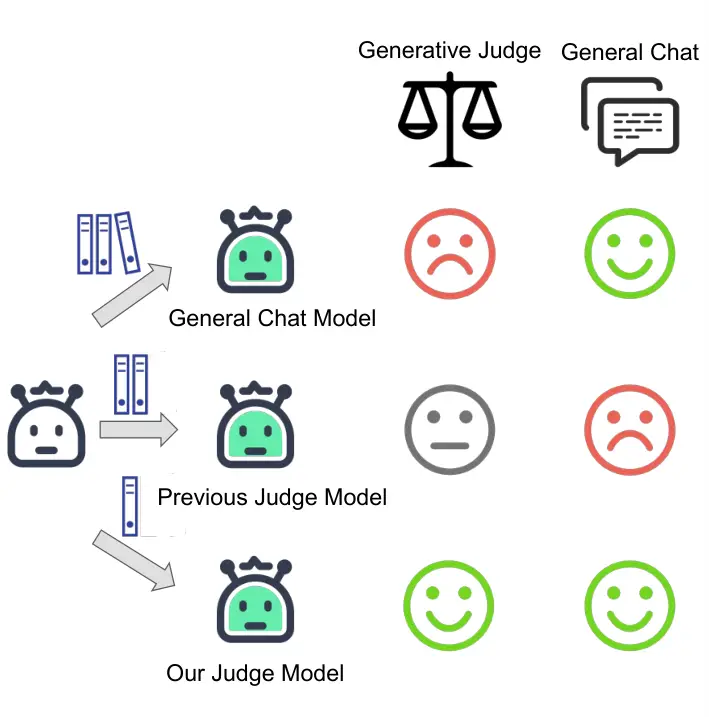
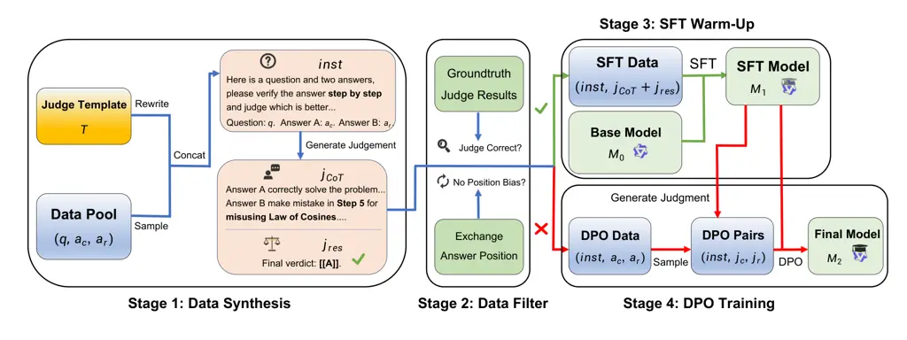

# Improve LLM-as-a-Judge Ability as a General Ability

Jiachen Yu Email: [yu-jc21@mails.tsinghua.edu.cn](mailto:)    Shaoning
Sun ^(†)^(†)thanks:     Equal contribution. Affiliation: Tsinghua
Shenzhen International Graduate School, Tsinghua University
Email: [ssn25@mails.tsinghua.edu.cn](mailto:)    Xiaohui Hu
Affiliation: Institute of Artificial Intelligence, China Telecom
(TeleAI) Email: [yukd@chinatelecom.cn](mailto:)    Jiaxu Yan
Affiliation: Institute of Computing Technology, Chinese Academy of
Sciences Email: [xuelongli@ieee.org](mailto:)    Kaidong Yu    Xuelong
Li ^(†)^(†)thanks:     Corresponding author. Affiliation: Institute of
Artificial Intelligence, China Telecom (TeleAI)

###### Abstract

LLM-as-a-Judge leverages the generative and reasoning capabilities of
large language models (LLMs) to evaluate LLM responses across diverse
scenarios, providing accurate preference signals. This approach plays a
vital role in aligning LLMs with human values, ensuring ethical and
reliable AI outputs that align with societal norms. Recent studies have
raised many methods to train LLM as generative judges, but most of them
are data consuming or lack accuracy, and only focus on LLM’s judge
ability. In this work, we regard judge ability as a general ability of
LLM and implement a two-stage training approach, comprising supervised
fine-tuning (SFT) warm-up and direct preference optimization (DPO)
enhancement, to achieve judge style adaptation and improve judgment
accuracy. Additionally, we introduce an efficient data synthesis method
to generate judgmental content. Experimental results demonstrate that
our approach, utilizing only about 2$`\%`$ to 40$`\%`$ of the data
required by other methods, achieves SOTA performance on RewardBench.
Furthermore, our training method enhances the general capabilities of
the model by constructing complicated judge task, and the judge signals
provided by our model have significantly enhanced the downstream DPO
training performance of our internal models in our test to optimize
policy model with Judge Model. We also open-source our model weights¹¹ 1
The model weights are available at
[https://huggingface.co/R-I-S-E/RISE-Judge-Qwen2.5-32B](https://huggingface.co/R-I-S-E/RISE-Judge-Qwen2.5-32B)
and training data ²² 2 The data is available at
[https://huggingface.co/datasets/R-I-S-E/RISE-Judge-SFT-20K](https://huggingface.co/datasets/R-I-S-E/RISE-Judge-SFT-20K),
[https://huggingface.co/datasets/R-I-S-E/RISE-Judge-DPO-20K](https://huggingface.co/datasets/R-I-S-E/RISE-Judge-DPO-20K).
to facilitate further research.



Figure 1: Our model achieves both strong general abilities and judge
abilities using only a minimal amount of data.

## 1 Introduction

Reinforcement Learning from Human Feedback (RLHF) has emerged as a
critical post-training technique for large language models (LLMs)(Ouyang
et al., 2022). By aligning model preferences with human values through
reinforcement learning, RLHF enables the generation of outputs that are
more consistent with human expectations. However, obtaining accurate
human preference signals remains a significant challenge, as manual
annotation is both costly and impractical for large-scale model
training. Consequently, developing an effective judge model and
leveraging AI-generated preferences for automated preference labeling to
do reinforcement learning from AI feedback (RLAIF) (Lee et al., 2023) is
a crucial research direction.

Generative model with abilities to produce detailed analyses of
responses before rendering a judgment (Ye et al., 2024; Zhang et al.,
2024; Wang et al., 2024a; Mahan et al., 2024) is widely used for
LLM-as-a-judge. Instruct LLM to generate Chain-of-Thought (CoT)
reasoning (Wei et al., 2022) to analyze each step of the response
preforms outstandingly in judge tasks which require strong logical
reasoning.

In this paper, we propose an efficient and high-quality data synthesis
method coupled with a two-stage training approach to construct a
high-quality dataset for training generative judge models. The resulting
model, RISE-Judge-Qwen2.5-32B, demonstrates exceptional performance. Our
methodology comprises two key components: (1) SFT Warm-Up: Utilizing an
open-source dataset containing question-answer pairs, we generate
judgments with CoT analyses by prompting GPT-4o with randomly rewritten
judge instructions. These judgments are filtered based on the dataset’s
standard answers, and position bias is mitigated by swapping answer
positions (Wei et al., 2024). The resulting data is combined with a
small amount of general dialogue data for SFT, enabling the model to
learn step-by-step analysis and accurate judgment while retaining its
general abilities. (2) DPO Enhancement: For questions where GPT-4o fails
to provide accurate labels, we sample responses from the SFT-trained
model and partition them into chosen and rejected pairs based on
ground-truth preferences. These pairs are then used for DPO to refine
the model’s preferences. This two-stage approach simplifies the judge
task into two subtasks, style adaptation and accurate analysis,
significantly reducing the data and computational resources required for
training.

To evaluate the judgment capabilities of our model, we conduct
experiments on RewardBench (Lambert et al., 2024). Our 32B-model
achieves SOTA performance, surpassing nearly all other generative
models. This is achieved by using only 20K data during the warm-up phase
and 20K pairwise data during the DPO phase, representing merely
2$`\%`$–40$`\%`$ of the data used by leading generative judge models.
Additionally, we assess our model on chat benchmarks such as AlignBench
(Liu et al., 2023) and MT-Bench (Zheng et al., 2023), where it
demonstrates performance comparable to Qwen2.5-32B-Instruct. This
indicates that high-quality judge task training data can internally
shape the model’s preference for high-quality responses, enabling it to
generate superior responses in general dialogue tasks. Finally, while
most judge models are evaluated solely on their judge capabilities, we
conduct downstream DPO experiments on our internal policy model, using
RISE-Judge-Qwen2.5-32B to annotate preferences. The results demonstrate
that RISE-Judge-Qwen2.5-32B-annotated data outperformed GPT-4o-annotated
data to improve the performance of policy model.

In summary, our work makes the following key contributions:

- •
  We propose a two-stage training framework for judge models, termed SFT
  Warm-Up and DPO Enhancement, which decomposes the judge task into two
  simpler subtasks: style adaptation and preference optimization. This
  approach improves training efficiency and final performance.
- •
  We introduce a high-quality data synthesis method, generating only 40k
  data entries (approximately 2$`\%`$ to 40$`\%`$ of the data used in
  most similar works) across the two stages, yet achieving superior
  metrics.
- •
  Experiments show that our model achieves a balance between judge
  abilities and general abilities. Using significantly less data, our
  model attains performance comparable to Qwen2.5-32B-instruct in chat
  benchmarks. Additionally, the judgments produced by our model can
  provide concise preference signals during training policy model.

## 2 Related Works

Many studies have explored training methods to improve the judge ability
of LLM, but some merely employ SFT to mimic the judge generation process
without infusing the model with accurate preference knowledge (Kim
et al., 2024; Zhang et al., 2024) . Others directly utilize untrained
base models to generate judge pairs, which may fail to produce
high-quality responses due to the limitations of base models (Ye et al.,
2024; Wang et al., 2024a). Additionally, nearly all related works lack
an efficient data synthesis method, resulting in excessively large
training datasets (600-900k entries) (Wang et al., 2024a; Cao et al.,
2024). Finally, some work Cao et al. (2024) raised that that enhancing
the judge capability of LLMs may concurrently benefit the improvement of
their general abilities. However, this viewpoint has not been further
validated. Other works Ye et al. (2024); Liu et al. (2024) focusing on
LLM-as-a-judge just concentrate on metrics related to the judge
capability of LLMs, and ignore the connections between judge and general
abilities.



Figure 2: Data synthesis and model training pipeline. Our pipeline
contains 4 stages in order. $`q`$ :The question in preference dataset.
$`a_{c}`$, $`a_{r}`$: The chosen and rejected answer to $`q`$ in
preference dataset. $`inst`$: Judge instructions with $`q`$, $`a_{c}`$,
$`a_{r}`$ merged in. $`j_{CoT}`$: The reasoning process when giving out
a judgement. $`j_{res}`$: Judge result towards judge instruction.
$`j_{c}`$, $`j_{r}`$: The chosen and rejected judge answer in DPO
training process.

## 3 Method

Figure 2 shows the pipeline for our data synthesis and model training
process. We synthesis traning data by rewriting judge instructions
template to adapt the model for reasoning and critical evaluation. Then
we let GPT-4o generate answers towards our judge instructions step by
step. After that, we check if the judge is correct and without length
bias by comparing with groundth judgment and exchange the position of
answers. Those trustful judgments will be use in SFT stage, while
others, which means the judgment may be hard to made, will be used in
DPO stage. Our judge model training consists of two phases: SFT Warm-Up
and DPO Enhancement. In the first phase, we use SFT with diverse judge
instructions and filtered high-quality judgments. In the second phase,
we apply DPO with an additional negative log-likelihood (NLL) loss term
to refine the model’s ability to select superior judgments towards
relatively harder judge instructions (Pang et al., 2024). A rule-based
filtering mechanism ensures efficient training with minimal high-quality
data. This two-stage traning approach enables the model to produce
high-quality evaluative judgments effectively.

### 3.1 Data synthesis and filter

The objective of the SFT Warm-Up phase is to enable the model to acquire
an appropriate judge reasoning pattern. To achieve this, we first
develop an automated prompt rewriting system that generates judge
instruction templates $`T`$ for each question. These templates
incorporate diverse role backgrounds, linguistic contexts, evaluation
criteria, and output style requirements.

The prompts instruct the model to analyze each response step by step
using a CoT approach, identify specific error locations and reasons for
non-open-ended questions, which we call $`j_{CoT}`$, and provide a judge
result $`j_{res}`$ in a predefined format. This is particularly crucial
for evaluating mathematical and coding solutions, where precise error
localization and effective criticism are essential.

After constructing prompts, we use them to guide GPT-4o in analyzing and
judging pairs of answers (chosen $`a_{c}`$ and rejected $`a_{r}`$). The
judgments are validated against the ground truth labels from the dataset
to ensure correctness.

To address two known limitations of LLM-as-a-judge, position bias and
length bias, we implement two strategies: (1) For position bias, we swap
the order of $`a_{c}`$, $`a_{r}`$ and perform two judgments. We retain
specific prompt for SFT training only when GPT-4o consistently select
$`a_{c}`$ in two judgements towards the same prompt, while other judge
instructions are reserved for DPO preference pair construction. (2) For
length bias, we balance the dataset such that $`a_{c}`$ and $`a_{r}`$
have an equal probability of being longer.

Our data is primarily sourced from the following:

- •
  Math-PRM800K Dataset (Lightman et al., 2023): We utilize the training
  phase-2 of this dataset, manually extracting and concatenating
  solution steps from PRM to create complete step-by-step answers and
  labeled with original correctness. We also choose some raw responses
  from Math dataset to form $`a_{c}`$, $`a_{r}`$ pairs. To prevent
  reward hacking, we ensure that $`a_{c}`$ are equally likely to
  originate from synthesized step-by-step answers or raw Math dataset
  responses.
- •
  Skywork-Reward-Preference-80K-v0.2 (Liu et al., 2024): These datasets
  contain responses from humans and various LLMs. We synthesized data
  using the original questions and answers from these sources.We mainly
  use subsets HelpSteer2 (Wang et al., 2024b), UltraFeedback (Cui
  et al., 2023), OffsetBias (Park et al., 2024), and WildGuardMix (Han
  et al., 2024) in our experiment.
- •
  Non-Judge Data: We comprise a limited amount of question-answer pairs
  of general chat data sourced from our proprietary dataset, which
  doesn’t contains any judge. This data is utilized to ensure that the
  model retains its foundational capabilities during the training
  process, thereby mitigating the risk of catastrophic forgetting.

All synthesized data are rigorously verified to ensure that there is no
overlap with the benchmarks used for the evaluation. This meticulous
data construction process ensures that the model can deliver
high-quality, human-aligned judgments after the SFT warm-up phase. A
sample of SFT data we use can be seen in Figure 7.

### 3.2 SFT Warm-Up Training

In the SFT Warm-Up phase, we employ the standard SFT loss for training,
utilizing judge templates with $`a_{c}`$, $`a_{r}`$ as inputs, and the
correct CoT along with judgment outcomes as optimization targets to
train our first-stage model. The specific formulation is as follows:

```math
l_{SFT}={E}_{(inst,j)\sim D_{SFT}}\left[-\log P_{\theta}(j|inst)\right] \tag{1}
```

Here, $`\theta`$ denotes the model parameters, and $`D_{SFT}`$ signifies
the dataset utilized during SFT phase. The input prompt $`inst`$ is
constructed by concatenating $`T`$, $`a_{c}`$, and $`a_{r}`$,
instructing the model to generate a judgment containing CoT for
$`a_{c}`$ and $`a_{r}`$. The output $`j`$ = $`j_{CoT}`$ + $`j_{res}`$,
which are the judgment results that have undergone rigorous validation
for correctness and consistency.

The SFT warm-up phase, as an independent step, offers clear advantages.
During this phase, the model is finetuned with diverse prompts to learn
the judgment task structure and adapt to various evaluation criteria. As
a result, the self-sampled responses in the DPO phase are of higher
quality, leading to more refined answers.

|                                    |      |         |      |           |        |           |
| ---------------------------------- | ---- | ------- | ---- | --------- | ------ | --------- |
| Model                              | Data | Average | Chat | Chat Hard | Safety | Reasoning |
| Proprietary Models                 |      |         |      |           |        |           |
| Claude-3-5-sonnet-20240620         | \-   | 84.2    | 96.4 | 74.0      | 81.6   | 84.7      |
| GPT-4o-2024-08-06                  | \-   | 86.7    | 96.1 | 76.1      | 88.1   | 86.6      |
| Gemini-1.5-pro-0924                | \-   | 86.8    | 94.1 | 77.0      | 85.8   | 90.2      |
| Open-sourced Models                |      |         |      |           |        |           |
| Llama-3.1-8B-Instruct              | \-   | 65.7    | 80.7 | 49.8      | 64.0   | 68.1      |
| Llama-3.1-70B-Instruct             | \-   | 84.0    | 97.2 | 70.2      | 82.8   | 86.0      |
| Qwen2.5-32B-Instruct               | \-   | 87.0    | 96.6 | 76.1      | 87.7   | 87.5      |
| Generative Judge Models            |      |         |      |           |        |           |
| CompassJudger-1-7B-Instruct        | 900k | 83.2    | 97.8 | 61.0      | 84.5   | 89.5      |
| CompassJudger-1-32B-Instruct       | 900k | 85.2    | 98.0 | 65.1      | 85.3   | 92.4      |
| Con-J-Qwen2-7B                     | 80k  | 87.1    | 91.9 | 80.3      | 88.2   | 88.1      |
| Self-taught-evaluator-llama3.1-70B | 100k | 90.0    | 96.9 | 85.1      | 89.6   | 88.4      |
| SFR-LLaMa-3.1-70B-Judge-r          | 680k | 92.7    | 96.9 | 84.8      | 91.6   | 97.6      |
| RISE-Judge-Qwen2.5-7B              | 73k  | 88.2    | 92.2 | 76.5      | 88.0   | 96.1      |
| RISE-Judge-Qwen2.5-32B             | 40k  | 92.7    | 96.6 | 83.3      | 91.9   | 98.8      |

Table 1: Evaluate result on RewardBench. The metrics of RISE and Qwen
series models are evaluated by ourselves, and other metrics are selected
from RewardBench leaderboard. Data represents the total amount of data
used during the training process of the judge model at each stage. Some
models on RewardBench are not shown due to data leaking.

### 3.3 DPO Enhancement

In the data construction phase of the DPO Enhancement stage, we perform
sampling based on the model obtained from the first-stage SFT. The
questions selected for sampling are sourced from the dataset constructed
during the SFT phase, particularly those for which GPT-4o failed to
provide consistent and correct answers. We let our SFT model generate
multiple answers for each question. The sampled results are further
filtered using a rule-based approach, and new preference pairs
$`(j_{c},j_{r})`$ are constructed based on the correctness of the
judgment results. These pairs are then used for training. Additionally,
a small-weighted NLL loss is incorporated during the DPO process to
prevent over-optimization and to guide the model toward generating more
accurate answers (Pang et al., 2024). The specific formulation is as
follows:

```math
\begin{split}&l_{DPO}=\mathbb{E}_{(inst,j_{c},j_{r})\sim D_{DPO}}\\
&\bigg[-\log\sigma\bigg(\beta\bigg(\log\frac{P_{\theta}(j_{c}|inst)}{P_{\theta_{0}}(j_{c}|inst)}-\log\frac{P_{\theta}(j_{r}|inst)}{P_{\theta_{0}}(j_{r}|inst)}\bigg)\bigg)\bigg]\end{split} \tag{2}
```

```math
l_{NLL}={E}_{(inst,j_{c})\sim D_{DPO}}\left[-\log P_{\theta}(j_{c}|inst)\right] \tag{3}
```

```math
l_{DPOtotal}=l_{DPO}+\alpha l_{NLL} \tag{4}
```

Where $`inst`$, $`a_{c}`$, $`a_{r}`$ means input judge instruction,
chosen judgment and rejected judgment sampled from DPO dataset.
$`\theta`$ denotes parameters of the training model while $`\theta_{0}`$
is the reference model initialized as SFT model and remains untrained.
The DPO loss and the NLL loss in this stage are combined with a small
weight $`\alpha`$.

## 4 Experiment

### 4.1 Experimental Setup

##### Datasets.

Our dataset is derived from three sources mentioned in the SFT Warm-Up
data synthesis section. All original data are open-source and have been
transformed into training judge data through the mentioned data
synthesis scheme. In our training dataset, the ratio of judge data to
general-purpose data is approximately 4:1. We will open-source the
dataset along with the model weights.

##### Model.

We employ Qwen2.5-32B-Base (Yang et al., 2024) as the foundational model
for our training. For comparative analysis, we select top-performing
generative judge models with no data leakage on RewardBench leaderboard,
powerful proprietary models such as GPT-4o and Claude, and open source
models like Qwen-2.5, Llama-3.1 (Dubey et al., 2024) to compare with our
judge model. To assess the impact of judge training on the model’s
general capabilities, we compare our model with open source models and
other leading generative judge models.

##### Hyper parameters.

During SFT, we train for 2 epochs with a batch size of 128 and a maximum
sequence length of 4,096 tokens. We employ a cosine learning rate
scheduler with an initial learning rate of $`2e-5`$ and a warm-up ratio
of 2%. For the DPO phase, we first use vLLM (Kwon et al., 2023) to
generate 6 candidate responses for each judge instruction, with sampling
temperature of 0.9. The subsequent DPO training is performed with a
learning rate of $`1e-6`$ over 2 epochs and a batch size of 32. We set
$`\alpha=0.2`$ in Equation 4 and $`\beta=0.1`$ in Equation 2. During the
evaluation phase, we use greedy decoding by setting the temperature to 0
and the top-p to 1 to ensure deterministic outputs.

### 4.2 Main Results

We adopt the leading pair-wise judge benchmark, RewardBench (Lambert
et al., 2024) to evaluate the performance of our model.

As delineated in Table 1, our model has achieved SOTA on the
RewardBench, utilizing a comparatively smaller parameter set and reduced
training workload relative to other models. This accomplishment
underscores the efficiency and effectiveness of our approach in the
realm of model training and evaluation. We also present an evaluation of
mainstream LLM-as-a-Judge models on the PPE Benchmark Frick et al.
(2024) in Table 4 of the appendix. RISE-Judge consistently outperforms
other models, further demonstrating its strong generalization capability
across diverse judge tasks.

### 4.3 Ablation Study

We have designed the following ablation experiments to demonstrate the
effectiveness of our proposed method. To reduce evaluation costs,
performance evaluations were conducted exclusively on the RewardBench
benchmark.

#### 4.3.1 Ablation on Training Stages

The first part of the ablation experiments focuses on the training
stages, with the specific components outlined as follows:

##### Instruct

Directly selecting the Qwen2.5-32B-Instruct model for evaluation,
serving as the baseline for comparison.

##### Base + SFT

Conducting only the SFT warm-up phase on the Qwen2.5-32B-Base model,
with the data amount consistent with the first phase of the two-stage
training, to validate the effectiveness of the DPO phase.

##### Instruct + DPO

Performing DPO training based on the Qwen2.5-32B-Instruct model, with
the data amount consistent with the second phase of the two-stage
training, to demonstrate the efficacy of the data construction in the
SFT warm-up phase.

##### Base + SFT + DPO

Following the mentioned methodology in this paper, the model obtained
through the two-stage training process of SFT-warm up and DPO
demonstrates significant improvements in generalization and performance.

The result of the ablation test on training stages in Figure 3 shows
that the two-stage training method, SFT warm-up followed by DPO,
significantly improves the model’s performance. Specifically, the model
train with both SFT and DPO stages achieved the highest score of 92.7,
outperforming the baseline Instruct model (87.0) as well as the SFT-only
(87.7) and DPO-only (91.8) variants. This indicates that the two-stage
traning method is crucial for maximizing the model’s capabilities. And
the consistent improvement across all stages validates the effectiveness
of our proposed methodology in improving model performance.

Figure 3: Result of ablation test on training stages. This indicates
both SFT and DPO stage have positive effects, while the effect of DPO is
larger. And compared to the traditional SFT training of general models,
pre-learning the format of judge tasks during the SFT phase enables the
model to achieve superior results in the DPO stage.

#### 4.3.2 Ablation on Data Amount and Model Size

The second part of the ablation experiments focuses on the training data
volume and model parameter size, with the specific components outlined
as follows:

##### Ablation on Data Amount

Adjusting the number of training samples in both the SFT warm-up and DPO
stages to investigate the impact on the evaluate results.

##### Ablation on Model Parameter Size

Based on Qwen2.5-7B-Base, we train a 7B model using the same data source
and the same two-stage methodology of SFT warm-up and DPO. This is done
to validate the effectiveness of our approach across models of different
sizes.

In the ablation on data amount study, we sample 0, 10k, 20k SFT data,
and 0, 10k, 20k, 40k DPO data from the same batch (SFT data = 0 means
DPO on Qwen2.5-32B-Instruct) to construct 12 checkpoints. We evaluated
their performance on RewardBench. The detailed results are presented in
Figure 4.

Figure 4: Result of ablation test on data amount. As data amount
increase in each of the two stages, the model’s metrics show an upward
trend, reaching peak at around 20k SFT + and 20k DPO data.

Overall, the increase in both SFT and DPO data volumes consistently
improved model performance, validating the effectiveness of our
two-stage training and data synthesis method. When the amount of DPO
data increased to 40k, the metrics don’t change obviously, demonstrating
that our current selection of 20k SFT data + 20k DPO data is the best
choice.

In the part of ablation on model size, we conducted experiments based on
the Qwen2.5-7B-Base to validate the effectiveness of our training method
on different parameter sizes. The training dataset is conducted by the
same two-stage sampling approach with the size of 40k SFT + 33k DPO data
for smaller model needs more training data. The 7B model is also open
sourced and evaluated on RewardBench with metrics shown in Table 1.³³ 3
The weights of our 7B model are available at
[https://huggingface.co/R-I-S-E/RISE-Judge-Qwen2.5-7B](https://huggingface.co/R-I-S-E/RISE-Judge-Qwen2.5-7B)
It demonstrates that our training approach remains effective for smaller
models and performs better with less training data than other 7B
generative judge models.

#### 4.3.3 Evaluate with Different Prompts

The third part of the ablation experiments focuses on the evaluation
prompts. Our constructed training data incorporates diverse judge
instruction templates, evaluation standard, and language types. As a
result, we anticipate that the trained judge model should exhibit strong
adaptability to various prompts. To validate this, we selected three
types of evaluation prompts and evaluated the performance of the trained
judge model on RewardBench. The three prompts are as follows (detailed
content are provided in Figure 11):

- •
  Official English Prompt: The default English prompt included in the
  RewardBench code.
- •
  Basic Chinese Prompt: Since the Qwen2.5-32B-Base model, on which our
  training is based, is a Chinese model, our judge model is expected to
  exhibit better adaptability to Chinese inputs. The basic Chinese
  prompt represents a concise Chinese prompt that provides no additional
  information.
- •
  Instructional Chinese Prompt: A manually constructed Chinese prompt
  that includes specific context and evaluation criteria, representing a
  more complex and detailed prompt with explicit requirements. This
  prompt is similar to the judging instruction we use in data synthesis
  stage. We achieve SOTA on RewardBench with this prompt.

The performance results of the model under different prompts are as
Figure 5. From these results, it is evident that our model consistently
delivers robust and superior performance across prompts of varying
languages and instruction complexities. This demonstrates the
effectiveness of our prompt template rewriting strategy in the data
synthesis process, which ensures data diversity and enhances the model’s
generalization capabilities.

Figure 5: Evaluation results with different prompts. The model’s metrics
show minimal variance towards different prompts, indicating that our
data synthesis strategy improves the model’s adaptability to diverse
prompts.

| Model                | Avg. | MMLU | CMMLU | CEval | BBH  | GSM  | AlignB. | MTB. |
| -------------------- | ---- | ---- | ----- | ----- | ---- | ---- | ------- | ---- |
| Skywork-Critic-70B   | 77.8 | 83.0 | 62.4  | 73.0  | 82.6 | 92.1 | 6.60    | 8.55 |
| CompassJudger-1-32B  | 82.7 | 83.4 | 81.3  | 81.1  | 80.1 | 91.7 | 7.50    | 8.63 |
| Qwen2.5-32B-Instruct | 83.1 | 83.1 | 80.6  | 82.3  | 81.2 | 92.2 | 7.41    | 8.82 |
| RISE-Judge-32B       | 83.4 | 82.4 | 83.6  | 83.4  | 81.2 | 91.4 | 7.31    | 8.89 |

Table 2: Evaluate result on general abilities. The result on AlignBench
and MTBench is rated by Azure GPT-4o-0513. We only consider single-turn
score in MTBench due to our training data only contains single-turn
dialogue. The score of AlignBench and MTBench is converted to
hundred-mark system when calculating average score. All evaluation
results are obtained from experiments conducted on our internal
platform, with all models evaluated under identical parameter settings.

### 4.4 Case Study

We selected a math problem from RewardBench and evaluated the responses
generated by four models: RISE-Judge-Qwen2.5-32B, Qwen2.5-32B-Base
fine-tuned on our SFT training set (Qwen2.5-32B-Base + SFT),
Qwen2.5-32B-Instruct, and CompassJudger-1-32B-Instruct. The detailed
results are shown in Figure 9 and Figure 10. It indicates that only
RISE-Judge-Qwen2.5-32B provided the correct judgment and accurately
identified the error in the incorrect answer. Additionally, only
RISE-Judge-Qwen2.5-32B and Qwen2.5-32B-Base + SFT produced a detailed
step-by-step analysis. This demonstrates that our SFT training stage
helps the model learn the correct judgment patterns, while the DPO
training stage improves the model’s judgment accuracy. The combination
of both stages significantly improves the model’s overall judgment
capabilities.

### 4.5 General Ability Evaluation

Previous researchers have hypothesized that training models on judge
tasks might enhance their overall general capabilities (Cao et al.,
2024). In our work, we empirically validated this hypothesis and
obtained affirmative results. We evaluated the performance of our
two-stage trained model based on Qwen2.5-32B-Base across multiple
authoritative benchmarks, including MMLU (Hendrycks et al., 2020), CMMLU
(Li et al., 2023), CEval (Huang et al., 2024), BBH (Suzgun et al.,
2022), GSM (Cobbe et al., 2021), AlignBench and MTBench, and found that
our results are comparable to those of Qwen2.5-32B-Instruct. Detailed
evaluate results are presented in Table 2. Additional evaluation results
on AlpacaEval 2.0 Dubois et al. (2024) are provided in appendix Table 5,
further substantiating the superior generalization capability of
RISE-Judge.

This demonstrates that fine-tuning with a small amount of high-quality
synthesized judge data can achieve significant improvements in general
capabilities, similar to those obtained through large-scale
post-training. The underlying reason may lie in our construction of a
step-by-step judge task training pipeline, which requires the model to
analyze user inputs in detail and provide critical evaluations—a process
that has been empirically shown to enhance the model’s general
capabilities. The demands of complex reasoning tasks and critical
evaluation have led to a noticeable improvement in the model’s
problem-solving abilities.

### 4.6 Optimize Policy Model with Judge Model

Previous studies always focus on the performance of judge models in
judge-specific tasks, primarily evaluating them on benchmarks such as
RewardBench, which assess judge capabilities. However, there has been a
lack of analysis regarding the practical performance of judge models in
downstream reinforcement learning tasks for model training. To address
this gap, we conducted experiments on our internal policy model.

We employed the DPO method to train policy model, utilizing the judge
model trained in this work to compare responses sampled from the policy
model. The data filtering method we employed involves sampling 16
different responses for the same prompt and using the judge model to
perform pairwise comparisons of these responses in a tournament-style
elimination process. Through this method, two best and two worst
responses are selected to form the pairs used for DPO training. This
approach ensures high-quality data for optimizing policy model’s
performance through DPO.

Finally, we evaluate the performance of the policy model after DPO on
AlignBench, with detailed experimental results presented in Table 3. The
result shows that our judge model can be effectively applied to the
training of policy model, achieving superior results compared to GPT-4o.
This demonstrates that our judge model can provide higher-quality AI
preference data during the actual data generation process, which can be
effectively applied to downstream reinforcement learning process.

| Model              | Avg  | Lang. | Reas. |
| ------------------ | ---- | ----- | ----- |
| Base               | 7.20 | 7.61  | 7.41  |
| +GPT-4o as judge   | 7.40 | 7.95  | 7.68  |
| +RISE-32B as judge | 7.60 | 7.97  | 7.79  |

Table 3: Evaluate result on AlignBench rated by Azure GPT-4o-0513. Base
indicates the model before DPO training. GPT-4o as judge and RISE-32B as
judge indicates training base model with pairs annotated by GPT-4o and
our 32B model. The evaluate results contains two parts: Reasoning
(Reas.) and Language (Lang.).

## 5 Conclusions

We regard improving the capability of LLM-as-a-judge as a part of
improving the model’s general ability, proposing a SFT-DPO two-stage
training approach. In these two stages, we respectively accomplished the
tasks of judge style adaptation and the enhancement of judging
capabilities, achieving SOTA results on RewardBench. Additionally, we
introduced an efficient data synthesis method, reducing the required
training data amount to 2$`\%`$ - 40$`\%`$. Finally, we validated that
our training effectively improves the model’s general abilities,
integrating the improvement of judging abilities with general abilities.
And we also verified the accuracy of the reward signals provided by our
judge model in the training of internal policy models and achieve good
results.

## Limitations

The overarching goal of our work is Reinforcement learning for
Incremental Self-Evolution (RISE), with the primary objective of
enhancing the models’ ability to optimize their performance through
self-generated feedback in the form of rewards.

Despite significant progress with RISE, several limitations remain. One
is the inability to achieve consistent precision in judgment across all
domains and tasks like open-ended questions and point-wise task .
Additionally, we are still refining how the self-rewarding mechanism can
effectively guide optimization and ensure continuous improvement.

In the future, we plan to continue our research on RISE in the following
directions. We will first focus on studying the interplay between the
LLM-as-judge capabilities and other abilities. A key focus is
understanding how the quality of generated responses correlates with the
judge’s responses to the same problem, revealing the relationship
between the model’s generation and specialized judge abilities. Next, we
plan to extend our methodologies to a broader range of domains and more
complex tasks , including code evaluation, safety assessments, and
precise instruction following, by enhancing judgment capabilities
through methods such as CoT and deep thinking. Finally, we are exploring
self-rewarding mechanisms, where models provide feedback to themselves
in the form of rewards to guide optimization and ensure continuous
improvement.

## References

- Cao et al. (2024) Maosong Cao, Alexander Lam, Haodong Duan, Hongwei
  Liu, Songyang Zhang, and Kai Chen. 2024. Compassjudger-1: All-in-one
  judge model helps model evaluation and evolution. _arXiv preprint
  arXiv:2410.16256_.
- Cobbe et al. (2021) Karl Cobbe, Vineet Kosaraju, Mohammad Bavarian,
  Mark Chen, Heewoo Jun, Lukasz Kaiser, Matthias Plappert, Jerry Tworek,
  Jacob Hilton, Reiichiro Nakano, et al. 2021. Training verifiers to
  solve math word problems. _arXiv preprint arXiv:2110.14168_.
- Cui et al. (2023) Ganqu Cui, Lifan Yuan, Ning Ding, Guanming Yao, Wei
  Zhu, Yuan Ni, Guotong Xie, Zhiyuan Liu, and Maosong Sun. 2023.
  Ultrafeedback: Boosting language models with high-quality feedback.
- Dubey et al. (2024) Abhimanyu Dubey, Abhinav Jauhri, Abhinav Pandey,
  Abhishek Kadian, Ahmad Al-Dahle, Aiesha Letman, Akhil Mathur, Alan
  Schelten, Amy Yang, Angela Fan, et al. 2024. The llama 3 herd of
  models. _arXiv preprint arXiv:2407.21783_.
- Dubois et al. (2024) Yann Dubois, Balázs Galambosi, Percy Liang, and
  Tatsunori B Hashimoto. 2024. Length-controlled alpacaeval: A simple
  way to debias automatic evaluators. _arXiv preprint arXiv:2404.04475_.
- Frick et al. (2024) Evan Frick, Tianle Li, Connor Chen, Wei-Lin
  Chiang, Anastasios N Angelopoulos, Jiantao Jiao, Banghua Zhu, Joseph E
  Gonzalez, and Ion Stoica. 2024. How to evaluate reward models for
  rlhf. _arXiv preprint arXiv:2410.14872_.
- Han et al. (2024) Seungju Han, Kavel Rao, Allyson Ettinger, Liwei
  Jiang, Bill Yuchen Lin, Nathan Lambert, Yejin Choi, and Nouha
  Dziri. 2024. Wildguard: Open one-stop moderation tools for safety
  risks, jailbreaks, and refusals of llms. _arXiv preprint
  arXiv:2406.18495_.
- Hendrycks et al. (2020) Dan Hendrycks, Collin Burns, Steven Basart,
  Andy Zou, Mantas Mazeika, Dawn Song, and Jacob Steinhardt. 2020.
  Measuring massive multitask language understanding. _arXiv preprint
  arXiv:2009.03300_.
- Huang et al. (2024) Yuzhen Huang, Yuzhuo Bai, Zhihao Zhu, Junlei
  Zhang, Jinghan Zhang, Tangjun Su, Junteng Liu, Chuancheng Lv, Yikai
  Zhang, Yao Fu, et al. 2024. C-eval: A multi-level multi-discipline
  chinese evaluation suite for foundation models. _Advances in Neural
  Information Processing Systems_, 36.
- Kim et al. (2024) Seungone Kim, Juyoung Suk, Shayne Longpre,
  Bill Yuchen Lin, Jamin Shin, Sean Welleck, Graham Neubig, Moontae Lee,
  Kyungjae Lee, and Minjoon Seo. 2024. Prometheus 2: An open source
  language model specialized in evaluating other language models. _arXiv
  preprint arXiv:2405.01535_.
- Kwon et al. (2023) Woosuk Kwon, Zhuohan Li, Siyuan Zhuang, Ying Sheng,
  Lianmin Zheng, Cody Hao Yu, Joseph Gonzalez, Hao Zhang, and Ion
  Stoica. 2023. Efficient memory management for large language model
  serving with pagedattention. In _Proceedings of the 29th Symposium on
  Operating Systems Principles_, pages 611–626.
- Lambert et al. (2024) Nathan Lambert, Valentina Pyatkin, Jacob
  Morrison, LJ Miranda, Bill Yuchen Lin, Khyathi Chandu, Nouha Dziri,
  Sachin Kumar, Tom Zick, Yejin Choi, et al. 2024. Rewardbench:
  Evaluating reward models for language modeling. _arXiv preprint
  arXiv:2403.13787_.
- Lee et al. (2023) Harrison Lee, Samrat Phatale, Hassan Mansoor,
  Kellie Ren Lu, Thomas Mesnard, Johan Ferret, Colton Bishop, Ethan
  Hall, Victor Carbune, and Abhinav Rastogi. 2023. Rlaif: Scaling
  reinforcement learning from human feedback with ai feedback.
- Li et al. (2023) Haonan Li, Yixuan Zhang, Fajri Koto, Yifei Yang, Hai
  Zhao, Yeyun Gong, Nan Duan, and Timothy Baldwin. 2023. Cmmlu:
  Measuring massive multitask language understanding in chinese. _arXiv
  preprint arXiv:2306.09212_.
- Lightman et al. (2023) Hunter Lightman, Vineet Kosaraju, Yura Burda,
  Harri Edwards, Bowen Baker, Teddy Lee, Jan Leike, John Schulman, Ilya
  Sutskever, and Karl Cobbe. 2023. Let’s verify step by step. _arXiv
  preprint arXiv:2305.20050_.
- Liu et al. (2024) Chris Yuhao Liu, Liang Zeng, Jiacai Liu, Rui Yan,
  Jujie He, Chaojie Wang, Shuicheng Yan, Yang Liu, and Yahui Zhou. 2024.
  Skywork-reward: Bag of tricks for reward modeling in llms. _arXiv
  preprint arXiv:2410.18451_.
- Liu et al. (2023) Xiao Liu, Xuanyu Lei, Shengyuan Wang, Yue Huang,
  Zhuoer Feng, Bosi Wen, Jiale Cheng, Pei Ke, Yifan Xu, Weng Lam Tam,
  et al. 2023. Alignbench: Benchmarking chinese alignment of large
  language models. _arXiv preprint arXiv:2311.18743_.
- Mahan et al. (2024) Dakota Mahan, Duy Van Phung, Rafael Rafailov,
  Chase Blagden, Nathan Lile, Louis Castricato, Jan-Philipp Fränken,
  Chelsea Finn, and Alon Albalak. 2024. Generative reward models. _arXiv
  preprint arXiv:2410.12832_.
- Ouyang et al. (2022) Long Ouyang, Jeffrey Wu, Xu Jiang, Diogo Almeida,
  Carroll Wainwright, Pamela Mishkin, Chong Zhang, Sandhini Agarwal,
  Katarina Slama, Alex Ray, et al. 2022. Training language models to
  follow instructions with human feedback. _Advances in neural
  information processing systems_, 35:27730–27744.
- Pang et al. (2024) Richard Yuanzhe Pang, Weizhe Yuan, Kyunghyun Cho,
  He He, Sainbayar Sukhbaatar, and Jason Weston. 2024. Iterative
  reasoning preference optimization. _arXiv preprint arXiv:2404.19733_.
- Park et al. (2024) Junsoo Park, Seungyeon Jwa, Meiying Ren, Daeyoung
  Kim, and Sanghyuk Choi. 2024. Offsetbias: Leveraging debiased data for
  tuning evaluators. _arXiv preprint arXiv:2407.06551_.
- Suzgun et al. (2022) Mirac Suzgun, Nathan Scales, Nathanael Schärli,
  Sebastian Gehrmann, Yi Tay, Hyung Won Chung, Aakanksha Chowdhery,
  Quoc V Le, Ed H Chi, Denny Zhou, et al. 2022. Challenging big-bench
  tasks and whether chain-of-thought can solve them. _arXiv preprint
  arXiv:2210.09261_.
- Wang et al. (2024a) Peifeng Wang, Austin Xu, Yilun Zhou, Caiming
  Xiong, and Shafiq Joty. 2024a. Direct judgement preference
  optimization. _arXiv preprint arXiv:2409.14664_.
- Wang et al. (2024b) Zhilin Wang, Yi Dong, Olivier Delalleau, Jiaqi
  Zeng, Gerald Shen, Daniel Egert, Jimmy J Zhang, Makesh Narsimhan
  Sreedhar, and Oleksii Kuchaiev. 2024b. Helpsteer2: Open-source dataset
  for training top-performing reward models. _arXiv preprint
  arXiv:2406.08673_.
- Wei et al. (2024) Hui Wei, Shenghua He, Tian Xia, Andy Wong, Jingyang
  Lin, and Mei Han. 2024. Systematic evaluation of llm-as-a-judge in llm
  alignment tasks: Explainable metrics and diverse prompt templates.
  _arXiv preprint arXiv:2408.13006_.
- Wei et al. (2022) Jason Wei, Xuezhi Wang, Dale Schuurmans, Maarten
  Bosma, Fei Xia, Ed Chi, Quoc V Le, Denny Zhou, et al. 2022.
  Chain-of-thought prompting elicits reasoning in large language models.
  _Advances in neural information processing systems_, 35:24824–24837.
- Yang et al. (2024) An Yang, Baosong Yang, Beichen Zhang, Binyuan Hui,
  Bo Zheng, Bowen Yu, Chengyuan Li, Dayiheng Liu, Fei Huang, Haoran Wei,
  et al. 2024. Qwen2. 5 technical report. _arXiv preprint
  arXiv:2412.15115_.
- Ye et al. (2024) Ziyi Ye, Xiangsheng Li, Qiuchi Li, Qingyao Ai, Yujia
  Zhou, Wei Shen, Dong Yan, and Yiqun Liu. 2024. Beyond scalar reward
  model: Learning generative judge from preference data. _arXiv preprint
  arXiv:2410.03742_.
- Zhang et al. (2024) Lunjun Zhang, Arian Hosseini, Hritik Bansal,
  Mehran Kazemi, Aviral Kumar, and Rishabh Agarwal. 2024. Generative
  verifiers: Reward modeling as next-token prediction. _arXiv preprint
  arXiv:2408.15240_.
- Zheng et al. (2023) Lianmin Zheng, Wei-Lin Chiang, Ying Sheng, Siyuan
  Zhuang, Zhanghao Wu, Yonghao Zhuang, Zi Lin, Zhuohan Li, Dacheng Li,
  Eric Xing, et al. 2023. Judging llm-as-a-judge with mt-bench and
  chatbot arena. _Advances in Neural Information Processing Systems_,
  36:46595–46623.

## Appendix A Appendix

| Model                              | MBPP | MATH | GPQA | AVG  |
| ---------------------------------- | ---- | ---- | ---- | ---- |
| CompassJudger-1-32B-Instruct       | 41.1 | 65.2 | 45.7 | 50.7 |
| Self-taught-evaluator-llama3.1-70B | 41.9 | 50.1 | 41.7 | 44.6 |
| RISE-Judge-Qwen2.5-32B             | 43.6 | 70.0 | 43.9 | 52.5 |

Table 4: Evaluate result compared with other judge models on PPE
benchmark.

| Model                  | Length Control Win Rate | Win Rate | Average Length |
| ---------------------- | ----------------------- | -------- | -------------- |
| Qwen2.5-32B-Instruct   | 37.4                    | 30.0     | 1808           |
| RISE-Judge-Qwen2.5-32B | 35.8                    | 37.0     | 2058           |

Table 5: Evaluate result compared with Qwen2.5-32B-Instruct on
Alpacaeval 2.0 benchmark.

### A.1 Judge Template Rewriting

Figure 6 shows how to rewrite the judge instruction template. We first
define a base template judge$`\_`$template. Then we instruct GPT-4o to
rewrite evaluation criteria according to constraints, the presentation
format of the evaluation criteria according to principle$`\_`$format),
the final output format according to output$`\_`$format, and the
language according to lang. These modifications were probabilistically
sampled. Finally, we utilized GPT-4o to rewrite the original judge
template with rewrite instruction.

### A.2 Training Data Example

Figure 7 and Figure 8 show training data examples from SFT and DPO
stages. In the displayed data, training data in SFT stage aims to teach
the model format of step-by-step evaluation.And the selected response in
DPO data example accurately identifies the logical flaws in the
incorrect judgment.

### A.3 Judge Case Analysis

Figure 9 and Figure 10 present an example of RewardBench test set. It
shows that among the four models tested, only the models that underwent
our SFT phase can judge step-by-step in detail. And only the model
trained with our complete two-stage training provides correct judgment.
This validates that the objectives of our two-stage training design have
been achieved: SFT enables model to learn the format of step-by-step
analysis, while DPO ensures the model accurately identifies errors in
answers and provides critical evaluations.

### A.4 Evaluation Judge Prompts

Figure 11 shows the detail of three kinds of prompts we use in Part
4.3.3.

### A.5 More eval results

Here we provide more eval results mentioned in main part of the paper.
Table 4 contains eval results of several mainstream LLM-as-a-judge model
on PPE Bench Frick et al. (2024). This demonstrates that RISE-Judge
consistently achieves robust and superior performance across a variety
of judge-class tasks. Table 5 shows eval results of RISE-Judge-32B and
Qwen2.5-32B-Instruct on Alpacaeval 2.0 benchmark Dubois et al. (2024).
The evaluation results from AlpacaEval 2.0 indicate that RISE-Judge
demonstrates overall superior performance compared to the
Qwen2.5-Instruct model (both derived from the Qwen2.5-Base model through
post-training). Notably, RISE-Judge tends to generate longer responses,
which presents a certain disadvantage in scenarios requiring strict
length control. This phenomenon may be attributed to the CoT response
pattern introduced during SFT stage, as discussed in the main text, and
is also corroborated by the cases presented in Section A.3.


Figure 6: Judge instruction template and rewrite prompt. The value of
each key in constraints, principle$`\_`$formats, output$`\_`$formats and
langs is the probability to choose the key.


Figure 7: An example in our SFT training set. This judgment correctly
selects out the better answer.


Figure 8: An example in our DPO training set. The Chosen Judge
identified the error in assistant A’s answer, while the Rejected Judge
did not, and selected a more detailed but incorrect response.


Figure 9: A Judge case. It shows that only RISE-Judge-Qwen2.5-32B makes
correct judgment, and models finetuned on judge data we conducted can
give out detailed stepwise judgment.


Figure 10: A Judge case same as Figure 9. It shows that open-sourced
model and other generative judge models can not provide correct judgment
and their analysis isn’t detailed enough.


Figure 11: Three kinds of prompt we use in evaluation. Official English
prompt is the prompt set in RewardBench original code. Base Chinese
prompt provides instruction as simple as possible, while Instructional
Chinese prompt gives out more detailed judge standard.
