# MCTS-Judge: Test-Time Scaling in LLM-as-a-Judge for Code Correctness Evaluation

Yutong Wang Affiliation: Mechanical Engineering Affiliation: National
University of Singapore Affiliation: Kaixin Li Affiliation: School of
Computing Affiliation: National University of Singapore    Pengliang Ji
Affiliation: Robotics Institute Affiliation: Carnegie Mellon University
Affiliation: Ming Hu Affiliation: Electrical and Computer Systems
Affiliation: Monash University Affiliation: Guillaume Sartoretti
Affiliation: Mechanical Engineering Affiliation: National University of
Singapore Affiliation: e0576114@u.nus.edu,
guillaume.sartoretti@nus.edu.sg    Chaoqun Yang Affiliation: Independent
Contributor Affiliation:  Affiliation: Jiaoyang Li Affiliation: Robotics
Institute Affiliation: Carnegie Mellon University

###### Abstract

The _LLM-as-a-Judge_ paradigm shows promise for evaluating generative
content but lacks reliability in reasoning-intensive scenarios, such as
programming. Inspired by recent advances in reasoning models and shifts
in scaling laws, we pioneer bringing test-time computation into
LLM-as-a-Judge, proposing MCTS-Judge, a resource-efficient, System-2
thinking framework for code correctness evaluation. MCTS-Judge leverages
Monte Carlo Tree Search (MCTS) to decompose problems into simpler,
multi-perspective evaluations. Through a node-selection strategy that
combines self-assessment based on historical actions in the current
trajectory and the Upper Confidence Bound for Trees based on prior
rollouts, MCTS-Judge balances global optimization and refinement of the
current trajectory. We further designed a high-precision,
unit-test-level reward mechanism to encourage the Large Language Model
(LLM) to perform line-by-line analysis. Extensive experiments on three
benchmarks and five LLMs demonstrate the effectiveness of MCTS-Judge,
which improves the base model’s accuracy from $`41.0\%`$ to $`80.0\%`$,
surpassing the o1-series models with $`3\times`$ fewer tokens. Further
evaluations validate the superiority of its reasoning trajectory in
logic, analytics, thoroughness, and overall quality, while revealing the
test-time scaling law of the LLM-as-a-Judge paradigm.

 

## 1 Introduction

LLM-as-a-Judge, wherein Large Language Models (LLMs) serve as the golden
rule for evaluation criteria Gu et al. (2024), has been proposed for
applications such as generative content assessment Li et al. (2024b),
and data captioning Chen et al. (2024), serving as a cost-effective
solution compared to human expert evaluators. Among those,
LLM-as-a-Judge has revolutionized code evaluation by automating
judgment Yang et al. (2024), repair Liu et al. (2024), and
explanation Weyssow et al. (2026), replacing inaccurate similarity-based
execution-free methods Ren et al. (2020); Tran et al. (2019), and
expensive execution-based methods reliant on manually-crafted test
cases Zheng et al. (2023); Zhuo et al. (2024).

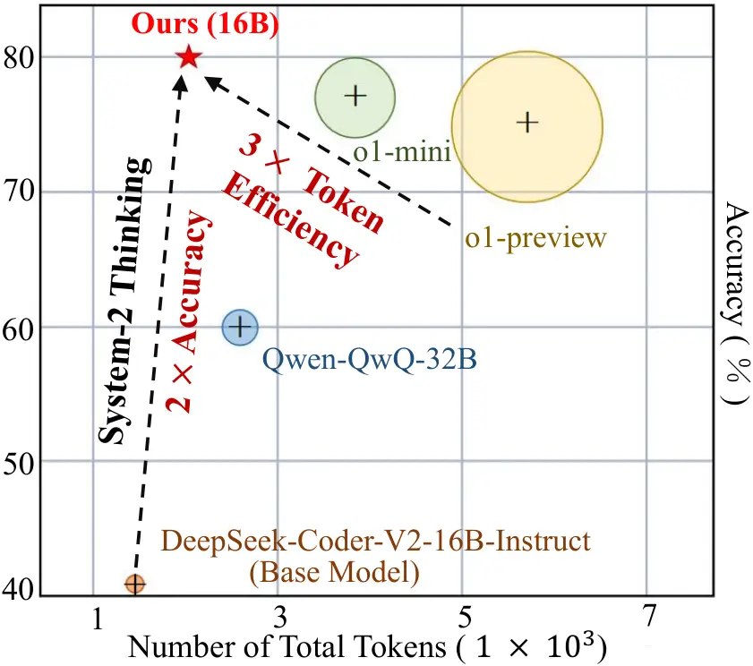

Figure 1: With test-time scaling, our MCTS-Judge method doubles the
accuracy of DeepSeek-Coder-V2-16B-Instruct on the APPS benchmark,
surpassing o1-series models and Qwen-QwQ-32B, while using $`3\times`$
fewer tokens and a smaller model. The circle sizes indicates the
relative sizes of the models.

Despite its growing adoption, recent studies highlight critical
challenges in the LLM-as-a-Judge paradigm, including bias Gu et al.
(2024), misalignment Ye et al. (2024), and fairness concerns Li et al.
(2024a), questioning its reliability for accurate, human-like judgments.
To address these issues, researchers have focused on pretraining Hui et
al. (2024), fine-tuning Wang et al. (2024a), and in-context learning Wei
et al. (2022) to improve reasoning capabilities, which are highly
demanded in programming scenarios. Unfortunately, as LLMs near the upper
bounds imposed by scaling laws, further advancements involve increasing
costs in training with diminishing returns Snell et al. (2024).

To address these limitations, inspired by the shift of scaling laws from
training to test time Xu et al. (2025) and recent breakthroughs in
Reasoning LLMs, such as OpenAI’s o-series Jaech et al. (2024), we
introduce the first framework that integrates test-time computation into
the LLM-as-a-Judge paradigm. We target code correctness evaluation and
propose MCTS-Judge, a resource-efficient LLM-as-a-Judge framework with
System-2 thinking, offering human-like reasoning for more reliable
evaluations. It achieves State-Of-The-Art (SOTA) performance compared to
prior LLM-as-a-Judge methods, which rely on rapid and superficial
System-1 thinking Tong and Zhang (2024); Zhuo (2023). MCTS-Judge
leverages a tailored Monte Carlo Tree Search (MCTS) to decompose
problems into simpler, multi-perspective evaluation tasks. In the
selection phase of MCTS, we introduce a global-local node selection
strategy that combines self-assessment based on historical actions in
the current trajectory, and the Upper Confidence Bound for Trees (UCT)
algorithm, guided by prior rollouts, to balance the optimization of
high-value regions in the global search space with local reasoning
trajectories. We further designed a high-precision simulated execution
reward mechanism. This mechanism combines cost-effective automatic test
case synthesis with LLM-as-an-interpreter execution, prompting
line-by-line analysis for unit-test-level reliability.

Extensive experiments on five LLMs across three challenging code
benchmarks, including BigCodeBench Zhuo et al. (2024), HumanEval-X Zheng
et al. (2023), and APPS Hendrycks et al. (2021), with varying code
complexity and languages, highlight the reliability of MCTS-Judge
powered by test-time computation. As shown in Fig. 1, our approach
elevates the accuracy of DeepSeek-Coder-Lite-16B Zhu et al. (2024) from
41.0% to 80.0%, surpassing o1-series models Jaech et al. (2024) and
open-source Qwen-QwQ-32B Qwen Team (2025), while using only 3$`\times`$
fewer tokens and a smaller model. Furthermore, we achieve SOTA
performance on all experiments compared to previous System-1
thinking-based LLM-as-a-judge frameworks, with up to 32% improvement on
APPS, and demonstrate strong robustness in generalizable scenarios
without code references. Case studies on HumanEval-X further showcase
MCTS-Judge’s superior reasoning across four fine-grained dimensions,
such as logic and analytics, achieving a higher win rate over o1-series
models. Finally, we validated that scaling test-time computation,
including tree depth and rollouts, further enhances MCTS-Judge’s
accuracy, shedding light into the test-time scaling law for
LLM-as-a-judge paradigms.

## 2 Related Work

### 2.1 Code Correctness Evaluation

Code correctness evaluation can be broadly broken down into two
paradigms. Execution-free methods, such as BLEU Papineni et al. (2002),
ROUGE-L Lin (2004), METEOR Denkowski and Lavie (2014), ChrF Popović
(2015), RUBY Tran et al. (2019), and CodeBLEU Ren et al. (2020), assess
code based on textual or code-specific feature similarity to reference
code. In this paper, we refer to them as similarity-based evaluation
methods. However, reference code is often unavailable in practice, and
these methods struggle to distinguish semantically equivalent but
syntactically different code, leading to low accuracy, as shown in
Appendix B. In contrast, execution-based methods, commonly used in code
generation benchmarks Zheng et al. (2023); Zhuo et al. (2024), assess
code correctness by executing it against test cases. However, this
approach demands comprehensive handcrafted test cases and isolated
environments, making it costly and operationally complex Chen et al.
(2022). To address these limitations, recent efforts have explored
LLM-as-a-Judge paradigms with in-context learning. ICE-Score Zhuo (2023)
integrates evaluation criteria into prompts, while CODEJUDGE Tong and
Zhang (2024) employs a two-stage prompting approach. However, these
methods rely on System-1 thinking Kahneman (2011), leading to rapid,
superficial decisions that are constrained by the inherent uncertainties
of LLMs, resulting in limited reliability.

### 2.2 Test-time Computation Boost Reasoning

Recent studies highlight a shift in scaling laws from train-time to
test-time Ji et al. (2025); Xu et al. (2025), as pretrained models
approach data scale limits Snell et al. (2024), while reasoning models
leverage test-time computation, demonstrating remarkable performance
improvements, exemplified by OpenAI’s o-series models Jaech et al.
(2024). To advance human-like System-2 thinking, key innovations include
chain-of-thought data curation Wang et al. (2022); Wang et al. (2024b),
reinforcement learning DeepSeek-AI et al. (2025); Qwen Team (2025), and
reward models Guan et al. (2025); Yu et al. (2024). As a core support,
search paradigms like beam search and MCTS dynamically select diverse
reasoning trajectories, significantly enhancing accuracy in large search
spaces. Examples include ReST-MCTS Zhang et al. (2024a), rStar Qi et al.
(2024), MCTSr Zhang et al. (2024b), and Xie et al. (2024), which
integrate MCTS with reinforced self-training, self-play mutual
reasoning, and preference optimization, driving advancements in
reasoning tasks such as math and code problem-solving. Building on this
remarkable improvement in reliability, we pioneeringly integrate
test-time computation into the LLM-as-a-Judge paradigm, proposing a
novel framework, MCTS-Judge, which leverages System-2 thinking to
generate reliable, human-like reasoning trajectories for comprehensive,
multi-perspective code correctness evaluation.

## 3 MCTS-Judge

In this section, we first introduce the overview of MCTS-Judge for code
evaluation (Sec.3.1), then detail its MCTS architecture (Sec.3.2) and
reward mechanism (Sec. 3.3).

### 3.1 Overview

The code correctness evaluation task determines whether a code snippet
$`c`$ correctly implements the functionality described in a problem
statement $`p`$, expressed as $`x=(c,p)`$. In MCTS-Judge, we decompose
this task into subtasks, each prompting the LLM to verify a specific
requirement. The action space of our MCTS consists of these subtasks and
a null action representing no evaluation. At each node in the search
tree, the subaction space includes one non-repeating subtask and the
null action. Each action in MCTS produces an output
$`s_{i}\in\mathcal{S}`$ with state transitions defined as
$`s_{i}=L\bigl(x,s_{1},\ldots,s_{i-1}\bigr)`$, where $`L`$ represents an
LLM. This forms a reasoning trajectory
$`\mathbf{t}=x\oplus s_{1}\oplus\cdots\oplus s_{k}`$, where $`k`$ is the
maximum depth of the search tree. The prediction for a trajectory is
computed as $`f(\mathbf{t,g})`$, where $`f`$ aggregates the subtask
outcomes in $`\mathbf{t}`$ along with a global evaluation
$`\mathbf{g}`$. A task-specific terminal reward is assigned based on the
agreement between $`f(\mathbf{t,g})`$ and the simulated execution
result. We perform multiple rollouts, yielding a set of reasoning
trajectories
$`\mathbf{T}=\left\{\mathbf{t}^{1},\mathbf{t}^{2},\ldots,\mathbf{t}^{n}\right\}`$.
The cumulative rewards
$`R(\mathbf{t^{i}})=\sum_{s\in\mathbf{t^{i}}}r(s)`$ for these
trajectories are used for weighted sampling to select the optimal
trajectory $`\mathbf{t^{b}}`$. The final prediction for $`x`$ is given
by $`f(\mathbf{t^{b},g})`$.

### 3.2 Architecture Design

We chose MCTS to implement System-2 thinking essential for code
evaluation for two reasons: First, MCTS breaks down the overall code
evaluation task into simpler subtasks, reducing the task complexity
compared to other System-2 methods like Best-of-N Brown et al. (2024)
and self-consistency Wang et al. (2022), which require generating
complete solutions in a single inference. Second, our MCTS introduces
rewards to guide the search and select the optimal trajectory, further
improving the reliability of the LLM-as-a-Judge paradigm. As shown in
Fig. 2, our tailored MCTS follows four key stages: selection, expansion,
simulation, and backpropagation.

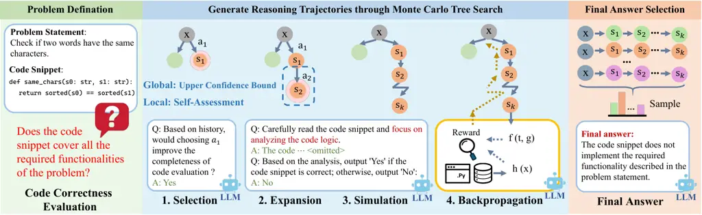

Figure 2: MCTS-Judge generates reasoning trajectories with
multi-dimensional evaluations using Monte-Carlo Tree Search (MCTS). Each
trajectory is iteratively constructed through selection, expansion,
simulation, and backpropagation. Our node selection strategy combines
LLM-driven self-assessment, based on historical actions in the current
trajectory, with the Upper Confidence Bound for Tree (UCT) algorithm
based on prior rollouts. This strategy effectively integrates global and
local information, balancing the optimization of high-value regions in
the search space with the refinement of the current trajectory.
Moreover, we introduce a high-precision, unit-test-level reward
mechanism, encouraging the LLM to perform line-by-line analysis. This
simulated execution reward guides the search process and selects the
final answer from candidate trajectories.

1. Selection. The selection process begins at the root node and
   progresses hierarchically until it reaches a node that has not been
   fully expanded yet. We propose a selection strategy that combines global
   and local information to balance the optimization of high-value regions
   in the search space with the current trajectory, resulting in a more
   coherent evaluation. Specifically, we employ a two-level approach: a
   global-level UCT algorithm Kocsis and Szepesvári (2006), leveraging
   insights from previous rollouts, and a local-level LLM-driven
   self-assessment, which evaluates historical actions within the current
   trajectory. The final selection is obtained through weighted sampling,
   with the UCT result weighted by $`w_{u}`$ and the self-assessment result
   weighted by $`w_{l}`$. The UCT algorithm selects the node with the
   highest UCT value, computed as:

```math
UCT(s)=\frac{Q(s)}{N(s)}+\alpha\cdot\sqrt{\frac{\ln N_{parent}(s)}{N(s)}}, \tag{1}
```

where $`Q(s)`$ represents the cumulative reward of node $`s`$, $`N(s)`$
is the visit count of $`s`$, $`N_{parent}(s)`$ the visit count of
$`s`$’s parent node, and $`\alpha`$ is a constant that helps balance
exploration and exploitation. The LLM self-assessment result is obtained
by prompting the LLM whether including this subtask enhances code
evaluation completeness based on the completed subtasks in the current
trajectory.

2. Expansion. If the maximum depth has not been reached, a new child
   node is added to the selected node by randomly sampling an unused action
   and executing it. If the action is not null, a subtask outcome is
   obtained by prompting the LLM to carefully analyze $`c`$ and $`p`$
   (optionally with reference code) from a specific perspective and then
   summarize the analysis into a binary decision.

3. Simulation. During the simulation process, MCTS-Judge consistently
   selects non-null actions to execute until the maximum depth is reached.
   At this point, a complete reasoning trajectory
   $`\mathbf{t}=x\oplus s_{1}\oplus\cdots\oplus s_{k}`$ that evaluates the
   code across multiple dimensions is generated. The prediction of this
   trajectory (i.e. $`f(\mathbf{t,g})`$) is determined by a consistency
   check using the majority vote across all binary subtask outcomes,
   combined with an additional global evaluation $`g`$.

4. Backpropagation. Once the maximum depth is reached, a terminal reward
   is calculated for the trajectory and propagated upward through the
   search tree. Each node in the trajectory updates its $`Q(s)`$ by adding
   the terminal reward and incrementing its $`N(s)`$ by one.

### 3.3 Reward Mechanism

Reward is crucial in MCTS to guide the search toward promising paths
while minimizing suboptimal exploration. Moreover, cumulative rewards
directly determine the final answer in MCTS-Judge, further underscoring
the importance of reward accuracy. However, verifying the correctness of
predictions without ground truth labels is challenging. Approaches like
$`\mathrm{M}^{*}`$ Kang et al. (2024) and LLaMA-Berry Zhang et al.
(2024c) attempted to address this issue by training a reward model, but
these methods often struggle with data collection and risk overfitting.
RAP Hao et al. (2023) introduced a self-evaluation mechanism where
rewards are derived by asking the LLM to identify errors in its
reasoning within a single completion. However, this mechanism may
perform close to random if the LLM’s capabilities are limited Qi et al.
(2024).

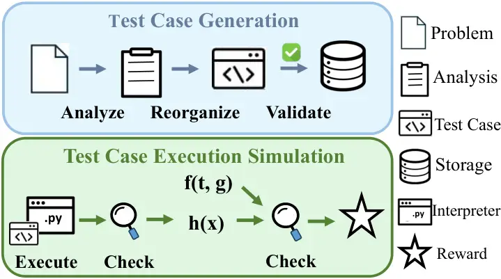

Figure 3: Flowchart of the fully LLM-driven Simulated Execution Reward
Mechanism. $`f(\mathbf{t,g})`$ represents the prediction of the
trajectory, and $`h(\mathbf{x})`$ represents the simulated execution
result.

Therefore, inspired by execution-based evaluation methods Liu et al.
(2024); Xia et al. (2024); Zhang et al. (2024d) and the recently
established success of commercial models, represented by GPT-4o, in
code-related tasks and applications Ma et al. (2025); Liu et al. (2025);
Anysphere (2024), we propose a fully LLM-powered simulated execution
reward mechanism that requires no training and improves reliability
through cross-checking and step-by-step, in-depth analysis. As
illustrated in Fig.3, the mechanism comprises two key phases: test case
generation and execution simulation. The test case generation phase
occurs prior to the MCTS process and requires only the problem statement
$`p`$. GPT-4oOpenAI (2024b) is used to construct, validate, and store
diverse test cases. The execution simulation phase is invoked once MCTS
reaches its maximum depth and is carried out using the same LLM as in
the search phase. Each test case is represented as an input-output pair,
where the evaluated code must produce the correct output corresponding
to a given input.

1. Recipe for Test Case Generation. In the test case generation phase,
   we instruct GPT-4o to analyze the problem statement thoroughly,
   identifying key requirements, constraints, boundary conditions, and
   special cases. Based on this analysis, the model generates
   low-complexity test cases that span a range of scenarios, each with a
   brief explanation. These cases are organized into structured
   input-output pairs. To ensure correctness, each pair undergoes a
   validation process in which the LLM is prompted $`\beta`$ times to
   self-evaluate whether the output aligns with the input and the intended
   behavior. Test cases that consistently pass this validation are
   retained, while those that do not are discarded.

2. LLM-driven Execution Simulation. When the MCTS search reaches its
   maximum depth, the test case execution simulation phase begins. We
   randomly select $`\gamma`$ stored test cases, mask their outputs, and
   provide the inputs to the LLM one by one. We instruct the LLM to
   simulate a code interpreter, executing the code line by line while
   tracking variable changes, and then determining the expected output for
   the given input based on this execution trace. This process repeats
   $`\delta`$ times per test case, and the generated outputs are compared
   with the originally stored outputs. The majority vote from the
   $`\delta`$ repetitions finally determines whether a test case passes.
   The reward mechanism predicts that the code is correct only if all
   sampled test cases pass, and the result is expressed by
   $`h(\mathbf{x})`$. This design mirrors practical test case evaluation:
   if a code passes all test cases, it may be correct; however, if it fails
   any test case, it is definitively incorrect. Finally, if the
   trajectory’s prediction $`f(\mathbf{t,g})`$ matches $`h(\mathbf{x})`$,
   the trajectory receives a terminal reward $`\epsilon`$.

In doing so, our reward mechanism is both cautious and reliable,
leveraging the characteristics of the code evaluation task to establish
a systematic, cross-checking evaluation process that effectively
minimizes errors. Additionally, by simulating an interpreter that
executes the code line by line, our approach encourages LLMs to perform
fine-grained deductive reasoning, considering code flow, variable
updates, and logical branches. This detailed analysis helps uncover
potential errors that might otherwise go unnoticed with a superficial
“general impression”, ensuring that final conclusions are grounded in
concrete and verifiable evidence.

## 4 Experiments

|                                                             |          |              |       |             |       |       |            |       |         |
| ----------------------------------------------------------- | -------- | ------------ | ----- | ----------- | ----- | ----- | ---------- | ----- | ------- |
| Method                                                      | Approach | BigCodeBench | APPS  | HumanEval-X |       |       |            |       |         |
|                                                             |          |              |       | Python      | Java  | C++   | JavaScript | Go    | Average |
| Test-case Verification                                      |          |              |       |             |       |       |            |       |         |
| GPT-4o                                                      | System-1 | \-           | 55.00 | 59.09       | 53.79 | 60.61 | 62.12      | 65.91 | 60.30   |
| Commercial Reasoning LLMs                                   |          |              |       |             |       |       |            |       |         |
| GPT-o1-preview                                              | System-2 | 82.02        | 75.00 | 82.58       | 89.39 | 87.12 | 86.36      | 83.33 | 85.76   |
| GPT-o1-mini                                                 | System-2 | 75.70        | 78.00 | 95.45       | 92.42 | 94.70 | 90.91      | 88.64 | 92.42   |
| Open-sourced Reasoning LLMs                                 |          |              |       |             |       |       |            |       |         |
| Qwen-QwQ-32B                                                | System-2 | 50.96        | 60.00 | 72.73       | 75.00 | 75.00 | 64.39      | 78.03 | 73.03   |
| Code-Specialized Base Model: Qwen2.5-Coder-14B-Instruct     |          |              |       |             |       |       |            |       |         |
| Vanilla                                                     | System-1 | 63.33        | 62.00 | 62.12       | 64.39 | 68.94 | 64.39      | 73.48 | 66.66   |
| ICE-Score                                                   | System-1 | 70.44        | 65.00 | 72.73       | 74.24 | 71.97 | 72.73      | 78.79 | 74.09   |
| CodeJudge                                                   | System-1 | 63.33        | 68.00 | 86.36       | 81.06 | 79.55 | 82.58      | 75.75 | 81.06   |
| MCTS-Judge (Ours)                                           | System-2 | 71.23        | 79.00 | 90.15       | 85.61 | 84.09 | 84.85      | 81.06 | 85.15   |
| Code-Specialized Base Model: DeepSeek-Coder-V2-16B-Instruct |          |              |       |             |       |       |            |       |         |
| Vanilla                                                     | System-1 | 51.75        | 41.00 | 73.48       | 64.39 | 63.64 | 66.67      | 60.61 | 65.76   |
| ICE-Score                                                   | System-1 | 57.89        | 48.00 | 71.21       | 76.52 | 69.70 | 70.45      | 74.24 | 72.42   |
| CodeJudge                                                   | System-1 | 52.45        | 62.00 | 73.48       | 69.70 | 67.42 | 69.70      | 66.67 | 69.39   |
| MCTS-Judge (Ours)                                           | System-2 | 62.46        | 80.00 | 80.30       | 77.27 | 80.30 | 78.79      | 82.58 | 79.85   |
| Code-Specialized Base Model: Mistralai-Codestral-22B        |          |              |       |             |       |       |            |       |         |
| Vanilla                                                     | System-1 | 42.81        | 62.00 | 82.58       | 68.18 | 70.45 | 62.88      | 66.67 | 70.15   |
| ICE-Score                                                   | System-1 | 51.93        | 56.00 | 82.58       | 68.18 | 60.61 | 63.64      | 61.36 | 67.27   |
| CodeJudge                                                   | System-1 | 49.04        | 54.00 | 85.61       | 69.70 | 68.94 | 71.21      | 66.67 | 72.43   |
| MCTS-Judge (Ours)                                           | System-2 | 68.77        | 72.00 | 87.78       | 75.76 | 77.27 | 73.48      | 75.76 | 78.01   |
| General Base Model: Llama-3.1-8B-Instruct                   |          |              |       |             |       |       |            |       |         |
| Vanilla                                                     | System-1 | 43.16        | 56.00 | 65.91       | 63.64 | 64.39 | 62.12      | 70.45 | 65.30   |
| ICE-Score                                                   | System-1 | 45.88        | 42.00 | 72.73       | 64.39 | 62.88 | 56.82      | 54.55 | 62.27   |
| CodeJudge                                                   | System-1 | 63.86        | 53.00 | 73.48       | 73.48 | 75.76 | 70.45      | 67.42 | 72.12   |
| MCTS-Judge (Ours)                                           | System-2 | 71.84        | 62.00 | 74.24       | 79.55 | 77.27 | 70.45      | 71.97 | 74.70   |
| Commercial General Base Model: GPT-4o-mini                  |          |              |       |             |       |       |            |       |         |
| Vanilla                                                     | System-1 | 72.37        | 65.00 | 86.36       | 82.58 | 85.61 | 86.36      | 84.85 | 85.15   |
| ICE-Score                                                   | System-1 | 77.37        | 72.00 | 84.85       | 78.79 | 86.36 | 83.33      | 85.61 | 83.79   |
| CodeJudge                                                   | System-1 | 70.70        | 72.00 | 87.12       | 83.33 | 87.88 | 86.36      | 84.09 | 85.76   |
| MCTS-Judge (Ours)                                           | System-2 | 79.12        | 76.00 | 87.88       | 86.36 | 88.64 | 88.64      | 85.61 | 87.43   |

Table 1: Accuracy (%) of MCTS-Judge and baselines on BigCodeBench, APPS,
and HumanEval-X. MCTS-Judge significantly improves the accuracy of base
models and achieves the highest accuracy among existing LLM-as-a-Judge
methods across all benchmarks and five LLMs (highlighted in bold). It
also surpasses larger reasoning model, Qwen-QwQ-32B in most tasks and
outperforms o1-series models in certain tasks (highlighted with
underlines).

### 4.1 Setup

Following previous work Tong and Zhang (2024), we evaluated MCTS-Judge
on three challenging benchmarks: HumanEval-X Zheng et al. (2023),
APPS Hendrycks et al. (2021), and BigCodeBench Zhuo et al. (2024).
HumanEval-X includes 164 introductory coding tasks across five
programming languages. APPS consists of Python coding tasks of three
different difficulty levels, from which we randomly selected 100
competition-level tasks. BigCodeBench contains 1,140 practical and
challenging Python programming tasks, covering 723 function calls from
139 libraries. For tasks in BigCodeBench that lack meaningful
input-output pairs, such as drawing or compressing, we shift the reward
mechanism from simulated execution to simulated discussions, granting
rewards only when all reasoning steps yield positive signals that
enhance generalizability.

MCTS-Judge is a general framework compatible with various LLMs. To
assess its effectiveness and generalizability, we employed five
different LLMs as base models, including code-specialized LLMs:
Qwen2.5-Coder-14B Hui et al. (2024), DeepSeek-Coder-V2-16B-Instruct Zhu
et al. (2024) and Mistralai-Codestral-22B Mistral AI team (2024), as
well as general LLMs: Llama-3.1-8B-Instruct Touvron et al. (2023) and
GPT-4o-mini OpenAI (2024a). We compare MCTS-Judge with three System 2
thinking LLMs, including OpenAI o1-preview Jaech et al. (2024),
o1-mini Jaech et al. (2024), and Qwen-QwQ-32B Qwen Team (2025), as well
as two LLM-as-a-Judge paradigms designed for code evaluation with System
1 thinking: CodeJudge Tong and Zhang (2024) and ICE-Score Zhuo (2023).¹¹
1 ICE-Score produces ratings ranging from 0 to 4. Following the approach
in Tong and Zhang (2024), only a rating of 4 is considered correct. We
further introduce a Vanilla baseline, which prompts the LLM directly for
code correctness, reflecting its native evaluation capability.
Additionally, we also include a test-case-only verification baseline
using GPT-4o, demonstrating that the MCTS-Judge’s effectiveness derives
from its architecture rather than model-specific advantages.
BigCodeBench is excluded here as it’s evaluated with non-test-case-based
approach. More details such as hyperparameters and prompts are included
in Appendix A.

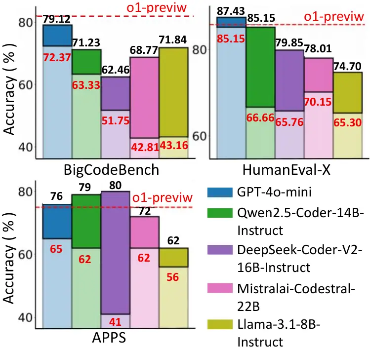

Figure 4: MCTS-Judge (darker colors) significantly enhances LLMs’
inherent code evaluation capabilities (lighter colors) across three
benchmarks.

### 4.2 Main Results

Table 1 presents the comparison results between MCTS-Judge and
baselines. We highlight three key observations: (1) MCTS-Judge
significantly enhances the code evaluation capabilities of all base
models. When using open-source LLMs with substantially smaller model
sizes, its performance can match or even surpass o1-series models. This
phenomenon is illustrated more clearly in Fig. 4. On average, MCTS-Judge
achieves a 14.34% accuracy improvement across five different base models
on three benchmarks. In particular, DeepSeek-Coder-V2-16B-Instruct,
originally at 41% accuracy on the APPS benchmark, improved dramatically
to 80% with MCTS-Judge, surpassing both o1-preview and o1-mini. (2) Any
base model we evaluated, when powered by MCTS-Judge, outperforms the
open-source reasoning model Qwen-QwQ-32B on most tasks. For instance,
MCTS-Judge based on Llama-3.1-8B-Instruct, with a model size only a
quarter of Qwen-QwQ-32B, outperforms it in all tasks except those using
the Go language, achieving up to a 20.88% higher accuracy. (3) Compared
to previous LLM-as-a-Judge paradigms with System 1 thinking, MCTS-Judge
demonstrates significantly superior performance in all tasks. For
example, MCTS-Judge with DeepSeek-Coder-V2-16B-Instruct achieved 18%
higher accuracy than CodeJudge and 32% higher than ICE-Score on the APPS
benchmark.

### 4.3 Inference Efficiency

To evaluate the test-time computational efficiency of MCTS-Judge, we
analyzed the average number of reasoning tokens generated on the APPS
benchmark. As presented in Table 2, when using
DeepSeek-Coder-V2-16B-Instruct as the base model, MCTS-Judge outperforms
o1-preview in accuracy, while only consuming one third as many reasoning
tokens, with an additional 20% equivalent token consumption for
simulation in parallelization indicated by the superscript, and
maintaining a model size that is 19 times smaller²² 2 The model sizes of
o1-preview, o1-mini, and GPT-4o-mini are referenced from this
paper Abacha et al. (2024)..

| Methods          | Model Size | \# Reasoning | Acc  |
| ---------------- | ---------- | ------------ | ---- |
|                  |            | Tokens       |      |
| o1-preview       | ~300B      | 5631         | 75.0 |
| o1-mini          | ~100B      | 3755         | 78.0 |
| Qwen-QwQ-32B     | 32B        | 2559         | 60.0 |
| Ours w/ Deepseek | 16B        | 2065₊₄₁₂     | 80.0 |

Table 2: Compared to advanced reasoning LLMs, MCTS-Judge is
cost-effective. With DeepSeek-Coder-V2-16B-Instruct on the APPS
benchmark, it achieves the highest accuracy using the fewest tokens and
the smallest model size.

### 4.4 Fine-grained Quality Assessment

MCTS-Judge demonstrated superior code correctness evaluation ability,
while simultaneously generating multi-perspective analyses during
reasoning trajectory construction. We believe that this may offer
developers deeper insights into the code, providing a distinct advantage
over both similarity-based and execution-based evaluation methods. To
evaluate the quality of meta-analysis and reasoning capabilities, we
compared the reasoning trajectories generated by MCTS-Judge with three
reasoning models—o1-preview, o1-mini, and Qwen-QwQ-32B across four
critical dimensions: thoroughness, logic, analysis, and overall
reasoning quality, with GPT-4o assessing the win rate. As shown in
Table 3, MCTS-Judge with Deepseek-Coder-V2-16B-Instruct and
Qwen2.5-Coder-14B-Instruct consistently achieves higher win rates,
particularly excelling at thoroughness and depth of analysis.

| Dimensions   | Deepseek-Coder- V2-16B-Instruct |       | Qwen2.5-Coder- 14B-Instruct |       |
| ------------ | ------------------------------- | ----- | --------------------------- | ----- |
|              | o1-preview                      | Ours  | o1-preview                  | Ours  |
| Thoroughness | 35.6%                           | 64.4% | 28.8%                       | 71.2% |
| Logic        | 51.5%                           | 48.5% | 49.2%                       | 50.8% |
| Analysis     | 33.3%                           | 66.7% | 34.8%                       | 65.2% |
| Overall      | 54.5%                           | 45.5% | 52.3%                       | 47.7% |
|              | o1-mini                         | Ours  | o1-mini                     | Ours  |
| Thoroughness | 25.8%                           | 74.2% | 14.4%                       | 85.6% |
| Logic        | 40.9%                           | 59.1% | 22.7%                       | 77.3% |
| Analysis     | 16.7%                           | 83.3% | 15.9%                       | 84.1% |
| Overall      | 46.2%                           | 53.8% | 47.0%                       | 53.0% |
|              | QwQ                             | Ours  | QwQ                         | Ours  |
| Thoroughness | 28.0%                           | 72.0% | 31.1%                       | 68.9% |
| Logic        | 25.8%                           | 74.2% | 43.2%                       | 56.8% |
| Analysis     | 38.6%                           | 61.4% | 40.1%                       | 59.9% |
| Overall      | 49.2%                           | 50.8% | 43.9%                       | 56.1% |

Table 3: Comparison of MCTS-Judge’s reasoning trajectories with advanced
reasoning LLMs across thoroughness, logic, analysis, and overall
reasoning quality, with GPT-4o assessing the win rate.

### 4.5 Extensions to General Scenarios

Reference code is crucial for similarity-based evaluation but is often
unavailable in practice. While it aids LLMs in understanding problems,
LLM-as-a-Judge methods should adapt to more generalizable settings
without it. We evaluated MCTS-Judge and baselines on three benchmarks
without reference code (full results in Appendix C). As shown in
Table 4, the absence of reference code significantly degrades the
performance of existing LLM-as-a-Judge frameworks. In contrast, our
MCTS-Judge demonstrates exceptional robustness, with only minimal
performance drop, highlighting its promising generalization
capabilities.

|               |               |              |               |
| ------------- | ------------- | ------------ | ------------- |
| Method        | BigCode-      | APPS         | Human         |
|               | Bench         |              | Eval-X        |
| ICE-Score     | 45.9          | 42.0         | 62.3          |
| w/o reference | 34.5 (-11.4%) | 46.0 (+4%)   | 52.3 (-10.0%) |
| CodeJudge     | 63.9          | 53.0         | 72.1          |
| w/o reference | 41.4 (-22.5%) | 47.0 (-6.0%) | 57.4 (-14.7%) |
| Ours          | 71.8          | 62.0         | 74.7          |
| w/o reference | 65.8 (-6%)    | 62.0 (+0.0%) | 69.5 (-5.2%)  |

Table 4: In the absence of reference code, MCTS-Judge with
Llama-3.1-8B-Instruct demonstrates robustness with minimal performance
drop, while other baselines degrade significantly.

### 4.6 Scaling Test-time Computation

We explore the relationship between test-time computational scale and
performance gains under our LLM-as-a-Judge framework. MCTS-Judge relies
on simulated execution of test cases to determine the terminal reward,
thereby providing more accurate guidance for MCTS and final prediction
selection. Intuitively, increasing the number of test cases ($`\alpha`$)
reduces the likelihood of misjudging incorrect code as correct, while
increasing the execution times per test case ($`\delta`$) further
enhances accuracy. Furthermore, extending the maximum tree depth
provides a more comprehensive evaluation, and more rollouts enable
broader exploration. Fig. 5 demonstrates the impact of these key
hyperparameters on the APPS benchmark using
DeepSeek-Coder-V2-16B-Instruct and Qwen2.5-Coder-14B-Instruct as base
models. MCTS-Judge benefits from increased test-time computation, though
the gains vary with specific hyperparameters and models. These results
align with OpenAI’s findings OpenAI (2024c), highlighting the potential
of test-time scaling for LLM-as-a-Judge frameworks.

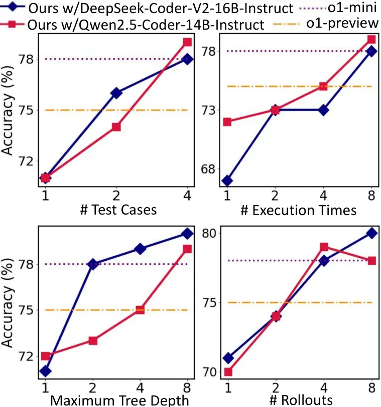

Figure 5: Increasing test cases ($`\alpha`$), executions per case
($`\delta`$), tree depth, and rollouts improves MCTS-Judge’s accuracy on
APPS, revealing a test-time scaling law.

### 4.7 Ablation Studies

Table 5 presents ablation results evaluating the key components of
MCTS-Judge. Under System-1 thinking, the Vanilla baseline reflects the
base model’s intrinsic evaluation capability, while Majority Vote
executes all subtasks and selects the most frequent answer. Majority
Vote improves accuracy by 13% over Vanilla, highlighting the value of
incorporating multi-perspective evaluation.

Under System-2 thinking, driven by MCTS, reward mechanisms are further
analyzed. $`RM_{SC}`$ assigns rewards based on self-consistency majority
voting Qi et al. (2024), while $`RM_{SE}`$ incorporates self-evaluation
rewards Hao et al. (2023). Our proposed simulated execution reward,
closely aligned with ground truth, surpasses $`RM_{SC}`$ and $`RM_{SE}`$
by 13% in accuracy. Moreover, a variant using pure UCT-based node
selection is outperformed by the full MCTS-Judge, highlighting the
benefit of our global-local-aware node selection strategy.

|                         |            |           |      |
| ----------------------- | ---------- | --------- | ---- |
| Method                  | Reward     | Node      | Acc  |
|                         | Model      | Selection |      |
| System-1 Thinking       |            |           |      |
| Vanilla                 | \-         | \-        | 41.0 |
| Majority Vote           | \-         | \-        | 54.0 |
| System-2 Thinking       |            |           |      |
| Monte Carlo Tree Search | RM\_(SC)   | UCT       | 65.0 |
|                         | RM\_(SE)   | UCT       | 65.0 |
|                         | RM\_(Ours) | UCT       | 78.0 |
|                         | RM\_(Ours) | UCT+LLM   | 80.0 |

Table 5: Ablation of System-2 thinking, reward mechanism, and node
selection strategy on APPS with DeepSeek-Coder-V2-16B-Instruct
highlights the effectiveness of our designed components. The grey line
represents the complete MCTS-Judge, improving from 41.0% to 80.0% over
Vanilla.

## 5 Conclusion

In this work, we propose MCTS-Judge, a novel resource-efficient,
test-time computation LLM-as-a-Judge framework with System-2 thinking
for code correctness evaluation. Powered by a fully LLM-driven MCTS,
MCTS-Judge decomposes problems into simpler, multi-perspective
evaluations. Through our global-local node selection strategy, along
with guidance from a simulated execution reward mechanism, MCTS-Judge
performs line-by-line deep analysis. Experiments on five LLMs and three
benchmarks show that MCTS-Judge significantly improves base model
accuracy, surpassing o1-series models and Qwen-QwQ-32B with one-third of
the tokens and a smaller model size. Compared to existing LLM-as-a-Judge
frameworks with System-1 thinking, MCTS-Judge achieves SOTA performance
while reducing dependence on reference code. Moreover, its reasoning
trajectory shows superiority in logic, analytics, thoroughness, and
overall quality. We further reveal the test-time scaling law of
MCTS-Judge, marking an important first step in integrating test-time
computation with the LLM-as-a-Judge paradigm.

## 6 Limitations

In this work, we propose a System-2 thinking approach with a carefully
designed architecture for code correctness evaluation. Our current
reward mechanism leverages GPT-4o, one of the few models capable of
producing reliable and well-formatted reward signals. In contrast,
existing open-source LLMs often struggle with accurate, line-by-line
code execution using only pre-trained capabilities and frequently fail
to generate structured, precise outputs for programming tasks. Looking
forward, we aim to integrate future advancements in open-source models
to develop a more cost-effective and broadly deployable solution. To
ensure full and reliable reproducibility, we will release the complete
codebase, data flywheel pipeline for test case generation, and
comprehensive documentation upon acceptance.

## References

- Abacha et al. (2024) A. B. Abacha, W. Yim, Y. Fu, Z. Sun, M.
  Yetisgen, F. Xia, and T. Lin Medec: a benchmark for medical error
  detection and correction in clinical notes. arXiv preprint
  arXiv:2412.19260. Cited by: footnote 2.
- Anysphere (2024) Anysphere Cursor: the ai-first code editor. Note:
  [https://www.cursor.so](https://www.cursor.so) Cited by: §3.3.
- Brown et al. (2024) B. Brown, J. Juravsky, R. Ehrlich, R. Clark, Q. V.
  Le, C. Ré, and A. Mirhoseini Large language monkeys: scaling inference
  compute with repeated sampling. arXiv preprint arXiv:2407.21787. Cited
  by: §3.2.
- Chen et al. (2022) B. Chen, F. Zhang, A. Nguyen, D. Zan, Z. Lin, J.
  Lou, and W. Chen Codet: code generation with generated tests. arXiv
  preprint arXiv:2207.10397. Cited by: §2.1.
- Chen et al. (2024) D. Chen, R. Chen, S. Zhang, Y. Liu, Y. Wang, H.
  Zhou, Q. Zhang, Y. Wan, P. Zhou, and L. Sun Mllm-as-a-judge: assessing
  multimodal llm-as-a-judge with vision-language benchmark. arXiv
  preprint arXiv:2402.04788. Cited by: §1.
- DeepSeek-AI et al. (2025) DeepSeek-AI, D. Guo, D. Yang, H. Zhang, J.
  Song, P. Wang, Q. Zhu, R. Xu, R. Zhang, S. Ma, X. Bi, et al.
  DeepSeek-R1: incentivizing reasoning capability in LLMs via
  reinforcement learning. arXiv preprint arXiv:2501.12948. Cited by:
  §2.2.
- Denkowski and Lavie (2014) M. Denkowski and A. Lavie Meteor universal:
  language specific translation evaluation for any target language. In
  Proceedings of the ninth workshop on statistical machine translation,
  Cited by: §2.1.
- Gu et al. (2024) J. Gu, X. Jiang, Z. Shi, H. Tan, X. Zhai, C. Xu, W.
  Li, Y. Shen, S. Ma, H. Liu, et al. A survey on llm-as-a-judge. arXiv
  preprint arXiv:2411.15594. Cited by: §1, §1.
- Guan et al. (2025) X. Guan, L. L. Zhang, Y. Liu, N. Shang, Y. Sun, Y.
  Zhu, F. Yang, and M. Yang RStar-math: small llms can master math
  reasoning with self-evolved deep thinking. arXiv preprint
  arXiv:2501.04519. Cited by: §2.2.
- Hao et al. (2023) S. Hao, Y. Gu, H. Ma, J. J. Hong, Z. Wang, D. Z.
  Wang, and Z. Hu Reasoning with language model is planning with world
  model. arXiv preprint arXiv:2305.14992. Cited by: §3.3, §4.7.
- Hendrycks et al. (2021) D. Hendrycks, S. Basart, S. Kadavath, M.
  Mazeika, A. Arora, E. Guo, C. Burns, S. Puranik, H. He, D. Song, et
  al. Measuring coding challenge competence with apps. arXiv preprint
  arXiv:2105.09938. Cited by: Appendix F, §1, §4.1.
- Hui et al. (2024) B. Hui, J. Yang, Z. Cui, J. Yang, D. Liu, L.
  Zhang, T. Liu, J. Zhang, B. Yu, K. Lu, et al. Qwen2.5-coder technical
  report. arXiv preprint arXiv:2409.12186. Cited by: §1, §4.1.
- Jaech et al. (2024) A. Jaech, A. Kalai, A. Lerer, A. Richardson, A.
  El-Kishky, A. Low, A. Helyar, A. Madry, A. Beutel, A. Carney, et al.
  Openai o1 system card. arXiv preprint arXiv:2412.16720. Cited by: §1,
  §1, §2.2, §4.1.
- Ji et al. (2025) Y. Ji, J. Li, Y. Xiang, H. Ye, K. Wu, K. Yao, J.
  Xu, L. Mo, and M. Zhang A survey of test-time compute: from intuitive
  inference to deliberate reasoning. arXiv preprint arXiv:2501.02497.
  Cited by: §2.2.
- Kahneman (2011) D. Kahneman Thinking, fast and slow. Farrar, Straus
  and Giroux. Cited by: §2.1.
- Kang et al. (2024) J. Kang, X. Z. Li, X. Chen, A. Kazemi, Q. Sun, B.
  Chen, D. Li, X. He, Q. He, F. Wen, et al. Mindstar: enhancing math
  reasoning in pre-trained llms at inference time. arXiv preprint
  arXiv:2405.16265. Cited by: §3.3.
- Kocsis and Szepesvári (2006) L. Kocsis and C. Szepesvári Bandit based
  monte-carlo planning. In Proceedings of the 17th European Conference
  on Machine Learning (ECML), Cited by: §3.2.
- Li et al. (2024a) H. Li, Q. Dong, J. Chen, H. Su, Y. Zhou, Q. Ai, Z.
  Ye, and Y. Liu LLMs-as-judges: a comprehensive survey on llm-based
  evaluation methods. arXiv preprint arXiv:2412.05579. Cited by: §1.
- Li et al. (2024b) L. Li, B. Dong, R. Wang, X. Hu, W. Zuo, D. Lin, Y.
  Qiao, and J. Shao Salad-bench: a hierarchical and comprehensive safety
  benchmark for large language models. arXiv preprint arXiv:2402.05044.
  Cited by: §1.
- Lin (2004) C. Lin Rouge: a package for automatic evaluation of
  summaries. In Text summarization branches out, Cited by: §2.1.
- Liu et al. (2025) R. Liu, A. Frade, A. Vaidya, M. Labonne, M.
  Kaiser, B. Chakrabarti, J. Budd, and S. Moran On iterative evaluation
  and enhancement of code quality using gpt-4o. arXiv preprint
  arXiv:2502.07399. Cited by: §3.3.
- Liu et al. (2024) Y. Liu, P. Gao, X. Wang, J. Liu, Y. Shi, Z. Zhang,
  and C. Peng MarsCode agent: ai-native automated bug fixing. arXiv
  preprint arXiv:2409.00899. Cited by: §1, §3.3.
- Ma et al. (2025) Z. Ma, X. Zhang, J. Zhang, J. Yu, S. Luo, and J. Tang
  Dynamic scaling of unit tests for code reward modeling. arXiv preprint
  arXiv:2501.01054. Cited by: §3.3.
- Mistral AI team (2024) Mistral AI team Codestral. External Links:
  [Link](https://mistral.ai/news/codestral/) Cited by: §4.1.
- OpenAI (2024a) OpenAI GPT-4o mini: advancing cost-efficient
  intelligence. External Links:
  [Link](https://openai.com/index/gpt-4o-mini-advancing-cost-efficient-intelligence/)
  Cited by: §4.1.
- OpenAI (2024b) OpenAI GPT-4o system card. External Links:
  [Link](https://openai.com/index/gpt-4o-system-card/) Cited by: §3.3.
- OpenAI (2024c) OpenAI Learning to reason with LLMs. External Links:
  [Link](https://openai.com/index/learning-to-reason-with-llms/) Cited
  by: §4.6.
- Papineni et al. (2002) K. Papineni, S. Roukos, T. Ward, and W. Zhu
  Bleu: a method for automatic evaluation of machine translation. In
  Proceedings of the 40th annual meeting of the Association for
  Computational Linguistics, Cited by: §2.1.
- Popović (2015) M. Popović ChrF: character n-gram f-score for automatic
  mt evaluation. In Proceedings of the tenth workshop on statistical
  machine translation, Cited by: §2.1.
- Qi et al. (2024) Z. Qi, M. Ma, J. Xu, L. L. Zhang, F. Yang, and M.
  Yang Mutual reasoning makes smaller llms stronger problem-solvers.
  arXiv preprint arXiv:2408.06195. Cited by: §2.2, §3.3, §4.7.
- Qwen Team (2025) Qwen Team QwQ-32B: embracing the power of
  reinforcement learning. External Links:
  [Link](https://qwenlm.github.io/blog/qwq-32b/) Cited by: §1, §2.2,
  §4.1.
- Ren et al. (2020) S. Ren, D. Guo, S. Lu, L. Zhou, S. Liu, D. Tang, N.
  Sundaresan, M. Zhou, A. Blanco, and S. Ma Codebleu: a method for
  automatic evaluation of code synthesis. arXiv preprint
  arXiv:2009.10297. Cited by: §1, §2.1.
- Snell et al. (2024) C. Snell, J. Lee, K. Xu, and A. Kumar Scaling llm
  test-time compute optimally can be more effective than scaling model
  parameters. arXiv preprint arXiv:2408.03314. Cited by: §1, §2.2.
- Tong and Zhang (2024) W. Tong and T. Zhang CodeJudge: evaluating code
  generation with large language models. arXiv preprint
  arXiv:2410.02184. Cited by: §1, §2.1, §4.1, §4.1, footnote 1.
- Touvron et al. (2023) H. Touvron, T. Lavril, G. Izacard, X.
  Martinet, M. Lachaux, T. Lacroix, B. Rozière, N. Goyal, E. Hambro, F.
  Azhar, et al. Llama: open and efficient foundation language models.
  arXiv preprint arXiv:2302.13971. Cited by: §4.1.
- Tran et al. (2019) N. Tran, H. Tran, S. Nguyen, H. Nguyen, and T.
  Nguyen Does bleu score work for code migration?. In 2019 IEEE/ACM 27th
  International Conference on Program Comprehension (ICPC), Cited by:
  §1, §2.1.
- Wang et al. (2024a) W. Wang, Z. Chen, W. Wang, Y. Cao, Y. Liu, Z.
  Gao, J. Zhu, X. Zhu, L. Lu, Y. Qiao, et al. Enhancing the reasoning
  ability of multimodal large language models via mixed preference
  optimization. arXiv preprint arXiv:2411.10442. Cited by: §1.
- Wang et al. (2022) X. Wang, J. Wei, D. Schuurmans, Q. Le, E. Chi, S.
  Narang, A. Chowdhery, and D. Zhou Self-consistency improves chain of
  thought reasoning in language models. arXiv preprint arXiv:2203.11171.
  Cited by: §2.2, §3.2.
- Wang et al. (2024b) Y. Wang, S. Zhao, Z. Wang, H. Huang, M. Fan, Y.
  Zhang, Z. Wang, H. Wang, and T. Liu Strategic chain-of-thought:
  guiding accurate reasoning in llms through strategy elicitation. arXiv
  preprint arXiv:2409.03271. Cited by: §2.2.
- Wei et al. (2022) J. Wei, X. Wang, D. Schuurmans, M. Bosma, F. Xia, E.
  Chi, Q. V. Le, D. Zhou, et al. Chain-of-thought prompting elicits
  reasoning in large language models. Advances in neural information
  processing systems 35, pp. 24824–24837. Cited by: §1.
- Weyssow et al. (2026) M. Weyssow, A. Kamanda, X. Zhou, and H. Sahraoui
  Codeultrafeedback: an llm-as-a-judge dataset for aligning large
  language models to coding preferences. ACM Transactions on Software
  Engineering and Methodology 35 (3), pp. 1–36. Cited by: §1.
- Xia et al. (2024) C. S. Xia, Y. Deng, S. Dunn, and L. Zhang Agentless:
  demystifying llm-based software engineering agents. arXiv preprint
  arXiv:2407.01489. Cited by: §3.3.
- Xie et al. (2024) Y. Xie, A. Goyal, W. Zheng, M. Kan, T. P.
  Lillicrap, K. Kawaguchi, and M. Shieh Monte carlo tree search boosts
  reasoning via iterative preference learning. arXiv preprint
  arXiv:2405.00451. Cited by: §2.2.
- Xu et al. (2025) F. Xu, Q. Hao, Z. Zong, J. Wang, Y. Zhang, J.
  Wang, X. Lan, J. Gong, T. Ouyang, F. Meng, et al. Towards large
  reasoning models: a survey of reinforced reasoning with large language
  models. arXiv preprint arXiv:2501.09686. Cited by: §1, §2.2.
- Yang et al. (2024) J. Yang, J. Yang, K. Jin, Y. Miao, L. Zhang, L.
  Yang, Z. Cui, Y. Zhang, B. Hui, and J. Lin Evaluating and aligning
  codellms on human preference. arXiv preprint arXiv:2412.05210. Cited
  by: §1.
- Ye et al. (2024) J. Ye, Y. Wang, Y. Huang, D. Chen, Q. Zhang, N.
  Moniz, T. Gao, W. Geyer, C. Huang, P. Chen, et al. Justice or
  prejudice? quantifying biases in llm-as-a-judge. arXiv preprint
  arXiv:2410.02736. Cited by: §1.
- Yu et al. (2024) Y. Yu, Z. Chen, A. Zhang, L. Tan, C. Zhu, R. Y.
  Pang, Y. Qian, X. Wang, S. Gururangan, C. Zhang, et al. Self-generated
  critiques boost reward modeling for language models. arXiv preprint
  arXiv:2411.16646. Cited by: §2.2.
- Zhang et al. (2024a) D. Zhang, S. Zhoubian, Z. Hu, Y. Yue, Y. Dong,
  and J. Tang Rest-mcts\*: llm self-training via process reward guided
  tree search. arXiv preprint arXiv:2406.03816. Cited by: §2.2.
- Zhang et al. (2024b) D. Zhang, X. Huang, D. Zhou, Y. Li, and W. Ouyang
  Accessing gpt-4 level mathematical olympiad solutions via monte carlo
  tree self-refine with llama-3 8b. arXiv preprint arXiv:2406.07394.
  Cited by: §2.2.
- Zhang et al. (2024c) D. Zhang, J. Wu, J. Lei, T. Che, J. Li, T.
  Xie, X. Huang, S. Zhang, M. Pavone, Y. Li, et al. Llama-berry:
  pairwise optimization for o1-like olympiad-level mathematical
  reasoning. arXiv preprint arXiv:2410.02884. Cited by: §3.3.
- Zhang et al. (2024d) Y. Zhang, H. Ruan, Z. Fan, and A. Roychoudhury
  Autocoderover: autonomous program improvement. In Proceedings of the
  33rd ACM SIGSOFT International Symposium on Software Testing and
  Analysis, Cited by: §3.3.
- Zheng et al. (2023) Q. Zheng, X. Xia, X. Zou, Y. Dong, S. Wang, Y.
  Xue, L. Shen, Z. Wang, A. Wang, Y. Li, et al. Codegeex: a pre-trained
  model for code generation with multilingual benchmarking on
  humaneval-x. In Proceedings of the 29th ACM SIGKDD conference on
  knowledge discovery and data mining, pp. 5673–5684. Cited by: Appendix
  F, §1, §1, §2.1, §4.1.
- Zhu et al. (2024) Q. Zhu, D. Guo, Z. Shao, D. Yang, P. Wang, R. Xu, Y.
  Wu, Y. Li, H. Gao, S. Ma, et al. DeepSeek-coder-v2: breaking the
  barrier of closed-source models in code intelligence. arXiv preprint
  arXiv:2406.11931. Cited by: §1, §4.1.
- Zhuo et al. (2024) T. Y. Zhuo, M. C. Vu, J. Chim, H. Hu, W. Yu, R.
  Widyasari, I. N. B. Yusuf, H. Zhan, J. He, I. Paul, et al.
  Bigcodebench: benchmarking code generation with diverse function calls
  and complex instructions. arXiv preprint arXiv:2406.15877. Cited by:
  Appendix F, §1, §1, §2.1, §4.1.
- Zhuo (2023) T. Y. Zhuo ICE-score: instructing large language models to
  evaluate code. arXiv preprint arXiv:2304.14317. Cited by: §1, §2.1,
  §4.1.

## Appendix A Experiment Settings

Table 6 details the hyperparameter settings of MCTS-Judge employed to
generate the results presented in this paper. These settings encompass
various aspects of the MCTS architecture, including maximum tree depth,
number of rollouts, exploration constant $`\alpha`$, LLM sample weight
$`w_{l}`$, and UCT sample weight $`w_{u}`$. Additionally, the reward
mechanism parameters include the number of test case validations
$`\beta`$, number of test cases used $`\gamma`$, number of test case
simulations $`\delta`$, and reward scaling factor $`\epsilon`$.
Hyperparameters related to the LLM configuration, such as temperature,
top_p, top_k, and maximum output tokens, are also specified. All
experiments were executed on a single H100 GPU with 80GB of memory,
ensuring consistency and reproducibility in computational performance.

| Hyperparameter                             | Value |
| ------------------------------------------ | ----- |
| Maximum tree depth                         | 9     |
| Number of rollouts                         | 8     |
| Constant $`\alpha`$                        | 3     |
| LLM sample weight $`w_{l}`$                | 0.1   |
| UCT sample weight $`w_{u}`$                | 0.9   |
| Number of test case validations $`\beta`$  | 5     |
| Number of test cases used $`\gamma`$       | 3     |
| Number of test case simulations $`\delta`$ | 7     |
| Reward $`\epsilon`$                        | 1.1   |
| Temperature                                | 0.4   |
| Top_p                                      | 0.95  |
| Top_k                                      | 40    |
| Maximum tokens                             | 2048  |

Table 6: Hyperparameters of MCTS-Judge.

## Appendix B Limitations of Execution-Free Methods

In this experiment, we evaluate whether similarity-based execution-free
metrics, which do not require test cases and isolated environments, can
be used to accurately assess code correctness. We evaluated six
representative metrics on the APPS benchmark: BLEU, ROUGE-L, METEOR,
ChrF, CodeBLEU, and RUBY. Fig. 6 shows that the score distributions for
incorrect and correct code differ only slightly for these metrics. This
further highlights the importance of developing high-precision
execution-free methods for assessing code correctness.

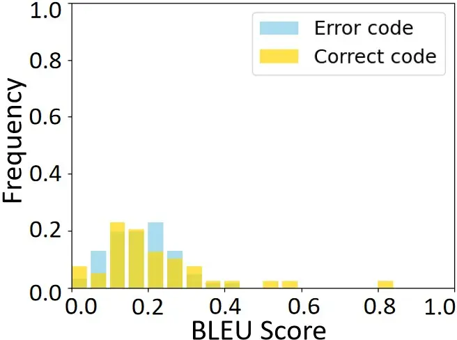

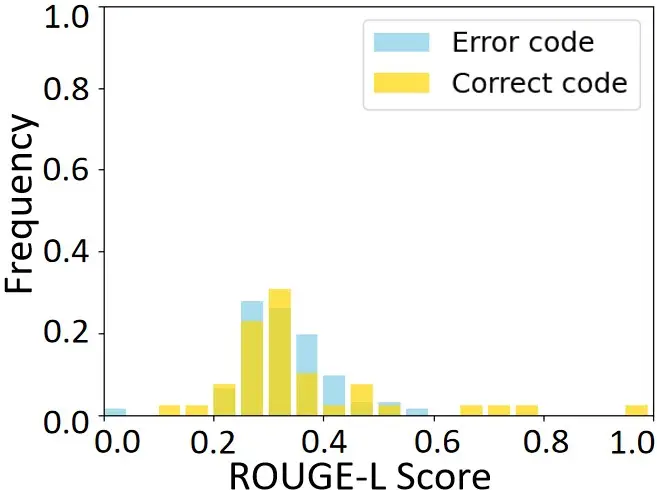

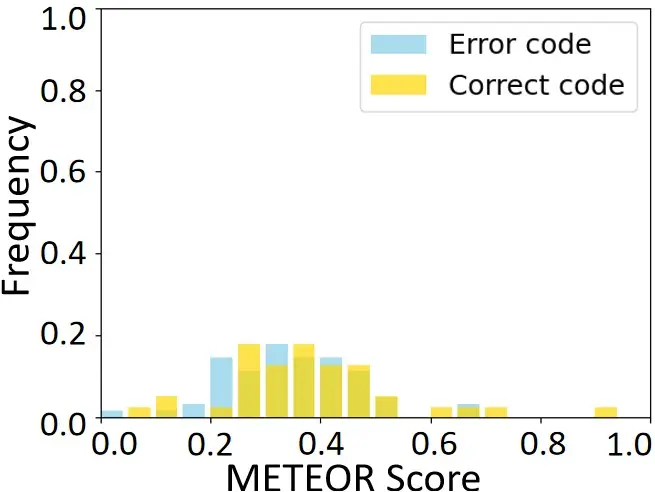

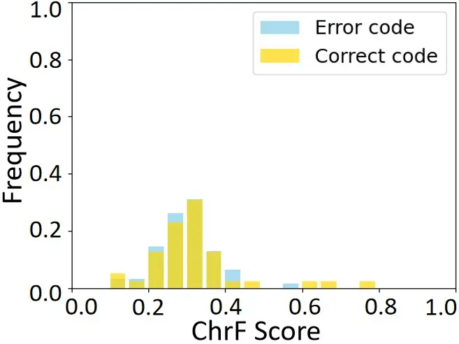

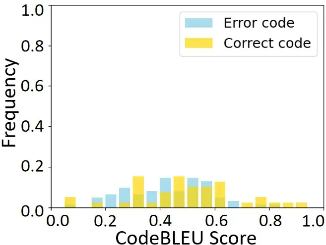

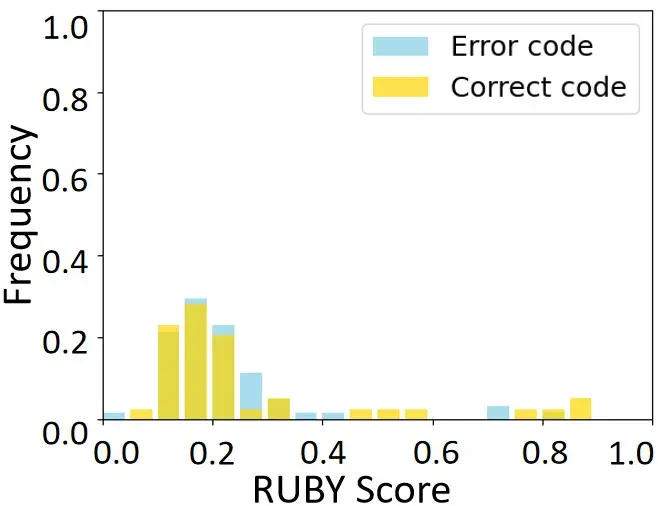

Figure 6: Score distributions of six execution-free metrics on the APPS
benchmark show negligible distinction between correct and incorrect
code, indicating a lack of reliability.

## Appendix C Evaluation without References

As discussed in Sec.4.5, we present the complete results for extending
to more general scenarios, specifically in the absence of reference
data. Table7 compares the performance of MCTS-Judge with baselines
across three benchmarks and five LLMs. The results highlight
MCTS-Judge’s greater robustness and generalization ability, as evidenced
by reduced performance decay compared to other LLM-as-a-Judge methods,
aligning with the conclusions drawn in the main paper’s analysis.

|                                                             |          |              |       |             |       |       |            |       |         |
| ----------------------------------------------------------- | -------- | ------------ | ----- | ----------- | ----- | ----- | ---------- | ----- | ------- |
| Method                                                      | Approach | BigCodeBench | APPS  | HumanEval-X |       |       |            |       |         |
|                                                             |          |              |       | Python      | Java  | C++   | JavaScript | Go    | Average |
| Commercial Reasoning LLMs                                   |          |              |       |             |       |       |            |       |         |
| GPT-o1-mini                                                 | System-2 | 71.14        | 78.00 | 93.18       | 86.36 | 86.36 | 89.39      | 87.88 | 88.63   |
| Open-sourced Reasoning LLMs                                 |          |              |       |             |       |       |            |       |         |
| Qwen-QwQ-32B                                                | System-2 | 51.05        | 69.00 | 61.36       | 68.18 | 66.67 | 67.42      | 77.27 | 68.18   |
| Code-Specialized Base Model: Qwen2.5-Coder-14B-Instruct     |          |              |       |             |       |       |            |       |         |
| Base Model                                                  | System-1 | 46.84        | 61.00 | 60.61       | 62.88 | 68.94 | 65.91      | 76.52 | 66.97   |
| ICE-Score                                                   | System-1 | 66.23        | 69.00 | 75.00       | 66.67 | 71.21 | 72.73      | 75.00 | 72.12   |
| CodeJudge                                                   | System-1 | 47.02        | 62.00 | 87.12       | 75.76 | 79.55 | 81.06      | 73.48 | 79.40   |
| MCTS-Judge (Ours)                                           | System-2 | 70.35        | 74.00 | 86.36       | 87.12 | 80.30 | 82.58      | 82.58 | 83.79   |
| Code-Specialized Base Model: DeepSeek-Coder-V2-16B-Instruct |          |              |       |             |       |       |            |       |         |
| Base Model                                                  | System-1 | 35.09        | 49.00 | 69.70       | 58.33 | 53.79 | 53.79      | 56.06 | 58.33   |
| ICE-Score                                                   | System-1 | 47.19        | 56.00 | 74.24       | 69.70 | 71.21 | 66.67      | 69.70 | 70.30   |
| CodeJudge                                                   | System-1 | 35.44        | 62.00 | 75.76       | 66.67 | 63.64 | 66.67      | 66.67 | 67.89   |
| MCTS-Judge (Ours)                                           | System-2 | 51.58        | 71.00 | 82.58       | 72.73 | 84.85 | 75.00      | 81.82 | 79.40   |
| Code-Specialized Base Model: Mistralai-Codestral-22B        |          |              |       |             |       |       |            |       |         |
| Base Model                                                  | System-1 | 32.63        | 43.00 | 75.76       | 58.33 | 58.33 | 57.58      | 58.33 | 61.67   |
| ICE-Score                                                   | System-1 | 31.05        | 41.00 | 76.52       | 57.58 | 53.03 | 59.09      | 53.79 | 60.00   |
| CodeJudge                                                   | System-1 | 35.44        | 48.00 | 78.79       | 59.09 | 59.09 | 60.61      | 63.64 | 64.24   |
| MCTS-Judge (Ours)                                           | System-2 | 52.37        | 74.00 | 79.55       | 72.73 | 75.76 | 65.91      | 77.27 | 74.24   |
| General Base Model: Llama-3.1-8B-Instruct                   |          |              |       |             |       |       |            |       |         |
| Base Model                                                  | System-1 | 33.95        | 58.00 | 59.85       | 60.61 | 62.88 | 64.39      | 67.42 | 63.30   |
| ICE-Score                                                   | System-1 | 34.47        | 46.00 | 62.12       | 51.52 | 50.76 | 54.55      | 42.42 | 52.27   |
| CodeJudge                                                   | System-1 | 41.40        | 47.00 | 61.36       | 60.61 | 58.33 | 54.55      | 52.27 | 57.42   |
| MCTS-Judge (Ours)                                           | System-2 | 65.79        | 62.00 | 71.21       | 69.70 | 65.15 | 68.18      | 73.48 | 69.54   |
| Commercial General Base Model: GPT-4o-mini                  |          |              |       |             |       |       |            |       |         |
| Base Model                                                  | System-1 | 71.05        | 61.00 | 81.82       | 80.30 | 83.33 | 83.33      | 83.33 | 82.42   |
| ICE-Score                                                   | System-1 | 58.60        | 62.00 | 78.03       | 75.00 | 75.76 | 81.06      | 82.58 | 78.49   |
| CodeJudge                                                   | System-1 | 57.46        | 70.00 | 81.06       | 82.58 | 85.61 | 84.85      | 83.33 | 83.49   |
| MCTS-Judge (Ours)                                           | System-2 | 73.68        | 72.00 | 82.58       | 83.33 | 87.12 | 87.12      | 85.61 | 85.15   |

Table 7: Accuracy (%) of MCTS-Judge and baselines without reference code
on BigCodeBench, APPS, and HumanEval-X. Compared to existing
LLM-as-a-Judge methods, MCTS-Judge without reference code still achieves
the highest accuracy across all benchmarks and five LLMs (highlighted in
bold). MCTS-Judge without reference code maintains its advantage over
advanced reasoning LLMs, with superior accuracy compared to the
o1-series models highlighted with underlines.

## Appendix D Case Study

We demonstrated the superiority of analysis metadata from reasoning
chains generated by MCTS-Judge across four key dimensions in
Section 4.4. To further highlight MCTS-Judge’s advantages over the
System-1 thinking approach in terms of accuracy and comprehensive
analysis, we present a case study comparing the vanilla
Deepseek-Coder-V2-16B-Instruct model with the one integrated with
MCTS-Judge.

As shown in Fig. 7, at each step, MCTS-Judge provides evaluations from
diverse perspectives, such as verifying whether requirements are met
(Step 2) and assessing the correctness of the code logic (Step 5). In
contrast, the vanilla model generates an incorrect answer with only
superficial analysis, demonstrating a lack of deeper understanding.

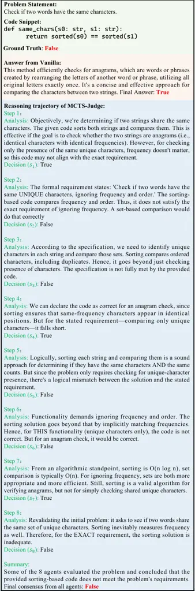

Figure 7: Case Study: System-2 Thinking vs. System-1 Thinking.
MCTS-Judge leads with comprehensive evaluations, while vanilla fails
with superficial analysis.

## Appendix E Prompts

We present the key prompt designs utilized in MCTS-Judge, including the
vanilla baseline (Fig. 8), the test-case verification baseline (Fig. 9),
the LLM-driven self-assessment (Fig. 10), the logic assessment action
(Fig. 11), the test case generation and validation (Fig. 12), and the
simulated execution (Fig. 13).

## Appendix F Responsible Use of Artifacts

Our experiments use publicly available research artifacts, including
APPS (Hendrycks et al., 2021), HumanEval-X (Zheng et al., 2023),
BigCodeBench (Zhuo et al., 2024), public or open-weight language models,
and prior code-evaluation baselines. We cite the original creators and
use these artifacts only for research evaluation and comparison,
following their respective licenses, access conditions, and terms of
use. We do not redistribute original benchmark data, proprietary model
outputs, or model weights beyond what is permitted. The study does not
collect human-subject data or personally identifying information.

[TABLE]

Table 8: Prompt of the baseline named Vanilla.

[TABLE]

Table 9: Prompt for the test-case verification baseline.

[TABLE]

Table 10: Prompt for LLM-driven self-assessment in MCTS node selection.

[TABLE]

Table 11: Example of subtasks: prompt focused on logic assessment

[TABLE]

Table 12: Prompt for test case generation and validation.

[TABLE]

Table 13: Prompt for simulated execution and verify whether the
execution results match the expected answers.
