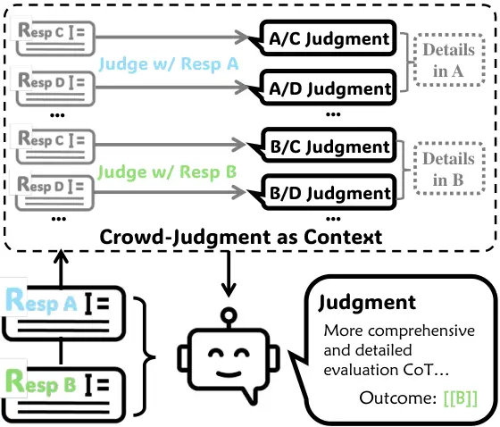
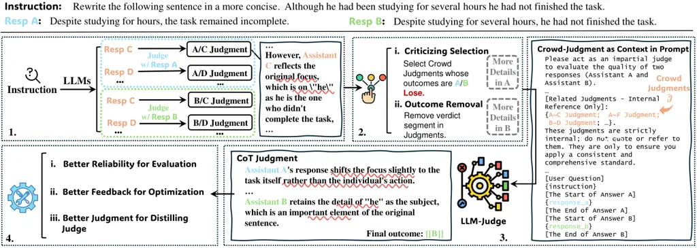
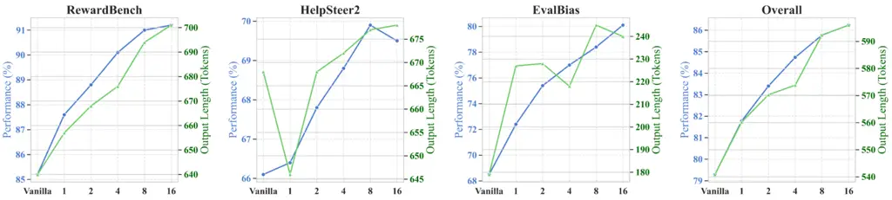
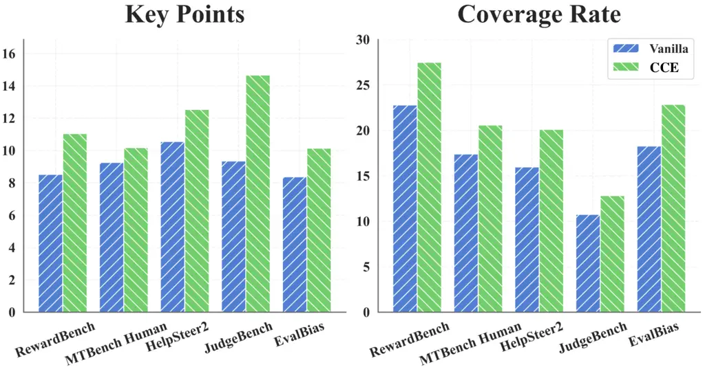

# Crowd Comparative Reasoning: Unlocking Comprehensive Evaluations for LLM-as-a-Judge

Qiyuan Zhang ^(†)^(†)thanks: Work partially done during the internship
at Huawei Noah’s Ark Lab. Affiliation: City University of Hong Kong
Email: <qzhang732-c@my.cityu.edu.hk>    Yufei Wang Affiliation: Huawei
Noah’s Ark Lab Email: <wang.yufei1@huawei.com>    Yuxin Jiang
Affiliation: The Hong Kong University of Science and Technology
(Guangzhou)    Liangyou Li Affiliation: Huawei Noah’s Ark Lab    Chuhan
Wu Affiliation: Huawei Noah’s Ark Lab    Yasheng Wang
Affiliation: Huawei Noah’s Ark Lab    Xin Jiang Affiliation: Huawei
Noah’s Ark Lab    Lifeng Shang Affiliation: Huawei Noah’s Ark Lab   
Ruiming Tang Affiliation: Huawei Noah’s Ark Lab    Fuyuan Lyu
Affiliation: McGill University & MILA    Chen Ma ^(†)^(†)thanks:
Corresponding Author. Affiliation: City University of Hong Kong

###### Abstract

LLM-as-a-Judge, which generates chain-of-thought (CoT) judgments, has
become a widely adopted auto-evaluation method. However, its reliability
is compromised by the CoT reasoning’s inability to capture comprehensive
and deeper details, often leading to incomplete outcomes. Existing
methods mainly rely on majority voting or criteria expansion, which is
insufficient to address the limitation in CoT. We propose Crowd-based
Comparative Evaluation, which introduces additional crowd responses to
compare with the candidate responses, thereby exposing deeper and more
comprehensive details within the candidate responses. This process
effectively guides LLM-as-a-Judge to provide a more detailed CoT
judgment. Extensive experiments demonstrate that our approach enhances
evaluation reliability, achieving an average accuracy gain of $`6.7\%`$
across five benchmarks. Moreover, our method produces higher-quality
CoTs that facilitate judge distillation and exhibit superior performance
in rejection sampling for supervised fine-tuning (SFT), referred to as
crowd rejection sampling, thereby enabling more efficient SFT. Our
analysis confirms that CoTs generated by ours are more comprehensive and
of higher quality, and evaluation accuracy improves as inference scales.
Our code is available at
[https://github.com/Don-Joey/CCE.git](https://github.com/Don-Joey/CCE.git).

## 1 Introduction



Figure 1: An overview of our method. By evaluating the candidate
responses A/B alongside the crowd responses, the resulting crowd
judgment can be used as context to enrich the evaluation of A/B
responses, leading to a more comprehensive CoT judgment.

With the prohibitive cost and limited scalability of human evaluation,
LLM-as-a-Judge has emerged as a scalable framework for
auto-evaluation (Chang et al., 2024; Li et al., 2024a; Li et al., 2025).
Given a task instruction and corresponding candidate responses,
LLM-as-a-Judge (Zheng et al., 2023; Wang et al., 2024b; Wagner et al., 2024) employs CoT judgment to analyze granular quality details of the
responses, ultimately deriving a final outcome. Despite advancements in
techniques such as CoT reasoning (Saha et al., 2025; Zheng et al.,
2023), specialized rubrics (Liu et al., 2023), and preference-aligned
training datasets (Li et al., 2024b; Wang et al., 2024c), human
evaluation remains the gold standard due to persistent limitations (Zeng
et al., 2024a) in LLM-as-a-Judge. These limitations include biases (Park
et al., 2024) in judgment and susceptibility to misleading
context (Dubois et al., 2024a; Chen et al., 2024), which undermine the
reliability of automated evaluation. One important yet overlooked reason
is the quality of CoT reasoning hinges on the model’s ability to
comprehensively compare nuanced details across responses. Our
observation reveals high-quality judgments incorporate a thorough
comparison of these details, while flawed reasoning tends to focus on
limited details, leading to premature and incomplete outcomes.
Therefore, enhancing the richness and comprehensiveness of CoT reasoning
is essential to improve LLM-as-a-Judge.

Two commonly adopted strategies aim to address this issue: majority
voting (Zhang et al., 2024; Mahan et al., 2024; DeepSeek-AI, 2024) and
criteria expansion (Kim et al., 2024a; Liu et al., 2024; Hu et al.,
2024a). The majority voting generates multiple judgments independently
in parallel and aggregates these results through voting. It essentially
leverages the randomness from temperature sampling to encourage detailed
reasoning. However, this approach is passive and computationally
expensive. In contrast, criteria expansion augments prompts with
additional evaluation aspects, proactively guiding the model to consider
more dimensions of quality. Yet, this strategy is response-unaware,
failing to adapt the evaluation process to the unique details of each
response. For instance, even if a response is rich with nuanced
insights, incorporating a criterion like “accuracy” does little to
prompt the LLM to identify the unique details of its reasoning.
Consequently, neither approach effectively guides LLM-as-a-Judge to
consistently produce nuanced, comprehensive CoT evaluations. This leads
to a critical research question: how can we guide LLMs to engage in
deeper, more detail-rich CoT reasoning during judgment?

In this work, we propose a novel crowd-based comparative evaluation
(CCE) to address this challenge by enabling LLM-as-a-Judge to uncover
valuable details, as depicted in Figure 1. Our approach is inspired by
human evaluative behavior: humans merely compare candidates in isolation
by also contrasting them against a broader crowd, thereby uncovering
additional nuanced insights about each candidate. Building on this
principle, CCE first gathers a set of alternative responses to the task
instruction, referred to as crowd responses, and then compares each
candidate response against these crowd responses to derive multiple
crowd judgments. Throughout this process, the diversity of crowd
responses serves as multiple evaluation anchors, revealing different
layers of detail within the candidate responses. Based on this, CCE
prompts the LLM-as-a-Judge to perform a more comprehensive and deeper
overall CoT judgment.

CCE achieves a remarkable average improvement of $`6.7\%`$ across five
judge benchmarks, including RewardBench, HelpSteer2, MTBench Human,
JudgeBench and EvalBias. When applied to judge distillation, we find
that the high-quality long CoT judgments generated by CCE enable a
smaller judge model to achieve higher accuracy, yielding an average
improvement of $`4.5\%`$-$`5.6\%`$ (in Qwen 2.5-7B), particularly
enhancing bias robustness. Moreover, we extend CCE naturally to SFT
rejection sampling, referred to as crowd rejection sampling, where our
approach serves as a quality signal to identify training-efficient
samples from the response pool. Our enhanced rejection strategy
consistently outperforms both random sampling and vanilla rejection
sampling on MTBench and AlpacaEval-v2, demonstrating the reliability and
practical utility of CCE in LLM alignment. Finally, our analysis
confirms that CCE scales inference effectively and produced CoTs
consistently yield more key points and capture finer-grained details
within responses compared to Vanilla LLM-as-a-Judge, facilitating more
comprehensive and deeper CoT reasoning.

## 2 Related Work

Human evaluation is typically regarded as the gold standard for
evaluating LLM responses to intricate and open-ended instructions Chiang
and Lee (2023); Elangovan et al. (2024). Nevertheless, due to its
inherent limitations—being time-consuming, costly, and prone to
variability Karpinska et al. (2021)—automated evaluation methods
leveraging LLMs have gained prominence as scalable and cost-efficient
alternatives. Unlike reward models that provide only scalar scores Wang
et al. (2024a); Wang et al. (2024b), LLM-as-a-Judge frameworks offer
enhanced robustness and interpretability by producing detailed CoT
rationales Li et al. (2024c); Gao et al. (2024).

Enhancing the performance of LLM-as-a-Judge has attracted significant
attention, with many techniques proposed recently. One prominent
approach involves fine-tuning pre-trained LLMs on task-specific datasets
to better adapt them for judgment tasks Vu et al. (2024); Li et al.
(2024b); Wang et al. (2024c); Kim et al. (2024b). Another line of
research focuses on step-by-step methodologies, such as G-EVAL Liu
et al. (2023), ICE-Score Zhuo (2024), and EvalPlanner Saha et al.
(2025), which decompose complex evaluation tasks into granular
components, thereby harnessing the reasoning capabilities of LLMs to
streamline the evaluation process. Additionally, recent advances explore
using LLMs to generate reasoning traces by designing domain-specific
prompts and meticulously crafting components of CoT reasoning. These
include constructing fine-grained scoring rubrics Zheng et al. (2023);
Zeng et al. (2024b); Trivedi et al. (2024) and generating reference
answers Zhang et al. (2025). Despite these efforts, the richness and
comprehensiveness of CoT reasoning remain underexplored, leaving room
for further advancements in improving LLM-as-a-Judge. While simple
heuristics such as majority voting Badshah and Sajjad (2024); Verga
et al. (2024) can mitigate this issue by improving the reliability and
accuracy of evaluations, they often fall short in terms of efficacy and
efficiency.



Figure 2: Pipeline of our proposed crowd-based comparative evaluation.
For a given instance $`(x,y^{A},y^{B})`$, we first use the LLM to
generate crowd responses $`\left\{y^{i}|i\in\{C,D,E,...\}\right\}`$
based on $`x`$. These responses are then compared with $`y^{A}`$ and
$`y^{B}`$ to produce initial crowd judgments $`\mathcal{J}`$, which are
subsequently refined into $`\hat{\mathcal{J}}`$ after selection and
processing. Finally, $`\hat{\mathcal{J}}`$ are used as contextual input
to evaluate the instance $`(x,y^{A},y^{B})`$.

## 3 Methodology

As illustrated in Figure 2, we propose a crowd-based comparative
evaluation that elicits and integrates multiple crowd judgments before
producing a final outcome. It consists of three core components: (1)
Crowd Response and Judgment Generation, (2) Crowd Judgment Selection and
Processing, and (3) Context-augmented Inference, which we will discuss
in the following subsections. Furthermore, we distill the CoT judgments
generated by CCE to train a judge and expand its application to an
enhanced rejection sampling technique for SFT.

### 3.1 Problem Formulation

Supposing $`\{y^{A},y^{B}\}`$ denote two candidate responses generated
by two assistants for a given task instruction $`x`$, Vanilla
LLM-as-a-Judge $`\mathcal{F}`$ is prompted to provide a CoT-based
judgment $`j`$ of $`y^{A}`$ and $`y^{B}`$, based on a specific set of
evaluation criteria $`s`$ (e.g., correctness, coherence).

```math
j=\mathcal{F}(y^{A},y^{B}|x,s). \tag{1}
```

The objective is to ensure that the $`\mathcal{F}`$ preference aligns
closely with human evaluation. In pairwise comparisons, this alignment
is quantified by measuring the accuracy relative to human labels.

### 3.2 Crowd Response and Judgment Generation

Based on the task instruction $`x`$, we first prompt the LLM to generate
a set of $`n`$ synthetic crowd responses
$`\left\{y^{i}|i\in\{C,D,E,...\}\right\}`$. To enhance the diversity of
these responses, we can leverage multiple LLMs ranging from smaller
models (e.g., Qwen2.5-0.5B-Instruct) to larger ones (e.g.,
Mistral-Nemo-Instruct-2407), along with varying temperature settings.
Theoretically, more diverse responses can cover a wider range of
scenarios. When compared with $`y^{A}`$ and $`y^{B}`$, these crowd
responses emphasize different details of $`\{y^{A},y^{B}\}`$, offering a
more comprehensive perspective and facilitating deeper reasoning. As
Figure 2 demonstrated, crowd judgment digs the importance of “he”, where
Response A subtly shifts the actor “he” onto the object “task” itself,
thereby violating the instruction’s requirement to rewrite while
preserving the concise original meaning. Then, we use it as context to
reinforce the following CoT. This advantage surpasses that of criteria
expansion, which cannot anticipate such details through pre-prompting.

For each synthetic $`y^{i}`$, $`\mathcal{F}`$ independently produces two
crowd judgments, $`j^{A}_{i}`$ and $`j^{B}_{i}`$, by individually
judging $`y^{i}`$ with $`y^{A}`$ and $`y^{B}`$, separately:

```math
j^{A}_{i}=\mathcal{F}(y^{A},y^{i}|x,s),\quad j^{B}_{i}=\mathcal{F}(y^{B},y^{i}|x,s). \tag{2}
```

Formally, we collect a set of $`2n`$ crowd judgments:

```math
\mathcal{J}=\left\{j^{A}_{i},j^{B}_{i}\mid i\in\{C,D,E,...\}\right\}. \tag{3}
```

While each judgment may not fully capture all details of the candidate
responses, they together provide a richer pool of evidence about how
$`y^{A}`$ and $`y^{B}`$ differ in nuanced ways.

### 3.3 Crowd Judgment Selection and Processing

After obtaining $`\mathcal{J}`$, the key stage lies in selecting and
processing these judgments effectively. Random Selection is neither
stable nor optimal, so we need better strategies for using crowd
judgments.

To this end, we propose a simple yet effective method called Criticizing
Selection. Specifically, we choose judgments based on their outcomes:
for $`j_{i}^{A}`$, we keep those where A loses, and for $`j_{i}^{B}`$,
those where B loses. Notably, our observation reveals judgments with a
critical outcome tend to provide detailed and informative reasoning for
the criticized response. For instance, Judge might point out how the
criticized response confuses key concepts by elaborating on specific
errors in the definition and citing relevant theoretical principles. In
contrast, judgments favoring the winning response tend to be brief,
where the Judge might simply say, “this answer is correct” without
further analysis. We also explore two alternative outcome-based
strategies: Praising Selection (choosing only judgments where A/B wins)
and Balanced Selection (maintaining an equal split between A/B wins and
losses). However, as shown in our analysis (Table 4), both strategies
perform worse than Criticizing Selection. Additionally, to mitigate bias
from the outcome distribution from crowd judgments, we introduce Outcome
Removal, where an LLM rewrites $`j_{i}`$ to remove explicit outcome
segments, ensuring a more neutral evaluation. After the selection and
processing, we obtain $`\hat{{\mathcal{J}}}`$.

Notably, $`j_{i}`$ includes CoT judgments not only of the ($`y^{A}`$,
$`y^{B}`$) but also of $`y^{i}`$. Our pilot study shows that removing
the CoT segments about $`y^{i}`$ does not improve performance;
therefore, we retain them to keep our approach simple.

### 3.4 Context-augmented Inference

The final judgment is derived by evaluating responses $`y^{A}`$ and
$`y^{B}`$ conditioned on the instruction $`x`$, the criteria $`s`$, and
the post-processed crowd judgments $`\hat{\mathcal{J}}`$:

```math
j^{\star}=\mathcal{F}(y^{A},y^{B}\mid x,s,\hat{\mathcal{J}}), \tag{4}
```

where the prompt template is provided in Appendix A. Notably, we distill
$`\{j^{\star}\}`$ for training a smaller judge, whose performance
surpasses the judge distilled from $`\{j\}`$, as demonstrated in
Table 2. It proves that higher-quality CoT judgment has better
distillation efficiency.

### 3.5 Extensive Application–Crowd Rejection Sampling in SFT

This subsection demonstrates the practicality of CCE by showcasing its
extensive application in SFT. Rejection sampling has been proven an
effective augmentation technique for SFT (Yuan et al., 2023; Zhu et al.,
2023b). In a typical rejection sampling framework, given the task
instruction and $`k`$ generated responses, low-quality responses are
filtered out, and the remaining high-quality ones are then used for
fine-tuning. Traditionally, the Vanilla LLM-as-a-Judge selects the best
response by comparing responses in pairs and choosing the one that wins
most often. In contrast, CCE naturally adapts to the scenario that
rejection sampling involves more than two responses, and we refer to it
as crowd rejection sampling. During pairwise comparing any two candidate
responses, we effectively utilize the additional $`k-2`$ responses as
crowd responses as introduced in Subsection 3.2. After producing crowd
judgments, it ensures a more detailed and consistent judgment. We
validate the crowd rejection sampling in our subsequent experiment (in
Table 3), where the integration of crowd responses consistently leads to
more reliable and interpretable sampling, ultimately improving the
overall performance of the fine-tuned model.

## 4 Experiments

### 4.1 Experimental Setup

We conduct a comprehensive evaluation of CCE across three tasks: testing
preference benchmarks, judge distillation, and SFT rejection sampling.

|                        |              |            |               |             |          |      |
| ---------------------- | ------------ | ---------- | ------------- | ----------- | -------- | ---- |
| Model                  | Reward Bench | HelpSteer2 | MTBench Human | Judge Bench | EvalBias | Avg. |
| GPT-4o                 |              |            |               |             |          |      |
| Vanilla                | 85.2         | 66.1       | 82.1          | 66.3        | 68.5     | 73.6 |
| LongPrompt             | 86.9         | 67.3       | 81.8          | 63.5        | 70.5     | 74.0 |
| EvalPlan               | 88.7         | 65.5       | 81.4          | 62.9        | 74.4     | 74.6 |
| 16-Criteria            | 87.3         | 69.1       | 82.8          | 66.6        | 73.7     | 75.9 |
| Maj@16                 | 87.9         | 68.9       | 82.4          | 68.6        | 75.5     | 76.7 |
| Agg@16                 | 88.1         | 68.7       | 82.6          | 67.2        | 77.9     | 76.9 |
| CCE-random@16          | 91.2         | 69.5       | 83.1          | 68.9        | 80.1     | 78.6 |
| CCE@16                 | 91.8         | 70.6       | 83.6          | 70.4        | 85.0     | 80.3 |
| Qwen 2.5 7B-Instruct   |              |            |               |             |          |      |
| Vanilla                | 78.2         | 60.7       | 76.1          | 58.3        | 57.4     | 66.1 |
| CCE@16                 | 80.4         | 64.2       | 76.7          | 64.0        | 79.4     | 72.9 |
| Qwen 2.5 32B-Instruct  |              |            |               |             |          |      |
| Vanilla                | 87.4         | 72.3       | 79.0          | 68.9        | 71.1     | 75.7 |
| CCE@16                 | 90.8         | 72.1       | 82.1          | 70.6        | 80.5     | 79.2 |
| Qwen 2.5 72B-Instruct  |              |            |               |             |          |      |
| Vanilla                | 85.2         | 69.5       | 79.5          | 68.3        | 68.5     | 74.0 |
| CCE@16                 | 93.7         | 68.5       | 88.9          | 75.7        | 85.9     | 82.7 |
| Llama 3.3 70B-Instruct |              |            |               |             |          |      |
| Vanilla                | 86.4         | 70.4       | 81.1          | 67.1        | 70.6     | 75.1 |
| CCE@16                 | 91.7         | 71.3       | 83.5          | 69.7        | 79.2     | 79.1 |

Table 1: Accuracy of LLM-as-a-Judge on pair-wise comparison benchmarks.
CCE can consistently enhance the LLM-as-a-Judge’s performance across 5
benchmarks, especially considerably outperforming other scaling
inference strategies, like maj@16. The highest values are bolded. Here,
CCE-random refers to replacing the “Criticizing
Selection$`+`$Outcome-Removal Processing” with “Random Selection”.

#### Preference Benchmarks and Baselines.

We adopt 5 preference benchmarks to test LLM-as-a-Judge, including
RewardBench (Lambert et al., 2024), HelpSteer2 (Wang et al., 2024d),
MTBench-Human (Zheng et al., 2023), JudgeBench (Tan et al., 2025), and
EvalBias (Park et al., 2024). These benchmarks provide general
instructions across a wide range of tasks with diverse responses and use
accuracy to measure their evaluation performance. They each focus on
different aspects. For example, RewardBench covers a wider range of
scenarios, while EvalBias focuses on various bias scenarios. We verify
the generality of CCE on 5 LLMs and compare it against multiple
baselines. In particular, we consider Vanilla, which uses the general
LLM-as-a-Judge prompt implemented by RewardBench; Maj@16, where we
independently judge a case 16 times and take a majority vote of the
outcomes; Agg@16, where instead of majority voting, the 16 individual
judgments are fed back into the LLM to aggregate a final decision;
16-Criteria, which incorporates 16 criteria with corresponding
descriptions in the prompt as designed in Hu et al. (2024b) and Wang
et al. (2024d); LongPrompt, where the LLM is explicitly directed to
produce a longer CoT; and EvalPlan, in which an unconstrained evaluation
plan is first generated based on the target case and then executed to
derive the final judgment (Saha et al., 2025). Additional details on the
preference benchmarks and baselines can be found in Appendix B.

#### Distilling CoT for Training Judge.

We start with a large preference dataset and evaluate it using the
Vanilla LLM-as-a-Judge and CCE under GPT-4o-as-a-Judge, producing two
CoTs. We then pair each CoT with the original preference data to form
two separate training sets, which we use to fine-tune a smaller LLM as a
judge. The resulting judges’ performance clearly reflects the quality
and effectiveness of each CoT. We use TULU3-preference data as the
distillation query while the preference benchmarks for evaluating the
judge remain the same as previously introduced. Details of the training
implementation are provided in Appendix C.

#### SFT Rejection Sampling.

Firstly, we generate a pool of 4 responses based on a given task
instruction to serve as the rejection sampling base. We compare Crowd
Rejection Sampling against Random Selection and a Vanilla Rejection
Sampling method to select the best response for fine-tuning.

We select two datasets of different scales, LIMA (Zhou et al., 2023)
($`1`$K) and TULU3-SFT (Lambert et al., 2025) (sample $`10`$K), as
instruction query. GPT-4o served as the judge LLM, while Llama-3.1-8B
and Qwen-2.5-7B are used as base models for SFT. We then evaluate the
generative ability of finetuned models using MTBench and
AlpacaEval-2 (Dubois et al., 2024b). Details of the implementation are
provided in Appendix D.

|                                         |                        |             |            |               |            |          |      |
| --------------------------------------- | ---------------------- | ----------- | ---------- | ------------- | ---------- | -------- | ---- |
| Model                                   | \# of Training Samples | RewardBench | HelpSteer2 | MTBench Human | JudgeBench | EvalBias | Avg. |
| JudgeLM-7B (Zhu et al., 2023a)          | 100,000                | 46.4        | 60.1       | 64.1          | 32.6       | 42.4     | 49.1 |
| PandaLM-7B (Wang et al., 2024c)         | 300,000                | 45.7        | 57.6       | 75.0          | 36.0       | 27.0     | 48.3 |
| Auto-J-13B (Li et al., 2024b)           | 4,396                  | 47.5        | 65.1       | 75.2          | 50.9       | 16.5     | 51.0 |
| Prometheus-7B (Kim et al., 2024a)       | 100,000                | 34.6        | 30.8       | 52.8          | 9.3        | 11.7     | 27.8 |
| Prometheus-2-7B (Kim et al., 2024b)     | 300,000                | 43.7        | 37.6       | 55.0          | 39.4       | 39.8     | 43.1 |
| Llama-3.1-8B-Tuned                      |                        |             |            |               |            |          |      |
| Synthetic Judgment from Vanilla         | 10,000                 | 66.8        | 56.0       | 71.6          | 60.1       | 34.2     | 57.7 |
| Synthetic Judgment from Vanilla         | 30,000                 | 72.5        | 58.6       | 73.9          | 50.4       | 46.2     | 60.3 |
| Synthetic Judgment from CCE             | 10,000                 | 69.7        | 58.6       | 72.7          | 66.4       | 38.7     | 61.2 |
| Synthetic Judgment from CCE             | 30,000                 | 70.0        | 60.1       | 74.3          | 50.3       | 50.7     | 61.1 |
| Qwen 2.5-7B-Tuned                       |                        |             |            |               |            |          |      |
| Synthetic Judgment from Vanilla         | 10,000                 | 68.1        | 55.6       | 70.7          | 50.2       | 38.4     | 56.6 |
| Synthetic Judgment from Vanilla         | 30,000                 | 71.4        | 56.2       | 75.1          | 48.2       | 54.7     | 61.1 |
| Synthetic Judgment from CCE             | 10,000                 | 68.8        | 56.7       | 71.3          | 49.8       | 40.2     | 57.4 |
| Synthetic Judgment from CCE             | 30,000                 | 73.3        | 59.5       | 74.9          | 50.1       | 57.1     | 63.0 |
| Mix Synthetic Judgment from CCE&Vanilla | 60,000                 | 74.1        | 60.7       | 76.6          | 61.6       | 60.6     | 66.7 |

Table 2: Accuracy of Trained small LLM-as-a-Judge on pair-wise
comparison benchmarks. Under the same preference pairs data, the model
trained with judgments synthesized using CCE achieves more reliable
evaluation results. The highest values are bolded, and the second
highest is underlined.

### 4.2 Experiment Result

In this section, we present our main results. The preference benchmark
results are shown in Table 1, the efficacy of distilling CoT for
training smaller judges is summarized in Table 2, and the training
efficiency of SFT rejection sampling is reported in Table 3. These three
objectives are concluded across various judge LLMs and downstream tasks.
Our findings for each task are as follows.

#### Performance on Preference Benchmarks.

Table 1 highlights CCE consistently achieves state-of-the-art
performance across all preference benchmarks. First, it outperforms the
Vanilla LLM-as-a-Judge, which already demonstrates reasonable
reliability on multiple LLMs and benchmarks. Notably, with Qwen
2.5-72B-Instruct as the judge, our method achieves an $`8.5`$ increase
on RewardBench and an overall average gain of $`8.7`$.

Second, CCE proves considerably more effective than common scaling
strategies such as Maj@16 and 16-Criteria. Even with random selection,
Maj@16 underperforms CCE by an average of 1.9. Although EvalPlan offers
a more response-aware reasoning process than 16-Criteria, its
effectiveness remains lower $`2.0`$-$`3.7`$ than CCE. Simply generating
longer CoT also falls short, indicating that scaling inference-time
computation calls for a more nuanced approach.

|                                 |         |              |
| ------------------------------- | ------- | ------------ |
| Rejection Sampling Method       | MTBench | AlpacaEval-2 |
| Llama 3.1 8B Base               |         |              |
| Instructions from LIMA \# 1K    |         |              |
| Random Sampling                 | 4.33    | 2.89/3.29    |
| Vanilla Rejection Sampling      | 4.28    | 2.91/3.29    |
| Crowd Rejection Sampling        | 4.53    | 3.02/3.31    |
| Instructions from Tulu 3 \# 10K |         |              |
| Random Sampling                 | 7.51    | 12.81/12.45  |
| Vanilla Rejection Sampling      | 7.56    | 19.92/17.17  |
| Crowd Rejection Sampling        | 7.63    | 22.23/19.74  |
| Qwen 2.5 7B Base                |         |              |
| Instructions from LIMA \# 1K    |         |              |
| Random Sampling                 | 8.06    | 14.52/9.40   |
| Vanilla Rejection Sampling      | 7.91    | 14.40/9.44   |
| Crowd Rejection Sampling        | 8.63    | 14.86/9.59   |
| Instructions from Tulu 3 \# 10K |         |              |
| Random Sampling                 | 8.36    | 21.39/13.68  |
| Vanilla Rejection Sampling      | 8.46    | 22.71/16.44  |
| Crowd Rejection Sampling        | 8.41    | 23.78/17.56  |

Table 3: SFT Rejection Sampling Performance on the Instruction-Following
Benchmark. The model fine-tuned with responses sampled using CCE
demonstrates improved generative performance.

|                                              |                         |             |            |               |            |          |      |
| -------------------------------------------- | ----------------------- | ----------- | ---------- | ------------- | ---------- | -------- | ---- |
| Strategy                                     | \# of Selection Samples | RewardBench | HelpSteer2 | MTBench Human | JudgeBench | EvalBias | Avg. |
| Random-Selection                             | 8                       | 91.0        | 69.9       | 82.6          | 68.7       | 78.4     | 78.1 |
| Praising-Selection                           | 8                       | 86.6        | 64.2       | 81.5          | 67.1       | 77.7     | 75.4 |
| Criticizing-Selection                        | 8                       | 91.2        | 69.2       | 83.0          | 68.9       | 79.1     | 78.3 |
| Balanced-Selection                           | 8                       | 90.7        | 68.6       | 82.8          | 67.4       | 78.7     | 77.6 |
| Outcome-Removal Random-Selection             | 8                       | 91.5        | 69.9       | 83.0          | 69.4       | 79.5     | 78.7 |
| Outcome-Removal Criticizing-Selection (Sota) | 8                       | 91.5        | 70.1       | 83.2          | 69.5       | 79.9     | 78.8 |
| Random-Selection                             | 16                      | 91.2        | 69.5       | 83.1          | 68.9       | 80.1     | 78.6 |
| Praising-Selection                           | 16                      | 87.0        | 68.4       | 82.0          | 67.1       | 77.9     | 76.5 |
| Criticizing-Selection                        | 16                      | 90.8        | 69.7       | 83.0          | 69.6       | 82.9     | 79.2 |
| Balanced-Selection                           | 16                      | 90.6        | 69.3       | 82.9          | 68.0       | 79.6     | 78.1 |
| Outcome-Removal Random-Selection             | 16                      | 91.7        | 69.7       | 83.2          | 70.0       | 81.5     | 79.2 |
| Outcome-Removal Criticizing-Selection(Sota)  | 16                      | 91.8        | 70.6       | 83.6          | 70.4       | 85.0     | 80.3 |

Table 4: Accuracy of CCE using different selection strategies on
LLM-as-a-Judge benchmarks. Our proposed Outcome-Removal
Criticizing-Selection consistently surpasses performances using other
selection strategies during the test-time inference phase.



Figure 3: Evaluation performance under scaling crowd judgments in the
context. As the number of crowd judgments grows, both accuracy and CoT
length generally increase.

Finally, CCE not only excels on RewardBench, the most general benchmark,
but also outperforms alternatives on more challenging tasks like
JudgeBench and EvalBias. Strategic crowd judgment selection further
enhances performance compared to random selection. We adopt a
“Criticizing Selection + Outcome Removal” strategy for our SOTA
selection & processing strategy, which we discuss in detail in the
following analysis.

#### Distilling CoT for Training Smaller Judges.

Distilling preference evaluation capabilities from powerful LLMs to
train smaller LLMs is a promising direction. Table 2 demonstrates that
higher-quality CoT leads to more effective distillation, resulting in
improved performance for smaller judge models. Fine-tuning small models
(e.g., Llama 3.1-8B and Qwen 2.5-7B) on the CoTs generated by CCE yields
higher accuracy on all five benchmarks than using Vanilla CoTs. For
instance, Qwen 2.5-7B trained on CCE’s synthetic CoT judgments achieves
up to 73.3% on RewardBench, surpassing Vanilla baseline by a notable
margin of 1.9. Moreover, combining both Vanilla and CCE synthetic
judgments further boosts performance, reaching 74.1% on RewardBench and
60.6% on EvalBias. This result suggests integrating diverse CoT can
further enhance accuracy and generalization.

LLM-as-a-Judge can develop biases in various scenarios, such as favoring
more verbose answers. This issue is particularly pronounced in smaller
judge models. As shown in Table 2, even after fine-tuning on over 100K
samples, many baseline models struggle to exceed 50% accuracy. This
highlights the persistent challenge of evaluation bias. Higher-quality
and more comprehensive CoT distillation enhances the debiasing ability
of smaller judge models. These findings suggest that many biases stem
from the model focusing on limited aspects of the responses rather than
assessing them holistically.

#### Efficacy in SFT Rejection Sampling.

As we can see in Table 3, Crowd Rejection Sampling proves effectiveness
for both $`1`$K and $`10`$K data sizes, consistently yielding better
finetuning performances for two base LLMs. CCE selects higher-quality
responses compared to both Random Sampling and Vanilla Rejection
Sampling, leading to consistent improvements in downstream
instruction-following benchmarks on MTBench and AlpacaEval-2. For
instance, with Llama 3.1-8B and the TULU3-SFT instructions, the
fine-tuned model sees performance gains of up to $`22.23`$/$`19.74`$ on
AlpacaEval-2, compared to $`19.92`$/$`17.17`$ under the Vanilla
Rejection Sampling. This underscores the reliability of CCE in
identifying higher-quality training examples.

Overall, the experiments confirm the flexibility and effectiveness of
CCE in three key general scenarios. By leveraging crowd-based context,
scaling inference-time computation, and strategically guiding the CoT
process, CCE delivers consistent improvements over strong baselines.

### 4.3 Analysis Experiments

In this section, we conduct an in-depth analysis of the two core
components of our method: crowd judgment selection & processing
strategies, as well as inference scaling. We then directly examine
whether the generated CoT is more comprehensive and provides a more
detailed analysis of the responses under evaluation.

#### Selection & Processing Strategy.

We compare Random Selection, Criticizing Selection, Praising Selection,
and Balanced Selection. As shown in Table 4, Criticizing Selection
yields the best results, followed by Balanced Selection, while Praising
Selection performs even worse than Random Selection. This suggests that
lose-based judgments provide deeper insights into A/B comparisons,
making criticism more informative. Additionally, the Outcome-Removal
post-processing strategy substantially improves evaluation reliability,
likely because final verdicts lack valuable details while introducing
biases into LLM decision-making.

#### Inference Scaling.

Figure 3 illustrates our analysis of how scaling crowd judgments
influence evaluation outcomes. Measuring accuracy and the average token
length of the CoT, three preference benchmarks are tested across
different judgment counts and then averaged for an overall assessment.
The implementation details are in Appendix E.

As shown in Figure 3, both performance and output length generally
increase as crowd judgments rise from 0 to 16. RewardBench displays a
clear upward trend, while HelpSteer2 dips briefly at 2 judgments before
recovering. Averaging across benchmarks (rightmost panel) confirms that
more crowd judgments lead to higher accuracy and longer CoT, consistent
with the inference scaling observed in studies (Brown et al., 2024;
Snell et al., 2025). Furthermore, we reexamine the Table 1 and find that
scaling test-time inference is a promising strategy for LLM-as-a-Judge,
as demonstrated by GPT-4o-as-a-Judge. This is especially evident in bias
scenarios, where the Vanilla struggles, while scaling-inference-based
baselines, including CCE, show substantial gains.



Figure 4: CoT Comparison. CCE’s CoT consistently yields a higher average
number of key points and a higher coverage rate across all benchmarks.

#### CoT Comparison.

To more directly assess whether the CoTs generated by CCE are more
comprehensive than those of the Vanilla approach, we perform two
analyses: Key Points Counting and Coverage Rate. First, we use GPT-4o to
parse and summarize each CoT, counting the key points to measure how
thoroughly the CoT is. Second, we leverage the cross-attention mechanism
from Bart-base to quantify the coverage rate–how thoroughly CoT covers
details in the candidate responses. We introduce the details in the
Appendix F.2.

As shown in Figure 4, CCE outperforms Vanilla across all benchmarks in
key point counting and coverage rate. More key points indicate that our
CoT examines the text from multiple angles, while a higher coverage rate
reflects a more detailed analysis. These results demonstrate that CCE
offers a deeper and wider evaluation than Vanilla.

|                                                                                                                                                                                                                                                                                                                                                                                                                                                                                                                                                                                                                                                                                                                                                                                                                             |
| --------------------------------------------------------------------------------------------------------------------------------------------------------------------------------------------------------------------------------------------------------------------------------------------------------------------------------------------------------------------------------------------------------------------------------------------------------------------------------------------------------------------------------------------------------------------------------------------------------------------------------------------------------------------------------------------------------------------------------------------------------------------------------------------------------------------------- |
| Instruction: Classify this tweet from the categories of positive, negative, or neutral. Tweet: I’m so thankful for all the wonderful people in my life                                                                                                                                                                                                                                                                                                                                                                                                                                                                                                                                                                                                                                                                      |
| Response A                                                                                                                                                                                                                                                                                                                                                                                                                                                                                                                                                                                                                                                                                                                                                                                                                  |
| The sentiment of this social media comment is positive. The use of the word "grateful" implies appreciation and thankfulness, while "amazing experiences" suggest that these experiences have been very fulfilling or enjoyable.                                                                                                                                                                                                                                                                                                                                                                                                                                                                                                                                                                                            |
| Response B                                                                                                                                                                                                                                                                                                                                                                                                                                                                                                                                                                                                                                                                                                                                                                                                                  |
| Positive                                                                                                                                                                                                                                                                                                                                                                                                                                                                                                                                                                                                                                                                                                                                                                                                                    |
| Vanilla LLM-as-a-Judge:                                                                                                                                                                                                                                                                                                                                                                                                                                                                                                                                                                                                                                                                                                                                                                                                     |
| Assistant A’s . . . . . . It highlights specific words and phrases in the tweet, such as “thankful” and “wonderful people,” to justify the positive sentiment classification. This explanation adds depth and clarity to the response, making it more helpful and informative. Assistant B, . . . . . . the response less informative and helpful . . . . . . . . . - Final Verdict: \[\[A\]\]                                                                                                                                                                                                                                                                                                                                                                                                                              |
| CCE:                                                                                                                                                                                                                                                                                                                                                                                                                                                                                                                                                                                                                                                                                                                                                                                                                        |
| AC Judgment: However, Assistant A makes a mistake by referencing words not present in the tweet, such as "grateful" and "amazing experiences," . . . . . . Assistant C also classifies the tweet as positive and provides a detailed explanation . . . . . . . . . Assistant A . . . . . , but it inaccurately references words not present in the tweet, such as "grateful" and "amazing experiences." This detracts from the accuracy of the response and could potentially confuse the user. . . . . . . Assistant B is concise and correctly classifies the tweet as positive. However, it lacks any explanation or reasoning, which limits its helpfulness and depth. . . . . . . In comparing the two, Given the importance of accuracy and explanation in sentiment analysis, . . . . . . - Final Verdict: \[\[B\]\] |

Table 5: A pairwise comparison case evaluated by different methods.
Preference refers to right result and Preference refers to wrong result.
We emphasize the noisy evaluation elements in orange, while highlighting
the useful elements of the evaluation in limongreen.

#### Case Study.

Table 5 presents a representative case. The vanilla is misled by fake
information in Response A, causing it to overlook the Instruction and
mistakenly rate Response A as more helpful. In contrast, the crowd
judgment correctly identifies the error in Response A and informs
subsequent evaluations. Additionally, our method produces a more
detailed CoT thereby enriching the overall evaluation process, as
evidenced by statements like “Assistant A does provide a brief
explanation”.

## 5 Conclusion

In this work, we tackle the shortcomings of LLM-as-a-Judge, which stem
from CoT reasoning lacking comprehensiveness and detail, by drawing
inspiration from human evaluative behavior. We introduce a novel
crowd-based comparative evaluation framework that enriches the CoT
process to unlock more comprehensive and reliable evaluations. By
scaling inference more effectively, our method serves as an efficient
alternative to traditional majority voting and criteria expansion.
Importantly, we demonstrate that high-quality CoT judgments boost
evaluation reliability and distilling efficiency across multiple
benchmarks, while broadening the scope of crowd-based evaluation
applications.

## Limitations

#### Progressive Self-Iteration Paradigm.

A limitation of our work is that we do not explore self-iteration in
this study, despite its potential for enhancing the evaluation process.
Our method inherently allows for iterative refinement, which could be
further extended into a progressive paradigm. We leave this direction
for future work, aiming to investigate how iterative self-improvement
can further enhance evaluation quality and robustness.

#### Selection based on LLMs.

We identify that the quality of crowd judgments influences the CoT and
explore a simple yet efficient selection strategy. We generate crowd
responses using many LLMs, but we do not explore which LLM’s crowd
response has a greater influence on crowd judgment.

## References

- Badshah and Sajjad (2024) Sher Badshah and Hassan Sajjad. 2024.
  [Reference-guided verdict: Llms-as-judges in automatic evaluation of
  free-form text](https://arxiv.org/abs/2408.09235). In _arXiv_.
- Bibal et al. (2022) Adrien Bibal, Rémi Cardon, David Alfter, Rodrigo
  Wilkens, Xiaoou Wang, Thomas François, and Patrick Watrin. 2022. Is
  attention explanation? an introduction to the debate. In _Annual
  Meeting of the Association for Computational Linguistics_, pages
  3889–3900.
- Brown et al. (2024) Bradley Brown, Jordan Juravsky, Ryan Ehrlich,
  Ronald Clark, Quoc V. Le, Christopher Ré, and Azalia Mirhoseini. 2024.
  [Large language monkeys: Scaling inference compute with repeated
  sampling](https://arxiv.org/abs/2407.21787). In _arXiv_.
- Chang et al. (2024) Yupeng Chang, Xu Wang, Jindong Wang, Yuan Wu,
  Linyi Yang, Kaijie Zhu, Hao Chen, Xiaoyuan Yi, Cunxiang Wang, Yidong
  Wang, et al. 2024. A survey on evaluation of large language models.
  _ACM Transactions on Intelligent Systems and Technology_, pages 1–45.
- Chen et al. (2024) Guiming Hardy Chen, Shunian Chen, Ziche Liu, Feng
  Jiang, and Benyou Wang. 2024. [Humans or llms as the judge? a study on
  judgement biases](https://arxiv.org/abs/2402.10669). In _arXiv_.
- Chiang and Lee (2023) David Cheng-Han Chiang and Hung-yi Lee. 2023.
  Can large language models be an alternative to human evaluations? In
  _Annual Meeting of the Association for Computational Linguistics_,
  pages 15607–15631.
- DeepSeek-AI (2024) DeepSeek-AI. 2024. [Deepseek-v3 technical
  report](https://arxiv.org/abs/2412.19437). In _arXiv_.
- Dubois et al. (2024a) Yann Dubois, Balázs Galambosi, Percy Liang, and
  Tatsunori B. Hashimoto. 2024a. [Length-controlled alpacaeval: A simple
  way to debias automatic evaluators](https://arxiv.org/abs/2404.04475).
  In _arXiv_.
- Dubois et al. (2024b) Yann Dubois, Percy Liang, and Tatsunori
  Hashimoto. 2024b. Length-controlled alpacaeval: A simple debiasing of
  automatic evaluators. In _Conference on Language Modeling_.
- Elangovan et al. (2024) Aparna Elangovan, Ling Liu, Lei Xu,
  Sravan Babu Bodapati, and Dan Roth. 2024. Considers-the-human
  evaluation framework: Rethinking human evaluation for generative large
  language models. In _Annual Meeting of the Association for
  Computational Linguistics_, pages 1137–1160.
- Gao et al. (2024) Mingqi Gao, Xinyu Hu, Jie Ruan, Xiao Pu, and Xiaojun
  Wan. 2024. [Llm-based nlg evaluation: Current status and
  challenges](https://arxiv.org/abs/2402.01383). In _arXiv_.
- Hu et al. (2024a) Xinyu Hu, Mingqi Gao, Sen Hu, Yang Zhang, Yicheng
  Chen, Teng Xu, and Xiaojun Wan. 2024a. Are LLM-based evaluators
  confusing NLG quality criteria? In _Annual Meeting of the Association
  for Computational Linguistics_, pages 9530–9570.
- Hu et al. (2024b) Xinyu Hu, Mingqi Gao, Sen Hu, Yang Zhang, Yicheng
  Chen, Teng Xu, and Xiaojun Wan. 2024b. Are LLM-based evaluators
  confusing NLG quality criteria? In _Annual Meeting of the Association
  for Computational Linguistics_, pages 9530–9570.
- Karpinska et al. (2021) Marzena Karpinska, Nader Akoury, and Mohit
  Iyyer. 2021. The perils of using mechanical turk to evaluate
  open-ended text generation. In _Conference on Empirical Methods in
  Natural Language Processing_, pages 1265–1285.
- Kim et al. (2024a) Seungone Kim, Jamin Shin, Yejin Cho, Joel Jang,
  Shayne Longpre, Hwaran Lee, Sangdoo Yun, Seongjin Shin, Sungdong Kim,
  James Thorne, and Minjoon Seo. 2024a. [Prometheus: Inducing
  fine-grained evaluation capability in language
  models](https://openreview.net/forum?id=8euJaTveKw). In _International
  Conference on Learning Representations_.
- Kim et al. (2024b) Seungone Kim, Juyoung Suk, Shayne Longpre,
  Bill Yuchen Lin, Jamin Shin, Sean Welleck, Graham Neubig, Moontae Lee,
  Kyungjae Lee, and Minjoon Seo. 2024b. [Prometheus 2: An open source
  language model specialized in evaluating other language
  models](https://arxiv.org/abs/2405.01535). In _arXiv_.
- Lambert et al. (2025) Nathan Lambert, Jacob Morrison, Valentina
  Pyatkin, Shengyi Huang, Hamish Ivison, Faeze Brahman, Lester James V.
  Miranda, Alisa Liu, Nouha Dziri, Shane Lyu, Yuling Gu, Saumya Malik,
  Victoria Graf, Jena D. Hwang, Jiangjiang Yang, Ronan Le Bras, Oyvind
  Tafjord, Chris Wilhelm, Luca Soldaini, Noah A. Smith, Yizhong Wang,
  Pradeep Dasigi, and Hannaneh Hajishirzi. 2025. [Tulu 3: Pushing
  frontiers in open language model
  post-training](https://arxiv.org/abs/2411.15124). In _arXiv_.
- Lambert et al. (2024) Nathan Lambert, Valentina Pyatkin, Jacob
  Morrison, LJ Miranda, Bill Yuchen Lin, Khyathi Chandu, Nouha Dziri,
  Sachin Kumar, Tom Zick, Yejin Choi, Noah A. Smith, and Hannaneh
  Hajishirzi. 2024. [RewardBench: Evaluating reward models for language
  modeling](https://arxiv.org/abs/2403.13787). In _arXiv_.
- Li et al. (2025) Dawei Li, Bohan Jiang, Liangjie Huang, Alimohammad
  Beigi, Chengshuai Zhao, Zhen Tan, Amrita Bhattacharjee, Yuxuan Jiang,
  Canyu Chen, Tianhao Wu, Kai Shu, Lu Cheng, and Huan Liu. 2025. [From
  generation to judgment: Opportunities and challenges of
  llm-as-a-judge](https://arxiv.org/abs/2411.16594). In _arXiv_.
- Li et al. (2024a) Haitao Li, Qian Dong, Junjie Chen, Huixue Su, Yujia
  Zhou, Qingyao Ai, Ziyi Ye, and Yiqun Liu. 2024a. [LLMs-as-Judges: A
  comprehensive survey on llm-based evaluation
  methods](https://arxiv.org/abs/2412.05579). In _arXiv_.
- Li et al. (2024b) Junlong Li, Shichao Sun, Weizhe Yuan, Run-Ze Fan,
  hai zhao, and Pengfei Liu. 2024b. [Generative judge for evaluating
  alignment](https://openreview.net/forum?id=gtkFw6sZGS). In
  _International Conference on Learning Representations_.
- Li et al. (2024c) Zhen Li, Xiaohan Xu, Tao Shen, Can Xu, Jia-Chen Gu,
  Yuxuan Lai, Chongyang Tao, and Shuai Ma. 2024c. [Leveraging large
  language models for nlg evaluation: Advances and
  challenges](https://arxiv.org/abs/2401.07103). In _arXiv_.
- Liu et al. (2023) Yang Liu, Dan Iter, Yichong Xu, Shuohang Wang,
  Ruochen Xu, and Chenguang Zhu. 2023. G-eval: NLG evaluation using
  gpt-4 with better human alignment. In _Conference on Empirical Methods
  in Natural Language Processing_, pages 2511–2522.
- Liu et al. (2024) Yuxuan Liu, Tianchi Yang, Shaohan Huang, Zihan
  Zhang, Haizhen Huang, Furu Wei, Weiwei Deng, Feng Sun, and
  Qi Zhang. 2024. HD-eval: Aligning large language model evaluators
  through hierarchical criteria decomposition. In _Annual Meeting of the
  Association for Computational Linguistics_, pages 7641–7660.
- Mahan et al. (2024) Dakota Mahan, Duy Van Phung, Rafael Rafailov,
  Chase Blagden, Nathan Lile, Louis Castricato, Jan-Philipp Fränken,
  Chelsea Finn, and Alon Albalak. 2024. [Generative reward
  models](https://arxiv.org/abs/2410.12832). In _arXiv_.
- Park et al. (2024) Junsoo Park, Seungyeon Jwa, Ren Meiying, Daeyoung
  Kim, and Sanghyuk Choi. 2024. OffsetBias: Leveraging debiased data for
  tuning evaluators. In _Findings of EMNLP_, pages 1043–1067.
- Saha et al. (2025) Swarnadeep Saha, Xian Li, Marjan Ghazvininejad,
  Jason Weston, and Tianlu Wang. 2025. [Learning to plan & reason for
  evaluation with
  thinking-llm-as-a-judge](https://arxiv.org/abs/2501.18099). In
  _arXiv_.
- Snell et al. (2025) Charlie Victor Snell, Jaehoon Lee, Kelvin Xu, and
  Aviral Kumar. 2025. [Scaling test-time compute optimally can be more
  effective than scaling LLM
  parameters](https://openreview.net/forum?id=4FWAwZtd2n). In
  _International Conference on Learning Representations_.
- Tan et al. (2025) Sijun Tan, Siyuan Zhuang, Kyle Montgomery,
  William Yuan Tang, Alejandro Cuadron, Chenguang Wang, Raluca Popa, and
  Ion Stoica. 2025. JudgeBench: A benchmark for evaluating LLM-based
  judges. In _International Conference on Learning Representations_.
- Trivedi et al. (2024) Prapti Trivedi, Aditya Gulati, Oliver
  Molenschot, Meghana Arakkal Rajeev, Rajkumar Ramamurthy, Keith
  Stevens, Tanveesh Singh Chaudhery, Jahnavi Jambholkar, James Zou, and
  Nazneen Rajani. 2024. [Self-rationalization improves llm as a
  fine-grained judge](https://arxiv.org/abs/2410.05495). In _arXiv_.
- Verga et al. (2024) Pat Verga, Sebastian Hofstatter, Sophia Althammer,
  Yixuan Su, Aleksandra Piktus, Arkady Arkhangorodsky, Minjie Xu, Naomi
  White, and Patrick Lewis. 2024. [Replacing judges with juries:
  Evaluating llm generations with a panel of diverse
  models](https://arxiv.org/abs/2404.18796). In _arXiv_.
- Vig (2019) Jesse Vig. 2019. A multiscale visualization of attention in
  the transformer model. In _Annual Meeting of the Association for
  Computational Linguistics: System Demonstrations_, pages 37–42.
- Vu et al. (2024) Tu Vu, Kalpesh Krishna, Salaheddin Alzubi, Chris Tar,
  Manaal Faruqui, and Yun-Hsuan Sung. 2024. [Foundational autoraters:
  Taming large language models for better automatic
  evaluation](https://arxiv.org/abs/2407.10817). In _arXiv_.
- Wagner et al. (2024) Nico Wagner, Michael Desmond, Rahul Nair, Zahra
  Ashktorab, Elizabeth M. Daly, Qian Pan, Martín Santillán Cooper,
  James M. Johnson, and Werner Geyer. 2024. [Black-box uncertainty
  quantification method for
  llm-as-a-judge](https://arxiv.org/abs/2410.11594).
- Wang et al. (2024a) Peifeng Wang, Austin Xu, Yilun Zhou, Caiming
  Xiong, and Shafiq Joty. 2024a. [Direct judgement preference
  optimization](https://arxiv.org/abs/2409.14664). In _arXiv_.
- Wang et al. (2024b) Tianlu Wang, Ilia Kulikov, Olga Golovneva, Ping
  Yu, Weizhe Yuan, Jane Dwivedi-Yu, Richard Yuanzhe Pang, Maryam
  Fazel-Zarandi, Jason Weston, and Xian Li. 2024b. [Self-taught
  evaluators](https://arxiv.org/abs/2408.02666). In _arXiv_.
- Wang et al. (2024c) Yidong Wang, Zhuohao Yu, Wenjin Yao, Zhengran
  Zeng, Linyi Yang, Cunxiang Wang, Hao Chen, Chaoya Jiang, Rui Xie,
  Jindong Wang, Xing Xie, Wei Ye, Shikun Zhang, and Yue Zhang. 2024c.
  [PandaLM: An automatic evaluation benchmark for LLM instruction tuning
  optimization](https://openreview.net/forum?id=5Nn2BLV7SB). In
  _International Conference on Learning Representations_.
- Wang et al. (2024d) Zhilin Wang, Yi Dong, Olivier Delalleau, Jiaqi
  Zeng, Gerald Shen, Daniel Egert, Jimmy J. Zhang, Makesh Narsimhan
  Sreedhar, and Oleksii Kuchaiev. 2024d. [HelpSteer 2: Open-source
  dataset for training top-performing reward
  models](https://openreview.net/forum?id=PvVKUFhaNy). In _Conference on
  Neural Information Processing Systems Datasets and Benchmarks Track_.
- Yuan et al. (2023) Zheng Yuan, Hongyi Yuan, Chengpeng Li, Guanting
  Dong, Keming Lu, Chuanqi Tan, Chang Zhou, and Jingren Zhou. 2023.
  [Scaling relationship on learning mathematical reasoning with large
  language models](https://arxiv.org/abs/2308.01825). In _arXiv_.
- Zeng et al. (2024a) Zhiyuan Zeng, Jiatong Yu, Tianyu Gao, Yu Meng,
  Tanya Goyal, and Danqi Chen. 2024a. [Evaluating large language models
  at evaluating instruction
  following](https://openreview.net/forum?id=tr0KidwPLc). In
  _International Conference on Learning Representations_.
- Zeng et al. (2024b) Zhiyuan Zeng, Jiatong Yu, Tianyu Gao, Yu Meng,
  Tanya Goyal, and Danqi Chen. 2024b. Evaluating large language models
  at evaluating instruction following. In _International Conference on
  Learning Representations_.
- Zhang et al. (2024) Lunjun Zhang, Arian Hosseini, Hritik Bansal,
  Mehran Kazemi, Aviral Kumar, and Rishabh Agarwal. 2024. [Generative
  verifiers: Reward modeling as next-token
  prediction](https://openreview.net/forum?id=CxHRoTLmPX). In _Workshop
  on Mathematical Reasoning and AI at NeurIPS_.
- Zhang et al. (2025) Qiyuan Zhang, Yufei Wang, Tiezheng YU, Yuxin
  Jiang, Chuhan Wu, Liangyou Li, Yasheng Wang, Xin Jiang, Lifeng Shang,
  Ruiming Tang, Fuyuan Lyu, and Chen Ma. 2025. [RevisEval: Improving
  LLM-as-a-judge via response-adapted
  references](https://openreview.net/forum?id=1tBvzOYTLF). In
  _International Conference on Learning Representations_.
- Zheng et al. (2023) Lianmin Zheng, Wei-Lin Chiang, Ying Sheng, Siyuan
  Zhuang, Zhanghao Wu, Yonghao Zhuang, Zi Lin, Zhuohan Li, Dacheng Li,
  Eric P. Xing, Hao Zhang, Joseph E. Gonzalez, and Ion Stoica. 2023.
  Judging llm-as-a-judge with mt-bench and chatbot arena. In _Conference
  on Neural Information Processing Systems_.
- Zhou et al. (2023) Chunting Zhou, Pengfei Liu, Puxin Xu, Srini Iyer,
  Jiao Sun, Yuning Mao, Xuezhe Ma, Avia Efrat, Ping Yu, LILI YU, Susan
  Zhang, Gargi Ghosh, Mike Lewis, Luke Zettlemoyer, and Omer Levy. 2023.
  LIMA: Less is more for alignment. In _Conference on Neural Information
  Processing Systems_.
- Zhu et al. (2023a) Lianghui Zhu, Xinggang Wang, and Xinlong Wang.
  2023a. [Judgelm: Fine-tuned large language models are scalable
  judges](https://arxiv.org/abs/2310.17631). In _arXiv_.
- Zhu et al. (2023b) Xinyu Zhu, Junjie Wang, Lin Zhang, Yuxiang Zhang,
  Yongfeng Huang, Ruyi Gan, Jiaxing Zhang, and Yujiu Yang. 2023b.
  Solving math word problems via cooperative reasoning induced language
  models. In _Annual Meeting of the Association for Computational
  Linguistics_, pages 4471–4485.
- Zhuo (2024) Terry Yue Zhuo. 2024. ICE-Score: Instructing large
  language models to evaluate code. In _Findings of the Association for
  Computational Linguistics: EACL 2024_, pages 2232–2242.

## Appendix A Prompt Template

We provide the prompt we used in this work for the experiment, as
depicted in Figure 5. For Vanilla LLM-as-a-Judge (Figure 6), we deployed
the prompt designed in MTBench, which is widely deployed in many works,
e.g., RewardBench. Notably, HelpSteer2 specializes in 5 aspects, so we
replace the MTBench’s aspects with these aspects when we test the method
in HelpSteer2. Furthermore, we also present the prompts of baselines:
LongPrompt(Figure 8) forces the CoT as long as possible; 16-Criteria
(Figure 7) incorporates 16 criteria and corresponding descriptions,
which are designed in Hu et al. (2024b) and Wang et al. (2024d).

Figure 5: Prompt of Our Method.

Figure 6: Prompt of Vanilla LLM-as-a-Judge.

Figure 7: Prompt of 16-Criteria LLM-as-a-Judge.

Figure 8: Prompt of LongPrompt LLM-as-a-Judge.

## Appendix B Testing Preference Benchmark

### B.1 Preference Benchmarks

As shown in Table 6, we give a brief introduction to preference
benchmarks. Each of these benchmarks has its own strengths; thoroughly
testing all of them and averaging the results is a reliable way to
evaluate the method. Notably, we randomly sampled $`1`$K cases from the
training split of EvalBias since the size of the test split is 80 items,
which is too small.

|               |           |                                                                                                                               |
| ------------- | --------- | ----------------------------------------------------------------------------------------------------------------------------- |
| Benchmarks    | Size      | Focus                                                                                                                         |
| RewardBench   | $`2,985`$ | It covers multiple scenarios, including Chat, Chat-Hard, Safety, and Reasoning.                                               |
| HelpSteeer2   | $`519`$   | It provides multiple fine-grained dimensions for evaluation, like Helpfulness, Coherence, Correctness, Complexity, Verbosity. |
| MTBench Human | $`2,665`$ | It provides multi-turn conversation for evaluation, and we filter the samples whose outcome is “Tie”.                         |
| JudgeBench    | $`350`$   | It focuses on challenging response pairs spanning knowledge, reasoning, math, and coding                                      |
| EvalBias      | $`1,000`$ | It tests the robustness of judges on various scenarios containing evaluation biases.                                          |

Table 6: The brief description of Preference Benchmarks for testing.

### B.2 The Implementation of Generating Crowd Judgments

To generate crowd judgments, we produce a wide range of diverse
responses. We employed several API-accessible and open-source LLMs to
generate these responses based on the given instructions. Since
diversity is crucial, we did not limit ourselves to only the most
powerful models. Specifically, we used the following LLMs:
Qwen-2.5-0.5B-Instruct, Qwen-2.5-1.5B-Instruct, Qwen-2.5-3B-Instruct,
Qwen-2.5-7B-Instruct, Llama-3.2-1B-Instruct, Llama-3.2-3B-Instruct,
Llama-3.1-8B-Instruct, Mistral-Nemo10-Instruct-2407,
Mistral-7B-Instruct, GPT-4o-mini, and GPT-4o. Additionally, we applied
two temperature settings ($`0.7`$ and $`1.0`$) for each model. In
principle, greater diversity in models and temperature configurations
leads to improved performance.

Based on these crowd responses, we deployed the vanilla LLM-as-a-Judge
to judge each crowd response with candidate response A/B separately
using the judge LLM.

### B.3 The Implementation of Baselines

For maj@16 and agg@16, we modify the temperature setting to $`1.0`$ to
promote more diversified responses. For other inferences in baselines,
we set a unified temperature as $`0.1`$.

### B.4 The Implementation of Selection and Processing

For the selection strategy, we adopted “Criticize Selection” by choosing
the crowd judgment where the outcome indicates that response A/B loses.
For “Outcome Removal Processing,” we used GPT-4o-mini to eliminate the
outcome segment from the judgment with a temperature of $`0`$. The
prompt is:

> “You are a helpful assistant. Specifically, I will provide you with
> the text quality judgment from an LLM-as-a-Judge evaluation of the
> responses from two AI assistants to an instruction. I need you to
> remove the final conclusion segments and only remain the evaluation
> analysis segments as soon as possible. ONLY OUTPUT the processed
> judgment. ”
>
> “\*Judgment:\* {judgment}”

### B.5 The Implementation of Inference

We tested our method on multiple LLMs-as-Judge, including GPT-4o
(2024-08-06), Qwen 2.5-7B-Instruct, Qwen 2.5-32B-Instruct, Qwen
2.5-72B-Instruct, and Llama 3.3-70B-Instruct. We found that reliability
and consistency of evaluation can be balanced when temperature$`=0.1`$.

## Appendix C Distilling CoT for Training Judge

### C.1 Distilling Preference Source

We chose the TULU3-Preference-Mixture ¹¹ 1
[https://huggingface.co/datasets/allenai/llama-3.1-tulu-3-8b-preference-mixture](https://huggingface.co/datasets/allenai/llama-3.1-tulu-3-8b-preference-mixture)
as the preference data source. Specifically, we prompt the
LLM-as-a-Judge to generate a CoT using the given instruction along with
the chosen-rejected response pairs as input. Additionally, we experiment
with two training sizes: random samples of $`10`$K and $`30`$K examples.

#### Distilling Inference.

We use the GPT-4o as the Judge to produce the CoT, and the temperature
setting is $`0.1`$.

### C.2 The Implementation of Training Judge

#### Base Models.

To verify the generality of our method in Distilling CoT, we fine-tuned
the preference data and corresponding CoT judgment in base LLMs: Qwen
2.5-7B-Base and Llama 3.1-8B-Base.

#### Training Setting.

We trained the Base LLM with a context length$`=4,096`$, epochs$`=3`$,
batch size$`=128`$,and learning rate$`=2e^{-5}`$.

## Appendix D SFT Data Selection

### D.1 Synthetic Response Pool for Selection

To enhance the challenge and realism of the SFT Data Selection, we chose
four LLMs with similar general generation capabilities as the base
models for synthesizing responses. These are: GPT-4o, DeepSeek-v3,
Claude-3.5-Sonnet, and Qwen 2.5-72B-Instruct. For inference, we set the
temperature parameter to 0.7. We generate four responses for each
instruction to serve as the basis for subsequent selection. The base
instruction queries we used are two pools: LIMA and TULU3-SFT. LIMA ²² 2
[https://huggingface.co/datasets/GAIR/lima](https://huggingface.co/datasets/GAIR/lima)
contains 1,000 instructions, which are regarded as high-quality;
TULU3-SFT ³³ 3
[https://huggingface.co/datasets/allenai/tulu-3-sft-mixture](https://huggingface.co/datasets/allenai/tulu-3-sft-mixture)
contains $`93.9`$K instruction-response pairs, and we randomly sampled
$`10`$K instructions as the query. The latter is the latest released
multilingual dataset.

### D.2 The Implementation of Rejection Sampling

Under the vanilla LLM-as-a-Judge approach, we perform pairwise
comparisons among four responses, awarding a score of $`+1`$ to the
winner of each matchup. After all comparisons, the response with the
highest total score is selected. Building on this, our method
incorporates the remaining two responses as “crowd responses” during
each evaluation, allowing us to gather additional crowd judgments.

#### Base Judge Model.

The base judge model is GPT-4o, and the temperature is set as $`0.1`$.

### D.3 The Implementation of Training SFT

#### Base Models.

To verify the generality of our method in SFT data selection, we
fine-tuned the instruction and selected response in base LLMs: Qwen
2.5-7B-Base and Llama 3.1-8B-Base.

#### Training Setting.

We followed the common setup for SFT, with a context length$`=2048`$,
epochs$`=3`$, batch size$`=128`$,and learning rate$`=2e^{-5}`$.

## Appendix E Inference Scaling

The “Vanilla” setup has no crowd judgments, “1” includes a single
judgment, and even-numbered settings split judgments evenly between A
and B. We use GPT-4o as the judge and sample three times per setting to
obtain the average result.

## Appendix F CoT Comparison

### F.1 Key Points Extraction

We use the Key points statistic to measure the richness of the CoT.
Firstly, we use the GPT-4o-mini to summarize the CoT to aspects and
corresponding sub-points. The summarization prompt is

> “Extract the key evaluation aspects and detailed points mentioned in
> the text below. List the aspects and points in a strictly structured
> format:”
>
> “Example Input: ‘The response is accurate but lacks creativity. It
> includes factual details but misses key arguments.’ ”
>
> “Example Dictionary Output:” “- Aspect: Accuracy ” “ - Sub-point:
> Includes factual details ” “ - Sub-point: Misses key arguments ” “-
> Aspect: Creativity ” “ - Sub-point: Lacks originality”
>
> “\*\*Input\*\*:”

When we generate the summarized dictionary parsed output, we can get the
total number of key points of each CoT.

### F.2 Coverage Rate Compuataion

An attention-based approach computes mapping weights linking output
tokens to input tokens. Interpretability research (Bibal et al., 2022;
Vig, 2019) uses these weights to assess which input tokens influence the
output. Our goal is to quantify how thoroughly CoT evaluates details in
the target text, and attention-based computation provides a precise
method for doing so.

Naturally, we used the bart-base ⁴⁴ 4
[https://huggingface.co/facebook/bart-base](https://huggingface.co/facebook/bart-base)
to compute the cross-attention between the target text and the generated
CoT. We extract the cross-attention weights from the last layer of the
decoder. By averaging these weights across attention heads and applying
a threshold$`=0.3`$, it calculates a coverage rate—the fraction of the
target text’s tokens whose attention is above the threshold from the
CoT.
