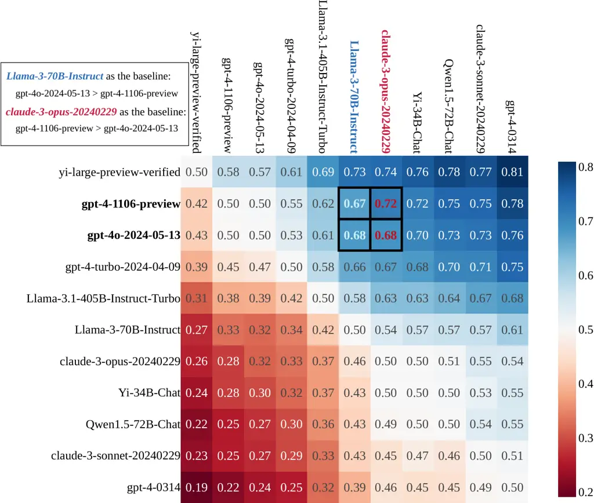
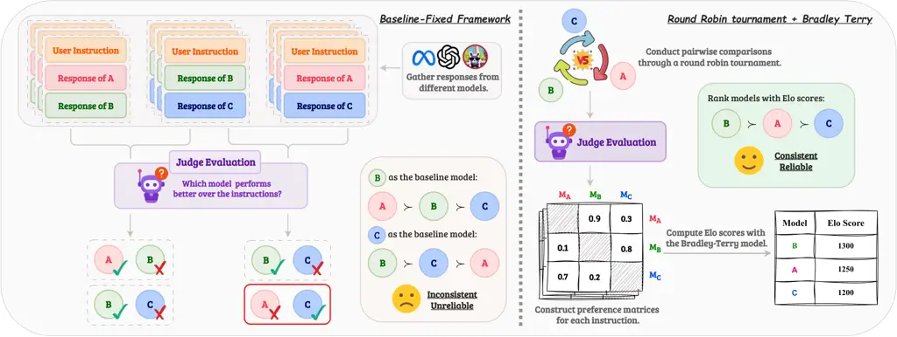
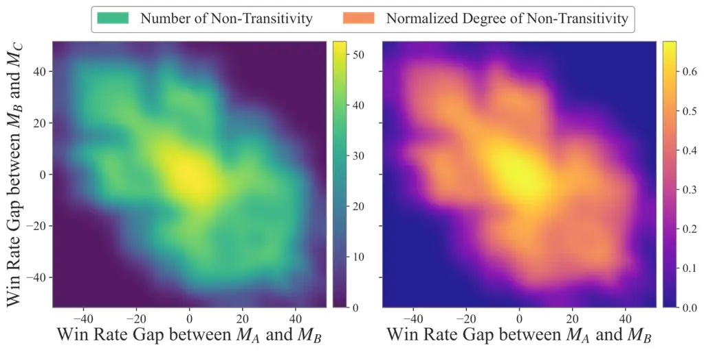
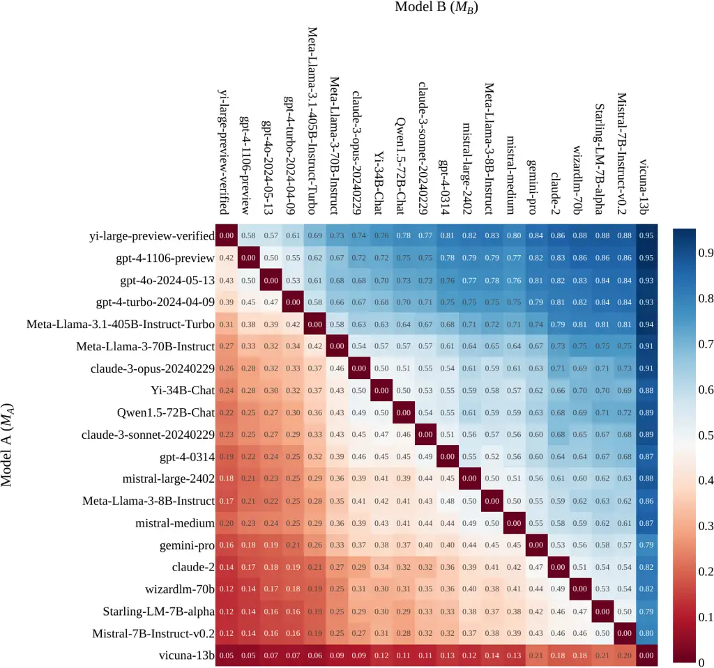
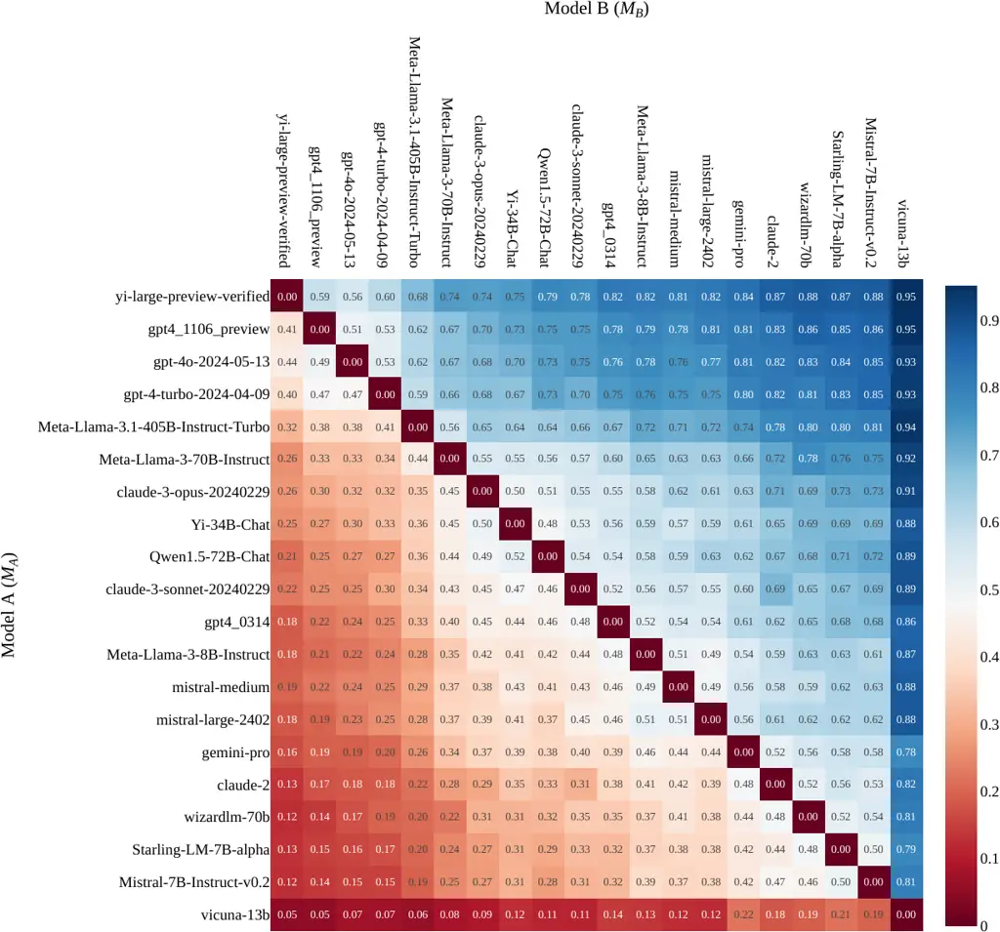

 

Investigating Non-Transitivity in LLM-as-a-Judge

 

Yi Xu ¹  Laura Ruis ¹  Tim Rocktäschel ¹  Robert Kirk ¹ ² 

^(†)^(†)footnotetext: ¹AI Centre, UCL ²UK AI Security Institute.
Correspondence to: Yi Xu \<y.xu.23@ucl.ac.uk\>.  
Proceedings of the $`\mathit{42}^{nd}`$ International Conference on
Machine Learning, Vancouver, Canada. PMLR 267, 2025. Copyright 2025 by
the author(s).

###### Abstract

Automatic evaluation methods based on large language models (LLMs) are
emerging as the standard tool for assessing the instruction-following
abilities of LLM-based agents. The most common method in this paradigm,
pairwise comparisons with a baseline model, critically depends on the
assumption of transitive preferences. However, the validity of this
assumption remains largely unexplored. In this study, we investigate the
presence of non-transitivity within the AlpacaEval framework and analyze
its effects on model rankings. We find that LLM judges exhibit
non-transitive preferences, leading to rankings that are sensitive to
the choice of the baseline model. To mitigate this issue, we show that
round-robin tournaments combined with Bradley-Terry models of preference
can produce more reliable rankings. Notably, our method increases both
the Spearman correlation and the Kendall correlation with Chatbot Arena
(95.0% $`\rightarrow`$ 96.4% and 82.1% $`\rightarrow`$ 86.3%
respectively). To address the computational cost of round-robin
tournaments, we propose Swiss-Wise Iterative Matchmaking (Swim)
tournaments, using a dynamic matching strategy to capture the benefits
of round-robin tournaments while maintaining computational efficiency.

## 1 Introduction



Figure 1: Rankings from baseline-fixed frameworks show high sensitivity
to the choice of baseline. Each entry $`(x,y)`$ represents the win rate
of model $`m_{x}`$ against $`m_{y}`$, where each column reflects a
ranking with the column model as the baseline. Inconsistency emerges
when Llama-3-70B and Claude-3-Opus are used as baselines. Section C.1
provides the detailed matrix comparing 20 models.



Figure 2: (Left) Inconsistent rankings are observed in baseline-fixed
frameworks based on pairwise comparisons due to non-transitivity in the
judge’s evaluations. Different choices of baselines can lead to varying
rankings, undermining the reliability and robustness of this approach.
(Right) We propose a round-robin tournament framework where all models
are compared pairwise. The results are used to capture non-transitivity
in the judge’s evaluations and score models using the Bradley-Terry
model. This method produces rankings that are more robust and better
aligned with human evaluation.

The growing adoption of large language models (LLMs) as generalist
systems for complex, open-ended tasks OpenAI et al. (2023); Meta AI
(2024b) presents a critical challenge: the lack of a universally
accepted gold-standard evaluation. In many cases, multiple valid
responses exist for a given task, complicating the establishment of
effective benchmarks. Consequently, a new paradigm for evaluating
open-ended tasks focuses on quantifying the alignment of LLMs with human
preferences Ouyang et al. (2022) — an aspect existing automatic metrics
cannot adequately assess. However, human evaluation is costly and lacks
scalability Karpinska et al. (2021). As a result, LLM-based evaluators
are now widely used to automate the process, with pairwise comparisons
proving particularly effective in aligning with human ratings Liusie
et al. (2024); Liu et al. (2024); Chiang et al. (2023); Li et al.
(2023); Lin et al. (2025); Zheng et al. (2023); Samvelyan et al. (2024);
Khan et al. (2024).

The typical pipeline for LLM-based automatic evaluation frameworks is
using pairwise comparisons between a target model and a fixed baseline
model, where an oracle model serves as the judge. By calculating the
relative win rate against the baseline model, such comparisons enable
ranking target models. However, it is unclear whether using a fixed
baseline provides consistent results. If the judge exhibits
non-transitive preferences, such as favoring A over B, B over C, but C
over A, the resulting rankings can become sensitive to the choice of the
baseline model (Figure 2).

In this work, we investigate the existence and impact of
non-transitivity within AlpacaEval Li et al. (2023), which has been
largely overlooked in previous work. AlpacaEval is a popular pairwise
comparison framework that employs GPT-4-Turbo as the fixed baseline
model. We introduce Soft Non-Transitivity Deviation (SNTD) as a metric
to measure the degree of soft non-transitivity in the judge’s continuous
preferences and find that LLMs exhibit both hard and soft non-transitive
preferences. Additionally, previous studies have demonstrated that LLMs
often exhibit various biases Gallegos et al. (2024) such as position
bias Zheng et al. (2023); Wang et al. (2024); Zhou et al. (2024b), which
can lead to spurious correlations in the judge’s preferences. We show
that the occurrence of non-transitivity is jointly influenced by
position bias and the judge model’s inherent non-transitive reasoning
abilities.

To address the above, we propose the use of round-robin tournaments in
the pairwise comparison setting, overcoming the need for a fixed
baseline model. We subsequently apply the Bradley-Terry model Bradley &
Terry (1952) to score models based on tournament outcomes, yielding a
more consistent ranking compared to baseline-fixed ranking. To address
the computational cost in the round-robin tournament, we propose
Swiss-Wise Iterative Matchmaking (Swim) tournaments to improve
efficiency while preserving the robustness of model comparisons.

Our contributions are as follows: 1) We show that LLMs exhibit
non-transitive preferences when performing pairwise comparisons.
Additionally, we observe that the aggregation of instruction-level
non-transitive relationships culminates in model-level non-transitivity
(Figure 1). We demonstrate that such non-transitivity makes the ranking
highly sensitive to the choice of the baseline model. Changing the
baseline model makes the rank order inconsistent and unstable,
highlighting the importance of proposing new ranking methods. 2) We find
that while position bias significantly contributes to non-transitivity,
it is not the sole cause. Our experiments confirm that position
switching outperforms random assignment in mitigating position bias for
stronger judges when using continuous values for judge’s preferences,
with reductions ranging from 17% to 44%. 3) We demonstrate that applying
round-robin tournaments combined with the Bradley-Terry model reduces
the impact of non-transitivity, resulting in more robust rankings. This
method also aligns better with human evaluations of model rankings in
Chatbot Arena. Finally, we introduce Swim, an efficient method for
adding models with nearly identical performance compared to naive
round-robin tournaments.

## 2 Related Work

LLM-as-a-Judge. The LLM-as-a-Judge Zheng et al. (2023) evaluation method
leverages frontier models to rank responses to open-ended queries
without explicit ground-truths. A common approach involves using a fixed
baseline model for pairwise comparisons to assess the performance of the
target model, as seen in frameworks such as VicunaEval Chiang et al.
(2023), AlpacaEval Li et al. (2023), and Arena-Hard Li et al. (2024).
The target models are then ranked on the basis of their win rates
against the baseline. However, an implicit assumption in these
frameworks is that transitivity holds in preference judgments, which has
not been empirically verified. Transitivity requires that if an LLM
judge prefers model $`m_{A}`$ over $`m_{B}`$ and $`m_{B}`$ over
$`m_{C}`$, it must consequently prefer $`m_{A}`$ over $`m_{C}`$.
Violations of transitivity can result in unstable rankings that
undermine the evaluation framework’s reliability (Figure 2). To address
this gap, we examine the robustness of current LLM ranking methodologies
by extending the AlpacaEval framework to investigate the existence of
non-transitivity, aiming to establish a more rigorous foundation for the
LLM evaluation system.

Non-Transitivity in Zero-sum Games. Prior work has explored
non-transitivity in two-player zero-sum games within multi-agent
reinforcement learning. Balduzzi et al. (2019) characterize agent
interactions through convex polytopes, using their dimensionality to
decompose transitive and cyclic components. Czarnecki et al. (2020)
demonstrate that real-world strategy spaces exhibit a spinning top
distribution, where non-transitivity peaks at middling performance
levels but diminishes at either lower or higher levels. Given the
presence of non-transitivity, evaluating a strategy based on its
performance against a single opponent does not reliably reflect its true
capability. Therefore, previous achievements in complex games such as
StarCraft Vinyals et al. (2019) and Dota 2 OpenAI et al. (2019) employ
population-based self-play training and evaluate agents through
tournament-style competitions against diverse opponents. Mirroring the
population-based evaluation paradigm that succeeded in non-transitive
games, we adopt tournament-based comparisons in LLM-as-a-Judge
frameworks to mitigate ranking instability induced by non-transitivity.

## 3 Methods

### 3.1 Measuring Non-Transitivity in Pairwise Comparisons

We employ an LLM, denoted as $`m_{\mathrm{J}}`$, to conduct pairwise
comparisons between models $`m_{A}`$ and $`m_{B}`$. The objective is to
determine which of the two outputs, $`o_{A}^{(i)}`$ or $`o_{B}^{(i)}`$,
better follows a given instruction $`I_{i}`$. To facilitate the
comparison, each model output is assigned a unique token identifier. The
antisymmetric judge function
$`\phi(o_{A}^{(i)},o_{B}^{(i)}\mid m_{J},I_{i})`$ evaluates pairs of
outputs from models and determines the probability of favoring
$`o_{A}^{(i)}`$ as the win rate by applying a softmax operation to the
log probabilities of the corresponding model tokens. The preference of
$`m_{A}`$ over $`m_{B}`$ is then quantified by taking the expected value
of the judge function:

```math
J(m_{A}\succ m_{B}\mid I_{i})=\mathbb{E}\left[\phi(o_{A}^{(i)},o_{B}^{(i)}\mid m_{\mathrm{J}},I_{i})\right]. \tag{1}
```

Hard Non-Transitive Cases. To quantify non-transitivity among a triplet
of models $`(m_{A},m_{B},m_{C})`$, we first compute the Percentage of
Non-Transitive cases (PNT) over the instruction set $`\mathcal{I}`$,
defined as:

```math
\mathrm{PNT}=\frac{1}{|\mathcal{I}|}\sum_{I_{i}\in\mathcal{I}}\mathbbm{1}_{\text{non-trans.}}(m_{A},m_{B},m_{C}\mid m_{\mathrm{J}},I_{i}), \tag{2}
```

where the indicator function $`\mathbbm{1}_{\text{non-trans.}}`$ returns
1 when the judge’s preferences violate logical transitivity, and 0
otherwise. See Section B.1 for the complete set of conditions.

However, this metric demonstrates a limitation in sensitivity: given
$`J(m_{A}\succ m_{B}\mid I)=1`$ and $`J(m_{B}\succ m_{C}\mid I)=1`$, it
classifies both $`J(m_{A}\succ m_{C}\mid I)=0`$ and
$`J(m_{A}\succ m_{C}\mid I)=0.49`$ as non-transitive, despite the latter
exhibiting substantially stronger transitivity tendency as it is closer
to the transitive threshold. Such insensitivity to transitional values
near the decision boundary undermines the metric’s capacity to capture
nuanced deviations from ideal transitivity.

Soft Transitivity Deviation. To address this limitation, we propose Soft
Non-Transitivity Deviation (SNTD) to measure the _degree_ of
non-transitivity for a single instruction with a triplet of models,
defined as:

```math
\displaystyle\mathrm{SNTD}(m_{A},m_{B},m_{C}\,|\,I_{i})= \tag{3}
```

```math
\displaystyle\frac{1}{3}\times\mathbb{E}\Bigg[\textsc{Jsd}\left(\phi(o_{A}^{(i)},o_{B}^{(i)}\mid m_{\mathrm{J}},I_{i})\|\hat{\phi}(o_{A}^{(i)},o_{B}^{(i)}\mid m_{\mathrm{J}},I_{i})\right)
```

```math
\displaystyle+\textsc{Jsd}\left(\phi(o_{B}^{(i)},o_{C}^{(i)}\mid m_{\mathrm{J}},I_{i})\|\hat{\phi}(o_{B}^{(i)},o_{C}^{(i)}\mid m_{\mathrm{J}},I_{i})\right)
```

```math
\displaystyle+\textsc{Jsd}\left(\phi(o_{A}^{(i)},o_{C}^{(i)}\mid m_{\mathrm{J}},I_{i})\|\hat{\phi}(o_{A}^{(i)},o_{C}^{(i)}\mid m_{\mathrm{J}},I_{i})\right)\Bigg],
```

where the Jensen–Shannon divergence (Jsd) quantifies the discrepancy
between observed win rates $`\phi`$ and estimated win rates
$`\hat{\phi}`$ under transitivity assumptions, as defined below.

Estimated Win Rate. We denote the latent quality of the outputs from
models $`m_{A}`$, $`m_{B}`$, and $`m_{C}`$ on instruction $`I_{i}`$ as
$`\gamma_{A}^{(i)}`$, $`\gamma_{B}^{(i)}`$, and $`\gamma_{C}^{(i)}`$,
respectively. Given empirical observations $`\phi`$, Bradley-Terry model
estimate the quality gap as:

```math
s_{AB}^{(i)}=\gamma_{A}^{(i)}-\gamma_{B}^{(i)}=\ln\left(\frac{\phi(o_{A}^{(i)},o_{B}^{(i)}\mid m_{\mathrm{J}},I_{i})}{1-\phi(o_{A}^{(i)},o_{B}^{(i)}\mid m_{\mathrm{J}},I_{i})}\right). \tag{4}
```

Based on that, we can estimate the expected win rate $`\hat{\phi}`$
under transitivity between any two models from a triplet
$`(m_{A},m_{B},m_{C})`$ by utilizing the observed win rates between the
other two pairs as (See Section B.4 for the derivation):

```math
\hat{\phi}(o_{A}^{(i)},o_{B}^{(i)}\mid m_{\mathrm{J}},I_{i})=\frac{1}{1+e^{-(s_{AC}^{(i)}-s_{BC}^{(i)})}}. \tag{5}
```

### 3.2 Measuring Model Performance

In this section, we define metrics to quantify and rank model
performance given a model pool $`\mathcal{M}`$, instruction dataset
$`\mathcal{I}`$, and judge $`m_{\mathrm{J}}`$.

Win Rate Against Baseline. Through currying the judge function with a
fixed baseline model $`m_{\mathrm{base}}`$, we define the win rate
against the baseline model as a rating function:

```math
\mathcal{R}_{\mathrm{base}}(\cdot)=\frac{1}{|\mathcal{I}|}\sum_{I_{i}\in\mathcal{I}}\mathbb{E}\left[\phi(\cdot,o_{m_{\mathrm{base}}}^{(i)}\mid m_{\mathrm{J}},I_{i})\right]. \tag{6}
```

Bradley-Terry Coefficients. Given a series of pairwise comparisons, we
employ the Bradley-Terry (BT) model to convert comparison outcomes into
coefficients $`\beta_{i}\in\mathbb{R}`$ that quantify the strength of
model $`m_{i}`$. The optimal BT coefficients $`\hat{\bm{\beta}}`$ are
estimated by maximizing the likelihood:

```math
\hat{\bm{\beta}}=\arg\max_{\bm{\beta}}\sum_{i}\sum_{j\neq i}\left[W_{i,j}\cdot\ln\left(\frac{1}{1+e^{(\beta_{j}-\beta_{i})}}\right)\right], \tag{7}
```

where $`W_{i,j}`$ represents the number of times model $`i`$ wins
against model $`j`$. Rather than using discrete labels $`\{0,1\}`$ to
count victories, we utilize the judge’s preferences as soft labels,
defining
$`W_{i,j}=\sum_{I_{k}\in\mathcal{I}}J(m_{i}\succ m_{j}\mid I_{k})`$,
which yields more accurate estimations (See Appendix D).

Elo Rating. To establish a standardized measure of model performance, we
convert Bradley-Terry coefficients to Elo ratings Elo (1966) by setting
$`\xi_{i}=400\log_{10}\beta_{i}`$. Under this system, the probability of
model $`m_{i}`$ winning against model $`m_{j}`$ is expressed as:

```math
P(m_{i}\succ m_{j})=\frac{1}{1+10^{(\xi_{j}-\xi_{i})/400}}. \tag{8}
```

### 3.3 Tournament-Based Ranking

We formalize the LLM-as-a-Judge evaluation as a multi-player game
framework, where evaluated language models act as players. Each player’s
strategy space is defined by its response generation approach under
given instructions. When the judge exhibits non-transitive evaluation
behavior, model assessment through fixed-opponent comparisons cannot
provide reliable rankings, leading us to characterize this evaluation
framework as a non-transitive game.

Round-Robin Tournament. Tournament-based competition with diverse
opponents has been established as an effective approach for performance
evaluation in non-transitive games OpenAI et al. (2019); Vinyals et al.
(2019), as it enables robust assessment of relative capabilities while
mitigating the impact of non-transitivity. Based on this insight, we
propose a round-robin tournament structure where each model engages in
pairwise evaluation against every other model in the pool, with
evaluations conducted by judge $`m_{\mathrm{J}}`$ over instruction set
$`\mathcal{I}`$. This method enables comprehensive model evaluation
through comparisons against a diverse population of models rather than
relying on a fixed perspective for assessment. We subsequently apply the
Bradley-Terry model to comparison outcomes to assign scores, which are
then converted into Elo scores for the final ranking.

Swiss-Wise Iterative Matchmaking Tournament. While round-robin
evaluation yields reliable rankings, it presents significant
computational challenges at scale. Incorporating a new model into a
leaderboard of size $`M`$ necessitates $`M`$ model-level comparisons
compared to a single comparison in baseline-fixed frameworks. To address
this computational bottleneck, we propose the Swiss-Wise Iterative
Matchmaking (Swim) tournament (Algorithm 1), drawing inspiration from
binary search and Swiss-system tournaments. Our approach dynamically
adjusts matchmaking based on Bradley-Terry coefficients, focusing
comparisons near model capability boundaries in a logarithmic manner,
thereby reducing the number of comparisons to
$`\lceil\log_{2}(M)\rceil`$.

### 3.4 Evaluation Setup

| Scenarios              |         Models                              | GPT-4-Turbo |        | GPT-3.5-Turbo |        |
| ---------------------- | ------------------------------------------- | ----------- | ------ | ------------- | ------ |
|                        |                                             | PNT         | SNTD   | PNT           | SNTD   |
| LL                     | $`m_{A}=\texttt{gpt-4o-2024-05-13}`$        |             |        | 21.37         |        |
| $`m_{A}\gg m_{B}`$     | $`m_{B}=\texttt{Qwen1.5-72B-Chat}`$         | 3.98        | 0.1121 |               | 0.2654 |
| $`m_{B}\gg m_{C}`$     | $`m_{C}=\texttt{Mistral-7B-Instruct-v0.2}`$ |             |        |               |        |
| LM                     | $`m_{A}=\texttt{gpt-4o-2024-05-13}`$        | 5.96        | 0.1336 | 22.48         |        |
| $`m_{A}\gg m_{B}`$     | $`m_{B}=\texttt{Qwen1.5-72B-Chat}`$         |             |        |               | 0.2586 |
| $`m_{B}\approx m_{C}`$ | $`m_{C}=\texttt{claude-3-sonnet-20240229}`$ |             |        |               |        |
| ML                     | $`m_{A}=\texttt{Yi-34B-Chat}`$              |             | 0.1215 |               | 0.2625 |
| $`m_{A}\approx m_{B}`$ | $`m_{B}=\texttt{Qwen1.5-72B-Chat}`$         | 3.98        |        | 22.86         |        |
| $`m_{B}\gg m_{C}`$     | $`m_{C}=\texttt{Mistral-7B-Instruct-v0.2}`$ |             |        |               |        |
| MM                     | $`m_{A}=\texttt{Qwen1.5-72B-Chat}`$         |             | 0.1431 |               | 0.2629 |
| $`m_{A}\approx m_{B}`$ | $`m_{B}=\texttt{claude-3-sonnet-20240229}`$ | 8.45        | 0.1431 | 20.87         |        |
| $`m_{B}\approx m_{C}`$ | $`m_{C}=\texttt{gpt-4-0314}`$               |             |        |               |        |

Table 1: We measure non-transitivity in four scenarios, evaluated by
GPT-4-Turbo and GPT-3.5-Turbo. Orange cells indicate maximum PNT/SNTD
values (highest non-transitivity); blue cells indicate minimum PNT/SNTD
values (highest transitivity). When using GPT-4-Turbo as the judge, more
non-transitivity can be observed as evaluated model performance becomes
more similar and the highest non-transitivity occurs when the
performances of all three models are similar; however, GPT-3.5-Turbo
does not exhibit this pattern.

Datasets. We use the AlpacaEval dataset Li et al. (2023), which includes
a wide variety of instruction types, such as information search tasks
and coding problems.

Participating models. We evaluate 20 models that appear on both the
AlpacaEval and Chatbot Arena¹¹ 1 Refer to Fully Style-Controlled Chatbot
Arena Leaderboard (2024/09/15) leaderboards (see Appendix A.1 for
details).

Scenarios. We denote significant performance advantages with $`\gg`$ and
marginal advantages with $`\approx`$. Based on relative model
performance, we classify model triplets $`(m_{A},m_{B},m_{C})`$ into
four categories:

1\. Lead & Lead (LL): $`m_{A}\gg m_{B}`$ and $`m_{B}\gg m_{C}`$.

2\. Lead & Margin (LM): $`m_{A}\gg m_{B}`$ and $`m_{B}\approx m_{C}`$.

3\. Margin & Lead (ML): $`m_{A}\approx m_{B}`$ and $`m_{B}\gg m_{C}`$.

4\. Margin & Margin (MM): $`m_{A}\approx m_{B}`$ and
$`m_{B}\approx m_{C}`$.

For each scenario, we select representative model triplets based on the
win rates of participating models from the AlpacaEval leaderboard (see
Section A.2 for details).

Judge models. For consistency with AlpacaEval, we maintain the judge
configuration and prompt templates. We examine non-transitivity in
judgments using two models: GPT-4-Turbo²² 2 GPT-4-Turbo refers to
gpt-4-1106-preview in the win rate matrix to avoid ambiguity. and
GPT-3.5-Turbo OpenAI et al. (2023), both with the temperature set to 0.
The detailed prompt is provided in Section G.1.

Position Switching. LLMs are known to exhibit biases and inconsistencies
based on the order of outputs presented in the prompt Zheng et al.
(2023); Pezeshkpour & Hruschka (2024); Raina et al. (2024). To mitigate
this bias, we employ position switching, where each comparison is
evaluated with responses in both orders. The final preference score is
calculated as the mean of these balanced evaluations. To reduce the
impact of API randomness, we invoke the judge function twice for each
order configuration.

## 4 Non-Transitive Judge Preferences

Figure 3: Larger performance gaps lead to more consistent preferences.
We quantify the proportion of consistent preferences of GPT-4-Turbo and
GPT-3.5-Turbo across four scenarios differentiated by relative model
performance, where $`\gg`$ denotes substantial performance advantages
and $`\approx`$ indicates marginal differences.



Figure 4: Non-transitivity becomes more pronounced as the model
performance gap approaches the origin. We find that both PNT and SNTD
peak near the origin when GPT-4-Turbo serves as the judge.

In this section, we investigate the judge’s non-transitive behaviors and
analyze their underlying mechanisms.

### 4.1 Increased Non-Transitivity with Similar Model

As shown in Table 1, non-transitivity emerges across all four scenarios
when GPT-4-Turbo serves as the judge. Both PNT and SNTD generally
increase as the performance gap between model pairs $`(m_{A},m_{B})`$ or
$`(m_{B},m_{C})`$ narrows. Notably, while scenarios LL and ML have
identical PNT scores, scenario ML exhibits a higher SNTD value,
indicating more non-transitivity. This discrepancy highlights the
limitation of the PNT—it fails to capture the continuous nature of judge
preferences in assessing non-transitivity. Notably, we observe similar
trends across other judges and datasets, confirming the generality of
the finding (See Appendix B.2).

Weaker Judge is More Non-Transitive. Replicating our evaluation with
GPT-3.5-Turbo as the judge reveals an intriguing pattern (Table 1): both
PNT and SNTD values are consistently higher than those observed with
GPT-4-Turbo and remain relatively stable across all scenarios,
suggesting a persistent and substantial level of non-transitivity.

Previous studies have demonstrated that GPT-4-Turbo possesses stronger
reasoning capabilities and exhibits significantly less bias compared to
GPT-3.5-Turbo Zheng et al. (2023). We hypothesize that the strong
non-transitivity observed with GPT-3.5-Turbo stems from its inability to
distinguish the quality differences among outputs, as it is generally
considered to have weaker instruction-following abilities than most
participating models Chiang et al. (2024); Lin et al. (2025); Li et al.
(2023); White et al. (2025). This inability leads to preferences driven
by bias predominantly, which is empirically validated in Section 4.3.

### 4.2 Aggregate Non-Transitivity

Figure 5: Proportion of (non-)transitive instructions across all
scenarios, as evaluated by GPT-4-Turbo and GPT-3.5-Turbo. When
evaluating model triplets with GPT-3.5-Turbo as judge, over 96% of
instructions exhibit position bias effects. In contrast, GPT-4-Turbo
demonstrates substantially higher evaluation consistency. Our analysis
reveals that position switching provides more effective bias mitigation
than random assignment for less position-biased judges.

We use
$`J(m_{A}\succ m_{B})=\frac{1}{|\mathcal{I}|}\sum_{I_{i}\in\mathcal{I}}J(m_{A}\succ m_{B}\mid I_{i})`$
to denote the averaged pairwise preference, representing the model-level
win rate between $`m_{A}`$ and $`m_{B}`$. We subsequently perform
pairwise comparisons across all models and present the win rate matrix
in Figure 1 with GPT-4-Turbo as the judge to assess whether
instance-level non-transitivity extends to the model-level.

Hard Non-Transitivity at Model Level is Mild. Surprisingly, we detect no
instances of hard non-transitivity (e.g., $`m_{a}\succ m_{b}`$,
$`m_{b}\succ m_{c}`$, and $`m_{a}\prec m_{c}`$) at the model level,
which we partially attribute to the effectiveness of calibration and
randomness mitigation techniques. When implementing a more aggressive
approach—where positions are randomly assigned for each evaluation,
reducing the process to a single call—we observe occurrences of hard
non-transitivity (see Section C.2). Nevertheless, model-level
non-transitive cases remain notably rare. We hypothesize that this
scarcity stems primarily from the low proportion of non-transitive
evaluations when using GPT-4-Turbo as the judge. Given the sparsity of
non-transitive comparisons, their aggregated effect is likely
overwhelmed by the predominance of transitive evaluations, thus
preventing the emergence of observable non-transitivity at the model
level.

Despite this, notable instances of soft non-transitivity remain evident,
leading to inconsistent ranking as shown by an example in Figure 1.
Specifically, while GPT-4-Turbo achieves a win rate of 0.50 against
GPT-4o, and GPT-4o wins against Claude-3-Opus with a rate of 0.68,
transitivity would predict a win rate of 0.68 for GPT-4-Turbo against
Claude-3-Opus. However, the observed rate of 0.72 reveals a subtle
violation of transitivity at the model level.

Limitations of the Baseline-Fixed Framework. We further quantify the
sensitivity of baseline-fixed frameworks. For each participating model
$`m`$, we apply the rating function $`\mathcal{R}_{m}(\cdot)`$ to
generate rankings, resulting 20 distinct ranking lists. We find that
only 20% of models maintain consistent rank positions across all
rankings. Moreover, when comparing any pair of ranking lists, only 61%
of models preserve their rank positions on average. These findings
demonstrate that rankings are highly sensitive to the choice of
baseline, indicating that baseline-fixed frameworks produce inconsistent
and unreliable model evaluations.

Influence of Model Performance Difference. We further investigate the
relationship between non-transitivity and the performance gap among
model triplets within all participating models. For each triplet, we
define the x-axis as the win rate difference between models $`m_{A}`$
and $`m_{B}`$ from the AlpacaEval leaderboard and the y-axis as the
difference between $`m_{B}`$ and $`m_{C}`$. The computed PNT and SNTD
values, visualized in Figure 4, demonstrate that non-transitivity
intensifies as the win rate differences between both model pairs
decrease. Both metrics peak near the origin, indicating that
non-transitivity is most pronounced when comparing models of similar
capabilities (See Section B.5 for implementation details).

### 4.3 Non-Transitivity is Jointly Influenced by Position Bias and Judge’s Inherent Reasoning Abilities

Position Bias in Judge Preferences. During the evaluation, we observe
that both judges exhibit position bias. Specifically, when evaluating
two models on a given instruction, we define a preference as consistent
if the judge’s preference maintains its relationship to 0.5 (either
consistently above or below) with position switching. We report the
proportion of consistent preferences in each scenario, using GPT-4-Turbo
and GPT-3.5-Turbo as judges (Figure 3).

In all scenarios except MM, both judges show the highest preference
consistency when comparing $`m_{A}`$ and $`m_{C}`$, attributable to the
substantial performance gap. A potential explanation is that AlpacaEval
may have limited discriminative ability when evaluating models with
similar capabilities, meaning the presumed performance gap does not
hold. Moreover, GPT-3.5-Turbo shows a markedly lower preference
consistency than GPT-4-Turbo, indicating that its evaluations are
primarily driven by position bias rather than comparing output
qualities.

Factors of Non-Transitivity. We further categorize instructions into two
groups: ambiguous and consistent. An instruction is considered
consistent only when the preferences between $`(m_{A},m_{B})`$,
$`(m_{B},m_{C})`$, and $`(m_{A},m_{C})`$ are all consistent, implying
that all comparisons are not influenced by position bias. Otherwise, the
instruction is categorized as ambiguous, as at least one of the
comparisons is affected by position bias. We report the proportion of
non-transitive cases in Figure 5. We find that ambiguous instruction
exhibits significantly higher non-transitivity rates compared to
consistent instructions, suggesting position bias is indeed a
contributing factor. Furthermore, when using GPT-3.5-Turbo as the judge,
the proportion of ambiguous instructions exceeds 96%, validating that it
exhibits a much stronger position bias than GPT-4-Turbo.

Interestingly, we find non-transitivity still occurs within consistent
instructions, with GPT-4-Turbo serving as the judge, indicating that
position bias is not the sole cause of non-transitivity. Therefore, we
argue that non-transitivity arises from two primary factors. The first
is the inherent reasoning capability of the model, which is
non-transitive due to the judge’s latent comparison criteria. When the
quality of the outputs is similar, the judge may display preferences
akin to a rock-paper-scissors dynamic. The second factor is the position
bias, which affects the judge’s preferences. These two factors interact
and compound the occurrence of non-transitivity.

Stronger Position Bias Increases Non-Transitivity. To investigate the
impact of position bias, we introduce Position Difference (PD). Given an
instruction $`I_{i}`$ and a model triplet $`(m_{A},m_{B},m_{C})`$, we
define this measure as
$`\text{PD}(m_{A},m_{B},I_{i})+\text{PD}(m_{B},m_{C},I_{i})+\text{PD}(m_{A},m_{C},I_{i})`$,
ranging from 0 to 3, where $`\text{PD}(m_{A},m_{B},I_{i})`$ is defined
as
$`\left|\mathbb{E}[\phi(o_{A}^{(i)},o_{B}^{(i)}\mid m_{\mathrm{J}},I_{i})]-\mathbb{E}[\phi(o_{B}^{(i)},o_{A}^{(i)}\mid m_{\mathrm{J}},I_{i})]\right|`$.
Using GPT-4-Turbo as the judge, we evaluate all triplet permutations and
partition PD values into bins. As shown in Figure 6-Left, the proportion
of non-transitive cases increases with PD, demonstrating a strong
positive correlation.

Usefulness of Position Switching. Instead of using position switching,
we repeat the experiment by randomly assigning the positions of the
outputs in the prompt (Figure 5). Since all preferences in the
consistent instruction are consistent, the proportion of non-transitive
cases remains unchanged. However, for ambiguous instructions, we observe
divergent effects: GPT-4-Turbo exhibits a significant increase in
non-transitivity, while GPT-3.5 shows a slight decrease.

The distributions of judge preference (see Appendix B.6) show distinct
evaluation patterns between judges. When mitigating GPT-3.5-Turbo’s
position bias through position switching, the model tends to generate
more uncertain outcomes (averaged preference $`\approx`$ 0.5). In
contrast, GPT-4-Turbo exhibits different characteristics: while position
switching occasionally introduces uncertainty, its debiased preferences
generally maintain clear output distinctions. This finding suggests that
position switching can reduce non-transitivity for stronger judges that
are less affected by position bias, with reductions ranging from 17% to
44%. However, for weaker judges that are more susceptible to position
bias, it may have the opposite effect.

Prompting Strategies to Mitigate Non-transitivity. We explore various
prompting strategies to address non-transitivity in model judgments. Our
analysis focuses on Scenario MM, where the capabilities of the compared
models are closely matched, making it easier to observe both
non-transitive behaviors and the effects of different prompts. Our
findings show that providing judges with a structured evaluation
checklist Cook et al. (2024) would marginally reduce non-transitive
cases. Interestingly, while incorporating Chain-of-Thought reasoning Wei
et al. (2022) helps mitigate position bias, it also leads to a higher
incidence of non-transitive preferences. Moreover, allowing the judge to
declare ties not only increases position bias but also further amplifies
non-transitivity. See Section C.3 for detailed results.

## 5 Results of Tournament-Based Ranking

| Method         | Spearman Correlation |       |            | Kendall Correlation |       |            |
| -------------- | -------------------- | ----- | ---------- | ------------------- | ----- | ---------- |
|                | w/o. LC              | w. LC | $`\Delta`$ | w/o.LC              | w. LC | $`\Delta`$ |
| AlpacaEval 2.0 | 81.4%                | 95.0% | +13.6%     | 63.2%               | 82.1% | +18.9%     |
| Round-Robin    | 85.4%                | 96.4% | +10.0%     | 68.4%               | 86.3% | +17.9%     |
| $`\Delta`$     | +4.0%                | +1.4% |            | +5.2%               | +4.2% |            |

Table 2: Correlation comparison between the round-robin-based framework
and AlpacaEval, with and without length control (LC).

Figure 6: (Left) Non-transitivity strongly correlates with position
difference. (Right) Both round-robin and Swim tournaments achieve nearly
identical performance, consistently outperforming AlpacaEval in all
cases. We compare the performance between tournament-based ranking and
AlpacaEval leaderboard across different numbers of participating models.
For each model count, we randomly sample models and conduct 2000 trials,
reporting the mean correlation with a 95% confidence interval.

We conduct a round-robin tournament to obtain pairwise comparisons and
apply the Bradley-Terry model to compute ratings, which are then
converted to Elo scores. The resulting Elo scores and rankings for all
20 evaluated models are presented in Table 9 in the Appendix.

To assess the effectiveness of our framework, we consider the human
preference ranking from the Chatbot Arena as the reference. We compute
the Spearman and Kendall correlations between our round-robin-based
ranking and the Chatbot Arena. We also compare these correlations with
those between the AlpacaEval and the Chatbot Arena. As shown in Table 2,
our method achieves higher correlations, with a 4% increase in Spearman
correlation and a 5.2% increase in Kendall correlation.

Length-Controlled Winrate. To mitigate verbosity bias and ensure a fair
comparison, we adopt the generalized linear model with the same weights
as Length-Controlled AlpacaEval Dubois et al. (2024) to derive
length-controlled preferences. Using these preferences, we compute the
length-controlled Bradley-Terry coefficients, which are then converted
to length-controlled Elo scores. Table 2 shows that our
length-controlled round-robin ranking further improves correlations,
with a 1.4% increase in Spearman correlation and a 4.2% increase in
Kendall correlation compared to length-controlled AlpacaEval.

Performance of Swim. We demonstrate that both round-robin-based ranking
and Swim-based ranking outperform AlpacaEval, as shown in Figure
6-Right. We do not compare performance under length control, as the
generalized linear model is an empirical approach that may be less
interpretable, potentially affecting fairness.

## 6 Limitations and Future Work

Our study has several limitations. While AlpacaEval provides diverse
instructions, it may not fully capture real-world open-ended tasks,
necessitating validation of our method across broader domains.
Additionally, extending our findings to judge models beyond GPT-4-Turbo
and GPT-3.5-Turbo is an important direction for future work.
Furthermore, while our benchmark relies on human rankings from Chatbot
Arena, inherent human biases Chen et al. (2024) may introduce
non-transitivity in human preferences, fundamentally limiting the
achievable alignment between automated and human evaluations.

Secondly, our focus on pairwise comparisons leaves open questions about
non-transitivity in pointwise evaluations. While pointwise methods
inherently avoid position bias caused by output ordering, converting
these scores to pairwise comparison (A \> B if score(A) \> score(B)) may
introduce new forms of non-transitivity, depending on the granularity
and consistency of rating criteria. Future work should investigate
whether such conversions preserve transitivity and identify conditions
that modulate cyclic preferences.

Finally, our analysis relies on the Bradley-Terry model, which assumes
transitive model-level preferences by assigning each model a global
scalar score. While we do observe instance-level non-transitivity in our
pairwise comparisons, these cases are relatively rare, and hard
non-transitivity in the aggregated model-level preferences is mild.
Therefore, we find the Bradley-Terry model sufficient for our ranking
purposes. Nevertheless, we acknowledge that this implementation may not
fully capture the nuanced capabilities of models. We leave this as a
direction for future work, focusing on more expressive alternatives that
parameterize model capabilities in a multi-dimensional space Duan et al.
(2017), which remains a promising and under-explored approach for
improving the robustness of LLM-as-a-judge evaluations.

## 7 Conclusion

In this paper, we comprehensively study the impact of non-transitivity
in the current LLM-based framework with pairwise settings, filling a gap
in this area of research. Our findings show that non-transitivity can be
observed at the instruction level during judgment and is related to the
reasoning capability of the judge. The aggregation of instruction-level
non-transitivity further leads to model-level non-transitivity,
revealing the limitations of the baseline-fixed framework, as the
rankings in this setting depend on the choice of the baseline model. Our
analysis also demonstrates that position bias is a key factor in
non-transitivity, with systematic position switching proving more
effective than random assignment in reducing non-transitivity for
stronger judges.

To address the above, we propose a baseline-free framework utilizing
round-robin tournaments with Bradley-Terry model, which captures
non-transitivity patterns and demonstrates better alignment with human.
Recognizing the computational constraints of round-robin tournaments,
which require $`\mathcal{O}(nm^{2})`$ instruction-level comparisons for
ranking $`m`$ models across $`n`$ instructions, we propose Swim
tournaments. This approach achieves $`\mathcal{O}(nm\log m)`$ complexity
through dynamic matching, substantially reducing computational cost
while maintaining nearly identical performance. The code and data are
available at
[https://github.com/yix8/llm-nontransitivity](https://github.com/yix8/llm-nontransitivity).

## Acknowledgements

We thank to the reviewers and the area chair for their constructive
suggestions. We also thank to the OpenAI researcher access program for
providing the OpenAI API credits used in this project. Finally, we are
grateful to Akbir Khan for early comments, suggestions and advice on the
project. LR is supported by the EPSRC Grant EP/S021566/1 and UCL
International Scholar Award for Doctoral Training Centres.

## Impact Statement

This paper presents work whose goal is to advance the field of Machine
Learning. There are many potential societal consequences of our work,
none which we feel must be specifically highlighted here.

## References

- 01.AI (2024) 01.AI. Yi-large llm launch, 2024.
- 01.AI et al. (2024) 01.AI, Young, A., Chen, B., Li, C., Huang, C.,
  Zhang, G., Zhang, G., Li, H., Zhu, J., Chen, J., Chang, J., Yu, K.,
  Liu, P., Liu, Q., Yue, S., Yang, S., Yang, S., Yu, T., Xie, W., Huang,
  W., Hu, X., Ren, X., Niu, X., Nie, P., Xu, Y., Liu, Y., Wang, Y., Cai,
  Y., Gu, Z., Liu, Z., and Dai, Z. Yi: Open foundation models by
  01.ai, 2024.
- Alzahrani et al. (2024) Alzahrani, N., Alyahya, H., Alnumay, Y.,
  AlRashed, S., Alsubaie, S., Almushayqih, Y., Mirza, F., Alotaibi, N.,
  Al-Twairesh, N., Alowisheq, A., Bari, M. S., and Khan, H. When
  benchmarks are targets: Revealing the sensitivity of large language
  model leaderboards. In Ku, L.-W., Martins, A., and Srikumar, V.
  (eds.), _Proceedings of the 62nd Annual Meeting of the Association for
  Computational Linguistics (Volume 1: Long Papers)_, pp. 13787–13805,
  Bangkok, Thailand, August 2024. Association for Computational
  Linguistics. doi: 10.18653/v1/2024.acl-long.744.
- Anthropic (2023) Anthropic. Model card and evaluations for claude
  models, 2023.
- Anthropic (2024) Anthropic, A. The claude 3 model family: Opus,
  sonnet, haiku, 2024. Claude-3 Model Card.
- Balduzzi et al. (2019) Balduzzi, D., Garnelo, M., Bachrach, Y.,
  Czarnecki, W., Perolat, J., Jaderberg, M., and Graepel, T. Open-ended
  learning in symmetric zero-sum games. In Chaudhuri, K. and
  Salakhutdinov, R. (eds.), _Proceedings of the 36th International
  Conference on Machine Learning_, volume 97 of _Proceedings of Machine
  Learning Research_, pp. 434–443. PMLR, 09–15 Jun 2019.
- Bradley & Terry (1952) Bradley, R. A. and Terry, M. E. Rank analysis
  of incomplete block designs: I. the method of paired comparisons.
  _Biometrika_, 39(3/4):324–345, 1952. ISSN 00063444, 14643510.
- Chen et al. (2024) Chen, G. H., Chen, S., Liu, Z., Jiang, F., and
  Wang, B. Humans or LLMs as the judge? a study on judgement bias. In
  Al-Onaizan, Y., Bansal, M., and Chen, Y.-N. (eds.), _Proceedings of
  the 2024 Conference on Empirical Methods in Natural Language
  Processing_, pp. 8301–8327, Miami, Florida, USA, November 2024.
  Association for Computational Linguistics. doi:
  10.18653/v1/2024.emnlp-main.474.
- Chiang et al. (2023) Chiang, W.-L., Li, Z., Lin, Z., Sheng, Y., Wu,
  Z., Zhang, H., Zheng, L., Zhuang, S., Zhuang, Y., Gonzalez, J. E.,
  Stoica, I., and Xing, E. P. Vicuna: An open-source chatbot impressing
  gpt-4 with 90%\* chatgpt quality, March 2023.
- Chiang et al. (2024) Chiang, W.-L., Zheng, L., Sheng, Y.,
  Angelopoulos, A. N., Li, T., Li, D., Zhu, B., Zhang, H., Jordan, M.,
  Gonzalez, J. E., and Stoica, I. Chatbot arena: An open platform for
  evaluating LLMs by human preference. In Salakhutdinov, R., Kolter, Z.,
  Heller, K., Weller, A., Oliver, N., Scarlett, J., and Berkenkamp, F.
  (eds.), _Proceedings of the 41st International Conference on Machine
  Learning_, volume 235 of _Proceedings of Machine Learning Research_,
  pp. 8359–8388. PMLR, 21–27 Jul 2024.
- Cook et al. (2024) Cook, J., Rocktäschel, T., Foerster, J., Aumiller,
  D., and Wang, A. Ticking all the boxes: Generated checklists improve
  llm evaluation and generation, 2024.
- Czarnecki et al. (2020) Czarnecki, W. M., Gidel, G., Tracey, B.,
  Tuyls, K., Omidshafiei, S., Balduzzi, D., and Jaderberg, M. Real world
  games look like spinning tops. In Larochelle, H., Ranzato, M.,
  Hadsell, R., Balcan, M., and Lin, H. (eds.), _Advances in Neural
  Information Processing Systems_, volume 33, pp. 17443–17454. Curran
  Associates, Inc., 2020.
- Duan et al. (2017) Duan, J., Li, J., Baba, Y., and Kashima, H. A
  generalized model for multidimensional intransitivity. In Kim, J.,
  Shim, K., Cao, L., Lee, J., Lin, X., and Moon, Y. (eds.), _Advances in
  Knowledge Discovery and Data Mining - 21st Pacific-Asia Conference,
  PAKDD 2017, Jeju, South Korea, May 23-26, 2017, Proceedings, Part II_,
  volume 10235 of _Lecture Notes in Computer Science_, pp.
  840–852, 2017. doi: 10.1007/978-3-319-57529-2\\65.
- Dubois et al. (2024) Dubois, Y., Liang, P., and Hashimoto, T.
  Length-controlled alpacaeval: A simple debiasing of automatic
  evaluators. In _First Conference on Language Modeling_, 2024.
- Elo (1966) Elo, A. _The USCF Rating System: Its Development, Theory,
  and Applications_. United States Chess Federation, 1966.
- Gallegos et al. (2024) Gallegos, I. O., Rossi, R. A., Barrow, J.,
  Tanjim, M. M., Kim, S., Dernoncourt, F., Yu, T., Zhang, R., and Ahmed,
  N. K. Bias and fairness in large language models: A survey.
  _Computational Linguistics_, 50(3):1097–1179, September 2024. doi:
  10.1162/coli_a_00524.
- Gemini Team Google (2023) Gemini Team Google. Gemini: A family of
  highly capable multimodal models. _arXiv preprint
  arXiv:2312.11805_, 2023.
- Jiang et al. (2023) Jiang, A. Q., Sablayrolles, A., Mensch, A.,
  Bamford, C., Chaplot, D. S., de las Casas, D., Bressand, F., Lengyel,
  G., Lample, G., Saulnier, L., Lavaud, L. R., Lachaux, M.-A., Stock,
  P., Scao, T. L., Lavril, T., Wang, T., Lacroix, T., and Sayed, W. E.
  Mistral 7b. _arXiv preprint arXiv:2310.06825_, 2023.
- Karpinska et al. (2021) Karpinska, M., Akoury, N., and Iyyer, M. The
  perils of using Mechanical Turk to evaluate open-ended text
  generation. In Moens, M.-F., Huang, X., Specia, L., and Yih, S. W.-t.
  (eds.), _Proceedings of the 2021 Conference on Empirical Methods in
  Natural Language Processing_, pp. 1265–1285, Online and Punta Cana,
  Dominican Republic, November 2021. Association for Computational
  Linguistics. doi: 10.18653/v1/2021.emnlp-main.97.
- Khan et al. (2024) Khan, A., Hughes, J., Valentine, D., Ruis, L.,
  Sachan, K., Radhakrishnan, A., Grefenstette, E., Bowman, S. R.,
  Rocktäschel, T., and Perez, E. Debating with more persuasive LLMs
  leads to more truthful answers. In Salakhutdinov, R., Kolter, Z.,
  Heller, K., Weller, A., Oliver, N., Scarlett, J., and Berkenkamp, F.
  (eds.), _Proceedings of the 41st International Conference on Machine
  Learning_, volume 235 of _Proceedings of Machine Learning Research_,
  pp. 23662–23733. PMLR, 21–27 Jul 2024.
- Li et al. (2024) Li, T., Chiang, W.-L., Frick, E., Dunlap, L., Wu, T.,
  Zhu, B., Gonzalez, J. E., and Stoica, I. From crowdsourced data to
  high-quality benchmarks: Arena-hard and benchbuilder pipeline, 2024.
- Li et al. (2023) Li, X., Zhang, T., Dubois, Y., Taori, R., Gulrajani,
  I., Guestrin, C., Liang, P., and Hashimoto, T. B. Alpacaeval: An
  automatic evaluator of instruction-following models, 5 2023.
- Lin et al. (2025) Lin, B. Y., Deng, Y., Chandu, K., Ravichander, A.,
  Pyatkin, V., Dziri, N., Bras, R. L., and Choi, Y. Wildbench:
  Benchmarking LLMs with challenging tasks from real users in the wild.
  In _The Thirteenth International Conference on Learning
  Representations_, 2025.
- Liu et al. (2024) Liu, Y., Zhou, H., Guo, Z., Shareghi, E., Vulić, I.,
  Korhonen, A., and Collier, N. Aligning with human judgement: The role
  of pairwise preference in large language model evaluators. In _First
  Conference on Language Modeling_, 2024.
- Liusie et al. (2024) Liusie, A., Manakul, P., and Gales, M. J. F. LLM
  comparative assessment: Zero-shot NLG evaluation through pairwise
  comparisons using large language models. In Graham, Y. and Purver, M.
  (eds.), _Proceedings of the 18th Conference of the European Chapter of
  the Association for Computational Linguistics, EACL 2024 - Volume 1:
  Long Papers, St. Julian’s, Malta, March 17-22, 2024_, pp. 139–151.
  Association for Computational Linguistics, 2024.
- Meta AI (2024a) Meta AI. Introducing meta llama 3: The most capable
  openly available llm to date, 2024a.
- Meta AI (2024b) Meta AI. Introducing llama 3.1: Our most capable
  models to date, 2024b.
- OpenAI et al. (2019) OpenAI, :, Berner, C., Brockman, G., Chan, B.,
  Cheung, V., Dębiak, P., Dennison, C., Farhi, D., Fischer, Q., Hashme,
  S., Hesse, C., Józefowicz, R., Gray, S., Olsson, C., Pachocki, J.,
  Petrov, M., d. O. Pinto, H. P., Raiman, J., Salimans, T., Schlatter,
  J., Schneider, J., Sidor, S., Sutskever, I., Tang, J., Wolski, F., and
  Zhang, S. Dota 2 with large scale deep reinforcement learning, 2019.
- OpenAI et al. (2023) OpenAI, Achiam, J., Adler, S., Agarwal, S.,
  Ahmad, L., Akkaya, I., Aleman, F. L., Almeida, D., Altenschmidt, J.,
  Altman, S., Anadkat, S., and othres. Gpt-4 technical report, 2023.
- Ouyang et al. (2022) Ouyang, L., Wu, J., Jiang, X., Almeida, D.,
  Wainwright, C., Mishkin, P., Zhang, C., Agarwal, S., Slama, K., Ray,
  A., Schulman, J., Hilton, J., Kelton, F., Miller, L., Simens, M.,
  Askell, A., Welinder, P., Christiano, P. F., Leike, J., and Lowe, R.
  Training language models to follow instructions with human feedback.
  In Koyejo, S., Mohamed, S., Agarwal, A., Belgrave, D., Cho, K., and
  Oh, A. (eds.), _Advances in Neural Information Processing Systems_,
  volume 35, pp. 27730–27744. Curran Associates, Inc., 2022.
- Pezeshkpour & Hruschka (2024) Pezeshkpour, P. and Hruschka, E. Large
  language models sensitivity to the order of options in multiple-choice
  questions. In Duh, K., Gomez, H., and Bethard, S. (eds.), _Findings of
  the Association for Computational Linguistics: NAACL 2024_, pp.
  2006–2017, Mexico City, Mexico, June 2024. Association for
  Computational Linguistics. doi: 10.18653/v1/2024.findings-naacl.130.
- Qwen Team (2024) Qwen Team. Introducing qwen1.5, 2024.
- Raina et al. (2024) Raina, V., Liusie, A., and Gales, M. Is
  LLM-as-a-judge robust? investigating universal adversarial attacks on
  zero-shot LLM assessment. In Al-Onaizan, Y., Bansal, M., and Chen,
  Y.-N. (eds.), _Proceedings of the 2024 Conference on Empirical Methods
  in Natural Language Processing_, pp. 7499–7517, Miami, Florida, USA,
  November 2024. Association for Computational Linguistics. doi:
  10.18653/v1/2024.emnlp-main.427.
- Saito et al. (2023) Saito, K., Wachi, A., Wataoka, K., and Akimoto, Y.
  Verbosity bias in preference labeling by large language models, 2023.
- Samvelyan et al. (2024) Samvelyan, M., Raparthy, S. C., Lupu, A.,
  Hambro, E., Markosyan, A. H., Bhatt, M., Mao, Y., Jiang, M.,
  Parker-Holder, J., Foerster, J. N., Rocktäschel, T., and Raileanu, R.
  Rainbow teaming: Open-ended generation of diverse adversarial prompts.
  In _The Thirty-eighth Annual Conference on Neural Information
  Processing Systems_, 2024.
- Vinyals et al. (2019) Vinyals, O., Babuschkin, I., Czarnecki, W.,
  Mathieu, M., Dudzik, A., Chung, J., Choi, D., Powell, R., Ewalds, T.,
  Georgiev, P., Oh, J., Horgan, D., Kroiss, M., Danihelka, I., Huang,
  A., Sifre, L., Cai, T., Agapiou, J., Jaderberg, M., and Silver, D.
  Grandmaster level in starcraft ii using multi-agent reinforcement
  learning. _Nature_, 575:350–354, 10 2019. doi:
  10.1038/s41586-019-1724-z.
- Wang et al. (2024) Wang, P., Li, L., Chen, L., Cai, Z., Zhu, D., Lin,
  B., Cao, Y., Kong, L., Liu, Q., Liu, T., and Sui, Z. Large language
  models are not fair evaluators. In Ku, L.-W., Martins, A., and
  Srikumar, V. (eds.), _Proceedings of the 62nd Annual Meeting of the
  Association for Computational Linguistics (Volume 1: Long Papers)_,
  pp. 9440–9450, Bangkok, Thailand, August 2024. Association for
  Computational Linguistics. doi: 10.18653/v1/2024.acl-long.511.
- Wei et al. (2022) Wei, J., Wang, X., Schuurmans, D., Bosma, M.,
  ichter, b., Xia, F., Chi, E., Le, Q. V., and Zhou, D. Chain-of-thought
  prompting elicits reasoning in large language models. In Koyejo, S.,
  Mohamed, S., Agarwal, A., Belgrave, D., Cho, K., and Oh, A. (eds.),
  _Advances in Neural Information Processing Systems_, volume 35, pp.
  24824–24837. Curran Associates, Inc., 2022.
- White et al. (2025) White, C., Dooley, S., Roberts, M., Pal, A.,
  Feuer, B., Jain, S., Shwartz-Ziv, R., Jain, N., Saifullah, K., Dey,
  S., Shubh-Agrawal, Sandha, S. S., Naidu, S. V., Hegde, C., LeCun, Y.,
  Goldstein, T., Neiswanger, W., and Goldblum, M. Livebench: A
  challenging, contamination-limited LLM benchmark. In _The Thirteenth
  International Conference on Learning Representations_, 2025.
- Xu et al. (2024) Xu, C., Sun, Q., Zheng, K., Geng, X., Zhao, P., Feng,
  J., Tao, C., Lin, Q., and Jiang, D. WizardLM: Empowering large
  pre-trained language models to follow complex instructions. In _The
  Twelfth International Conference on Learning Representations_, 2024.
- Zheng et al. (2023) Zheng, L., Chiang, W.-L., Sheng, Y., Zhuang, S.,
  Wu, Z., Zhuang, Y., Lin, Z., Li, Z., Li, D., Xing, E., Zhang, H.,
  Gonzalez, J. E., and Stoica, I. Judging LLM-as-a-judge with MT-bench
  and chatbot arena. In _Thirty-seventh Conference on Neural Information
  Processing Systems Datasets and Benchmarks Track_, 2023.
- Zhou et al. (2024a) Zhou, H., Wan, X., Liu, Y., Collier, N., Vulić,
  I., and Korhonen, A. Fairer preferences elicit improved human-aligned
  large language model judgments. In Al-Onaizan, Y., Bansal, M., and
  Chen, Y.-N. (eds.), _Proceedings of the 2024 Conference on Empirical
  Methods in Natural Language Processing_, pp. 1241–1252, Miami,
  Florida, USA, November 2024a. Association for Computational
  Linguistics.
- Zhou et al. (2024b) Zhou, H., Wan, X., Proleev, L., Mincu, D., Chen,
  J., Heller, K. A., and Roy, S. Batch calibration: Rethinking
  calibration for in-context learning and prompt engineering. In _The
  Twelfth International Conference on Learning Representations_, 2024b.
- Zhu et al. (2024) Zhu, B., Frick, E., Wu, T., Zhu, H., Ganesan, K.,
  Chiang, W.-L., Zhang, J., and Jiao, J. Starling-7b: Improving
  helpfulness and harmlessness with RLAIF. In _First Conference on
  Language Modeling_, 2024.

## Appendix A LLM Details.

In this section, we provide detailed information about all models
participating in the ranking evaluation for our experiments.

### A.1 Participating LLMs.

The experimental model set consists of 20 LLMs encompassing a range of
top proprietary models, large open-source models, and small open-source
models. All models are concurrently presented on the AlpacaEval
leaderboard and the Fully Style-Controlled Chatbot Arena (2024/09/15).
The AlpacaEval leaderboard supplies pre-generated outputs for each model
on the AlpacaEval dataset, allowing us to avoid the computational costs
associated with output generation and focus solely on the costs involved
in the evaluation process. The Fully Style-Controlled Chatbot Arena
provides human preference rankings, which we use as a reference for
calculating the agreement. A detailed list of participating LLMs is
presented below:

- •
  Proprietary models includes four OpenAI models: gpt-4-1106-preview,
  gpt-4o-2024-05-13, gpt4_0314, gpt-4-turbo-2024-04-09 OpenAI et al.
  (2023); three Anthropic models: claude-2, claude-3-opus-20240229,
  claude-3-sonnet-20240229 Anthropic (2023); Anthropic (2024); two
  Mistral models: mistral-large-2402, mistral-medium Jiang et al.
  (2023); one Google model: gemini-pro Gemini Team Google (2023); and
  one Yi model: yi-large-preview 01.AI (2024).
- •
  Large open-source models includes Yi-34B-Chat 01.AI et al. (2024),
  Llama-3.1-405B-Instruct-Turbo Meta AI (2024b), Llama-3-70B-Instruct
  Meta AI (2024a), Qwen1.5-72B-Chat Qwen Team (2024), wizardlm-70b Xu
  et al. (2024).
- •
  Small open-source models includes Meta-Llama-3-8B-Instruct Meta AI
  (2024a), vicuna-13b Chiang et al. (2023), Starling-LM-7B-alpha Zhu
  et al. (2024), Mistral-7B-Instruct-v0.2 Jiang et al. (2023).

### A.2 Selection of Representative Model Triplets across Scenarios.

For each scenario, we select representative model triplets based on the
win rates of participating models (shown in parentheses) from the
AlpacaEval leaderboard:

1.  1.  LL: GPT-4o-2024-05-13 (51.3%) as $`m_{A}`$, Qwen1.5-72B-Chat (26.5%)
        as $`m_{B}`$, and Mistral-7B-Instruct-v0.2 (14.7%) as $`m_{C}`$.
2.  2.  LM: GPT-4o-2024-05-13 (51.3%) as $`m_{A}`$, Qwen1.5-72B-Chat (26.5%)
        as $`m_{B}`$, and Claude-3-Sonnet-20240229 (25.6%) as $`m_{C}`$.
3.  3.  ML: Yi-34B-Chat (29.7%) as $`m_{A}`$, Qwen1.5-72B-Chat (26.5%) as
        $`m_{B}`$, and Mistral-7B-Instruct-v0.2 (14.7%) as $`m_{C}`$.
4.  4.  MM: Qwen1.5-72B-Chat (26.5%) as $`m_{A}`$, Claude-3-Sonnet-20240229
        (25.6%) as $`m_{B}`$, and GPT-4-0314 (22.1%) as $`m_{C}`$.

## Appendix B Non-Transitivity in Preference

### B.1 Conditions for Non-Transitivity

In this section, we define the conditions under which non-transitivity
arises in pairwise model comparisons. Consider a triplet of models,
$`(m_{A},m_{B},m_{C})`$, and the corresponding pairwise comparisons on
instruction $`I_{i}`$:

```math
J(m_{A}\succ m_{B}\mid I_{i}),\;J(m_{B}\succ m_{C}\mid I_{i}),\;J(m_{A}\succ m_{C}\mid I_{i})
```

where $`J(m_{x}\succ m_{y}\mid I_{i})`$ denotes the preference of the
judge that model $`m_{x}`$ outperforms model $`m_{y}`$ under instruction
$`I_{i}`$.

Non-transitivity occurs if the results of these comparisons form any of
the following patterns:

- •
  $`m_{A}\succ m_{B},\;m_{B}\succ m_{C},\;m_{A}\sim m_{C}`$
- •
  $`m_{A}\succ m_{B},\;m_{B}\succ m_{C},\;m_{A}\prec m_{C}`$
- •
  $`m_{A}\succ m_{B},\;m_{B}\sim m_{C},\;m_{A}\sim m_{C}`$
- •
  $`m_{A}\succ m_{B},\;m_{B}\sim m_{C},\;m_{A}\prec m_{C}`$
- •
  $`m_{A}\sim m_{B},\;m_{B}\succ m_{C},\;m_{A}\sim m_{C}`$
- •
  $`m_{A}\sim m_{B},\;m_{B}\succ m_{C},\;m_{A}\prec m_{C}`$
- •
  $`m_{A}\sim m_{B},\;m_{B}\sim m_{C},\;m_{A}\succ m_{C}`$
- •
  $`m_{A}\sim m_{B},\;m_{B}\sim m_{C},\;m_{A}\prec m_{C}`$
- •
  $`m_{A}\sim m_{B},\;m_{B}\prec m_{C},\;m_{A}\succ m_{C}`$
- •
  $`m_{A}\sim m_{B},\;m_{B}\prec m_{C},\;m_{A}\sim m_{C}`$
- •
  $`m_{A}\prec m_{B},\;m_{B}\succ m_{C},\;m_{A}\succ m_{C}`$
- •
  $`m_{A}\prec m_{B},\;m_{B}\succ m_{C},\;m_{A}\sim m_{C}`$
- •
  $`m_{A}\prec m_{B},\;m_{B}\prec m_{C},\;m_{A}\succ m_{C}`$
- •
  $`m_{A}\prec m_{B},\;m_{B}\prec m_{C},\;m_{A}\sim m_{C}`$

where $`\succ`$ means the left side wins against the right, $`\prec`$
means the left side loses to the right, and $`\sim`$ represents a tie
between the two sides.

Threshold Setting. In practice, given the continuous nature of
probability estimates, ties where $`J(m_{x}\succ m_{y}\mid I_{i})=0.5`$
occur with negligible frequency. Therefore, we introduce the following
thresholds to determine the outcome of pairwise comparisons:

1.  1.  If $`0.475\leq J(m_{x}\succ m_{y}\mid I_{i})\leq 0.525`$, the
        outcome is treated as a tie ($`\sim`$).
2.  2.  If $`J(m_{x}\succ m_{y}\mid I_{i})>0.525`$, the outcome is
        classified as a win for $`M_{x}`$ ($`\succ`$).
3.  3.  If $`J(m_{x}\succ m_{y}\mid I_{i})<0.475`$, the outcome is
        classified as a loss for $`M_{x}`$ ($`\prec`$).

Notably, even without threshold settings, the non-transitivity patterns
observed across all four scenarios remain consistent with Figure 3,
which is shown in Section B.3.

### B.2 Results Under Varying Judges and Datasets

To further assess the robustness of our findings, we evaluate the same
four scenario settings on the AlpacaEval dataset using GPT-4o-mini³³ 3
Specifically, gpt-4o-mini-2024-07-18 is used for evaluation. as the
judge. As shown in Table 3, the results align closely with those
obtained using GPT-4-Turbo: the SNTD metric confirms that
non-transitivity increases as the performance gap between model pairs
narrows. In addition, based on the Chatbot Arena rankings Chiang et al.
(2024), GPT-4o-mini is ranked higher than GPT-4-Turbo, suggesting that
it serves as a stronger judge. Across almost all scenarios, GPT-4o-mini
exhibits lower SNTD and PNT values than GPT-4-Turbo, indicating more
transitive judgments. These results provide further empirical support
for our claim that stronger judges tend to exhibit less
non-transitivity.

To evaluate whether this pattern holds across datasets, we also conduct
experiments on the Arena-Hard-Auto Li et al. (2024) dataset, which
consists of 500 high-quality prompts curated from Chatbot Arena. Due to
computational constraints, we sample 200 prompts for evaluation. We
utilize GPT-4-Turbo, GPT-3.5-Turbo, and GPT-4o-mini as judges under the
four-scenario framework, selecting models based on their rankings in the
Arena-Hard-Auto leaderboard. As shown in the Table 4, the results remain
consistent with those observed on AlpacaEval: the SNTD metric confirms
that non-transitivity intensifies as the performance gap narrows,
particularly for stronger judges. In contrast, GPT-3.5-Turbo exhibits
high non-transitivity across all scenarios, due to its inability to
reliably distinguish quality differences among the outputs. This
consistency suggests that the non-transitive behavior of LLM judges is
robust across datasets.

| Scenarios              |         Models                              | GPT-4o-mini |        |
| ---------------------- | ------------------------------------------- | ----------- | ------ |
|                        |                                             | PNT         | SNTD   |
| LL                     | $`m_{A}=\texttt{gpt-4o-2024-05-13}`$        |             |        |
| $`m_{A}\gg m_{B}`$     | $`m_{B}=\texttt{Qwen1.5-72B-Chat}`$         | 3.35        | 0.1006 |
| $`m_{B}\gg m_{C}`$     | $`m_{C}=\texttt{Mistral-7B-Instruct-v0.2}`$ |             |        |
| LM                     | $`m_{A}=\texttt{gpt-4o-2024-05-13}`$        | 3.60        | 0.1070 |
| $`m_{A}\gg m_{B}`$     | $`m_{B}=\texttt{Qwen1.5-72B-Chat}`$         |             |        |
| $`m_{B}\approx m_{C}`$ | $`m_{C}=\texttt{claude-3-sonnet-20240229}`$ |             |        |
| ML                     | $`m_{A}=\texttt{Yi-34B-Chat}`$              |             | 0.1036 |
| $`m_{A}\approx m_{B}`$ | $`m_{B}=\texttt{Qwen1.5-72B-Chat}`$         | 3.98        |        |
| $`m_{B}\gg m_{C}`$     | $`m_{C}=\texttt{Mistral-7B-Instruct-v0.2}`$ |             |        |
| MM                     | $`m_{A}=\texttt{Qwen1.5-72B-Chat}`$         | 3.60        |        |
| $`m_{A}\approx m_{B}`$ | $`m_{B}=\texttt{claude-3-sonnet-20240229}`$ |             | 0.1173 |
| $`m_{B}\approx m_{C}`$ | $`m_{C}=\texttt{gpt-4-0314}`$               |             |        |

Table 3: We measure non-transitivity on the AlpacaEval dataset across
four scenarios, evaluated by GPT-4o-mini. Orange cells indicate maximum
PNT/SNTD values (highest non-transitivity); blue cells indicate minimum
PNT/SNTD values (highest transitivity). Consistently, more
non-transitivity can be observed as evaluated model performance becomes
more similar and the highest non-transitivity occurs when the
performances of all three models are similar.

| Scenarios              |         Models                         | GPT-4-Turbo |        | GPT-3.5-Turbo |        | GPT-4o-mini |        |
| ---------------------- | -------------------------------------- | ----------- | ------ | ------------- | ------ | ----------- | ------ |
|                        |                                        | PNT         | SNTD   | PNT           | SNTD   | PNT         | SNTD   |
| LL                     | $`m_{A}=\texttt{gpt-4o-2024-05-13}`$   |             |        |               | 0.2071 |             |        |
| $`m_{A}\gg m_{B}`$     | $`m_{B}=\texttt{Qwen1.5-72B-Chat}`$    | 2.00        | 0.0820 | 17.00         |        | 1.00        | 0.0813 |
| $`m_{B}\gg m_{C}`$     | $`m_{C}=\texttt{Mistral-7B-Instruct}`$ |             |        |               |        |             |        |
| LM                     | $`m_{A}=\texttt{gpt-4o-2024-05-13}`$   | 3.00        | 0.1083 | 17.50         |        | 1.50        | 0.0880 |
| $`m_{A}\gg m_{B}`$     | $`m_{B}=\texttt{Mistral-Large-2402}`$  |             |        |               | 0.2002 |             |        |
| $`m_{B}\approx m_{C}`$ | $`m_{C}=\texttt{Qwen1.5-72B-Chat}`$    |             |        |               |        |             |        |
| ML                     | $`m_{A}=\texttt{Mistral-Large-2402}`$  | 2.50        | 0.0945 | 24.50         |        |             | 0.1085 |
| $`m_{A}\approx m_{B}`$ | $`m_{B}=\texttt{Qwen1.5-72B-Chat}`$    |             |        |               | 0.2370 | 5.50        |        |
| $`m_{B}\gg m_{C}`$     | $`m_{C}=\texttt{Mistral-7B-Instruct}`$ |             |        |               |        |             |        |
| MM                     | $`m_{A}=\texttt{gpt-4-0613}`$          |             | 0.1431 |               | 0.2294 | 5.00        |        |
| $`m_{A}\approx m_{B}`$ | $`m_{B}=\texttt{Mistral-Large-2402}`$  | 5.00        | 0.1270 | 28.00         |        |             | 0.1181 |
| $`m_{B}\approx m_{C}`$ | $`m_{C}=\texttt{Qwen1.5-72B-Chat}`$    |             |        |               |        |             |        |

Table 4: We measure non-transitivity on the Arena-Hard-Auto dataset
across four scenarios, evaluated by GPT-4-Turbo, GPT-3.5-Turbo, and
GPT-4o-mini. Orange cells indicate maximum PNT/SNTD values (highest
non-transitivity); blue cells indicate minimum PNT/SNTD values (highest
transitivity). We observe a similar pattern as on the AlpacaEval
dataset.

### B.3 Results with Preferences without the Threshold of Ties

Figure 7: Proportion of (non-)transitive instructions across all
scenarios (without the threshold of ties), as evaluated by GPT-4-Turbo
and GPT-3.5-Turbo. When evaluating model triplets with GPT-3.5-Turbo as
judge, over 96% of instructions exhibit position bias effects. In
contrast, GPT-4-Turbo demonstrates substantially higher evaluation
consistency.

| Scenarios              |         Models                              | GPT-4-Turbo |        | GPT-3.5-Turbo |        |
| ---------------------- | ------------------------------------------- | ----------- | ------ | ------------- | ------ |
|                        |                                             | PNT         | SNTD   | PNT           | SNTD   |
| LL                     | $`m_{A}=\texttt{gpt-4o-2024-05-13}`$        |             |        | 1.12          |        |
| $`m_{A}\gg m_{B}`$     | $`m_{B}=\texttt{Qwen1.5-72B-Chat}`$         | 0.25        | 0.1121 |               | 0.2654 |
| $`m_{B}\gg m_{C}`$     | $`m_{C}=\texttt{Mistral-7B-Instruct-v0.2}`$ |             |        |               |        |
| LM                     | $`m_{A}=\texttt{gpt-4o-2024-05-13}`$        | 1.24        | 0.1336 |               |        |
| $`m_{A}\gg m_{B}`$     | $`m_{B}=\texttt{Qwen1.5-72B-Chat}`$         |             |        | 0.25          | 0.2586 |
| $`m_{B}\approx m_{C}`$ | $`m_{C}=\texttt{claude-3-sonnet-20240229}`$ |             |        |               |        |
| ML                     | $`m_{A}=\texttt{Yi-34B-Chat}`$              |             | 0.1215 |               | 0.2625 |
| $`m_{A}\approx m_{B}`$ | $`m_{B}=\texttt{Qwen1.5-72B-Chat}`$         | 0.99        |        | 1.86          |        |
| $`m_{B}\gg m_{C}`$     | $`m_{C}=\texttt{Mistral-7B-Instruct-v0.2}`$ |             |        |               |        |
| MM                     | $`m_{A}=\texttt{Qwen1.5-72B-Chat}`$         |             | 0.1431 |               | 0.2629 |
| $`m_{A}\approx m_{B}`$ | $`m_{B}=\texttt{claude-3-sonnet-20240229}`$ | 2.86        | 0.1431 | 1.99          |        |
| $`m_{B}\approx m_{C}`$ | $`m_{C}=\texttt{gpt-4-0314}`$               |             |        |               |        |

Table 5: We measure non-transitivity (without the threshold of ties) on
the AlpacaEval dataset across four scenarios, evaluated by GPT-4-Turbo
and GPT-3.5-Turbo. Orange cells indicate maximum PNT/SNTD values
(highest non-transitivity); blue cells indicate minimum PNT/SNTD values
(highest transitivity). When using GPT-4-Turbo as the judge, more
non-transitivity can be observed as evaluated model performance becomes
more similar and the highest non-transitivity occurs when the
performances of all three models are similar; however, GPT-3.5-Turbo
does not exhibit this pattern.

We observe the same pattern from the table 5 as in the main text, which
is with the threshold for ties. When GPT-4-Turbo serves as the judge,
both PNT and SNTD increase as the performance gap between any pair of
models, $`(m_{A},m_{B})`$ or $`(m_{B},m_{C})`$, decreases. In cases
where all three models exhibit similar performance, such as in scenario
MM, the incidence of non-transitivity rises significantly. We attribute
this to the increased uncertainty judges face when assessing quality
differences between similar outputs. When the comparisons between
$`m_{A}`$ and $`m_{B}`$, $`m_{B}`$ and $`m_{C}`$, and $`m_{A}`$ and
$`m_{C}`$ are all uncertain, non-transitivity reaches its highest level.
Replicating our evaluation with GPT-3.5-Turbo as judge reveals an
intriguing pattern: while the PNT remains minimal across scenarios, the
consistently high SNTD values indicate substantial non-transitivity.
This observation motivates us to define the tie threshold, as ties can
serve as an indicator of model uncertainty.

To explain the low number of hard non-transitive cases when using
GPT-3.5-Turbo as the judge with position switching in Figure 5, we
hypothesize that GPT-3.5-Turbo is also affected by other biases Zhou
et al. (2024a), such as verbosity bias Saito et al. (2023) and token
bias Alzahrani et al. (2024). Since GPT-3.5-Turbo struggles to
accurately assess the quality of outputs, these combined biases
influence the judge’s preferences. As a result, even though position
switching mitigates the position bias, the averaged preference is still
not determined by the actual quality of the outputs but rather by other
fixed biases in the prompt, leading to transitive preferences. This
observation also motivates us to define the threshold, as it can be used
to reduce the impact of other biases.

### B.4 Derivation of Expected Win Rate

The Bradley-Terry model Bradley & Terry (1952) provides a probabilistic
framework for estimating pairwise win rates based on these latent
quality scores. Specifically, the probability that model $`m_{A}`$
outperforms model $`m_{B}`$ on instruction $`I_{i}`$ is given by:

```math
\phi(o_{A}^{(i)},o_{B}^{(i)}\mid m_{\mathrm{J}},I_{i})=\frac{1}{1+e^{-(\gamma_{A}^{(i)}-\gamma_{B}^{(i)})}}=\sigma(s_{AB}^{(i)}), \tag{9}
```

where we denote $`s_{AB}^{(i)}=\gamma_{A}^{(i)}-\gamma_{B}^{(i)}`$ as
the quality gap. Conversely, this quality gap can be calculated from
empirical observations $`\phi`$ as:

```math
s_{AB}^{(i)}=\ln\left(\frac{\phi(o_{A}^{(i)},o_{B}^{(i)}\mid m_{\mathrm{J}},I_{i})}{1-\phi(o_{A}^{(i)},o_{B}^{(i)}\mid m_{\mathrm{J}},I_{i})}\right). \tag{10}
```

Based on that, we can estimate the expected win rate $`\hat{\phi}`$
under transitivity between any two models from a triplet
$`(m_{A},m_{B},m_{C})`$ by utilizing the observed win rates between the
other two pairs. For instance, to estimate the win rate for model
$`m_{A}`$ beating model $`m_{B}`$ on instruction $`I_{i}`$ without
direct observations, we assume that the observed win rates for the
remaining pairs reflect true performance differences and compute the
estimated win rate as:

```math
\hat{\phi}(o_{A}^{(i)},o_{B}^{(i)}\mid m_{\mathrm{J}},I_{i})=\frac{1}{1+e^{-\left((\gamma_{A}^{(i)}-\gamma_{C}^{(i)})-(\gamma_{B}^{(i)}-\gamma_{C}^{(i)})\right)}}=\frac{1}{1+e^{-(s_{AC}^{(i)}-s_{BC}^{(i)})}}. \tag{11}
```

### B.5 Heatmap Implementation

In this experiment, we aim to investigate the relationship between
non-transitivity and the performance gap between two models being
compared. From the pool of 20 models, we generate all possible tuples
$`(m_{A},m_{B},m_{C})`$ by computing $`P(20,3)=\frac{20!}{17!}=6,840`$
permutations. For each tuple, we calculate the number of hard
non-transitive cases and the degree of soft non-transitivity. The
results are visualized as a 2D heatmap, where the x-axis represents the
performance gap between model $`m_{A}`$ and model $`m_{B}`$, measured by
their win-rate difference on AlpacaEval. Similarly, the y-axis
represents the win-rate difference between model $`m_{B}`$ and model
$`m_{C}`$. A positive win-rate difference indicates that the former
model performs better, whereas a negative difference suggests that the
latter outperforms the former.

According to the AlpacaEval leaderboard, yi-large-preview achieves the
highest relative win rate of 57.5%, while vicuna-13b records the lowest
at 5.8%. This establishes a win rate differential range of \[-51.7%,
+51.7%\], which we partition into a 35 × 35 grid. For each grid cell, we
compute the mean number of PNT and SNTD across all possible model
triplet permutations. We apply a Gaussian filter ($`\sigma=1`$) to
reduce noise in the resulting data, and then perform quadratic
interpolation to generate the final heatmap.

### B.6 Preference Distributions of Judge

Figure 8: Preference distribution of GPT-3.5-Turbo across scenarios
(from top to bottom: LL, LM, LM, MM). (Left) Distribution with random
assignment. (Right) Distribution with position switching.

Figure 9: Preference distribution of GPT-4-Turbo across scenarios (from
top to bottom: LL, LM, LM, MM). (Left) Distribution with random
assignment. (Right) Distribution with position switching.

All scenario assumes that $`m_{A}`$ outperforms $`m_{B}`$, $`m_{B}`$
outperforms $`m_{C}`$, and $`m_{A}`$ outperforms $`m_{C}`$.
Consequently, we expect the judge’s preference distribution to exhibit a
heavy-tailed pattern concentrated around 1. In scenario LL, because the
models differ significantly in performance, the judge should tend to
select the superior output. However, under the random assignment
setting, GPT-3.5-Turbo exhibits a U-shaped distribution across all
scenarios (Figure 8), validating that it fails to distinguish response
quality and is instead primarily driven by position bias. As a result,
after applying position switching, its preference distribution changes
significantly, forming a sharp peak at 0.5 while rapidly decaying away
from it, leading to a large number of ties.

By contrast, GPT-4-Turbo’s distributions vary across scenarios
(Figure 9). In scenario LL, where $`m_{A},m_{B},`$ and $`m_{C}`$ have
large performance gaps, the distribution precisely follows a
heavy-tailed pattern concentrated at 1, indicating that when GPT-4-Turbo
perceives a substantial quality difference, it strongly favors the
superior response. In LM and ML scenarios, where one model pair has a
clear performance gap while the other is closer in quality, increased
uncertainty arises when evaluating the latter, causing the tail to shift
towards 0. In MM, GPT-4-Turbo also exhibits a U-shaped distribution.
However, unlike GPT-3.5-Turbo, it retains 38% of its preferences
distributed across the full range from 0 to 1, demonstrating that its
preferences are guided by reasoning rather than solely by position bias.
Thus, position switching smooths its preference distribution while
preserving a considerable proportion of decisive judgments (non-ties),
reflecting that GPT-4-Turbo still distinguishes quality differences

This also explains why position switching is least effective in Scenario
MM, reducing non-transitivity by only 17%.

## Appendix C Additional Experimental Results

### C.1 Full Pairwise Comparison Matrix (Position Switching and Two API Calls per Order)



Figure 10: Win rate matrix for 20 models using default settings
(Position Switching and Two API Calls per Order).

### C.2 Position Switching and Multiple API Calls Reduce the Occurrence of Non-transitivity at the Model Level.

We hypothesize that the absence of observed hard non-transitivity in
Figure 10 is due to the use of position switching and two API calls per
order, which help ensure the consistency of judgments. To validate this
hypothesis, we adopt a more aggressive approach by randomly assigning
positions for each evaluation, reducing the process to a single API call
to mitigate position bias. However, since the preference between each
model pair for a given instruction is determined by log probability
rather than a binary label (0 or 1), we argue that random assignment may
not fully eliminate position bias. As a result, this setup is expected
to perform worse than position switching, leading to lower judgment
consistency compared to the original setting.

To reduce computational costs, the judge’s new preference can be
interpreted as a random sample from the four API calls made in the
original experiment. In other words, in this ablation experiment, the
judge’s preference is equivalent to selecting one random sample from the
pre-computed preferences in Section 4.2.



Figure 11: Win rate matrix for 20 models using ablated settings (random
assignment and a single API call per order). Hard non-transitivity is
observed compared to Figure 1. For instance, Qwen1.5-72B-Chat
outperforms Yi-34B-Chat, and Yi-34B-Chat outperforms
claude-3-opus-20240229. However, claude-3-opus-20240229 outperforms
Qwen1.5-72B-Chat, highlighting the presence of non-transitive
relationships among the models.

Figure 11 presents the corresponding win rate matrix from this ablation.
In contrast to Figure 10, we now observe the occurrence of a hard
non-transitive case at the model level. Specifically, Qwen1.5-72B-Chat
outperforms Yi-34B-Chat, and Yi-34B-Chat outperforms
claude-3-opus-20240229. However, claude-3-opus-20240229 outperforms
Qwen1.5-72B-Chat, thus exhibiting a clear case of non-transitivity.

To further verify that the observation of non-transitivity in the
ablated setting is not merely due to randomness, we repeat this ablation
experiment 50 times. We quantify the degree of soft non-transitivity in
the win rate matrix in a manner similar to Equation 3, but applied at
the model level. Specifically, for a set of 20 models, we first compute
all possible permutations of triples $`(m_{A},m_{B},m_{C})`$. For each
triplet, we sequentially select two pairs of models and extract their
corresponding values from the win rate matrix as ground truth. We then
calculate the expected win rate for the remaining model pair and measure
the associated SNTD at the model level. Finally, we average the results
across all permutations to assess the overall non-transitivity in the
win-rate matrix.

| Experiment Setting                             | SNTD                                      |
| ---------------------------------------------- | ----------------------------------------- |
| Position Switching and Two API Calls per Order | $`4.00\times 10^{-4}`$                    |
| Random Assignment and One API Call (50 times)  | $`\mathbf{(5.38\pm 0.04)\times 10^{-4}}`$ |

Table 6: Comparison of the degree of soft non-transitivity between the
original and random assignment settings. The values represent the mean
SNTD, with the standard deviation reported for the random assignment
setting based on 50 independent trials.

As shown in Table 6, the degree of non-transitivity in the ablated
experiment is significantly higher than in the original experiment. This
finding demonstrates that by employing position switching and multiple
API calls, we can improve the consistency of the judge’s evaluations and
thereby reduce the occurrence of non-transitivity at the model level.

### C.3 More Prompting Strategies

We evaluate six prompting strategies in Scenario MM to encourage the
judge to exhibit more transitive preferences from a prompting
perspective ($`\approx\approx`$). The prompt templates are provided in
Section G.1.

1.  1.  Direct Comparison: Standard binary choice comparison identical to
        our previous experimental setup, serving as the baseline.
2.  2.  CoT Comparison: Requires the judge to output its reasoning through
        Chain-of-Thought Wei et al. (2022) before making a decision.
3.  3.  Direct Comparison with Checklist: Provides a detailed evaluation
        checklist Cook et al. (2024) for the judgment without explicit
        reasoning.
4.  4.  CoT Comparison with Checklist: Combines a detailed evaluation
        checklist with Chain-of-Thought reasoning before judgment.
5.  5.  CoT Comparison (Tie Allowed): Extends the binary choice to three
        options by introducing the possibility of ties, while maintaining
        the Chain-of-Thought reasoning process.
6.  6.  CoT Comparison with Checklist (Tie Allowed): Incorporates both the
        three-choice option and evaluation checklist while preserving
        Chain-of-Thought reasoning.

| Method         | A vs B     | B vs C     | A vs C     | \# of Consistent | \# of Non-trans. | \# of Non-trans. |
| -------------- | ---------- | ---------- | ---------- | ---------------- | ---------------- | ---------------- |
|                | (consist.) | (consist.) | (consist.) | Instr.           | (w. threshold)   | (w/o. threshold) |
| Direct         | 473        | 496        | 476        | 217              | (1, 67)          | (1, 22)          |
| Direct w. Chk  | 478        | 506        | 440        | 227              | (0, 64)          | (0, 23)          |
| CoT            | 572        | 577        | 560        | 301              | (1, 152)         | (1, 46)          |
| CoT w. Chk     | 548        | 571        | 535        | 268              | (5, 172)         | (5, 47)          |
| CoT w. Tie     | 474        | 496        | 493        | 210              | (5, 139)         | (5, 87)          |
| CoT w. Chk&Tie | 466        | 479        | 456        | 181              | (10, 183)        | (10, 129)        |

Table 7: Comparison of different prompting strategies, judged by
GPT-4-Turbo. Red cells indicate the lowest consistency (most affected by
position bias); green cells represent the highest consistency (least
affected by position bias). Orange cells denote the highest number of
non-transitive cases (greatest non-transitivity), while blue cells
indicate the lowest number of non-transitive cases (greatest
transitivity). The values in parentheses represent the number of
non-transitive cases in consistent instructions (left) and ambiguous
instructions (right).

For the checklist-based method, we first use GPT-4-Turbo to generate a
checklist—a set of YES/NO questions assessing different aspects of the
given instruction. The corresponding prompt is provided in Section G.2.

As shown in Table 7, providing the judge with a checklist slightly
reduces non-transitivity. This aligns with our earlier assertion that
the judge’s latent comparison criteria are inherently non-transitive for
closely matched models. While introducing explicit criteria helps guide
the judge toward more transitive preferences, the effect remains
limited, likely because the automatically generated checklists lack the
granularity to capture subtle output differences.

Meanwhile, although Chain-of-Thought prompting reduces position bias and
improves overall preference consistency, it increases non-transitivity
for ambiguous instructions and can introduce additional non-transitive
cases even in consistent instructions. Additionally, when combining CoT
with a checklist, we observe more inconsistency, suggesting that CoT
elicits the judge’s latent reasoning criteria, which may conflict with
the explicitly provided checklist. Furthermore, allowing the judge to
declare ties increases non-transitivity, as the judge may opt for ties
instead of identifying subtle differences between outputs.

## Appendix D Soft Bradley-Terry Model Yields More Accurate Rankings

We explored three methods for computing $`W_{i,j}`$ in Equation 7. The
first method, referred to as hard-BT, directly derives discrete win
rates from the judge’s continuous preferences. In this approach, if
$`J(m_{i}\succ m_{j}\mid I_{k})>0.5`$, the outcome is counted as a win
(1); if $`J(m_{i}\succ m_{j}\mid I_{k})<0.5`$, it is counted as a loss
(0); and if $`J(m_{i}\succ m_{j}\mid I_{k})=0.5`$, it is considered a
tie (0.5).

The second method, rounded-BT, incorporates a threshold to refine the
win/loss definition. Specifically, if
$`J(m_{i}\succ m_{j}\mid I_{k})>0.525`$, it is considered a win (1); if
$`J(m_{i}\succ m_{j}\mid I_{k})<0.475`$, it is considered a loss (0);
and if $`J(m_{i}\succ m_{j}\mid I_{k})`$ falls within the range
$`[0.475,0.525]`$, it is treated as a tie (0.5).

The final method, soft-BT, follows the formulation presented in the main
text. Instead of discretizing preferences into fixed categories, it
directly uses the judge’s continuous preference scores to compute
$`W_{i,j}`$, allowing for a more nuanced representation of the relative
strength between models:

```math
W_{i,j}=\sum_{I_{k}\in\mathcal{I}}J(m_{i}\succ m_{j}\mid I_{k}).
```

We evaluate these methods by computing rankings from a round-robin
tournament involving 20 models, using GPT-4-Turbo as the judge, and
measuring their correlation with the Chatbot Arena rankings as metrics.

|                      | RR + Soft-BT | RR + Hard-BT | RR + Rounded-BT |
| -------------------- | ------------ | ------------ | --------------- |
| Spearman Correlation | 85.4%        | 84.4%        | 84.8%           |
| Kendall Correlation  | 68.4%        | 66.3%        | 67.4%           |

Table 8: Comparison between Round Robin based framework with
Bradley-Terry model and AlpacaEval 2.0.

Table 8 shows that soft-BT produces the most aligned ranking,
demonstrating its ability to better capture the relative strength of
models from continuous preferences.

## Appendix E Swiss-Wise Iterative Matchmaking tournaments

1:  Input: $`M`$ unranked models, a dataset $`\mathcal{I}`$ and a judge
model $`M_{J}`$.

2:  Output: An ordered ranking of all $`M`$ models.

3:  $`R\leftarrow`$ empty set $`\varnothing`$ to store ranked models

4:  $`U\leftarrow`$ set of all $`M`$ models

5:  $`X\leftarrow`$ a random model from $`U`$

6:  $`R\leftarrow R\cup\{X\}`$, $`U\leftarrow U\setminus\{X\}`$

7:  while $`U\neq\varnothing`$ do

8:   $`P\leftarrow`$ a random model from $`U`$

9:   $`U\leftarrow U\setminus\{P\}`$

10:   $`s\leftarrow|R|`$, $`c\leftarrow\lceil\max(\log_{2}(s),1)\rceil`$

11:   $`X\leftarrow`$ a random model from $`R`$

12:   $`T\leftarrow R\setminus\{X\}`$

13:   for all $`I_{i}\in\mathcal{I}`$ do

14:    Compute $`J(m_{P}\succ m_{X}\mid I_{i})`$

15:   end for

16:   $`\beta\leftarrow`$ update BT coefficient for $`R\cup\{P\}`$

17:   for $`j=1`$ to $`c-1`$ do

18:    $`O\leftarrow\arg\min_{O\in T}|\beta_{O}-\beta_{P}|`$

19:    $`T\leftarrow T\setminus\{O\}`$

20:    for all $`I_{i}\in\mathcal{I}`$ do

21:     Compute $`J(m_{P}\succ m_{O}\mid I_{i})`$

22:    end for

23:    $`\beta\leftarrow`$ update BT coefficient for $`R\cup\{P\}`$

24:   end for

25:   $`R\leftarrow R\cup\{P\}`$

26:  end while

Algorithm 1 Swiss-Wise Iterative Matchmaking (Swim) tournament

## Appendix F ELO Scores

We conduct a round-robin tournament to obtain pairwise comparisons and
apply the Bradley-Terry model to compute ratings, which are then
converted to Elo scores.

| Model Names                   | FSC Arena Elo | Round-Robin + BT |        | AlpacaEval 2.0 |             |
| ----------------------------- | ------------- | ---------------- | ------ | -------------- | ----------- |
|                               |               | Elo              | LC Elo | Win Rate       | LC Win Rate |
| gpt-4o-2024-05-13             | 1262          | 1325             | 1227   | 51.3%          | 57.5%       |
| gpt-4-turbo-2024-04-09        | 1241          | 1306             | 1217   | 46.1%          | 55.0%       |
| gpt-4-1106-preview            | 1234          | 1337             | 1206   | 50.0%          | 50.0%       |
| yi-large-preview              | 1204          | 1377             | 1205   | 57.5%          | 51.9%       |
| claude-3-opus-20240229        | 1238          | 1180             | 1156   | 29.1%          | 40.5%       |
| Llama-3.1-405B-Instruct-Turbo | 1250          | 1264             | 1136   | 39.1%          | 39.3%       |
| gpt4_0314                     | 1200          | 1137             | 1117   | 22.1%          | 35.3%       |
| claude-3-sonnet-20240229      | 1197          | 1152             | 1110   | 25.6%          | 34.9%       |
| Qwen1.5-72B-Chat              | 1148          | 1168             | 1108   | 26.5%          | 36.6%       |
| Llama-3-70B-Instruct          | 1193          | 1210             | 1093   | 33.2%          | 34.4%       |
| mistral-large-2402            | 1158          | 1110             | 1090   | 21.4%          | 32.7%       |
| claude-2                      | 1144          | 1043             | 1060   | 17.2%          | 28.2%       |
| mistral-medium                | 1141          | 1109             | 1059   | 21.9%          | 28.6%       |
| Yi-34B-Chat                   | 1100          | 1169             | 1026   | 29.7%          | 27.2%       |
| gemini-pro                    | 1132          | 1074             | 1020   | 18.2%          | 24.4%       |
| Llama-3-8B-Instruct           | 1141          | 1110             | 988    | 22.6%          | 22.9%       |
| wizardlm-70b                  | 1106          | 1036             | 964    | 14.4%          | 17.6%       |
| Mistral-7B-Instruct-v0.2      | 1067          | 1019             | 947    | 14.7%          | 17.1%       |
| Starling-LM-7B-alpha          | 1083          | 1021             | 925    | 14.2%          | 14.7%       |
| vicuna-13b                    | 1060          | 800              | 800    | 6.7%           | 10.5%       |

Table 9: Evaluation Results of LLMs in Fully Style-Controlled Chatbot
Arena, Round-Robin Tournament and AlpacaEval.

| Model Names                   | FSC Arena Rank | Round-Robin + BT |                       | AlpacaEval 2.0 |                       |
| ----------------------------- | -------------- | ---------------- | --------------------- | -------------- | --------------------- |
|                               |                | Rank             | LC Rank               | Rank           | LC Rank               |
| gpt-4o-2024-05-13             | 1              | 3                | 1 (2 $`\uparrow`$)    | 2              | 1 (1 $`\uparrow`$)    |
| gpt-4-turbo-2024-04-09        | 3              | 4                | 2 (2 $`\uparrow`$)    | 4              | 2 (2 $`\uparrow`$)    |
| gpt-4-1106-preview            | 5              | 2                | 3 (1 $`\downarrow`$)  | 3              | 4 (1 $`\downarrow`$)  |
| yi-large-preview              | 6              | 1                | 4 (3 $`\downarrow`$)  | 1              | 3 (2 $`\downarrow`$)  |
| claude-3-opus-20240229        | 4              | 7                | 5 (2 $`\uparrow`$)    | 8              | 5 (3 $`\uparrow`$)    |
| Llama-3.1-405B-Instruct-Turbo | 2              | 5                | 6 (1 $`\downarrow`$)  | 5              | 6 (1 $`\downarrow`$)  |
| gpt4_0314                     | 7              | 11               | 7 (4 $`\uparrow`$)    | 12             | 8 (4 $`\uparrow`$)    |
| claude-3-sonnet-20240229      | 8              | 10               | 8 (2 $`\uparrow`$)    | 10             | 9 (1 $`\uparrow`$)    |
| Qwen1.5-72B-Chat              | 11             | 9                | 9 (0 –)               | 9              | 7 (2 $`\uparrow`$)    |
| Llama-3-70B-Instruct          | 9              | 6                | 10 (4 $`\downarrow`$) | 6              | 10 (4 $`\downarrow`$) |
| mistral-large-2402            | 10             | 12               | 11 (1 $`\uparrow`$)   | 14             | 11 (3 $`\uparrow`$)   |
| claude-2                      | 12             | 16               | 12 (4 $`\uparrow`$)   | 16             | 13 (3 $`\uparrow`$)   |
| mistral-medium                | 13             | 14               | 13 (1 $`\uparrow`$)   | 13             | 12 (1 $`\uparrow`$)   |
| Yi-34B-Chat                   | 17             | 8                | 14 (6 $`\downarrow`$) | 7              | 14 (7 $`\downarrow`$) |
| gemini-pro                    | 15             | 15               | 15 (0 –)              | 15             | 15 (0 –)              |
| Llama-3-8B-Instruct           | 14             | 13               | 16 (3 $`\downarrow`$) | 11             | 16 (5 $`\downarrow`$) |
| wizardlm-70b                  | 16             | 17               | 17 (0 –)              | 18             | 17 (1 $`\uparrow`$)   |
| Mistral-7B-Instruct-v0.2      | 19             | 19               | 18 (1 $`\uparrow`$)   | 17             | 18 (1 $`\downarrow`$) |
| Starling-LM-7B-alpha          | 18             | 18               | 19 (1 $`\downarrow`$) | 19             | 19 (0 –)              |
| vicuna-13b                    | 20             | 20               | 20 (0 –)              | 20             | 20 (0 –)              |

Table 10: Ranking of LLMs based on evaluation results from the Fully
Style-Controlled Chatbot Arena, Round-Robin Tournament, and AlpacaEval.
The numbers in parentheses indicate changes in model rankings after
applying the length-controlled debiasing technique, where $`\uparrow`$
denotes an increase, $`\downarrow`$ denotes a decrease, and – indicates
no change in ranking.

## Appendix G Prompt Template.

### G.1 Judge Prompts

Direct Comparison - Identical to AlpacaEval 2.0 Li et al. (2023)

\[System Part\]

You are a highly efficient assistant, who evaluates and selects the best
large language model (LLMs) based on the quality of their responses to a
given instruction. This process will be used to create a leaderboard
reflecting the most accurate and human-preferred answers.

\[User Part\]

I require a leaderboard for various large language models. I’ll provide
you with prompts given to these models and their corresponding outputs.
Your task is to assess these responses, and select the model that
produces the best output from a human perspective.

\## Instruction

{

"instruction": """{instruction}""",

}

\## Model Outputs

Here are the unordered outputs from the models. Each output is
associated with a specific model, identified by a unique model
identifier.

{

{

"model_identifier": "m",

"output": """{output_1}"""

},

{

"model_identifier": "M",

"output": """{output_2}"""

}

}

\## Task

Evaluate the models based on the quality and relevance of their outputs,
and select the model that generated the best output. Answer by providing
the model identifier of the best model. We will use your output as the
name of the best model, so make sure your output only contains one of
the following model identifiers and nothing else (no quotes, no spaces,
no new lines, ...): m or M.

\## Best Model Identifier

Direct Comparison with Checklist

\[System Part\]

You are a highly efficient assistant, who evaluates and selects the best
large language model (LLMs) based on the quality of their responses to a
given instruction and the corresponding criteria. This process will be
used to create a leaderboard reflecting the most accurate and
human-preferred answers.

\[User Part\]

I require a leaderboard for various large language models. I will
provide you with prompts given to these models and their corresponding
outputs. I will also provide one specific evaluation checklist which
contains a list of specific criteria that a good output should fulfill.
Your task is to assess these responses to see whether they satisfy the
requirements of the checklist and select the model that produces the
best output from a human perspective based on the provided checklist.

\## Instruction

{

"instruction": """{instruction}""",

}

\## Checklist

Here is the checklist that contains the conditions specified in the
question for a good output. The more requirements an output meets, the
better it is considered.

{

checklist: """{checklist}""",

}

\## Model Outputs

Here are the unordered outputs from the models. Each output is
associated with a specific model, identified by a unique model
identifier.

{

{

"model_identifier": "m",

"output": """{output_1}"""

},

{

"model_identifier": "M",

"output": """{output_2}"""

}

}

\## Task

Evaluate the models based on the quality and relevance of their outputs,
and select the model that generated the best output based on the
checklist. Answer by providing the model identifier of the best model.
We will use your output as the name of the best model, so make sure your
output only contains one of the following model identifiers and nothing
else (no quotes, no spaces, no new lines, ...): m or M.

\## Best Model Identifier

CoT Comparison - Identical to AlpacaEval 2.0 Li et al. (2023)

\[System Part\]

You are a highly efficient assistant, who evaluates and selects the best
large language model (LLMs) based on the quality of their responses to a
given instruction. This process will be used to create a leaderboard
reflecting the most accurate and human-preferred answers.

\[User Part\]

I require a leaderboard for various large language models. I’ll provide
you with prompts given to these models and their corresponding outputs.
Your task is to assess these responses, and select the model that
produces the best output from a human perspective.

\## Instruction

{

"instruction": """{instruction}""",

}

\## Model Outputs

Here are the unordered outputs from the models. Each output is
associated with a specific model, identified by a unique model
identifier.

{

{

"model_identifier": "m",

"output": """{output_1}"""

},

{

"model_identifier": "M",

"output": """{output_2}"""

}

}

\## Task

Evaluate the models based on the quality and relevance of their outputs,
and select the model that generated the best output. Answer by first
providing a concise explanation and then end your answer by providing
the model identifier of the best output. We will use the last character
of your output ‘output\[-1\]‘ as the name of the best model, so make
sure you finish with the token of the model identifiers and nothing
else: ‘m‘ or ‘M‘ (no quotes, no dots, no backticks, no new lines, ...).
For example:

\### Concise explanation

...some text...

\### Which is best, m or M?

M

Now is your turn.

\## Your answer: "Concise explanation" followed by "Which is best, m or
M?"

CoT Comparison (Tie Allowed)

\[System Part\]

You are a highly efficient assistant, who evaluates and selects the best
large language model (LLMs) based on the quality of their responses to a
given instruction. This process will be used to create a leaderboard
reflecting the most accurate and human-preferred answers.

\[User Part\]

I require a leaderboard for various large language models. I’ll provide
you with prompts given to these models and their corresponding outputs.
Your task is to assess these responses, and select the model that
produces the best output from a human perspective. If you determine that
both outputs are of equal quality or are unable to decide which one is
better, you should indicate a tie by providing the identifier ‘D‘.

\## Instruction

{

"instruction": """{instruction}""",

}

\## Model Outputs

Here are the unordered outputs from the models. Each output is
associated with a specific model, identified by a unique model
identifier.

{

{

"model_identifier": "m",

"output": """{output_1}"""

},

{

"model_identifier": "M",

"output": """{output_2}"""

}

}

\## Task

Evaluate the models based on the quality and relevance of their outputs,
and select the model that generated the best output. Answer by first
providing a concise explanation and then end your answer by providing
the model identifier of the best output. If you determine that both
outputs are of equal quality or cannot decide which one is better,
indicate a tie by using the identifier ‘D‘. We will use the last
character of your output ‘output\[-1\]‘ as the name of the best model,
so make sure you finish with the token of the model identifiers and
nothing else: ‘m‘, ‘M‘ or ‘D‘ (no quotes, no dots, no backticks, no new
lines, ...). For example:

\### Concise explanation

...some text...

\### Which is best, m, M or D?

M

Now is your turn.

\## Your answer: "Concise explanation" followed by "Which is best, m, M
or D?"

CoT Comparison with Checklist

\[System Part\]

You are a highly efficient assistant, who evaluates and selects the best
large language model (LLMs) based on the quality of their responses to a
given instruction and the corresponding criteria. This process will be
used to create a leaderboard reflecting the most accurate and
human-preferred answers.

\[User Part\]

I require a leaderboard for various large language models. I will
provide you with prompts given to these models and their corresponding
outputs. I will also provide one specific evaluation checklist which
contains a list of specific criteria that a good output should fulfill.
Your task is to assess these responses to see whether they satisfy the
requirements of the checklist and select the model that produces the
best output from a human perspective based on the provided checklist.

\## Instruction

{

"instruction": """{instruction}""",

}

\## Checklist

Here is the checklist that contains the conditions specified in the
question for a good output. The more requirements an output meets, the
better it is considered.

{

checklist: """{checklist}""",

}

\## Model Outputs

Here are the unordered outputs from the models. Each output is
associated with a specific model, identified by a unique model
identifier.

{

{

"model_identifier": "m",

"output": """{output_1}"""

},

{

"model_identifier": "M",

"output": """{output_2}"""

}

}

\## Task

Evaluate the models based on the quality and relevance of their outputs,
and select the model that generated the best output based on the
checklist. Answer by first providing a concise explanation and then end
your answer by providing the model identifier of the best output. We
will use the last character of your output ‘output\[-1\]‘ as the name of
the best model, so make sure you finish with the token of the model
identifiers and nothing else: ‘m‘ or ‘M‘ (no quotes, no dots, no
backticks, no new lines, ...). For example:

\### Concise explanation

...some text...

\### Which is best, m or M?

M

Now is your turn.

\## Your answer: "Concise explanation" followed by "Which is best, m or
M?"

CoT Comparison with Checklist (Tie Allowed)

\[System Part\]

You are a highly efficient assistant, who evaluates and selects the best
large language model (LLMs) based on the quality of their responses to a
given instruction and the corresponding criteria. This process will be
used to create a leaderboard reflecting the most accurate and
human-preferred answers.

\[User Part\]

I require a leaderboard for various large language models. I will
provide you with prompts given to these models and their corresponding
outputs. I will also provide one specific evaluation checklist which
contains a list of specific criteria that a good output should fulfill.
Your task is to assess these outputs to see whether they satisfy the
requirements of the checklist and select the model that produces the
best output from a human perspective based on the provided checklist. If
you determine that both outputs are of equal quality or are unable to
decide which one is better, you should indicate a tie by providing the
identifier ‘D‘.

\## Instruction

{

"instruction": """{instruction}""",

}

\## Checklist

Here is the checklist that contains the conditions specified in the
question for a good output. The more requirements an output meets, the
better it is considered.

{

checklist: """{checklist}""",

}

\## Model Outputs

Here are the unordered outputs from the models. Each output is
associated with a specific model, identified by a unique model
identifier.

{

{

"model_identifier": "m",

"output": """{output_1}"""

},

{

"model_identifier": "M",

"output": """{output_2}"""

}

}

\## Task

Evaluate the models based on the quality and relevance of their outputs,
and select the model that generated the best output based on the
checklist. Answer by first providing a concise explanation based on the
checklist and then end your answer by providing the model identifier of
the best output. If you determine that both outputs are of equal quality
or cannot decide which one is better, indicate a tie by using the
identifier ‘D‘. We will use the last character of your output
‘output\[-1\]‘ as the name of the best model, so make sure you finish
with the token of the model identifiers and nothing else: ‘m‘, ‘M‘ or
‘D‘ (no quotes, no dots, no backticks, no new lines, ...). For example:

\### Concise explanation

...some text...

\### Which is best, m, M or D?

M

Now is your turn.

\## Your answer: "Concise explanation" followed by "Which is best, m, M
or D?"

### G.2 Checklist Generation

We follow Cook et al. (2024)’s prompt tepmplate to generate checklists.

\[System Part\]

Please help judge an AI assistant’s response to an instruction by
providing an evaluation checklist.

To write a specific evaluation checklist, you get given the following
entity each time:

INSTRUCTION: An instruction that has been given to an AI assistant.

\[User Part\]

\## Task Details

Your task is to come up with an evaluation checklist list for a given
INSTRUCTION.

This evaluation checklist should be a list of questions that ask whether
or not specific criteria relevant to the INSTRUCTION were met by an AI
assistant’s response.

Criteria covered by your checklist could be explicitly stated in the
INSTRUCTION, or be generally sensible criteria for the problem domain.

You should, however, try to be concise and not include unnecessary
entries in your checklist.

Checklist questions should:

- \*\*Be answerable by ’yes’ or ’no’\*\*, with ’yes’ meaning that the
  response successfully met the corresponding requirement.

- \*\*Be comprehensive, but concise\*\*, meaning that all criteria
  directly relevant to the INSTRUCTION should be represented by a
  question, but only questions that are very clearly relevant should be
  included.

- \*\*Be precise\*\*, meaning that checklist questions should avoid
  vague wording and evaluate specific aspects of a response, directly
  using the phrasing of the INSTRUCTION where appropriate.

You should always analyse the INSTRUCTION before providing an evaluation
checklist.

\## Response Format

Analysis: xxx

Answer: CHECKLIST QUESTIONS (each question should appear on a new

line)

\## Examples

{examples}

\## Real Task

\### INSTRUCTION

{message}

\### Response

Please analyse the instruction and provide an answer in the correct
format.

Remember that each question should be phrased such that answering with
’yes’ would mean that the response \*\*successfully\*\* fulfilled the
criteria being assessed by the question.

In most cases, your checklist should contain at least two questions, but
no more than eight.
