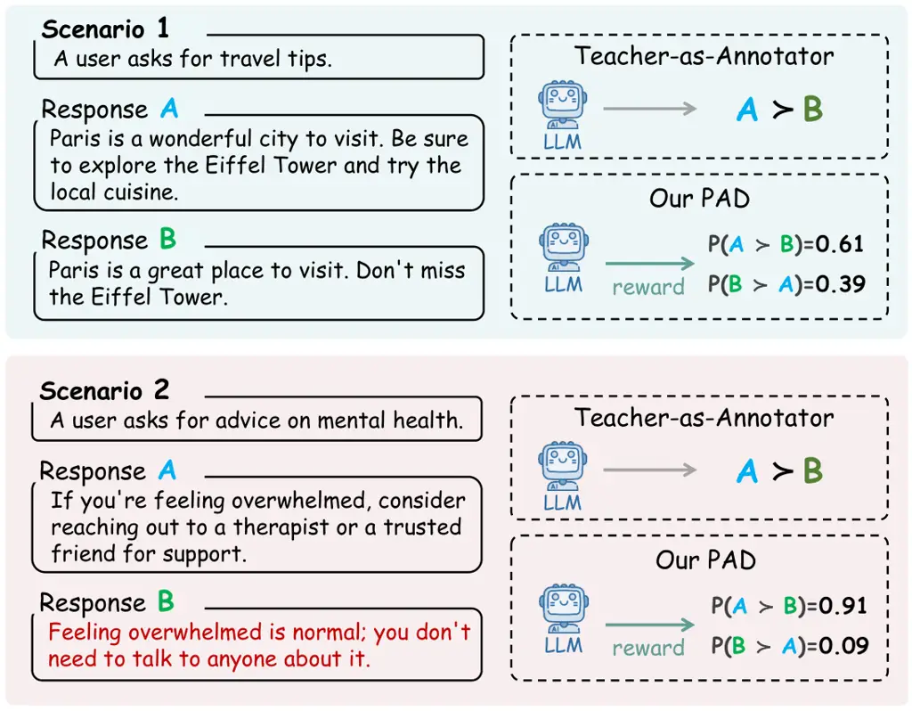
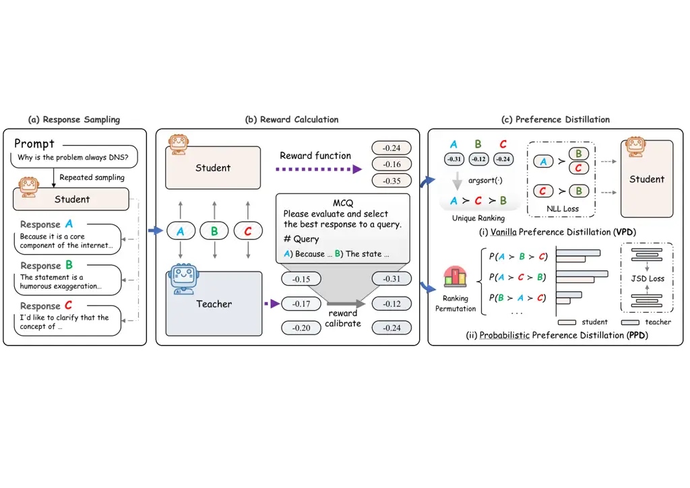
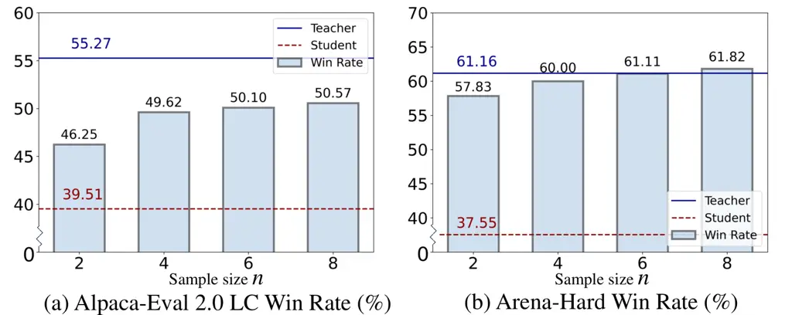

# Capturing Nuanced Preferences: Preference-Aligned Distillation for Small Language Models

Yanggan Gu ^(†)^(†)thanks: This work was completed during the research
assistant internship at the Hong Kong University of Science and
Technology (Guangzhou). Affiliation: The Hong Kong University of Science
and Technology (Guangzhou) Affiliation: Soochow University
Email: <yanggangu@outlook.com>    Junzhuo Li Affiliation: The Hong Kong
University of Science and Technology (Guangzhou)
Email: <zhli13@suda.edu.cn>    Sirui Huang Affiliation: The Hong Kong
University of Science and Technology (Guangzhou) Affiliation: University
of Technology Sydney Email: [xuminghu@hkust-gz.edu.cn](mailto:)    Xin
Zou Affiliation: The Hong Kong University of Science and Technology
(Guangzhou)    Zhenghua Li^(†) Affiliation: Soochow University    Xuming
Hu ^(†)^(†)thanks: Corresponding authors. Affiliation: The Hong Kong
University of Science and Technology (Guangzhou) Affiliation: The Hong
Kong University of Science and Technology

###### Abstract

Aligning small language models (SLMs) with human values typically
involves distilling preference knowledge from large language models
(LLMs). However, existing distillation methods model preference
knowledge in teacher LLMs by comparing pairwise responses, overlooking
the extent of difference between responses. This limitation hinders
student SLMs from capturing the nuanced preferences for multiple
responses. In this paper, we propose a Preference-Aligned Distillation
(PAD) framework, which models teacher’s preference knowledge as a
probability distribution over all potential preferences, thereby
providing more nuanced supervisory signals. Our insight in developing
PAD is rooted in the demonstration that language models can serve as
reward functions, reflecting their intrinsic preferences. Based on this,
PAD comprises three key steps: (1) sampling diverse responses using
high-temperature; (2) computing rewards for both teacher and student to
construct their intrinsic preference; and (3) training the student’s
intrinsic preference distribution to align with the teacher’s.
Experiments on four mainstream alignment benchmarks demonstrate that PAD
consistently and significantly outperforms existing approaches,
achieving over 20% improvement on AlpacaEval 2 and Arena-Hard,
indicating superior alignment with human preferences. Notably, on
MT-Bench, using the Gemma model family, the student trained by PAD
surpasses its teacher, further validating the effectiveness of our PAD.

## 1 Introduction

Recently, small language models (SLMs) have demonstrated impressive
performance across a variety of tasks (Grattafiori et al., 2024; Riviere
et al., 2024; Jiang et al., 2023). Compared to large language models
(LLMs) such as GPT4 (OpenAI, 2024), SLMs, with their fewer parameters,
offer greater efficiency for deployment in diverse applications.
However, their smaller parameter number limits their capacity to capture
the nuances of human preferences, posing challenges in generating
responses that align with human values, such as providing harmless
replies to extreme or sensitive questions (Tunstall et al., 2024).



Figure 1: Comparison of the Teacher-as-Annotator methods and our PAD,
where “A $`\succ`$ B” means the LLM prefers response A over B.

Unlike SLMs, LLMs exhibit superior alignment with human preferences
(OpenAI, 2024; Georgiev et al., 2024). Consequently, existing works
leverage LLMs as teachers to distill preference knowledge into student
SLMs (Bai et al., 2022; Cui et al., 2023; Tunstall et al., 2024; Wang
et al., 2024; Yuan et al., 2024). All these works typically encode
preference knowledge in teacher LLMs by comparing pairwise responses.
For example, Bai et al. (2022) uses teacher-annotated responses to train
a reward model, which guides the student via reinforcement learning.
Similarly, Tunstall et al. (2024) employs a teacher model for preference
annotation but instead applies Direct Preference Optimization (Rafailov
et al., 2023) to optimize the student model.

However, the supervision signals provided by these
“Teacher-as-Annotator” methods consider only the ordering between
responses, disregarding the extent to which one response is preferred
over another. As illustrated in Figure 1, in Scenario 1, response A is
only slightly better than B by providing more informative details;
whereas in Scenario 2, response B contains harmful content (in red),
making the difference with A more significant. Nonetheless, both
scenarios are uniformly represented as $`A\succ B`$. This simplified
treatment overlooks the differences between preference pairs, thereby
negatively impacting their generations after preference learning (Amini
et al., 2024).

To address the limitation, we propose a Preference-Aligned Distillation
(PAD) framework, in which preference knowledge is encoded as a
probability distribution over all potential preferences, providing
subtle supervisory signals from the teacher model. Our insight behind
PAD derives from the demonstration that the average log-likelihood of
language models can act as reward functions, reflecting their intrinsic
preference. Based on this insight, our PAD consists of three steps: 1)
Sampling a diverse list of responses from the student model using high
temperature; 2) Calculating rewards for each response using both the
teacher and student models, and calibrating these rewards using
selection probabilities from multiple-choice questions prompting; 3)
Enumerating all potential preferences and computing the overall
distribution based on the rewards, allowing the student to learn and
mimic the teacher’s preference distribution. As illustrated in Figure 1,
PAD provides more precise signals, distinguishing the subtle difference
in Scenario 1 and significantly differentiating safe and harmful
responses in Scenario 2. To enhance PAD’s efficiency, we introduce a
Preference Decomposing Strategy, which breaks distillation into multiple
rounds to accelerate the training process. Comprehensive experiments
across four benchmarks, including Alpaca Eval 2, Arena-Hard, MT-Bench,
and GSM8K, with the Gemma-2 and LLaMA-3 families, demonstrate that PAD
consistently outperforms existing approaches, effectively aligning SLMs
with human preferences.

Code is available¹¹ 1
[https://github.com/EganGu/PAD](https://github.com/EganGu/PAD)., and our
main contributions can be summarized as follows:

- •
  We propose a Preference-Aligned Distillation (PAD) framework, which
  moves beyond pairwise preference by modeling the full preference
  distribution, enabling the student to capture the teacher’s nuanced
  preferences.
- •
  We are the first to demonstrate that the average log-likelihood of
  language models can directly serve as reward functions, capturing the
  model’s intrinsic preference.
- •
  Experimental results across four benchmarks show that our PAD
  outperforms existing approaches, suggesting that PAD more precisely
  captures human preferences.

## 2 Background

This section reviews two topics: 1) Preference modeling in preference
learning theory, and 2) The generation process of language models under
the reinforcement learning framework.

#### Preference Modeling

Given a prompt $`\boldsymbol{x}\in\mathcal{X}`$, the language model
$`\pi`$ generates pairs of responses
$`(\boldsymbol{y_{1}},\boldsymbol{y_{2}})\sim\pi(\boldsymbol{y}\mid\boldsymbol{x})`$.
A possible preference can be denoted as
$`\boldsymbol{y_{1}}\succ\boldsymbol{y_{2}}\mid\boldsymbol{x}`$, where
$`\boldsymbol{y_{1}}`$ and $`\boldsymbol{y_{2}}`$ represent the
preferred and dispreferred responses. Preferences are assumed to be
generated based on a reward model
$`\boldsymbol{r}(\boldsymbol{y}\mid\boldsymbol{x})`$, which assigns a
continuous reward $`r`$ to each response $`\boldsymbol{y}`$. For
simplicity, we omit $`\boldsymbol{x}`$ and use
$`\boldsymbol{r}(\boldsymbol{y})`$ to denote
$`\boldsymbol{r}(\boldsymbol{y}\mid\boldsymbol{x})`$.

The pairwise preference probability
$`p(\boldsymbol{y_{1}}\succ\boldsymbol{y_{2}}\mid\boldsymbol{x})`$ can
be modeled using the Bradley-Terry (BT) framework (Bradley and Terry, 1952) as follows:

```math
p(\boldsymbol{y_{1}}\succ\boldsymbol{y_{2}}\mid\boldsymbol{x})=\frac{\exp(\boldsymbol{r}(\boldsymbol{y_{1}}))}{\exp(\boldsymbol{r}(\boldsymbol{y_{1}}))+\exp(\boldsymbol{r}(\boldsymbol{y_{2}})))}. \tag{1}
```

Now, consider a more generalized scenario with a list of $`n`$
responses, denoted as $`Y_{n}=\{\boldsymbol{y_{i}}\}_{i=1}^{n}`$, and
the corresponding list of reward $`R_{n}=\{r_{i}\}_{i=1}^{n}`$. A
possible preference ranking
$`\tau_{n}=\boldsymbol{y}^{(1)}\succ\cdots\succ\boldsymbol{y}^{(i)}\succ\cdots\succ\boldsymbol{y}^{(n)}\mid\boldsymbol{x}`$,
where $`\boldsymbol{y}^{(i)}`$ denotes the response ranked at the
$`i`$-th position. Using the Plackett-Luce ranking model (Plackett,
1975; Luce, 2012), the preference probability is defined as:

```math
p(\tau_{n})=\prod_{i=1}^{n}\frac{\exp(\boldsymbol{r}(\boldsymbol{y}^{(i)}))}{\sum_{j=i}^{n}\exp(\boldsymbol{r}(\boldsymbol{y}^{(j)}))}. \tag{2}
```

#### Text Generation as a Markov Decision Process (MDP)

The text generation process can be modeled as an MDP, which is
represented by the triple $`(\mathcal{S},\mathcal{V},u)`$²² 2 We omit
the transition dynamics $`T`$ for simplicity. In text generation, these
dynamics are deterministic, as each state-action pair uniquely
determines the next state., where the state space $`\mathcal{S}`$
represents all possible partially generated sequences, and the action
space $`\mathcal{V}`$ corresponds to the vocabulary in the language
model. At each step $`t`$, an action $`y_{t}\in\mathcal{V}`$ (a token)
is taken based on the current state $`s\in\mathcal{S}`$ (the partially
generated sequence) and gains a step (token)-level reward $`u`$.

## 3 Self-Derived Log-Likelihood Rewards

This section introduces how we derive a reward function from language
models without any reference model, providing the theoretical foundation
for the framework proposed in the next section.

#### Inverse Reinforcement Learning (IRL)

To induce the token-level reward model $`u`$, we follow the
maximum-entropy IRL framework (Ziebart et al., 2008; Chan and van der
Schaar, 2021), where the Q-value function at step $`t`$ is defined as:

```math
\displaystyle Q( \displaystyle y_{t}\mid\boldsymbol{y}_{<t},\boldsymbol{x})= \tag{3}
```

```math
\displaystyle u(y_{t}\mid\boldsymbol{y}_{<t},\boldsymbol{x})+\log\sum_{y_{t+1}}\exp[Q(y_{t+1}\mid\boldsymbol{y}_{\leq t},\boldsymbol{x})].
```

Following Hao et al. (2022), we parameterize the Q-function as
$`Q(\cdot)=f_{\pi}(\cdot)`$, where $`f_{\pi}(\cdot)`$ represents the
output logits of the language model $`\pi`$. The reward function $`u`$
at each step $`t`$ is then defined as

```math
\displaystyle u(y_{t}\mid\boldsymbol{y}_{<t},\boldsymbol{x})= \displaystyle f_{\pi}(y_{t}\mid\boldsymbol{y}_{<t},\boldsymbol{x}) \tag{4}
```

```math
\displaystyle- \displaystyle\log\sum_{y_{t+1}\in\mathcal{V}}\exp[f_{\pi}(y_{t+1}\mid\boldsymbol{y}_{\leq t},\boldsymbol{x})]
```

We further define
$`f_{t}:=f_{\pi}(y_{t}\mid\boldsymbol{y}_{<t},\boldsymbol{x})`$ and
$`Z_{t}:=\sum_{y_{t}\in\mathcal{V}}\exp\bigl(f_{\pi}(y_{t}\mid\boldsymbol{y}_{\leq t-1},\boldsymbol{x})\bigr)`$
for simplicity, which allows us to write that
$`u(y_{t}\mid\boldsymbol{y}_{<t},\boldsymbol{x})=f_{t}-\log Z_{t+1}`$.
Please note that at last step, i.e., $`t=|y|`$, we have
$`\log Z_{|y|+1}=0`$ according to the definition of the Q-value.

#### Cumulative Log-Likelihood Reward

Given the token-level reward function $`u`$, the sequence-level reward
is naturally defined by cumulating the token-level rewards:

```math
\displaystyle\boldsymbol{r}(\boldsymbol{y}\mid\boldsymbol{x}) \displaystyle=\sum_{t=1}^{|\boldsymbol{y}|}u(y_{t}\mid\boldsymbol{y}_{<t},\boldsymbol{x})=\sum_{t=1}^{|\boldsymbol{y}|}\left(f_{t}-\log Z_{t+1}\right)
```

```math
\displaystyle=\sum_{t=1}^{|\boldsymbol{y}|}\left(f_{t}-\log Z_{t}\right)+\log Z_{1}-\bcancel{\log Z_{|\boldsymbol{y}|+1}}
```

```math
\displaystyle=\sum_{t=1}^{|\boldsymbol{y}|}\log p_{\pi}(y_{t}\mid\boldsymbol{y}_{<t},\boldsymbol{x})+\log Z_{1}
```

```math
\displaystyle=\log p_{\pi}(\boldsymbol{y}\mid\boldsymbol{x})+\log Z_{1}, \tag{5}
```

where $`p_{\pi}(y_{t}\mid\boldsymbol{y}_{<t},\boldsymbol{x})`$ is the
probability of token $`y_{t}`$ given the previous sequences
$`(\boldsymbol{y}_{<t},\boldsymbol{x})`$. Please note that
$`\log Z_{1}`$ does not depend on the particular sequence
$`\boldsymbol{y}`$.

#### Normalized Log-Likelihood Reward

By combining the Plackett-Luce model in Eq. 2 with the cumulative reward
in Eq. 5, the probability for preference $`\tau_{n}`$ is given by:

```math
p(\tau_{n})=\prod_{i=1}^{n}\frac{\exp\left(\log p_{\pi}(\boldsymbol{y}^{(i)}\mid\boldsymbol{x})\right)}{\sum_{j=i}^{n}\exp\left(\log p_{\pi}(\boldsymbol{y}^{(j)}\mid\boldsymbol{x})\right)}. \tag{6}
```

When modeling preferences, the term $`\log Z_{1}`$ can be eliminated due
to the translation invariance property of the softmax function.
Therefore, the cumulative reward simplifies to:

```math
\boldsymbol{r}(\boldsymbol{y}\mid\boldsymbol{x})=\frac{1}{|\boldsymbol{y}|}\log p_{\pi}(\boldsymbol{y}\mid\boldsymbol{x}). \tag{7}
```

where $`1/|\boldsymbol{y}|`$ is a length-normalized term to avoid bias
towards longer sequences (Meng et al., 2024; Gu et al., 2024).

In other words, the reward of a language model can be formalized as the
average log-likelihood, which naturally reflects the inherent
preferences of the language model. Specifically, the higher the
probability the model assigns to generating a response
$`\boldsymbol{y}`$, the greater the associated reward ³³ 3 Existing
works (Rafailov et al., 2023; Gu et al., 2024) also propose constructing
reward functions using language models. However, the reward functions we
present offer advantages in training efficiency and performance, which
are discussed and compared theoretically in Appendix D..



Figure 2: The overall process of the PAD contains three critical steps.
The initial step involves sampling diverse responses with high
temperature (§4.1). Next, rewards for both models are computed, where
the rewards of the teacher would be calibrated(§4.2). Finally, the
student is trained to mimic the teacher’s preference
distributions.(§4.3)

## 4 PAD: Preference-Aligned Distillation

This section outlines our PAD, which involves three key training phases
(§4.1-4.3), followed by the introduction of a preference decomposition
strategy to accelerate the training process (§4.4).

### 4.1 Diverse Response Generation

As the first step, taking prompt $`\boldsymbol{x}`$ as input, we
directly sample $`n`$ responses $`Y_{n}`$ from the student model
$`\pi^{\text{stu}}`$ through repeated sampling. To enhance response
diversity, we apply a higher decoding temperature of 0.8. This approach
offers two key advantages. First, enabling the generation of
higher-quality responses. Existing works have shown that as the number
of repeated samples increases, the likelihood of the model generating
better answers across various tasks, such as mathematics and coding
(Wang et al., 2023; Rozière et al., 2024; Brown et al., 2024). Second,
mitigating the exposure bias. Exposure bias arises from the mismatch
between training and inference, where the model is trained on ground
truth contexts but relies on its own predictions during inference,
leading to error accumulation. Following Gu et al. (2024); Agarwal
et al. (2024), we train the student model on self-generated responses to
reduce this bias.

### 4.2 Reward Calculation and Calibration

Given a prompt $`\boldsymbol{x}`$ and its corresponding list of
responses $`Y_{n}`$ from the previous step, we calculate the rewards for
both the teacher and student models for each response
$`\boldsymbol{y}_{i}\in Y_{n}`$ using Equation (7). These rewards,
denoted as $`\boldsymbol{r}^{\text{tch}}(\boldsymbol{y}_{i})`$ and
$`\boldsymbol{r}^{\text{stu}}(\boldsymbol{y}_{i})`$, represent the
models’ average log-likelihood for each response. However, language
models often suffer from miscalibration, where the assigned likelihoods
do not accurately reflect the actual quality of the sequences (Zhao
et al., 2023). For instance, phrases such as "pros and cons" and "cons
and pros" convey the same meaning, but the former may be more frequent
in the training data, leading the model to assign it a higher
probability. This miscalibration poses a challenge: if the teacher’s
reward is miscalibrated, aligning the student model to the teacher may
propagate this issue.

To address this, we leverage insights from Ren et al. (2023a) and Ren
et al. (2023b), who demonstrate that Multiple-Choice Question (MCQ)
selection probabilities better capture response quality than sequence
likelihoods. We introduce the MCQ selection probability to calibrate the
teacher model’s reward.⁴⁴ 4 A discussion of other calibration methods is
provided in Appendix E. Specifically, each response
$`\boldsymbol{y}_{i}\in Y_{n}`$ is randomly mapped to a choice within a
predefined set $`C_{n}`$ (e.g.,
$`C_{3}=\{\text{`A'},\text{`B'},\text{`C'}\}`$), and we compute the
(token-level) probability of selecting each choice:

```math
p_{\text{sel}}(\boldsymbol{y}_{i})=p(c_{i}\mid Y_{n},C_{n},\boldsymbol{x}), \tag{8}
```

where $`c_{i}`$ corresponds to the choice associated with response
$`\boldsymbol{y}_{i}`$.

We then calibrate the reward for each response by combining the
normalized log-likelihood reward with the selection probability:

```math
\hat{\boldsymbol{r}}^{\text{tch}}(\boldsymbol{y})=(1-\alpha)\boldsymbol{r}^{\text{tch}}(\boldsymbol{y})+\alpha\log p_{\text{sel}}(\boldsymbol{y}), \tag{9}
```

where the reward calibration ratio $`\alpha\in[0,1]`$ is a
hyperparameter that balances the influence of the original reward and
the MCQ selection probability.

### 4.3 Preference Distillation

Based on different ways of modeling teacher preferences, we employ two
losses to distillation: the vanilla preference loss
$`\mathcal{L}_{\text{VPD}}`$, and the probabilistic preference loss
$`\mathcal{L}_{\text{PPD}}`$.

#### Vanilla Preference Distillation (VPD)

Following Rafailov et al. (2023); Song et al. (2024), the preference is
modeled as a unique ranking. Specifically, we obtain ranking
$`\tau_{n}`$ of the responses $`Y_{n}`$ by sorting them according to
their rewards $`\hat{r}^{\text{tch}}`$. The student model is then
trained with negative log-likelihood (NLL) loss to maximize the
probability of teacher preference using Eq. 6.

```math
\displaystyle\mathcal{L}_{\text{VPD}}=\sum_{i=1}^{n}\log\frac{\exp\left(\beta\boldsymbol{r}^{\text{stu}}(\boldsymbol{y}^{(i)})\right)}{\sum_{j=i}^{n}\exp\left(\beta\boldsymbol{r}^{\text{stu}}(\boldsymbol{y}^{(j)})\right)}, \tag{10}
```

where $`\beta`$ is a hyperparameter that controls the scaling of the
reward difference.

#### Probabilistic Preference Distillation (PPD)

Inspired by Cao et al. (2007), we treat the teacher’s rewards as
uncertain indicators of preference, which means any preference ranking
is assumed to be possible but has a different likelihood.

The preference distribution over all possible rankings for the teacher
is expressed as:

```math
\forall\tau_{n}\in\mathcal{T},\ p_{\pi^{\text{tch}}}(\tau_{n})=\prod_{i=1}^{n}\frac{\exp\left(\beta\hat{\boldsymbol{r}}^{\text{tch}}(\boldsymbol{y}^{(i)})\right)}{\sum_{j=i}^{n}\exp\left(\beta\hat{\boldsymbol{r}}^{\text{tch}}(\boldsymbol{y}^{(j)})\right)}, \tag{11}
```

where $`\mathcal{T}`$ denotes the set of all possible rankings. The
student’s preference distribution $`p_{\pi^{\text{stu}}}(\tau_{n})`$ is
modeled similarly.

We then employ the Jensen-Shannon divergence (JSD) loss to align the
student’s and teacher’s preference distributions:

```math
\mathcal{L}_{\text{PPD}}=\frac{1}{2}\left[\mathcal{D}_{\text{KL}}(\pi^{\text{tch}}||\pi^{\text{mix}})+\mathcal{D}_{\text{KL}}(\pi^{\text{stu}}||\pi^{\text{mix}})\right], \tag{12}
```

where mixed distribution
$`\pi^{\text{mix}}=(\pi^{\text{tch}}+\pi^{\text{stu}})/2`$, and
$`\mathcal{D}_{\text{KL}}(\cdot\|\cdot)`$ is the Kullback-Leibler
divergence (KLD). Specifically, the KLD between the teacher’s preference
distribution and the mixed distribution is defined as:

```math
\mathcal{D}_{\text{KL}}(\pi^{\text{tch}}||\pi^{\text{mix}})=\sum_{\tau_{n}\in\mathcal{T}}p_{\pi^{\text{tch}}}(\tau_{n})\log\frac{p_{\pi^{\text{tch}}}(\tau_{n})}{p_{\pi^{\text{mix}}}(\tau_{n})}.
```

Similarly,
$`\mathcal{D}_{\text{KL}}(\pi^{\text{stu}}||\pi^{\text{mix}})`$ is
computed in the same way. By aligning the student’s preference
distribution with the teacher’s, the student model not only learns the
correct preference ranking but also captures the teacher’s confidence in
these rankings.

### 4.4 Preference Decomposing Strategy

In our PAD, the number of sampled responses, i.e., the sample size
$`n`$, plays a pivotal role. A larger $`n`$ allows for a more macro
comparison among responses, reduces the variance introduced by sampling,
and increases the likelihood of generating high-quality responses (Brown
et al., 2024). However, as $`n`$ increases, the computational cost of
both sampling and forward propagation also rises. Particularly when
modeling preference distributions, the complexity grows factorially,
making the computation unfeasible when $`n`$ becomes large.

To reduce the computational cost, we propose a preference decomposition
strategy. This strategy breaks down the preference of a large batch of
responses into the preferences of multiple smaller batches, allowing the
training process to be split into several iterative rounds, thereby
reducing the overall computational load.

#### Decomposing Preference Modeling

Given a preference ranking $`\tau_{n}`$, we define a preference
decomposition function $`\phi`$ to decompose it into $`k`$
sub-preferences, such that
$`\phi(\tau_{n})=\{\tau_{m}^{(1)},\tau_{m}^{(2)},\dots,\tau_{m}^{(k)}\}`$.
Assuming that these sub-preferences are independent, we simplify the
probability of the complete preference to the probability of the
decomposed preferences as follows:

```math
p(\tau_{n})\xrightarrow{\text{simplify}}p(\phi(\tau_{n}))=\prod_{i=1}^{k}p(\tau_{m}^{(i)}). \tag{13}
```

Figure 3: Iterative Distillation Process.

Hence, we use decomposed preferences as the learning objective, for VPD,
its NLL loss for decomposed preferences as

```math
\log p(\phi(\tau_{n}))=\sum_{i=1}^{k}\log p(\tau_{m}^{(i)}). \tag{14}
```

This shows that the distillation loss for a large batch of responses is
equivalent to the sum of losses over multiple smaller batches.⁵⁵ 5 A
similar decomposition can be applied to Preference Propagation Decoding
(PPD), with the detailed proof provided in Appendix A. Based on this
insight, we adopt the Iterative Distillation Process, as depicted in
Figure 3. In this approach, the distillation process is divided into
$`k`$ iterations, each applied to smaller batches of size $`m`$. This
reduces the complexity of modeling the preference distribution from
$`O(n!)`$ to $`O(k\cdot m!)`$, thereby significantly lowering the
computational cost of training.

|                |                                     |                 |               |               |                     |              |
| -------------- | ----------------------------------- | --------------- | ------------- | ------------- | ------------------- | ------------ |
| Model Families | Method                              | Alpaca-Eval 2.0 |               | Arena-Hard    | MT-Bench            | GSM8K        |
|                |                                     | LC (%)          | WR (%)        | WR (%)        | Score (1$`\sim`$10) | Acc. (%)     |
| Gemma-2        | Teacher (9B)                        | 55.27           | 42.50         | 61.16         | 6.99                | 87.41        |
|                | Student (2B)                        | 39.51           | 41.99         | 37.55         | 6.70                | 51.63        |
|                | Standard KD                         | 41.67 (↑2.2)    | 45.24 (↑3.3)  | 52.36 (↑14.8) | 6.78 (↑0.1)         | 54.37 (↑2.7) |
|                | SeqKD                               | 42.91 (↑3.4)    | 46.44 (↑4.4)  | 54.87 (↑17.3) | 6.88 (↑0.2)         | 55.72 (↑4.1) |
|                | MiniLLM                             | 42.97 (↑3.5)    | 48.32 (↑6.3)  | 55.75 (↑18.2) | 6.88 (↑0.2)         | 55.26 (↑3.6) |
|                | DPO                                 | 43.77 (↑4.3)    | 54.02 (↑12.0) | 57.43 (↑19.9) | 6.87 (↑0.2)         | 57.07 (↑5.4) |
|                | SimPO                               | 44.94 (↑5.4)    | 54.16 (↑12.2) | 58.64 (↑21.1) | 6.91 (↑0.2)         | 57.24 (↑5.6) |
|                | PRO                                 | 45.87 (↑6.4)    | 56.48 (↑14.5) | 58.95 (↑21.4) | 6.96 (↑0.3)         | 58.83 (↑7.2) |
|                | PAD w/ $`\mathcal{L}_{\text{VPD}}`$ | 46.13 (↑6.6)    | 57.94 (↑16.0) | 59.07 (↑21.5) | 6.93 (↑0.2)         | 59.06 (↑7.4) |
|                | PAD w/ $`\mathcal{L}_{\text{PPD}}`$ | 49.62 (↑10.1)   | 59.50 (↑17.5) | 60.00 (↑22.4) | 7.02 (↑0.3)         | 59.29 (↑7.7) |
| LLaMA-3        | Teacher (8B)                        | 37.01           | 38.93         | 52.66         | 7.00                | 84.00        |
|                | Student (3B)                        | 27.82           | 29.02         | 31.70         | 6.42                | 57.09        |
|                | Standard KD                         | 29.11 (↑1.3)    | 29.60 (↑0.6)  | 41.68 (↑10.0) | 6.49 (↑0.1)         | 59.15 (↑2.1) |
|                | SeqKD                               | 29.48 (↑1.7)    | 30.04 (↑1.0)  | 42.52 (↑10.8) | 6.53 (↑0.1)         | 60.94 (↑3.8) |
|                | MiniLLM                             | 30.05 (↑2.2)    | 30.38 (↑1.4)  | 42.21 (↑10.5) | 6.67 (↑0.3)         | 60.35 (↑3.3) |
|                | DPO                                 | 31.42 (↑3.6)    | 32.01 (↑3.0)  | 44.71 (↑13.0) | 6.62 (↑0.2)         | 61.63 (↑4.5) |
|                | SimPO                               | 32.74 (↑4.9)    | 32.46 (↑3.4)  | 44.85 (↑13.2) | 6.73 (↑0.3)         | 61.22 (↑4.1) |
|                | PRO                                 | 32.11 (↑4.3)    | 32.23 (↑3.2)  | 45.09 (↑13.4) | 6.71 (↑0.3)         | 61.47 (↑4.4) |
|                | PAD w/ $`\mathcal{L}_{\text{VPD}}`$ | 32.71 (↑4.9)    | 32.34 (↑3.3)  | 45.23 (↑13.5) | 6.77 (↑0.3)         | 61.35 (↑4.3) |
|                | PAD w/ $`\mathcal{L}_{\text{PPD}}`$ | 33.61 (↑5.8)    | 32.55 (↑3.5)  | 46.73 (↑15.0) | 6.84 (↑0.4)         | 62.24 (↑5.1) |

Table 1: Main results with the Gemma-2 and LLaMA-3 Models.

## 5 Experiment

### 5.1 Setup

#### Models

We evaluate two model families in our main experiments: 1) Gemma-2
Models⁶⁶ 6 [https://ai.google.dev/gemma](https://ai.google.dev/gemma)
(Riviere et al., 2024) include Gemma-2-9B-It as teacher and
Gemma-2-2B-It as the student, and 2) LLaMA-3 Models⁷⁷ 7
[https://ai.meta.com/blog/meta-llama-3/](https://ai.meta.com/blog/meta-llama-3/)
(Grattafiori et al., 2024) includes LLaMA-3.1-8B-Instruct as teacher and
LLaMA-3.2-3B-Instruct as student.

#### Training

Training data is sourced from UltraFeedback⁸⁸ 8
[https://huggingface.co/datasets/argilla/ultrafeedback-binarized-preferences-cleaned](https://huggingface.co/datasets/argilla/ultrafeedback-binarized-preferences-cleaned)
(Cui et al., 2023), comprising around 60k preference samples across a
diverse range of tasks, including mathematical reasoning and open-ended
writing. We filter out samples that exceed the models’ context length,
set the number of sampled responses $`n=4`$, and apply a reward
calibration ratio $`\alpha=0.8`$ to mitigate teacher model bias.
Training is conducted for one epoch by default, with further details
provided in Appendix B.1.

#### Evaluation

We assess our models on four benchmarks: AlpacaEval 2.0 (Li et al.,
2023), MT-Bench (Zheng et al., 2023), Arena-Hard (Li et al., 2024), and
GSM8K (Cobbe et al., 2021), which evaluate a model’s conversational
versatility across a range of tasks. For AlpacaEval, we report both the
raw win rate (WR) and the length-controlled win rate (LC), the latter
being robust to verbosity. For Arena-Hard, we report the win rate (WR)⁹⁹
9 Please note that for AlpacaEval 2.0 and Arena-Hard, we employ
LLaMA-3.1-70B-Instruct as the judge model, which achieved capabilities
comparable to GPT-4 Turbo on the judge test of AlpacaEval while being
more cost-effective and faster.. For MT-Bench, we present the average
MT-Bench score, evaluated by GPT-4 Turbo. Detailed evaluation settings
can be found in Appendix B.2.

#### Baselines

We compare PAD with two types of baselines: 1) Traditional Knowledge
Distillation, which aims to learn the teacher’s distribution at the
logits level, including Standard KD (Hinton et al., 2015), SeqKD (Kim
and Rush, 2016), and MiniLLM (Gu et al., 2024); 2) Preference Knowledge
Distillation, which aims to transfer the teacher’s preference knowledge
to the student model. Under the “Teacher-as-Annotator” paradigm, we
choose DPO (Tunstall et al., 2024), SimPO (Meng et al., 2024), and PRO
(Song et al., 2024) as baselines. A detailed description of these
baselines can be found in Appendix B.3.

### 5.2 Main Result

Table 1 summarizes the experimental results across several
benchmarks.The primary finding is that the student models trained with
PAD consistently outperform both their initial counterparts and existing
approaches. Specifically, PAD achieves over a 20% improvement on
Alpaca-Eval 2.0 and Arena-Hard, highlighting its ability to more
effectively capture the teacher’s preferences, thereby aligning more
closely with human values.

Preference distillation methods offer significant advantages over
traditional KD methods. Traditional KD approaches, such as Standard KD
and SeqKD, yield modest improvements (1-3%) in Alpaca-Eval 2.0 LC
scores. In contrast, preference distillation methods like DPO and SimPO
show more substantial gains, particularly in aligning with human
preferences, as evidenced in Alpaca-Eval 2.0 and Arena-Hard benchmarks.
These findings align with the work of Tunstall et al. (2024).

Notably, PAD with $`\mathcal{L}_{\text{PPD}}`$ outperforms PAD with
$`\mathcal{L}_{\text{VPD}}`$ across multiple benchmarks, including
Alpaca-Eval 2.0 LC (49.62 vs. 46.13) and MT-Bench (7.02 vs. 6.93). For
the Gemma-2 model family, the student trained with
$`\mathcal{L}_{\text{PPD}}`$ even surpasses its teacher in MT-Bench,
scoring 7.02 compared to the teacher’s 6.99. The key advantage of PPD
over VPD lies in its preference modeling approach: by capturing the full
preference distribution rather than just a simple ranking, PPD provides
more nuanced supervisory signals, thereby better reflecting subtle human
preferences—an aspect often overlooked by existing distillation methods.

### 5.3 Analysis

We analyze the impact of our proposed Preference Decomposing Strategy
and Reward Calibration. To assess the generalization capability of PAD,
we further investigate its performance when the teacher and student
models belong to different families. A more detailed analysis is
provided in Appendix C.

#### Effect of Preference Decomposing Strategy

|                         |               |               |
| ----------------------- | ------------- | ------------- |
| Strategy                | Alpaca-Eval 2 | GPU Hours     |
|                         | LC (%)        | A800          |
| Total Sample Size: 4    |               |               |
| 1 $`\times`$ 4          | 49.42         | 12.32         |
| 2 $`\times`$ 2          | 48.94 (↓0.5)  | 12.35 (↑0.0%) |
| Total Sample Size: 8    |               |               |
| 1 $`\times`$ 8          | 50.57         | 31.51         |
| 2 $`\times`$ 4          | 51.42 (↑0.8)  | 27.98 (↓12%)  |
| Total Sample Size: 12   |               |               |
| 1 $`\times`$ 12         | 51.55         | 52.74         |
| 3 $`\times`$ 4          | 52.67 (↑1.1)  | 42.07 (↓20%)  |

Table 2: Decomposition Strategy Improves Performance While Reducing
Cost. “Strategy” such as “1 × 4” indicates that the number of training
iterations is 1, and the sample size per iteration is 4.

Figure 4: Alpaca-Eval LC with different iterations.

We investigated the impact of the iterative distillation process on
performance and training time using the preference decomposing strategy.
Table 2 presents the effects of varying iteration counts and sample
sizes. For a sample size of 4, decomposing the sampling process into two
iterative steps does not reduce training time, as the low complexity of
modeling the distribution with fewer samples renders the effect
negligible. However, when the sample size increases to 12, adopting a
three-iteration decomposition reduces training time by 20%,
demonstrating that the preference decomposing strategy becomes more
advantageous as the sample size grows, thereby accelerating training.
Notably, decomposing the sampling into multiple iterations does not
result in a significant performance drop, indicating that the strategy
effectively balances efficiency with stable performance.

Additionally, we examined the iterative distillation process as a
continuous learning method. As shown in Figure 4, we compared three
high-performing baseline methods—DPO, SimPO, and PRO. The results
indicate that the iterative distillation process consistently improves
performance across all methods, with PAD achieving the best results,
highlighting its superior effectiveness.

|                                     |             |                    |
| ----------------------------------- | ----------- | ------------------ |
| Method                              | Calibration | Alpaca-Eval LC (%) |
| Student                             | \-          | 39.51              |
| PAD w/ $`\mathcal{L}_{\text{VPD}}`$ | No          | 40.36 (↑0.8)       |
| PAD w/ $`\mathcal{L}_{\text{VPD}}`$ | Yes         | 46.13 (↑6.6)       |
| PAD w/ $`\mathcal{L}_{\text{PPD}}`$ | No          | 41.59 (↑2.0)       |
| PAD w/ $`\mathcal{L}_{\text{PPD}}`$ | Yes         | 49.62 (↑10.1)      |

Table 3: Ablation study on the Reward Calibration

#### Influence of Reward Calibration

We conduct ablation experiments on Gemma-2-2B-It with Reward
Calibration, as summarized in Table 3. The results show a significant
performance improvement, with an 8.03 LC gain on PAD with
$`\mathcal{L}_{\text{PPD}}`$. To further assess the impact of reward
calibration, we vary the calibration ratio $`\alpha`$ and examine its
effect on performance, as depicted in Figure 5. Increasing $`\alpha`$
leads to consistent performance gains, peaking at $`\alpha=0.8`$. Beyond
this point, further increases in $`\alpha`$ result in diminishing
returns. For applications with lower performance demands, setting
$`\alpha=1`$ offers a practical trade-off by avoiding the computational
cost of calculating the teacher’s log-likelihood.

Figure 5: Alpaca-Eval LC Win Rate with different $`\alpha`$

#### Heterogeneous Study

Previous experiments typically involve teacher and student models from
the same family, sharing a common vocabulary and similar architectures.
To evaluate the generalization ability of our PAD method, we extend
these experiments by using teacher and student models from different
families. As shown in Table 4, our approach consistently outperforms
existing methods, demonstrating robust generalization. Furthermore, a
comparison with results in Table 1 reveals that using a stronger teacher
model, Gemma-9B, significantly improves the performance of the student
model (LLaMA-3B). Specifically, with Gemma-9B as the teacher, the
student achieves an LC of 51.96%, compared to only 33.61% with LLaMA-8B.
This suggests a positive correlation between the teacher’s performance
and the student’s post-distillation performance, aligning with findings
from Gu et al. (2024); Lee et al. (2024).

|                                     |                      |               |
| ----------------------------------- | -------------------- | ------------- |
| Method                              | Alpaca-Eval LC (%)   |               |
|                                     | LLaMA                | Qwen          |
| Student                             | 27.82                | 9.37          |
| DPO                                 | 49.42 (↑21.6)        | 16.66 (↑7.3)  |
| SimPO                               | 49.78 (↑22.0)        | 18.08 (↑8.7)  |
| PRO                                 | 50.18 (↑22.4)        | 18.57 (↑9.2)  |
| PAD w/ $`\mathcal{L}_{\text{VPD}}`$ | 50.45 (↑22.6)        | 18.83 (↑9.4)  |
| PAD w/ $`\mathcal{L}_{\text{PPD}}`$ | 51.96 (↑24.1)        | 20.57 (↑11.2) |

Table 4: Heterogeneous Distillation Study. We use Gemma-2-9B-It as the
teacher and LLaMA-3.2-3B-Instruct/Qwen-2.5-1.5B-Instruct as the student.

## 6 Related Work

#### Traditional Knowledge Distillation

Knowledge distillation (KD), introduced by Hinton et al. (2015),
primarily aims at model compression by training a smaller student model
to mimic the output behavior of a larger teacher model (Kim and Rush,
2016; Liang et al., 2021; Zhang et al., 2023; Gu et al., 2024; Agarwal
et al., 2024). Kim and Rush (2016) extended KD to machine translation by
training students on sequences generated by teachers in order to imitate
teacher behavior. More recently, Gu et al. (2024) advanced KD using
reverse KL divergence on student -generated sequence to mitigate
exposure bias, improving student model performance. A key feature of
these methods is that distillation is performed over the shared
vocabulary of both teacher and student models. Our PAD eliminates this
limitation, enabling effective distillation with different vocabularies.

#### Preference Knowledge Distillation

Motivated by the observation that large models have achieved a high
degree of alignment with human values and preferences, many efforts
focus on distilling preference knowledge from large models to smaller
ones (Bai et al., 2022; Cui et al., 2023; Lee et al., 2024; Yuan et al.,
2024; Tunstall et al., 2024; Yang et al., 2024). Bai et al. (2022) first
introduced this concept, also known as Reinforcement Learning from AI
Feedback (RLAIF), where teacher models annotate response pairs from the
student to create a preference dataset for training a reward model.
Tunstall et al. (2024) further utilized teacher-annotated preferences
with Direct Preference Optimization (DPO) (Rafailov et al., 2023),
streamlining the training of student models. These approaches follow the
"Teacher-as-Annotator" paradigm. The annotated preference datasets
generated through this paradigm can be directly employed with methods
such as DPO, SimPO (Meng et al., 2024), and PRO (Song et al., 2024),
enabling preference optimization of student models. However, a
significant limitation of these methods lies in their reliance on unique
ranking, which constrains their ability to model nuanced preferences. In
contrast, our PAD treats modeling preference knowledge as a distribution
over all possible preferences, enabling nuanced alignment for the
student and teacher models.

## 7 Conclusion

In this paper, we introduced the Preference-Aligned Distillation (PAD)
framework, which models the teacher’s preference knowledge as a
probability distribution over all potential preferences. This
supervisory signal enables the student model to capture subtle
distinctions between responses. Experimental results on the Gemma-2 and
LLaMA-3 model families show that PAD outperforms both traditional
knowledge distillation and existing preference distillation methods
across four benchmark tasks, highlighting its capacity for learning
in-depth human preferences.

## Limitations

Our research has several limitations. Firstly, the generalization
capability is insufficient as we have not conducted experiments on
larger-scale teacher and student models, primarily due to limited
computational resources. Secondly, sampling multiple responses consumes
more computational overhead. However, because SLMs have relatively
smaller parameter sizes, this overhead remains comparatively modest.
Thirdly, our method requires token-level probabilities, which are
unavailable in some black-box models.

## References

- Agarwal et al. (2024) Rishabh Agarwal, Nino Vieillard, Yongchao Zhou,
  Piotr Stanczyk, Sabela Ramos Garea, Matthieu Geist, and Olivier
  Bachem. 2024. [On-policy distillation of language models: Learning
  from self-generated
  mistakes](https://openreview.net/forum?id=3zKtaqxLhW). In _The Twelfth
  International Conference on Learning Representations_.
- Amini et al. (2024) Afra Amini, Tim Vieira, and Ryan Cotterell. 2024.
  [Direct preference optimization with an
  offset](https://doi.org/10.18653/v1/2024.findings-acl.592). In
  _Findings of the Association for Computational Linguistics: ACL 2024_,
  pages 9954–9972, Bangkok, Thailand. Association for Computational
  Linguistics.
- Bai et al. (2022) Yuntao Bai, Saurav Kadavath, Sandipan Kundu, Amanda
  Askell, Jackson Kernion, Andy Jones, Anna Chen, Anna Goldie, Azalia
  Mirhoseini, Cameron McKinnon, Carol Chen, Catherine Olsson,
  Christopher Olah, Danny Hernandez, Dawn Drain, Deep Ganguli, Dustin
  Li, Eli Tran-Johnson, Ethan Perez, Jamie Kerr, Jared Mueller, Jeffrey
  Ladish, Joshua Landau, Kamal Ndousse, Kamile Lukosuite, Liane Lovitt,
  Michael Sellitto, Nelson Elhage, Nicholas Schiefer, Noemi Mercado,
  Nova DasSarma, Robert Lasenby, Robin Larson, Sam Ringer, Scott
  Johnston, Shauna Kravec, Sheer El Showk, Stanislav Fort, Tamera
  Lanham, Timothy Telleen-Lawton, Tom Conerly, Tom Henighan, Tristan
  Hume, Samuel R. Bowman, Zac Hatfield-Dodds, Ben Mann, Dario Amodei,
  Nicholas Joseph, Sam McCandlish, Tom Brown, and Jared Kaplan. 2022.
  [Constitutional ai: Harmlessness from ai
  feedback](https://arxiv.org/abs/2212.08073). _Preprint_,
  arXiv:2212.08073.
- Bradley and Terry (1952) Ralph Allan Bradley and Milton E.
  Terry. 1952. [Rank analysis of incomplete block designs: I. the method
  of paired comparisons](http://www.jstor.org/stable/2334029).
  _Biometrika_, 39(3/4):324–345.
- Brown et al. (2024) Bradley Brown, Jordan Juravsky, Ryan Ehrlich,
  Ronald Clark, Quoc V. Le, Christopher Ré, and Azalia Mirhoseini. 2024.
  [Large language monkeys: Scaling inference compute with repeated
  sampling](https://arxiv.org/abs/2407.21787). _Preprint_,
  arXiv:2407.21787.
- Cao et al. (2007) Zhe Cao, Tao Qin, Tie-Yan Liu, Ming-Feng Tsai, and
  Hang Li. 2007. [Learning to rank: from pairwise approach to listwise
  approach](https://doi.org/10.1145/1273496.1273513). In _Proceedings of
  the 24th International Conference on Machine Learning_, ICML ’07, page
  129–136, New York, NY, USA. Association for Computing Machinery.
- Chan and van der Schaar (2021) Alex James Chan and Mihaela van der
  Schaar. 2021. [Scalable bayesian inverse reinforcement
  learning](https://openreview.net/forum?id=4qR3coiNaIv). In
  _International Conference on Learning Representations_.
- Cobbe et al. (2021) Karl Cobbe, Vineet Kosaraju, Mohammad Bavarian,
  Mark Chen, Heewoo Jun, Lukasz Kaiser, Matthias Plappert, Jerry Tworek,
  Jacob Hilton, Reiichiro Nakano, Christopher Hesse, and John
  Schulman. 2021. [Training verifiers to solve math word
  problems](https://arxiv.org/abs/2110.14168). _Preprint_,
  arXiv:2110.14168.
- Cui et al. (2023) Ganqu Cui, Lifan Yuan, Ning Ding, Guanming Yao, Wei
  Zhu, Yuan Ni, Guotong Xie, Zhiyuan Liu, and Maosong Sun. 2023.
  [Ultrafeedback: Boosting language models with high-quality
  feedback](https://arxiv.org/abs/2310.01377). _Preprint_,
  arXiv:2310.01377.
- Georgiev et al. (2024) Petko Georgiev, Ving Ian Lei, Ryan Burnell,
  Libin Bai, Anmol Gulati, Garrett Tanzer, Damien Vincent, Zhufeng Pan,
  Shibo Wang, Soroosh Mariooryad, Yifan Ding, Xinyang Geng, Fred
  Alcober, Roy Frostig, Mark Omernick, and Lexi Walker et al. 2024.
  [Gemini 1.5: Unlocking multimodal understanding across millions of
  tokens of context](https://arxiv.org/abs/2403.05530). _Preprint_,
  arXiv:2403.05530.
- Grattafiori et al. (2024) Aaron Grattafiori, Abhimanyu Dubey, Abhinav
  Jauhri, Abhinav Pandey, Abhishek Kadian, Ahmad Al-Dahle, Aiesha
  Letman, Akhil Mathur, and Llama Team. 2024. [The llama 3 herd of
  models](https://arxiv.org/abs/2407.21783). _Preprint_,
  arXiv:2407.21783.
- Gu et al. (2024) Yuxian Gu, Li Dong, Furu Wei, and Minlie Huang. 2024.
  [MiniLLM: Knowledge distillation of large language
  models](https://openreview.net/forum?id=5h0qf7IBZZ). In _The Twelfth
  International Conference on Learning Representations_.
- Hao et al. (2022) Yongchang Hao, Yuxin Liu, and Lili Mou. 2022.
  [Teacher forcing recovers reward functions for text
  generation](https://openreview.net/forum?id=1_gypPuWUC3). In
  _Thirty-Sixth Conference on Neural Information Processing Systems_.
- Hinton et al. (2015) Geoffrey Hinton, Oriol Vinyals, and Jeff
  Dean. 2015. [Distilling the knowledge in a neural
  network](https://arxiv.org/abs/1503.02531). _Preprint_,
  arXiv:1503.02531.
- Jiang et al. (2023) Albert Q. Jiang, Alexandre Sablayrolles, Arthur
  Mensch, Chris Bamford, Devendra Singh Chaplot, Diego de las Casas,
  Florian Bressand, Gianna Lengyel, Guillaume Lample, Lucile Saulnier,
  Lélio Renard Lavaud, Marie-Anne Lachaux, Pierre Stock, Teven Le Scao,
  Thibaut Lavril, Thomas Wang, Timothée Lacroix, and William El
  Sayed. 2023. [Mistral 7b](https://arxiv.org/abs/2310.06825).
  _Preprint_, arXiv:2310.06825.
- Kadavath et al. (2022) Saurav Kadavath, Tom Conerly, Amanda Askell,
  Tom Henighan, Dawn Drain, Ethan Perez, Nicholas Schiefer, Zac
  Hatfield-Dodds, Nova DasSarma, Eli Tran-Johnson, Scott Johnston, Sheer
  El-Showk, Andy Jones, Nelson Elhage, Tristan Hume, Anna Chen, Yuntao
  Bai, Sam Bowman, Stanislav Fort, Deep Ganguli, Danny Hernandez, Josh
  Jacobson, Jackson Kernion, Shauna Kravec, Liane Lovitt, Kamal Ndousse,
  Catherine Olsson, Sam Ringer, Dario Amodei, Tom Brown, Jack Clark,
  Nicholas Joseph, Ben Mann, Sam McCandlish, Chris Olah, and Jared
  Kaplan. 2022. [Language models (mostly) know what they
  know](https://arxiv.org/abs/2207.05221). _Preprint_, arXiv:2207.05221.
- Kim and Rush (2016) Yoon Kim and Alexander M. Rush. 2016.
  [Sequence-level knowledge
  distillation](https://doi.org/10.18653/v1/D16-1139). In _Proceedings
  of the 2016 Conference on Empirical Methods in Natural Language
  Processing_, pages 1317–1327, Austin, Texas. Association for
  Computational Linguistics.
- Lee et al. (2024) Harrison Lee, Samrat Phatale, Hassan Mansoor,
  Kellie Ren Lu, Thomas Mesnard, Johan Ferret, Colton Bishop, Ethan
  Hall, Victor Carbune, and Abhinav Rastogi. 2024. [RLAIF: Scaling
  reinforcement learning from human feedback with AI
  feedback](https://openreview.net/forum?id=AAxIs3D2ZZ).
- Li et al. (2024) Tianle Li, Wei-Lin Chiang, Evan Frick, Lisa Dunlap,
  Banghua Zhu, Joseph E. Gonzalez, and Ion Stoica. 2024. [From live data
  to high-quality benchmarks: The arena-hard
  pipeline](https://lmsys.org/blog/2024-04-19-arena-hard/).
- Li et al. (2023) Xuechen Li, Tianyi Zhang, Yann Dubois, Rohan Taori,
  Ishaan Gulrajani, Carlos Guestrin, Percy Liang, and Tatsunori B.
  Hashimoto. 2023. Alpacaeval: An automatic evaluator of
  instruction-following models.
  [https://github.com/tatsu-lab/alpaca_eval](https://github.com/tatsu-lab/alpaca_eval).
- Liang et al. (2021) Kevin J Liang, Weituo Hao, Dinghan Shen, Yufan
  Zhou, Weizhu Chen, Changyou Chen, and Lawrence Carin. 2021. [Mixkd:
  Towards efficient distillation of large-scale language
  models](https://arxiv.org/abs/2011.00593). _Preprint_,
  arXiv:2011.00593.
- Luce (2012) R.D. Luce. 2012. [_Individual Choice Behavior: A
  Theoretical
  Analysis_](https://books.google.co.jp/books?id=ERQsKkPiKkkC). Dover
  Books on Mathematics. Dover Publications.
- Meng et al. (2024) Yu Meng, Mengzhou Xia, and Danqi Chen. 2024. SimPO:
  Simple preference optimization with a reference-free reward. _arXiv
  preprint arXiv:2405.14734_.
- OpenAI (2024) OpenAI. 2024. [Gpt-4 technical
  report](https://arxiv.org/abs/2303.08774). _Preprint_,
  arXiv:2303.08774.
- Plackett (1975) R. L. Plackett. 1975. [The analysis of
  permutations](http://www.jstor.org/stable/2346567). _Journal of the
  Royal Statistical Society. Series C (Applied Statistics)_,
  24(2):193–202.
- Rafailov et al. (2023) Rafael Rafailov, Archit Sharma, Eric Mitchell,
  Christopher D Manning, Stefano Ermon, and Chelsea Finn. 2023. [Direct
  preference optimization: Your language model is secretly a reward
  model](https://openreview.net/forum?id=HPuSIXJaa9). In _Thirty-seventh
  Conference on Neural Information Processing Systems_.
- Ren et al. (2023a) Allen Z. Ren, Anushri Dixit, Alexandra Bodrova,
  Sumeet Singh, Stephen Tu, Noah Brown, Peng Xu, Leila Takayama, Fei
  Xia, Jake Varley, Zhenjia Xu, Dorsa Sadigh, Andy Zeng, and Anirudha
  Majumdar. 2023a. [Robots that ask for help: Uncertainty alignment for
  large language model
  planners](https://openreview.net/pdf?id=4ZK8ODNyFXx). In _Proceedings
  of the Conference on Robot Learning (CoRL)_.
- Ren et al. (2023b) Jie Ren, Yao Zhao, Tu Vu, Peter J. Liu, and Balaji
  Lakshminarayanan. 2023b. [Self-evaluation improves selective
  generation in large language
  models](https://proceedings.mlr.press/v239/ren23a.html). In
  _Proceedings on "I Can’t Believe It’s Not Better: Failure Modes in the
  Age of Foundation Models" at NeurIPS 2023 Workshops_, volume 239 of
  _Proceedings of Machine Learning Research_, pages 49–64. PMLR.
- Riviere et al. (2024) Morgane Riviere, Shreya Pathak, Pier Giuseppe
  Sessa, Cassidy Hardin, Surya Bhupatiraju, Léonard Hussenot, Thomas
  Mesnard, Bobak Shahriari, Alexandre Ramé, Johan Ferret, Peter Liu, and
  Gemma Team. 2024. [Gemma 2: Improving open language models at a
  practical size](https://arxiv.org/abs/2408.00118). _Preprint_,
  arXiv:2408.00118.
- Robinson and Wingate (2023) Joshua Robinson and David Wingate. 2023.
  [Leveraging large language models for multiple choice question
  answering](https://openreview.net/forum?id=yKbprarjc5B). In _The
  Eleventh International Conference on Learning Representations_.
- Rozière et al. (2024) Baptiste Rozière, Jonas Gehring, Fabian
  Gloeckle, Sten Sootla, Itai Gat, Xiaoqing Ellen Tan, Yossi Adi, Jingyu
  Liu, Romain Sauvestre, Tal Remez, Jérémy Rapin, Artyom Kozhevnikov,
  Ivan Evtimov, Joanna Bitton, Manish Bhatt, Cristian Canton Ferrer,
  Aaron Grattafiori, Wenhan Xiong, Alexandre Défossez, Jade Copet,
  Faisal Azhar, Hugo Touvron, Louis Martin, Nicolas Usunier, Thomas
  Scialom, and Gabriel Synnaeve. 2024. [Code llama: Open foundation
  models for code](https://arxiv.org/abs/2308.12950). _Preprint_,
  arXiv:2308.12950.
- Song et al. (2024) Feifan Song, Bowen Yu, Minghao Li, Haiyang Yu, Fei
  Huang, Yongbin Li, and Houfeng Wang. 2024. [Preference ranking
  optimization for human
  alignment](https://doi.org/10.1609/aaai.v38i17.29865). _Proceedings of
  the AAAI Conference on Artificial Intelligence_, 38(17):18990–18998.
- Tunstall et al. (2024) Lewis Tunstall, Edward Emanuel Beeching, Nathan
  Lambert, Nazneen Rajani, Kashif Rasul, Younes Belkada, Shengyi Huang,
  Leandro Von Werra, Clémentine Fourrier, Nathan Habib, Nathan Sarrazin,
  Omar Sanseviero, Alexander M Rush, and Thomas Wolf. 2024. [Zephyr:
  Direct distillation of LM
  alignment](https://openreview.net/forum?id=aKkAwZB6JV). In _First
  Conference on Language Modeling_.
- Wang et al. (2023) Xuezhi Wang, Jason Wei, Dale Schuurmans, Quoc V Le,
  Ed H. Chi, Sharan Narang, Aakanksha Chowdhery, and Denny Zhou. 2023.
  [Self-consistency improves chain of thought reasoning in language
  models](https://openreview.net/forum?id=1PL1NIMMrw). In _The Eleventh
  International Conference on Learning Representations_.
- Wang et al. (2024) Yufei Wang, Zhanyi Sun, Jesse Zhang, Zhou Xian,
  Erdem Biyik, David Held, and Zackory Erickson. 2024. [RL-VLM-f:
  Reinforcement learning from vision language foundation model
  feedback](https://openreview.net/forum?id=YSoMmNWZZx). In _Forty-first
  International Conference on Machine Learning_.
- Yang et al. (2024) Kevin Yang, Dan Klein, Asli Celikyilmaz, Nanyun
  Peng, and Yuandong Tian. 2024. [RLCD: Reinforcement learning from
  contrastive distillation for LM
  alignment](https://openreview.net/forum?id=v3XXtxWKi6). In _The
  Twelfth International Conference on Learning Representations_.
- Yuan et al. (2024) Weizhe Yuan, Richard Yuanzhe Pang, Kyunghyun Cho,
  Xian Li, Sainbayar Sukhbaatar, Jing Xu, and Jason Weston. 2024.
  [Self-rewarding language models](https://arxiv.org/abs/2401.10020).
  _Preprint_, arXiv:2401.10020.
- Zhang et al. (2023) Rongzhi Zhang, Jiaming Shen, Tianqi Liu, Jialu
  Liu, Michael Bendersky, Marc Najork, and Chao Zhang. 2023. [Do not
  blindly imitate the teacher: Using perturbed loss for knowledge
  distillation](https://arxiv.org/abs/2305.05010). _Preprint_,
  arXiv:2305.05010.
- Zhao et al. (2023) Yao Zhao, Mikhail Khalman, Rishabh Joshi, Shashi
  Narayan, Mohammad Saleh, and Peter J Liu. 2023. [Calibrating sequence
  likelihood improves conditional language
  generation](https://openreview.net/forum?id=0qSOodKmJaN). In _The
  Eleventh International Conference on Learning Representations_.
- Zheng et al. (2023) Lianmin Zheng, Wei-Lin Chiang, Ying Sheng, Siyuan
  Zhuang, Zhanghao Wu, Yonghao Zhuang, Zi Lin, Zhuohan Li, Dacheng Li,
  Eric Xing, Hao Zhang, Joseph E. Gonzalez, and Ion Stoica. 2023.
  [Judging LLM-as-a-judge with MT-bench and chatbot
  arena](https://openreview.net/forum?id=uccHPGDlao). In _Thirty-seventh
  Conference on Neural Information Processing Systems Datasets and
  Benchmarks Track_.
- Ziebart et al. (2008) Brian D. Ziebart, Andrew Maas, J. Andrew
  Bagnell, and Anind K. Dey. 2008. [Maximum entropy inverse
  reinforcement
  learning](https://cdn.aaai.org/AAAI/2008/AAAI08-227.pdf). In _Proc.
  AAAI_, pages 1433–1438.

## Appendix A Decomposing Probabilistic Preference Distillation

Substituting Eq. 13 into the KLD:

```math
\displaystyle\sum_{\tau_{n}}\left(\prod_{i=1}^{k}p_{\pi^{\text{tch}}}(\tau_{m}^{(i)})\right)\log\left(\frac{\prod_{i=1}^{k}p_{\pi^{\text{tch}}}(\tau_{m}^{(i)})}{\prod_{i=1}^{k}p_{\pi^{\text{mix}}}(\tau_{m}^{(i)})}\right)
```

```math
\displaystyle= \displaystyle\sum_{\tau_{n}}\left(\prod_{i=1}^{k}p_{\pi^{\text{tch}}}(\tau_{m}^{(i)})\right)\left(\sum_{i=1}^{k}\log\frac{p_{\pi^{\text{tch}}}(\tau_{m}^{(i)})}{p_{\pi^{\text{mix}}}(\tau_{m}^{(i)})}\right)
```

```math
\displaystyle= \displaystyle\sum_{i=1}^{k}\sum_{\tau_{n}}\left(\prod_{j=1}^{k}p_{\pi^{\text{tch}}}(\tau_{m}^{(j)})\right)\log\frac{p_{\pi^{\text{tch}}}(\tau_{m}^{(i)})}{p_{\pi^{\text{mix}}}(\tau_{m}^{(i)})}
```

notice that for a fixed $`i`$, the logarithm term only depends on
$`\tau_{m}^{(i)}`$, and the product can be separated,

```math
\displaystyle=\sum_{i=1}^{k}\left(\sum_{\tau_{m}^{(i)}}p_{\pi^{\text{tch}}}(\tau_{m}^{(i)})\log\frac{p_{\pi^{\text{tch}}}(\tau_{m}^{(i)})}{p_{\pi^{\text{mix}}}(\tau_{m}^{(i)})}\right)\prod_{j\neq i}\left(\sum_{\tau_{m}^{(j)}}p_{\pi^{\text{tch}}}(\tau_{m}^{(j)})\right)
```

```math
\sum_{\tau_{m}^{(j)}}p_{\pi^{\text{tch}}}(\tau_{m}^{(j)})=1 j
```

```math
\displaystyle=\sum_{i=1}^{k}\sum_{\tau_{m}^{(i)}}p_{\pi^{\text{tch}}}(\tau_{m}^{(i)})\log\frac{p_{\pi^{\text{tch}}}(\tau_{m}^{(i)})}{p_{\pi^{\text{mix}}}(\tau_{m}^{(i)})}
```

Therefore, the KLD can be decomposed as:

```math
\displaystyle\mathcal{D}_{\text{KL}}(p_{\pi^{\text{tch}}}(\tau_{n})\|p_{\pi^{\text{mix}}}(\tau_{n}))=
```

```math
\displaystyle\quad\quad\quad\quad\sum_{i=1}^{k}\mathcal{D}_{\text{KL}}(p_{\pi^{\text{tch}}}(\tau_{m}^{(i)})\|p_{\pi^{\text{mix}}}(\tau_{m}^{(i)}))
```

The JSD Loss (Eq. 12) used in PPD is the average of two KLDs in
different directions, making JSD also decomposable.

## Appendix B Implementation Details

### B.1 Training

|                |       |                  |
| -------------- | ----- | ---------------- |
| hyperparameter | Value | Searching Space  |
| $`\beta`$      | 10    | $`[1,2,5,8,10]`$ |
| batch size     | 128   | $`[32,64,128]`$  |
| warmup ratio   | 0.1   | $`[0.05,0.1]`$   |

Table 5: The hyperparameter values in PAD training.

We individually search the learning rates for different model families
in the range of $`[3e-7,5e-7,8e-7,1e-6,1e-5]`$. As a result, the
learning rate for Gemma-2 Models is $`8e-7`$ and for Llama-3 Models is
$`1e-6`$. Table 5 shows other hyperparameters for training. All the
training experiments in this paper were conducted on 2×A800 GPUs based
on the TRL repo¹⁰¹⁰ 10
[https://github.com/huggingface/trl/tree/main](https://github.com/huggingface/trl/tree/main).

### B.2 Evaluation

#### Data Statistics

AlpacaEval 2 consists of 805 questions from five datasets, MT-Bench
includes 80 questions across eight categories, and the recently released
Arena-Hard is an enhanced version of MT-Bench, comprising 500
challenging questions. Since the training data, ultrafeedback, includes
some mathematical reasoning problems, we additionally incorporate the
GSM8K test set, which contains approximately 1,300 questions, to
evaluate the model’s mathematical abilities.

#### Judge Models

For AlpacaEval 2.0 and Arena-Hard, we employ LLaMA-3.1-70B-Instruct as
the judge model. For MT-Bench, we employ GPT-4 Turbo as the judge model.
For GSM8K, we report accuracy on the test set. Table 6 presents the
evaluation capability test¹¹¹¹ 11
[https://github.com/tatsu-lab/alpaca_eval/tree/main/src/alpaca_eval/evaluators_configs](https://github.com/tatsu-lab/alpaca_eval/tree/main/src/alpaca_eval/evaluators_configs)
of these judge models on AlpacaEval. We can see that
LLaMA-3.1-70B-Instruct has evaluation capabilities comparable to
GPT4-Turbo.

|                        |                 |
| ---------------------- | --------------- |
| Model                  | Human Agreement |
| GPT4                   | 69.17           |
| LLaMA-3.1-70B-Instruct | 69.10           |
| GPT4-Turbo             | 68.09           |
| LLaMA-3-70B-Instruct   | 67.53           |
| Qwen2.5-72B-Instruct   | 67.51           |
| Humans                 | 65.66           |

Table 6: Leaderboard of judge models in AlpacaEval.

### B.3 Baselines

For traditional knowledge distillation, we consider three baselines: 1)
Standard KD (Hinton et al., 2015): Fine-tunes the student model using
the teacher model’s logits distribution as a supervision signal, applied
to golden responses. 2) SeqKD (Kim and Rush, 2016): Directly fine-tunes
the student model with cross-entropy loss using responses generated by
the teacher model. 3) MiniLLM (Gu et al., 2024): Employs the teacher
model’s logits distribution as supervision signal while fine-tuning the
student model on its own generated responses.

For preference knowledge distillation, under the "Teacher-as-Annotator"
paradigm, we employ three offline preference optimization methods as
baselines: 1) DPO (Rafailov et al., 2023; Tunstall et al., 2024): Treats
the student model as a reward model, fine-tuning it based on a reward
function derived from a reference model. 2) SimPO (Meng et al., 2024):
Operates similarly to DPO but uses average log-likelihood as the
optimization objective. 3) RPO (Song et al., 2024): Extends the above
approaches by optimizing with listwise preference information. For a
fair comparison, we also use responses sampled from the student model
for these baselines. We use the MCQ selection probability introduced in
Section 4.2 as the score to rank the responses. For the pairwise
preference optimization methods DPO and SimPO, we select the responses
with the maximum and minimum rewards to form preference pairs. For the
listwise preference optimization method PRO, we directly sort the scores
to form the preference ranking. Please kindly note that constructing
preference pairs using the maximum and minimum scores of responses is a
common practice (Cui et al., 2023; Meng et al., 2024). Moreover, our
preliminary experiments indicate that splitting the entire listwise
response data into multiple pairwise data and training with DPO/SimPO
does not yield significant performance improvements.

## Appendix C Additional Experiments and Analyses

#### Scaling Up

|                                     |             |            |
| ----------------------------------- | ----------- | ---------- |
| Method                              | Alpaca-Eval | Arena-Hard |
|                                     | LC (%)      | WR (%)     |
| Teacher                             | 56.89       | 76.09      |
| Student                             | 39.51       | 37.55      |
| DPO                                 | 51.93       | 65.42      |
| SimPO                               | 52.36       | 66.36      |
| PRO                                 | 52.45       | 68.01      |
| PAD w/ $`\mathcal{L}_{\text{VPD}}`$ | 53.32       | 67.38      |
| PAD w/ $`\mathcal{L}_{\text{PPD}}`$ | 55.96       | 69.90      |

Table 7: Scaling-up Study.

We use Gemma-2-27B-It as the teacher and Gemma-2-2B-It as the student.
The overall performance is shown in Table  7. When employing
larger-scale teacher models, our PAD consistently and significantly
enhances the ability of small models to align with human preferences.
Compared to the main result (§5.2), we observe that when using a more
capable teacher, the student model achieves greater performance
improvements, indicating that the performance gap between the teacher
and student is a key factor in determining the extent of the student’s
enhancement.



Figure 6: Win Rate with different sample size $`n`$.

#### Effect of Sample Size

We investigate the impact of the number of sampled responses on PPD, and
the results can be seen in Figure 6. We observe that as the number of
sample size $`n`$ increases, the performance of the student model
improves accordingly. This indicates that obtaining more feedback
knowledge through extensive sampling from the text generation space
facilitates better alignment of the student model with the teacher’s
preferences.

## Appendix D Comparative Analysis of Reward Functions

|            |                                                                                                                     |                       |                                             |                         |
| ---------- | ------------------------------------------------------------------------------------------------------------------- | --------------------- | ------------------------------------------- | ----------------------- | -------------- | -------------- |
|            | Formulation                                                                                                         | Preference Expression | Reference-free                              | Aligned with Generation |
| DPO        | $`\mathbf{r}(\boldsymbol{y})=\log\dfrac{p_{\text{current}}(\boldsymbol{y})}{p_{\text{reference}}(\boldsymbol{y})}`$ | $`\checkmark`$        | $`\times`$                                  | $`\times`$              |
| MiniLLM    | $`\mathbf{r}(\boldsymbol{y})=\log\dfrac{p_{\text{teacher}}(\boldsymbol{y})}{p_{\text{student}}(\boldsymbol{y})}`$   | $`\times`$            | $`\times`$                                  | $`\times`$              |
| PAD (Ours) | $`\mathbf{r}(\boldsymbol{y})=\dfrac{1}{                                                                             | y                     | }\log p\_{\text{current}}(\boldsymbol{y})`$ | $`\checkmark`$          | $`\checkmark`$ | $`\checkmark`$ |

Table 8: Theoretical Comparison of Reward Functions

For the preference distillation, existing works DPO(Rafailov et al., 2023) and MiniLLM(Gu et al., 2024) both propose using language models to
construct reward functions. However, there are significant differences
between these methods and our PAD, particularly in the formulation of
the reward function, the theoretical foundation, and how the reward is
used during training. Below, we elaborate on three key distinctions.

### D.1 Formulation of Reward Functions

#### DPO (Direct Preference Optimization)

constructs the reward function using the log ratio of the likelihoods
between the "current model" and the "reference model" for the same
response:

```math
\mathbf{r}(\boldsymbol{y})=\log\frac{p_{\text{current}}(\boldsymbol{y})}{p_{\text{reference}}(\boldsymbol{y})},
```

where $`p_{\text{current}}`$ represents the likelihood of response
$`\boldsymbol{y}`$ under the model aligned with human preferences, and
$`p_{\text{reference}}`$ typically corresponds to the likelihood from a
supervised fine-tuning (SFT) model. A higher reward indicates that the
current model is more likely to generate $`\boldsymbol{y}`$ than the
reference model.

#### MiniLLM

is similar in spirit to DPO but uses a “teacher model” and “student
model” in a distillation framework. Its reward function is based on the
likelihood ratio:

```math
\mathbf{r}(\boldsymbol{y})=\log\frac{p_{\text{teacher}}(\boldsymbol{y})}{p_{\text{student}}(\boldsymbol{y})}.
```

Here, a larger reward implies that the teacher model is more inclined to
generate the sequence than the student model.

#### PAD (Ours)

defines the reward function as the model’s log-likelihood of the
response, averaged by the sequence length for consistency across varying
lengths:

```math
\mathbf{r}(\boldsymbol{y})=\frac{1}{|y|}\log p_{\text{current}}(\boldsymbol{y}).
```

When the model assigns a higher probability to a response, that response
receives a higher reward.

### D.2 Theoretical Foundations and Training Processes

#### Different Theoretical Foundations.

DPO is grounded in the Reinforcement Learning from Human Feedback (RLHF)
framework, while MiniLLM derives its reward function from the reverse
KL-divergence of the policy gradient. In contrast, PAD is based on
Inverse Reinforcement Learning (IRL), where we demonstrate that the
average log-likelihood can function as a reward, effectively capturing
the model’s intrinsic preferences.

#### Roles in the Loss Function.

DPO aims to directly maximize the margin between "good" and "bad"
responses within its loss function. MiniLLM, on the other hand, treats
the reward function as a scaling factor for the SFT loss, where
responses with higher rewards experience a more significant increase in
likelihood. PAD utilizes the reward function to derive a preference
distribution over responses, enabling a student model to emulate the
teacher model’s preferences. Notably, unlike DPO and PAD, MiniLLM’s
reward function does not explicitly encode preference.

#### Reference Model Requirement.

Both DPO and MiniLLM necessitate the simultaneous use of two models
(current/reference or teacher/student) for reward computation. In
contrast, PAD requires only the log-likelihood of the current model,
eliminating the need for a reference model. This simplification not only
streamlines the theoretical framework but also reduces computational
cost in practice.

#### Alignment with the Generation Stage.

The reward functions in DPO and MiniLLM generally do not align with the
probability distribution used during the final text-generation phase. In
contrast, PAD’s reward function is directly aligned with the model’s
log-likelihood, ensuring consistency between the training and inference.

### D.3 Empirical Evaluation

Beyond the theoretical distinctions outlined in Table 8, the choice of
reward significantly influences performance across various benchmarks.
As illustrated in the main results of Table 1, PAD, which employs
average log-likelihood as its reward function, demonstrates superior
performance gains.

## Appendix E Discussion of Reward Calibration

### E.1 Existing Methods

Recent studies have shown that large language models (LLMs) are
well-calibrated for multiple-choice question-answering and true/false
evaluation tasks Kadavath et al. (2022); OpenAI (2024); Robinson and
Wingate (2023), suggesting that these models exhibit better calibration
on token-level scores. In addition to the MCQ-based calibration method,
we also compare it with the P(True) method proposed by Kadavath et al.
(2022).

#### P(True)

involves asking the model whether a candidate answer is correct. If the
answer is correct, the model outputs True, otherwise False, with the
probability of True representing the likelihood of the response being
correct. Formally, for an input $`x`$ and a response $`y`$, this
probability is given by:

```math
p_{\text{true}}(x,y)=p(\text{Yes}\mid x,y).
```

A variant, P(True) with reference, incorporates all candidate responses:

```math
p_{\text{true}}(x,y,Y)=p(\text{Yes}\mid x,y,Y).
```

Notably, the P(True) method is more computationally intensive than the
MCQ-based method, as it requires multiple queries to determine the
probability values for different responses, whereas MCQ-based
calibration can map responses to options and obtain probabilities in a
single query.

### E.2 Experimental Comparison

We conducted experiments on the Alpaca-eval Evaluator test set (Li
et al., 2023) to assess the alignment of various calibrated reward
functions with human preferences. This test set, consisting of
approximately 2.5k data points, is commonly used to evaluate LLM
performance as judges, where each data point includes a pair of
responses ranked by human preferences. We applied different reward
calibration methods to rank these preference pairs and evaluated their
alignment with human preferences.

The evaluation metrics include Human Agreement and Prob. prefer longer.

#### Human Agreement:

This metric measures the alignment between human and model rankings of
response pairs. Given $`n`$ response pairs ($`y_{g}`$ for the good
response and $`y_{b}`$ for the bad response), the score is calculated
as:

```math
\begin{split}\text{score}=1-\frac{1}{n}\sum_{i=1}^{n}\biggl[&\left|\text{rank}_{i}^{\text{human}}(y_{g})-\text{rank}_{i}^{\text{pred}}(y_{g})\right|\\
+&\left|\text{rank}_{i}^{\text{human}}(y_{b})-\text{rank}_{i}^{\text{pred}}(y_{b})\right|\biggr]\end{split}
```

with a score closer to 1 indicating stronger alignment with human
preferences.

#### Prob. prefer longer:

This metric measures the likelihood that the model’s preferred response
is longer than the alternative, indicating a potential length bias in
the model’s preferences.

We evaluated the performance of two models, Gemma-2-9B-It and
Llama-3.1-8B-Instruct, with the results presented in Table 9. These
results show that the MCQ-based calibration achieves the highest
alignment with human preferences while exhibiting a relatively lower
bias toward longer responses.

|                 |           |                     |
| --------------- | --------- | ------------------- |
| Method          | Agreement | Prob. prefer longer |
|                 | (%)       | (%)                 |
| Gemma-2         |           |                     |
| MCQ             | 68.21     | 65                  |
| P(True)         | 61.27     | 52                  |
| P(True) w/ ref. | 67.75     | 76                  |
| Llama-3         |           |                     |
| MCQ             | 65.59     | 75                  |
| P(True)         | 63.12     | 60                  |
| P(True) w/ ref. | 65.47     | 76                  |

Table 9: Alpaca Evaluator Performance Comparison.

We further examined the impact of different reward calibration methods
on PAD with PPD Loss using two benchmarks, Alpaca-Eval 2.0 and
Arena-Hard. The results, shown in Table 10, demonstrate that the
MCQ-based method consistently outperforms other methods, achieving the
highest performance on both benchmarks.

|                 |             |            |
| --------------- | ----------- | ---------- |
| Method          | Alpaca-Eval | Arena-Hard |
|                 | LC (%)      | WR (%)     |
| MCQ             | 49.62       | 59.50      |
| P(True)         | 44.09       | 53.96      |
| P(True) w/ ref. | 48.59       | 57.74      |

Table 10: Impact of Different Reward Calibration Methods on PAD with
Gemma-2

These findings highlight the significant impact of the chosen reward
calibration method on PAD performance. The MCQ-based method not only
aligns more closely with human preferences but also improves the
effectiveness of PAD training, leading to better alignment in the
distilled model.
