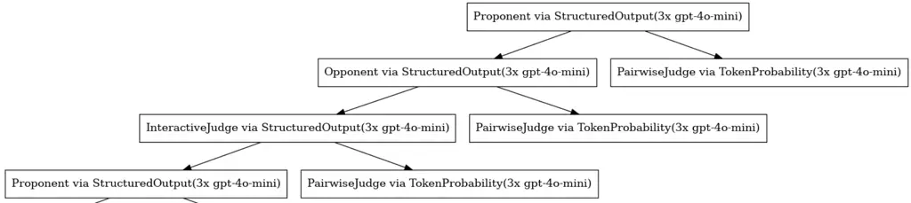
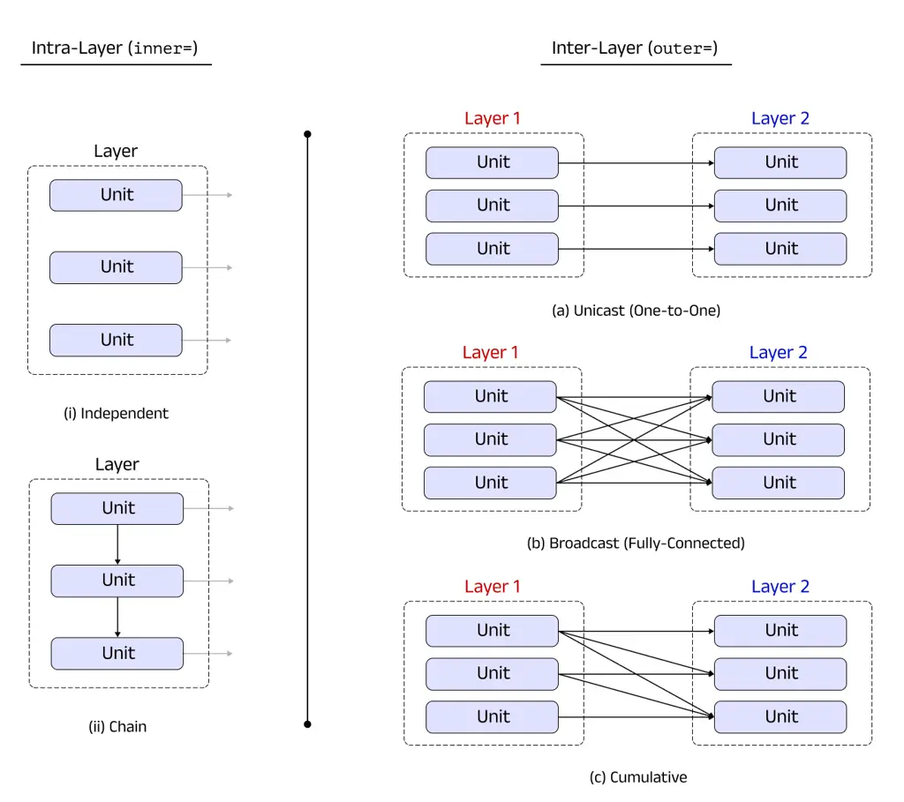
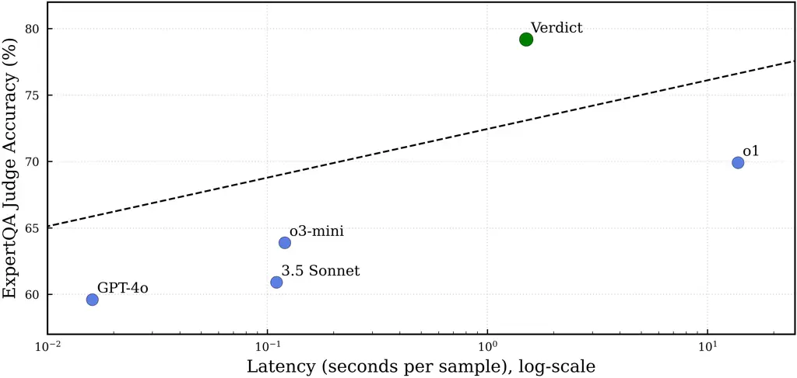

# Verdict: A Library for Scaling Judge-Time Compute

Nimit Kalra Affiliation: Haize Labs, NYC    Leonard Tang
Affiliation: {nimit, leonard}@haizelabs.com

###### Abstract

The use of LLMs as automated judges ("LLM-as-a-judge") is now
widespread, yet standard judges suffer from a multitude of reliability
issues. To address these challenges, we introduce Verdict, an
open-source¹¹ 1 Code available at
[https://github.com/haizelabs/verdict](https://github.com/haizelabs/verdict).
library for scaling judge-time compute to enhance the accuracy,
reliability, and interpretability of automated evaluators. Verdict
leverages the composition of modular reasoning units—such as
verification, debate, and aggregation—and increased inference-time
compute to improve LLM judge quality. Across a variety of challenging
tasks such as content moderation, fact-checking, and hallucination
detection, Verdict judges achieves performance competitive with
orders-of-magnitude larger fine-tuned judges, prompted judges, and
reasoning models. Our framework establishes a foundation for scalable,
interpretable, and reliable LLM-based evaluation systems for both
researchers and practitioners.



Figure 1: In the Interactive Debate protocol (Khan et al., 2024),
independent instances of a language model adopt opposing positions on an
evaluation query (e.g., Is the following response harmless and
helpful?). After each round, a separate model summarizes the debate.
Verdict allows for straightforward implementation of this protocol
through its declarative interface for defining and composing modules for
parallel execution. This enables flexible scaling of test-time compute
at both the component level (e.g., model capacity or role) and the
architectural level (e.g., length or trace shape).

## 1 Introduction

Automated evaluation using LLMs, a.k.a. “LLMs-as-a-judge”, is a widely
adopted practice for both developers and researchers building
LLM-powered applications. However, LLM judges still face a variety of
reliability issues, such as inconsistent output formats, missing or
miscalibrated uncertainty quantification, biases towards superficial
qualities such as answer positioning, style and tone, safety, numerical
frequency and preferences, the type of underlying LLM being judged, and
numerous other failure modes.

To mitigate these shortcomings, we developed Verdict, a library for
building compound LLM judge systems. Verdict provides both the
primitives (Units) and execution framework for building such systems.
Instead of a single LLM call to produce a judge result, Verdict Judges
combine multiple units of reasoning, verification, debate, and
aggregation into a single judge system. When applied, these judge
architectures leverage additional inference-time compute to yield
impressive results on automatic evaluation of LLMs and LLM applications.

Verdict’s primary contributions are as follows:

1.  1.  Verdict provides a unified interface for a variety of prompting
        strategies, bias mitigation methods, and architectures grounded in
        frontier research. We support ideas from the disciplines of
        automated evaluation, scalable oversight, safety and content
        moderation, fact-checking, generative reward modeling, and more.
2.  2.  Verdict introduces powerful reasoning primitives and patterns for
        automated evaluation, such as hierarchical reasoning verification
        and debate-aggregation.
3.  3.  Verdict is fully composable, allowing arbitrary reasoning patterns
        to be stacked into expressive and powerful architectures.
4.  4.  Verdict judges require minimal fitting but achieve competitive
        performance on a wide variety of challenging automated evaluation
        tasks spanning safety moderation, factual and logical correctness,
        and hallucination detection.

## 2 Related Work

### 2.1 Prompted Judges

Prompted out-of-the-box LLMs are the earliest and most straightforward
approach to automated evaluation. This method involves providing an LLM
with specific instructions or criteria to assess outputs (Bai et al.,
2024; Lin and Chen, 2023; Zheng et al., 2023). The effectiveness of
prompted judges has been demonstrated in both pairwise comparison and
single output scoring scenarios. One key advantage of prompted judges is
their flexibility. They can be easily adapted to evaluate different
aspects of LLM outputs, such as linguistic quality, content accuracy,
and task-specific metrics. However, the reliability of prompted judges
is often inhibited by factors such as prompt design, formatting, and
in-context example selection. In the same way that underlying LLMs
suffer from sensitivity, brittleness, and hallucinations, so too do
prompted LLM judges (Shankar et al., 2024; Thakur et al., 2024; Wang et
al., 2023).

### 2.2 Fine-Tuned Judges

One alternative to prompted judges is fine-tuned custom judge models.
These fine-tuned judges alleviate the biases and shortcomings of
prompted judges, and sometimes are also cheaper and smaller than
prompted judges. Indeed, it is possible to produce fine-tuned judge
models that are only 7B parameters with performance on-par with leading
closed-source models (Kim et al., 2023; Kim et al., 2024; Zhu et al.,
2023). Oftentimes, custom judges are fine-tuned to improve performance
on specific tasks like fact-checking and hallucination detection, rather
than general preference modeling and evaluation (Tang et al., 2024; Wang
et al., 2024).

The emerging study of generative verifiers and reward models has also
provided new insights for LLM judging. Unlike traditional discriminative
verifiers, generative reward models utilize next-token prediction for
training, allowing it to tap into the benefits of generative LLMs.
Research has demonstrated that generative reward models outperform
discriminative verifiers, DPO verifiers, and LLM-as-a-Judge approaches
(Ankner et al., 2024; Zhang et al., 2024). On algorithmic and math
reasoning tasks, generative reward models show a 16-40% improvement in
the number of problems solved using the Best-of-N method.

While these models can often times appear strong, they have been shown
that to overfit their training data distribution (Huang et al., 2024;
Tang, 2024).

### 2.3 Early Compound Judges

Recent approaches have leveraged multiple LLM calls to enhance the
accuracy, consistency, and robustness of evaluations. One such method is
LLM debate, where multiple instances argue from different perspectives,
presenting arguments and counterarguments. A final judge LLM analyzes
these debates to provide a comprehensive and balanced conclusion (Chan
et al., 2023; Chu et al., 2024; Li et al., 2023). This technique has
contemporaneously gained traction in the scalable oversight community,
particularly for improving the accuracy of less-capable judges (Kenton
et al., 2024; Michael et al., 2023).

Ensemble judging, which independently queries multiple LLM judges and
aggregates their assessments, has also become widely adopted.
Aggregation strategies range from simple majority voting to weighted
averaging based on model confidence, as well as more sophisticated
fusion techniques that account for the strengths of different models
(Liang et al., 2024; Verga et al., 2024).

These early compound judge systems have demonstrated significant
improvements over single-LLM methods. Smaller, weaker models can often
be combined to rival or even surpass the performance of larger models.
Verdict unifies and builds upon these insights to yield even more
reliable, accurate, and powerful compound judge systems.

## 3 Overview: Core Concepts & Orchestration

At the heart of Verdict are (1) primitives for judging (Units), and (2)
methods for linking, orchestrating, and executing systems of Units.

### 3.1 Basic Anatomy of a Unit

A Unit is the fundamental building block of a judge system. They are
composed of the following:

- •
  Prompt: The instructions for how a Unit should function.
- •
  Model: The model that the Unit calls to generate responses.
- •
  Scale: The domain that generated values must be restricted to. For
  example, the 1-5 Likert scale, or the Yes/No scale, or the Safe/Unsafe
  scale, or any other ordinal or categorical scale.
- •
  Input Schema: The values and types the Unit can accept, either from a
  previous Unit or from raw user-provided input.
- •
  Response Schema: The values and types the Unit’s model can generate.
- •
  Output Schema: The values that are ultimately generated by the Unit.
  This usually involves either postprocessing values produced by the
  Response Schema or referencing state from prior Units. These values
  get passed to the subsequent Unit.



Figure 2: Primitives for linking Units together within and between
Layers.

The structure of a Unit solves two major pain points of standard LLM
judges:

1.  1.  The output structure of the judge is _predictable_ even for small
        language models, governed in particular by the Scale, Response
        Schema, and Output Schema.
2.  2.  Format and function are specified separately. The Prompt implements
        the evaluation logic—the function—of the Unit, while the Scale and
        Schemas manage the format of the Unit.

In the context of a Verdict system, Units that are chained together are
also automatically type-checked. The Output Schema of a Unit must match
the Input Schema of its subsequent Unit. This allows for information to
flow through a compound judge system in a stable and predictable
fashion.

### 3.2 Structured Extraction

While simple Scales like the 1-5 Likert Scale are straightforward to
interpret and implement, they miss out on the rich information from a
model’s underlying probability distribution.

For more precise, calibrated, and powerful judging, Units support
accessing, manipulating, and aggregating the normalized log
probabilities across their specified Scale. One can _extract_ the log
probability as a final score, or _extract_ a weighted sum (with
potentially learned weights to further reduce bias) from the
distribution (Liu et al., 2023). For simplicity, probabilities are not
managed by default unless a Unit invokes an Extractor.

### 3.3 Execution Flow

Units on their own only re-implement existing LLM-judge methods.
Stitching them together, however, unlocks the full power of Verdict and
increased inference-time compute. Combining Units with the right
architecture priors can yield impressive results across a variety of
evaluation, judging, and reward modeling tasks.

Verdict draws inspiration from deep learning libraries like PyTorch
vis-à-vis managing Unit groups and interactions. The most fundamental
organizational principle is that of a Layer, which is a list of Units.
This is analogous to how neural networks are computation graphs composed
of submodules.

A standard Layer propagates information through a judge system in a
_feedforward_ fashion. By default, subsequent Layer’s Units receive the
output of previous Layer’s Units in a one-to-one fashion, and Units
within a Layer are fully independent of one another. However, it is
possible to customize Unit behavior both _within_ a Layer (using keyword
inner=) and _between_ current and subsequent Layers (using the outer
keyword). Figure 2 illustrates common ways in which Units can be
connected across Layers. Verdict also implements a MapUnit to aggregate
outputs from a previous Layer’s Units (and optionally across several
Layers).

## 4 Results



Figure 3: A simple Verdict judge surpasses reasoning models such as o1
(+9.28%) on the ExpertQA benchmark while operating at a fraction of the
cost and latency. By explicitly programming the reasoning-trace
structure for each evaluation task, Verdict judges can be calibrated to
a fixed computational budget. As shown above, Verdict pipelines can be
tuned to approach or extend the Pareto frontier relative to their
constituent prompted judges.

Across diverse evaluation settings ranging from content moderation,
factual and logical validation, and hallucination detection, Verdict
systems match the performance of specialized evaluator models and
carefully prompted judges.

### 4.1 Safety Moderation

| Judge Model       | Score  |
| ----------------- | ------ |
| Verdict           | 96.44% |
| o1                | 96.00% |
| GPT-4o            | 96.00% |
| o1 Mini           | 95.56% |
| WildGuard         | 95.11% |
| o1 Preview        | 94.89% |
| GPT-4o Mini       | 93.33% |
| Llama-Guard-3-8B  | 90.44% |
| Claude 3.5 Sonnet | 87.33% |
| Claude 3.5 Haiku  | 84.44% |
| Llama-Guard-2-8B  | 83.56% |
| Claude 3 Opus     | 80.89% |

Table 1: Results on XSTest. The reported Verdict system is a pipeline of
CoTUnit + JudgeUnits + MeanPoolUnit.

We first demonstrate the power of Verdict on XSTest, a test suite
containing challenging, borderline prompts that induce False Positive
and False Negative safety classifications by LLMs. XSTest comprises (1)
250 safe prompts across ten prompt types that well-calibrated models
should not refuse to comply with, and (2) 200 unsafe prompts as
contrasts, which models should typically refuse for most applications.

XSTest includes diverse prompt types, such as homonyms and figurative
language, to test various aspects of model behavior. Each prompt is
crafted as a single English sentence in question format to simulate
dialogue. XSTest helps identify exaggerated safety behaviors where
models refuse to respond to safe prompts, evaluates model calibration by
testing responses to both safe and unsafe prompts, and highlights
systematic content moderation failure modes across leading LLMs. Table 1
shows the results of the Verdict judge vis-à-vis other judges. Our judge
is a system consisting of one CoTUnit, two JudgeUnits, and one
MeanPoolUnit.

### 4.2 Factual and Logical Validation

Verdict is also useful for evaluating the factual and logical
correctness of LLMs. In Table 2, we showcase how Verdict judges can
achieve competitive performance on JudgeBench, a benchmark designed to
assess LLM-based judges on complex responses spanning knowledge,
reasoning, math, and coding. Each example in JudgeBench consists of a
response pair with corresponding preference labels reflecting objective
correctness. This is unlike previous benchmarks that implicitly
emphasize instruction-following and style preferences. JudgeBench is a
challenging benchmark—many frontier models perform only marginally
better than random guessing. However, a Verdict architecture performs
well, only second to the o1 models.

|                   |            |
| ----------------- | ---------- |
| Judge             | JudgeBench |
| o1                | 75.43%     |
| o1-mini           | 65.71%     |
| Claude-3.5-Sonnet | 64.29%     |
| Verdict (4o)      | 63.55%     |
| Llama-3.1-405B    | 56.86%     |
| GPT-4o            | 56.57%     |
| Llama-3.1-70B     | 52.29%     |
| GPT-4o-mini       | 50.00%     |
| Gemini-1.5-pro    | 47.14%     |
| Llama-3.1-8B      | 40.86%     |
| Gemini-1.5-flash  | 39.71%     |
| Claude-3-Haiku    | 33.14%     |

| Judge                | ExpertQA |
| -------------------- | -------- |
| Verdict (4o)         | 79.17%   |
| o1                   | 69.91%   |
| Verdict (4o-mini)    | 67.72%   |
| GPT-4o               | 64.67%   |
| o3-mini              | 63.88%   |
| Claude-3.5 Sonnet    | 60.90%   |
| Qwen2.5-72B          | 60.10%   |
| QwQ-32B-Preview      | 60.00%   |
| Bespoke-Minicheck-7B | 59.20%   |
| MiniCheck-Flan-T5-L  | 59.00%   |
| Llama-3.1-405B       | 58.50%   |
| Llama-3.3-70B        | 58.30%   |

Table 2: Left: Results on JudgeBench. Our Verdict system consists of 4
rounds of debate and a JudgeUnit that determines the final Verdict based
on these arguments. All Units use GPT-4o. Right: Results on the
LLM-AggreFact ExpertQA split. Results are taken directly from the
LLM-AggreFact leaderboard. Our Verdict Judge is an ensemble of three
instances of a JudgeUnit with explanation followed by a self-verifier
JudgeUnit. The results of each instance are aggregated via a
MaxPoolUnit.

### 4.3 Hallucination Detection

Table 2 compares a Verdict system—a triplet ensemble of JudgeUnit models
verified by another JudgeUnit and aggregated with a MaxPoolUnit—against
other judges on the ExpertQA dataset.

The ExpertQA dataset is designed to evaluate the factuality of
AI-generated responses in domain-specific contexts. It consists of 2,177
expert-curated questions across medicine, law, history, and engineering.
The dataset includes (1) expert-written questions that reflect
real-world professional scenarios, (2) model-generated answers,
evaluated by experts for factuality, attribution, and reliability, and
(3) expert-revised answers, ensuring factual correctness and alignment
with credible sources.

An answer that is deemed not factual by an expert is considered to be a
hallucination. Notably, our Verdict system using GPT-4o outperforms the
SOTA judge (GPT-4o) by +14.5%. The same Verdict system, using a weaker
backbone of GPT-4o-mini, still outperforms GPT-4o by +3.05%.

## 5 Applications

Ostensibly, Verdict judges are used for offline evaluation, but
practically speaking Verdict judges can be used anywhere to replace
human feedback and verification. Naturally, they apply to at least the
following scenarios:

1.  1.  Automated Evaluation of AI Applications. Verdict judges enable
        tailored and automated evaluation of AI applications.
2.  2.  Run-Time Guardrails. Verdict judges are guardrails that sit on top
        of AI applications running in production.
3.  3.  Test-Time Compute Scaling. Verdict judges are verifiers that help
        rank, prune, and select candidates during test-time compute scaling.
4.  4.  Reward Modeling & Reinforcement Learning. Verdict judges provide
        signal in reinforcement learning — particularly in settings where
        rewards are not easily verifiable.

Given the recent innovation around scaling inference-time compute,
reinforcement learning, and reasoning models, it is prudent to point out
that Verdict judges can indeed be leveraged as verifiers in these
settings. Verdict is especially well-suited for verification, given that
Verdict judges are:

1.  1.  More general than fine-tuned reward models. Verdict judges readily
        apply across different tasks and domains, as seen by our experiments
        on safety moderation, checking for factual and logical correctness,
        and hallucination detection.
2.  2.  More stable and reliable compared to simple LLM judges. Verdict
        judges beat out all simple LLM judges (and fine-tuned evaluators),
        barring the o1 models on JudgeBench, on the three tasks presented
        here.
3.  3.  Capable of generating soft rewards, unlike formal verifiers. This is
        critical for extending reasoning models beyond verifiable domains
        like mathematics and programming.
4.  4.  Relatively low-latency and cost-efficient compared to similarly
        powerful judges, which is necessary for methods leveraging heavy
        inference-time compute.

## 6 Conclusion

We introduce Verdict: a modular, expressive, and flexible approach to
automated evaluation of LLM outputs. By enabling the composition of
diverse reasoning units—such as verification, debate, and
aggregation—Verdict enhances the robustness, interpretability, and
accuracy of LLM judges.

Verdict judges achieve competitive performance across a wide range of
challenging evaluation tasks, including safety moderation, factual and
logical verification, and hallucination detection. Notably,
Verdict-based judges surpass both 1) models that are fine-tuned
specifically for each evaluation task, as well as 2) orders-of-magnitude
large foundation models when prompted. This highlights Verdict’s
potential as an efficient and scalable alternative for AI evaluation.

Beyond the immediate demonstrated performance gains, Verdict serves as a
unified framework for scaling judge-time compute. We hope Verdict will
enable researchers and practitioners to develop reliable, accurate, and
scalable AI evaluators to advance our field into the next era of major
progress.

## Acknowledgments

We would like to thank Omar Khattab, Julian Michael, Jon Saad-Falcon,
William Brown, Hamel Husain, Eugene Yan, and Shi Feng for their
discussion and insights on scalable oversight protocols, automated
evaluation, and generative reward models. We would also like to thank
the gracious staff at Siena Bakehouse for fueling our work with
delectable coffee and pastries.

## References

- Ankner et al. (2024) Z. Ankner, M. Paul, B. Cui, J. D. Chang, and P.
  Ammanabrolu Critique-out-loud reward models. arXiv preprint
  arXiv:2408.11791. Cited by: §2.2.
- Bai et al. (2024) Y. Bai, J. Ying, Y. Cao, X. Lv, Y. He, X. Wang, J.
  Yu, K. Zeng, Y. Xiao, H. Lyu, et al. Benchmarking foundation models
  with language-model-as-an-examiner. Advances in Neural Information
  Processing Systems 36. Cited by: §2.1.
- Chan et al. (2023) C. Chan, W. Chen, Y. Su, J. Yu, W. Xue, S.
  Zhang, J. Fu, and Z. Liu Chateval: towards better llm-based evaluators
  through multi-agent debate. arXiv preprint arXiv:2308.07201. Cited by:
  §2.3.
- Chu et al. (2024) Z. Chu, Q. Ai, Y. Tu, H. Li, and Y. Liu Pre: a peer
  review based large language model evaluator. arXiv preprint
  arXiv:2401.15641. Cited by: §2.3.
- Huang et al. (2024) H. Huang, Y. Qu, J. Liu, M. Yang, and T. Zhao An
  empirical study of llm-as-a-judge for llm evaluation: fine-tuned judge
  models are task-specific classifiers. arXiv preprint arXiv:2403.02839.
  Cited by: §2.2.
- Kenton et al. (2024) Z. Kenton, N. Y. Siegel, J. Kramár, J.
  Brown-Cohen, S. Albanie, J. Bulian, R. Agarwal, D. Lindner, Y.
  Tang, N. D. Goodman, et al. On scalable oversight with weak llms
  judging strong llms. arXiv preprint arXiv:2407.04622. Cited by: §2.3.
- Khan et al. (2024) A. Khan, J. Hughes, D. Valentine, L. Ruis, K.
  Sachan, A. Radhakrishnan, E. Grefenstette, S. R. Bowman, T.
  Rocktäschel, and E. Perez Debating with more persuasive llms leads to
  more truthful answers. External Links: 2402.06782 Cited by: §A.2.1,
  Figure 1.
- Kim et al. (2023) S. Kim, J. Shin, Y. Cho, J. Jang, S. Longpre, H.
  Lee, S. Yun, S. Shin, S. Kim, J. Thorne, et al. Prometheus: inducing
  fine-grained evaluation capability in language models. In The Twelfth
  International Conference on Learning Representations, Cited by: §2.2.
- Kim et al. (2024) S. Kim, J. Suk, S. Longpre, B. Y. Lin, J. Shin, S.
  Welleck, G. Neubig, M. Lee, K. Lee, and M. Seo Prometheus 2: an open
  source language model specialized in evaluating other language models.
  arXiv preprint arXiv:2405.01535. Cited by: §2.2.
- Li et al. (2023) R. Li, T. Patel, and X. Du Prd: peer rank and
  discussion improve large language model based evaluations. arXiv
  preprint arXiv:2307.02762. Cited by: §2.3.
- Liang et al. (2024) S. Liang, B. Zhang, J. Zhao, and K. Liu Abseval:
  an agent-based framework for script evaluation. In Proceedings of the
  2024 Conference on Empirical Methods in Natural Language Processing,
  pp. 12418–12434. Cited by: §2.3.
- Lin and Chen (2023) Y. Lin and Y. Chen Llm-eval: unified
  multi-dimensional automatic evaluation for open-domain conversations
  with large language models. arXiv preprint arXiv:2305.13711. Cited by:
  §2.1.
- Liu et al. (2023) Y. Liu, D. Iter, Y. Xu, S. Wang, R. Xu, and C. Zhu
  G-eval: nlg evaluation using gpt-4 with better human alignment. arXiv
  preprint arXiv:2303.16634. Cited by: §A.2.3, §3.2.
- Michael et al. (2023) J. Michael, S. Mahdi, D. Rein, J. Petty, J.
  Dirani, V. Padmakumar, and S. R. Bowman Debate helps supervise
  unreliable experts. arXiv preprint arXiv:2311.08702. Cited by: §A.2.1,
  §2.3.
- Shankar et al. (2024) S. Shankar, J. Zamfirescu-Pereira, B.
  Hartmann, A. Parameswaran, and I. Arawjo Who validates the validators?
  aligning llm-assisted evaluation of llm outputs with human
  preferences. In Proceedings of the 37th Annual ACM Symposium on User
  Interface Software and Technology, pp. 1–14. Cited by: §2.1.
- Tang (2024) L. Tang Sphynx hallucination induction. Note:
  [https://github.com/haizelabs/sphynx](https://github.com/haizelabs/sphynx)
  External Links: [Document](https://dx.doi.org/10.5281/zenodo.13187085)
  Cited by: §2.2.
- Tang et al. (2024) L. Tang, P. Laban, and G. Durrett MiniCheck:
  efficient fact-checking of LLMs on grounding documents. In Proceedings
  of the 2024 Conference on Empirical Methods in Natural Language
  Processing, Y. Al-Onaizan, M. Bansal, and Y. Chen (Eds.), Miami,
  Florida, USA, pp. 8818–8847. External Links:
  [Link](https://aclanthology.org/2024.emnlp-main.499/),
  [Document](https://dx.doi.org/10.18653/v1/2024.emnlp-main.499) Cited
  by: §2.2.
- Thakur et al. (2024) A. S. Thakur, K. Choudhary, V. S. Ramayapally, S.
  Vaidyanathan, and D. Hupkes Judging the judges: evaluating alignment
  and vulnerabilities in llms-as-judges. arXiv preprint
  arXiv:2406.12624. Cited by: §2.1.
- Verga et al. (2024) P. Verga, S. Hofstatter, S. Althammer, Y. Su, A.
  Piktus, A. Arkhangorodsky, M. Xu, N. White, and P. Lewis Replacing
  judges with juries: evaluating llm generations with a panel of diverse
  models. arXiv preprint arXiv:2404.18796. Cited by: §A.2.2, §2.3.
- Wang et al. (2024) B. Wang, S. Chern, E. Chern, and P. Liu Halu-j:
  critique-based hallucination judge. arXiv preprint arXiv:2407.12943.
  Cited by: §2.2.
- Wang et al. (2023) P. Wang, L. Li, L. Chen, Z. Cai, D. Zhu, B. Lin, Y.
  Cao, Q. Liu, T. Liu, and Z. Sui Large language models are not fair
  evaluators. arXiv preprint arXiv:2305.17926. Cited by: §2.1.
- Zhang et al. (2024) L. Zhang, A. Hosseini, H. Bansal, M. Kazemi, A.
  Kumar, and R. Agarwal Generative verifiers: reward modeling as
  next-token prediction. arXiv preprint arXiv:2408.15240. Cited by:
  §2.2.
- Zheng et al. (2023) L. Zheng, W. Chiang, Y. Sheng, S. Zhuang, Z.
  Wu, Y. Zhuang, Z. Lin, Z. Li, D. Li, E. Xing, et al. Judging
  llm-as-a-judge with mt-bench and chatbot arena. Advances in Neural
  Information Processing Systems 36, pp. 46595–46623. Cited by: §2.1.
- Zhu et al. (2023) L. Zhu, X. Wang, and X. Wang Judgelm: fine-tuned
  large language models are scalable judges. arXiv preprint
  arXiv:2310.17631. Cited by: §2.2.

## Appendix A Appendix

### A.1 Built-In Units

Though Units are meant to be maximally flexible and amenable to any
practitioner or researcher use case, we implement the following base
Units.

##### Judge Units:

- •
  JudgeUnit: Supports any discrete Scale, such as a Likert Scale,
  categorical Scale, or ordinal Scale. This is the standard
  LLM-as-a-judge.
- •
  PairwiseJudgeUnit: Takes as input two strings and outputs a preferred
  choice between the two strings. This may also effectively be used as a
  categorical judge.

##### Intermediate Units:

- •
  CoTUnit: Generates a Chain of Thought in the usual sense.
- •
  ConversationalUnit: Takes as input an existing conversation (list of
  messages) and generates the next turn of the conversation. Generally
  used in tandem with other ConversationalUnits.
- •
  DebateUnit: A subclass of ConversationalUnit meant for debate (arguing
  opposing stances) between other DebateUnits. Standard
  ConversationalUnits are more neutral in their discourse.

##### Map/Aggregate Units:

- •
  MapUnit: A generic way to aggregate outputs from a previous Layer’s
  Units (and optionally across several Layers).
- •
  MedianFilterUnit: Takes the median of outputs from the previous layer
  of Units.
- •
  MeanPoolUnit: Takes the mean of outputs from the previous layer of
  Units.
- •
  MaxPoolUnit: Takes the max of outputs from the previous layer of
  Units.
- •
  MeanVariancePoolUnit: Takes the mean and variance of outputs from the
  previous layer of Units.

### A.2 Examples of Compound Judge Systems

To illustrate the expressiveness and ease of Verdict, we use it to
implement various examples from the LLM Judge literature with just a few
lines of code. ²² 2 These judge systems are also accessible via the
[Haize Labs API](mailto:contact@haizelabs.com)..

#### A.2.1 Debate

In the field of scalable oversight, debates are often used to evaluate
LLM reasoning, resolve conflicting perspectives, and identify the most
robust and well-supported answers by having multiple models critique and
counter-argue each other’s outputs (Khan et al., 2024; Michael et al.,
2023).

The debate method involves multiple LLMs (typically two) arguing
different sides of a question or task, with a judge LLM or human
evaluating the debate to determine the most convincing argument.
Typically, the process is as follows:

1.  1.  A question or task is presented to the debater LLMs.
2.  2.  Each debater LLM provides an initial answer and supporting
        arguments.
3.  3.  In subsequent rounds, debaters respond to each other’s arguments,
        providing additional evidence or pointing out flaws in the
        opponent’s reasoning.
4.  4.  After a set number of rounds (often 3–5), the judge reviews the
        entire debate transcript.
5.  5.  The judge determines which debater presented the most convincing
        argument and selects a winner.

Verdict implements this relatively complex process with a Pipeline
comprising ConversationalUnits, a MapUnit, and a JudgeUnit.
ConversationalUnits sequentially on top of each to execute several
rounds of debate. The MapUnit aggregates information from the debate
history into a string format, and finally the JudgeUnit performs the
binary classification to determine which ConversationalUnits prevails.

```ltx_verbatim


```

Figure 4: A Verdict Pipeline for the Debate protocol. Leveraging
ConversationalUnits, MapUnits, and JudgeUnits makes for a quick and easy
implementation.

#### A.2.2 Jury: Ensemble of Judges

Instead of using a single large model—like o1—as a judge, one can
instead use a Panel of LLM evaluators (PoLL) composed of multiple
smaller models (Verga et al., 2024). The PoLL approach of ensembling
smaller, diverse language models offers a more cost-effective (seven
times less expensive than GPT-4), less biased, and potentially more
accurate method for evaluating LLM outputs.

#### A.2.3 G-Eval

G-Eval is an automated evaluation framework for natural language
generation (NLG) tasks that uses LLMs with chain-of-thought (CoT)
reasoning and a form-filling paradigm (Liu et al., 2023). It was
developed to assess the quality of NLG outputs, such as text summaries
and dialogue responses, with better human alignment than previous
methods. Indeed, G-Eval with GPT-4 achieves a Spearman correlation of
0.514 with human evaluations on summarization tasks.

Verdict can implement the G-Eval Pipeline using a CoTUnit, JudgeUnit,
and MeanVariancePoolUnit. Critically, both here and for all pipelines
implemented with Verdict, the input and output schemas of each Unit are
validated and enforced throughout the Pipeline. This allows the ML
practitioner to focus on core judging logic without needing to worry
about the brittleness of message passing between LLMs.

```ltx_verbatim


```

Figure 5: A Verdict Pipeline implementation of G-Eval using a CoTUnit,
JudgeUnit, and MeanVariancePoolUnit. Structure is enforced via the Scale
property, model parameters are easily managed on each Unit, and the
prompt can be flexibly defined inline.
