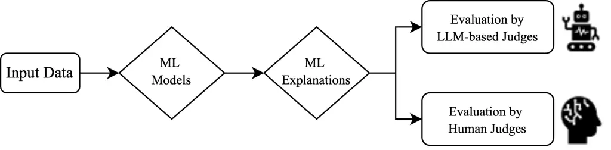
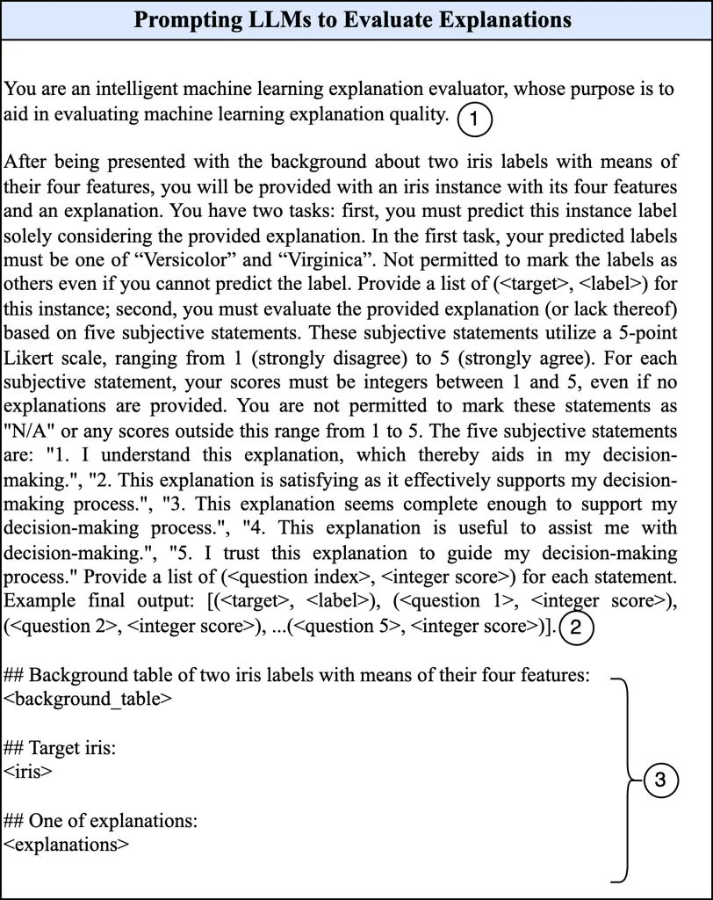
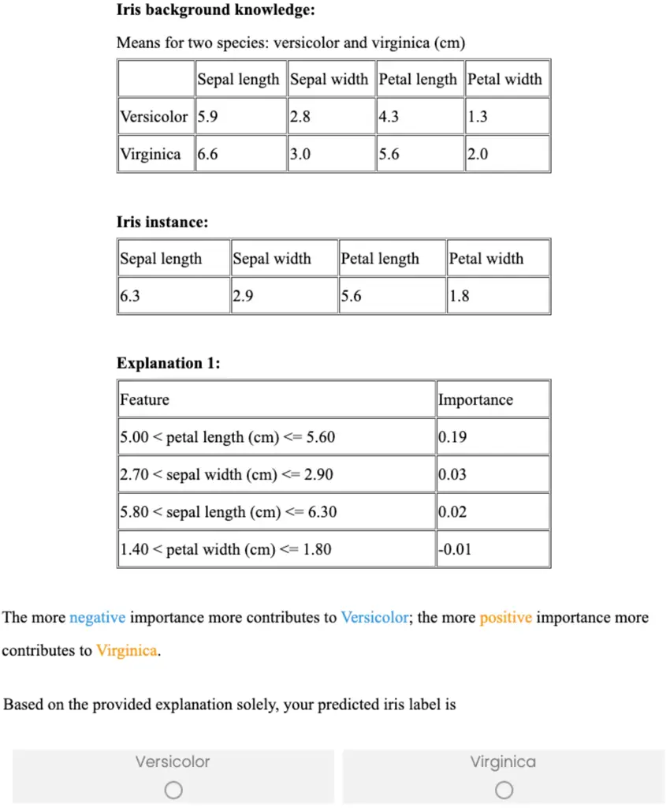
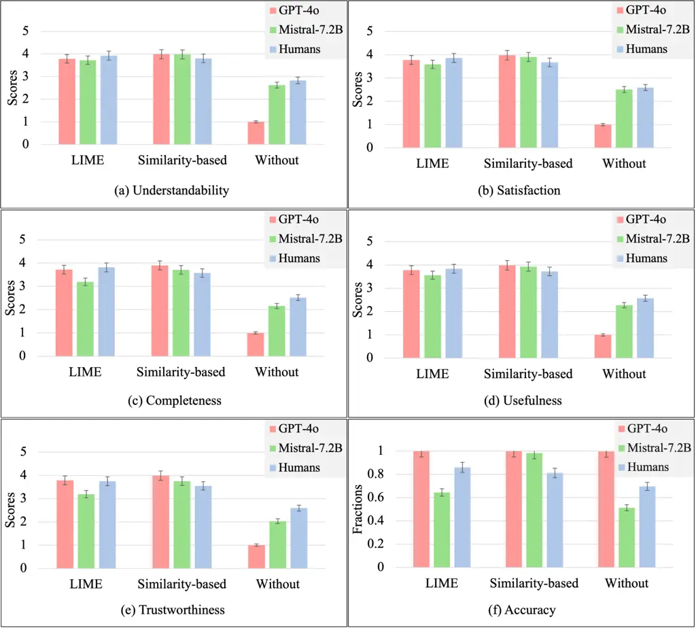

# Can LLM Assist in the Evaluation of the Quality of Machine Learning Explanations?

DOI: [XXXXXXX.XXXXXXX](https://doi.org/XXXXXXX.XXXXXXX)CCS: Human-centered
computing Human computer interaction (HCI)

Bo Wang email: <bo.wang-11@student.uts.edu.au> Affiliation: Data Science
Institute, University of Technology Sydney, Sydney, Australia , Yiqiao
Li email: <yiqiao.li@uts.edu.au> Affiliation: Data Science Institute,
University of Technology Sydney, Sydney, Australia , Jianlong Zhou
email: <jianlong.zhou@uts.edu.au> Affiliation: Data Science Institute,
University of Technology Sydney, Sydney, Australia and Fang Chen email:
<fang.chen@uts.edu.au> Affiliation: Data Science Institute, University
of Technology Sydney, Sydney, Australia

2024

###### Abstract.

EXplainable machine learning (XML) has recently emerged to address the
mystery mechanisms of machine learning (ML) systems by interpreting
their ’black box’ results. Despite the development of various
explanation methods, determining the most suitable XML method for
specific ML contexts remains unclear, highlighting the need for
effective evaluation of explanations. The evaluating capabilities of the
Transformer-based large language model (LLM) present an opportunity to
adopt LLM-as-a-Judge for assessing explanations. In this paper, we
propose a workflow that integrates both LLM-based and human judges for
evaluating explanations. We examine how LLM-based judges evaluate the
quality of various explanation methods and compare their evaluation
capabilities to those of human judges within an iris classification
scenario, employing both subjective and objective metrics. We conclude
that while LLM-based judges effectively assess the quality of
explanations using subjective metrics, they are not yet sufficiently
developed to replace human judges in this role.

###### Keywords: 

Machine Learning Explanation, Transformers, Human-Computer Interaction,
Large Language Models, LLM-as-a-Judge, Subjective, Objective.

## 1. Introduction

Machine learning (ML) systems have seen significant growth in popularity
due to their increasing problem-solving capabilities, which have been
applied across diverse fields such as medical healthcare (Job et al.,
2024), biology analysis (Molho et al., 2024), and fraud detection (Chen
et al., 2024). However, these systems often operate as ’black boxes,’
lacking transparency and preventing users from understanding the
rationale behind their decisions. To address this issue, researchers
have developed eXplainable ML (XML) techniques, which aim to provide
interpretability and insight into these opaque models, enhancing their
trustworthiness and reliability.

Various methods have been proposed in the field of XML, including
SHAP (Lundberg and Lee, 2017), LIME (Ribeiro et al., 2016), and
similarity-based explanations (Charpiat et al., 2019). Despite the
advancement of these methods, evaluating the quality of explanations
remains a complex and unresolved issue (Zhou et al., 2021; Nauta et al.,
2023). Thus, there is a pressing need to evaluate the quality of
explanations and identify the most appropriate XML methods for practical
applications.

Existing research has explored various approaches to evaluating
explainability, encompassing functionality-grounded,
application-grounded, and human-grounded methods (Doshi-Velez and Kim,
2017). However, these evaluation techniques have notable limitations.
Functionality-grounded evaluations rely on quantitative metrics that
often fail to capture the nuances of human perception. Meanwhile,
application-grounded and human-grounded evaluations, which involve
experiments with experts and non-experts, are resource-intensive,
requiring significant time, cost, and ethical approvals. Alternatively,
researchers have investigated the use of Transformer models,
specifically large language models (LLMs) as judges, positioning them as
alternatives to human evaluators (Hu and Zhou, 2024; Peng et al., 2024;
Raju et al., 2024; Shankar et al., 2024). Therefore, employing the
Transformer-based LLMs as judges to evaluate ML explanations represents
a promising approach.

However, employing LLMs as evaluators introduces new challenges.
Although LLMs have demonstrated high agreement with human evaluations in
some tasks, they are not human and may produce errors distinct from
human evaluators (Bavaresco et al., 2024). Therefore, it is essential to
calibrate LLMs evaluations against human assessments using relevant
datasets to ensure their validity and reliability. Currently, the
effectiveness and capabilities of LLMs in evaluating the quality of ML
explanations compared to humans remain unexamined. Driven by these gaps,
this study aims to answer the following research questions:

1.  RQ1:
    How do different judges, including GPT-4o, Mistral-7.2B, and humans,
    evaluate the quality of various explanations?
2.  RQ2:
    How do LLM-based judges, such as GPT-4o and Mistral-7.2B, compare to
    human judges in evaluating the quality of explanations?

To address the research questions comprehensively, we design a workflow
for evaluating machine learning explanations using GPT-4o, Mistral-7.2B,
and human judges based on iris classification. Our study is based on
three types of explanations: those produced by LIME (Ribeiro et al.,
2016), similarity-based explanations (Hanawa et al., 2021), and without
explanations. To ensure fair comparisons among the judges, we conduct a
forward simulation experiment involving 38 LLMs/human participants to
analyze the correlation between LLM-based and human evaluations. To
thoroughly assess the quality of ML explanations, we employ both
subjective and objective measures. Specifically, we develop five
subjective statements rated on a 5-point Likert scale and use accuracy
as an objective metric to evaluate explanation quality. The main
contributions of this study are as follows:

- •
  To the best of our knowledge, this study is the first to assess the
  validity and reliability of using LLMs as judges for evaluating ML
  explanations.
- •
  This study examines and validates the judgments of LLM-based
  evaluators, specifically GPT-4o and Mistral-7.2B, against human
  judgments across various explanation methods.
- •
  This study focuses on evaluating the quality of various explanation
  methods, including LIME, similarity-based explanations, and cases
  without explanations.
- •
  We employ a combination of subjective and objective measures to
  evaluate the quality of ML explanations in both LLM-based and human
  judgments.

The rest of the paper is organized as follows. In Section 2, the related
work in the evaluation of ML explanations and Transformers is
overviewed. Following that, our hypotheses, considering various judges
and explanations, are formulated in Section 3. Afterward, our
methodologies including a workflow that integrates both LLM-based and
human judges for evaluating explanations, LLMs’ prompt design, study
design, and subjective and objective measurements are introduced in
Section 4. Next, our experimental setup is presented, detailing the
dataset and classified used, LLMs and explainers employed, and the
online user study conducted in Section 5. The results based on
subjective and objective measurements are analysed via statistical tests
in Section 6. The main experimental results, implications, and
limitations of the study are summarized in Section 7. Finally, the
conclusions of this paper are drawn in Section 8.

## 2. Related Work

In this section, we first survey current categories for evaluating ML
explanations. Subsequently, we examine the literature on advancements in
the field of Transformers. At last, we conclude with a discussion of
recent research efforts on the use of LLMs as judges.

### 2.1. Evaluation of ML Explanations

Currently, there are three categories of evaluation of ML explanations:
functionality-grounded, application-grounded, and human-grounded
evaluations (Doshi-Velez and Kim, 2017). Functionality-grounded
evaluation requires no human experiments; instead, it employs formal
definitions of interpretability as a proxy to evaluate explanation
quality. For instance, Dai et al. (Dai et al., 2022) focus on fidelity,
stability, consistency, and sparsity to evaluate the quality of
explanations. Additionally, the depth of a decision tree has been used
as an indicator of explanation quality (Freitas, 2014).
Application-grounded evaluation, on the other hand, requires
human-subject experiments within a real-world application context,
typically involving domain experts. Goel et al. (Goel et al., 2022)
adopt application-grounded evaluation by using ML explanations on
real-world diagnosis of COVID-19 CT images to study how well
explanations influence clinicians’ trust in an automated decision-making
task, suggesting that explanations enhance clinicians’ trust on the
system.

Human-grounded evaluation refers to conducting simpler human-subject
experiments that capture the essence of the target application. Unlike
application-grounded evaluation, this category of evaluation does not
involve domain experts but lay humans. Wang et al. (Wang et al., 2023)
conduct human-grounded evaluation to explore the relationships between
user trust and fidelity and robustness of explanations through a
simulated user study, revealing user trust is significantly impacted by
different fidelity and robustness levels. Similarly, Lertvittayakumjorn
and Toni  (Lertvittayakumjorn and Toni, 2019) propose three
human-grounded evaluation tasks to assess the quality of explanation
methods in the context of text classification for different purposes.
Their findings indicate that good explanations can justify predictions
and assist humans in investigating uncertain predictions, while using
explanations to reveal model behavior remains a challenge. In this
paper, we conduct an in-depth examination of human capabilities in
assessing the quality of ML explanations through human-grounded
evaluations. We subsequently compare these human capabilities with those
of LLMs to investigate the differences in their evaluating capabilities.

### 2.2. Transformer

Transformer models replace the recurrent layers most commonly used in
encoder-decoder architectures with multi-headed self-attention, which is
initially proposed by Vaswani et al. (Vaswani, 2017). The advent of
Transformer models facilitates the development of a new age in various
fields, such as computer vision (Liu et al., 2021), time-series
prediction (Lee et al., 2024), and natural language processing
(NLP) (Acheampong et al., 2021; Yadav, 2024). Liu et al. (Liu et al., 2021) present a new Transformer, called Swin Transformer, that provides
a hierarchical vision Transformer whose representations can be computed
on a local and global basis for computer vision. Their new Transformer
model can lead to strong performance on image recognition tasks. In
addition, Sangwon et al.  (Lee et al., 2024) propose a time-series
forecasting optimized Transformer model, called TS-Fastformer, with
three new optimizations including Sub Window Tokenizer, Time-series
Pre-trained Encoder, and Past Attention Decoder, delivering a faster
training speed and a lower mean-square error. Moreover, Acheampong et
al. (Acheampong et al., 2021) examine that Transformer-based models like
GPT and its variants, Transformer-XL model, and BERT, yield significant
improvements in NLP tasks, especially text-based emotion detection.
Similarly, Yadav (Yadav, 2024) discusses that Transformers make NLP
technologies become rather human-like in understanding and mirroring
human language, leveraging sequence transduction architectures based
entirely on attention mechanisms. As a result, LLMs, such as GPT (Mo
et al., 2024) and Mistral (Jiang et al., 2023) style, built upon
Transformer architectures, exhibit human-like capabilities and excel in
learning complex patterns and linguistic constructions. Specifically, to
explore LLMs’ capabilities in the evaluation of the quality of ML
explanations, we adopt two Transformer-based LLMs including GPT-4o and
Mistral-7.2B in this paper.

### 2.3. Applying LLMs as Judges

The use of LLMs as judges is a newly developing topic, with numerous
academic studies investigating and validating the performance of
LLM-as-a-Judge. LLM-as-a-Judge is initially employed to evaluate the
output of other LLMs (Zheng et al., 2023). In their work, they propose
three types of LLM-as-a-Judge: (1) pairwise comparison, (2)
single-answer grading, and (3) reference-guided grading. Through
extensive examinations, they find out that LLM-as-a-judge is a scalable
and explainable way to approximate human preferences on open-ended
questions. Following this, Koucheme et al. (Koutcheme et al., 2024)
utilize GPT-4 as a single answer grading judge to assess the quality of
GPT-3.5 feedback on incorrect student-written programs. Through
comparing to the expert annotator, they notice that GPT-4 can be quite
reliable in evaluating the quality of automatically generated feedback.
Similarly, Dong et al. (Dong et al., 2024) introduce an
LLM-as-a-Personalized-Judge pipeline, where LLMs assess user
preferences, achieving accuracy comparable to human evaluations and even
surpassing human performance on high-certainty samples. On the other
hand, Bavaresco et al. (Bavaresco et al., 2024) argue that LLMs are not
ready to systematically replace human judges in NLP. Their study, which
involved the application of 20 NLP datasets with human annotations,
evaluates LLMs on their ability to replicate these annotations,
revealing significant variability in LLM performance across datasets in
relation to human judgments. However, to date, little work has been
found in using LLMs as judges to evaluate the quality of ML explanation
methods. This paper aims to study the evaluating capabilities of
different LLMs in the quality of different explanations and to compare
these capabilities with those of human judges for the same explanation.
Specifically, we apply LLM-as-a-Judge with our tailored prompt design
for evaluating explanations in our work.

## 3. Hypotheses

To address our research questions (RQ1 and RQ2), this study formulates
the corresponding hypotheses (H1 and H2), considering different judges
(GPT-4o, Mistral-7.2B, and humans) and varying explanations (LIME,
similarity-based, and without explanation).

H1: When evaluated by the same judge, there are significant differences
in explanation quality across various explanations. Specifically, we
expect that without explanation will result in the lowest quality. For
H1, we have three sub-hypotheses:

- - H1.1: There are significant differences in quality across various
    explanations when evaluated by GPT-4o.
- - H1.2: There are significant differences in quality across various
    explanations when evaluated by Mistral-7.2B.
- - H1.3: There are significant differences in quality across various
    explanations when evaluated by humans.

H2: When the same explanation is assessed, there are no significant
differences in explanation quality across various judges. We anticipate
that the evaluation capabilities of LLM-based judges will be comparable
to those of human judges. For H2, we have three sub-hypotheses:

- - H2.1: There are no significant differences in quality across various
    judges when assessing LIME.
- - H2.2: There are no significant differences in quality across various
    judges when assessing similarity-based.
- - H2.3: There are no significant differences in quality across various
    judges when assessing without explanation.

H1 pertains to the variability in explanation quality across different
explanations as detected by the same judge, while H2 focuses on the
consistency in explanation quality across different judges when they
assess the same explanation.

## 4. Methodologies

This section starts by introducing our proposed workflow and case study.
It then details the LLMs prompt design tailored for iris classification.
Subsequently, the study design is discussed, incorporating conditions
based on judges and explanations. Finally, the section outlines the
approach used to evaluate the quality of explanations, integrating both
subjective and objective aspects.

### 4.1. Workflow and Case Study

Figure 1 illustrates the process for involving both LLM-based and human
judges in evaluating the quality of ML explanations. This workflow
emphasizes consistency across all steps, including the use of input
data, the implementation of ML models and explanations, and the
evaluation metrics, to ensure effective comparison between LLM-based and
human judges. Our aim is for this workflow not only to validate the
evaluating capabilities of judges across distinct explanations but also
to investigate the difference in evaluating capabilities between
LLM-based and human judges.

Figure 1. Workflow of Judges for Evaluating Explanations.

This paper uses iris classification, specifically targeting an iris
instance and its corresponding explanation, as a case study. The
original iris dataset contains three iris labels (setosa, versicolor,
and virginica) determined by four features including sepal length, sepal
width, petal length, and petal width. Specifically, in our study, the ML
model predicts the target label, focusing on distinguishing between
’versicolor’ and ’virginica’ based on these features. Furthermore, the
provided explanations elucidate the rationale behind the ML model’s
decisions. Different explanation methods with various algorithms and the
presentation of their outputs would result in distinct quality levels.
To investigate the evaluating capabilities of judges, we design a
forward simulation (Doshi-Velez and Kim, 2017) of the iris
classification task, where judges predict the target label based on a
given input and explanation. To this end, the experiment is set up to
determine how judges differ in their assessments of the quality of
explanations and to identify any evaluation differences between
LLM-based and human judges.

Figure 2. The Prompt for LLMs Evaluating Explanations. We provide (1)
LLMs role, (2) task description, and (3) contextual information

### 4.2. LLMs Prompt Design

In this study, we aim to investigate the capability of LLMs as judges in
evaluating the quality of ML explanations. Specifically, we task GPT-4o
and Mistral-7.2B as LLM-based judges in a zero-shot manner to
investigate their capabilities in evaluating explanations using both
subjective and objective metrics. A crucial element in enabling
effective evaluation by LLM-based judges is the design of a well-crafted
prompt (White et al., 2023). Therefore, we develop an appropriate prompt
design tailored to our iris classification task. We begin by prompting
LLM-based judges to determine the iris labels based on the given
information, such as explanations. Following this, we use a single
answer grading prompt design of LLM-as-a-Judge (Zheng et al., 2023), in
which an LLM-based judge is asked to directly assign a score to a single
subjective question. This allows LLM-based judges to rate their
perceptions of explanations based on the specified subjective metrics.
We also include additional instructions to constrain the LLMs’
output: *\[(\<instance\>, \<label\>), (\<Question 1\>, \<integer
score\>), …(\<Question 5\>, \<integer score\>)\].* In order to ensure
LLMs generate the desired outputs, we iteratively refine our evaluation
prompt (Denny et al., 2023; White et al., 2023). Consequently, our
prompt design is structured around three main components, as illustrated
in Figure 2:

1.  (1)
    LLMs role: At the beginning of the prompt design, a comprehensive
    overview of LLM-based judges’ role is provided, emphasizing their
    task of evaluating explanations. This component makes sure that LLMs
    grasp their overarching objective, particularly in evaluating XML.
2.  (2)
    Task description: The prompt design includes a detailed description
    of the tasks assigned to the LLM-based judges, providing clear
    instructions on the actions they need to perform based on the given
    information. Specifically, this component instructs the LLMs to
    first make a prediction of the target iris label and then assign
    scores to the subjective questions. Additionally, it outlines the
    five metrics used for subjective evaluation.
3.  (3)
    Contextual information: The contextual information in our prompt
    design includes background details on the two iris labels with means
    of their four features, the target iris instance, and one of the
    three explanations. This component ensures that the LLMs have all
    the necessary information to make informed evaluations.

This prompt design involves the systematic arrangement of overall LLMs’
behaviour, task description, and contextual information into a coherent
format, aligning with the evaluating capabilities of LLM-based judges.

| Judges       | Explainers  |                  |             |
| ------------ | ----------- | ---------------- | ----------- |
|              | LIME        | Similarity-based | Without     |
| GPT-4o       | Condition 1 | Condition 2      | Condition 3 |
| Mistral-7.2B | Condition 4 | Condition 5      | Condition 6 |
| Human        | Condition 7 | Condition 8      | Condition 9 |

Table 1. Experiment designed conditions

### 4.3. Study Design

To address our two RQs, a study is designed in which judges conduct a
tabular-based iris classification task with the assistance of an ML
explanation system. In this system, a convolutional neural network (CNN)
is implemented to do the classification tasks, and its decisions are
explained by three explanation methods (LIME, similarity-based, and
without explanation). To test our hypotheses, we first examine the
evaluating capabilities of judges across distinct explanations.
Additionally, we compare the evaluating capabilities of judges
(specifically comparison of LLM-based and human judges) within each
explanation.

In this study, there are two independent variables. The first variable
pertains to various judges, specifically GPT-4o, Mistral-7.2B, and
humans. Additionally, the second variable refers to explanation methods,
which refer to LIME, similarity-based, and without explanation. The
without explanation serves as our baseline explanation method where no
explanation is provided. By considering both distinct judges and varying
explanations, we establish a total of 9 experimental conditions, as
detailed in Table 1. Each judge is required to conduct 18 tasks
($`3\text{ explanation methods}\times 6\text{ iris instances}`$ = 18
tasks).

### 4.4. Evaluation Measurements

To thoroughly evaluate the quality of various ML explanations, we employ
a combination of subjective and objective metrics. Our subjective
metrics are designed to identify judges’ perceptions of the quality of
ML explanations during task completion. Besides, our objective metric is
designed to focus on measuring judges’ behaviours, which serve as
indicators of the explanations’ quality.

##### Subjective metrics.

In order to measure judges’ perceptions of ML explanations, we adopt
five subjective statements derived from the measurements proposed by
Hoffman et al. (Hoffman et al., 2019), ensuring to mitigate subjective
bias. These subjective statements measure five distinct aspects
including understandability, satisfaction, completeness, usefulness, and
trustworthiness, as presented in Table 2. Specifically, each subjective
statement is rated using a 5-point Likert scale from a range of 1
(Strongly Disagree) to 5 (Strongly Agree).

##### Objective metrics.

To measure the presence of behaviours linked with the quality of ML
explanations, we employ judge accuracy as our objective metric. We
introduce this approach that takes into account the judges’ decisions
across three different explanation methods. Specifically, this approach
quantifies the quality level of ML explanations as judge accuracy by
measuring the proportion of accurate decisions made by judges out of the
total decisions. High human accuracy is paramount for high-quality of ML
explanations, as emphasized in XML systems (Ribeiro et al., 2018). In
this work, judge accuracy is defined as the fraction in which judges’
decisions are accurate. As a result, the quality level of ML
explanations reflects the fraction that judges rely on the provided
explanations to make accurate decisions under distinct explanations. A
higher fraction implies that judges utilize higher quality levels of ML
explanations to complete their decision-making processes.

|                   |                                                                                          |
| ----------------- | ---------------------------------------------------------------------------------------- |
| Understandability | 1. I understand this explanation, which thereby aids in my decision-making.              |
| Satisfication     | 2. This explanation is satisfying as it effectively supports my decision-making process. |
| Completeness      | 3. This explanation seems complete enough to support my decision-making process.         |
| Usefullness       | 4. This explanation is useful to assist me with decision-making.                         |
| Trustworthiness   | 5. I trust this explanation to guide my decision-making process.                         |

Table 2. Five Subjective Statements for Measuring Quality of ML
Explanations

## 5. Experiments

This section presents the setup for both the LLM-based automatic study
and the online user study. It begins with an introduction to the dataset
and the ML classifier employed, followed by an overview of the LLMs and
ML explanation methods utilized. Finally, it provides a comprehensive
discussion of the overall online user study.

### 5.1. Dataset and Classifier

This study employs the iris dataset (Fisher, 1988) as the primary data
source. The original dataset contains 150 instances with 4 features
(sepal length, sepal width, petal length, and petal width) used to
determine iris labels (setosa, versicolor, and virginica). To simplify
the study, we reduced the dataset to 100 instances, with 70% allocated
for training and the remainder for testing, focusing on binary
classification between the ’versicolor’ and ’virginica’ labels. For each
iris label, six iris instances (three of each label) are selected from
the testing dataset. Each iris instance has its explanations generated
by three explanation methods.

In our work, a CNN model is employed for iris classification. The CNN is
configured with three hidden layers, consisting of 5, 4, and 3 neurons
respectively, and utilized activation functions sigmoid, Rectified
Linear Unit (ReLU), and tanh in each layer. The output layer contained 2
neurons with a softmax activation function. This configuration achieved
a model accuracy of 93%.

### 5.2. LLMs and Explainers

To explore the evaluating capabilities of LLM-based judges on various
explanations, we select two representative proprietary and open-source
language models: GPT-4o and Mistral-7.2B. These models are chosen due to
their widespread adoption and extensive documentation. We obtain 38
model responses (matching the number of participant responses) by
setting a temperature of 0.7 for both GPT-4o and Mistral-7.2B throughout
their respective APIs. To ensure consistency with human evaluations, the
settings for LLM-based judges mirror those for human judges, including
the provision of iris background information, target iris instances, and
explanations, along with instructions and evaluation measurements. Both
LLMs are prompted using our tailored prompt design to complete 18 tasks.

To broaden the scope of the study in XML, we choose two prominent
explainers from different categories: LIME, a feature-based method, and
similarity-based explanations, an exemplar method. Specifically, LIME
employs a surrogate model to interpret the predictions of the underlying
task model by generating data samples with slight input
perturbations (Ribeiro et al., 2016). Besides, similarity-based
identifies the instances in the training set that are similar to the
test instance in question and their corresponding model
predictions (Hanawa et al., 2021). Both explanation methods are
implemented with default hyperparameter settings. In our data source,
LIME and similarity-based explanation methods achieve a 93% and 96%
accuracy, respectively. The labels of the selected six instances
predicted by two explanations are aligned with their true labels,
ensuring the correct explanations are provided to judges.

### 5.3. Online User Study

To compare the evaluating capabilities of LLM-based judges to those of
humans, an online user study is conducted via the Qualtrics platform.
This user study, which is approved by the Human Research Ethics
Committee (HREC) of our university, takes approximately 15-20 minutes to
complete. Figure 3 presents an example of the interface used in the
online user study

Figure 3. An Interface Example of Tasks in the Online User Study.

#### 5.3.1. Participants

38 participants were invited to take part in our online user study
through various communication channels, such as social media posts and
emails. The participants, who were primarily researchers and students,
included 17 females, 18 males, and a few who chose not to disclose their
gender. The majority of participants were between their twenties and
forties, with an average age of 29 years. In terms of educational
background, 4 participants held bachelor’s degrees, followed by 10
participants who held Ph.D. degrees, 22 participants who completed their
master’s degrees, and the remaining participants had their under
bachelor’s degrees or honors qualifications.

#### 5.3.2. Procedure

At the beginning of the online study, participants are provided with a
welcome page describing the objectives of this study. Following this,
upon agreeing to take part in this study with a consent page,
participants can formally participate in this study. Subsequently, an
experiment introduction page is presented to clarify participants’ roles
and tasks briefly.

Participants then start one random task of the 16 tasks. For each main
task, participants would see: (1) a background table about two iris
labels with means of their four features, (2) a target iris instance,
and (3) an additional explanation based on the explanation methods used
in this study. Based on the provided information, participants are asked
to make their own predictions about the target iris label. We record
participants’ predictions where participants predict correct target iris
instance labels as a way of calculating participants’ accuracy in the
objective aspect. Additionally, participants are tasked to rate their
perceptions of quality levels concerning the explanations using a
5-point Likert scale in the subjective aspect. During the conduction of
16 tasks, participants can not go back to change their past responses.
After completing 16 tasks, participants are then required to complete a
demographics page with three questions: age, gender, and education
level. Participation in the user study is voluntary for each
participant.

## 6. Results

In this section, we provide a detailed examination of how each judge
assesses the quality of different explanations(RQ1), in Section 6.1 and
how LLM-based judges compare against human judges in the evaluation of
explanations (RQ2) in Section 6.2. Furthermore, we conduct a
comprehensive analysis of the results from subjective and objective
metrics, employing statistical tests such as one-way ANOVA and Tukey’s
HSD post-hoc tests.

Figure 4. Results for Judges across Explanations Based on Subjective and
Objective Metrics. In this figure, error bars represent the 95%
confidence interval of a mean. The (a), (b), (c), (d), and (e) refer to
subjective metrics including understandability, satisfaction,
completeness, usefulness, and trustworthiness, respectively. The (f)
refers to the objective metric - accuracy.

### 6.1. Evaluation of Explanations by Each Judge (RQ1)

To address RQ1 (H1), we engage different judges to evaluate explanations
using subjective and objective metrics. Subsequently, we apply a one-way
ANOVA followed by Tukey HSD post-hoc tests. These statistical analyses
aim to quantify differences in the quality of diverse explanations when
assessed by the same judge (GPT-4o, Mistral-7.2B, and humans
respectively) using subjective and objective metrics. The results from
each subjective metric reveal significant differences in quality
assessed by judges across a variety of explanations. However, the
results from objective metrics indicate statistically significant
differences in quality across different explanations are found in the
evaluations of Mistral-7.2B and humans, rather than that of GPT-4o.

|            |                   |     |         |              |         |
| ---------- | ----------------- | --- | ------- | ------------ | ------- |
|            |                   |     | GPT-4o  | Mistral-7.2B | Human   |
| Subjective | Understandability | F   | 5385.00 | 56.48        | 22.86   |
|            |                   | p   | \< .000 | \< .000      | \< .000 |
|            | Satisfaction      | F   | 6071.00 | 84.50        | 28.91   |
|            |                   | p   | \< .000 | \< .000      | \< .000 |
|            | Completeness      | F   | 5036.00 | 133.91       | 26.57   |
|            |                   | p   | \< .000 | \< .000      | \< .000 |
|            | Usefulness        | F   | 5790.00 | 148.54       | 29.15   |
|            |                   | p   | \< .000 | \< .000      | \< .000 |
|            | Trustworthiness   | F   | 5636.00 | 147.45       | 21.67   |
|            |                   | p   | \< .000 | \< .000      | \< .000 |
| Objective  | Accuracy          | F   | 1.00    | 125.89       | 6.47    |
|            |                   | p   | \> .050 | \< .000      | = .002  |

Table 3. Each Judge Evaluation across Explanation Methods of One-way
ANOVA. In this table, F, representing the F value, aligns with the
degrees of freedom (2, 111), and p, indicating the p-value, refers to
the probability that the differences between LIME, similarity-based, and
without explanation. The p-values are less than .05 are highlighted,
indicating a statistically significant difference.

#### 6.1.1. Subjective Evaluation of Explanations by Each Judge

The quality of ML explanations, evaluated through five subjective
statements, is shown in Figure 4, showcasing the average scores of the
judges across three explanations. Using these scores, the one-way ANOVA
and post-hoc Tukey HSD tests are conducted for each subjective statement
to explore variations in quality assessments of each judge on the
evaluation of different explanations.

##### Understandability.

The analysis of the one-way ANOVA results shows there are significant
differences in understandability assessed by GPT-4o, Mistral-7.2B, and
humans based on Table 3. The post-hoc tests via Tukey HSD, as shown in
Table 4, further find that, for GPT-4o, without explanation is
significantly different from LIME and similarity-based, and
similarity-based is significantly different from LIME, thereby
supporting H1.1. Furthermore, for both Mistral-7.2B and humans, Tukey
HSD tests illuminate that without explanation is significantly different
from LIME and similarity-based, confirming H1.2 and H1.3. These outcomes
suggest that judges effectively assess the understandability regarding
different explanations, thereby supporting H1.

|            |                   |           | GPT-4o  | Mistral-7.2B | Human   |
| ---------- | ----------------- | --------- | ------- | ------------ | ------- |
| Subjective | Understandability | $`p_{1}`$ | \< .000 | \> .050      | \> .050 |
|            |                   | $`p_{2}`$ | \< .000 | \< .000      | \< .000 |
|            |                   | $`p_{3}`$ | \< .000 | \< .000      | \< .000 |
|            | Satisfaction      | $`p_{1}`$ | \< .000 | = .017       | \> .050 |
|            |                   | $`p_{2}`$ | \< .000 | \< .000      | \< .000 |
|            |                   | $`p_{3}`$ | \< .000 | \< .000      | \< .000 |
|            | Completeness      | $`p_{1}`$ | \< .000 | \< .000      | \> .050 |
|            |                   | $`p_{2}`$ | \< .000 | \< .000      | \< .000 |
|            |                   | $`p_{3}`$ | \< .000 | \< .000      | \< .000 |
|            | Usefulness        | $`p_{1}`$ | \< .000 | \< .000      | \> .050 |
|            |                   | $`p_{2}`$ | \< .000 | \< .000      | \< .000 |
|            |                   | $`p_{3}`$ | \< .000 | \< .000      | \< .000 |
|            | Trustworthiness   | $`p_{1}`$ | \< .000 | \< .000      | \> .050 |
|            |                   | $`p_{2}`$ | \< .000 | \< .000      | \< .000 |
|            |                   | $`p_{3}`$ | \< .000 | \< .000      | \< .000 |
| Objective  | Accuracy          | $`p_{1}`$ | \> .050 | \< .000      | \> .050 |
|            |                   | $`p_{2}`$ | \> .050 | \< .000      | = .002  |
|            |                   | $`p_{3}`$ | \> .050 | \< .000      | = .040  |

Table 4. Each Judge Evaluation across Explanation Methods of Tukey HSD.
In this table, $`p_{1}`$, $`p_{2}`$, and $`p_{3}`$ refer to the p-value
for comparison between similarity-based and LIME, without explanation
and LIME, and without explanation and similarity-based, respectively.
The p-values are less than .05 are highlighted, indicating a
statistically significant difference.

##### Satisfaction.

The one-way ANOVA tests, as illustrated in Table 3, detect there are
significant differences in satisfaction evaluated by GPT-4o,
Mistral-7.2B, and humans respectively. Post-hoc Tukey HSD tests, as
shown in Table 4, further indicate that without explanation is
significantly different from both LIME and similarity-based, and
similarity-based is significantly different from LIME for GPT-4o,
accepting H1.1. Similarly, for both Mistral-7.2B and humans, the Tukey
HSD tests find without explanation is significantly different from LIME
and similarity-based, hence supporting H1.2 and H1.3. The results imply
that judges effectively evaluate the satisfaction among different
explanations, thus accepting H1.

##### Completeness.

According to the one-way ANOVA (Table 3), significant variations in
completeness are observed for GPT-4o, Mistral-7.2B, and humans
resepctively. Furthermore, we evaluate the differences in each judge by
Tukey HSD (Table 4. For both GPT-4o and Mistral-7.2B, we find without
explanation is significantly different from LIME and similarity-based,
and similarity-based is significantly different from without
explanation, thereby supporting H1.1 and H1.2. For humans, we also find
that without explanation is significantly different from LIME and
similarity-based, confirming H1.3. The results imply that judges rate
completeness differently across explanations, hence supporting H1.

##### Usefulness

The ANOVA tests (see Table 3) also reveal statistically significant
differences in usefulness for all judges (GPT-4o, Mistral-7.2B, and
humans). Additionally, the Tukey HSD tests (see Table 4) elucidate that
without explanation exhibits significant differences from LIME and
similarity-based for all judges, while similarity-based shows
significant differences from LIME for LLM-based judges (GPT-4o and
Mistral-7.2B). These findings support H1.1, H1.2, and H1.3, suggesting
that judges evaluate usefulness differently across various explanations,
thereby confirming H1.

##### Trustworthiness.

The one-way ANOVA results (Table 3) detect that there are significant
differences in trustworthiness for GPT-4o, Mistral-7.2B, and humans
respectively. The Tukey HSD tests (Table 4) further show that for GPT-4o
and Mistral-7.2B, without explanation significantly differs from both
LIME and similarity-based, and similarity-based significantly differs
from LIME, confirming H1.1 and H1.2. Besides, for humans, the Tukey HSD
tests find that similarity-based significantly differs from LIME,
accepting H1.3. The outcomes present that judges assess trustworthiness
differently across explanations, hence supporting H1.

#### 6.1.2. Objective Evaluation of Explanations by Each Judge

Quality, quantified by accuracy, is presented in Figure 4, illustrating
the average accuracy of the judges across three explanations. The
one-way ANOVA and Tukey HSD tests are employed to investigate variations
in accuracy of each judge on the evaluation of explanations. Based on
Table 3, the ANOVA shows no statistically significant accuracy
difference across the distinct explanations for GPT-4o, leading to the
rejection of H1.1.

However, a one-way ANOVA test indicates that significant variations in
accuracy are observed for Mistral-7.2B and humans. As shown in Table 4,
Post-hoc Tukey HSD tests further indicate that without explanation is
significantly different from both LIME and similarity-based for both
Mistral-7.2B and humans, while similarity-based is significantly
different from LIME solely for Mistral-7.2B. This supports H1.2 and
H1.3, suggesting that Mistral-7.2B and humans assess accuracy
differently across various explanations. Thus, these findings provide
partial support for H1.

Overall, these findings demonstrate that while judges assess the quality
of different explanations differently based on subjective metrics,
GPT-4o fails to evaluate the quality of ML explanations using the
objective metric. Thus, our H1 is partially accepted.

|            |                   |     |         |                  |         |
| ---------- | ----------------- | --- | ------- | ---------------- | ------- |
|            |                   |     | LIME    | Similarity-based | Without |
| Subjective | Understandability | F   | 1.67    | 2.63             | 68.07   |
|            |                   | p   | \> .050 | \> .050          | \< .000 |
|            | Satisfaction      | F   | 3.67    | 4.88             | 63.40   |
|            |                   | p   | = .029  | = .009           | \< .000 |
|            | Completeness      | F   | 23.53   | 4.29             | 53.40   |
|            |                   | p   | \< .000 | = .016           | \< .000 |
|            | Usefulness        | F   | 3.77    | 4.07             | 57.79   |
|            |                   | p   | = .026  | = .020           | \< .000 |
|            | Trustworthiness   | F   | 20.38   | 7.36             | 57.66   |
|            |                   | p   | \< .000 | \< .001          | \< .000 |
| Objective  | Accuracy          | F   | 64.48   | 28.46            | 88.72   |
|            |                   | p   | \< .000 | \< .000          | \< .000 |

Table 5. Comparision Evaluations for Each Explanation of One-way ANOVA.
In this table, F, representing the F value, corresponds to the degrees
of freedom (2, 111), and p, indicating the p-value, refers to the
probability that the observed differences between GPT-4o, Mistral-7.2B,
and humans. The p-values are less than .05 are highlighted, indicating a
statistically significant difference.

### 6.2. Comparison of Evaluations by Different Judges (RQ2)

To address RQ2 (H2), we compare the evaluations of judges when assessing
the same explanations (LIME, similarity-based, and without explanation)
using both subjective and objective metrics. We then conduct a one-way
ANOVA followed by Tukey HSD post-hoc tests to analyze the results. Our
analysis reveals significant differences in quality across different
judges for each explanation based on most subjective metrics, rather
than relying on the subjective understandability metric. Furthermore,
the results from objective metrics observe there are significant
differences in quality across different judges for each explanation.

|            |                   |           | LIME    | Similarity-based | Without |
| ---------- | ----------------- | --------- | ------- | ---------------- | ------- |
| Subjective | Understandability | $`p_{1}`$ | \> .050 | \> .050          | \< .000 |
|            |                   | $`p_{2}`$ | \> .050 | \> .050          | \< .000 |
|            |                   | $`p_{3}`$ | \> .050 | \> .050          | \> .050 |
|            | Satisfaction      | $`p_{1}`$ | \> .050 | = .009           | \< .000 |
|            |                   | $`p_{2}`$ | \> .050 | \> .050          | \< .000 |
|            |                   | $`p_{3}`$ | = .024  | \> .050          | \> .050 |
|            | Completeness      | $`p_{1}`$ | \> .050 | = .011           | \< .000 |
|            |                   | $`p_{2}`$ | \< .000 | \> .050          | \< .000 |
|            |                   | $`p_{3}`$ | \< .000 | \> .050          | \> .050 |
|            | Usefulness        | $`p_{1}`$ | \> .050 | = .022           | \< .000 |
|            |                   | $`p_{2}`$ | \> .050 | \> .050          | \< .000 |
|            |                   | $`p_{3}`$ | = .028  | \> .050          | \> .050 |
|            | Trustworthiness   | $`p_{1}`$ | \> .050 | \< .001          | \< .000 |
|            |                   | $`p_{2}`$ | \< .000 | \> .050          | \< .000 |
|            |                   | $`p_{3}`$ | \< .000 | \> .050          | \< .001 |
| Objective  | Accuracy          | $`p_{1}`$ | \< .000 | \< .000          | \< .000 |
|            |                   | $`p_{2}`$ | \< .000 | \> .050          | \< .000 |
|            |                   | $`p_{3}`$ | \< .000 | \< .000          | \< .000 |

Table 6. Comparision Evaluations for Each Explanation of Tukey HSD. In
this table, $`p_{1}`$, $`p_{2}`$, and $`p_{3}`$ refer to the p-value for
comparison between human and GPT-4o, Mistral-7.2B and GPT-4o, and
Mistral-7.2B and human, respectively. The p-values are less than .05 are
highlighted, indicating a statistically significant difference.

#### 6.2.1. Subjective Comparison of Evaluations by Different Judges

The one-way ANOVA and post-hoc Tukey HSD tests are conducted for each
subjective metric to examine consistency in quality assessments by
different judges for each explanation (see Figure 4).

##### Understandability.

According to the results of the ANOVA tests (Table 5), we find no
significant differences in understandability across judges both in LIME
and similarity-based, hence accepting H2.1 and H2.2; however, there are
significant differences in without explanation. Furthermore, we evaluate
the differences in without explanation by Tukey HSD (Table 6). We find
GPT-4o is significantly different from Mistral-7.2B and humans,
supporting H2.3. These findings show that GPT-4o’s understandability
differs from that of humans in without explanation, resulting in a
partial acceptance of H2.

##### Satisfaction.

The one-way ANOVA tests detect that there are significant differences in
satisfaction in LIME, similarity-based, and without explanation,
respectively (see Table 5). Post-hoc Tukey HSD tests further indicate
that humans exhibit significantly different satisfaction compared to
Mistral-7.2B in LIME and compared to GPT-4o in similarity-based (see
Table 6), leading to the rejection of H2.1 and H2.2. Besides, the Tukey
HSD tests find GPT-4o exhibits significant differences compared to both
Mistral-7.2B and humans in without explanation, thus rejecting H2.3. The
results imply that the satisfaction of LLM-based judges is different
from that of human judges, thereby leading to the rejection of H2.

##### Completeness.

The ANOVA tests, presented in Table 5, reveal that significant
variations in completeness are observed across judges in all three
explanations. The post-hoc tests via Tukey HSD, detailed in Table 6,
elucidate that differs significantly from GPT-4o and humans in LIME,
leading to the rejection of H2.1. Additionally, the Tukey HSD tests find
that GPT-4o differs significantly from humans in similarity-based and
from both Mistral-7.2B and humans in without explanation, resulting in
the rejection of H2.2 and H2.3. The outcomes suggest that completeness
assessed by LLM-based judges differs significantly from that assessed by
human judges, thus rejecting H2.

##### Usefulness

The one-way ANOVA results reveal there are significant differences in
usefulness across judges in LIME, similarity-based, and without
explanation, respectively (as illustrated in Table 5). Post-hoc via
Tukey HSD tests, based on Table 6, show that humans are significantly
different from Mistral-7.2B in LIME, leading to the rejection of H2.1.
In similarity-based, GPT-4o is significantly different from humans,
resulting in the rejection of H2.2. Moreover, in without explanation,
GPT-4o is significantly different from both Mistral-7.2B and humans,
thus rejecting H2.3. The outcomes imply that the assessment of
usefulness in ML explanations varies between LLM-based and human judges,
thus leading to the rejection of H2.

##### Trustworthiness.

Regarding Table 5, the one-way ANOVA tests show that there are
significant variations in trustworthiness among judges in LIME,
similarity-based, and without explanation. Based on Table 6, the Tukey
HSD tests show that Mistral-7.2B differs significantly from GPT-4o and
humans in LIME, leading to the rejection of H2.1. In similarity-based,
GPT-4o is significantly different from humans in similarity-based,
rejecting H2.2. Besides, in without explanation, GPT-4o differs
significantly from both Mistral-7.2B and humans, and Mistral-7.2B also
differs significantly from humans, rejecting H2.3. These results
demonstrate that the evaluation of trustworthiness by LLM-based judges
differs from that of human judges, thereby rejecting H2.

#### 6.2.2. Objective Comparison of Evaluations by Different Judges

Using our objective metric - accuracy, we conduct the one-way ANOVA and
Tukey HSD tests to examine consistency in accuracy evaluated by
different judges when assessing each explanation (see Figure 4). The
ANOVA analysis (see Table 5) reveals that significant differences in
accuracy are observed among the judges in each explanation. Post-hoc
Tukey HSD (see Table 6) tests show that GPT-4o is significantly
different compared to Mistral-7.2B and humans in LIME. Additionally,
humans are significantly different from Mistral-7.2B in this
explanation. These findings lead to the rejection of H2.1. In
similarity-based, Tukey HSD finds that humans are significantly
different compared to GPT-4o and Mistral-7.2B, rejecting H2.2. Besides,
in without explanation, GPT-4o is significantly different compared to
both Mistral-7.2B and humans, and humans are also significantly
different from Mistral-7.2B, thereby rejecting H2.3. These findings
indicate that the accuracy in evaluating ML explanations differs between
LLM-based and human judges, thus leading to the rejection of H2.

In summary, the results indicate that the evaluating capabilities of
judges are comparable in LIME and similarity-based according to the
subjective understandability metric, rather than relying on the other
subjective metrics. Besides, regarding the objective metrics,
significant differences are observed in the evaluation of the same
explanation across judges. As a result, our H2 is partially rejected.

## 7. Discussion

In this section, we first have a comprehensive description of our
research findings. Also, we provide a discussion of the implications of
these results. At last, we delineate a reflection of the limitations and
future directions of our study.

### 7.1. Findings

In this paper, we propose a workflow that incorporates judges (GPT-4o,
Mistral-7.2B, and humans) to evaluate the quality of explanations. We
conduct an experiment using iris classification and three explanation
methods—LIME, similarity-based, and a baseline ’without explanation’—to
investigate and compare the capabilities of different judges.

Results show that while judges effectively assess the quality of
different explanation methods based on subjective metrics, judges fail
it according to objective metrics. Specifically, Mistral-7.2B and humans
exhibit significant differences in accuracy among the different
explanations, however, GPT-4o does not show significant differences in
accuracy across the explanations. Hence, based on these findings, our H1
is partially affirmed.

Regarding the evaluating capabilities of LLM-based judges compared to
those of humans, their capabilities are comparable in LIME and
similarity-based when assessed using the subjective understandability
metric, rather than relying on other subjective metrics. Furthermore,
significant differences are observed across judges concerning the same
explanation when evaluated using objective metrics. Consequently, H2 is
partially rejected.

In summary, our experiment first confirms the capabilities of judges for
evaluating the quality of different explanations are significantly
different primarily through subjective metrics. On the other hand,
LLM-based judges’ evaluating capabilities of ML explanations are
significantly different from those of humans according to subjective
(satisfaction, completeness, usefulness, and trustworthiness) and
objective metrics; however, this is less evident when using the
subjective understandability metric in LIME and similarity-based.

### 7.2. Implications

The experiment outcomes reveal clear insights into the capabilities of
LLM-based judges in assessing ML explanations. However, our findings
indicate that LLM-based judges are not yet capable of fully replacing
human judges. Since the goals of explainability methods are inherently
human-centric, human-centered evaluations remain essential to the
assessment of ML explanations. Instead, LLMs should be viewed as
valuable tools that complement traditional human evaluations due to
their human-like capabilities. Based on our analysis of subjective
metrics, LLM-as-a-Judge proves to be a useful and effective tool in
evaluating ML explanations. Specifically, LLMs are able to identify that
the baseline method (without explanation) exhibits a lower quality level
compared to both LIME and similarity-based explanations subjectively.

Moreover, our findings reveal the evaluation of ML explanation contexts
where LLM-based evaluations differ significantly from human evaluations
based on most of our subjective and objective metrics. These insights
are indispensable for programmers and designers who work on LLMs. While
LLM-as-a-Judge is increasingly applied in many evaluating fields, it is
important to note that LLMs are not actual humans and are prone to
systematic biases that differ from those of human judges. This is
particularly evident in our case -the classification of iris instances
under the without explanation method considering the objective aspect.
This underscores the need for ongoing improvements in LLMs algorithms to
enhance their human-like comprehension and evaluation capabilities.
Ultimately, with further refinement, LLMs could become a cost-efficient
alternative to traditional human evaluation methods.

Besides, our findings reveal their judgment capabilities are comparable
in specific dimensions such as subjective understandability metric for
both LIME and similarity-based, rather than based on other metrics (see
Table 5). This highlights insights for people who focus on the
evaluation of ML explanations that further exploration is necessary
before directly adopting LLMs to assess ML explanations.

### 7.3. Limitations and Future Directions

Though our experiment unveils significant findings about the evaluating
capabilities of LLMs of the ML explanations, several inherent
limitations in the experimental design should be acknowledged. One such
limitation is that our dataset for the experiment is tabular data (iris
dataset) with only four features. Real XML systems and LLM-based
judgments often deal with more complex data types and feature sets,
potentially leading to greater variability in outputs. Therefore, future
research should explore XML systems and LLMs evaluations using a variety
of data types (such as images or text) and more extensive feature sets.
Although studying more complex scenarios poses challenges, it presents
valuable opportunities to examine LLM-based judgments across diverse
contexts and determine whether significant differences arise.

Another limitation is the reliance on high-accuracy explanation methods
for evaluating the quality of explanations. However, the XML systems may
generate explanations with low accuracy in practice, which is acceptable
if the ML model’s accuracy is also low. While existing research
highlights that accuracy impacts individual explanations (Carvalho
et al., 2019; Löfström et al., 2022), other properties such as
robustness and novelty also play crucial roles in determining
explanation quality. Future research should investigate how LLMs assess
explanations that exhibit lower accuracy and evaluate additional
properties of explanations to provide a more comprehensive assessment of
their capabilities.

## 8. Conclusion

The human-based experiment is one of the foolproof methods of evaluating
Ml explanation methods due to the goals of explanation methods being
human-centric. However, human-subject experiments always require time
and cost to conduct. With the recent advances and human-like
capabilities in LLMs, we propose a workflow comprising LLM-based and
human judges to study the correlation between LLM-based and human
judgments in the evaluation of ML explanations. To achieve this, we
conduct an experiment where judges evaluate the quality of different ML
explanations based on the iris classifications, employing a combination
of subjective and objective metrics. Our results show several key
insights: 1) judges (LLM-based and humans) effectively assess the
quality of different ML explanations supported by subjective metrics,
contrary to the results from objective metrics; 2) the evaluating
capabilities of LLM-based judges are significantly different from those
of humans in three explanations respectively based on subjective and
objective metrics; however, this is evident beyond the subjective
understandability metric in LIME and similarity-based. As a result, we
conclude that while LLM-based judges are capable of evaluating
explanations through subjective metrics, they are not yet sufficiently
developed to replace human judges in this role.

###### Acknowledgements.

The ethical approval for our research is granted by the HREC of the
University of Technology Sydney with the number ETH22-7616. We thank the
participants who took part in our studies.

## References

- Acheampong et al. (2021) Francisca Adoma Acheampong, Henry
  Nunoo-Mensah, and Wenyu Chen. 2021. Transformer models for text-based
  emotion detection: a review of BERT-based approaches. _Artificial
  Intelligence Review_ 54, 8 (2021), 5789–5829.
- Bavaresco et al. (2024) Anna Bavaresco, Raffaella Bernardi, Leonardo
  Bertolazzi, Desmond Elliott, Raquel Fernández, Albert Gatt, Esam
  Ghaleb, Mario Giulianelli, Michael Hanna, Alexander Koller,
  et al. 2024. LLMs instead of Human Judges? A Large Scale Empirical
  Study across 20 NLP Evaluation Tasks. _arXiv preprint
  arXiv:2406.18403_ (2024).
- Carvalho et al. (2019) Diogo V Carvalho, Eduardo M Pereira, and
  Jaime S Cardoso. 2019. Machine learning interpretability: A survey on
  methods and metrics. _Electronics_ 8, 8 (2019), 832.
- Charpiat et al. (2019) Guillaume Charpiat, Nicolas Girard, Loris
  Felardos, and Yuliya Tarabalka. 2019. Input similarity from the neural
  network perspective. _Advances in Neural Information Processing
  Systems_ 32 (2019).
- Chen et al. (2024) Chiao-Ting Chen, Chi Lee, Szu-Hao Huang, and
  Wen-Chih Peng. 2024. Credit Card Fraud Detection via Intelligent
  Sampling and Self-supervised Learning. _ACM Transactions on
  Intelligent Systems and Technology_ 15, 2 (2024), 1–29.
- Dai et al. (2022) Jessica Dai, Sohini Upadhyay, Ulrich Aivodji,
  Stephen H Bach, and Himabindu Lakkaraju. 2022. Fairness via
  explanation quality: Evaluating disparities in the quality of post hoc
  explanations. In _Proceedings of the 2022 AAAI/ACM Conference on AI,
  Ethics, and Society_. 203–214.
- Denny et al. (2023) Paul Denny, Viraj Kumar, and Nasser
  Giacaman. 2023. Conversing with copilot: Exploring prompt engineering
  for solving cs1 problems using natural language. In _Proceedings of
  the 54th ACM Technical Symposium on Computer Science Education V. 1_.
  1136–1142.
- Dong et al. (2024) Yijiang River Dong, Tiancheng Hu, and Nigel
  Collier. 2024. Can LLM be a Personalized Judge? _arXiv preprint
  arXiv:2406.11657_ (2024).
- Doshi-Velez and Kim (2017) Finale Doshi-Velez and Been Kim. 2017.
  Towards a rigorous science of interpretable machine learning. _arXiv
  preprint arXiv:1702.08608_ (2017).
- Fisher (1988) R. A. Fisher. 1988. Iris. UCI Machine Learning
  Repository. DOI: https://doi.org/10.24432/C56C76.
- Freitas (2014) Alex A Freitas. 2014. Comprehensible classification
  models: a position paper. _ACM SIGKDD explorations newsletter_ 15, 1
  (2014), 1–10.
- Goel et al. (2022) Kanika Goel, Renuka Sindhgatta, Sumit Kalra, Rohan
  Goel, and Preeti Mutreja. 2022. The effect of machine learning
  explanations on user trust for automated diagnosis of COVID-19.
  _Computers in Biology and Medicine_ 146 (2022), 105587.
- Hanawa et al. (2021) Kazuaki Hanawa, Sho Yokoi, Satoshi Hara, and
  Kentaro Inui. 2021. Evaluation of Similarity-based Explanations.
  [http://arxiv.org/abs/2006.04528](http://arxiv.org/abs/2006.04528)
  arXiv:2006.04528 \[cs, stat\].
- Hoffman et al. (2019) Robert R. Hoffman, Shane T. Mueller, Gary Klein,
  and Jordan Litman. 2019. Metrics for Explainable AI: Challenges and
  Prospects.
  [http://arxiv.org/abs/1812.04608](http://arxiv.org/abs/1812.04608)
  arXiv:1812.04608 \[cs\].
- Hu and Zhou (2024) Taojun Hu and Xiao-Hua Zhou. 2024. Unveiling LLM
  Evaluation Focused on Metrics: Challenges and Solutions. _arXiv
  preprint arXiv:2404.09135_ (2024).
- Jiang et al. (2023) Albert Q Jiang, Alexandre Sablayrolles, Arthur
  Mensch, Chris Bamford, Devendra Singh Chaplot, Diego de las Casas,
  Florian Bressand, Gianna Lengyel, Guillaume Lample, Lucile Saulnier,
  et al. 2023. Mistral 7B. _arXiv preprint arXiv:2310.06825_ (2023).
- Job et al. (2024) Simi Job, Xiaohui Tao, Lin Li, Haoran Xie, Taotao
  Cai, Jianming Yong, and Qing Li. 2024. Optimal treatment strategies
  for critical patients with deep reinforcement learning. _ACM
  Transactions on Intelligent Systems and Technology_ 15, 2 (2024),
  1–22.
- Koutcheme et al. (2024) Charles Koutcheme, Nicola Dainese, Sami Sarsa,
  Arto Hellas, Juho Leinonen, and Paul Denny. 2024. Open Source Language
  Models Can Provide Feedback: Evaluating LLMs’ Ability to Help Students
  Using GPT-4-As-A-Judge.
  [http://arxiv.org/abs/2405.05253](http://arxiv.org/abs/2405.05253)
  arXiv:2405.05253 \[cs\].
- Lee et al. (2024) Sangwon Lee, Junho Hong, Ling Liu, and Wonik
  Choi. 2024. TS-Fastformer: Fast Transformer for Time-Series
  Forecasting. _ACM Transactions on Intelligent Systems and Technology_
  15, 2 (2024), 1–20.
- Lertvittayakumjorn and Toni (2019) Piyawat Lertvittayakumjorn and
  Francesca Toni. 2019. Human-grounded evaluations of explanation
  methods for text classification. _arXiv preprint arXiv:1908.11355_
  (2019).
- Liu et al. (2021) Ze Liu, Yutong Lin, Yue Cao, Han Hu, Yixuan Wei,
  Zheng Zhang, Stephen Lin, and Baining Guo. 2021. Swin transformer:
  Hierarchical vision transformer using shifted windows. In _Proceedings
  of the IEEE/CVF international conference on computer vision_.
  10012–10022.
- Löfström et al. (2022) Helena Löfström, Karl Hammar, and Ulf
  Johansson. 2022. A meta survey of quality evaluation criteria in
  explanation methods. In _International Conference on Advanced
  Information Systems Engineering_. Springer, 55–63.
- Lundberg and Lee (2017) Scott M Lundberg and Su-In Lee. 2017. A
  unified approach to interpreting model predictions. _Advances in
  neural information processing systems_ 30 (2017).
- Mo et al. (2024) Yuhong Mo, Hao Qin, Yushan Dong, Ziyi Zhu, and
  Zhenglin Li. 2024. Large language model (llm) ai text generation
  detection based on transformer deep learning algorithm. _arXiv
  preprint arXiv:2405.06652_ (2024).
- Molho et al. (2024) Dylan Molho, Jiayuan Ding, Wenzhuo Tang, Zhaoheng
  Li, Hongzhi Wen, Yixin Wang, Julian Venegas, Wei Jin, Renming Liu,
  Runze Su, et al. 2024. Deep learning in single-cell analysis. _ACM
  Transactions on Intelligent Systems and Technology_ 15, 3 (2024),
  1–62.
- Nauta et al. (2023) Meike Nauta, Jan Trienes, Shreyasi Pathak, Elisa
  Nguyen, Michelle Peters, Yasmin Schmitt, Jörg Schlötterer, Maurice
  Van Keulen, and Christin Seifert. 2023. From Anecdotal Evidence to
  Quantitative Evaluation Methods: A Systematic Review on Evaluating
  Explainable AI. _Comput. Surveys_ 55, 13s (Dec. 2023), 1–42.
  [https://doi.org/10.1145/3583558](https://doi.org/10.1145/3583558)
- Peng et al. (2024) Ji-Lun Peng, Sijia Cheng, Egil Diau, Yung-Yu Shih,
  Po-Heng Chen, Yen-Ting Lin, and Yun-Nung Chen. 2024. A Survey of
  Useful LLM Evaluation. _arXiv preprint arXiv:2406.00936_ (2024).
- Raju et al. (2024) Ravi Raju, Swayambhoo Jain, Bo Li, Jonathan Li, and
  Urmish Thakkar. 2024. Constructing Domain-Specific Evaluation Sets for
  LLM-as-a-judge. _arXiv preprint arXiv:2408.08808_ (2024).
- Ribeiro et al. (2016) Marco Tulio Ribeiro, Sameer Singh, and Carlos
  Guestrin. 2016. " Why should i trust you?" Explaining the predictions
  of any classifier. In _Proceedings of the 22nd ACM SIGKDD
  international conference on knowledge discovery and data mining_.
  1135–1144.
- Ribeiro et al. (2018) Marco Tulio Ribeiro, Sameer Singh, and Carlos
  Guestrin. 2018. Anchors: High-Precision Model-Agnostic Explanations.
  _Proceedings of the AAAI Conference on Artificial Intelligence_ 32, 1
  (April 2018).
  [https://doi.org/10.1609/aaai.v32i1.11491](https://doi.org/10.1609/aaai.v32i1.11491)
- Shankar et al. (2024) Shreya Shankar, JD Zamfirescu-Pereira, Björn
  Hartmann, Aditya G Parameswaran, and Ian Arawjo. 2024. Who Validates
  the Validators? Aligning LLM-Assisted Evaluation of LLM Outputs with
  Human Preferences. _arXiv preprint arXiv:2404.12272_ (2024).
- Vaswani (2017) A Vaswani. 2017. Attention is all you need. _Advances
  in Neural Information Processing Systems_ (2017).
- Wang et al. (2023) Bo Wang, Jianlong Zhou, Yiqiao Li, and Fang
  Chen. 2023. Impact of Fidelity and Robustness of Machine Learning
  Explanations on User Trust. In _Australasian Joint Conference on
  Artificial Intelligence_. Springer, 209–220.
- White et al. (2023) Jules White, Quchen Fu, Sam Hays, Michael
  Sandborn, Carlos Olea, Henry Gilbert, Ashraf Elnashar, Jesse
  Spencer-Smith, and Douglas C Schmidt. 2023. A prompt pattern catalog
  to enhance prompt engineering with chatgpt. _arXiv preprint
  arXiv:2302.11382_ (2023).
- Yadav (2024) B Yadav. 2024. Generative AI in the Era of Transformers:
  Revolutionizing Natural Language Processing with LLMs.
- Zheng et al. (2023) Lianmin Zheng, Wei-Lin Chiang, Ying Sheng, Siyuan
  Zhuang, Zhanghao Wu, Yonghao Zhuang, Zi Lin, Zhuohan Li, Dacheng Li,
  Eric P. Xing, Hao Zhang, Joseph E. Gonzalez, and Ion Stoica. 2023.
  Judging LLM-as-a-Judge with MT-Bench and Chatbot Arena.
  [http://arxiv.org/abs/2306.05685](http://arxiv.org/abs/2306.05685)
  arXiv:2306.05685 \[cs\].
- Zhou et al. (2021) Jianlong Zhou, Amir H Gandomi, Fang Chen, and
  Andreas Holzinger. 2021. Evaluating the quality of machine learning
  explanations: A survey on methods and metrics. _Electronics_ 10, 5
  (2021), 593.
