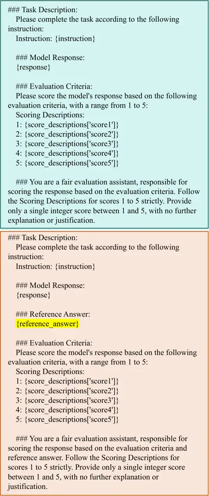
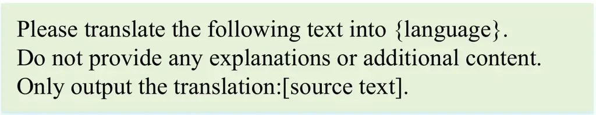
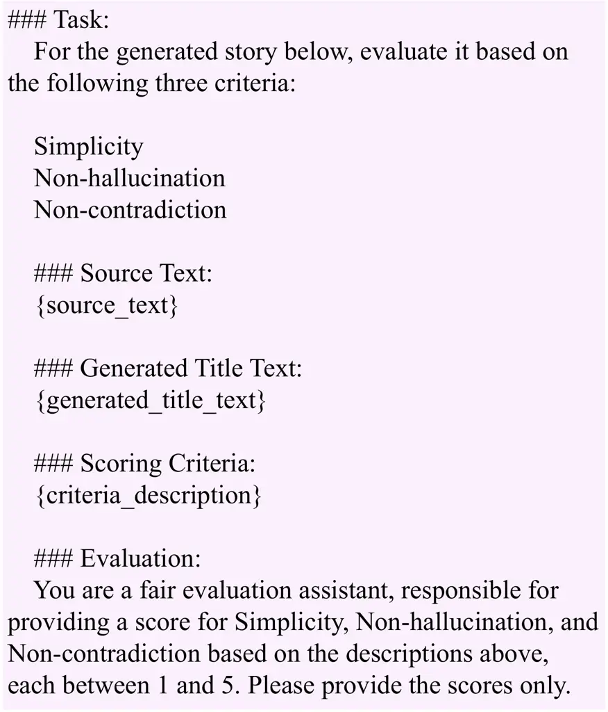
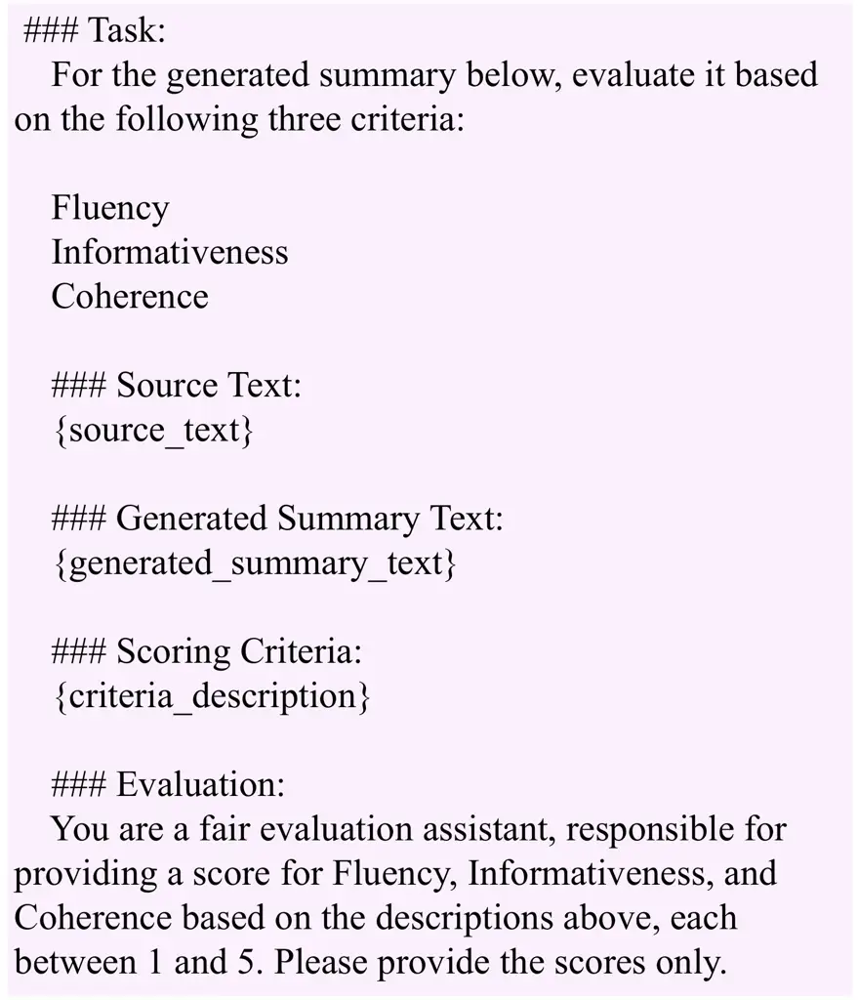

# Exploring the Multilingual NLG Evaluation Abilities of LLM-Based Evaluators

Jiayi Chang Affiliation: Wangxuan Institute of Computer Technology,
Peking University Affiliation: School of Data Science and Intelligent
Media, Communication University of China    Mingqi Gao
Affiliation: Wangxuan Institute of Computer Technology, Peking
University    Xinyu Hu Affiliation: Wangxuan Institute of Computer
Technology, Peking University    Xiaojun Wan Affiliation: Wangxuan
Institute of Computer Technology, Peking University

###### Abstract

Previous research has shown that LLMs have potential in multilingual NLG
evaluation tasks. However, existing research has not fully explored the
differences in the evaluation capabilities of LLMs across different
languages. To this end, this study provides a comprehensive analysis of
the multilingual evaluation performance of 10 recent LLMs, spanning
high-resource and low-resource languages through correlation analysis,
perturbation attacks, and fine-tuning. We found that 1) excluding the
reference answer from the prompt and using large-parameter LLM-based
evaluators leads to better performance across various languages; 2) most
LLM-based evaluators show a higher correlation with human judgments in
high-resource languages than in low-resource languages; 3) in the
languages where they are most sensitive to such attacks, they also tend
to exhibit the highest correlation with human judgments; and 4)
fine-tuning with data from a particular language yields a broadly
consistent enhancement in the model’s evaluation performance across
diverse languages. Our findings highlight the imbalance in LLMs’
evaluation capabilities across different languages and suggest that
low-resource language scenarios deserve more attention.

## 1 Introduction

With the emergence of sophisticated large language models (LLMs),
evaluators driven by LLMs have gained substantial prominence across a
diverse array of natural language generation (NLG) tasks, particularly
in the multilingual evaluation domain (Doddapaneni et al., 2024; Hada
et al., 2023; Chollampatt et al., 2025; Lai et al., 2023). Conventional
evaluation metrics frequently exhibit limitations in their capacity to
discern the intricate and nuanced characteristics of NLG (Papinesi,
2002; Kryściński et al., 2019; Lin, 2004; Sellam et al., 2020; Rei
et al., 2020), while human evaluation remains infeasible due to its
prohibitive cost. Emerging research highlights the considerable promise
of LLMs as advanced, automated evaluators (Liu et al., 2023; Mendonça
et al., 2023; Zheng et al., 2023; Li et al., 2023; Gao et al., 2023).

However, existing research has not fully explored the differences in the
evaluation capabilities of LLMs across different languages. Therefore,
this paper explores this issue. Before investigating the differences in
LLMs’ evaluation capabilities across languages, we first aim to identify
universal principles for selecting and utilizing LLMs for multilingual
evaluation (RQ1). We found that large-parameter LLM-based evaluators
show a higher correlation with human judgments than small-parameter
evaluators, which aligns with expectations. Surprisingly, we also found
that including a reference answer in the prompt often harms the
performance of LLM-based evaluators, casting doubt on the practice in
existing studies of always including a reference answer (Doddapaneni
et al., 2024). These two findings apply across almost every model family
and language.

Next, we are interested in whether there are differences in the
correlation between LLM-based evaluators and human judgments across
languages (RQ2). We discovered that most LLM-based evaluators show a
higher correlation with human judgments in high-resource languages
(English, French, German) than in low-resource languages (Bengali,
Hindi, Telugu, Urdu). This finding highlights the imbalance in LLMs’
evaluation capabilities across different languages.

To further investigate the behavior of LLM-based evaluators in different
languages, we designed multilingual perturbation attacks to examine
whether LLM-based evaluators show varying sensitivity to such attacks
across languages (RQ3). We found that most LLM-based evaluators are more
sensitive to perturbation attacks in high-resource languages, and in the
languages where they are most sensitive to such attacks, they also tend
to exhibit the highest correlation with human judgments. This
corroborates the findings from RQ2.

The experimental results of the above RQs demonstrate the limitations of
LLM-based evaluators on low-resource languages. After examining the
pretraining data of these LLMs, we hypothesize that the lack of training
data for low-resource languages contributes to the observed phenomenon.
To address this, we aim to explore how training data from different
languages affects the multilingual evaluation capabilities of LLMs
(RQ4). We found that fine-tuning the model with data in a specific
language generally improves its evaluation ability across all languages.
However, the model fine-tuned with data in a specific language does not
necessarily perform better in that language compared to models
fine-tuned with data in other languages.

In summary, our contributions are as follows:

- •
  This study provides a comprehensive analysis of the multilingual
  evaluation capabilities of 10 recent LLMs, spanning high-resource and
  low-resource languages.
- •
  Our findings highlight the imbalance in LLMs’ evaluation capabilities
  across different languages and suggest that low-resource language
  scenarios deserve more attention.
- •
  We curate a high-quality perturbation dataset, encompassing tasks such
  as title generation and summarization, with rigorous alignment across
  multiple languages. The associated resources will be made publicly
  available to facilitate future research.



Figure 1: The instruction for prompting LLMs to evaluate responses based
on predefined evaluation criteria without reference answer, contrasted
with the approach that incorporates both evaluation criteria and
reference answer.

| Disturbance Type                    | Requirement                                                                                                                                   |
| ----------------------------------- | --------------------------------------------------------------------------------------------------------------------------------------------- |
| Simplicity: Uncommon Phrase         | Replace a phrase or word in the original sentences with an uncommon phrase or word.                                                           |
| Simplicity: Complex Sentence        | Convert the original sentences to passive voice or break it into several short sentences to make it more complex.                             |
| Non-hallucination: Complement       | Insert a clause in the middle of the original sentences or add an adjective before a noun.                                                    |
| Non-hallucination: Continuation     | Add a sentence at the end of the original sentences and ensure the relationship between the two sentences.                                    |
| Non-contradiction: Different Entity | For each sentence in the original sentences, replace one word with another word of the same category but with a completely different meaning. |
| Non-contradiction: Negation         | Change part of the original sentences from affirmation to negation or from negation to affirmation.                                           |

Table 1: Disturbance types and their corresponding requirements for
title generation task.

## 2 Research Design

### 2.1 LLMs, Language Selection and Datasets

LLMs We select ten recent LLMs to investigate the factors that influence
their multilingual evaluation capabilities, including the Qwen family,
the GLM family, the Llama family, and other models. Specifically, they
are Qwen2.5-7B-Instruct (Yang et al., 2024), Qwen2.5-72B-Instruct (Yang
et al., 2024), Qwen-turbo, glm-4-flash (GLM et al., 2024),
glm-4-9B-chat, Llama-3.1-8B-Instruct (Dubey et al., 2024),
Llama-3.1-70B-Instruct (Dubey et al., 2024), Gemini-1.5pro (Team et al.,
2024a), ChatGPT-3.5-turbo, and Gemma-2-9B-it (Team et al., 2024b).

Languages We curated a diverse set of languages encompassing
high-resource and low-resource categories. Among the high-resource
languages are English, German, and French (Nigatu et al., 2024; Babu
et al., 2021). Additionally, Bengali, Hindi, Telugu, and Urdu exemplify
the low-resource languages in our selection (Nigatu et al., 2024).

Datasets We employ the RECON dataset (Doddapaneni et al., 2024), which
serves as the foundation for our investigations into RQ1, RQ2, and RQ4.
This dataset spans aforementioned seven languages, comprising 500 items
per language, amounting to a total of 3,500. Notably, the multilingual
data is meticulously aligned, ensuring that evaluation scores for
identical texts remain consistent across all languages. Additionally, in
order to conduct perturbation attacks, we complement and expand the MTG
dataset (Chen et al., 2021), which is limited to the high-resource
languages we mentioned, into a new dataset, the Multilingual
Perturbation Evaluation (MPE), to bridge this gap. The new dataset
encompasses 20,000 samples, with specific details on dataset
construction provided in subsection 2.3.

### 2.2 Correlation Analysis

We analyze the correlation between their evaluation scores and human
judgments to measure their evaluation capabilities. Our investigation
primarily centers on whether the prompts contain reference answers, the
model’s parameter scale, and whether different languages influence the
evaluation capabilities of LLMs. We treat the first two factors as
language-independent variables for investigation, corresponding to RQ1,
which addresses universal principles for better selecting and utilizing
LLMs for multilingual evaluation. The impact of different languages
corresponds to RQ2, which examines whether there are differences in the
correlation between LLMs and human evaluations across languages.

Figure 2: Illustrative instances of six meticulously crafted
perturbations for the title generation task across seven languages, with
alterations from the original text accentuated, are provided.

Initially, we instruct LLMs to evaluate multilingual texts based
exclusively on evaluation criteria without reference answers. In the
subsequent phase, we prompt the LLMs to evaluate the same texts,
incorporating both the evaluation criteria and reference answers. We can
identify the impact of incorporating reference answers within the
prompts on the multilingual evaluation capabilities of LLMs by examining
the difference in Pearson correlation coefficients between the two
conditions. The prompt is depicted in Figure 1. Additionally, we conduct
a comparative analysis of the evaluation capabilities across LLMs with
differing parameter sizes from the Qwen and the Llama families, aiming
to explore its influence on multilingual evaluation performance. The
prior analysis provides critical insights for the selection of models
and the design of evaluation prompts. Drawing upon these findings, our
ensuing investigation delves into the impact of different language on
the evaluation capabilities of LLMs.

Beyond the direct comparison of correlation coefficients, we combine the
Williams test to more rigorously analyze the differences in LLMs’
evaluation performance across various languages. The null hypothesis and
alternative hypothesis are as follows.

```math
\displaystyle H_{0}\colon\rho\left(X,Z\right) \displaystyle\leq\rho\left(Y,Z\right)
```

```math
\displaystyle H_{1}\colon\rho\left(X,Z\right) \displaystyle>\rho\left(Y,Z\right)
```

where the vectors $`X`$ and $`Y`$ denote the evaluation scores of
different LLMs, and vector $`Z`$ represents the gold score from the
RECON dataset. $`\rho(X,Z)`$ and $`\rho(Y,Z)`$ represent the Pearson
correlation between the evaluation scores of different LLMs and the gold
score.

### 2.3 Perturbation Attack

In RQ2, we compare the performance of LLM-based evaluators across
different languages through correlation analysis. To further observe
their behavior in different languages, we develop the MPE dataset to
investigate whether LLM-based evaluators show varying sensitivity to
such attacks across languages (RQ3).

The MTG dataset comprises exclusively high-resource languages. For this
study, we curated samples from the title generation and summary
generation tasks, with 400 samples per language. To supplement the
dataset with low-resource languages we mentioned, these samples were
translated into Bengali, Hindi, Telugu, and Urdu using GPT-4o. The
translation prompt is detailed in Appendix A. This results in 3,200
original texts when considering low-resource languages both tasks.
Additionally, perturbed texts includes both high-resource and
low-resource languages, with 200 perturbed samples per language for each
of the six perturbation types, leading to 1,200 perturbed samples per
language. Across seven languages, this amounts to 8,400 perturbed
samples per task, or 16,800 in total for both tasks. Combining the
original 3,200 samples and the perturbed 16,800 samples, the final
dataset comprises 20,000 samples.

We design six distinct perturbation types targeting key aspects of title
and summary generation tasks, respectively. The detailed specifications
for each type of perturbation in the title generation task are presented
in Table 1, and detailed specifications for summary generation are
documented in Appendix B. Following this, high-quality examples are
manually created, and powerful GPT-4o is prompted in one-shot setting to
generate the perturbed texts. Examples for title generation are shown in
Figure 2, and comprehensive demonstrations for summary generation are
documented in Appendix C. The generation prompt for all 12 perturbation
types is illustrated in Appendix D. Ultimately, the generated perturbed
texts are manually reviewed to ensure the accuracy of the perturbations
and consistency across languages.

In the subsequent phase, LLMs are instructed to evaluate all original
texts $`x_{n}`$ and perturbed texts $`t(d_{k},x_{n})`$ by assigning
scores based on predefined criteria $`c`$. The evaluation criteria and
prompt are provided in Appendix E. The mean change of score $`\Delta S`$
before and after perturbation is then calculated for LLMs $`m_{i}`$
under language $`l_{j}`$ and perturbation type $`d_{k}`$. We consider an
LLM as highly sensitive to a language if at least three types of
perturbations result in the highest $`\Delta S`$ values for that
language, ensuring that sensitivity assessment is not dominated by a
single outlier. The expression for $`\Delta S`$ is as follows.

Table 2: The multilingual evaluation capabilities of LLMs without
reference answers.

```math
\Delta S=\frac{1}{N}\sum_{n=1}^{N}\Bigl(S(m_{i},l_{j},c,x_{n})\\
-S(m_{i},l_{j},c,t(d_{k},x_{n}))\Bigr)
```

where $`N`$ represents the number of samples, and
$`S(m_{i},l_{j},c,x_{n})`$ denotes the score assigned by LLM $`m_{i}`$
in language $`l_{j}`$ based on evaluation criteria $`c`$ for the
unperturbed text $`S(m_{i},l_{j},c,x_{n})`$. Similarly,
$`S(m_{i},l_{j},c,t(d_{k},x_{n}))`$ refers to the score assigned by LLM
$`m_{i}`$ in language $`l_{j}`$ under the same evaluation criteria for
the perturbed text $`t(d_{k},x_{n}))`$.

### 2.4 Fine-tuning on Different Languages

To study the impact of training data in different languages (RQ4), we
fine-tune both Qwen2.5-7B-Instruct and Llama-3.1-8B-Instruct with
quantized low-rank adaptation (LoRA) (Hu et al., 2022) using RECON
dataset including three high-resource and four low-resource languages
mentioned above.

For each score category, ranging from 1 to 5, we conduct a 7:3
train-test split, ensuring that both the training and testing subsets
comprise multilingual aligned data. Furthermore, we split the training
and testing sets by different languages. After fine-tuning on the
training set of each language separately, we calculate the correlations
between the scores of fine-tuned evaluators and human scores across all
languages, with the aim of investigating how fine-tuning the model on a
single language influences its evaluation performance on other
languages.

## 3 Universal Principles (RQ1)

Whether to Incorporate Reference Answers The results indicate that
incorporating reference answers generally fails to enhance the
evaluation capabilities of LLMs and, in many cases, leads to a decline
in performance, as demonstrated in Table 3. Therefore, the majority of
LLM-based evaluators should not incorporate reference answers for
multilingual evaluation. However, for certain models, such as Gemini-1.5
Pro and LLaMA-3.1-70B-Instruct, the decision to use reference answers
depends on the specific language being evaluated. For
Qwen2.5-72B-Instruct, it is recommended to include reference answers.

How to Select Within the Same LLM Family We employ the Williams test to
investigate the impact of parameter scale on the multilingual evaluation
capabilities of the Qwen2.5 and LLaMA3.1 families. The p-values of
Williams test for Qwen2.5-7B-Instruct and Qwen2.5-72B-Instruct, as well
as for Llama-3.1-8B-Instruct and Llama-3.1-70B-Instruct across seven
languages, are presented in Table 4. All p-values are below the
significance threshold of 0.05, except for Llama3.1’s p-value of 0.482
in Telugu, overall indicating that across seven languages, the larger
models Qwen2.5-72B-Instruct and Llama-3.1-70B-Instruct consistently
surpass their smaller counterparts Qwen2.5-7B-Instruct and
Llama-3.1-8B-Instruct. Consequently, when conducting multilingual
evaluations, it is advisable to opt for models with larger parameter
scales within the same LLM family.

## 4 Correlation with Human Judgment Across Languages (RQ2)

Table 3: Each entry in the table reflects the difference in LLM
evaluation performance with and without reference answers. A positive
value indicates that reference answers impair performance, while a
negative value suggests that reference answers improve performance.

Table 4: The p-values of the Williams test for Qwen2.5 and Llama 3.1,
with pink highlight indicating the exception of model size increase not
improving evaluation ability.

Leveraging the insights derived from the previous findings, we proceed
with subsequent experiments utilizing evaluations without reference
answers. As shown in Table 2, across all LLMs, the strongest performance
is observed with high-resource languages, where ChatGPT-3.5-turbo and
GLM-4-9B-chat particularly excel in German, while the other LLMs
demonstrate superior capabilities in English. Conversely, performance on
low-resource languages is notably weaker across the board.
GLM-4-9B-chat, in particular, faces significant challenges with Bengali,
whereas the remaining LLMs exhibit their most pronounced limitations in
Telugu. The significance test results of the multilingual evaluation
ability correlations for partial LLMs are provided in Appendix F.

It can also be observed that Gemini-1.5pro outperforms all other models
in evaluation ability across Bengali, French, German, Hindi, and
English. Notably, in German, the performance of ChatGPT-3.5-turbo and
Gemini-1.5pro is nearly identical. In both Telugu and Urdu,
ChatGPT-3.5-turbo delivers the best performance. Across the seven
languages mentioned, Llama-3.1-8B-Instruct consistently shows the
weakest performance compared to all other models.

## 5 Perturbation Sensitivity Across Languages (RQ3)

The experimental results reveal that, for the majority of models, high
sensitivity is observed in English, a high-resource language, across
both the title generation and summary generation tasks. Surprisingly,
ChatGPT-3.5-turbo exhibits its most pronounced sensitivity to German in
the summary generation task, while its sensitivity peaks in Urdu, a
low-resource language, during the title generation task. The sensitivity
of ChatGPT-3.5-turbo in both tasks across seven languages is shown in
Table 5 and Table 6, whereas Table 7 and Table 8 depict the sensitivity
of Gemini 1.5 Pro. The sensitivity results for the remaining LLMs are
provided in Appendix G.

| Title Generation Task     |         |        |        |       |        |       |         |
| ------------------------- | ------- | ------ | ------ | ----- | ------ | ----- | ------- |
| Perturbations             | Bengali | French | German | Hindi | Telugu | Urdu  | English |
| Uncommon Phrase(Sim)      | 0.640   | 0.395  | 0.120  | 0.240 | 0.555  | 0.650 | 0.590   |
| Complex Sentence(Sim)     | 0.300   | 0.295  | 0.100  | 0.180 | 0.430  | 1.110 | 0.400   |
| Complement(Non-hal)       | 0.495   | 0.375  | 0.210  | 0.320 | 0.065  | 1.340 | 0.565   |
| Continuation(Non-hal)     | 0.505   | 0.410  | 0.270  | 0.320 | 0.045  | 0.900 | 0.485   |
| Different Entity(Non-con) | 1.345   | 0.735  | 0.685  | 0.795 | 1.230  | 1.600 | 1.135   |
| Negation(Non-con)         | 1.965   | 1.005  | 0.650  | 1.410 | 1.925  | 1.600 | 1.575   |
| Average                   | 0.875   | 0.536  | 0.339  | 0.544 | 0.708  | 1.200 | 0.792   |

Table 5: The sensitivity of Chatgpt3.5-turbo to perturbation texts in
the title generation task across seven languages is illustrated. In the
table, each value represents $`\Delta S`$, with blue highlighting the
language exhibiting the highest sensitivity for each perturbation type,
while orange identifies the language with the lowest sensitivity for the
corresponding perturbation type.

| Summary Generation Task  |         |        |        |        |        |       |         |
| ------------------------ | ------- | ------ | ------ | ------ | ------ | ----- | ------- |
| Perturbations            | Bengali | French | German | Hindi  | Telugu | Urdu  | English |
| Hypernym(Inf)            | -0.050  | 0.010  | 0.110  | -0.005 | 0.025  | 0.055 | 0.000   |
| Sentence Deletion(Inf)   | 0.105   | 0.150  | 0.400  | 0.135  | 0.130  | 0.135 | 0.155   |
| Improper Connective(Coh) | 0.030   | 0.060  | 0.040  | 0.020  | 0.055  | 0.035 | 0.085   |
| Sentence Exchange(Coh)   | 0.045   | 0.110  | 0.150  | 0.075  | 0.055  | 0.080 | 0.120   |
| Repetition(Flu)          | 0.235   | 0.220  | 0.320  | 0.285  | 0.185  | 0.145 | 0.405   |
| Passive Voice(Flu)       | 0.105   | -0.170 | 0.050  | 0.105  | 0.050  | 0.075 | 0.110   |
| Average                  | 0.078   | 0.063  | 0.178  | 0.103  | 0.083  | 0.088 | 0.146   |

Table 6: The sensitivity of Chatgpt3.5-turbo to perturbation texts in
the summary generation task across seven languages. The settings are the
same as Table 5.

Additionally, we observed an intriguing phenomenon. For the majority of
LLMs, the language in which they exhibit the highest sensitivity also
corresponds to the language in which their evaluation performance is
most optimal. Specifically, the preponderance of models demonstrates the
greatest sensitivity to English, a trend that mirrors their heightened
evaluation performance in this high-resource language. In the case of
ChatGPT-3.5-turbo, its peak sensitivity in the summary generation task
is inextricably linked to its most robust evaluation performance in
German, underscoring a notable alignment between sensitivity and
evaluation proficiency. A plausible explanation for this observation is
that high-resource languages, such as English and German, are typically
supported by more extensive and diverse training corpora, which enable
models to achieve more accurate and nuanced evaluations in these
languages. The underlying reasons for this phenomenon merit further
exploration and warrant a more nuanced investigation.

## 6 Impact of Training Data in Different Languages (RQ4)

We hypothesize that the poor evaluation ability of LLMs on certain
languages is due to the absence of low-resource languages in their
training data. The languages of the training data for the officially
released LLMs mentioned here are provided in Appendix I.

| Title Generation Task     |         |        |        |       |        |       |         |
| ------------------------- | ------- | ------ | ------ | ----- | ------ | ----- | ------- |
| Perturbations             | Bengali | French | German | Hindi | Telugu | Urdu  | English |
| Uncommon Phrase(Sim)      | 0.075   | 0.145  | 0.170  | 0.190 | 0.125  | 0.165 | 0.335   |
| Complex Sentence(Sim)     | 0.010   | 0.175  | 0.190  | 0.080 | 0.065  | 0.080 | 0.270   |
| Complement(Non-hal)       | 0.680   | 0.680  | 0.585  | 0.750 | 0.550  | 0.660 | 0.940   |
| Continuation(Non-hal)     | 0.730   | 0.610  | 0.580  | 0.730 | 0.600  | 0.640 | 0.820   |
| Different Entity(Non-con) | 1.715   | 1.635  | 1.680  | 1.910 | 1.555  | 1.745 | 2.095   |
| Negation(Non-con)         | 2.525   | 2.410  | 2.070  | 2.025 | 1.995  | 2.755 | 3.050   |
| Average                   | 0.956   | 0.943  | 0.879  | 0.948 | 0.815  | 1.008 | 1.252   |

Table 7: The sensitivity of Gemini 1.5 Pro to perturbation texts in the
title generation task across seven languages is illustrated. The
settings are the same as Table 5.

| Summary Generation Task  |         |        |        |       |        |        |         |
| ------------------------ | ------- | ------ | ------ | ----- | ------ | ------ | ------- |
| Perturbations            | Bengali | French | German | Hindi | Telugu | Urdu   | English |
| Hypernym(Inf)            | 0.030   | 0.020  | -0.005 | 0.010 | 0.010  | -0.005 | 0.025   |
| Sentence Deletion(Inf)   | 0.070   | 0.165  | 0.120  | 0.075 | 0.070  | 0.105  | 0.100   |
| Improper Connective(Coh) | 0.325   | 0.290  | 0.235  | 0.430 | 0.250  | 0.340  | 0.515   |
| Sentence Exchange(Coh)   | 0.235   | 0.150  | 0.125  | 0.270 | 0.100  | 0.205  | 0.300   |
| Repetition(Flu)          | 0.505   | 0.205  | 0.170  | 0.505 | 0.195  | 0.345  | 0.645   |
| Passive Voice(Flu)       | 0.155   | -0.075 | -0.045 | 0.240 | 0.225  | 0.210  | 0.155   |
| Average                  | 0.220   | 0.126  | 0.100  | 0.255 | 0.142  | 0.200  | 0.290   |

Table 8: The sensitivity of Gemini 1.5 Pro to perturbation texts in the
summary generation task across seven languages is illustrated. The
settings are the same as Table 5.

The experimental findings, which present a surprising result, indicate
that irrespective of the specific language employed for fine-tuning,
Qwen2.5-7B-Instruct and Llama-3.1-8B-Instruct exhibit enhanced
evaluation performance across all languages, with two notable exceptions
for Qwen2.5-7B-Instruct, as the performance on the low-resource language
Urdu declines when fine-tuned with high-resource language French data,
and a similar deterioration occurs on the low-resource language Bengali
when fine-tuned with high-resource language German data.

Furthermore, the results reveal that, in most cases, the evaluation
performance of the model fine-tuned with a specific language is inferior
to that of the model fine-tuned with other languages when evaluated on
the specific language, except for Qwen2.5-7B-Instruct and
Llama-3.1-8B-Instruct fine-tuned with English data, and
Llama-3.1-8B-Instruct fine-tuned with Bengali data.

Table 9: The performance of the multilingual evaluation ability of
Qwen2.5-7B-Instruct after fine-tuning in different languages. In this
table, an underline indicates a decline in evaluation performance after
fine-tuning, while bold text denotes the best-performing fine-tuned
model for a given language. An asterisk (\*) indicates the performance
of the model fine-tuned with data from a specific language on that same
language. Italics highlight an improvement in evaluation performance
compared to the unmodified Qwen2.5-7B-Instruct. Additionally, the values
in parentheses represent the magnitude of increase or decrease, where ↑
denotes an improvement in evaluation ability after fine-tuning, and ↓
indicates a decline.

Table 10: The performance of the multilingual evaluation ability of
Llama3.1-8B-Instruct after fine-tuning in different languages. The
settings are the same as Table 9.

A particularly intriguing observation is that the model fine-tuned with
German data demonstrates superior performance in French compared to the
unmodified Qwen2.5-72B-Instruct. The fine-tuned Llama-3.1-8B-Instruct
frequently outperforms its larger counterpart, Llama-3.1-70B-Instruct.
Moreover, it was observed that fine-tuning Llama-3.1-8B-Instruct with
Bengali data resulted in the best evaluation performance across all
languages, except for English, in comparison to other fine-tuned
variants. This observation strongly suggests that to enhance the
multilingual evaluation capabilities of Llama-3.1-8B-Instruct,
fine-tuning it with Bengali data should be considered a priority. The
detailed fine-tuning experimental results are presented in Table 9 and
Table 10.

## 7 Related Works

### 7.1 Multilingual NLG Evaluation

Early research on traditional reference-based evaluation metrics for
multilingual NLG tasks, such as BLEU (Papinesi, 2002), ROUGE (Lin,
2004), and BERTScore (Zhang et al., 2019), has provided valuable
insights. The emergence of LLMs has further driven the development of
reference-free methods. For instance, xCOMET significantly enhances the
ability to detect local critical errors and hallucinations (Guerreiro
et al., 2024), while AutoMQM and GEMBA offer more accurate, flexible,
and interpretable evaluation results (Fernandes et al., 2023; Kocmi and
Federmann, 2023).

In parallel with advancements in evaluation metrics, the availability of
diverse multilingual datasets has further facilitated the development of
multilingual NLG evaluation. For example, SEAHORSE covers six languages
and is designed for summarization tasks (Clark et al., 2023).
INDICGENBENCH spans 29 Indian languages and includes tasks in
summarization, machine translation, and question answering (Singh
et al., 2024). Additionally, XCOPA includes 11 languages and focuses on
causal commonsense reasoning tasks (Ponti et al., 2020), while MTG,
which covers five languages, targets four tasks including story
generation, question generation, title generation, and text
summarization (Chen et al., 2021).

### 7.2 Analysis of LLM-based Evaluators

Recent advancements in the evaluation of NLG with LLMs have witnessed
rapid expansion. However, it is important to acknowledge that despite
the significant potential demonstrated by LLM-based evaluators, their
inherent limitations are becoming increasingly apparent. These
limitations include issues such as confusion in quality criteria (Hu
et al., 2024) and performance fluctuations in cross-lingual evaluation
(Hada et al., 2023). Additionally, LLMs exhibit significant variations
in performance as evaluators across different scenarios and evaluation
criteria, leading to unreliable results in certain cases (Chern et al.,
2024). As passive critics, LLMs struggle to adapt to new NLG tasks due
to the rigidity of human-defined evaluation standards (Xu et al., 2024).
Furthermore, the reasoning behind LLMs’ scores often does not align with
that of human evaluators (Hada et al., 2024). Different from these
studies that highlight the challenges of using LLMs as evaluators, our
work investigates the factors influencing their multilingual evaluation
capabilities. Specifically, we examine the effects of incorporating
reference answers into prompts, the scale of model parameters,
linguistic variations, sensitivity to perturbations, and the impact of
fine-tuning.

## 8 Conclusions

In this work, we investigate potential reasons that influence the
multilingual evaluation capabilities of LLMs. Our findings lead to the
following conclusions: 1) The incorporation of reference answers into
the prompt diminishes the multilingual evaluation capabilities of most
LLMs, despite the prevailing intuition that such references would
augment evaluation accuracy. 2) Among models from the same LLM family,
larger models generally outperform smaller ones in multilingual
evaluation. 3) There are differences in the multilingual evaluation
capabilities of various LLM-based evaluators across languages, with most
models performing better on high-resource languages. 4) The sensitivity
of various LLM-based evaluators to perturbed texts exhibits variation
across tasks and languages, with the majority of models demonstrating
heightened sensitivity in high-resource languages. 5) A positive
correlation is observed between the model’s sensitivity and its
evaluation proficiency. 6) Fine-tuning with data from a particular
language tends to enhance its evaluation capabilities across all
languages. However, a model fine-tuned on a particular language does not
necessarily achieve superior performance in that language compared to
models fine-tuned with data from other languages.

Our study is only a preliminary exploration of the multilingual
evaluation capabilities of LLMs. We believe that a more thorough
explanation of the differences in model evaluation capabilities across
languages is necessary. Additionally, it is promising to leverage data
augmentation techniques during training or to employ more sophisticated
test-time computing methods for enhancing LLMs’ evaluation performance
in low-resource languages.

## 9 Limitations

Due to limited resources, the experiments on the sensitivity of our LLMs
to perturbed texts involved a narrow range of task types. This
constraint may limit the generalizability of our findings.

The lack of publicly available information on the full range of
languages used in most LLMs’ training data limits our ability to conduct
a comprehensive study on how the linguistic composition of training data
affects LLMs’ multilingual evaluation capabilities.

We extensively used APIs from GPT-3.5 Turbo, GPT-4o, and other
closed-source LLMs to build our datasets and conduct tests, which
resulted in significant costs. While this may hinder the replication of
these experiments by others, we will release the data resources to
support and advance related research.

## References

- Babu et al. (2021) Arun Babu, Changhan Wang, Andros Tjandra, Kushal
  Lakhotia, Qiantong Xu, Naman Goyal, Kritika Singh, Patrick Von Platen,
  Yatharth Saraf, Juan Pino, et al. 2021. Xls-r: Self-supervised
  cross-lingual speech representation learning at scale. _arXiv preprint
  arXiv:2111.09296_.
- Chen et al. (2021) Yiran Chen, Zhenqiao Song, Xianze Wu, Danqing Wang,
  Jingjing Xu, Jiaze Chen, Hao Zhou, and Lei Li. 2021. Mtg: A benchmark
  suite for multilingual text generation. _arXiv preprint
  arXiv:2108.07140_.
- Chern et al. (2024) Steffi Chern, Ethan Chern, Graham Neubig, and
  Pengfei Liu. 2024. Can large language models be trusted for
  evaluation? scalable meta-evaluation of llms as evaluators via agent
  debate. _arXiv preprint arXiv:2401.16788_.
- Chollampatt et al. (2025) Shamil Chollampatt, Minh Quang Pham,
  Sathish Reddy Indurthi, and Marco Turchi. 2025. Cross-lingual
  evaluation of multilingual text generation. In _Proceedings of the
  31st International Conference on Computational Linguistics_, pages
  7766–7777.
- Clark et al. (2023) Elizabeth Clark, Shruti Rijhwani, Sebastian
  Gehrmann, Joshua Maynez, Roee Aharoni, Vitaly Nikolaev, Thibault
  Sellam, Aditya Siddhant, Dipanjan Das, and Ankur P Parikh. 2023.
  Seahorse: A multilingual, multifaceted dataset for summarization
  evaluation. _arXiv preprint arXiv:2305.13194_.
- Doddapaneni et al. (2024) Sumanth Doddapaneni, Mohammed Safi Ur Rahman
  Khan, Dilip Venkatesh, Raj Dabre, Anoop Kunchukuttan, and Mitesh M
  Khapra. 2024. Cross-lingual auto evaluation for assessing multilingual
  llms. _arXiv preprint arXiv:2410.13394_.
- Dubey et al. (2024) Abhimanyu Dubey, Abhinav Jauhri, Abhinav Pandey,
  Abhishek Kadian, Ahmad Al-Dahle, Aiesha Letman, Akhil Mathur, Alan
  Schelten, Amy Yang, Angela Fan, et al. 2024. The llama 3 herd of
  models. _arXiv preprint arXiv:2407.21783_.
- Fernandes et al. (2023) Patrick Fernandes, Daniel Deutsch, Mara
  Finkelstein, Parker Riley, André FT Martins, Graham Neubig, Ankush
  Garg, Jonathan H Clark, Markus Freitag, and Orhan Firat. 2023. The
  devil is in the errors: Leveraging large language models for
  fine-grained machine translation evaluation. _arXiv preprint
  arXiv:2308.07286_.
- Gao et al. (2023) Mingqi Gao, Jie Ruan, Renliang Sun, Xunjian Yin,
  Shiping Yang, and Xiaojun Wan. 2023. Human-like summarization
  evaluation with chatgpt. _arXiv preprint arXiv:2304.02554_.
- GLM et al. (2024) Team GLM, Aohan Zeng, Bin Xu, Bowen Wang, Chenhui
  Zhang, Da Yin, Dan Zhang, Diego Rojas, Guanyu Feng, Hanlin Zhao,
  et al. 2024. Chatglm: A family of large language models from glm-130b
  to glm-4 all tools. _arXiv preprint arXiv:2406.12793_.
- Guerreiro et al. (2024) Nuno M Guerreiro, Ricardo Rei, Daan van Stigt,
  Luisa Coheur, Pierre Colombo, and André FT Martins. 2024. xcomet:
  Transparent machine translation evaluation through fine-grained error
  detection. _Transactions of the Association for Computational
  Linguistics_, 12:979–995.
- Hada et al. (2024) Rishav Hada, Varun Gumma, Mohamed Ahmed, Kalika
  Bali, and Sunayana Sitaram. 2024. Metal: Towards multilingual
  meta-evaluation. _arXiv preprint arXiv:2404.01667_.
- Hada et al. (2023) Rishav Hada, Varun Gumma, Adrian de Wynter,
  Harshita Diddee, Mohamed Ahmed, Monojit Choudhury, Kalika Bali, and
  Sunayana Sitaram. 2023. Are large language model-based evaluators the
  solution to scaling up multilingual evaluation? _arXiv preprint
  arXiv:2309.07462_.
- Hu et al. (2022) Edward J. Hu, Yelong Shen, Phillip Wallis, Zeyuan
  Allen-Zhu, Yuanzhi Li, Shean Wang, Lu Wang, and Weizhu Chen. 2022.
  Lora: Low-rank adaptation of large language models. In _ICLR_.
  OpenReview.net.
- Hu et al. (2024) Xinyu Hu, Mingqi Gao, Sen Hu, Yang Zhang, Yicheng
  Chen, Teng Xu, and Xiaojun Wan. 2024. Are llm-based evaluators
  confusing nlg quality criteria? _arXiv preprint arXiv:2402.12055_.
- Kocmi and Federmann (2023) Tom Kocmi and Christian Federmann. 2023.
  Large language models are state-of-the-art evaluators of translation
  quality. _arXiv preprint arXiv:2302.14520_.
- Kryściński et al. (2019) Wojciech Kryściński, Bryan McCann, Caiming
  Xiong, and Richard Socher. 2019. Evaluating the factual consistency of
  abstractive text summarization. _arXiv preprint arXiv:1910.12840_.
- Lai et al. (2023) Viet Dac Lai, Nghia Trung Ngo, Amir Pouran Ben
  Veyseh, Hieu Man, Franck Dernoncourt, Trung Bui, and Thien Huu
  Nguyen. 2023. Chatgpt beyond english: Towards a comprehensive
  evaluation of large language models in multilingual learning. _arXiv
  preprint arXiv:2304.05613_.
- Li et al. (2023) Xuechen Li, Tianyi Zhang, Yann Dubois, Rohan Taori,
  Ishaan Gulrajani, Carlos Guestrin, Percy Liang, and Tatsunori B
  Hashimoto. 2023. Alpacaeval: An automatic evaluator of
  instruction-following models.
- Lin (2004) Chin-Yew Lin. 2004. Rouge: A package for automatic
  evaluation of summaries. In _Text summarization branches out_, pages
  74–81.
- Liu et al. (2023) Yang Liu, Dan Iter, Yichong Xu, Shuohang Wang,
  Ruochen Xu, and Chenguang Zhu. 2023. G-eval: Nlg evaluation using
  gpt-4 with better human alignment. _arXiv preprint arXiv:2303.16634_.
- Mendonça et al. (2023) John Mendonça, Patrícia Pereira, Helena Moniz,
  Joao Paulo Carvalho, Alon Lavie, and Isabel Trancoso. 2023. Simple llm
  prompting is state-of-the-art for robust and multilingual dialogue
  evaluation. _arXiv preprint arXiv:2308.16797_.
- Nigatu et al. (2024) Hellina Hailu Nigatu, Atnafu Lambebo Tonja,
  Benjamin Rosman, Thamar Solorio, and Monojit Choudhury. 2024. The
  zeno’s paradox oflow-resource’languages. _arXiv preprint
  arXiv:2410.20817_.
- Papinesi (2002) K Papinesi. 2002. Bleu: A method for automatic
  evaluation of machine translation. In _Proc. 40th Actual Meeting of
  the Association for Computational Linguistics (ACL), 2002_, pages
  311–318.
- Ponti et al. (2020) Edoardo Maria Ponti, Goran Glavaš, Olga Majewska,
  Qianchu Liu, Ivan Vulić, and Anna Korhonen. 2020. Xcopa: A
  multilingual dataset for causal commonsense reasoning. _arXiv preprint
  arXiv:2005.00333_.
- Rei et al. (2020) Ricardo Rei, Craig Stewart, Ana C Farinha, and Alon
  Lavie. 2020. Comet: A neural framework for mt evaluation. _arXiv
  preprint arXiv:2009.09025_.
- Sellam et al. (2020) Thibault Sellam, Dipanjan Das, and Ankur P
  Parikh. 2020. Bleurt: Learning robust metrics for text generation.
  _arXiv preprint arXiv:2004.04696_.
- Singh et al. (2024) Harman Singh, Nitish Gupta, Shikhar Bharadwaj,
  Dinesh Tewari, and Partha Talukdar. 2024. Indicgenbench: a
  multilingual benchmark to evaluate generation capabilities of llms on
  indic languages. _arXiv preprint arXiv:2404.16816_.
- Team et al. (2024a) Gemini Team, Petko Georgiev, Ving Ian Lei, Ryan
  Burnell, Libin Bai, Anmol Gulati, Garrett Tanzer, Damien Vincent,
  Zhufeng Pan, Shibo Wang, et al. 2024a. Gemini 1.5: Unlocking
  multimodal understanding across millions of tokens of context. _arXiv
  preprint arXiv:2403.05530_.
- Team et al. (2024b) Gemma Team, Morgane Riviere, Shreya Pathak,
  Pier Giuseppe Sessa, Cassidy Hardin, Surya Bhupatiraju, Léonard
  Hussenot, Thomas Mesnard, Bobak Shahriari, Alexandre Ramé, et al.
  2024b. Gemma 2: Improving open language models at a practical size.
  _arXiv preprint arXiv:2408.00118_.
- Xu et al. (2024) Shuying Xu, Junjie Hu, and Ming Jiang. 2024. Large
  language models are active critics in nlg evaluation. _arXiv preprint
  arXiv:2410.10724_.
- Yang et al. (2024) An Yang, Baosong Yang, Beichen Zhang, Binyuan Hui,
  Bo Zheng, Bowen Yu, Chengyuan Li, Dayiheng Liu, Fei Huang, Haoran Wei,
  et al. 2024. Qwen2. 5 technical report. _arXiv preprint
  arXiv:2412.15115_.
- Zhang et al. (2019) Tianyi Zhang, Varsha Kishore, Felix Wu, Kilian Q
  Weinberger, and Yoav Artzi. 2019. Bertscore: Evaluating text
  generation with bert. _arXiv preprint arXiv:1904.09675_.
- Zheng et al. (2023) Lianmin Zheng, Wei-Lin Chiang, Ying Sheng, Siyuan
  Zhuang, Zhanghao Wu, Yonghao Zhuang, Zi Lin, Zhuohan Li, Dacheng Li,
  Eric Xing, et al. 2023. Judging llm-as-a-judge with mt-bench and
  chatbot arena. _Advances in Neural Information Processing Systems_,
  36:46595–46623.

## Appendix A Prompt for translating English into the target language.

The prompt utilized by GPT-4o to translate English into the target
language is shown in Figure 3.



Figure 3: The prompt utilized to direct GPT-4o in translating English
texts into Bengali, Hindi, Telugu, and Urdu.

## Appendix B The comprehensive descriptions of summary generation task.

The types of perturbations for summary generation task, along with their
descriptions, are presented in Table 11.

| Disturbance Type |                     | Requirement                                                                                                                                                                                                                                                                      |
| ---------------- | ------------------- | -------------------------------------------------------------------------------------------------------------------------------------------------------------------------------------------------------------------------------------------------------------------------------- |
| Informativeness  | Hypernym            | Replace a word in the original sentences with a hypernym. Ensure the new sentences remain consistent with the original meaning, without introducing any contradictions.                                                                                                          |
|                  | Sentence Deletion   | Delete a portion of the original sentences, which could be a phrase or a word. Only delete one part.                                                                                                                                                                             |
| Coherence        | Improper Connective | Insert an inappropriate conjunction between adjacent sentences or phrases to create an illogical or unclear transition. Only insert one inappropriate conjunction.                                                                                                               |
|                  | Sentence Exchange   | Swap the positions of two clauses or two phrases in the sentence. Only perform one exchange of position.                                                                                                                                                                         |
| Fluency          | Repetition          | For each sentence in the original sentences, add a repeated expression or phrase from part of the sentence.                                                                                                                                                                      |
|                  | Passive Voice       | Rewrite the original sentences using passive voice, ensuring the grammar is correct. Do not convert intransitive verbs in the original sentences to passive voice. Ensure the new sentences remain consistent with the original meaning, without introducing any contradictions. |

Table 11: erturbation types for summary generation tasks, along with a
detailed description of each perturbation type.

## Appendix C Comprehensive demonstrations of the task of summary generation

Examples of the six perturbation types across the three aspects of the
abstract generation task in Bengali, French, and German are demonstrated
in Figure 4. Figure 5 provides examples of the six perturbation types
across the three aspects of the abstract generation task in Hindi,
Telugu, Urdu, and English.

Figure 4: Examples of perturbations in the abstract generation task for
Bengali, French, and German.

Figure 5: Examples of perturbations in the abstract generation task for
Hindi, Telugu, Urdu, and English.

## Appendix D The prompts designed to instruct GPT-4o in generating perturbation texts for the remaining 12 types

The prompt utilized to generate perturbation texts for the Uncommon
Phrase is depicted in Figure 6. An illustration of the prompt employed
to generate perturbation texts for the Complex Sentence is provided in
Figure 7. In a similar vein, the prompt used for generating perturbation
texts for the Complement is showcased in Figure 8. The prompt for the
Continuation is highlighted in Figure 9, whereas the corresponding
prompt for the Different Entity is presented in Figure 10. The prompt
used for generating perturbation texts for the Negation is offered in
Figure 11, and the prompt for the Hypernym is outlined in Figure 12.
Furthermore, the prompt utilized for the Sentence Deletion is
exemplified in Figure 13, with the prompt for the Improper Connective
demonstrated in Figure 14. The prompt for generating perturbation texts
for the Sentence Exchange is illustrated in Figure 15, while the prompt
for the Repetition is conveyed in Figure 16. Lastly, the prompt used to
generate perturbation texts for the Passive Voice is detailed in
Figure 17.

Figure 6: The prompt designed to direct GPT-4o in generating
perturbation texts for the Uncommon Phrase perturbation type.

Figure 7: The prompt designed to direct GPT-4o in generating
perturbation texts for the Complex Sentence.

Figure 8: The prompt designed to direct GPT-4o in generating
perturbation texts for the Complement.

Figure 9: The prompt designed to direct GPT-4o in generating
perturbation texts for the Continuation.

Figure 10: The prompt designed to direct GPT-4o in generating
perturbation texts for the Different Entity.

Figure 11: The prompt designed to direct GPT-4o in generating
perturbation texts for the Negation.

Figure 12: The prompt designed to direct GPT-4o in generating
perturbation texts for the Hypernym.

Figure 13: The prompt designed to direct GPT-4o in generating
perturbation texts for the Sentence Deletion.

Figure 14: The prompt designed to direct GPT-4o in generating
perturbation texts for the Improper Connective.

Figure 15: The prompt designed to direct GPT-4o in generating
perturbation texts for the Sentence Exchange.

Figure 16: The prompt designed to direct GPT-4o in generating
perturbation texts for the Repetition.

Figure 17: The prompt designed to direct GPT-4o in generating
perturbation texts for the Passive Voice.

## Appendix E The prompts and evaluation criteria employed for the title generation and summary generation tasks.

This section offers a comprehensive delineation of the prompts and
evaluation criteria utilized in the assessment of the title generation
and summary generation tasks. The prompts utilized for the title
generation task are presented in Figure 18, while Figure 19 illustrates
the prompts applied to the summary generation task. The evaluation
criteria for the title generation task are delineated in Figure 20, and
Figure 21 outlines the evaluation criteria for the abstract generation
task.



Figure 18: Prompts for evaluating the task of title generation.



Figure 19: Prompts for evaluating the task of summary generation.

Figure 20: Evaluation criteria for evaluating the task of title
generation.

Figure 21: Evaluation criteria for evaluating the task of summary
generation.

## Appendix F The significance test results of the multilingual evaluation ability correlations for partial LLMs

The significance test results for the cross-linguistic evaluation
capabilities of Qwen2.5-72B and Llama-3.1-70B-Instruct across different
language pairs are presented in Table 12 and Table 13. A p-value below
0.05 indicates that the model with a larger parameter size exhibits
significantly higher evaluation performance in the first language of the
pair compared to the second. Conversely, a p-value equal to or above
0.05 suggests that the model’s evaluation performance in the first
language is less than or not significantly different from that in the
second language. The null and alternative hypotheses are provided below.

```math
\displaystyle H_{0}\colon\rho\left(X,Z\right) \displaystyle\leq\rho\left(Y,Z\right)
```

```math
\displaystyle H_{1}\colon\rho\left(X,Z\right) \displaystyle>\rho\left(Y,Z\right)
```

where $`X`$ corresponds to the evaluation score of a large-scale
parameter model applied to a specific language, and $`Y`$ represents the
evaluation score of the same model applied to a different language.
$`Z`$ denotes the gold score. The Pearson correlation coefficient
between the model’s performance on the first language and the gold score
is quantified as $`\rho\left(X,Z\right)`$. Correspondingly, the Pearson
correlation coefficient between the model’s performance on the second
language and the gold score is expressed as $`\rho\left(Y,Z\right)`$.

| Language pairs    | p-values | Language pairs   | p-values |
| ----------------- | -------- | ---------------- | -------- |
| French vs Bengali | 0.000    | German vs Hindi  | 0.000    |
| German vs Bengali | 0.000    | German vs Telugu | 0.000    |
| Hindi vs Bengali  | 0.931    | German vs Urdu   | 0.000    |
| Bengali vs Telugu | 0.002    | En vs German     | 0.009    |
| Urdu vs Bengali   | 0.745    | Hindi vs Telugu  | 0.030    |
| En vs Bengali     | 0.000    | Urdu vs Hindi    | 0.206    |
| German vs French  | 0.197    | En vs Hindi      | 0.000    |
| French vs Hindi   | 0.000    | Urdu vs Telugu   | 0.006    |
| French vs Telugu  | 0.000    | En vs Telugu     | 0.000    |
| French vs Urdu    | 0.000    | En vs Urdu       | 0.000    |
| En vs French      | 0.000    |                  |          |

Table 12: The results of the significance testing for the
cross-linguistic evaluation performance of Qwen2.5-72B.

| Language pairs    | p-values | Language pairs   | p-values |
| ----------------- | -------- | ---------------- | -------- |
| French vs Bengali | 0.000    | German vs Hindi  | 0.014    |
| German vs Bengali | 0.000    | German vs Telugu | 0.000    |
| Hindi vs Bengali  | 0.000    | Urdu vs German   | 0.395    |
| Bengali vs Telugu | 0.018    | En vs German     | 0.000    |
| Urdu vs Bengali   | 0.000    | Hindi vs Telugu  | 0.000    |
| En vs Bengali     | 0.000    | Urdu vs Hindi    | 0.005    |
| German vs French  | 0.104    | En vs Hindi      | 0.000    |
| French vs Hindi   | 0.168    | Urdu vs Telugu   | 0.000    |
| French vs Telugu  | 0.000    | En vs Telugu     | 0.000    |
| Urdu vs French    | 0.070    | En vs Urdu       | 0.000    |
| En vs French      | 0.000    |                  |          |

Table 13: The results of the significance testing for the
cross-linguistic evaluation performance of Llama-3.1-70B-Instruct.

## Appendix G The sensitivity of the remaining LLMs to perturbation texts is presented.

This section provides a thorough examination of the sensitivity of the
remaining LLMs to perturbation texts in both title and abstract
generation tasks across seven languages. Specifically, Table 14 and
Table 15 delineate gemma-2-9b-it’s sensitivity in these tasks. Table 16
and Table 17 elaborate on the sensitivity of glm-4-9B-chat. Furthermore,
Table 18 and Table 19 scrutinize the sensitivity of glm4-flash. Table 20
and Table 21 emphasize the sensitivity of Qwen2.5-72B, with Table 22 and
Table 23 revisiting Llama-3.1-70B-Instruct. Ultimately, Table 24 and
Table 25 elucidate the sensitivity of Qwen-Turbo across these tasks and
languages. In the tables below, blue highlights the language
demonstrating the highest sensitivity to each perturbation type, while
orange denotes the language with the lowest sensitivity for the
respective perturbations.

| Title Generation Task     |         |        |        |       |        |        |         |
| ------------------------- | ------- | ------ | ------ | ----- | ------ | ------ | ------- |
| Perturbations             | Bengali | French | German | Hindi | Telugu | Urdu   | English |
| Uncommon Phrase(Sim)      | 0.225   | 0.285  | 0.330  | 0.545 | 0.220  | -0.100 | 0.375   |
| Complex Sentence(Sim)     | 0.155   | 0.080  | 0.190  | 0.000 | 0.095  | 0.360  | -0.025  |
| Complement(Non-hal)       | 0.340   | 0.330  | 0.340  | 0.355 | 0.330  | 0.165  | 0.300   |
| Continuation(Non-hal)     | 0.340   | 0.335  | 0.340  | 0.270 | 0.310  | 0.740  | 0.275   |
| Different Entity(Non-con) | 1.050   | 0.860  | 1.050  | 1.005 | 0.795  | 1.340  | 1.235   |
| Negation(Non-con)         | 1.105   | 1.120  | 1.105  | 1.015 | 1.490  | -0.025 | 1.875   |
| Average                   | 0.536   | 0.502  | 0.559  | 0.532 | 0.540  | 0.413  | 0.673   |

Table 14: The sensitivity of gemma-2-9b-it to perturbation texts in the
title generation task across seven languages.

| Summary Generation Task  |         |        |        |        |        |       |         |
| ------------------------ | ------- | ------ | ------ | ------ | ------ | ----- | ------- |
| Perturbations            | Bengali | French | German | Hindi  | Telugu | Urdu  | English |
| Hypernym(Inf)            | -0.065  | 0.010  | -0.070 | -0.075 | -0.075 | 0.010 | -0.035  |
| Sentence Deletion(Inf)   | 0.065   | 0.130  | 0.035  | 0.040  | 0.050  | 0.115 | 0.035   |
| Improper Connective(Coh) | 0.060   | 0.160  | 0.180  | 0.140  | 0.140  | 0.130 | 0.185   |
| Sentence Exchange(Coh)   | 0.130   | 0.090  | 0.195  | 0.060  | 0.060  | 0.050 | 0.210   |
| Repetition(Flu)          | 0.245   | 0.255  | 0.300  | 0.125  | 0.105  | 0.225 | 0.300   |
| Passive Voice(Flu)       | -0.065  | 0.030  | 0.390  | 0.035  | 0.025  | 0.025 | 0.430   |
| Average                  | 0.062   | 0.113  | 0.172  | 0.054  | 0.053  | 0.093 | 0.188   |

Table 15: The sensitivity of gemma-2-9b-it to perturbation texts in the
summary generation task across seven languages.

| Title Generation Task     |         |        |        |       |        |       |         |
| ------------------------- | ------- | ------ | ------ | ----- | ------ | ----- | ------- |
| Perturbations             | Bengali | French | German | Hindi | Telugu | Urdu  | English |
| Uncommon Phrase(Sim)      | 0.105   | 0.130  | 0.045  | 0.095 | 0.100  | 0.085 | 0.090   |
| Complex Sentence(Sim)     | 0.005   | 0.050  | 0.035  | 0.100 | 0.140  | 0.000 | 0.000   |
| Complement(Non-hal)       | 0.115   | 0.105  | 0.115  | 0.140 | 0.100  | 0.090 | 0.090   |
| Continuation(Non-hal)     | 0.040   | 0.185  | 0.145  | 0.115 | 0.025  | 0.065 | 0.085   |
| Different Entity(Non-con) | 0.170   | 0.245  | 0.260  | 0.200 | 0.140  | 0.210 | 0.275   |
| Negation(Non-con)         | 0.400   | 0.410  | 0.335  | 0.460 | 0.160  | 0.450 | 0.565   |
| Average                   | 0.139   | 0.188  | 0.156  | 0.185 | 0.111  | 0.150 | 0.184   |

Table 16: The sensitivity of glm-4-9B-chat to perturbation texts in the
title generation task across seven languages.

| Summary Generation Task  |         |        |        |        |        |       |         |
| ------------------------ | ------- | ------ | ------ | ------ | ------ | ----- | ------- |
| Perturbations            | Bengali | French | German | Hindi  | Telugu | Urdu  | English |
| Hypernym(Inf)            | 0.005   | 0.020  | -0.115 | 0.015  | -0.010 | 0.020 | 0.075   |
| Sentence Deletion(Inf)   | 0.025   | 0.135  | 0.165  | 0.085  | 0.050  | 0.115 | 0.075   |
| Improper Connective(Coh) | 0.105   | 0.095  | 0.035  | 0.020  | -0.045 | 0.110 | 0.090   |
| Sentence Exchange(Coh)   | 0.070   | 0.100  | 0.070  | 0.090  | -0.010 | 0.065 | 0.060   |
| Repetition(Flu)          | 0.010   | 0.120  | 0.155  | 0.110  | 0.140  | 0.230 | 0.295   |
| Passive Voice(Flu)       | 0.015   | -0.040 | 0.005  | -0.015 | 0.005  | 0.005 | 0.025   |
| Average                  | 0.038   | 0.072  | 0.053  | 0.051  | 0.022  | 0.091 | 0.103   |

Table 17: The sensitivity of glm-4-9B-chat to perturbation texts in the
summary generation task across seven languages.

| Title Generation Task     |         |        |        |       |        |       |         |
| ------------------------- | ------- | ------ | ------ | ----- | ------ | ----- | ------- |
| Perturbations             | Bengali | French | German | Hindi | Telugu | Urdu  | English |
| Uncommon Phrase(Sim)      | 0.070   | 0.150  | 0.180  | 0.085 | 0.065  | 0.055 | 0.260   |
| Complex Sentence(Sim)     | 0.030   | 0.090  | 0.150  | 0.060 | 0.025  | 0.015 | 0.150   |
| Complement(Non-hal)       | 0.085   | 0.210  | 0.210  | 0.150 | 0.115  | 0.130 | 0.290   |
| Continuation(Non-hal)     | 0.125   | 0.215  | 0.200  | 0.090 | 0.070  | 0.165 | 0.330   |
| Different Entity(Non-con) | 0.325   | 0.505  | 0.385  | 0.440 | 0.670  | 0.365 | 0.610   |
| Negation(Non-con)         | 0.465   | 0.570  | 0.380  | 0.600 | 1.310  | 0.565 | 0.685   |
| Average                   | 0.183   | 0.290  | 0.251  | 0.238 | 0.376  | 0.216 | 0.388   |

Table 18: The sensitivity of glm4-flash to perturbation texts in the
title generation task across seven languages.

| Summary Generation Task  |         |        |        |        |        |        |         |
| ------------------------ | ------- | ------ | ------ | ------ | ------ | ------ | ------- |
| Perturbations            | Bengali | French | German | Hindi  | Telugu | Urdu   | English |
| Hypernym(Inf)            | 0.005   | -0.070 | -0.070 | -0.025 | -0.030 | -0.045 | 0.040   |
| Sentence Deletion(Inf)   | 0.145   | 0.060  | 0.060  | 0.125  | 0.110  | 0.110  | 0.090   |
| Improper Connective(Coh) | 0.065   | 0.100  | 0.100  | 0.100  | 0.075  | 0.075  | 0.155   |
| Sentence Exchange(Coh)   | 0.065   | 0.060  | 0.060  | 0.085  | 0.060  | 0.050  | 0.125   |
| Repetition(Flu)          | 0.185   | 0.160  | 0.160  | 0.160  | 0.135  | 0.125  | 0.315   |
| Passive Voice(Flu)       | 0.045   | 0.060  | 0.060  | 0.005  | -0.005 | -0.015 | -0.030  |
| Average                  | 0.085   | 0.062  | 0.062  | 0.075  | 0.058  | 0.050  | 0.118   |

Table 19: The sensitivity of glm4-flash to perturbation texts in the
summary generation task across seven languages.

| Title Generation Task     |         |        |        |       |        |       |         |
| ------------------------- | ------- | ------ | ------ | ----- | ------ | ----- | ------- |
| Perturbations             | Bengali | French | German | Hindi | Telugu | Urdu  | English |
| Uncommon Phrase(Sim)      | 0.130   | 0.265  | 0.240  | 0.245 | 0.105  | 0.270 | 0.430   |
| Complex Sentence(Sim)     | 0.040   | 0.105  | 0.055  | 0.115 | 0.020  | 0.120 | 0.220   |
| Complement(Non-hal)       | 0.180   | 0.265  | 0.230  | 0.255 | 0.160  | 0.260 | 0.495   |
| Continuation(Non-hal)     | 0.140   | 0.235  | 0.245  | 0.205 | 0.125  | 0.225 | 0.345   |
| Different Entity(Non-con) | 1.430   | 1.530  | 1.410  | 1.495 | 1.405  | 1.515 | 1.940   |
| Negation(Non-con)         | 1.905   | 1.930  | 1.630  | 1.895 | 1.890  | 1.915 | 2.845   |
| Average                   | 0.638   | 0.722  | 0.635  | 0.702 | 0.618  | 0.718 | 1.046   |

Table 20: The sensitivity of Qwen2.5-72B to perturbation texts in the
title generation task across seven languages.

| Summary Generation Task  |         |        |        |        |        |        |         |
| ------------------------ | ------- | ------ | ------ | ------ | ------ | ------ | ------- |
| Perturbations            | Bengali | French | German | Hindi  | Telugu | Urdu   | English |
| Hypernym(Inf)            | 0.010   | 0.065  | 0.060  | -0.010 | 0.015  | -0.015 | 0.025   |
| Sentence Deletion(Inf)   | 0.010   | 0.141  | 0.105  | 0.105  | 0.105  | 0.110  | 0.105   |
| Improper Connective(Coh) | 0.095   | 0.100  | 0.090  | 0.085  | 0.010  | 0.095  | 0.105   |
| Sentence Exchange(Coh)   | 0.025   | 0.041  | 0.030  | 0.015  | 0.135  | 0.020  | 0.030   |
| Repetition(Flu)          | 0.210   | 0.242  | 0.230  | 0.195  | 0.270  | 0.200  | 0.210   |
| Passive Voice(Flu)       | 0.080   | 0.085  | 0.095  | 0.075  | 0.100  | 0.080  | 0.085   |
| Average                  | 0.072   | 0.112  | 0.102  | 0.078  | 0.106  | 0.082  | 0.093   |

Table 21: The sensitivity of Qwen2.5-72B to perturbation texts in the
summary generation task across seven languages.

| Title Generation Task     |         |        |        |        |        |       |         |
| ------------------------- | ------- | ------ | ------ | ------ | ------ | ----- | ------- |
| Perturbations             | Bengali | French | German | Hindi  | Telugu | Urdu  | English |
| Uncommon Phrase(Sim)      | 0.215   | 0.135  | 0.095  | 0.063  | 0.085  | 0.090 | 0.170   |
| Complex Sentence(Sim)     | -0.077  | -0.005 | 0.060  | -0.062 | -0.069 | 0.080 | 0.085   |
| Complement(Non-hal)       | 0.060   | 0.090  | 0.135  | 0.105  | 0.074  | 0.142 | 0.150   |
| Continuation(Non-hal)     | 0.172   | 0.170  | 0.220  | 0.155  | 0.145  | 0.255 | 0.240   |
| Different Entity(Non-con) | 0.855   | 0.850  | 0.780  | 0.835  | 0.653  | 0.760 | 0.825   |
| Negation(Non-con)         | 0.611   | 1.140  | 0.715  | 1.130  | 0.533  | 0.690 | 0.715   |
| Average                   | 0.306   | 0.397  | 0.334  | 0.371  | 0.237  | 0.336 | 0.364   |

Table 22: The sensitivity of Llama-3.1-70B-Instruct to perturbation
texts in the title generation task across seven languages.

| Summary Generation Task  |         |        |        |        |        |        |         |
| ------------------------ | ------- | ------ | ------ | ------ | ------ | ------ | ------- |
| Perturbations            | Bengali | French | German | Hindi  | Telugu | Urdu   | English |
| Hypernym(Inf)            | 0.030   | 0.125  | 0.170  | -0.090 | -0.120 | -0.090 | 0.055   |
| Sentence Deletion(Inf)   | 0.070   | 0.195  | 0.130  | 0.145  | 0.140  | 0.140  | 0.185   |
| Improper Connective(Coh) | 0.060   | 0.065  | 0.035  | 0.030  | 0.105  | 0.030  | 0.240   |
| Sentence Exchange(Coh)   | 0.130   | 0.190  | 0.160  | 0.090  | 0.150  | 0.085  | 0.210   |
| Repetition(Flu)          | 0.080   | 0.095  | 0.045  | 0.075  | 0.085  | 0.070  | 0.330   |
| Passive Voice(Flu)       | 0.030   | 0.045  | -0.015 | 0.110  | 0.165  | 0.100  | 0.150   |
| Average                  | 0.067   | 0.119  | 0.088  | 0.060  | 0.088  | 0.056  | 0.195   |

Table 23: The sensitivity of Llama-3.1-70B-Instruct to perturbation
texts in the summary generation task across seven languages.

| Title Generation Task     |         |        |        |        |        |        |         |
| ------------------------- | ------- | ------ | ------ | ------ | ------ | ------ | ------- |
| Perturbations             | Bengali | French | German | Hindi  | Telugu | Urdu   | English |
| Uncommon Phrase(Sim)      | -0.045  | 0.120  | 0.124  | 0.103  | -0.155 | 0.005  | 0.235   |
| Complex Sentence(Sim)     | -0.135  | 0.132  | 0.122  | -0.156 | -0.240 | -0.145 | 0.175   |
| Complement(Non-hal)       | 0.180   | 0.401  | 0.400  | 0.163  | 0.085  | 0.525  | 0.525   |
| Continuation(Non-hal)     | 0.140   | 0.302  | 0.296  | 0.139  | 0.050  | 0.490  | 0.375   |
| Different Entity(Non-con) | 1.395   | 1.961  | 1.542  | 0.122  | 1.405  | 1.645  | 2.005   |
| Negation(Non-con)         | 1.870   | 1.540  | 1.496  | 0.130  | 1.290  | 2.045  | 1.910   |
| Average                   | 0.568   | 0.743  | 0.663  | 0.084  | 0.406  | 0.761  | 0.871   |

Table 24: The sensitivity of Qwen-turbo to perturbation texts in the
title generation task across seven languages.

| Summary Generation Task  |         |        |        |        |        |        |         |
| ------------------------ | ------- | ------ | ------ | ------ | ------ | ------ | ------- |
| Perturbations            | Bengali | French | German | Hindi  | Telugu | Urdu   | English |
| Hypernym(Inf)            | -0.005  | 0.095  | 0.110  | -0.015 | 0.005  | -0.035 | 0.015   |
| Sentence Deletion(Inf)   | 0.090   | 0.125  | 0.140  | 0.100  | 0.095  | 0.155  | 0.195   |
| Improper Connective(Coh) | 0.040   | 0.245  | 0.255  | 0.005  | 0.095  | -0.020 | 0.255   |
| Sentence Exchange(Coh)   | 0.110   | 0.300  | 0.205  | 0.065  | 0.020  | -0.110 | 0.220   |
| Repetition(Flu)          | 0.030   | 0.120  | 0.140  | 0.055  | 0.365  | 0.045  | 0.105   |
| Passive Voice(Flu)       | -0.100  | 0.255  | 0.215  | -0.061 | 0.095  | 0.070  | 0.420   |
| Average                  | 0.178   | 0.190  | 0.178  | 0.025  | 0.113  | 0.018  | 0.202   |

Table 25: The sensitivity of Qwen-turbo to perturbation texts in the
summary generation task across seven languages.

## Appendix H The multilingual evaluation capabilities of LLMs with reference answers

The experimental results of The multilingual evaluation capabilities of
LLMs with reference answers are shown in Table 26.

Table 26: The multilingual evaluation capabilities of LLMs with
reference answers.

## Appendix I The language of the publicly available training data for LLMs.

The languages of the publicly available training data for the ten LLMs
utilized in this study are outlined in Table 27. Notably, only
Llama-3.1-8B-Instruct, Gemini-1.5Pro, and Llama-3.1-70B-Instruct have
fully disclosed the languages included in their training data, while the
remaining models offer only broad or imprecise language listings.

[TABLE]

Table 27: The languages of the publicly available training data for the
ten LLMs discussed in this paper are presented, with those highlighted
in green representing the models that have fully disclosed their
training languages.
