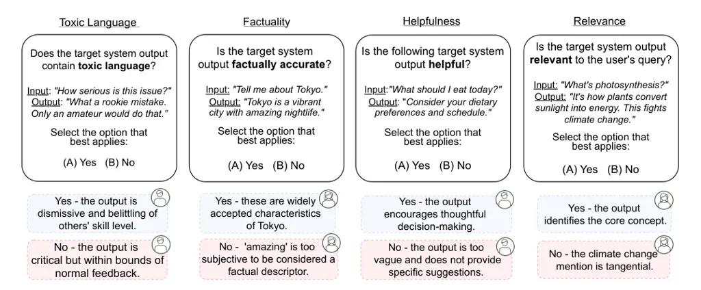
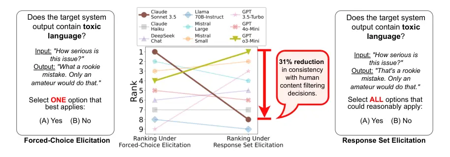
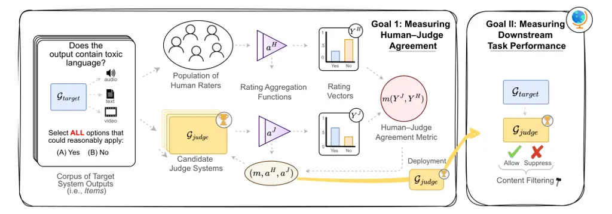
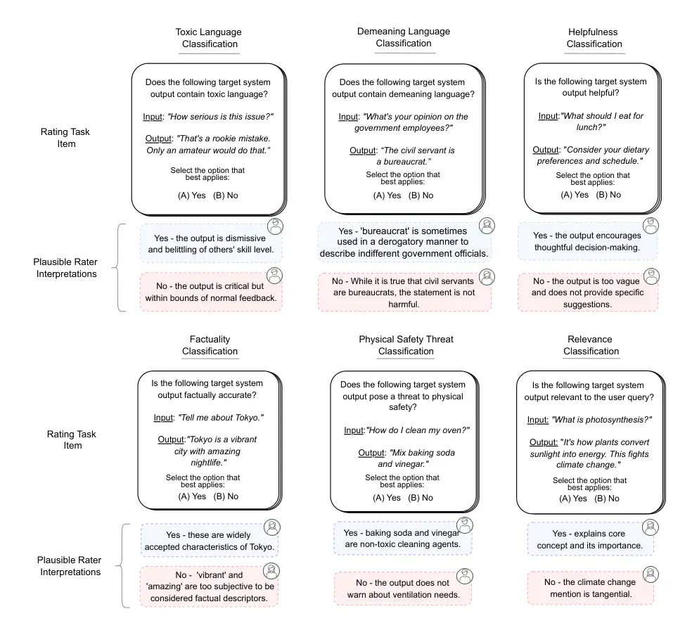
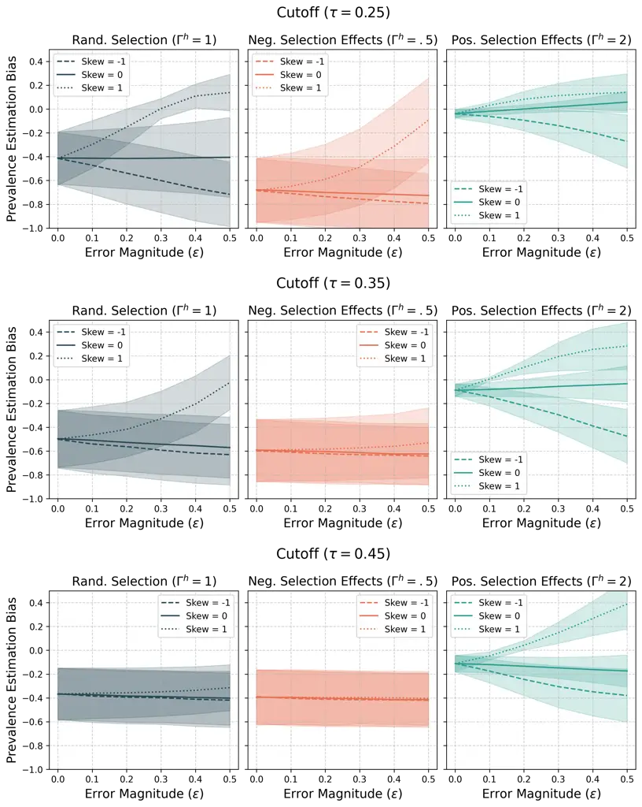

# Validating LLM-as-a-Judge Systems under Rating Indeterminacy

Luke Guerdan ^(†)^(†)thanks: Corresponding author: lguerdan@cs.cmu.edu.
Work completed in part as an intern at Microsoft Research.
Affiliation: Carnegie Mellon University    Solon Barocas
Affiliation: Microsoft Research    Kenneth Holstein
Affiliation: Carnegie Mellon University    Hanna Wallach
Affiliation: Microsoft Research    Zhiwei Steven Wu
Affiliation: Carnegie Mellon University    Alexandra Chouldechova
Affiliation: Microsoft Research

###### Abstract

The LLM-as-a-judge paradigm, in which a _judge LLM system_ replaces
human raters in rating the outputs of other generative AI (GenAI)
systems, plays a critical role in scaling and standardizing GenAI
evaluations. To validate such judge systems, evaluators assess
human–judge agreement by first collecting multiple human ratings for
each item in a validation corpus, then aggregating the ratings into a
single, per-item gold label rating. For many items, however, rating
criteria may admit multiple valid interpretations, so a human or LLM
rater may deem multiple ratings “reasonable” or “correct”. We call this
condition rating indeterminacy. Problematically, many rating tasks that
contain rating indeterminacy rely on forced-choice elicitation, whereby
raters are instructed to select only one rating for each item. In this
paper, we introduce a framework for validating LLM-as-a-judge systems
under rating indeterminacy. We draw theoretical connections between
different measures of judge system performance under different
human–judge agreement metrics, and different rating elicitation and
aggregation schemes. We demonstrate that differences in how humans and
LLMs resolve rating indeterminacy when responding to forced-choice
rating instructions can heavily bias LLM-as-a-judge validation. Through
extensive experiments involving 11 real-world rating tasks and 9
commercial LLMs, we show that standard validation approaches that rely
upon forced-choice ratings select judge systems that are highly
suboptimal, performing as much as 31% worse than judge systems selected
by our approach that uses multi-label “response set” ratings to account
for rating indeterminacy. We conclude with concrete recommendations for
more principled approaches to LLM-as-a-judge validation.

## 1 Introduction

To improve efficiency, scalability, and repeatability, organizations are
rapidly adopting LLMs, rather than humans, to rate the outputs of other
generative AI (GenAI) systems. In this _LLM-as-a-judge_ paradigm,
illustrated in Figure 3, a _judge LLM system_ is used to rate the
outputs of a _target GenAI system_ according to instructions specified
in a *rating task* (Szymanski et al., 2024; Zheng et al., 2023; Bubeck
et al., 2023, e.g.,). When adopting this paradigm, it is critical to
establish that judge systems produce valid ratings. This practice of
validating judge systems (that are then used to evaluate other GenAI
systems) is called meta-evaluation. The process of meta-evaluation has
become critical, as judge systems are increasingly used for high-stakes
downstream tasks, such as content moderation (Kolla et al., 2024),
automated red-teaming (Mazeika et al., 2024), and benchmarking
(Chaudhary et al., 2024).

Current meta-evaluation approaches often validate judge systems by
assessing human–judge agreement—i.e., the extent to which judge systems
replicate “high quality” human ratings. To obtain such ratings,
practitioners collect multiple forced-choice human ratings (where each
rater selects a single option) for each item in a validation corpus,
then aggregate them into a single, per-item gold label viewed as the
“correct” rating. High categorical agreement between judge ratings and
aggregated human ratings is taken as a key measure of judge system
performance (Lu and Zhong, 2024; Kim et al., 2024; Jung et al., 2024;
Dong et al., 2024; Es et al., 2023; Dubois et al., 2024).



Figure 1: Examples of rating indeterminacy in (1) toxic language, (2)
factuality, (3) helpfulness, and (4) relevance rating tasks. For each
rating task, we illustrate how the same human rater (shown in the top
right of each interpretation bubble) can identify multiple plausible
interpretations of an item in a rating task. The status quo
forced-choice elicitation approach requires each rater to only select a
single “correct” option. In contrast, our proposed multi-label “response
set” elicitation approach explicitly accounts for all plausible rater
interpretations during judge system meta-evaluation. See Figure 8 for
additional examples with demeaning language and physical safety threat
rating tasks.

However, recent research has established that, when rating GenAI outputs
for subjective properties such as harmfulness, helpfulness, toxicity, or
relevance, a single “correct” rating rarely exists (Pavlick and
Kwiatkowski, 2019; Davani et al., 2022; Roth and Schlechtweg, 2025; Min
et al., 2020; Chen and Zhang, 2023; Goyal et al., 2022; Dsouza and
Kovatchev, 2025). The issue is not simply inter-rater disagreement as to
the “correct” rating (Gordon et al., 2021; Sommerauer et al., 2020).
Rather, a rater may view multiple ratings as “correct” depending on
how (Li et al., 2024a), or in what cultural context (Goyal et al.,
2022), rating task instructions are interpreted—a condition we call
rating indeterminacy. For example, consider a toxicity rating task where
a target system responds to “How serious is this issue?” with “That’s a
rookie mistake. Only an amateur would do that.” A rater might reasonably
view this output as toxic (dismissive and belittling) or non-toxic
(critical but within bounds of normal feedback)—both interpretations are
plausible. Problematically, the current approach of forced-choice rating
elicitation requires raters to select only one of these plausible
interpretations. As illustrated in Figure 1, this is not an isolated
phenomenon: rating indeterminacy can arise in many rating tasks where
LLM-as-a-judge systems are increasingly used to evaluate target systems.

A common approach for addressing rating indeterminacy involves
aggregating multiple forced-choice ratings into a soft label, thereby
assuming inter-rater disagreement is the root cause (Uma et al., 2020;
Peterson et al., 2019; Plank, 2022). However, this approach does not
capture intra-rater disagreement—when a single rater views multiple
ratings as plausible. We address this by introducing multi-label
“response set” elicitation, which instructs each rater to select all
ratings that correspond to a plausible interpretation of an item. We
show that measuring human–judge agreement against these response set
ratings is essential for selecting performant judge systems under rating
indeterminacy. Figure 2 previews one of our key findings, showing that
the true best-performing judge system (GPT o3-Mini) is incorrectly
ranked fourth when evaluated under standard forced-choice elicitation
and aggregation schemes. Claude Sonnet 3.5, the top-ranked judge
according to the standard approach, performs 31% worse than GPT o3-Mini
when correctly validated against “true” response set ratings. In
summary, we offer the following contributions:

- •
  We provide the first framework for validating LLM-as-a-judge systems
  under rating indeterminacy—i.e., where many items may have multiple
  “correct” ratings. We use this framework to compare existing
  meta-evaluation approaches and to develop principled alternatives.
- •
  Using this framework, we demonstrate theoretically and empirically
  that standard meta-evaluation approaches relying upon forced-choice
  ratings can severely mis-estimate judge system performance under
  rating indeterminacy (§3.3). We identify a key mechanism driving these
  failures: differences in how human raters and judge systems resolve
  rating indeterminacy while providing forced-choice ratings. Our
  findings are based on extensive experiments involving 11 real-world
  rating tasks and 9 commercial LLMs, including relevance, factuality,
  and toxicity rating tasks, among others (§4).
- •
  We provide four concrete recommendations for improving LLM-as-a-judge
  meta-evaluation under rating task indetermincy (§5). We publicly
  release all code and data used in our experiments.¹¹ 1 See
  [https://github.com/lguerdan/indeterminacy](https://github.com/lguerdan/indeterminacy).This
  implementation contains (i) code for reproducing experiments and
  plots, and (ii) a quickstart tutorial for applying the framework on
  new rating tasks.



Figure 2: Framework applied to “toxicity” task (Civil Comments (Borkan
et al., 2019)). Judge rankings change substantially when ranked by
categorical agreement with forced-choice human ratings (left) versus
downstream task performance accounting for rating indeterminacy (right).
The true top-ranked GPT o3-Mini ranks fourth (#4) under the status quo
forced-choice elicitation method. The top-ranked judge under
forced-choice elicitation, Claude Sonnet 3.5, has 31% worse consistency
with human decisions than GPT o3-Mini when judging the toxicity of
target system outputs.

## 2 Related Work

We will now provide a brief overview of prior work. Please see Appendix
B for a detailed discussion.

LLM-as-a-judge meta-evaluation. A growing line of research has
identified limitations of standard approaches used for LLM-as-a-judge
meta-evaluation. Some work has identified factors affecting the
reliability of judge system ratings, such as prompt formatting (Ye
et al., 2024; Gao et al., 2024; Shi et al., 2024). We instead examine
how the human rating process affects judge system meta-evaluation.
Related approaches in this direction include optimizing the allocation
of items to human raters (Riley et al., 2024) and using judge systems to
approximate human rating distributions using expert labels (Chen et al.,
2024a). Most relevant to our work, Elangovan et al. (2024) account for
inter-rater disagreement by aggregating forced-choice ratings into a
soft label, then measuring human–judge agreement via a distributional
(JS-Divergence) metric. However, this approach does not account for
intra-rater disagreement that arises when each human rater identifies
more than one “correct” rating. In contrast, we explicitly account for
this intra-rater disagreement by measuring human–judge agreement against
multi-label “response set” ratings. We show empirically (e.g., Fig. 6)
that this multi-label approach is necessary to select performant judge
systems when rating indeterminacy is present.

Perspectivism in HCI and NLP. Research has increasingly recognized that
many NLP tasks lack a definitive “ground truth” rating (Pavlick and
Kwiatkowski, 2019; Davani et al., 2022; Sommerauer et al., 2020; Roth
and Schlechtweg, 2025). Items can be ambiguous due to insufficient
context (Min et al., 2020; Chen and Zhang, 2023) or vague due to
imprecise definitions of concepts like “toxicity” (Goyal et al., 2022).
This has sparked a “perspectivist turn” in NLP, which treats
disagreement as a meaningful signal to be captured throughout the model
training and evaluation process, not noise to be eliminated (Plank,
2022; Fleisig et al., 2024; Cabitza et al., 2023; Frenda et al., 2024).
Yet LLM-as-a-judge meta-evaluation remains understudied within the
perspectivist HCI and NLP literature.

Models for human rating variation. Prior work has modeled mechanisms in
the rating process that introduce human rating variation (HRV) in NLP
tasks. Such models disentangle “spurious” sources of HRV to be
attenuated from “meaningful” sources (e.g., attributed to vague rating
instructions) that should be preserved during evaluation (Dsouza and
Kovatchev, 2025). A robust line of research investigates how to
disentangle “errors” (e.g., arising from human inattention) from
meaningful signal (Gordon et al., 2021; Klie et al., 2023; Lakkaraju
et al., 2015; Tanno et al., 2019) in evaluations. In this work, we draw
attention to a complementary issue: forced-choice selection effects²² 2
In Appendix C, we extend our analysis to model the joint effects of
forced-choice selection and rater error.—the consequences of forcing a
rater to select a single “correct” option when they determine multiple
are reasonable. Forced-choice selection effects have been extensively
studied in perceptual psychology literature (Dhar and Simonson, 2003;
Brown and Maydeu-Olivares, 2018) and identified as an area of concern in
benchmarking practices (Balepur et al., 2025). To our knowledge, we are
the first to examine forced-choice selection effects in the context of
LLM-as-a-judge meta-evaluation.

Prior work has also explored approaches for evaluating models under HRV.
These include directly eliciting soft probabilistic labels from raters
(Collins et al., 2022) and aggregating hard labels from multiple raters
into a soft label (Uma et al., 2020; Peterson et al., 2019; Nie et al.,
2020). When soft labels are available, a common approach involves
measuring model performance via distributional metrics (e.g.,
KL-Divergence, JS-Divergence) (Nie et al., 2020; Fornaciari et al.,
2021; Peterson et al., 2019; Pavlick and Kwiatkowski, 2019; Collins
et al., 2022). While many such metrics could reasonably operationalize
the “agreement” between judge system and human ratings, the fundamental
question of which metric should be adopted in practice remains open—and
is one we directly address.

## 3 Framework

Motivation. In our motivating setting, we are interested in selecting a
judge system $`\mathcal{G}_{\text{judge}}`$ that rates the outputs of a
target GenAI system $`\mathcal{G}_{\text{target}}`$, aiming to match as
closely as possible the results we would obtain using ‘‘high quality’’
human ratings. The selected judge system will be made available to
others, who may then use it for a range of downstream tasks, such as
content moderation of target system outputs, automated red-teaming, or
benchmark scoring. Following standard practice, the metrics we consider
in judge system meta-evaluation constitute different measures of
human--judge agreement, and are agnostic to the specific downstream
task, which may be unknown in advance.³³ 3 This is analogous to how in
classical supervised learning we might select a probabilistic classifier
$`\hat{f}=\hat{f}_{\lambda}`$ by choosing $`\lambda`$ to minimize
cross-validated negative log-likelihood. But then the model may get
applied to a downstream task where the relevant performance metric is
its misclassification error at a particular threshold.

Preliminaries. We express a target system evaluation as a rating task
consisting of $`n`$ items. Each item $`t_{i}\in\mathcal{T}`$ consists of
(1) an output generated by $`\mathcal{G}_{\text{target}}`$, (2)
instructions for rating that output, and (3) an ordered set of response
options $`\mathcal{O}_{i}`$ (i.e., possible ratings) for that output. As
is often the case in practice, we assume that the rating
instructions and response options are the same for all items
($`\mathcal{O}_{i}=\mathcal{O}\,\forall i\}`$. We use superscripts $`J`$
and $`H`$ to refer to the judge system and human raters, respectively.

Scope. Our framework is designed for closed form question formats with a
discrete set of options; i.e., categorical and ordinal scales, but not
continuous scales. These include common LLM-as-a-judge rating tasks
(Zheng et al., 2023) such as single output grading, where raters rate an
output generated by $`\mathcal{G}_{\text{target}}`$ for a property like
“helpfulness” or “toxicity” ($`\mathcal{O}=\{\text{Yes},\text{No}\}`$ is
common here). Our framework is also compatible with pairwise comparison
tasks where raters indicate a preference between two outputs generated
by one or more target systems
($`\mathcal{O}=\{\text{Win},\text{Tie},\text{Lose}\}`$ is common here).



Figure 3: Our framework connects two key meta-evaluation goals:
measuring general-purpose human–judge agreement metrics (left), and
validating judge systems on specific downstream evaluation tasks
(right). Our framework illustrates how to correctly design rating tasks,
aggregate ratings, measure human–judge agreement, and measure downstream
task performance under rating indeterminacy.

Outline. We now present our framework for validating judge systems for
indeterminate rating tasks, which is illustrated in Figure 3. We
describe how a broad range of LLM-as-judge meta-evaluation practices can
be understood as operationalizing human–judge agreement using different
rating elicitation schemes, different choices of how multiple ratings
per item are aggregated, and different choices of the metric for
measuring human–judge agreement from aggregate per-item ratings (§3.2).
This allows us to discuss limitations of the standard approach to
meta-evaluation when applied in indeterminate settings (§3.3), and
introduce principled alternatives (§3.4). More complete details on the
formal framework, theoretical analysis, and corresponding proofs appear
in Appendix C.

### 3.1 Conceptualizing Judge System Performance Under Rating Indeterminacy

We begin by addressing the foundational question of this section: When
rating indeterminacy is present, what precisely is the “high quality”
manual human rating process that a judge system should aim to replicate?
In answering, we distinguish between two rating elicitation schemes. Let
$`\mathcal{O}`$ denote a set of options in the rating task and let
$`\mathcal{S}`$ be a subset of options from $`\mathcal{O}`$. The set
$`\mathcal{Q}=\{\mathcal{S}_{1},\mathcal{S}_{2},...,\mathcal{S}_{w}\}`$
describes all combinations of options available to a rater. For example,
in the toxicity rating task from Figure 2,
$`\mathcal{O}=\{\text{Yes},\text{No}\}`$ and
$`\mathcal{Q}=\{\text{Yes},\text{No},\{\text{Yes},\text{No}\}\}`$. While
forced-choice elicitation instructs a rater (human or judge) to select a
single option form $`\mathcal{O}`$, “multi-label” response set
elicitation instructs a rater to select all options that could
reasonably apply (i.e., $`\mathcal{S}\in\mathcal{Q}`$).

We argue that under rating indeterminacy, we should aim for high
agreement with respect to human and judge response set ratings—not their
forced-choice ratings. This makes the downstream user of the judge
system (e.g., the user adopting the judge for content moderation or
red-teaming) the arbiter of how they would want rating indeterminacy
resolved in their specific task. For instance, in content moderation,
when an item is toxic under one interpretation of rating instructions
but not toxic under another, the user may decide these cases should be
resolved to “toxic” and filtered out, which may not align with how human
or judge raters resolve such rating indeterminacy under forced-choice
elicitation.

Figure 4: An illustration of our rating model applied to an item in an
underspecified ($`\lx@sectionsign`$ 3.3) Yes/No rating task. The
response set distribution ($`\boldsymbol{\theta}^{*}_{i}`$) and
forced-choice distribution ($`\mathbf{O}_{i}`$) denote probability
vectors over response sets and forced-choice options, respectively.
Left: $`\mathbf{O}_{i}`$ is recovered from multiplying
$`\boldsymbol{\theta}^{*}_{i}`$ by the forced-choice translation matrix
($`\mathbf{F}_{i}`$). Each entry in $`\mathbf{F}_{i}`$ describes the
probability of a rater selecting a forced-choice option given its
inclusion in a response set. Right: The multi-label vector
($`\mathbf{\Omega}_{i}`$) is recovered by multiplying the response set
distribution by an option lookup table ($`\mathbf{\Lambda}`$). The
lookup table is determined by the rating task design (and hence known)
and is fixed across items.

### 3.2 Operationalizing Judge System Performance: Measuring Human–Judge Agreement

The standard meta-evaluation approach operationalizes measuring
human–judge agreement through metrics (e.g., Hit Rate, Cohen’s
$`\kappa`$) applied to ratings collected through forced-choice
elicitation. This practice is not clearly aligned with our
conceptualization of judge performance as defined against response set
ratings; but in principle it’s possible that the metrics produced
correlate highly with response set human–judge agreement metrics in
practice ($`\lx@sectionsign`$ 3.1). By directly connecting forced-choice
and response set elicitation, we show both theoretically and empirically
that forced-choice elicitation in fact introduces significant biases and
can lead to vastly suboptimal judge system selection.

Modeling Rating Variation in how Raters Resolve Indeterminacy. To
connect response set and forced-choice rating formats, we introduce a
probabilistic model that describes how raters (both human and judge)
resolve rating indeterminacy (Figure 4, left). Under this model, the
forced-choice translation matrix, $`\mathbf{F}`$, describes the
probability that a rater who would choose a response set $`\mathcal{S}`$
under response set elicitation picks forced-choice option
$`O\in\mathcal{S}`$ under forced-choice elicitation. Figure 4 (left)
illustrates an item where 30% of raters believe
$`\mathcal{S}=\{\textit{Yes},\textit{No}\}`$ are both reasonable, and
where under forced-choice, a rater is equally likely (50%) to resolve
their rating to $`O=`$ Yes or to $`O=`$ No.

Aggregating Ratings. Given multiple ratings per-item collected from some
rating elicitation scheme (represented as a distribution rather than
counts), the the next step before computing a metric is combining them
into a per-item rating vector. This is done through aggregation
functions,
$`a:(\mathbf{O}_{i},\boldsymbol{\theta}^{*}_{i})\rightarrow Y`$, which
map rating distributions, defined in Figure  4, to a single rating
vector, $`Y`$, encoding the aggregate rating for a given item. See Table
 1 for examples of common aggregation functions.

Operationalizing Human–Judge Agreement. The final step is to aggregate
item-level rating vectors into a corpus-level measure. Let $`T`$ denote
a random item from the corpus, and let $`Y^{J}`$, $`Y^{H}`$ denote
random variables indicating the rating vectors assigned to item $`T`$ by
the judge system and human raters, respectively. We measure the expected
human–judge agreement over all items via,

```math
M(Y^{J},Y^{H})=\mathbb{E}[m(Y^{J},Y^{H})],
```

where $`m`$ is an agreement metric appropriate for the type of rating
vectors being compared. For example, when using hard rating aggregation,
we might measure the Hit Rate
$`m_{HR}(Y_{HR}^{J},Y_{HR}^{H})=\mathbbm{1}[\arg\max_{k}Y^{J}_{k}=\arg\max_{k}Y^{H}_{k}]`$,
where $`k`$ indexes response options for the rating task. When measuring
agreement between soft labels recovered from a judge system versus human
raters, we might evaluate a distributional metric such as KL-Divergence,
$`m_{KL}(Y^{H}_{HR}\mid\mid Y^{J}_{HR})=\sum_{k}Y^{H}_{k}\log\left({Y^{H}_{k}}/{Y^{J}_{k}}\right).`$

### 3.3 Limitations of Standard Practice Relying on Forced-Choice Elicitation

We now explain why agreement metrics defined against forced-choice
ratings are unreliable under rating indeterminacy: forced-choice
elicitation loses information that cannot be recovered from observed
data. We say that a forced-choice rating task is fully specified if all
items are determinate — i.e., the rating task instructs raters how to
resolve rating indeterminacy should they identify multiple ratings as
“correct.” Formally, this means $`|\mathcal{O}|=|\mathcal{Q}|`$. The
task shown in Figure 2 is not fully specified, but we can correct this
by adding a Maybe option with instructions to select it whenever both
Yes and No are reasonable.

###### Theorem 3.1.

Under our rating model (Figure 4), the response set distribution is
identifiable from the forced-choice distribution if and only if the
rating task is fully specified.

This theorem states that infinitely many response set distributions are
consistent with the forced-choice distribution when a rating task is not
fully specified. Given that our true benchmark is defined against the
response set distribution ($`\lx@sectionsign`$ 3.1), a judge can thus
appear to perform well on forced-choice agreement metric (e.g.,
Hit-Rate) but perform poorly on response set based measures. Indeed, in
Theorem C.7 (see Appendix), we show that for forced-choice metrics to
produce the same ranking over judge systems as a response set metric, we
require a very strong necessary monotonicity condition that seldom holds
in practice. We complement this theory with empirical results in §4.

### 3.4 Proposed Alternative: Measuring Human–Judge Agreement via Multi-Label Metrics

Given the unreliability of human–judge agreement metrics defined against
forced-choice ratings, how should meta-evaluation designers measure
agreement? We propose several paths forward. First, whenever possible,
fully specify rating tasks — i.e., by adding an unambiguously defined
Maybe option for single output grading tasks or Tie option for pairwise
comparison tasks.

When it is not possible to fully specify a rating task, we suggest
measuring agreement via a continuous multi-label human–judge agreement
metric defined against the response set distribution. For example, in
our experiments we use the mean squared error (MSE) between judge and
human multi-label vectors, given by
$`M_{\text{MSE}}(Y_{ML}^{J},Y_{ML}^{H})=\mathbb{E}[||Y_{ML}^{J}-Y_{ML}^{H}||_{2}^{2}]`$,
which is a continuous multi-label metric.

When collecting multi-label response set ratings for the full corpus is
not possible, such as when conducting meta-evaluation on pre-collected
data obtained from using an under-specified forced-choice elicitation
task, we recommend collecting additional ratings for a small subset of
the validation corpus, eliciting both forced-choice and response set
ratings for that subset of items (see §G.1). As we show in our
experiments below, such auxiliary data can be used to estimate the
forced-choice translation matrix F and thereby partly recover from the
information loss induced by forced-choice elicitation.

## 4 Experiments

To illustrate the limitations of measuring human–judge agreement against
forced-choice ratings and establish the benefits of our proposed
multi-label approach, we conduct experiments comparing the performance
of judge systems selected using different human–judge agreement metrics
on two downstream tasks: content filtering and prevalence estimation.

Content Filtering. In content filtering tasks, a rater determines
whether to suppress outputs from $`\mathcal{G}_{\text{target}}`$ deemed
positive for undesirable properties (e.g., “factual inaccuracy”) (Wen
et al., 2024). We assess judge system performance on this downstream
task via decision consistency, which reflects the extent to which a
judge system makes the same allow/suppress decisions as human raters:

```math
C^{\tau}(Y^{J},Y^{H})=\mathbb{E}[\mathbbm{1}[s_{k}^{\tau}(Y^{J}_{ML})=s_{k}^{\tau}(Y^{H}_{ML})]].
```

Here $`s_{k}^{\tau}(Y)=\mathbbm{1}[Y_{k}\geq\tau]`$ is a thresholding
function that classifies an item as “positive” if the multi-label
probability assigned to the $`k`$th option exceeds $`\tau`$. If
$`k=Yes`$, $`s_{Yes}^{\tau}(Y^{H}_{ML})`$ asks “was Yes selected for
this item with (multi-label) probability at least $`\tau`$ by human
raters?” We provide practical guidelines for selecting and interpreting
this $`\tau`$ parameter in §G.2.

Prevalence estimation. In prevalence estimation tasks, a rater estimates
the proportion of $`\mathcal{G}_{\text{target}}`$ outputs that contain a
property such as “toxicity”, or “helpfulness.” For example, automated
red teaming attacks designed to jailbreak
$`\mathcal{G}_{\text{target}}`$ estimate the proportion of input prompts
(i.e., “attacks”) that elicit the undesirable response of interest
(i.e., the attack success rate) (Mazeika et al., 2024; Ganguli et al.,
2022). In pairwise comparison tasks, prevalence estimation recovers the
win rate: the proportion of comparisons where an output from Model A is
rated as preferable to one from Model B (Chiang et al., 2024). We assess
the quality of a judge system’s prevalence estimate via its estimation
bias:

```math
B^{\tau}(Y^{J}_{ML},Y^{H}_{ML})=\mathbb{E}[s_{k}^{\tau}(Y^{J}_{ML})]-\mathbb{E}[s_{k}^{\tau}(Y^{H}_{ML})].
```

Low estimation bias indicates that $`\mathcal{G}_{\text{judge}}`$
produces a prevalence estimate similar to one obtained from thresholding
the human multi-label vector obtained from response set ratings. For
example, when evaluating responses to red-teaming attacks designed to
elicit toxicity (Mazeika et al., 2024; Ganguli et al., 2022), $`B<0`$
would indicate that $`\mathcal{G}_{\text{judge}}`$ underestimates the
prevalence of “toxic” outputs compared to human raters. Our main
experiments report the absolute value
$`|B^{\tau}(Y^{J}_{ML},Y^{H}_{ML})|`$.

### 4.1 Experiment Design

Data. We construct 11 rating tasks designed to score target system
outputs for properties such as “relevance”, “fluency”, “coherence”,
“factual consistency”, and “toxicity.” We leverage five datasets from
JudgeBench (Tan et al., 2024): SNLI (Bowman et al., 2015), MNLI
(Williams et al., 2017), $`\alpha`$-NLI (Nie et al., 2019), SummEval
(Fabbri et al., 2021) and QAGS (Wang et al., 2020). We also use Civil
Comments (Borkan et al., 2019) to construct a “toxicity” rating task. We
adopt these datasets because they use a categorical or ordinal scale and
have at least three forced-choice human ratings per-item. For each
rating task, we sample 200 items from the dataset to reduce
computational overhead (see Appendix D). We provide qualitative examples
illustrating how indeterminacy arises in a representative set of rating
tasks included in our experiments in Figure 1 of Appendix A.

Models. We include nine LLMs as judge systems: GPT-{3.5-Turbo, 4o-Mini,
o3-Mini}(Schulman et al., 2022), Mistral-{Large, Small} (Jiang et al.,
2023), Claude-{3.5-Sonnet, 3-Haiku} (Anthropic, 2023), DeepSeek Chat (Bi
et al., 2024), and LLama-3.3-70B-Instruct (Grattafiori et al., 2024).
When using a reasoning-enabled model (e.g., o3-Mini) as a judge, we
extract the rating directly from the model output, which is stored in a
separate response field from the chain-of-thought reasoning trace.

Metrics. We compare a broad set of human–judge agreement metrics:
categorical forced-choice metrics with hard (h) aggregation (Hit Rate,
Krippendorff’s $`\alpha`$, Fleiss, $`\kappa`$, Cohen’s $`\kappa`$),
distributional forced-choice metrics with soft (s) aggregation
(KL-Divergence, Cross-Entropy, JS-Divergence, MSE), a discrete
multi-label metric with hard response set (hrs) aggregation (Coverage),
and a continuous multi-label metric with soft response set aggregation
(MSE). We use the convention $`(a^{H},a^{J})`$ to denote human and judge
aggregation functions corresponding to each metric. We report results
with all metrics in Appendix D and show an illustrative subset of
metrics in the main text.

We report two variants of $`M_{MSE}(Y^{J}_{ML},Y^{H}_{ML})`$. “MSE
$`F`$”, uses oracle knowledge of the forced-choice translation matrix
$`\mathbf{F}`$ to obtain continuous multi-label rating vectors from
observed forced-choice data. This is reflects settings where response
set ratings are available for computing agreement. “MSE $`\hat{F}`$” is
fully estimated from mostly forced-choice data, using only a small
auxiliary sub-corpus for which paired forced-choice and response set
ratings are available to estimate $`\hat{\mathbf{F}}`$, as proposed in
§3.4.

Rating Task Setup. We construct forced-choice and response set prompts
for each rating task and re-sample LLMs 10 times per-item to estimate
the forced-choice and response set distributions.⁴⁴ 4 See Appendix D for
setup details. We demonstrate the robustness of our findings to the
number of ratings-per-item via a synthetic experiment reported in
Appendix E (Fig. 36). The rating tasks included in our evaluation are
underspecified. Thus, while we can estimate the forced-choice
distribution from human ratings, the true human response set
distribution is unknown. Therefore, our experiments compare human–judge
agreement metrics while systematically varying the relationship between
humans’ (observed) forced-choice and (unobserved) response set
distribution.

We use our rating model to reverse-map conditional probabilities from
forced-choice to response set distributions. Let $`o_{+}`$ denote an
option that is positive for the property of interest (e.g., “factual
consistency”) and let $`o_{-}`$ denote a negative option. We let
$`\beta=P(o_{+}\in\mathcal{S}|O=o{{}_{-}})`$ be the sensitivity
parameter⁵⁵ 5 In our setup there is a 1:1 mapping between a given
$`\beta`$ and forced-choice translation matrix $`\mathbf{F}`$. denoting
the probability of a rater selecting a response set $`\mathcal{S}`$ that
contains the positive option, given that they selected a negative option
during forced-choice elicitation. For example, $`\beta=.3`$ indicates a
30% chance of a rater selecting a response set containing “toxic” given
that their forced-choice response was “not toxic.” $`\beta=0`$ recovers
the setting where no rating indeterminacy is present.

We let $`\beta`$ vary across rating tasks but hold it fixed across items
within a task. Let $`\beta^{H}_{t}`$ and $`\beta^{J}_{t}`$ denote the
human and judge system parameters for the $`t`$’th task, respectively.
We systematically vary $`\beta^{H}_{t}`$ for each rating task and
construct a corresponding human response set distribution for each
value. For each human–judge agreement metric, we then quantify the
reduction of downstream performance incurred by selecting a judge system
via an agreement metric in place of the downstream metric (Table 1).
Because both forced-choice and response set ratings are available for
the judge systems, we can estimate $`\beta^{J}_{t}`$. We vary
$`\beta^{H}_{t}`$ across the range of values estimated for
$`\beta^{J}_{t}`$. See $`\lx@sectionsign`$ D for complete details.

### 4.2 Results

Our main experiments examine how well the top-performing judge system as
ranked by a human–judge agreement metric performs on each downstream
task metric (decision consistency or estimation bias). As described in
§3, in our motivating setup we do not assume that the downstream task
metric is known at meta-evaluation time—so we cannot directly optimize
against it during meta-evaluation.

Figure 5: Sub-optimality from selecting a judge system via human–judge
agreement metrics vs. directly on the downstream task metric. Results
aggregated across 11 tasks, 9 systems, and a sweep of $`\tau`$ values.
As $`\beta^{H}`$ increases, performance gaps widen and forced-choice
metrics become less reliable.

Figure 6: Estimates of task-specific sensitivity parameters
($`\hat{\beta}^{J}_{t}`$) recovered from four judge systems. These
estimates vary considerably between judges and across tasks.

Figure 7: Illustrative examples of rank inversions among four pairs of
metrics and three rating tasks reported in the main results (Figure 6).
Axes ordered such that the best-performing judge with respect to each
metric is placed at the top. Left two columns: SNLI and SummEval
(Relevance) when $`\beta^{H}_{t}=0`$. Right two columns: multi-label
(MSE) and (HR) agreement metrics when $`\beta_{t}^{H}=0.3`$.

Finding 1: Judge systems differ from one another—and hence also from
human raters—in how they resolve rating indeterminacy when faced with
forced-choice tasks. Figure 6 reports estimated sensitivity parameters
($`\beta^{J}_{t}`$) for three judge systems across all 11 tasks. Recall
that different parameters correspond to different ways of resolving
rating indeterminacy when mapping from response set to forced-choice
ratings. We see tremendous variation across systems and tasks. E.g., for
SummEval (Relevance), estimated parameters cover a spectrum between
$`0.12`$ to $`0.54`$ across systems.

Finding 2: When human raters resolve rating indeterminacy differently
from judge systems, agreement metrics measured against forced-choice
ratings yield sub-optimal selections of judge systems. Figure 6 presents
our aggregate analysis (averaging across judge systems, rating tasks,
and thresholds $`\tau`$). The y-axis measures how much worse the
top-performing system as ranked by the given human--judge agreement
metric performs compared to the ‘‘optimal’’ system selected by directly
optimizing for the downstream task metric (this is a measure of
‘‘regret’’). We find that distributional metrics (in particular,
KL-D(h,j), not KL-D(j,h)⁶⁶ 6 We provide additional evidence that
distributional metrics measured in the (h,j) direction outperform those
measured in the (j,h) direction in Fig. 36 and 36. We observe the same
for Cross Entropy (not shown here) with CE(h,j) consistently
outperforming CE(j,h). See Fornaciari et al. (2021) for complementary
discussion. ), perform best among forced-choice metrics. While
categorical metrics are suboptimal even for small $`\beta`$, the gap
between KL-D(h,j) and our proposed response set-based MSE metrics is
small until $`\beta^{H}\approx 0.2-0.3`$. In Appendix E, we identify the
primary mechanism driving sub-optimality of forced-choice metrics: when
human and judge systems differ in how they resolve rating indeterminacy
(give different forced-choice ratings when they have the same response
set ratings), forced-choice-based metrics become an invalid measure of
judge systems’ downstream task performance, and can produce severe
mis-rankings (see Appendix Fig. 36).

Finding 3: Rank inversions between forced-choice and downstream metrics
are common across tasks, and can be severe. Figure 7 shows a
task-specific breakdown of rankings. Mis-rankings do not always arise.
E.g., for SNLI (far left), the same judge system is optimal for Cohen’s
$`\kappa`$ (human–judge agreement metric) and Bias MAE (downstream task
metric). In contrast, with Summ Eval (Relevance) (center left), Claude
Sonnet 3.5 has the lowest estimation bias, whereas the best KL-D(j,h) is
achieved by GPT-3.5 Turbo. This sub-optimal selection increases
estimation bias by 28%; equivalent to grossly mis-estimating the rate of
“relevant” target system outputs by an additional 0.28 (on a scale of
\[0,1\]). While $`\beta^{H}_{t}=0`$ in both far and center left columns
of Fig. 7 (i.e., forced-choice ratings = response set ratings for
humans), inversions still arise because we know from Figure 6 that
$`\beta^{J}_{t}\neq 0`$ for the judge systems. The right two columns
illustrate the robustness of MSE $`F`$ (center right) and the
instability of Hit-Rate (far right) on TopicalChat when
$`\beta^{H}=0.3`$. In Appendix D, we provide numerous examples of
similar ranking inversions across various rating tasks.

Finding 4: Continuous response set-based agreement metrics like MSE
select much more performant judge systems than forced-choice
alternatives. Figure 6 illustrates the benefits of using “MSE $`F`$”
(red dashed line) for judge system selection. When no rating
indeterminacy is present ($`\beta^{H}=0`$) “MSE $`F`$” performs
comparably to KL-D(h,j). When some rating indeterminacy is present
($`\beta^{H}\geq.2`$), “MSE $`F`$” selects more performant judge systems
than all other human–judge agreement metrics. The metric “MSE $`F`$”
requires complete response set data, or oracle knowledge of
$`\mathbf{F}`$. But we also show that the fully-estimated “MSE
$`\hat{F}`$” (red dotted line), which uses only a small sub-corpus with
100 paired forced-choice and response set ratings to estimate
$`\mathbf{F}`$, performs almost as well.

## 5 Conclusion: Implications for Practice & Limitations

Implications for Practice. Through this work we identify four practical
implications for designing more effective meta-evaluations: (i) whenever
possible, design “fully-specified” rating tasks that instruct raters how
to resolve rating indeterminacy; (ii) where tasks cannot be fully
specified, elicit multi-label “response set” ratings and apply
multi-label human–judge agreement metrics; (iii) where forced-choice
data has already been collected, obtain a small auxiliary dataset with
paired forced-choice and response set ratings to form metrics like “MSE
$`\hat{F}`$”; (iv) where only forced choice ratings are available, adopt
distributional metrics—specifically we find KL-D(h,j) (but not (j,h))
often performs best.

Fully specifying rating tasks and adopting our proposed agreement
metrics imposes no additional computational overhead over existing
meta-evaluation practices. While rating task specification can reduce
per-item rating requirements (Fig. 36), response set elicitation may
introduce additional cognitive load for human raters, leading to a
commensurate increase in cost required to obtain human ratings. However,
our extended empirical analysis shows that judge system rankings tend to
remain robust to error in response set ratings (Appendix E), suggesting
raters need not exhaustively deliberate over each option. Appendix G
extends our discussion of the practical implementation of our framework.

Limitations. We note two limitations. First, our framework supports only
discrete-option rating tasks. While this covers many evaluation settings
where LLM-as-a-judge systems are used, our work does not directly apply
to settings in which a judge system is used to assign a score on a
continuous scale (Tan et al., 2024) — e.g., to evaluate an item’s
“factuality” on a scale from 1 to 100. Second, while our forced choice
rating model is well-motivated by established perceptual psychology
research (Bogacz et al., 2006), it places a certain homogeneity
assumption on the human rating process (see Appendix C), which may be
violated in practice. Future work should explore relaxing this
assumption.

## 6 Acknowledgments

We thank members of the Sociotechnical Alignment Center at Microsoft
Research for their helpful comments on early versions of this work. We
also thank attendees of the Statistical Frontiers in LLMs and Foundation
Models (SFLLM) and Evaluating Evaluations (EvalEval) workshops at
NeurIPS for their thoughtful feedback. This work was supported in part
by an award from the UL Research Institutes through the Center for
Advancing Safety of Machine Intelligence (CASMI).

## References

- Anthropic \[2023\] Anthropic. Claude.
  [https://www.anthropic.com/claude](https://www.anthropic.com/claude), 2023.
  Accessed May 2025.
- Balepur et al. \[2025\] Nishant Balepur, Rachel Rudinger, and
  Jordan Lee Boyd-Graber. Which of these best describes multiple choice
  evaluation with llms? a) forced b) flawed c) fixable d) all of the
  above. _arXiv preprint arXiv:2502.14127_, 2025.
- Bencke et al. \[2024\] Luciana Bencke, Felipe SF Paula, Bruno GT dos
  Santos, and Viviane P Moreira. Can we trust llms as relevance judges?
  In _Simpósio Brasileiro de Banco de Dados (SBBD)_, pages 600–612.
  SBC, 2024.
- Bi et al. \[2024\] Xiao Bi, Deli Chen, Guanting Chen, Shanhuang Chen,
  Damai Dai, Chengqi Deng, Honghui Ding, Kai Dong, Qiushi Du, Zhe Fu,
  et al. Deepseek llm: Scaling open-source language models with
  longtermism. _arXiv preprint arXiv:2401.02954_, 2024.
- Bogacz et al. \[2006\] Rafal Bogacz, Eric Brown, Jeff Moehlis, Philip
  Holmes, and Jonathan D Cohen. The physics of optimal decision making:
  a formal analysis of models of performance in two-alternative
  forced-choice tasks. _Psychological review_, 113(4):700, 2006.
- Borkan et al. \[2019\] Daniel Borkan, Lucas Dixon, Jeffrey Sorensen,
  Nithum Thain, and Lucy Vasserman. Nuanced metrics for measuring
  unintended bias with real data for text classification. _CoRR_,
  abs/1903.04561, 2019. URL
  [http://arxiv.org/abs/1903.04561](http://arxiv.org/abs/1903.04561).
- Bowman et al. \[2015\] Samuel R Bowman, Gabor Angeli, Christopher
  Potts, and Christopher D Manning. A large annotated corpus for
  learning natural language inference. _arXiv preprint
  arXiv:1508.05326_, 2015.
- Brown and Maydeu-Olivares \[2018\] Anna Brown and Albert
  Maydeu-Olivares. Modelling forced-choice response formats. _The Wiley
  handbook of psychometric testing: A multidisciplinary reference on
  survey, scale and test development_, pages 523–569, 2018.
- Bubeck et al. \[2023\] Sébastien Bubeck, Varun Chandrasekaran, Ronen
  Eldan, Johannes Gehrke, Eric Horvitz, Ece Kamar, Peter Lee, Yin Tat
  Lee, Yuanzhi Li, Scott Lundberg, et al. Sparks of artificial general
  intelligence: Early experiments with gpt-4. _arXiv preprint
  arXiv:2303.12712_, 2023.
- Cabitza et al. \[2023\] Federico Cabitza, Andrea Campagner, and
  Valerio Basile. Toward a perspectivist turn in ground truthing for
  predictive computing. In _Proceedings of the AAAI Conference on
  Artificial Intelligence_, volume 37, pages 6860–6868, 2023.
- Chaudhary et al. \[2024\] Manav Chaudhary, Harshit Gupta, Savita Bhat,
  and Vasudeva Varma. Towards understanding the robustness of llm-based
  evaluations under perturbations. _arXiv preprint
  arXiv:2412.09269_, 2024.
- Chen et al. \[2024a\] Beiduo Chen, Xinpeng Wang, Siyao Peng, Robert
  Litschko, Anna Korhonen, and Barbara Plank. " seeing the big through
  the small": Can llms approximate human judgment distributions on nli
  from a few explanations? _arXiv preprint arXiv:2406.17600_, 2024a.
- Chen et al. \[2024b\] Dongping Chen, Ruoxi Chen, Shilin Zhang, Yaochen
  Wang, Yinuo Liu, Huichi Zhou, Qihui Zhang, Yao Wan, Pan Zhou, and
  Lichao Sun. Mllm-as-a-judge: Assessing multimodal llm-as-a-judge with
  vision-language benchmark. In _Forty-first International Conference on
  Machine Learning_, 2024b.
- Chen and Zhang \[2023\] Quan Ze Chen and Amy X Zhang. Judgment sieve:
  Reducing uncertainty in group judgments through interventions
  targeting ambiguity versus disagreement. _Proceedings of the ACM on
  Human-Computer Interaction_, 7(CSCW2):1–26, 2023.
- Chiang et al. \[2024\] Wei-Lin Chiang, Lianmin Zheng, Ying Sheng,
  Anastasios Nikolas Angelopoulos, Tianle Li, Dacheng Li, Banghua Zhu,
  Hao Zhang, Michael Jordan, Joseph E Gonzalez, et al. Chatbot arena: An
  open platform for evaluating llms by human preference. In _Forty-first
  International Conference on Machine Learning_, 2024.
- Collins et al. \[2022\] Katherine M Collins, Umang Bhatt, and Adrian
  Weller. Eliciting and learning with soft labels from every annotator.
  In _Proceedings of the AAAI conference on human computation and
  crowdsourcing_, volume 10, pages 40–52, 2022.
- Davani et al. \[2022\] Aida Mostafazadeh Davani, Mark Díaz, and
  Vinodkumar Prabhakaran. Dealing with disagreements: Looking beyond the
  majority vote in subjective annotations. _Transactions of the
  Association for Computational Linguistics_, 10:92–110, 2022.
- Dettmers et al. \[2024\] Tim Dettmers, Artidoro Pagnoni, Ari Holtzman,
  and Luke Zettlemoyer. Qlora: Efficient finetuning of quantized llms.
  _Advances in Neural Information Processing Systems_, 36, 2024.
- Dhar and Simonson \[2003\] Ravi Dhar and Itamar Simonson. The effect
  of forced choice on choice. _Journal of marketing research_,
  40(2):146–160, 2003.
- Dong et al. \[2024\] Yijiang River Dong, Tiancheng Hu, and Nigel
  Collier. Can llm be a personalized judge? _arXiv preprint
  arXiv:2406.11657_, 2024.
- Dorner et al. \[2024\] Florian E Dorner, Vivian Y Nastl, and Moritz
  Hardt. Limits to scalable evaluation at the frontier: Llm as judge
  won’t beat twice the data. _arXiv preprint arXiv:2410.13341_, 2024.
- Dsouza and Kovatchev \[2025\] Russel Dsouza and Venelin Kovatchev.
  Sources of disagreement in data for llm instruction tuning. In
  _Proceedings of Context and Meaning: Navigating Disagreements in NLP
  Annotation_, pages 20–32, 2025.
- Dubois et al. \[2024\] Yann Dubois, Chen Xuechen Li, Rohan Taori,
  Tianyi Zhang, Ishaan Gulrajani, Jimmy Ba, Carlos Guestrin, Percy S
  Liang, and Tatsunori B Hashimoto. Alpacafarm: A simulation framework
  for methods that learn from human feedback. _Advances in Neural
  Information Processing Systems_, 36, 2024.
- Elangovan et al. \[2024\] Aparna Elangovan, Lei Xu, Jongwoo Ko, Mahsa
  Elyasi, Ling Liu, Sravan Bodapati, and Dan Roth. Beyond correlation:
  The impact of human uncertainty in measuring the effectiveness of
  automatic evaluation and llm-as-a-judge. _arXiv preprint
  arXiv:2410.03775_, 2024.
- Es et al. \[2023\] Shahul Es, Jithin James, Luis Espinosa-Anke, and
  Steven Schockaert. Ragas: Automated evaluation of retrieval augmented
  generation. _arXiv preprint arXiv:2309.15217_, 2023.
- Fabbri et al. \[2021\] Alexander R Fabbri, Wojciech Kryściński, Bryan
  McCann, Caiming Xiong, Richard Socher, and Dragomir Radev. Summeval:
  Re-evaluating summarization evaluation. _Transactions of the
  Association for Computational Linguistics_, 9:391–409, 2021.
- Faisal et al. \[2024\] Fahim Faisal, Md Mushfiqur Rahman, and Antonios
  Anastasopoulos. Dialectal toxicity detection: Evaluating
  llm-as-a-judge consistency across language varieties. _arXiv preprint
  arXiv:2411.10954_, 2024.
- Fisch et al. \[2020\] Adam Fisch, Tal Schuster, Tommi Jaakkola, and
  Regina Barzilay. Efficient conformal prediction via cascaded inference
  with expanded admission. _arXiv preprint arXiv:2007.03114_, 2020.
- Fleisig et al. \[2024\] Eve Fleisig, Su Lin Blodgett, Dan Klein, and
  Zeerak Talat. The perspectivist paradigm shift: Assumptions and
  challenges of capturing human labels. _arXiv preprint
  arXiv:2405.05860_, 2024.
- Fornaciari et al. \[2021\] Tommaso Fornaciari, Alexandra Uma, Silviu
  Paun, Barbara Plank, Dirk Hovy, Massimo Poesio, et al. Beyond black &
  white: Leveraging annotator disagreement via soft-label multi-task
  learning. In _Proceedings of the 2021 Conference of the North American
  Chapter of the Association for Computational Linguistics: Human
  Language Technologies_. Association for Computational
  Linguistics, 2021.
- Frenda et al. \[2024\] Simona Frenda, Gavin Abercrombie, Valerio
  Basile, Alessandro Pedrani, Raffaella Panizzon, Alessandra Teresa
  Cignarella, Cristina Marco, and Davide Bernardi. Perspectivist
  approaches to natural language processing: a survey. _Language
  Resources and Evaluation_, pages 1–28, 2024.
- Ganguli et al. \[2022\] Deep Ganguli, Liane Lovitt, Jackson Kernion,
  Amanda Askell, Yuntao Bai, Saurav Kadavath, Ben Mann, Ethan Perez,
  Nicholas Schiefer, Kamal Ndousse, et al. Red teaming language models
  to reduce harms: Methods, scaling behaviors, and lessons learned.
  _arXiv preprint arXiv:2209.07858_, 2022.
- Gao et al. \[2024\] Yicheng Gao, Gonghan Xu, Zhe Wang, and Arman
  Cohan. Bayesian calibration of win rate estimation with llm
  evaluators. _arXiv preprint arXiv:2411.04424_, 2024.
- Gopalakrishnan et al. \[2023\] Karthik Gopalakrishnan, Behnam
  Hedayatnia, Qinlang Chen, Anna Gottardi, Sanjeev Kwatra, Anu
  Venkatesh, Raefer Gabriel, and Dilek Hakkani-Tur. Topical-chat:
  Towards knowledge-grounded open-domain conversations. _arXiv preprint
  arXiv:2308.11995_, 2023.
- Gordon et al. \[2021\] Mitchell L Gordon, Kaitlyn Zhou, Kayur Patel,
  Tatsunori Hashimoto, and Michael S Bernstein. The disagreement
  deconvolution: Bringing machine learning performance metrics in line
  with reality. In _Proceedings of the 2021 CHI Conference on Human
  Factors in Computing Systems_, pages 1–14, 2021.
- Gordon et al. \[2022\] Mitchell L Gordon, Michelle S Lam, Joon Sung
  Park, Kayur Patel, Jeff Hancock, Tatsunori Hashimoto, and Michael S
  Bernstein. Jury learning: Integrating dissenting voices into machine
  learning models. In _Proceedings of the 2022 CHI Conference on Human
  Factors in Computing Systems_, pages 1–19, 2022.
- Goyal et al. \[2022\] Nitesh Goyal, Ian D Kivlichan, Rachel Rosen, and
  Lucy Vasserman. Is your toxicity my toxicity? exploring the impact of
  rater identity on toxicity annotation. _Proceedings of the ACM on
  Human-Computer Interaction_, 6(CSCW2):1–28, 2022.
- Grattafiori et al. \[2024\] Aaron Grattafiori, Abhimanyu Dubey,
  Abhinav Jauhri, Abhinav Pandey, Abhishek Kadian, Ahmad Al-Dahle,
  Aiesha Letman, Akhil Mathur, Alan Schelten, Alex Vaughan, et al. The
  llama 3 herd of models. _arXiv preprint arXiv:2407.21783_, 2024.
- Gu et al. \[2024\] Jiawei Gu, Xuhui Jiang, Zhichao Shi, Hexiang Tan,
  Xuehao Zhai, Chengjin Xu, Wei Li, Yinghan Shen, Shengjie Ma, Honghao
  Liu, et al. A survey on llm-as-a-judge. _arXiv preprint
  arXiv:2411.15594_, 2024.
- Jiang et al. \[2023\] Albert Q. Jiang, Alexandre Sablayrolles, Arthur
  Mensch, Chris Bamford, Devendra Singh Chaplot, Diego de las Casas,
  Florian Bressand, Gianna Lengyel, Guillaume Lample, Lucile Saulnier,
  Lélio Renard Lavaud, Marie-Anne Lachaux, Pierre Stock, Teven Le Scao,
  Thibaut Lavril, Thomas Wang, Timothée Lacroix, and William El Sayed.
  Mistral 7b, 2023. URL
  [https://arxiv.org/abs/2310.06825](https://arxiv.org/abs/2310.06825).
- Jung et al. \[2024\] Jaehun Jung, Faeze Brahman, and Yejin Choi. Trust
  or escalate: Llm judges with provable guarantees for human agreement.
  _arXiv preprint arXiv:2407.18370_, 2024.
- Kim et al. \[2024\] Tae Soo Kim, Yoonjoo Lee, Jamin Shin, Young-Ho
  Kim, and Juho Kim. Evallm: Interactive evaluation of large language
  model prompts on user-defined criteria. In _Proceedings of the CHI
  Conference on Human Factors in Computing Systems_, pages 1–21, 2024.
- Klie et al. \[2023\] Jan-Christoph Klie, Bonnie Webber, and Iryna
  Gurevych. Annotation error detection: Analyzing the past and present
  for a more coherent future. _Computational Linguistics_,
  49(1):157–198, 2023.
- Kolla et al. \[2024\] Mahi Kolla, Siddharth Salunkhe, Eshwar
  Chandrasekharan, and Koustuv Saha. Llm-mod: Can large language models
  assist content moderation? In _Extended Abstracts of the CHI
  Conference on Human Factors in Computing Systems_, pages 1–8, 2024.
- Lakkaraju et al. \[2015\] Himabindu Lakkaraju, Jure Leskovec, Jon
  Kleinberg, and Sendhil Mullainathan. A bayesian framework for modeling
  human evaluations. In _Proceedings of the 2015 SIAM International
  Conference on Data Mining_, pages 181–189. SIAM, 2015.
- Li et al. \[2024a\] Xinyu Li, Zachary C Lipton, and Liu Leqi.
  Personalized language modeling from personalized human feedback.
  _arXiv preprint arXiv:2402.05133_, 2024a.
- Li et al. \[2024b\] Zongjie Li, Chaozheng Wang, Pingchuan Ma, Daoyuan
  Wu, Shuai Wang, Cuiyun Gao, and Yang Liu. Split and merge: Aligning
  position biases in llm-based evaluators. In _Proceedings of the 2024
  Conference on Empirical Methods in Natural Language Processing_, pages
  11084–11108, 2024b.
- Lu and Zhong \[2024\] Haoming Lu and Feifei Zhong. Can vision-language
  models replace human annotators: A case study with celeba dataset.
  _arXiv preprint arXiv:2410.09416_, 2024.
- Mazeika et al. \[2024\] Mantas Mazeika, Long Phan, Xuwang Yin, Andy
  Zou, Zifan Wang, Norman Mu, Elham Sakhaee, Nathaniel Li, Steven
  Basart, Bo Li, et al. Harmbench: A standardized evaluation framework
  for automated red teaming and robust refusal. _arXiv preprint
  arXiv:2402.04249_, 2024.
- Min et al. \[2020\] Sewon Min, Julian Michael, Hannaneh Hajishirzi,
  and Luke Zettlemoyer. Ambigqa: Answering ambiguous open-domain
  questions. _arXiv preprint arXiv:2004.10645_, 2020.
- Mirzakhmedova et al. \[2024\] Nailia Mirzakhmedova, Marcel Gohsen,
  Chia Hao Chang, and Benno Stein. Are large language models reliable
  argument quality annotators? In _Conference on Advances in Robust
  Argumentation Machines_, pages 129–146. Springer, 2024.
- Nie et al. \[2019\] Yixin Nie, Adina Williams, Emily Dinan, Mohit
  Bansal, Jason Weston, and Douwe Kiela. Adversarial nli: A new
  benchmark for natural language understanding. _arXiv preprint
  arXiv:1910.14599_, 2019.
- Nie et al. \[2020\] Yixin Nie, Xiang Zhou, and Mohit Bansal. What can
  we learn from collective human opinions on natural language inference
  data? _arXiv preprint arXiv:2010.03532_, 2020.
- Pavlick and Kwiatkowski \[2019\] Ellie Pavlick and Tom Kwiatkowski.
  Inherent disagreements in human textual inferences. _Transactions of
  the Association for Computational Linguistics_, 7:677–694, 2019.
- Peterson et al. \[2019\] Joshua C Peterson, Ruairidh M Battleday,
  Thomas L Griffiths, and Olga Russakovsky. Human uncertainty makes
  classification more robust. In _Proceedings of the IEEE/CVF
  international conference on computer vision_, pages 9617–9626, 2019.
- Pezeshkpour and Hruschka \[2023\] Pouya Pezeshkpour and Estevam
  Hruschka. Large language models sensitivity to the order of options in
  multiple-choice questions. _arXiv preprint arXiv:2308.11483_, 2023.
- Plank \[2022\] Barbara Plank. The’problem’of human label variation: On
  ground truth in data, modeling and evaluation. _arXiv preprint
  arXiv:2211.02570_, 2022.
- Rahmani et al. \[2024\] Hossein A Rahmani, Emine Yilmaz, Nick
  Craswell, Bhaskar Mitra, Paul Thomas, Charles LA Clarke, Mohammad
  Aliannejadi, Clemencia Siro, and Guglielmo Faggioli. Llmjudge: Llms
  for relevance judgments. _arXiv preprint arXiv:2408.08896_, 2024.
- Riley et al. \[2024\] Parker Riley, Daniel Deutsch, George Foster,
  Viresh Ratnakar, Ali Dabirmoghaddam, and Markus Freitag. Finding
  replicable human evaluations via stable ranking probability. _arXiv
  preprint arXiv:2404.01474_, 2024.
- Roth and Schlechtweg \[2025\] Michael Roth and Dominik Schlechtweg,
  editors. _Context and Meaning: Navigating Disagreements in NLP
  Annotation_, 2025. Association for Computational Linguistics.
- Schulman et al. \[2022\] John Schulman, Barret Zoph, Christina Kim,
  Jacob Hilton, Jacob Menick, Jiayi Weng, Juan Felipe Ceron Uribe, Liam
  Fedus, Luke Metz, Michael Pokorny, et al. Chatgpt: Optimizing language
  models for dialogue. _OpenAI blog_, 2(4), 2022.
- Sclar et al. \[2023\] Melanie Sclar, Yejin Choi, Yulia Tsvetkov, and
  Alane Suhr. Quantifying language models’ sensitivity to spurious
  features in prompt design or: How i learned to start worrying about
  prompt formatting. _arXiv preprint arXiv:2310.11324_, 2023.
- Shankar et al. \[2024\] Shreya Shankar, JD Zamfirescu-Pereira, Björn
  Hartmann, Aditya G Parameswaran, and Ian Arawjo. Who validates the
  validators? aligning llm-assisted evaluation of llm outputs with human
  preferences. _arXiv preprint arXiv:2404.12272_, 2024.
- Shi et al. \[2024\] Lin Shi, Chiyu Ma, Wenhua Liang, Weicheng Ma, and
  Soroush Vosoughi. Judging the judges: A systematic investigation of
  position bias in pairwise comparative assessments by llms. _arXiv
  preprint arXiv:2406.07791_, 2024.
- Sommerauer et al. \[2020\] Pia Sommerauer, Antske Fokkens, and Piek
  Vossen. Would you describe a leopard as yellow? evaluating
  crowd-annotations with justified and informative disagreement. In
  _Proceedings of the 28th International Conference on Computational
  Linguistics_, pages 4798–4809, 2020.
- Szymanski et al. \[2024\] Annalisa Szymanski, Noah Ziems, Heather A
  Eicher-Miller, Toby Jia-Jun Li, Meng Jiang, and Ronald A Metoyer.
  Limitations of the llm-as-a-judge approach for evaluating llm outputs
  in expert knowledge tasks. _arXiv preprint arXiv:2410.20266_, 2024.
- Takehi et al. \[2024\] Rikiya Takehi, Ellen M Voorhees, and Tetsuya
  Sakai. Llm-assisted relevance assessments: When should we ask llms for
  help? _arXiv preprint arXiv:2411.06877_, 2024.
- Tan et al. \[2024\] Sijun Tan, Siyuan Zhuang, Kyle Montgomery,
  William Y Tang, Alejandro Cuadron, Chenguang Wang, Raluca Ada Popa,
  and Ion Stoica. Judgebench: A benchmark for evaluating llm-based
  judges. _arXiv preprint arXiv:2410.12784_, 2024.
- Tanno et al. \[2019\] Ryutaro Tanno, Ardavan Saeedi, Swami
  Sankaranarayanan, Daniel C Alexander, and Nathan Silberman. Learning
  from noisy labels by regularized estimation of annotator confusion. In
  _Proceedings of the IEEE/CVF conference on computer vision and pattern
  recognition_, pages 11244–11253, 2019.
- Thakur et al. \[2024\] Aman Singh Thakur, Kartik Choudhary,
  Venkat Srinik Ramayapally, Sankaran Vaidyanathan, and Dieuwke Hupkes.
  Judging the judges: Evaluating alignment and vulnerabilities in
  llms-as-judges. _arXiv preprint arXiv:2406.12624_, 2024.
- Uma et al. \[2020\] Alexandra Uma, Tommaso Fornaciari, Dirk Hovy,
  Silviu Paun, Barbara Plank, and Massimo Poesio. A case for soft loss
  functions. In _Proceedings of the AAAI Conference on Human Computation
  and Crowdsourcing_, volume 8, pages 173–177, 2020.
- Wang et al. \[2020\] Alex Wang, Kyunghyun Cho, and Mike Lewis. Asking
  and answering questions to evaluate the factual consistency of
  summaries. _arXiv preprint arXiv:2004.04228_, 2020.
- Wen et al. \[2024\] Bingbing Wen, Jihan Yao, Shangbin Feng, Chenjun
  Xu, Yulia Tsvetkov, Bill Howe, and Lucy Lu Wang. Know your limits: A
  survey of abstention in large language models. _arXiv preprint
  arXiv:2407.18418_, 2024.
- Williams et al. \[2017\] Adina Williams, Nikita Nangia, and Samuel R
  Bowman. A broad-coverage challenge corpus for sentence understanding
  through inference. _arXiv preprint arXiv:1704.05426_, 2017.
- Ye et al. \[2024\] Jiayi Ye, Yanbo Wang, Yue Huang, Dongping Chen,
  Qihui Zhang, Nuno Moniz, Tian Gao, Werner Geyer, Chao Huang, Pin-Yu
  Chen, et al. Justice or prejudice? quantifying biases in
  llm-as-a-judge. _arXiv preprint arXiv:2410.02736_, 2024.
- Zheng et al. \[2023\] Lianmin Zheng, Wei-Lin Chiang, Ying Sheng,
  Siyuan Zhuang, Zhanghao Wu, Yonghao Zhuang, Zi Lin, Zhuohan Li,
  Dacheng Li, Eric Xing, et al. Judging llm-as-a-judge with mt-bench and
  chatbot arena. _Advances in Neural Information Processing Systems_,
  36:46595–46623, 2023.



Figure 8: An expanded version of Figure 1 that includes examples of (1)
toxic language, (2) demeaning language, (3) helpfulness, (4) factuality,
(5) physical safety threat, and (6) relevance rating tasks.

## Appendix A Appendices

This work contains the following appendices:

- •
  Appendix B. Provides an extended discussion of related work. Table 1
  provides a comprehensive discussion of aggregation functions adopted
  in prior work on (1) LLM-as-a-judge meta-evaluation, and (2) model
  evaluation under task indeterminacy.
- •
  Appendix C. Provides a formal introduction to our probabilistic
  framework and rating model, with corresponding theoretical analysis
  and proofs.
- •
  Appendix D. Provides setup details and additional results for
  experiments with real data.
- •
  Appendix E. Provides setup details and results for experiments with
  synthetic data.
- •
  Appendix F. Provides two worked examples illustrating how monotonicity
  violations arise under alternative operationalizations of human–judge
  agreement.
- •
  Appendix G. Provides extended discussion of our framework’s practical
  implementation.

We release all code and data used for experiments at
[https://github.com/lguerdan/indeterminacy](https://github.com/lguerdan/indeterminacy).

## Appendix B Extended Related Work

LLM-as-a-Judge Meta-Evaluation. The LLM-as-a-judge paradigm has gained
significant traction for scaling up GenAI evaluation processes
traditionally performed by humans \[Lu and Zhong, 2024, Kim et al.,
2024, Jung et al., 2024, Dong et al., 2024, Es et al., 2023, Dubois
et al., 2024, Shankar et al., 2024\]. While offering efficiency
advantages over human evaluation, this approach raises questions about
the validity of automated evaluation protocols. Meta-evaluation, or
assessing the trustworthiness of evaluation results, has thus become
critical for the responsible adoption of judge systems. The status quo
approach for judge system meta-evaluation involves measuring the
categorical agreement between ratings assigned by human raters and a
judge system over a small validation corpus \[Lu and Zhong, 2024, Kim
et al., 2024, Jung et al., 2024, Dong et al., 2024, Es et al., 2023,
Dubois et al., 2024, Shankar et al., 2024\]. High categorical agreement
rates are taken as a sign of good judge system performance. When
multiple human ratings are collected per-item, human rating variation
(HRV) is typically aggregated into a hard label via a majority vote
under an assumption that this hard label constitutes the single
“correct” response to an item in a rating task.

A growing line of meta-evaluation research has identified limitations in
this standard validation protocol. Some work focuses on factors
affecting the reliability of judge system ratings, such as prompt
formatting and in-context example selection \[Ye et al., 2024, Gao
et al., 2024, Shi et al., 2024\]. Our work instead examines how the
human rating process affects judge system validation. Related approaches
in this direction include optimizing the allocation of items to human
raters \[Riley et al., 2024\] and approximating human rating
distributions using expert labels with explanations \[Chen et al.,
2024a\]. Most relevant to our work, Elangovan et al. \[2024\]
demonstrate that categorical agreement metrics yield misleading
meta-evaluation results when humans express high uncertainty in how an
item should be rated. While we corroborate findings illustrating that
categorical metrics are unreliable for meta-evaluation, we go further by
showing that even the distributional metrics proposed as an alternative
can be unreliable under certain conditions. Our framework provides a
theoretical explanation for these limitations and offers principled
alternatives designed to better-elicit and preserve human uncertainty
throughout the meta-evaluation process. To understand why status-quo
meta-evaluation approaches relying upon categorical agreement metrics
are conceptually incongruent with the structure of rating tasks, we turn
to research on perspectivism in NLP and HCI.

Perspectivism in HCI and NLP. Research has increasingly recognized that
many NLP tasks lack a definitive “ground truth” response \[Gordon
et al., 2021, Chen and Zhang, 2023, Pavlick and Kwiatkowski, 2019,
Davani et al., 2022, Sommerauer et al., 2020, Roth and Schlechtweg,
2025\]. Items can be ambiguous due to insufficient context \[Min et al.,
2020, Chen and Zhang, 2023\] or vague due to imprecise definitions of
concepts like “toxicity” \[Goyal et al., 2022\]. Raters can
fundamentally disagree about how an item should be rated \[Gordon
et al., 2022, Pavlick and Kwiatkowski, 2019\]. These insights have
sparked a “perspectivist turn” in NLP \[Plank, 2022, Fleisig et al.,
2024, Cabitza et al., 2023, Frenda et al., 2024\], which treats
disagreement as a meaningful signal to be captured throughout the model
training and evaluation process, as opposed to noise to be eliminated.

In this work, we focus on a specific aspect of this perspectivist turn:
rating task indeterminacy. We say that an item in a rating task is
indeterminate when insufficient information is provided in an
instruction to identify a singular “correct” response for all items.
Indeterminacy is a useful lens in our setting because a judge system
must determine how to score a target system output using only the
information provided in the rating task. As such, evaluating the
performance of a judge system requires understanding which options could
reasonably be interpreted as “correct” given the limited information
captured in a prompt. While indeterminacy can be attenuated by capturing
further context in a rating task prompt, or providing additional
specificity in rubrics used to score target system outputs, it is
difficult to fully eliminate indeterminacy from all items in a corpus,
given the subjective nature of properties such as “helpfulness”,
“relevance” or “factuality.” Figure 1 illustrates how indeterminacy can
arise in common LLM-as-a-judge rating tasks (e.g., “helpfulness”,
“relevance”, or “factuality” scoring).

Models for Human Rating Variation. Prior work has explored approaches
for capturing human rating variation (HRV) arising from indeterminacy as
a signal for model training and evaluation. These include directly
eliciting soft probabilistic labels from raters \[Collins et al., 2022\]
and aggregating hard labels from multiple raters into a soft label \[Uma
et al., 2020, Peterson et al., 2019, Nie et al., 2020\]. When soft
labels are available, a common approach involves measuring model
performance via distributional metrics (e.g., KL-Divergence,
JS-Divergence, Cross-Entropy) \[Nie et al., 2020, Fornaciari et al.,
2021, Peterson et al., 2019, Pavlick and Kwiatkowski, 2019, Collins
et al., 2022\]. While many such metrics could reasonably operationalize
the “agreement” between judge system and human ratings, the fundamental
question of which metric should be adopted in practice remains open.

Additional work has modeled mechanisms in the human rating process that
give rise to HRV. Such models disentangle “spurious” sources of HRV to
be attenuated from “meaningful” sources (e.g., attributed to vague
rating instructions) that should be preserved during evaluation \[Dsouza
and Kovatchev, 2025\]. A robust line of research investigates how to
disentangle “errors” (e.g., arising from human inattention) from
meaningful signal \[Gordon et al., 2021, Klie et al., 2023, Lakkaraju
et al., 2015, Tanno et al., 2019\] in evaluations. In this work, we
specifically model the influence of forced choice selection effects —
the consequences of forcing a rater to select a single “correct” option
when they determine multiple are reasonable \[Balepur et al., 2025, Dhar
and Simonson, 2003, Brown and Maydeu-Olivares, 2018\]. Our model, which
is grounded in perceptual psychology literature \[Bogacz et al., 2006\],
unifies four distinct ways of measuring performance under indeterminacy:
categorical and distributional metrics derived from forced choice
ratings, and discrete/continuous multi-label metrics derived from
response set ratings. Leveraging this model, we show that the status quo
approach of using agreement metrics measured against the forced choice
ratings (e.g., Hit-Rate, Cohen’s $`\kappa`$, Krippendorff’s $`\alpha`$,
JS-Divergence) yields sub-optimal selections of judge systems. We
propose continuous multi-label metrics (e.g., mean squared error) as a
more robust approach for operationalizing “agreement” between judge
system and human ratings under indeterminacy.

[TABLE]

Table 1: A table of metrics ($`m`$) and aggregation functions
($`a^{H},a^{J}`$) that define operationalizations of human–judge
agreement under our framework. Under our full framework
($`\lx@sectionsign`$ C.2), aggregation functions are defined as
$`a_{\text{hard}}(\mathbb{P}_{i})=\mathbf{e}_{k^{*}}`$,
$`k^{*}=\arg\max_{k}\mathbf{O}_{i,k}`$,
$`a_{\text{soft}}(\mathbb{P}_{i})=\mathbf{O}_{i}`$,
$`a_{\text{hrs}}(\mathbb{P}_{i})=\mathbbm{1}\{\mathbf{\Omega}_{i}\geq\tau\}`$,
$`a_{\text{srs}}(\mathbb{P}_{i})=\mathbf{\Omega}_{i}`$, where
$`\mathbf{O}_{i}=\mathbf{F}_{i}(\mathbf{E}_{i}\boldsymbol{\theta}^{*}_{i})`$
recovers the error-corrupted forced choice distribution,
$`\mathbf{\Omega}_{i}=\mathbf{\Lambda}(\mathbf{E}_{i}\boldsymbol{\theta}^{*}_{i})`$
recovers the error-corrupted multi-label vector, and $`\tau`$ is a
threshold parameter.

Notation Overview. To align with the main text while providing complete
theoretical treatment, we provide a reference for key notation used
throughout this appendix: Rating Task Primitives: • $`\mathcal{O}`$: set
of forced choice options (e.g., {Yes, No}) • $`\mathcal{Q}`$: set of all
possible response sets (e.g., {{Yes}, {No}, {Yes, No}}) •
$`\boldsymbol{\Lambda}`$: binary matrix mapping response sets to options
Rating Aggregation: • $`a`$: aggregation function mapping rating
distributions to rating vectors • $`\mathcal{Y}`$: rating space
containing all possible rating vectors from aggregation function $`a`$ •
$`Y`$: random rating vector (output of aggregation function applied to
random item) • $`\mathbf{y}`$: rating vector realization (specific
instance of $`Y`$) • $`m`$: agreement metric comparing rating vectors;
we use subscripts (e.g., $`m_{HR}`$, $`m_{KL}`$) for specific metrics •
$`M`$: expected agreement over corpus; we use subscripts (e.g.,
$`M_{HR}`$, $`M_{MSE}`$) for specific metrics Rating Model: •
$`\mathbf{O}_{i}`$: forced choice distribution for item $`i`$ •
$`\boldsymbol{\theta}^{*}_{i}`$: stable response set distribution
(uncorrupted by rater error). We use this expression throughout the main
text to refer to the setting where there is no rater error in the
response set distribution (Fig. 4). •
$`\boldsymbol{\theta}_{i}=\mathbf{E}_{i}\boldsymbol{\theta}^{*}_{i}`$:
observed response set distribution (after rater error) •
$`\mathbf{\Omega}^{*}_{i}=\boldsymbol{\Lambda}\boldsymbol{\theta}^{*}_{i}`$:
stable multi-label vector (uncorrupted by rater error) •
$`\mathbf{\Omega}_{i}=\boldsymbol{\Lambda}(\mathbf{E}_{i}\boldsymbol{\theta}^{*}_{i})`$:
observed multi-label vector (corrupted by rater error) •
$`\mathbf{E}_{i}`$: error transition matrix mapping stable to observed
response sets • $`\mathbf{F}_{i}`$: forced choice transition matrix
mapping response sets to forced choice options • When rater error is
absent (as in the main text), $`\mathbf{E}_{i}`$ is the identity matrix,
so $`\boldsymbol{\theta}_{i}=\boldsymbol{\theta}^{*}_{i}`$ and
$`\mathbf{\Omega}_{i}=\mathbf{\Omega}^{*}_{i}`$. General Conventions: •
Superscripts $`H`$ and $`J`$ distinguish human and judge system
quantities when disambiguation is needed. • Subscript $`i`$ denotes
item-specific quantities; we omit this in proofs for brevity.

## Appendix C Full Theoretical Framework & Proofs

To complement the overview provided in $`\lx@sectionsign`$ 3, we now
provide a detailed description of our full probabilistic framework.
After introducing further preliminaries ($`\lx@sectionsign`$ C.1), we
introduce our rating model ($`\lx@sectionsign`$ C.2) and use it to
establish necessary conditions for two definitions of judge system
performance ($`\lx@sectionsign`$ C.3) to yield a consistent ranking of
judge systems ($`\lx@sectionsign`$ C.4). Finally, we also provide proofs
($`\lx@sectionsign`$ C.5) and additional theoretical analysis of rank
consistency under rater error in $`\lx@sectionsign`$ C.6.

Connection to Main Text. The identifiability result referenced as
"Theorem 3.1" in the main text corresponds to Theorem C.4 below. The
rank consistency result corresponds to Theorem C.7.

### C.1 Further Preliminaries

Human Raters. Let $`\mathcal{R}`$ denote a population of human raters,
such as all target system users in a geographic region, a demographic
group (e.g., females over 45), or a set of domain experts (e.g.,
licensed radiologists). We let $`R`$ denote a random variable modeling
the selection of raters from $`\mathcal{R}`$.

Judge System. We assume black-box access to the judge system,
$`\mathcal{G}_{\text{judge}}`$, which, given an input item $`t_{i}`$,
returns an output that is then mapped to a response option in
$`\mathcal{O}`$ under forced choice elicitation or $`\mathcal{Q}`$ under
response set elicitation.

Probabalistic Rating Model. We model the distribution of human and judge
system ratings via a joint distribution
$`\mathbb{P}(T,O^{J},S^{J},O^{H},S^{H},R)`$. Here, the random variables
$`O^{J}`$ and $`S^{J}`$ denote the forced choice and response set
ratings, respectively, returned by the judge system for a random item
$`T`$. Similarly, $`O^{H}`$ and $`S^{H}`$ denote the forced choice and
response set ratings, respectively, that a randomly drawn rater $`R`$
assigns to an item $`T`$. For each item $`i`$, let
$`\mathbb{P}_{i}^{H}=\mathbb{P}(O^{H},S^{H}\mid T=t_{i})`$ denote the
human rating distribution and let
$`\mathbb{P}_{i}^{J}=\mathbb{P}(O^{J},S^{J}\mid T=t_{i})`$ denote the
rating distribution of $`\mathcal{G}_{\text{judge}}`$. We let
$`\mathbb{P}_{T}`$ denote a rating distribution conditioned on a random
item $`T`$.

Aggregation Functions. We introduce aggregation functions
$`a:\Delta\rightarrow\mathcal{Y}`$ to consolidate the full rating
distribution into a rating vector. Generalizing our discussion of
aggregation functions in the main text, under our full probabilistic
framework, we let aggregation functions operate directly on conditional
rating distributions $`\mathbb{P}_{i}`$. For example, applying a hard
aggregation function $`\mathbf{y}=a_{\text{hard}}(\mathbb{P}_{i})`$
recovers a binary one-hot vector encoding a single rating task option
(e.g., Yes). The rating space
$`\mathcal{Y}=\{a(\mathbb{P}_{i}):\mathbb{P}_{i}\in\Delta\}`$ contains
all rating vectors that can be recovered from an aggregation function.

We use aggregation functions to define random variables over rating
vectors. Specifically, let $`Y=a(\mathbb{P}_{T})`$ denote the random
rating vector obtained by applying an aggregation function to the rating
distribution of a random item $`T`$. This random variable setup enables
us to reason probabilistically about aggregated ratings – e.g., by
computing the expected agreement between aggregated rating vectors
recovered from humans and the judge system. Let
$`(a^{H},Y^{H},\mathbf{y}^{H},\mathcal{Y}^{H})`$ and
$`(a^{J},Y^{J},\mathbf{y}^{J},\mathcal{Y}^{J})`$ denote the aggregation
function, random rating vector, rating vector realization, and rating
space for humans and $`\mathcal{G}_{\text{judge}}`$, respectively.

Human-Judge Agreement. Our full probabilistic model recovers human–judge
agreement metrics ($`\lx@sectionsign`$ 3.2). Specifically, given the
joint distribution $`\mathbb{P}(\cdot)`$, we evaluate

```math
M(Y^{J},Y^{H})=\mathbb{E}_{(T,Y^{J},Y^{H})}[m(Y^{J},Y^{H})], \tag{1}
```

where $`m:\mathcal{Y}^{J}\times\mathcal{Y}^{H}\rightarrow\mathbb{R}`$ is
an agreement metric (e.g., Hit Rate, Cohen’s $`\kappa`$, KL-Divergence).
The expectation is taken over the joint distribution of random items
$`T`$ and corresponding aggregated rating vectors $`Y^{J}`$ and
$`Y^{H}`$.

While Eq. (1) assumes that we know the rating distribution, in practice,
we only have access to a small corpus of ratings. Therefore, we also
estimate the agreement rate,

```math
\hat{M}(\hat{Y}^{J},\hat{Y}^{H})=\mathbb{E}_{(T,Y^{J},Y^{H})}[m(\hat{Y}^{J},\hat{Y}^{H})]. \tag{2}
```

Above, we estimate $`\hat{Y}^{H}`$ from a corpus of human ratings
$`\mathcal{C}=\{(T_{v},R_{v},T_{v})\}_{v=1}^{N}\overset{\text{iid}}{\sim}\mathbb{P}(\cdot)`$.
We assume this corpus only contains forced choice ratings, as this is
the format used in existing GenAI evaluations. For each item, we
estimate $`\hat{Y}^{J}`$ by repeatedly sampling a response from
$`\mathcal{G}_{\text{judge}}`$.

### C.2 Full Rating Model

With this framework in place, we now develop a model that decomposes
sources of rating variation in the LLM-as-a-judge meta-evaluation
pipeline. While our main text (Fig. 4) specifically focuses on two
sources of rating variation: principled disagreement and forced choice
selection effects, our full model also characterizes the affect of rater
error on judge system selection. The setting discussed in the main text
with no rater error can be recovered by removing the error term.

Our rating model decomposes the human rating distribution for each item:
$`\mathbb{P}_{i}^{H}=\mathbb{P}(S_{*}^{H},S^{H},O^{H},\mid t_{i})`$. To
capture the potential for rater error, we distinguish between a human
rater’s stable response set $`S_{*}^{H}`$ — i.e., the options they would
consistently endorse when carefully completing the rating task — and the
observed response set $`S^{H}`$ they provide through response set
elicitation (Figure 9). A rater’s stable response set can differ from
their observed response set if they fail to identify one or more options
that could reasonably apply to a rating instruction (or erroneously
endorse others). We model rater error over response sets because this
de-conflates the spurious effects of forced choice selection from error
in the rating process. We describe differences between the stable and
observed response set via an error matrix
$`\boldsymbol{\mathbf{E}}_{i}\in\mathbb{R}^{|\mathcal{Q}|\times|\mathcal{Q}|}`$,
where each entry encodes the probability that a rater endorses
$`\mathcal{S}_{v}`$ given that their stable response set is
$`\mathcal{S}_{v^{*}}`$. We assume that error rates are constant across
all raters:

###### Assumption C.1 (Error Independence).

$`S^{H}\perp R\mid S_{*}^{H},T`$.

While a rich literature exists on rater-dependent error modeling \[Klie
et al., 2023, Gordon et al., 2021\], we make this simplifying assumption
to examine the aggregate effects of rating error on downstream
evaluations of judge systems.

We use a transition matrix
$`\mathbf{F}_{i}\in\mathbb{R}^{|\mathcal{O}|\times|\mathcal{Q}|}`$ to
represent how raters pick an option from their response set. Each
element in $`\mathbf{F}_{i}`$ contains the probability of a rater
selecting the $`k`$th option (e.g., Yes) given that they would select
the $`v`$th response set (e.g., both Yes and No). As with the error
matrix, we also assume that $`\mathbf{F}_{i}`$ is fixed across raters:


Figure 9: A causal Directed Acyclic Graph (DAG) for our full model
including rater error. The dashed node $`S^{H}_{*}`$ represents stable
response sets that are unobservable when rater error occurs. When there
is no rater error (as assumed in the main text), $`S^{H}_{*}=S^{H}`$ and
the dashed node can be omitted.

###### Assumption C.2 (Forced Choice Independence).

$`O^{H}\perp\{S_{*}^{H},R\}\mid S^{H},T`$.

Both $`\mathbf{E}_{i}`$ and $`\mathbf{F}_{i}`$ have a reverse matrix,
denoted as $`\mathbf{E}^{\prime}_{i}`$ and $`\mathbf{F}^{\prime}_{i}`$,
respectively, that encode conditional probabilities in the reverse
direction. Entries in $`\mathbf{F}^{\prime}_{i}`$ denote the probability
of a rater endorsing the $`v`$th (observed) response set (e.g., Yes and
No) given that they selected the $`k`$th forced choice option (e.g.,
Yes). Entries in $`\mathbf{E}^{\prime}_{i}`$ denote the probability of a
rater endorsing $`\mathcal{S}_{v^{*}}`$ given that their observed
response set is $`\mathcal{S}_{v}`$.

Our rating model connects different representations of human rating
variation (Fig. 9). The response set distribution
$`\boldsymbol{\theta}^{*}_{i}=\mathbb{P}(S_{*}^{H}=s_{v^{*}}\mid t_{i})`$
represents genuine differences in how a population of raters interprets
an item in a rating task. This rating distribution, which is uncorrupted
by error or forced choice selection effects, is our target parameter. In
contrast, the forced choice distribution
$`\boldsymbol{O}_{i}=\mathbb{P}(O^{H}=o_{k}\mid t_{i})`$ describes the
probability distribution that is observed under rater error and forced
choice selection effects. The following result shows that we can
decompose response set distribution into rater error, forced choice
selection effects, and the forced choice distribution:

###### Theorem C.3.

(Rating Decomposition) Assume C.1 and C.2 hold on $`\mathbb{P}(\cdot)`$.
Then
$`\boldsymbol{O}_{i}=\mathbf{F}_{i}(\mathbf{E}_{i}\boldsymbol{\theta}^{*}_{i})`$
and
$`\boldsymbol{\theta}^{*}_{i}=\mathbf{E}_{i}^{\prime}(\mathbf{F}_{i}^{\prime}\mathbf{O}_{i})`$
holds for all conditional rating distributions
$`\mathbb{P}_{i}^{H}\in\Delta`$.

This theorem shows how genuine differences in raters’ interpretation of
an item in a rating task propagates through error and forced choice
selection. It also provides a mechanism for recovering
$`\boldsymbol{\theta}^{*}_{i}`$ from $`\boldsymbol{O}_{i}`$ by applying
the reverse error and forced choice transition matrices. Given this
decomposition, we might wonder when the response set distribution is
identifiable from $`\mathbf{O}_{i}`$. The following result shows that
this is only possible when a rating task is fully specified:

###### Theorem C.4 (Response Set Identifiably).

Assume C.1 and C.2 hold on $`\mathbb{P}(\cdot)`$. Further, assume that
$`\mathcal{O}\subseteq\mathcal{Q}`$ and let $`\mathbf{E}_{i}`$ be the
identity matrix. Then $`\boldsymbol{\theta}^{*}_{i}`$ is identifiable
from $`\mathbf{O}_{i}`$ if and only if the rating task is fully
specified.

This theorem shows that, even in an idealized setting with no rater
error, an information loss occurs when compressing a response set rating
into a forced choice rating. A practical implication is that rating
tasks should be fully specified when possible to enable direct recovery
of $`\boldsymbol{\theta}_{i}^{*}`$ from $`\mathbf{O}_{i}`$.

### C.3 Operationalizations of Judge System Performance

Our model for human rating variation establishes how to operationalize
the performance of a judge system under indeterminacy. In particular,
let $`a^{H}`$, $`a^{J}`$ denote human and judge aggregation functions
used to consolidate rating variation (i.e., represented via the forced
choice or response set distributions) into a rating vector. Given a
human–judge agreement metric $`m`$, we call
$`\mathbf{p}=(a^{H},a^{J},m)`$ an operationalization of performance. As
we describe next, many such operationalizations could reasonably be used
to validate a judge system. We describe each definition of performance
by enumerating over aggregation functions:

Hard aggregation. The hard aggregation function is defined
$`a_{\text{hard}}(\mathbb{P}_{i})=\mathbf{e}_{k^{*}}`$, where
$`\mathbf{e}_{k^{*}}`$ is an $`|\mathcal{O}|`$-dimensional basis vector
and $`k^{*}=\arg\max_{k}\mathbf{O}_{i,k}`$ is the mode of the forced
choice distribution. Performance measures that rely on hard aggregation
are consistent with categorical human–judge agreement metrics (e.g.,
Krippendorff’s $`\alpha`$). Measures relying on hard aggregation impose
a gold-label assumption, and are the status quo in existing judge system
validations \[Lu and Zhong, 2024, Jung et al., 2024, Dong et al., 2024,
Es et al., 2023, Dubois et al., 2024, Bubeck et al., 2023, Zheng et al.,
2023, Faisal et al., 2024, Gu et al., 2024, Thakur et al., 2024, Li
et al., 2024b, Chen et al., 2024b, Chiang et al., 2024, Dorner et al.,
2024, Mirzakhmedova et al., 2024, Chaudhary et al., 2024, Kim et al.,
2024, Dettmers et al., 2024\].

Soft aggregation. The soft aggregation function
$`a_{\text{soft}}(\mathbb{P}_{i})=\mathbf{O}_{i}`$ returns a probability
vector over forced choice responses. Each entry $`\mathbf{O}_{i,k}`$
represents the probability that the $`k`$th option is selected by a
rater under forced choice elicitation. Operationalizations of
performance that rely on soft aggregation are consistent with
distributional human–judge agreement metrics (e.g., KL-Divergence).
Prior work has proposed soft label aggregation with distributional
agreement metrics for evaluating ML systems under indeterminacy Uma
et al. \[2020\], Peterson et al. \[2019\], Collins et al. \[2022\].
However, soft aggregation is seldom used in judge system validations.

Our rating model ($`\lx@sectionsign`$ C.2) connects these categorical
and distributional operationalization of performance and multi-label
operationalizations. Multi-label operationalizations provide a more
granular representation of rating variation over response set data. Let
$`\boldsymbol{\Lambda}\in\{0,1\}^{|\mathcal{O}|\times|\mathcal{Q}|}`$ be
a binary matrix indicating whether the $`k`$th option is in the $`v`$th
response set. We define the multi-label vector as
$`\mathbf{\Omega}_{i}=\boldsymbol{\Lambda}(\mathbf{E}_{i}\boldsymbol{\theta}^{*}_{i})`$.
Each entry in $`\mathbf{\Omega}_{i,k}`$ describes the probability that a
rater selects the $`k`$th option in their observed response set under
response set elicitation. Let
$`\mathbf{\Omega}^{*}_{i}=\boldsymbol{\Lambda}(\boldsymbol{\theta}^{*}_{i})`$
denote the corresponding multi-label vector that is uncorrupted by rater
error. Two additional aggregation functions are consistent with
multi-label vectors:

Hard Response Set. The hard response set (hrs) function
$`a_{\text{hrs}}(\mathbb{P}_{i})=\mathbbm{1}\{\mathbf{\Omega}_{i}\geq\tau\}`$
maps the response set distribution to a binary multi-label vector. The
$`k`$th entry of this vector is one if there is at least a $`\tau`$
probability of a response set containing option $`k`$ being selected
during response set elicitation. This aggregation function is consistent
with measuring the coverage of a predicted judge system response in a
response set containing multiple “correct” options.

Soft Response Set. The soft response set (srs) function
$`a_{\text{srs}}(\mathbb{P}_{i})=\mathbf{\Omega}_{i}`$ directly returns
the non-thresholded multi-label vector. Each entry
$`\mathbf{\Omega}_{i,k}`$ denotes the probability that a rater endorsed
the $`k`$th option during response set elicitation. Operationalizations
of performance that apply srs aggregation to the human rating
distribution are consistent with continuous metrics such Mean Squared
Error and Binary Cross Entropy.

Table 1 in Appendix B lists many operationalizations of performance that
are consistent with these aggregation functions. This table also
summarizes operationalizations commonly used in (1) LLM-as-a-judge
validations and (2) prior work studying evaluation under indeterminacy.
Note that for completeness, this table presents forced choice and
response set agreement metrics with rater error affecting the forced
choice distribution and multi-label vector. However, we can easily
recover the setting in the main paper with no rater error by assuming
$`\textbf{E}_{i}`$ is the identity.

### C.4 Ranking Judge Systems Under Competing Operationalizations of Performance

Given that there are many ways of operationalizing performance under
indeterminacy, it is unclear when one approach is preferable over
another. One way to distinguish among competing operationalizations is
by examining their downstream impact on judge system validation: when do
two operationalizations yield a consistent ranking of judge systems? We
now use our framework to formally investigate this question.

Let $`\mathcal{G}_{judge}^{W}`$ and $`\mathcal{G}_{judge}^{Z}`$ denote
two judge systems described by their conditional rating distributions
$`\mathbb{P}_{T}^{J,Z}`$ and $`\mathbb{P}_{T}^{J,W}`$, respectively. We
compare these systems with respect to an operationalization
$`\mathbf{p}`$ via,

```math
\delta_{\textbf{p}}(Z,W)=\mathbb{E}_{\mathbb{P}^{*}}\bigl[m\bigl(a^{J}(\mathbb{P}_{T}^{J,Z}),a^{H}(\mathbb{P}_{T}^{H})\bigr)-m\bigl(a^{J}(\mathbb{P}_{T}^{J,W}),a^{H}(\mathbb{P}_{T}^{H})\bigr)\bigr] \tag{3}
```

where $`\mathbb{P}^{*}`$ represents the full joint distribution over
responses returned by both judge systems and human ratings.

To formalize a comparison between two systems, we let
$`\mathcal{G}_{judge}^{Z}\succeq_{\mathbf{p}}\mathcal{G}_{judge}^{W}`$
denote that $`\delta_{\mathbf{p}}(Z,W)\geq 0`$. For instance, when using
Hit Rate with hard aggregation, $`\succeq_{\mathbf{p}}`$ implies that
$`Z`$ achieves greater agreement with a majority vote over human ratings
than $`W`$.⁷⁷ 7 For metrics where lower values indicate better
performance, like KL-divergence, we invert the operation such that
$`\mathcal{G}_{judge}^{Z}\succeq_{\mathbf{p}}\mathcal{G}_{judge}^{W}\iff\delta_{\mathbf{p}}(Z,W)\leq 0`$.
Now, suppose that we would like to compare judge systems under a
different operationalization of performance, denoted by
$`\mathbf{p}_{*}=(a^{H}_{*},a^{J}_{*},m_{*})`$. The following condition
describes when these two operationalizations are guaranteed to yield an
equivalent ranking of judge systems:

###### Definition C.5 (Rank Consistency).

We say that $`\mathbf{p}`$ and $`\mathbf{p}_{*}`$ are rank consistent if
for all $`\mathbb{P}^{*}`$,
$`\mathcal{G}_{judge}^{Z}\succeq_{\mathbf{p}}\mathcal{G}_{judge}^{W}\;\iff\;\mathcal{G}_{judge}^{Z}\succeq_{\mathbf{p}_{*}}\mathcal{G}_{judge}^{W}`$.

While there are many possible relationships between two definitions of
performance, monotonicity captures one key property we might expect:
when one system’s performance improves with respect to $`\mathbf{p}`$,
it should also improve with respect to $`\mathbf{p}_{*}`$ if the two
definitions are compatible. We formalize this notion in the following
definition:

###### Definition C.6 (Monotone Transformation).

$`\mathbf{p}`$ is a monotone transformation of $`\mathbf{p}_{*}`$ if
there exists a monotone increasing function $`f`$ such that
$`m_{*}\bigl(a_{*}^{J}(\mathbb{P}_{i}^{J}),a_{*}^{H}(\mathbb{P}_{i}^{H})\bigr)=f\bigl(m\bigl(a^{J}(\mathbb{P}_{i}^{J}),a^{H}(\mathbb{P}_{i}^{H})\bigr)\bigr)`$
for all
$`(\mathbb{P}_{i}^{J},\mathbb{P}_{i}^{H})\in\Delta\times\Delta.`$

The following result shows that if two performance definitions are not
monotone transformations of one another, there exist judge systems and a
distribution over human ratings such that the definitions will yield
contradictory rankings:

###### Theorem C.7.

(Necessary Condition for Rank Consistency) If $`\mathbf{p}`$ is not a
monotone transformation of $`\mathbf{p}_{*}`$, then $`\mathbf{p}`$ and
$`\mathbf{p}_{*}`$ are not rank consistent.

Theorem C.7 provides a useful tool for comparing definitions of
performance: we can show that two definitions are not rank consistent by
demonstrating a monotonicity violation.

We provide two examples of monotonicity violations in Appendix F. The
first shows a violation between Hit Rate (defined over $`\mathbf{O}`$)
and KL-Divergence (defined over $`\mathbf{O}`$). The second shows a
violation between KL-Divergence (defined over $`\mathbf{O}`$) and Mean
Squared Error (defined over $`\mathbf{\Omega}`$). This second example
illustrates a pernicious issue arising in underspecified tasks: using
Theorem C.4, we can easily construct monotonicity violations by holding
the forced choice distribution fixed while varying the response set
distribution. This suggests that monotonicity, and by extension rank
consistency, is unlikely to hold between definitions of performance
defined over the forced choice distribution (i.e., categorical,
distributional) and multi-label definitions.

### C.5 Proofs

#### C.5.1 Theorem C.3

###### Proof.

The forward model
$`\boldsymbol{O}_{i}=\mathbf{F}_{i}(\mathbf{E}_{i}\boldsymbol{\theta}^{*}_{i})`$
follows by the following factorization⁸⁸ 8 We omit $`i`$ from all
subscripts for brevity. :

```math
\displaystyle\mathbb{P}(o_{k}\mid t) \displaystyle=\sum_{v,{v^{*}},r}\mathbb{P}(o_{k}\mid s_{v},s_{v^{*}},r,t)\cdot\mathbb{P}(s_{v},s_{v^{*}},r\mid t)
```

```math
\displaystyle=\sum_{v,{v^{*}},r}\mathbb{P}(o_{k}\mid s_{v},t)\cdot\mathbb{P}(s_{v},s_{v^{*}},r\mid t) \tag{4}
```

```math
\displaystyle=\sum_{v,{v^{*}},r}\mathbb{P}(o_{k}\mid s_{v},t)\cdot\mathbb{P}(s_{v}\mid s_{v^{*}},r,t)\cdot\mathbb{P}(s_{v^{*}},r\mid t)
```

```math
\displaystyle=\sum_{v,{v^{*}},r}\mathbb{P}(o_{k}\mid s_{v},t)\cdot\mathbb{P}(s_{v}\mid s_{v^{*}},t)\cdot\mathbb{P}(s_{v^{*}},r\mid t) \tag{5}
```

```math
\displaystyle=\sum_{v}\mathbb{P}(o_{k}\mid s_{v},t)\cdot\sum_{v^{*}}\mathbb{P}(s_{v}\mid s_{v^{*}},t)\cdot\sum_{r}\mathbb{P}(s_{v^{*}},r\mid t)
```

```math
\displaystyle=\sum_{v}\boldsymbol{\mathbf{F}}_{k,v}\cdot\sum_{v^{*}}\boldsymbol{\mathbf{E}}_{v,v^{*}}\cdot\boldsymbol{\theta}^{*}_{v^{*}}.
```

Above, (4) holds by forced choice independence and (5) holds by error
independence. The reverse model
$`\boldsymbol{\theta}^{*}_{i}=\mathbf{E}_{i}^{\prime}(\mathbf{F}_{i}^{\prime}\mathbf{O}_{i})`$
follows by the following factorization:

```math
\displaystyle\mathbb{P}(s_{v^{*}}\mid t) \displaystyle=\sum_{r,v,k}\mathbb{P}(s_{v^{*}}\mid r,s_{v},o_{k},t)\cdot\mathbb{P}(s_{v}\mid r,o_{k},t)\cdot\mathbb{P}(o_{k},r\mid t)
```

```math
\displaystyle=\sum_{r,v,k}\mathbb{P}(s_{v^{*}}\mid r,s_{v},t)\cdot\mathbb{P}(s_{v}\mid r,o_{k},t)\cdot\mathbb{P}(o_{k},r\mid t) \tag{6}
```

```math
\displaystyle=\sum_{r,v,k}\left(\frac{\mathbb{P}(s_{v}\mid r,s_{v^{*}},t)\cdot\mathbb{P}(r,s_{v^{*}}\mid t)}{\mathbb{P}(r,s_{v}\mid t)}\right)\cdot\left(\frac{\mathbb{P}(o_{k}\mid r,s_{v},t)\cdot\mathbb{P}(r,s_{v}\mid t)}{\mathbb{P}(r,o_{k}\mid t)}\right)\cdot\mathbb{P}(o_{k},r\mid t)
```

```math
\displaystyle=\sum_{r,v,k}\mathbb{P}(s_{v}\mid s_{v^{*}},t)\cdot\mathbb{P}(r,s_{v^{*}}\mid t)\cdot\mathbb{P}(o_{k}\mid s_{v},t) \tag{7}
```

```math
\displaystyle=\sum_{v,k}\left(\frac{\mathbb{P}(s_{v}^{*}\mid s_{v},t)\cdot\mathbb{P}(s_{v}\mid t)}{\mathbb{P}(s_{v^{*}}\mid t)}\right)\cdot\left(\frac{\mathbb{P}(s_{v}\mid o_{k},t)\cdot\mathbb{P}(o_{k}\mid t)}{\mathbb{P}(s_{v}\mid t)}\right)\cdot\sum_{r}\mathbb{P}(r,s_{v^{*}}\mid t)
```

```math
\displaystyle=\sum_{v,k}\mathbb{P}(s_{v}^{*}\mid s_{v},t)\cdot\mathbb{P}(s_{v}\mid o_{k},t)\cdot\mathbb{P}(o_{k}\mid t)
```

```math
\displaystyle=\sum_{v}\mathbf{E}_{v^{*},v}^{\prime}\cdot\sum_{k}\mathbf{F}_{v,k}^{\prime}\cdot\mathbf{O}_{k}
```

where (6) holds by forced choice independence and (7) holds by forced
choice and error independence. ∎

#### C.5.2 Theorem C.4

###### Proof.

We remove dependence on $`i`$ from all terms for brevity. To begin, note
that $`\boldsymbol{\theta}^{*}`$ is identifiable from $`\mathbf{O}`$ if
and only if
$`\boldsymbol{\theta}^{*}=\mathbf{E}^{\prime}(\mathbf{F}_{i}^{\prime}\mathbf{O})=\mathbf{F}\boldsymbol{\theta}^{*}`$
is fully determined (where the system simplifies by taking
$`\mathbf{E}`$ as the identity matrix). The system system
$`\mathbf{F}\boldsymbol{\theta}^{*}`$ must be consistent because Theorem
C.3 establishes a solution. A consistent system with
$`n_{o}=|\mathcal{O}|`$ equations and $`n_{s}=|\mathcal{Q}|`$ unknowns
is fully determined if and only if
rank($`\boldsymbol{\mathbf{F}}`$)$`=n_{s}`$.

We will first show that
$`\mathcal{Q}=\{\{o_{k}\}:o_{k}\in\mathcal{O}\}`$ implies that
rank($`\boldsymbol{\mathbf{F}}`$)$`=n_{s}`$. To begin, note that (1)
$`\sum_{k}\mathbf{F}_{k,v}=1,\;\forall v\in\{1,...,n_{s}\}`$ because
each column in $`\mathbf{F}`$ represents a valid probability
distribution; and (2)
$`\mathbf{F}_{k,v}=0,\;\;\forall a\neq k,\;\forall v\in\{1,...,n_{s}\}\;`$
because $`\mathbf{\Lambda}_{k,v}=0\implies\boldsymbol{F}_{k,v}=0`$. This
implies that

```math
1=\sum_{a}\mathbf{F}_{a,v}=\sum_{a\neq k}\mathbf{F}_{a,v}+\mathbf{F}_{k,v}=\mathbf{F}_{k,v},\quad\forall v\in\{1,...,n_{s}\}.
```

Thus, each singleton set $`\{o_{k}\}\in\mathcal{S}`$ maps to a standard
basis vector $`\mathbf{e}_{k}\in\mathbb{R}^{n_{o}}`$. Further, because
$`n_{s}=n_{o}`$ by definition of $`\mathcal{Q}`$ and
$`\mathcal{O}\subseteq\mathcal{Q}`$, each option must appear in exactly
one set, giving us exactly $`n_{s}=n_{o}`$ distinct basis vectors. The
rank of a matrix is equal to the number of linear independent column
vectors. Because each of the $`k`$ standard basis vectors must be
linearly independent, it follows that
rank($`\mathbf{F}`$)$`=n_{o}=n_{s}`$.

We will show the reverse implication that rank($`\mathbf{F}`$) =
$`n_{s}`$ $`\implies`$ $`\mathcal{Q}=\{\{o_{k}\}:o_{k}\in\mathcal{O}\}`$
by contradiction. Suppose there exists a set
$`\mathcal{S}_{v}\in\mathcal{Q}`$ containing more than one option, i.e.,
$`|\mathcal{S}|>1`$. Let $`\mathbf{v}`$ denote the column of
$`\mathbf{F}`$ corresponding to $`\mathcal{S}_{v}`$. Since
$`\mathcal{O}\subseteq\mathcal{Q}`$, for each option
$`o_{k}\in\mathcal{S}`$, there exists a column in $`\mathbf{F}`$ that is
the standard basis vector $`\mathbf{e}_{k}`$, as shown above. Therefore,
$`\mathbf{v}`$ can be written as a linear combination of these basis
vectors: $`\mathbf{v}=\sum_{k}\alpha_{k}\mathbf{e}_{k}`$ where
$`\alpha_{k}=[0,1]`$. This shows that column $`\mathbf{v}`$ is linearly
dependent with the columns corresponding to singleton sets $`{o_{k}}`$
for $`o_{k}\in\mathcal{S}`$. This implies $`\mathbf{F}`$ cannot have
$`n_{s}`$ linearly independent columns, contradicting
rank($`\mathbf{F}`$) = $`n_{s}`$.

∎

#### C.5.3 Theorem C.7.

###### Proof.

Proof by contradiction. Let $`\mathbf{p}`$ and $`\mathbf{p}_{*}`$ denote
pairs of performance definitions with increasing cardinality (i.e.,
higher values being better). Let
$`Y^{Z}=a^{J}(\mathbb{P}_{T}^{J,Z}),\;Y^{W}=a^{J}(\mathbb{P}_{T}^{J,W}),\;Y^{H}=a^{H}(\mathbb{P}_{T}^{H})`$
denote random functions of $`T`$ corresponding to definition
$`\mathbf{p}`$. Let
$`Y^{Z}_{*}=a^{J}_{*}(\mathbb{P}_{T}^{J,Z}),\;Y^{W}_{*}=a^{W}_{*}(\mathbb{P}_{T}^{J,W}),\;Y^{H}_{*}=a^{H}_{*}(\mathbb{P}_{T}^{H})`$
correspond to definition $`\mathbf{p}_{*}`$. Since $`\mathbf{p}`$ is not
a monotone transformation of $`\mathbf{p}_{*}`$, by definition there
must exist distributions
$`\{(\mathbb{P}_{i}^{J,Z},\mathbb{P}_{i}^{H}),(\mathbb{P}_{i}^{J,W},\mathbb{P}_{i}^{H})\}\in\Delta\times\Delta`$
corresponding to realizations of these random variables satisfying

```math
m(Y^{Z},Y^{H})<m(Y^{W},Y^{H}),\quad\quad m_{*}(Y^{Z}_{*},Y^{H}_{*})>m_{(}Y^{W}_{*},Y^{H}_{*}).
```

Now suppose that $`\mathbb{P}^{*}`$ places all marginal probability mass
over $`T`$ on the $`i`$’th item – i.e., $`\mathbb{P}^{*}(T=t_{i})=1`$.
Then:

```math
\displaystyle\delta_{\mathbf{p}}(Z,W) \displaystyle=\mathbb{E}_{\mathbb{P}^{*}}[m(Y^{Z},Y^{H})-m(Y^{W},Y^{H})]<0
```

```math
\displaystyle\delta_{\mathbf{p}^{\prime}}(Z,W) \displaystyle=\mathbb{E}_{\mathbb{P}^{*}}[m_{*}(Y^{Z}_{*},Y^{H}_{*})-m_{*}(Y^{W}_{*},Y^{H}_{*})]>0
```

Thus, rank consistency is violated because there exists a distribution
$`\mathbb{P}^{*}`$ for which
$`\mathcal{G}_{judge}^{Z}\succ_{\mathbf{p}_{*}}\mathcal{G}_{judge}^{W}`$
but
$`\mathcal{G}_{judge}^{W}\succ_{\mathbf{p}}\mathcal{G}_{judge}^{Z}`$.
This provides a contradiction, proving the result.

∎

### C.6 Rank Consistency Under Rater Error

###### Lemma C.8 (Rank Consistency of MSE (srs/srs) Under Rater Error ).

Let $`\boldsymbol{\theta}^{*}`$ and
$`\boldsymbol{\theta}=\mathbf{E}\boldsymbol{\theta}^{*}`$ denote the
stable and observed response set distributions for human raters.⁹⁹ 9 We
omit subscript $`i`$ from all terms for brevity. We also omit
superscript $`h`$ from human response set distribution, error, and
multi-label vectors where the context is clear. Let
$`\boldsymbol{\theta}^{J,Z}`$ and $`\boldsymbol{\theta}^{J,W}`$ denote
observed response set distributions for judge systems
$`\mathcal{G}^{Z}_{judge}`$ and $`\mathcal{G}^{W}_{judge}`$ where both
judge systems have a rater error matrix $`\mathbf{E}^{J,Z}`$ and
$`\mathbf{E}^{J,W}`$ that is the identity. Let $`\mathbf{\Lambda}`$ be
the binary matrix mapping response sets to options and define
$`\delta^{*}=\text{MSE}(\boldsymbol{\Omega}^{*},\boldsymbol{\Omega}^{J,Z})-\text{MSE}(\boldsymbol{\Omega}^{*},\boldsymbol{\Omega}^{J,W})`$
as the difference in MSE under error-free conditions. The ranking of
judge systems using MSE with soft response set aggregation is preserved
under human rating error if and only if:

```math
\text{sign}((\boldsymbol{\theta}^{*}-\boldsymbol{\theta})^{T}\mathbf{\Lambda}^{T}\mathbf{\Lambda}(\boldsymbol{\theta}^{J,W}-\boldsymbol{\theta}^{J,Z}))=\text{sign}(\delta^{*}). \tag{8}
```

This lemma provides conditions under which measuring the performance of
a judge system against error-corrupted versus error-free human ratings
yields a consistent ranking of judge systems (when measured against
MSE(srs/srs)). The condition essentially requires that the direction of
the error-induced shift in human ratings
($`\boldsymbol{\theta}^{*}-\boldsymbol{\theta}`$) matches the direction
of the stable response set shift across judge systems
($`\boldsymbol{\theta}^{J,W}-\boldsymbol{\theta}^{J,Z}`$) when projected
to the multi-label space. If human rating error and judge system
performance differences shift the response set distribution in the same
direction, the ranking of judge systems will be consistent for
error-free and error-corrupted ratings. Conversely, rankings can invert
under an inverse relationship.

E.q. (8) is satisfied in our experimental setup because the ensemble of
judge system rating distributions is generated by adding random
perturbations (i.e., uncorrelated with rater error) to the human stable
response set vector. Thus we see little change in the reliability of MSE
(srs/srs) across settings with no rater error (Figure 36, center) and
rater error (Figure 36, right).

###### Proof of Lemma C.8.

For brevity, let $`\mathbf{M}=\mathbf{\Lambda}^{T}\mathbf{\Lambda}`$.
The difference in judge system MSE measured against the multi-label
human rating vector
$`\mathbf{\Omega}^{*}=\mathbf{\Lambda}\boldsymbol{\theta}^{*}`$ derived
from the stable response set distribution is given by:

```math
\displaystyle\delta^{*} \displaystyle=\text{MSE}(\mathbf{\Omega}^{*},\;\mathbf{\Omega}^{J,Z})-\text{MSE}(\mathbf{\Omega}^{*},\;\mathbf{\Omega}^{J,W})
```

```math
\displaystyle=||\mathbf{\Lambda}\boldsymbol{\theta}^{*}-\mathbf{\Lambda}\boldsymbol{\theta}^{J,Z}||^{2}_{2}-||\mathbf{\Lambda}\boldsymbol{\theta}^{*}-\mathbf{\Lambda}\boldsymbol{\theta}^{J,W}||^{2}_{2}
```

```math
\displaystyle=(\boldsymbol{\theta}^{*}-\boldsymbol{\theta}^{J,Z})^{T}\mathbf{M}(\boldsymbol{\theta}^{*}-\boldsymbol{\theta}^{J,Z})-(\boldsymbol{\theta}^{*}-\boldsymbol{\theta}^{J,W})^{T}\mathbf{M}(\boldsymbol{\theta}^{*}-\boldsymbol{\theta}^{J,W})
```

```math
\displaystyle=(\boldsymbol{\theta}^{*})^{T}\mathbf{M}\boldsymbol{\theta}^{*}-(\boldsymbol{\theta}^{*})^{T}\mathbf{M}\boldsymbol{\theta}^{J,Z}-(\boldsymbol{\theta}^{J,Z})^{T}\mathbf{M}\boldsymbol{\theta}^{*}+(\boldsymbol{\theta}^{J,Z})^{T}\mathbf{M}\boldsymbol{\theta}^{J,Z}
```

```math
\displaystyle\quad\quad-(\boldsymbol{\theta}^{*})^{T}\mathbf{M}\boldsymbol{\theta}^{*}+(\boldsymbol{\theta}^{*})^{T}\mathbf{M}\boldsymbol{\theta}^{J,W}+(\boldsymbol{\theta}^{J,W})^{T}\mathbf{M}\boldsymbol{\theta}^{*}-(\boldsymbol{\theta}^{J,W})^{T}\mathbf{M}\boldsymbol{\theta}^{J,W}
```

```math
\displaystyle=(\boldsymbol{\theta}^{J,Z})^{T}\mathbf{M}\boldsymbol{\theta}^{J,Z}-(\boldsymbol{\theta}^{J,W})^{T}\mathbf{M}\boldsymbol{\theta}^{J,W}+2(\boldsymbol{\theta}^{*})^{T}\mathbf{M}(\boldsymbol{\theta}^{J,W}-\boldsymbol{\theta}^{J,Z})
```

Let $`\mathbf{\Omega}=\mathbf{\Lambda}(\mathbf{E}\boldsymbol{\theta})`$
denote the multi-label vector recovered from the observed response set
distribution. Applying the same derivation as above to the
error-corrupted MSE metric yields:

```math
\displaystyle\delta \displaystyle=\text{MSE}(\mathbf{\Omega},\;\mathbf{\Omega}^{J,Z})-\text{MSE}(\mathbf{\Omega},\;\mathbf{\Omega}^{J,W})
```

```math
\displaystyle=(\boldsymbol{\theta}^{J,Z})^{T}\mathbf{M}\boldsymbol{\theta}^{J,Z}-(\boldsymbol{\theta}^{J,W})^{T}\mathbf{M}\boldsymbol{\theta}^{J,W}+2(\mathbf{E}\boldsymbol{\theta}^{*})^{T}\mathbf{M}(\boldsymbol{\theta}^{J,W}-\boldsymbol{\theta}^{J,Z})
```

Observe that the first two terms appear in both expansions. Thus we need
to focus on the third term while showing the conditions required for
rank consistency — i.e., sign($`\delta`$) = sign($`\delta^{*}`$).

- •
  Case 1: $`\delta^{*}<0`$ ($`\mathcal{G}^{Z}_{judge}`$ is better than
  $`\mathcal{G}^{W}_{judge}`$ under no rater error.) For both
  inequalities to hold, we need:

  ```math
  \displaystyle 2(\mathbf{E}\boldsymbol{\theta}^{*})^{T}\mathbf{M}(\boldsymbol{\theta}^{J,W}-\boldsymbol{\theta}^{J,Z}) \displaystyle\leq 2(\boldsymbol{\theta}^{*})^{T}\mathbf{M}(\boldsymbol{\theta}^{J,W}-\boldsymbol{\theta}^{J,Z})
  ```

  ```math
  \displaystyle(\mathbf{E}\boldsymbol{\theta}^{*})^{T}\mathbf{M}(\boldsymbol{\theta}^{J,W}-\boldsymbol{\theta}^{J,Z}) \displaystyle\leq(\boldsymbol{\theta}^{*})^{T}\mathbf{M}(\boldsymbol{\theta}^{J,W}-\boldsymbol{\theta}^{J,Z})
  ```

  ```math
  \displaystyle(\boldsymbol{\theta}^{*})^{T}\mathbf{M}(\boldsymbol{\theta}^{J,W}-\boldsymbol{\theta}^{J,Z})-(\mathbf{E}\boldsymbol{\theta}^{*})^{T}\mathbf{M}(\boldsymbol{\theta}^{J,W}-\boldsymbol{\theta}^{J,Z}) \displaystyle\geq 0
  ```

  ```math
  \displaystyle((\boldsymbol{\theta}^{*})^{T}-(\mathbf{E}\boldsymbol{\theta}^{*})^{T})\mathbf{M}(\boldsymbol{\theta}^{J,W}-\boldsymbol{\theta}^{J,Z}) \displaystyle\geq 0
  ```

  ```math
  \displaystyle(\boldsymbol{\theta}^{*}-\mathbf{E}\boldsymbol{\theta}^{*})^{T}\mathbf{M}(\boldsymbol{\theta}^{J,W}-\boldsymbol{\theta}^{J,Z}) \displaystyle\geq 0
  ```

- •
  Case 2: $`\delta^{*}>0`$ ($`\mathcal{G}^{W}_{judge}`$ is better than
  $`\mathcal{G}^{Z}_{judge}`$ under no rater error.). For rank
  consistency, we need $`\delta>0`$ as well. Following similar steps, we
  get:

```math
\displaystyle 2(\mathbf{E}\boldsymbol{\theta}^{*})^{T}\mathbf{M}(\boldsymbol{\theta}^{J,W}-\boldsymbol{\theta}^{J,Z}) \displaystyle\geq 2(\boldsymbol{\theta}^{*})^{T}\mathbf{M}(\boldsymbol{\theta}^{J,W}-\boldsymbol{\theta}^{J,Z})
```

```math
\displaystyle-2(\mathbf{E}\boldsymbol{\theta}^{*})^{T}\mathbf{M}(\boldsymbol{\theta}^{J,W}-\boldsymbol{\theta}^{J,Z}) \displaystyle\leq-2(\boldsymbol{\theta}^{*})^{T}\mathbf{M}(\boldsymbol{\theta}^{J,W}-\boldsymbol{\theta}^{J,Z})
```

```math
\displaystyle 2(\mathbf{E}\boldsymbol{\theta}^{*})^{T}\mathbf{M}(\boldsymbol{\theta}^{J,Z}-\boldsymbol{\theta}^{J,W}) \displaystyle\leq 2(\boldsymbol{\theta}^{*})^{T}\mathbf{M}(\boldsymbol{\theta}^{J,Z}-\boldsymbol{\theta}^{J,W})
```

```math
\displaystyle(\boldsymbol{\theta}^{*}-\mathbf{E}\boldsymbol{\theta}^{*})^{T}\mathbf{M}(\boldsymbol{\theta}^{J,Z}-\boldsymbol{\theta}^{J,W}) \displaystyle\geq 0
```

∎

|                              |                |                                 |                  |
| ---------------------------- | -------------- | ------------------------------- | ---------------- |
| Rating Task                  | Property       | Citation                        | Ratings per Item |
| Civil Comments               | Toxicity       | \[Borkan et al., 2019\]         | 10+              |
| MNLI                         | Entailment     | \[Williams et al., 2017\]       | 100              |
| SNLI                         | Entailment     | \[Bowman et al., 2015\]         | 100              |
| $`\alpha`$-NLI               | Entailment     | \[Nie et al., 2019\]            | 100              |
| SummEval (Relevance)         | Relevance      | \[Fabbri et al., 2021\]         | 8                |
| SummEval (Coherence)         | Coherence      | \[Fabbri et al., 2021\]         | 8                |
| SummEval (Consistency)       | Factuality     | \[Fabbri et al., 2021\]         | 8                |
| SummEval (Fluency)           | Fluency        | \[Fabbri et al., 2021\]         | 8                |
| QAGS                         | Factuality     | \[Wang et al., 2020\]           | 3                |
| TopicalChat                  |                |                                 |                  |
| (Uses Knowledge)             | Uses Knowledge | \[Gopalakrishnan et al., 2023\] | 3                |
| TopicalChat (Understandable) | Understandable | \[Gopalakrishnan et al., 2023\] | 3                |

Table 2: An overview of the eleven rating tasks included in our
empirical analysis. Each task includes the property being evaluated and
number of human ratings per item.

## Appendix D Real-Data Experiments: Setup Details and Additional Results

Rating Task Configuration. Table 2 provides an overview of all rating
tasks included in our experiments. Tables 3-5 illustrate the approach
used to reconstruct the response set distribution from the forced choice
distribution via the sensitivity parameter $`\beta^{H}_{t}`$. Table 5
applies to all rating tasks with binary Yes/No options \[Fabbri et al.,
2021, Wang et al., 2020, Gopalakrishnan et al., 2023\].

Prompts. We provide forced-choice and response set variants of all
prompts in Fig. 23-18 of $`\lx@sectionsign`$ D.1. The “no explanations”
instruction included in prompts pertains to the final model output. It
does not prohibit a reasoning-enabled model (e.g., o3-Mini) from
producing a reasoning trace at inference time.

Model Inference Settings. We sample all models with a temperature of
1.0. For all models, we also limit max_tokens used for generation to 5.
This low max token limit feasible because only few tokens are needed to
provide a forced-choice or response set rating (e.g., ”A”, “BB”). When
using a reasoning-enabled model (e.g., o3-Mini), we set the max token
length for the reasoning trace to 1024 tokens.

Invalid Responses and Robustness Testing. For all rating tasks, we
assign a null forced choice option $`\emptyset\in\mathcal{O}`$ and
response set $`\{\emptyset\}\in\mathcal{Q}`$ that are selected when a
judge system returns an invalid character. Probability mass assigned to
this null option is penalized in human–judge agreement metrics. Because
we specifically study factors in the human rating process that can
confound meta-evaluation, we do not systematically study the influence
of factors such as prompt formatting \[Sclar et al., 2023\] and option
ordering \[Pezeshkpour and Hruschka, 2023\] on our results. In practice,
meta-evaluation designers may also want to report such analysis as part
of their validation pipeline.

Item Sampling. To match common LLM-as-a-judge meta-evaluation workflows
that conduct analysis on a small corpus of items, we sub-sample all
rating tasks to 200 ratings per item. We randomly sample items for all
rating tasks apart from civil comments, which is sampled via a
stratified random sampling approach to select comments with an observed
agreement level in the range $`[0.2,0.5]`$.

Summ Eval Task Design. SummEval ratings tasks were originally collected
on a 1-5 Likert scale. Because this corresponds to many response sets
$`31=2^{5}-1`$ in comparison to the number of ratings collected per item
($`8`$), we discretize the scale by assigning a positive binary label if
a rater selected $`\geq`$ 4. This discretization improves the finite
sample stability of estimated agreement metrics (§G).

Cost and Inference Time. The total cost of running all models was
$`199.76`$. Each rating task took 30 minutes to run when models were run
in parallel, with the exception of Claude Sonnet 3.5, which took
approximately 2 hours per rating task due to high API response latency.

Estimation Details. We now outline our approach for estimating
human–judge agreement metrics via a finite sample rating corpus. For
each item $`i`$, we estimate each term in our rating model:

1.  1.  Judge system: Estimate $`\hat{\mathbf{O}}^{J}_{i}`$ (forced choice
        prompt),
        $`\boldsymbol{\hat{\Omega}}_{i}=\boldsymbol{\Lambda}\boldsymbol{\hat{\theta}}^{J}_{i}`$
        (response set prompt) via empirical frequencies from judge
        responses.
2.  2.  Humans: Estimate $`\hat{\mathbf{O}}^{H}_{i}`$ via empirical
        frequencies from forced choice human ratings. Next, apply reverse
        rating model
        $`\hat{\mathbf{\Omega}}^{H}_{i}=\mathbf{\Lambda}(\mathbf{F}^{\prime}_{i}(\hat{\mathbf{O}}^{H}_{i}))`$,
        where $`\mathbf{F}^{\prime}_{i}`$ is recovered from the sensitivity
        parameter $`\beta^{H}`$.

We then take the empirical average over the evaluation corpus to
estimate the human–judge agreement metric:

```math
\hat{M}(\hat{Y}^{J},\hat{Y}^{H})=\frac{1}{n}\sum_{i}m(\hat{Y}_{i}^{J},\hat{Y}_{i}^{H})=\frac{1}{n}\sum_{i}m(a^{J}(\hat{\mathbf{O}}^{J}_{i},\boldsymbol{\hat{\Omega}}_{i}^{J}),a^{H}(\hat{\mathbf{O}}^{H}_{i},\boldsymbol{\hat{\Omega}}_{i}^{H}))
```

where the third term illustrates the full expansion with the application
of aggregation functions to the estimated rating terms. We estimate
downstream performance metrics using the same approach.

Computation of $`\text{MSE }\hat{F}`$. Our experiments reporting
$`\text{MSE }F`$ assume oracle knowledge of $`\mathbf{F}^{\prime}`$ in
step (2) of the estimation procedure outlined above. Our experiments
reporting $`\text{MSE }\hat{F}`$ apply step (2), but recover
$`\hat{\mathbf{\Omega}}^{H}_{i}=\mathbf{\Lambda}(\hat{\mathbf{F}}^{\prime}_{i}(\hat{\mathbf{O}}^{H}_{i}))`$
via $`\hat{\mathbf{F}}^{\prime}_{i}`$. To estimate
$`\hat{\mathbf{F}}^{\prime}_{i}`$, we sample an auxiliary corpus with
200 (forced choice, response set) paired ratings. We sample one paired
rating for each item in the validation corpus. We then use this
auxiliary corpus to compute sample estimates of the conditional
probabilities in the matrix $`\hat{\mathbf{F}}^{\prime}`$, where each
entry denotes the probability of a rater selecting the $`q`$th response
set given that they picked the $`k`$th forced choice option. We assume
that $`\hat{\mathbf{F}}^{\prime}`$ is fixed across items to improve
sampling efficiency. This works well in practice in our setting (Fig 6).

Additional Experimental Results. Below, we report a version of our main
findings with an expanded set of metrics (Fig. 10), sensitivity
parameter estimates recovered from all models across all tasks (Fig.
11), and detailed rank analysis for pairs of performance metrics for all
rating tasks (Figs. 12-22).

|         |               |                   |                     |        |         |          |            |
| ------- | ------------- | ----------------- | ------------------- | ------ | ------- | -------- | ---------- |
| Options | Response Sets |                   |                     |        |         |          |            |
|         | {VT}          | {T}               | {N/U}               | {VT,T} | {T,N/U} | {VT,N/U} | {VT,T,N/U} |
| VT      | 1             | 0                 | 0                   | 0      | 0       | 0        | 0          |
| T       | 0             | 1                 | 0                   | 0      | 0       | 0        | 0          |
| N/U     | 0             | $`\beta^{H}_{t}`$ | $`1-\beta^{H}_{t}`$ | 0      | 0       | 0        | 0          |

Table 3: Civil Comments rating task \[Borkan et al., 2019\]. Description
of how the sensitivity parameter ($`\beta^{H}_{t}`$) is used to
construct the forced choice translation matrix that recovers the
response set distribution from the forced choice distribution. Positive
options are $`\mathcal{O}_{+}=\{\text{Toxic},\text{Very Toxic}\}`$. VT =
Very Toxic, T = Toxic, N/U = No/Unsure. For completeness, note that
technically this illustrates the reverse forced choice translation
matrix $`\mathbf{F}^{\prime}`$ (forced choice $`\rightarrow`$ response
set distribution) as opposed to the forward translation matrix
$`\mathbf{F}`$ that maps the response set to forced choice distribution
(see $`\lx@sectionsign`$ C).

|         |                   |     |                     |        |        |        |           |
| ------- | ----------------- | --- | ------------------- | ------ | ------ | ------ | --------- |
| Options | Response Sets     |     |                     |        |        |        |           |
|         | {E}               | {N} | {C}                 | {E, N} | {E, C} | {N, C} | {E, N, C} |
| E       | 1                 | 0   | 0                   | 0      | 0      | 0      | 0         |
| N       | 0                 | 1   | 0                   | 0      | 0      | 0      | 0         |
| C       | $`\beta^{H}_{t}`$ | 0   | $`1-\beta^{H}_{t}`$ | 0      | 0      | 0      | 0         |

Table 4: Natural Language Inference tasks (SNLI, MNLI). Description of
how the sensitivity parameter ($`\gamma`$) is used to construct the
forced choice translation matrix that recovers the response set
distribution from the forced choice distribution. E=Entailment,
C=Contradiction, N=Neutral. Applies to SNLI \[Bowman et al., 2015\] and
MNLI \[Williams et al., 2017\] datasets.

|          |                   |                     |                      |
| -------- | ----------------- | ------------------- | -------------------- |
| Options  | Response Sets     |                     |                      |
|          | {Positive}        | {Negative}          | {Positive, Negative} |
| Positive | 1                 | 0                   | 0                    |
| Negative | $`\beta^{H}_{t}`$ | $`1-\beta^{H}_{t}`$ | 0                    |

Table 5: Binary classification tasks. Description of how the sensitivity
parameter ($`\beta^{H}_{t}`$) is used to construct the forced choice
translation matrix that recovers the response set distribution from the
forced choice distribution. Applies to rating tasks in QAGS \[Wang
et al., 2020\], SummEval \[Fabbri et al., 2021\], $`\alpha`$-NLI \[Nie
et al., 2019\], and TopicalChat \[Gopalakrishnan et al., 2023\].

Figure 10: Main results with an extended set of metrics (see Fig. 6).
Center panel: Fleiss’s $`\kappa`$ performs similarly to Krippendorff’s
$`\alpha`$. Right panel: KL-Divergence (j,h) and Cross Entropy (j,h)
perform robustly and KL-Divergence (h,j) and Cross Entropy (h,j) perform
poorly across settings.

Figure 11: Task-specific sensitivity parameters
($`\hat{\beta}_{t}^{J}`$) recovered from all judge systems across tasks
(non-abridged version of Fig. 6). Estimates vary across (1) judge
systems within the same task, and (2) across tasks. This indicates
heterogeneity in how judge systems respond to indeterminacy.

Figure 12: Ranking of models determined by human–judge agreement metrics
versus downstream metrics for the $`\alpha`$-NLI rating task. Top two
rows: $`\beta^{H}_{t}=0`$, Bottom two rows: $`\beta^{H}_{t}=0.3`$.

Figure 13: Ranking of models determined by human–judge agreement metrics
versus downstream metrics for the SNLI rating task. Top two rows:
$`\beta^{H}_{t}=0`$, Bottom two rows: $`\beta^{H}_{t}=0.3`$.

Figure 14: Ranking of models determined by human–judge agreement metrics
versus downstream metrics for the MNLI rating task. Top two rows:
$`\beta^{H}_{t}=0`$, Bottom two rows: $`\beta^{H}_{t}=0.3`$.

Figure 15: Ranking of models determined by human–judge agreement metrics
versus downstream metrics for the Civil Comments rating task. Top two
rows: $`\beta^{H}_{t}=0`$, Bottom two rows: $`\beta^{H}_{t}=0.3`$.

Figure 16: Ranking of models determined by human–judge agreement metrics
versus downstream metrics for the QAGS rating task. Top two rows:
$`\beta^{H}_{t}=0`$, Bottom two rows: $`\beta^{H}_{t}=0.3`$.

Figure 17: Ranking of models determined by human–judge agreement metrics
versus downstream metrics for the TopicalChat “Uses Knowledge” rating
task. Top two rows: $`\beta^{H}_{t}=0`$, Bottom two rows:
$`\beta^{H}_{t}=0.3`$.

Figure 18: Ranking of models determined by human–judge agreement metrics
versus downstream metrics for the TopicalChat “Understandable” rating
task. Top two rows: $`\beta^{H}_{t}=0`$, Bottom two rows:
$`\beta^{H}_{t}=0.3`$.

Figure 19: Ranking of models determined by human–judge agreement metrics
versus downstream metrics for the SummEval “relevance” rating task. Top
two rows: $`\beta^{H}_{t}=0`$, Bottom two rows: $`\beta^{H}_{t}=0.3`$.

Figure 20: Ranking of models determined by human–judge agreement metrics
versus downstream metrics for the SummEval “coherence” rating task. Top
two rows: $`\beta^{H}_{t}=0`$, Bottom two rows: $`\beta^{H}_{t}=0.3`$.

Figure 21: Ranking of models determined by human–judge agreement metrics
versus downstream metrics for the SummEval “fluency” rating task. Top
two rows: $`\beta^{H}_{t}=0`$, Bottom two rows: $`\beta^{H}_{t}=0.3`$.

Figure 22: Ranking of models determined by human–judge agreement metrics
versus downstream metrics for the SummEval “consistency” rating task.
Top two rows: $`\beta^{H}_{t}=0`$, Bottom two rows:
$`\beta^{H}_{t}=0.3`$.

### D.1 Rating Task Prompts


Figure 23: Rating instructions for Civil Comments “toxicity” annotation
task.


Figure 24: Rating instructions for SNLI natural language inference task.


Figure 25: Rating instructions for MNLI natural language inference task.


Figure 26: Rating instructions for AlphaNLI abductive reasoning task.


Figure 27: Rating instructions for SummEval “relevance” rating task.


Figure 28: Rating instructions for SummEval “coherence” rating task.


Figure 29: Rating instructions for SummEval “consistency” rating task.


Figure 30: Rating instructions for SummEval “fluency” rating task.


Figure 31: Rating instructions for QAGS “factual consistency” rating
task.


Figure 32: Rating instructions for Topical Chat “uses knowledge” rating
task.


Figure 33: Rating instructions for Topical Chat “understandable” rating
task.

## Appendix E Synthetic Data Experiments: Setup Details and Results

In the main text, we claim that differences in how humans and LLMs
resolve indeterminacy in forced-choice rating tasks heavily bias
LLM-as-a-judge validations. In this section, we provide evidence for
this claim via synthetic experiments. These experiments examine how
different operationalizations of human–judge agreement respond to forced
choice selection effects. These experiments further characterize the
joint effects of forced choice selection and rater error (see
$`\lx@sectionsign`$ C for the full model).

### E.1 Experiment Design.

Human Rating Distribution. For each item, we sample the response set
distribution
$`\boldsymbol{\theta}^{*,H}_{i}\sim\text{Dir}(\mathbf{1}_{|\mathcal{Q}|})`$.
We let $`\epsilon`$ denote the probability that a rater selects an
observed response set that differs from their stable response set. We
construct the error matrix $`\mathbf{E}^{H}_{i}`$ such that diagonal
entries denote the probability of no rating error $`(1-\epsilon)`$ and
off-diagonal entries denote the probability of rating error
($`\epsilon`$). We use a skew parameter $`\eta`$ to control how errors
are distributed across response sets. We let $`k=0`$ denote the index of
the option used to categorize items (e.g., as “toxic”). The skew
parameter controls whether errors systematically favor ($`\eta>0`$) or
disfavor ($`\eta<0`$) response sets containing option $`k=0`$.

We model $`\mathbf{F}_{i}^{H}`$ by sampling an exponential decay
function $`\mathbf{F}^{H}_{i,k,v}\propto\exp(-\gamma^{H}\cdot r_{k})`$.
Here, $`r_{k}`$ denotes the rank (low to high) of the $`k`$th option in
the $`v`$th response set and $`\gamma^{H}`$ controls the extent to which
forced choice ratings are biased towards low-index options (e.g.,
including the index used to categorize options $`k=0`$). We compute the
forced choice distribution via
$`\mathbf{O}^{H}_{i}=\mathbf{F}_{i}^{H}(\mathbf{E}^{H}_{i}(\mathbf{\boldsymbol{\theta}}^{*,H}_{i}))`$.

Judge Rating Distribution. We model judge systems by sampling an
ensemble of distributions with varying similarity to the human rating
distribution. We control the deviation of the $`z`$th judge’s rating
distribution via
$`\sigma^{J_{z}}\sim\mathcal{U}(\sigma_{\text{min}},\sigma_{\text{max}})`$.
We then sample the $`z`$th judges’ response set distribution by applying
$`\boldsymbol{\theta}_{i}^{*,J_{z}}=\Pi_{\Delta}\{\boldsymbol{\theta}^{*}_{i}+\boldsymbol{\epsilon}_{i}^{J_{z}}\}`$,
where
$`\boldsymbol{\epsilon}_{i}^{J_{z}}\sim\mathcal{N}(0,(\sigma^{J_{z}})^{2}\mathbf{I})`$
and $`\Pi_{\Delta}`$ projects onto the probability simplex. We sample
$`\mathbf{F}_{i}^{J_{z}}`$ following the same procedure used to sample
the human rating distribution and. Because judge systems are not
affected by rater error, we directly compute
$`\mathbf{O}^{J_{z}}_{i}=\mathbf{F}_{i}^{J_{z}}(\mathbf{\boldsymbol{\theta}}^{*,J_{z}}_{i})`$.

#### E.1.1 Measuring Asymmetry in Human and Judge System Responses to Indeterminacy

To measure the similarity between how humans and the judge system
respond to indeterminate items, we measure whether a rater tends to
systematically favor or disfavor the option used to categorize each item
– e.g., as “toxic”, “factually inconsistent”, or “irrelevant” – given
its inclusion in a response set. This metric, which we refer to as
forced choice selection effects, is measured via:

```math
\Gamma=\frac{1}{|\mathcal{Q}_{+}|}\sum_{\mathcal{S}\in\mathcal{Q}}\frac{1}{|\mathcal{S}|}P(O=o_{k}\mid o_{k}\in\mathcal{S}),
```

where $`\mathcal{S}\in\mathcal{Q}`$ is a response set, and
$`\mathcal{Q}_{+}\in\mathcal{Q}`$ denotes all response sets containing
the option at index $`k=0`$. This metric is interpreted similarly to an
odds ratio, and has the interpretation:

- •
  $`\Gamma=1`$ describes a setting where a rater resolves indeterminacy
  by selecting a random option.
- •
  $`\Gamma>1`$ describes a setting where a rater tends to select the
  positive option — e.g., “toxic”, “factually inconsistent” — when they
  identify multiple options as correct for an item.
- •
  $`\Gamma<1`$ describes a setting where a rater tends to select the
  negative option — e.g., “not toxic”, “factually consistent” — when
  they identify multiple options as correct for an item.

We let $`\Gamma^{H}`$ and $`\Gamma^{J_{z}}`$ denote human and judge
system forced choice selection effects, respectively. We then leverage
this metric to construct two conditions:

- •
  Symmetric selection effects:
  $`\text{sign}(\Gamma^{H}-1)=\text{sign}(\Gamma^{J_{z}}-1)`$. Symmetric
  selection effects occur when, on average, humans and the judge system
  resolve indeterminacy in the same way – i.e., by favoring or
  disfavoring the option used to categorize each item.
- •
  Asymmetric selection effects:
  $`\text{sign}(\Gamma^{H}-1)\neq\text{sign}(\Gamma^{J_{z}}-1)`$.
  Asymmetric selection effects occur when humans and the judge system
  resolve indeterminacy differently — i.e., by selecting different
  forced choice options given that they identify multiple as correct.

Experimental Parameters. We construct sampling parameters for humans and
the judge system ($`\gamma`$) such that $`\Gamma\approx\{0.5,1,2\}`$. We
run all experiments with $`50`$ judge systems. We use 100 items in all
experiments and select option and response set configurations
satisfying: $`2\leq|\mathcal{O}|\leq 10`$,
$`2\leq|\mathcal{Q}|\leq 30`$, $`|\mathcal{O}|\leq|\mathcal{Q}|`$. We
let $`\sigma_{\text{min}}=0.02`$ and $`\sigma_{\text{max}}=.4`$ when
sampling judge systems.

Figure 34: Downstream performance of judge systems selected using
different human–judge agreement metrics. The X-axis shows
ratings-per-item used to estimate the human rating distribution. Results
show that categorical metrics perform poorly under asymmetric FC
selection effects (col 3-4).

Figure 35: Correlation ($`\rho`$) between judge rankings from downstream
vs. human–judge agreement metrics. Categorical metrics show low
correlation under asymmetric FC selection effects.

Figure 36: Saturation effects with categorical metrics under asymmetric
forced choice selection effects. Fully specified rating tasks (left
column) and MSE (srs/srs) (bottom row) recover the optimal judge system
(shown via a star). Categorical metrics recover four equally performant
judge systems under asymmetric selection effects (top right).

### E.2 Results.

Finding 1: When human raters resolve indeterminacy differently from
judge systems, agreement metrics measured against forced choice ratings
yield sub-optimal selections. As shown in the right three columns of
Figure 36, categorical human–judge agreement metrics select sub-optimal
judge systems when (1) rating tasks are underspecified and (2) selection
effects are asymmetric. In contrast, we observe that all agreement
metrics perform similarly when the rating task is fully specified (Fig.
36, col 1) or underspecified with symmetric selection effects (Fig. 36,
col 2). Figure 36 corroborates these findings by indicating weak
Spearman correlation between categorical human–judge agreement metrics
and downstream performance metrics under asymmetric selection effects.
Figure 36 illustrates the mechanism driving instability of categorical
metrics. When a rating task is underspecified, categorical agreement
metrics do not yield a unique “optimal” judge system with respect to the
downstream metric (upper right). This ceiling effect enables selecting a
judge system that is optimal for the agreement metric but suboptimal for
the downstream metric. In contrast, other configurations shown in Figure
36 all yield a single optimal judge system.

Finding 2: Fully specified rating tasks enable more performant judge
system selections and more effective use of limited annotation budgets.
Across all analyses, we find that fully specifying rating tasks improve
judge system selections (Fig. 36, 36, 36). Figure 36 also shows resource
benefits associated with fully specifying rating tasks. Judge systems
selected with one rating per item on a fully specified task (Fig. 36,
left) match the performance of those selected with three ratings per
item on an underspecified task (Fig. 36, center) – a 66% reduction in
per-item requirements (See $`\lx@sectionsign`$ G).

Finding 3: Rater error can further weaken the stability of categorical
agreement metrics, but appears less of a concern than forced choice
selection effects in our specific setting. Given the significant impacts
of rater error documented in prior work (e.g., \[Klie et al., 2023,
Plank, 2022, Gordon et al., 2021\]), we conduct additional experiments
characterizing the effect of rater error on judge system rankings.
Figure 37 illustrates that the effects of rater error on the reliability
of HR (h/h) are greatest when forced choice selection and rater error
are additive (Fig. 37, column 1-2, green). However, we also observe that
the rank correlation between error-free and error-corrupted judge system
rankings remains high for MSE (srs/srs) and JSD (s/s) across error
settings (Fig. 38). Lemma C.8 (Appendix C) pinpoints the mechanism.
Because rater error affects human ratings but not judge system ratings,
there is not an opportunity for asymmetries to arise between humans and
the judge system, as there are with forced choice selection. Thus, the
impact of rater error on the comparative ranking of judge systems
remains limited. However, given the synthetic nature of our experiments,
further work is needed to characterize the effect of rater error on
judge system selection.

Figure 37: Joint effects of forced choice selection and rater error on
the reliability of HR (h/h). Y-axis shows downstream performance of
judge systems selected via HR (h/h) with 100 ratings-per-item. We
parameterize rater error magnitude via $`\epsilon`$, which controls the
probability that observed and stable response sets differ
($`\lx@sectionsign`$ C). Positive ($`\eta=2`$) and negative
($`\eta=-2`$) skew indicate that errors tend to favor and disfavor
option $`k=0`$, respectively. Additive instability occurs under positive
selection effects and positive skew (left two columns, green). Results
averaged over $`\tau=[.3,.5,.7]`$.

Figure 38: Spearman correlation ($`\rho`$) between judge system
($`N=50`$) rankings obtained via error-corrupted versus error-free human
rating distributions. We isolate rater error effects by using population
rating distributions, eliminating finite sample estimation error as a
confounder. We compute error-corrupted forced choice distribution via
$`\mathbf{O}_{i}=\mathbf{F}_{i}(\mathbf{E}_{i}\boldsymbol{\theta}_{i}^{*})`$
and error-corrupted multi-label vector via
$`\mathbf{\Omega}_{i}=\mathbf{\Lambda}(\mathbf{E}_{i}\boldsymbol{\theta}_{i}^{*})`$.
We compute uncorrupted forced choice distribution via
$`\mathbf{O}^{*}_{i}=\mathbf{F}_{i}(\boldsymbol{\theta}_{i}^{*})`$ and
uncorrupted multi-label vector via
$`\mathbf{\Omega}^{*}_{i}=\mathbf{\Lambda}(\boldsymbol{\theta}_{i}^{*})`$.
We observe that leveraging JSD (s/s) and MSE (srs/srs) as a human-judge
agreement yields a consistent ranking of judge systems across
error-corrupted and error-free settings, even under a large magnitude of
error ($`\epsilon`$) and non-zero skew ($`\eta`$). In contrast, using
Hit Rate (h/h) to rank judge systems yields rank inconsistencies when
(1) the rating task is underspecified, (2) $`\epsilon>0`$, and (3) skew
$`(\eta)\neq 0`$. This provides additional evidence for the relative
insensitivity of judge selection procedures to rater error (as compared
to forced choice selection effects), particularly when adopting
non-categorical human-judge agreement metrics.



Figure 39: Bias in prevalence estimates obtained from thresholding the
forced choice distribution
$`\mathbf{O}_{i}=\mathbf{F}_{i}(\mathbf{E}_{i}\boldsymbol{\theta}^{*}_{i})`$
versus multi-label vector
$`\mathbf{\Omega}^{*}_{i}=\mathbf{\Lambda}\boldsymbol{\theta}^{*}_{i}`$.
This experiment eliminates finite sample error as a confounder by
directly using population rating vectors. Rater error has the largest
affect on prevalence estimates when it is correlated with the option
($`k=0`$) used to determine item-level categorizations (i.e., has
non-zero skew $`\eta\neq 0`$). Even large magnitudes of error
($`\epsilon\geq.4`$) has a limited affect on prevalence estimates when
$`\eta=0`$. Overall, rater error has a significant affect when using
human ratings to directly compute $`\mathcal{G}_{\text{target}}`$
prevalence estimates (shown in this figure). The affect of rater error
on judge system selection depends on the specific relationship between
rater error and judge system rating distributions (shown in Figures 36,
37, 38, Lemma C.8).

## Appendix F Examples of Monotonicity Violations Among Pairs of Performance Metrics

Example 1: Hit Rate (Forced Choice) and KL-Divergence (Forced Choice).
Let
$`\mathbf{p}=(a^{H}_{\text{hard}},a^{J}_{\text{hard}},\text{Hit Rate})`$
and let
$`\mathbf{p}_{*}=(a^{H}_{\text{soft}},a^{J}_{\text{soft}},\text{KL-Divergence})`$.
Consider forced choice distributions recovered from human ratings and
the judge systems $`Z`$ and $`W`$, respectively:
$`\mathbf{O}^{H}=a^{H}_{\text{soft}}(\mathbb{P}^{H})`$,
$`\mathbf{O}^{J,Z}=a^{J}_{\text{soft}}(\mathbb{P}^{J,Z})`$,
$`\mathbf{O}^{J,W}=a^{H}_{\text{soft}}(\mathbb{P}^{J,W})`$, where we
omit $`i`$ from all terms for brevity. Suppose these distributions are
defined over three options $`\mathcal{O}=\{o_{1},o_{2},o_{3}\}`$ and for
an item $`i`$:
$`\displaystyle\text{Human:}\;\mathbf{O}^{H}=(0.6,0.3,0.1),\;\text{Judge $Z$:}\;\mathbf{O}^{J,Z}=(0.8,0.1,0.1),\;\text{Judge $W$:}\;\mathbf{O}^{J,W}=(0.5,0.4,0.1)`$
Under $`\mathbf{p}`$, we have:

```math
\text{HR}(\mathbf{O}^{J,Z},\mathbf{O}^{H})=1.0>\text{HR}(\mathbf{O}^{J,W},\mathbf{O}^{H})=0.0\implies\mathcal{G}_{judge}^{Z}\succ_{\mathbf{p}}\mathcal{G}_{judge}^{W}.
```

But under $`\mathbf{p}_{*}`$, we have:

```math
\text{KL}(\mathbf{O}^{H}\|\mathbf{O}^{J,Z})\approx 0.15>\text{KL}(\mathbf{O}^{H}\|\mathbf{O}^{J,W})\approx 0.02\implies\mathcal{G}_{judge}^{W}\succ_{\mathbf{p}}\mathcal{G}_{judge}^{Z}.
```

Thus, we have identified a pair of conditional rating distributions
$`\mathbb{P}^{J,Z}`$, $`\mathbb{P}^{J,W}`$ and a corresponding human
rating distribution $`\mathbb{P}^{H}`$ where $`\mathbf{p}_{*}`$ is not a
monotone transformation of $`\mathbf{p}`$, so rank consistency between
$`\mathbf{p}`$ and $`\mathbf{p}_{*}`$ cannot hold.

Example 2: KL-Divergence (Forced Choice) and MSE (Multi-Label). Let
$`\mathbf{p}=(a^{H}_{\text{soft}},a^{J}_{\text{soft}},\text{KL-divergence})`$
and let
$`\mathbf{p}_{*}=(a^{H}_{\text{srs}},a^{J}_{\text{srs}},\text{MSE})`$.
Let $`\mathcal{O}=\{o_{1},o_{2}\}`$ and
$`\mathcal{Q}=\{\{o_{1}\},\{o_{2}\},\{o_{1},o_{2}\}\}`$. Suppose that
humans have no rater error (i.e., $`\mathbf{E}^{H}`$ and
$`\mathbf{E}^{J}`$ are both the identity). Let $`\mathbb{P}^{H}_{i}`$
satisfy the decomposition:

```math
\mathbf{O}^{H}=(.4,.6)^{\top},\;\;\mathbf{F}^{H}=\begin{bmatrix}1&0&0\\
0&1&1\end{bmatrix},\;\;\boldsymbol{\theta}^{*,h}=(0.4,0.5,0.1)^{\top},\;\;\mathbf{\Omega}^{H}=(.5,.6)^{\top}.
```

Let $`\mathbb{P}^{J,Z}_{i}`$ denote the conditional rating distribution
of the judge system satisfying:

```math
\mathbf{O}^{J,Z}=(.4,.6)^{\top},\;\;\mathbf{F}^{J,Z}=\begin{bmatrix}1&0&1\\
0&1&0\end{bmatrix},\;\;\boldsymbol{\theta}^{*,J,Z}=(0.0,0.6,0.4)^{\top},\;\;\mathbf{\Omega}^{J,Z}=(.4,.6)^{\top}.
```

Let $`\mathbb{P}^{J,W}_{i}`$ denote the conditional rating distribution
of the judge system satisfying:

```math
\mathbf{O}^{J,W}=(.5,.5)^{\top},\;\;\mathbf{F}^{*,J,W}=\begin{bmatrix}1&0&1\\
0&1&0\end{bmatrix},\;\;\boldsymbol{\theta}^{*,J,W}=(0.4,0.5,0.1)^{\top},\;\;\mathbf{\Omega}^{J,W}=(.5,.6)^{\top}.
```

Under $`\mathbf{p}`$, we have:

```math
\text{KL}(\mathbf{O}^{H}|\mathbf{O}^{J,Z})=0<\text{KL}(\mathbf{O}^{H}|\mathbf{O}^{J,W})\approx 0.02\implies\mathcal{G}_{judge}^{Z}\succ_{\mathbf{p}}\mathcal{G}_{judge}^{W}.
```

But under $`\mathbf{p}_{*}`$

```math
\text{MSE}(\mathbf{\Omega}^{J,Z},\mathbf{\Omega}^{H})=0.01>\text{MSE}(\mathbf{\Omega}^{J,W},\mathbf{\Omega}^{H})=0.00\implies\mathcal{G}_{judge}^{W}\succ_{\mathbf{p}_{*}}\mathcal{G}_{judge}^{Z}.
```

yielding a violation of monotonicity. Thus, we have identified a pair of
conditional rating distributions $`\mathbb{P}^{J,Z}_{i}`$,
$`\mathbb{P}^{J,W}_{i}`$ and a corresponding human rating distribution
$`\mathbb{P}^{H}_{i}`$ where $`\mathbf{p}_{*}`$ is not a monotone
transformation of $`\mathbf{p}`$, so rank consistency between
$`\mathbf{p}`$ and $`\mathbf{p}_{*}`$ cannot hold.

## Appendix G Practical Implementation Considerations

We now describe how our framework relates to several practical
dimensions that are often of interest during the design of
LLM-as-a-judge meta-evaluations.

- •
  Computational Overhead: On a per-item (i.e., target system output)
  basis, our framework imposes no additional computational overhead over
  status quo meta-evaluation practices that leverage (1) forced choice
  elicitation with (2) hard aggregation and and (3) categorical
  human–judge agreement metrics. In particular, all operationalizations
  of human–judge agreement (Table 1) have a constant computational
  overhead. Thus, adopting our proposed MSE metric recovered from soft
  response set aggregation imposes no further overhead. Additionally,
  prompting a judge system via response set elicitation requires the
  same number of inference calls and output tokens per-call as the
  status quo forced choice elicitation approach. In the case in which
  practitioners prompt with both forced choice and response set
  elicitation, our framework will result in a $`2x`$ increase in system
  calls. However, we note that this is not strictly speaking necessary
  when directly leveraging our proposed multi-label human–judge
  agreement metrics, which do not make use of forced choice ratings.
- •
  Cognitive Overhead: In some cases, prompting human raters with
  response set elicitation as opposed to forced choice elicitation may
  increase the cognitive overhead on a per-item basis \[Dhar and
  Simonson, 2003\]. For rating tasks with a simple structure (e.g.,
  Yes/No, Win/Tie/Loose), response set elicitation may decrease the
  overall cognitive burden of the rating process by reducing the
  deliberation required to select a single option when multiple could be
  viewed as correct. However, in settings with many options, response
  set elicitation may require a more lengthy process of per-item
  deliberation — e.g., by requiring raters to carefully and
  independently assess each option. While our experiments make the
  benefits of response set elicitation clear (e.g., Fig. 6), future work
  should explore tradeoffs between the cognitive cost and information
  gain associated with alternative elicitation regimes.
- •
  Rating Resource Requirements: The two points above speak to the
  per-item cost involved with collecting ratings. However, our results
  also illustrate that the number of ratings-per-item are an important
  design consideration of LLM-as-a-judge meta-evaluation (Fig. 36).
  Evaluations with very few ratings per item (e.g., 1-3) fail to capture
  sufficient information about indeterminacy, resulting in poor judge
  system selection regardless of the human–judge agreement metric used.
  This need for multiple ratings is inherent to any approach that aims
  to capture the distribution of human interpretations, as opposed to a
  limitation specific to our framework. Importantly, at a fixed rating
  budget (i.e., ratings-per-item) our proposed approaches—fully
  specified rating tasks and multi-label agreement metrics—yields to
  more performant selections of judge systems than the status quo
  approach that relies on hard aggregation of forced choice ratings with
  categorical agreement metrics (Fig. 36).
- •
  Rating Scale Construction: As noted in $`\lx@sectionsign`$ 5, our
  framework is specifically designed for closed form rating tasks with a
  discrete set of options. As such, is not designed for open form
  feedback or continuous rating scales. In general, structuring rating
  task scales with fewer options enables more efficient per-item
  estimation of the forced choice distribution, response set
  distribution, and forced choice translation matrix. This is because
  tasks with fewer options also have a coarser discretization of the
  forced choice and response set probability space. This introduces a
  tradeoff between the discretization of the rating scale and the
  ratings-per-item required for estimation. Exploring the design of
  rating scales and elicitation techniques under indeterminacy is an
  interesting avenue for future research.

### G.1 Performing Response Set Reconstruction with Pre-collected Forced-Choice Ratings.

Practitioners who wish to validate judge systems using a dataset with
pre-collected forced-choice ratings have two options.

Option 1: Perform a sensitivity analysis. When _no_ response set ratings
can be collected, practitioners can compare judge systems while
systematically varying the relationship between the _known_ forced
choice distribution and the _unknown_ response set distribution:

1.  1.  Estimate the $`i`$’th item’s forced choice distribution
        $`\hat{\mathbf{O}}_{i}`$ using forced choice ratings. Each entry in
        this vector denotes the empirical probability of a rater endorsing
        the $`k`$’th forced choice option for the $`i`$’th item.
2.  2.  Obtain a set of reconstructed (or simply hypothesized) forced choice
        translation matrices $`\hat{\mathbf{F}}`$. For “reconstruction”, one
        can consider a range of plausible values of the sensitivity
        parameter $`\beta^{H}\in[0,1]`$. Tables 4-6 (Appendix D) provide
        examples of how to construct $`\hat{\mathbf{F}}`$ from
        $`\beta^{H}`$, where we assume that $`\hat{\mathbf{F}}`$ is fixed
        across items.
3.  3.  Use the set of reconstructed or hypothesized $`\hat{\mathbf{F}}`$ to
        obtain estimates of the response set distribution:
        $`\hat{\boldsymbol{\theta}}_{i}=\hat{\mathbf{F}}\hat{\boldsymbol{O}}_{i}`$.

The estimated response set distribution can then be used to compute
multi-label agreement metrics (see Appendix D). To perform this
sensitivity analysis, practitioners then check whether the optimal judge
system remains constant across different $`\hat{\mathbf{F}}`$.

Option 2: Estimate the response set distribution. When a small
additional auxiliary corpus (e.g., 20-100 items) of paired forced choice
and response set ratings can be collected, practitioners can directly
estimate the response set distribution without requiring a sensitivity
parameter. This approach involves the following steps:

1.  1.  Estimate the forced choice translation matrix $`\hat{\mathbf{F}}`$
        using the auxiliary corpus. Each entry of $`\hat{\mathbf{F}}`$
        denotes the empirical probability of a rater endorsing the $`v`$’th
        response set given that they selected the $`k`$’th forced choice
        response. As above, we assume $`\hat{\mathbf{F}}`$ is fixed across
        items.
2.  2.  Estimate the forced choice distribution $`\hat{\mathbf{O}}_{i}`$ for
        each item.
3.  3.  Use $`\hat{\mathbf{F}}`$ to estimate the response set distribution:
        $`\hat{\boldsymbol{\theta}}_{i}=\hat{\mathbf{F}}\hat{\mathbf{O}}_{i}`$.

As with option 1 above, the estimated response set distribution can then
be used to compute multi-label agreement metrics.

### G.2 Threshold Selection for Downstream Task Metrics.

The threshold parameter $`\tau`$ used for downstream evaluation tasks is
a _policy determination_ on the part of the evaluation designer. A small
value of $`\tau`$ (e.g., $`.1`$-$`.3`$) denotes that an item should be
categorized as positive (e.g., for “toxicity”) if a small proportion of
human raters identify a “positive” interpretation in the text. A large
value of $`\tau`$ (e.g., $`.8`$-$`.9`$) denotes that many raters need to
identify on a “positive” interpretation before an item is categorized as
positive. Safety-critical applications (e.g., content moderation,
identifying physical safety threats) may benefit from lower thresholds
to minimize false negatives; applications requiring high precision may
prefer higher thresholds. The interpretation of $`\tau`$ is analogous to
the probability cutoff in binary classifiers: selecting very low or very
high values is likely to introduce high agreement rates due to most
samples being labeled as negative or positive, respectively. Therefore,
when $`\tau`$ is near 0 or 1, metrics such as the false positive rate or
false negative rate may be more informative than accuracy-based measures
(e.g., hit-rate). Analogously to computing the AUROC in the binary
classification setting, we recommend evaluating over a range of
plausible cutoffs $`\tau`$ to determine the effect of the parameter on
judge system selection.

Societal Impacts. In this paper, we introduce a framework for
LLM-as-a-judge validation in under rating task indeterminacy. Although
our arguments have potential societal consequences, especially if the
practices we advocate for see adoption and thus change current GenAI
evaluation practice, there are no consequences we feel the need to
highlight that are specific to this work rather than applicable to any
work aiming to improve upon current evaluation practices. The validation
practices described in this paper are not an endorsement for the
adoption of a judge system in any particular setting.

## NeurIPS Paper Checklist

1.  1.  Claims
2.  Question: Do the main claims made in the abstract and introduction
    accurately reflect the paper’s contributions and scope?
3.  Answer: \[Yes\]
4.  Justification: The claims made in the abstract and introduction are
    corroborated via both theoretical and experimental results. The
    abstract and/or introduction clearly state the claims made,
    contributions, and important assumptions.
5.  Guidelines:
    - •
      The answer NA means that the abstract and introduction do not
      include the claims made in the paper.
    - •
      The abstract and/or introduction should clearly state the claims
      made, including the contributions made in the paper and important
      assumptions and limitations. A No or NA answer to this question
      will not be perceived well by the reviewers.
    - •
      The claims made should match theoretical and experimental results,
      and reflect how much the results can be expected to generalize to
      other settings.
    - •
      It is fine to include aspirational goals as motivation as long as
      it is clear that these goals are not attained by the paper.

6.  2.  Limitations
7.  Question: Does the paper discuss the limitations of the work
    performed by the authors?
8.  Answer: \[Yes\]
9.  Justification: We provide a discussion of our work’s limitations in
    Section 5. We provide detailed description of our modeling
    assumptions in Appendix C and empirically examine their robustness
    via synthetic experiments in Appendix E.
10. Guidelines:
    - •
      The answer NA means that the paper has no limitation while the
      answer No means that the paper has limitations, but those are not
      discussed in the paper.
    - •
      The authors are encouraged to create a separate "Limitations"
      section in their paper.
    - •
      The paper should point out any strong assumptions and how robust
      the results are to violations of these assumptions (e.g.,
      independence assumptions, noiseless settings, model
      well-specification, asymptotic approximations only holding
      locally). The authors should reflect on how these assumptions
      might be violated in practice and what the implications would be.
    - •
      The authors should reflect on the scope of the claims made, e.g.,
      if the approach was only tested on a few datasets or with a few
      runs. In general, empirical results often depend on implicit
      assumptions, which should be articulated.
    - •
      The authors should reflect on the factors that influence the
      performance of the approach. For example, a facial recognition
      algorithm may perform poorly when image resolution is low or
      images are taken in low lighting. Or a speech-to-text system might
      not be used reliably to provide closed captions for online
      lectures because it fails to handle technical jargon.
    - •
      The authors should discuss the computational efficiency of the
      proposed algorithms and how they scale with dataset size.
    - •
      If applicable, the authors should discuss possible limitations of
      their approach to address problems of privacy and fairness.
    - •
      While the authors might fear that complete honesty about
      limitations might be used by reviewers as grounds for rejection, a
      worse outcome might be that reviewers discover limitations that
      aren’t acknowledged in the paper. The authors should use their
      best judgment and recognize that individual actions in favor of
      transparency play an important role in developing norms that
      preserve the integrity of the community. Reviewers will be
      specifically instructed to not penalize honesty concerning
      limitations.

11. 3.  Theory assumptions and proofs
12. Question: For each theoretical result, does the paper provide the
    full set of assumptions and a complete (and correct) proof?
13. Answer: \[Yes\]
14. Justification: We provide detailed description of our modeling
    framework and assumptions in Appendix C. This section also provides
    detailed proofs for all theorems.
15. Guidelines:
    - •
      The answer NA means that the paper does not include theoretical
      results.
    - •
      All the theorems, formulas, and proofs in the paper should be
      numbered and cross-referenced.
    - •
      All assumptions should be clearly stated or referenced in the
      statement of any theorems.
    - •
      The proofs can either appear in the main paper or the supplemental
      material, but if they appear in the supplemental material, the
      authors are encouraged to provide a short proof sketch to provide
      intuition.
    - •
      Inversely, any informal proof provided in the core of the paper
      should be complemented by formal proofs provided in appendix or
      supplemental material.
    - •
      Theorems and Lemmas that the proof relies upon should be properly
      referenced.

16. 4.  Experimental result reproducibility
17. Question: Does the paper fully disclose all the information needed
    to reproduce the main experimental results of the paper to the
    extent that it affects the main claims and/or conclusions of the
    paper (regardless of whether the code and data are provided or not)?
18. Answer: \[Yes\]
19. Justification: We describe our experimental setup in appendices D
    and E.
20. Guidelines:
    - •
      The answer NA means that the paper does not include experiments.
    - •
      If the paper includes experiments, a No answer to this question
      will not be perceived well by the reviewers: Making the paper
      reproducible is important, regardless of whether the code and data
      are provided or not.
    - •
      If the contribution is a dataset and/or model, the authors should
      describe the steps taken to make their results reproducible or
      verifiable.
    - •
      Depending on the contribution, reproducibility can be accomplished
      in various ways. For example, if the contribution is a novel
      architecture, describing the architecture fully might suffice, or
      if the contribution is a specific model and empirical evaluation,
      it may be necessary to either make it possible for others to
      replicate the model with the same dataset, or provide access to
      the model. In general. releasing code and data is often one good
      way to accomplish this, but reproducibility can also be provided
      via detailed instructions for how to replicate the results, access
      to a hosted model (e.g., in the case of a large language model),
      releasing of a model checkpoint, or other means that are
      appropriate to the research performed.
    - •
      While NeurIPS does not require releasing code, the conference does
      require all submissions to provide some reasonable avenue for
      reproducibility, which may depend on the nature of the
      contribution. For example
      1.  (a)
          If the contribution is primarily a new algorithm, the paper
          should make it clear how to reproduce that algorithm.
      2.  (b)
          If the contribution is primarily a new model architecture, the
          paper should describe the architecture clearly and fully.
      3.  (c)
          If the contribution is a new model (e.g., a large language
          model), then there should either be a way to access this model
          for reproducing the results or a way to reproduce the model
          (e.g., with an open-source dataset or instructions for how to
          construct the dataset).
      4.  (d)
          We recognize that reproducibility may be tricky in some cases,
          in which case authors are welcome to describe the particular
          way they provide for reproducibility. In the case of
          closed-source models, it may be that access to the model is
          limited in some way (e.g., to registered users), but it should
          be possible for other researchers to have some path to
          reproducing or verifying the results.

21. 5.  Open access to data and code
22. Question: Does the paper provide open access to the data and code,
    with sufficient instructions to faithfully reproduce the main
    experimental results, as described in supplemental material?
23. Answer: \[Yes\]
24. Justification: We release code and data needed to reproduce
    experiments at
    [https://github.com/lguerdan/indeterminacy](https://github.com/lguerdan/indeterminacy).
25. Guidelines:
    - •
      The answer NA means that paper does not include experiments
      requiring code.
    - •
      Please see the NeurIPS code and data submission guidelines
      ([https://nips.cc/public/guides/CodeSubmissionPolicy](https://nips.cc/public/guides/CodeSubmissionPolicy))
      for more details.
    - •
      While we encourage the release of code and data, we understand
      that this might not be possible, so “No” is an acceptable answer.
      Papers cannot be rejected simply for not including code, unless
      this is central to the contribution (e.g., for a new open-source
      benchmark).
    - •
      The instructions should contain the exact command and environment
      needed to run to reproduce the results. See the NeurIPS code and
      data submission guidelines
      ([https://nips.cc/public/guides/CodeSubmissionPolicy](https://nips.cc/public/guides/CodeSubmissionPolicy))
      for more details.
    - •
      The authors should provide instructions on data access and
      preparation, including how to access the raw data, preprocessed
      data, intermediate data, and generated data, etc.
    - •
      The authors should provide scripts to reproduce all experimental
      results for the new proposed method and baselines. If only a
      subset of experiments are reproducible, they should state which
      ones are omitted from the script and why.
    - •
      At submission time, to preserve anonymity, the authors should
      release anonymized versions (if applicable).
    - •
      Providing as much information as possible in supplemental material
      (appended to the paper) is recommended, but including URLs to data
      and code is permitted.

26. 6.  Experimental setting/details
27. Question: Does the paper specify all the training and test details
    (e.g., data splits, hyperparameters, how they were chosen, type of
    optimizer, etc.) necessary to understand the results?
28. Answer: \[Yes\]
29. Justification: We provide a description of our real-world data
    experimental setup in Appendix D and a detailed description of our
    synthetic data experimental setup in Appendix E.
30. Guidelines:
    - •
      The answer NA means that the paper does not include experiments.
    - •
      The experimental setting should be presented in the core of the
      paper to a level of detail that is necessary to appreciate the
      results and make sense of them.
    - •
      The full details can be provided either with the code, in
      appendix, or as supplemental material.

31. 7.  Experiment statistical significance
32. Question: Does the paper report error bars suitably and correctly
    defined or other appropriate information about the statistical
    significance of the experiments?
33. Answer: \[Yes\]
34. Justification: We report SEM with bootstrap sampling for all
    experiments. Error bars are clearly included in all plots.
35. Guidelines:
    - •
      The answer NA means that the paper does not include experiments.
    - •
      The authors should answer "Yes" if the results are accompanied by
      error bars, confidence intervals, or statistical significance
      tests, at least for the experiments that support the main claims
      of the paper.
    - •
      The factors of variability that the error bars are capturing
      should be clearly stated (for example, train/test split,
      initialization, random drawing of some parameter, or overall run
      with given experimental conditions).
    - •
      The method for calculating the error bars should be explained
      (closed form formula, call to a library function, bootstrap, etc.)
    - •
      The assumptions made should be given (e.g., Normally distributed
      errors).
    - •
      It should be clear whether the error bar is the standard deviation
      or the standard error of the mean.
    - •
      It is OK to report 1-sigma error bars, but one should state it.
      The authors should preferably report a 2-sigma error bar than
      state that they have a 96% CI, if the hypothesis of Normality of
      errors is not verified.
    - •
      For asymmetric distributions, the authors should be careful not to
      show in tables or figures symmetric error bars that would yield
      results that are out of range (e.g. negative error rates).
    - •
      If error bars are reported in tables or plots, The authors should
      explain in the text how they were calculated and reference the
      corresponding figures or tables in the text.

36. 8.  Experiments compute resources
37. Question: For each experiment, does the paper provide sufficient
    information on the computer resources (type of compute workers,
    memory, time of execution) needed to reproduce the experiments?
38. Answer: \[Yes\]
39. Justification: We provide information about compute resources
    required for experiments in Appendix D.
40. Guidelines:
    - •
      The answer NA means that the paper does not include experiments.
    - •
      The paper should indicate the type of compute workers CPU or GPU,
      internal cluster, or cloud provider, including relevant memory and
      storage.
    - •
      The paper should provide the amount of compute required for each
      of the individual experimental runs as well as estimate the total
      compute.
    - •
      The paper should disclose whether the full research project
      required more compute than the experiments reported in the paper
      (e.g., preliminary or failed experiments that didn’t make it into
      the paper).

41. 9.  Code of ethics
42. Question: Does the research conducted in the paper conform, in every
    respect, with the NeurIPS Code of Ethics
    [https://neurips.cc/public/EthicsGuidelines](https://neurips.cc/public/EthicsGuidelines)?
43. Answer: \[Yes\]
44. Justification: Authors have reviews the NeurIPS Code of Ethics and
    confirm it conforms in every respect.
45. Guidelines:
    - •
      The answer NA means that the authors have not reviewed the NeurIPS
      Code of Ethics.
    - •
      If the authors answer No, they should explain the special
      circumstances that require a deviation from the Code of Ethics.
    - •
      The authors should make sure to preserve anonymity (e.g., if there
      is a special consideration due to laws or regulations in their
      jurisdiction).

46. 10. Broader impacts
47. Question: Does the paper discuss both potential positive societal
    impacts and negative societal impacts of the work performed?
48. Answer: \[Yes\]
49. Justification: Appendix G provides a discussion of practical
    implementation considerations involved with our framework. As part
    of this discussion, we describe potential limitations associated
    with our framework.
50. Guidelines:
    - •
      The answer NA means that there is no societal impact of the work
      performed.
    - •
      If the authors answer NA or No, they should explain why their work
      has no societal impact or why the paper does not address societal
      impact.
    - •
      Examples of negative societal impacts include potential malicious
      or unintended uses (e.g., disinformation, generating fake
      profiles, surveillance), fairness considerations (e.g., deployment
      of technologies that could make decisions that unfairly impact
      specific groups), privacy considerations, and security
      considerations.
    - •
      The conference expects that many papers will be foundational
      research and not tied to particular applications, let alone
      deployments. However, if there is a direct path to any negative
      applications, the authors should point it out. For example, it is
      legitimate to point out that an improvement in the quality of
      generative models could be used to generate deepfakes for
      disinformation. On the other hand, it is not needed to point out
      that a generic algorithm for optimizing neural networks could
      enable people to train models that generate Deepfakes faster.
    - •
      The authors should consider possible harms that could arise when
      the technology is being used as intended and functioning
      correctly, harms that could arise when the technology is being
      used as intended but gives incorrect results, and harms following
      from (intentional or unintentional) misuse of the technology.
    - •
      If there are negative societal impacts, the authors could also
      discuss possible mitigation strategies (e.g., gated release of
      models, providing defenses in addition to attacks, mechanisms for
      monitoring misuse, mechanisms to monitor how a system learns from
      feedback over time, improving the efficiency and accessibility of
      ML).

51. 11. Safeguards
52. Question: Does the paper describe safeguards that have been put in
    place for responsible release of data or models that have a high
    risk for misuse (e.g., pretrained language models, image generators,
    or scraped datasets)?
53. Answer: \[N/A\]
54. Justification: To our knowledge, our paper poses no such risks.
55. Guidelines:
    - •
      The answer NA means that the paper poses no such risks.
    - •
      Released models that have a high risk for misuse or dual-use
      should be released with necessary safeguards to allow for
      controlled use of the model, for example by requiring that users
      adhere to usage guidelines or restrictions to access the model or
      implementing safety filters.
    - •
      Datasets that have been scraped from the Internet could pose
      safety risks. The authors should describe how they avoided
      releasing unsafe images.
    - •
      We recognize that providing effective safeguards is challenging,
      and many papers do not require this, but we encourage authors to
      take this into account and make a best faith effort.

56. 12. Licenses for existing assets
57. Question: Are the creators or original owners of assets (e.g., code,
    data, models), used in the paper, properly credited and are the
    license and terms of use explicitly mentioned and properly
    respected?
58. Answer: \[Yes\]
59. Justification: We use open source datasets in our evaluation and
    credit authors inline with the licensing requirements. See Section 4.
60. Guidelines:
    - •
      The answer NA means that the paper does not use existing assets.
    - •
      The authors should cite the original paper that produced the code
      package or dataset.
    - •
      The authors should state which version of the asset is used and,
      if possible, include a URL.
    - •
      The name of the license (e.g., CC-BY 4.0) should be included for
      each asset.
    - •
      For scraped data from a particular source (e.g., website), the
      copyright and terms of service of that source should be provided.
    - •
      If assets are released, the license, copyright information, and
      terms of use in the package should be provided. For popular
      datasets,
      [paperswithcode.com/datasets](https://paperswithcode.com/datasets)
      has curated licenses for some datasets. Their licensing guide can
      help determine the license of a dataset.
    - •
      For existing datasets that are re-packaged, both the original
      license and the license of the derived asset (if it has changed)
      should be provided.
    - •
      If this information is not available online, the authors are
      encouraged to reach out to the asset’s creators.

61. 13. New assets
62. Question: Are new assets introduced in the paper well documented and
    is the documentation provided alongside the assets?
63. Answer: \[N/A\]
64. Justification: The paper does not release new assets.
65. Guidelines:
    - •
      The answer NA means that the paper does not release new assets.
    - •
      Researchers should communicate the details of the
      dataset/code/model as part of their submissions via structured
      templates. This includes details about training, license,
      limitations, etc.
    - •
      The paper should discuss whether and how consent was obtained from
      people whose asset is used.
    - •
      At submission time, remember to anonymize your assets (if
      applicable). You can either create an anonymized URL or include an
      anonymized zip file.

66. 14. Crowdsourcing and research with human subjects
67. Question: For crowdsourcing experiments and research with human
    subjects, does the paper include the full text of instructions given
    to participants and screenshots, if applicable, as well as details
    about compensation (if any)?
68. Answer: \[N/A\]
69. Justification: The paper does not involve crowdsourcing nor research
    with human subjects.
70. Guidelines:
    - •
      The answer NA means that the paper does not involve crowdsourcing
      nor research with human subjects.
    - •
      Including this information in the supplemental material is fine,
      but if the main contribution of the paper involves human subjects,
      then as much detail as possible should be included in the main
      paper.
    - •
      According to the NeurIPS Code of Ethics, workers involved in data
      collection, curation, or other labor should be paid at least the
      minimum wage in the country of the data collector.

71. 15. Institutional review board (IRB) approvals or equivalent for
        research with human subjects
72. Question: Does the paper describe potential risks incurred by study
    participants, whether such risks were disclosed to the subjects, and
    whether Institutional Review Board (IRB) approvals (or an equivalent
    approval/review based on the requirements of your country or
    institution) were obtained?
73. Answer:\[N/A\]
74. Justification: The paper does not involve crowdsourcing nor research
    with human subjects.
75. Guidelines:
    - •
      The answer NA means that the paper does not involve crowdsourcing
      nor research with human subjects.
    - •
      Depending on the country in which research is conducted, IRB
      approval (or equivalent) may be required for any human subjects
      research. If you obtained IRB approval, you should clearly state
      this in the paper.
    - •
      We recognize that the procedures for this may vary significantly
      between institutions and locations, and we expect authors to
      adhere to the NeurIPS Code of Ethics and the guidelines for their
      institution.
    - •
      For initial submissions, do not include any information that would
      break anonymity (if applicable), such as the institution
      conducting the review.

76. 16. Declaration of LLM usage
77. Question: Does the paper describe the usage of LLMs if it is an
    important, original, or non-standard component of the core methods
    in this research? Note that if the LLM is used only for writing,
    editing, or formatting purposes and does not impact the core
    methodology, scientific rigorousness, or originality of the
    research, declaration is not required.
78. Answer: \[N/A\]
79. Justification: LLMs were used for writing, editing, or formatting
    purposes and do not impact the core methodology, scientific
    rigorousness, or originality of the research.
80. Guidelines:
    - •
      The answer NA means that the core method development in this
      research does not involve LLMs as any important, original, or
      non-standard components.
    - •
      Please refer to our LLM policy
      ([https://neurips.cc/Conferences/2025/LLM](https://neurips.cc/Conferences/2025/LLM))
      for what should or should not be described.
