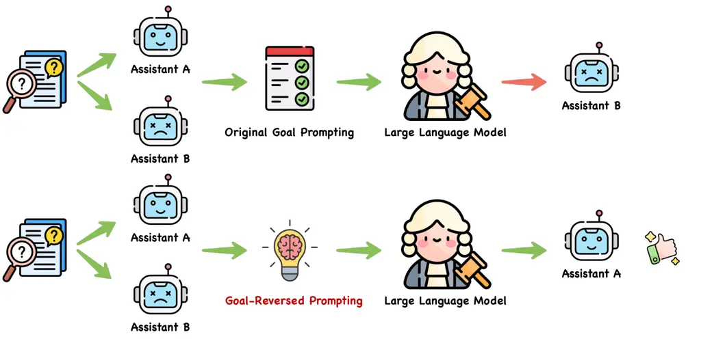

# GRP: Goal-Reversed Prompting for Zero-Shot Evaluation with LLMs

Mingyang Song    Mao Zheng    Xuan Luo Affiliation: Tencent, China
Email: [nickmysong@tencent.com](mailto:)

###### Abstract

Pairwise LLM-as-a-judge evaluation asks the judge to identify the
_better_ of two candidate answers. We study a one-line modification that
asks for the _worse_ answer instead and recovers the preference by
elimination, a procedure we call Goal-Reversed Prompting (GRP). GRP
introduces no extra inference rounds, composes with any prompt template
(direct, chain-of-thought, or Arena-Hard SOP), and leaves the rest of
the evaluation pipeline untouched. Two observations motivate the
reversal. Reverse reasoning is a recurring strategy in human problem
solving, and modern instruction-tuned judges exhibit a positive-leaning
bias that asking for the worse answer can counteract. On JudgeBench
under a strict consistency protocol that counts a judgment as correct
only when both response orderings agree with the gold preference, GRP
improves all three closed-source judges we test across both
response-pair sources. With GPT-4o-generated pairs, the Arena-Hard SOP
baseline improves from 61.71% to 66.23% for GPT-4o (+4.52) and from
60.00% to 66.00% for Claude-3.5-Sonnet (+6.00), with the largest
absolute gains on Reasoning and Mathematics. The lift persists when
response pairs come from Claude-3.5-Sonnet and when the SOP scaffolding
is stripped to a minimal direct-prompting template, suggesting that goal
reversal acts on the underlying judging behavior rather than on a
particular rubric. Stronger judges benefit more than weaker ones,
suggesting that goal reversal exposes additional reasoning capacity
rather than compensating for its absence.

|     |
| --- |
|     |

## 1 Introduction

LLM-as-a-judge evaluation has become a common substitute for human
preference judgments because collecting annotations at the scale that
modern training pipelines require is slow and expensive (Zheng et al.,
2023; Tan et al., 2024). The dominant instantiation is _pairwise_
judgment, where a judge model reads a user prompt together with two
candidate answers and returns a preference (Zheng et al., 2023; Wang et
al., 2023). A large body of work has examined failure modes of such
judges, including positional bias, self-preference, and verbosity bias
(Wang et al., 2023; Chen et al., 2024a; Song et al., 2025), and has
proposed corrections that act on the judging procedure, on the judge’s
training data, or on post-hoc aggregation.

This work starts from a different angle. Rather than modifying the judge
or the aggregation, we revisit a small and usually unexamined choice
inside the prompt itself, the direction in which the judge is asked to
state its preference. The standard phrasing asks the judge to identify
the _better_ answer. We ask whether requesting the _worse_ answer and
recovering the preference by elimination behaves differently under an
otherwise identical protocol. We call this procedure Goal-Reversed
Prompting (GRP).

Two independent observations motivate the reversal. Reverse reasoning is
a recurring strategy in human problem solving, particularly in
mathematics and decision making where the weaker option has a more
salient flaw than the stronger one has a distinguishing virtue
(Branchini et al., 2021; Chen et al., 2024b). Separately, modern
instruction-tuned LLMs tend toward positive-leaning, agreeable
judgments, and prior work has documented systematic bias toward one side
of a pair (Wang et al., 2023). Asking for the worse answer tests whether
a fraction of pairwise-judge errors comes from the difficulty of
_endorsing_ a winner rather than from the underlying ability to
distinguish the two candidates. We do not claim to disentangle these two
forces here, and treat them as hypotheses that guide our design rather
than as mechanisms to be proved.

To make the comparison fair, we keep everything except the goal sentence
identical between conditions. The judge model, prompt scaffolding, input
candidates, decoding configuration, and order-swap procedure are all
shared. The only textual change is replacing _better_ with _worse_ in
the goal sentence and inverting the two verdict labels. We adopt a
strict consistency protocol in which each instance is evaluated twice
with the two candidate answers swapped, and a judgment counts as correct
only if both trials agree with the gold preference after un-swapping.
Ties and order-dependent flips count as incorrect. Because this protocol
applies uniformly to both conditions, the comparison is
order-of-presentation invariant by construction.

We report results on JudgeBench (Tan et al., 2024), using both its
GPT-4o-generated and Claude-3.5-Sonnet-generated response-pair versions,
and three closed-source judges (GPT-4o, Gemini-1.5-Pro,
Claude-3.5-Sonnet). Under the Arena-Hard SOP template on
GPT-4o-generated pairs, GRP lifts overall accuracy from 61.71% to 66.23%
for GPT-4o, from 57.14% to 59.43% for Gemini-1.5-Pro, and from 60.00% to
66.00% for Claude-3.5-Sonnet. The gains carry over to the
Claude-3.5-Sonnet response-pair version and to a stripped-down
direct-prompting template, where every judge gains 4–5 points overall
despite the absence of the SOP rubric. The absolute gains concentrate on
Reasoning and Mathematics, where the gold preference is closer to a
verifiable correctness signal. The stronger judges (GPT-4o 2024-11-20
and Claude-3.5-Sonnet) benefit more than the weaker one, a pattern
suggesting that reversal leverages reasoning capacity the judge already
possesses. A judge that cannot reliably verify candidate correctness in
the forward direction benefits little from posing the question in
reverse.

## 2 Goal-Reversed Prompting

Figure 1: Pairwise comparison under the original goal (top) and under
the reverse goal (bottom). The two procedures differ only in the final
question posed to the judge and the label that encodes the verdict.

### 2.1 Setup

A pairwise judgment instance consists of a user prompt $`x`$ and two
candidate answers $`a`$ and $`b`$. A judge model $`J`$, conditioned on a
template $`T`$, outputs a verdict in $`\{a{>}b,b{>}a,a{=}b\}`$. The
standard _original-goal_ template $`T_{\mathrm{orig}}`$ instructs $`J`$
to identify the _better_ answer. We define the _reverse-goal_ template
$`T_{\mathrm{rev}}`$ as $`T_{\mathrm{orig}}`$ with two local changes:
(i) the goal sentence asks which answer is _worse_, and (ii) the verdict
labels are inverted, so that “Assistant A is worse: \[\[B$`>`$A\]\]”
replaces “Assistant A is better: \[\[A$`>`$B\]\]”. Everything else
remains identical.

To reduce positional bias (Zheng et al., 2023; Wang et al., 2023), each
instance is evaluated twice with $`a`$ and $`b`$ swapped. A judgment is
_consistent_ if the two trials agree after un-swapping. Inconsistent
verdicts and ties are marked incorrect. This protocol is stricter than
the original JudgeBench reporting and applies identically to both
$`T_{\mathrm{orig}}`$ and $`T_{\mathrm{rev}}`$.

### 2.2 Three Template Variants

We instantiate GRP on three template families to test how it interacts
with prompt scaffolding:

- •
  Direct. The judge is asked to pick the better (resp. worse) answer
  with no chain-of-thought and no scoring rubric.
- •
  CoT. The judge is additionally instructed to think step by step before
  producing a verdict.
- •
  SOP (Arena-Hard). The judge is given a structured rubric. It first
  generates its own reference answer, then compares both candidate
  answers against it, evaluates helpfulness, relevance and conciseness,
  and finally outputs the verdict (Tan et al., 2024).

Table 1 shows all three variants under the reverse goal. The
original-goal counterparts follow the same surface edit in reverse and
are listed in Appendix A.

| Direct prompting (reverse goal)                                                                                                                                                                                                                                                                                                                                                                                                                                                                                                                                                                                                                                                                                                           |
| ----------------------------------------------------------------------------------------------------------------------------------------------------------------------------------------------------------------------------------------------------------------------------------------------------------------------------------------------------------------------------------------------------------------------------------------------------------------------------------------------------------------------------------------------------------------------------------------------------------------------------------------------------------------------------------------------------------------------------------------- |
| Please act as an impartial judge and evaluate the quality of the responses provided by two AI assistants to the user prompt displayed below. You will be given assistant A’s answer and assistant B’s answer. Your job is to evaluate which assistant’s answer is worse, and output one of the following choices as your final verdict with a label. 1. Assistant A is worse: \[\[B$`>`$A\]\]. 2. Assistant B is worse: \[\[A$`>`$B\]\]. Example output: “My final verdict is Assistant A is worse: \[\[B$`>`$A\]\]”.                                                                                                                                                                                                                     |
| CoT prompting (reverse goal)                                                                                                                                                                                                                                                                                                                                                                                                                                                                                                                                                                                                                                                                                                              |
| Same as above, with an additional final instruction: “Let’s think step by step.”.                                                                                                                                                                                                                                                                                                                                                                                                                                                                                                                                                                                                                                                         |
| Arena-Hard SOP prompting (reverse goal)                                                                                                                                                                                                                                                                                                                                                                                                                                                                                                                                                                                                                                                                                                   |
| Please act as an impartial judge and evaluate the quality of the responses provided by two AI assistants. Your job is to identify which assistant’s answer is worse. Begin by generating your own answer to the prompt before judging the candidates. When evaluating, compare both candidates against your own answer, identify and correct any mistakes, then assess helpfulness, relevance, and conciseness, and finally consider creativity and missing information. After your explanation, output one of the following choices as your final verdict with a label. 1. Assistant A is worse: \[\[B$`>`$A\]\]. 2. Assistant B is worse: \[\[A$`>`$B\]\]. Example output: “My final verdict is Assistant A is worse: \[\[B$`>`$A\]\]”. |
| Inputs (shared across all three variants)                                                                                                                                                                                                                                                                                                                                                                                                                                                                                                                                                                                                                                                                                                 |
| $`\langle`$User Prompt$`\rangle`$ {User-Prompt}                                                                                                                                                                                                                                                                                                                                                                                                                                                                                                                                                                                                                                                                                           |
| $`\langle`$The Start of Assistant A’s Answer$`\rangle`$ {Answer-A} $`\langle`$The End of Assistant A’s Answer$`\rangle`$                                                                                                                                                                                                                                                                                                                                                                                                                                                                                                                                                                                                                  |
| $`\langle`$The Start of Assistant B’s Answer$`\rangle`$ {Answer-B} $`\langle`$The End of Assistant B’s Answer$`\rangle`$                                                                                                                                                                                                                                                                                                                                                                                                                                                                                                                                                                                                                  |

Table 1: Three GRP template variants. Original-goal counterparts are
obtained by replacing every _worse_ with _better_ and inverting the two
verdict labels.

### 2.3 Two Hypotheses

We state two hypotheses about why goal reversal may help, without
attempting to prove either. The experiments in Section 4 probe which
hypothesis better fits the observed pattern of gains.

H1 (rule-out is easier than rule-in). Under the original goal, the judge
must commit to one answer as better. When both candidates are plausible,
this requires reasoning about a fine-grained advantage that may be small
relative to surface variation in style. Under the reverse goal, the
instance is resolved once the judge identifies a single salient flaw in
one candidate. Where the gold preference is closer to a verifiable
correctness signal than to a stylistic preference, ruling one candidate
out is a more direct path to the verdict. The Reasoning and Mathematics
subsets of JudgeBench (Tan et al., 2024) fit this profile, and the lift
we observe is largest on these subsets.

H2 (counteracting positive-leaning bias). Modern instruction-tuned LLMs
are trained to produce helpful, agreeable outputs and tend toward
positive-leaning judgment behavior in pairwise comparison (Zheng et al.,
2023; Wang et al., 2023). The original goal aligns with that tendency
because it asks the judge to endorse a winner. The reverse goal asks the
judge to flag a loser, which does not align with the positive-leaning
default. To the extent that the original-goal error budget includes
over-endorsing weak candidates, flipping the question reduces the
alignment between the bias and the verdict label at no computational
cost. We do not separate H1 and H2 in this paper and leave a clean
ablation (e.g., a setting where both candidates are weak) to future
work.

## 3 Experimental Setup

#### Benchmark.

We use JudgeBench (Tan et al., 2024), which evaluates a judge’s ability
to identify the objectively better of two candidate answers. We test on
two response-pair sources, the GPT-4o version (350 instances across 154
Knowledge, 98 Reasoning, 56 Math, 42 Coding) and the Claude-3.5-Sonnet
version (270 instances across 154 Knowledge, 51 Reasoning, 34 Math, 31
Coding). Following JudgeBench, we report accuracy per category and an
overall score.

#### Judges.

Our main results use three closed-source judges accessed through their
official APIs: GPT-4o (versions 2024-05-13, 2024-11-20), Gemini-1.5-Pro
(versions 001, 002), and Claude-3.5-Sonnet (2024-06-20). We additionally
report GPT-4o-mini (2024-07-18), Gemini-1.5-Flash (001), and
Claude-3-Haiku (2024-03-07) under the original goal re-evaluated with
our strict protocol, but omit reverse-goal runs because their baselines
are weak.

#### Decoding.

All judges use greedy decoding (temperature $`=0`$) for reproducibility.
We do not impose a length limit beyond the API default.

#### Strict consistency protocol.

As defined in Section 2, each instance is evaluated twice with response
order swapped, and only judgments that agree on both trials count as
correct. This protocol is stricter than that of Tan et al. (2024), which
is one reason some original-goal numbers we report differ from theirs
(marked ^(†)).

## 4 Results and Analysis

### 4.1 Main Results

|                                    |            |           |           |       |        |         |
| ---------------------------------- | ---------- | --------- | --------- | ----- | ------ | ------- |
| LLMs                               | Version    | Knowledge | Reasoning | Math  | Coding | Overall |
| SOP prompting (original goal)      |            |           |           |       |        |         |
| GPT-4o-mini^(†)                    | 2024-07-18 | 46.75     | 42.86     | 66.07 | 42.86  | 48.29   |
| GPT-4o^(†)                         | 2024-05-13 | 46.10     | 48.98     | 62.50 | 52.38  | 50.29   |
| GPT-4o                             | 2024-11-20 | 61.04     | 56.12     | 73.21 | 61.90  | 61.71   |
| Gemini-1.5-Flash^(†)               | 001        | 26.62     | 20.41     | 30.36 | 9.52   | 23.43   |
| Gemini-1.5-Pro^(†)                 | 001        | 45.45     | 37.76     | 55.36 | 9.52   | 40.57   |
| Gemini-1.5-Pro                     | 002        | 57.79     | 52.04     | 71.43 | 47.62  | 57.14   |
| Claude-3-Haiku^(†)                 | 2024-03-07 | 20.78     | 14.29     | 16.07 | 2.38   | 16.00   |
| Claude-3.5-Sonnet^(†)              | 2024-06-20 | 59.74     | 62.24     | 60.71 | 54.76  | 60.00   |
| SOP prompting (reverse goal, ours) |            |           |           |       |        |         |
| GPT-4o                             | 2024-11-20 | 68.18     | 61.22     | 71.43 | 63.81  | 66.23   |
| Gemini-1.5-Pro                     | 002        | 56.49     | 59.18     | 76.79 | 47.62  | 59.43   |
| Claude-3.5-Sonnet                  | 2024-06-20 | 62.99     | 66.32     | 76.79 | 61.90  | 66.00   |

Table 2: JudgeBench accuracy with response pairs generated by GPT-4o.
^(†) rows are re-evaluated under our strict two-trial protocol. Bold
marks the best per column among the three reverse-goal judges.

Table 2 reports results on the GPT-4o response pairs. All three judges
improve overall when the goal is reversed: GPT-4o (2024-11-20) moves
from 61.71% to 66.23% (+4.52), Gemini-1.5-Pro (002) from 57.14% to
59.43% (+2.29), and Claude-3.5-Sonnet (2024-06-20) from 60.00% to 66.00%
(+6.00). The largest absolute gains appear on Mathematics and Reasoning,
where the gold preference is closer to a verifiable correctness signal.
Gemini-1.5-Pro and Claude-3.5-Sonnet both reach 76.79 on Math under the
reverse goal (+5.36 and +16.08 over their respective baselines), and
Reasoning improves from 62.24 to 66.32 (+4.08) for Claude-3.5-Sonnet.
Coding gains are modest for GPT-4o (+1.91) and roughly flat for the
other two judges, whose SOP baselines on that subset are already low.

A second pattern concerns judge strength. GPT-4o and Claude-3.5-Sonnet,
the two strongest judges under the original goal, also gain most from
the reversal (+4.52 and +6.00), while Gemini-1.5-Pro starts lower and
gains less (+2.29). This gradient supports the hypothesis that reversal
amplifies existing reasoning ability rather than compensating for its
absence. A judge that cannot reliably verify candidate correctness in
the forward direction gains little from asking the question backwards.

### 4.2 Robustness to the Response-Pair Source

Figure 2: JudgeBench overall accuracy with response pairs generated by
Claude-3.5-Sonnet. The reverse goal shifts every judge upward.
Claude-3.5-Sonnet, also the response-pair generator here, has the lowest
accuracy, consistent with reported self-preference bias (Zheng et al.,
2023; Wang et al., 2023).

When response pairs are generated by Claude-3.5-Sonnet instead of
GPT-4o, the reverse goal still yields a positive shift for every judge
(+0.74 for GPT-4o, +6.00 for Gemini-1.5-Pro, +1.85 for
Claude-3.5-Sonnet, as shown in Figure 2). Claude-3.5-Sonnet has the
lowest absolute accuracy on this version, where it is also the response
generator, a pattern consistent with prior reports of self-preference
bias (Zheng et al., 2023; Wang et al., 2023). Its reverse-goal lift is
the smallest of the three, though still positive, suggesting that goal
reversal does not remove the self-preference cue but rather competes
with it.

### 4.3 Effect of the Prompt Scaffolding

Figure 3: Direct prompting on JudgeBench with GPT-4o-generated response
pairs. Removing the SOP scaffolding lowers absolute accuracy for every
judge, yet the reverse-goal lift remains positive across all three
(+4.29, +4.79, +4.57).

A natural question is whether the gain depends on the Arena-Hard SOP
rubric. Stripping the scaffolding to a minimal direct-prompting template
lowers absolute accuracy for all three judges, as expected, but the
reverse-goal lift persists at +4 to +5 points per judge (Figure 3).
Together with the robustness results above, this indicates that goal
reversal acts on the underlying judging behavior and is largely
orthogonal to template engineering.

### 4.4 Where the Gains Come From

Across Table 2 and Figures 2–3, gains concentrate on Mathematics and
Reasoning rather than Knowledge or Coding. We lack a controlled
experiment that isolates the cause, but two observations suggest partial
explanations. First, on Math and Reasoning the gold label reflects
objectively verifiable correctness. Identifying a concrete error in the
worse answer is a more direct path to the verdict than arguing why the
better answer is preferable, and goal reversal foregrounds exactly this
error-finding mode. Second, the strict consistency protocol penalizes
order-dependent judgments, and reversing the goal appears to reduce the
fraction of inconsistent verdicts (consistency rates in Appendix B). The
two effects are confounded in our current design, and disentangling them
remains future work.

## 5 Related Work

#### LLM-as-a-judge.

LLM-based pairwise evaluation is widely used for ranking model outputs
(Zheng et al., 2023; Tan et al., 2024; Koo et al., 2023; Liusie et al.,
2023; Liu et al., 2023; Zhu et al., 2023; Lu et al., 2023; Fu et al.,
2023). Follow-up work has documented failure modes such as positional
bias, self-preference, and verbosity bias (Wang et al., 2023; Chen et
al., 2024a; Song et al., 2025). GRP does not propose a new judge
architecture or a new debiasing mechanism, and composes with existing
prompt templates unchanged. It shows that a single surface edit to the
goal sentence moves consistent-pairwise accuracy on JudgeBench upward
across three judges.

#### Reverse and contrastive thinking.

Reverse reasoning has been studied in math problem solving and
verification, where reasoning backward from an answer can detect errors
that forward reasoning misses (Branchini et al., 2021; Chen et al.,
2024b). GRP differs in that it does not prompt the judge to reason in
reverse internally but only inverts the final question it is asked to
answer. We treat the link to reverse reasoning as motivating analogy
rather than claimed mechanism.

#### Prompt-template engineering for evaluation.

Arena-Hard (Tan et al., 2024) and follow-up work design SOP-style
templates that ask the judge to generate a reference answer before
evaluating candidates. GRP is complementary to template design rather
than competitive with it. Every result in this paper uses Arena-Hard as
the underlying SOP, and the reverse-goal lift persists when the SOP is
stripped to a minimal direct-prompting template (Figure 3).

## 6 Conclusion

This paper studies a small change to the dominant pairwise
LLM-as-a-judge protocol, replacing the standard request to identify the
_better_ answer with a request to identify the _worse_ answer, and
recovering the preference by elimination. The change is a literal
surface edit on the prompt template, compatible with any existing
judging stack, including chain-of-thought and Arena-Hard SOP rubrics.
The results are consistent across three axes of variation. Goal reversal
improves the strict consistent-pairwise accuracy of GPT-4o,
Gemini-1.5-Pro, and Claude-3.5-Sonnet on JudgeBench, and the lift
survives when the response-pair generator is changed from GPT-4o to
Claude-3.5-Sonnet and when the SOP scaffolding is stripped to a minimal
direct-prompting template. The absolute gains concentrate on Reasoning
and Mathematics, where correctness is objectively verifiable, and the
stronger judges gain more from the reversal than the weaker ones. We do
not attempt to disentangle whether the gains arise because rule-out is
easier than rule-in, because asking for the worse answer counteracts a
positive-leaning bias, or both. What the experiments do support is a
narrower, practical claim. Goal reversal is a cheap, broadly applicable
default for pairwise LLM judges that stacks with existing prompt
engineering at no additional cost.

## Limitations

Our experiments cover three closed-source judges and two response-pair
sources from JudgeBench. Results for open-weight judges (e.g.,
Llama-3.x-70B-Instruct, Qwen2.5-72B, DeepSeek-V3) would help separate
the effect of goal reversal from properties of proprietary training data
and are the most natural extension. The strict consistency protocol
counts ties and order-inconsistent verdicts as incorrect, and we have
not isolated how much of the GRP gain comes from a higher agreement rate
versus a higher per-trial accuracy. Benchmark coverage is limited to
JudgeBench’s four categories (Knowledge, Reasoning, Math, Coding).
Domains where the worse answer is harder to flag than the better one,
such as creative writing or open-ended chat, may behave differently and
are not addressed here.

## Ethics Statement

This paper studies prompting recipes for LLM-based evaluation and does
not involve human-subject data or new pretraining. JudgeBench (Tan et
al., 2024) is a public benchmark used as released. GRP is a surface
modification to existing LLM-as-a-judge templates and does not introduce
capabilities beyond what those templates already enable.

## References

- Branchini et al. (2021) E. Branchini, E. Capitani, R. Burro, U.
  Savardi, and I. Bianchi Opposites in reasoning processes: do we use
  them more than we think, but less than we could?. Frontiers in
  Psychology 12. External Links:
  [Link](https://www.frontiersin.org/journals/psychology/articles/10.3389/fpsyg.2021.715696),
  [Document](https://dx.doi.org/10.3389/fpsyg.2021.715696), ISSN
  1664-1078 Cited by: §1, §5.
- Chen et al. (2024a) G. H. Chen, S. Chen, Z. Liu, F. Jiang, and B. Wang
  Humans or llms as the judge? A study on judgement biases. CoRR
  abs/2402.10669. External Links:
  [Link](https://doi.org/10.48550/arXiv.2402.10669),
  [Document](https://dx.doi.org/10.48550/ARXIV.2402.10669), 2402.10669
  Cited by: §1, §5.
- Chen et al. (2024b) J. C. Chen, Z. Wang, H. Palangi, R. Han, S.
  Ebrahimi, L. T. Le, V. Perot, S. Mishra, M. Bansal, C. Lee, and T.
  Pfister Reverse thinking makes llms stronger reasoners. CoRR
  abs/2411.19865. External Links:
  [Link](https://doi.org/10.48550/arXiv.2411.19865),
  [Document](https://dx.doi.org/10.48550/ARXIV.2411.19865), 2411.19865
  Cited by: §1, §5.
- Fu et al. (2023) X. Fu, Md. T. R. Laskar, C. Chen, and S. B. TN Are
  large language models reliable judges? A study on the factuality
  evaluation capabilities of llms. CoRR abs/2311.00681. External Links:
  [Link](https://doi.org/10.48550/arXiv.2311.00681),
  [Document](https://dx.doi.org/10.48550/ARXIV.2311.00681), 2311.00681
  Cited by: §5.
- Koo et al. (2023) R. Koo, M. Lee, V. Raheja, J. I. Park, Z. M. Kim,
  and D. Kang Benchmarking cognitive biases in large language models as
  evaluators. CoRR abs/2309.17012. External Links:
  [Link](https://doi.org/10.48550/arXiv.2309.17012),
  [Document](https://dx.doi.org/10.48550/ARXIV.2309.17012), 2309.17012
  Cited by: §5.
- Liu et al. (2023) Y. Liu, N. S. Moosavi, and C. Lin LLMs as
  narcissistic evaluators: when ego inflates evaluation scores. CoRR
  abs/2311.09766. External Links:
  [Link](https://doi.org/10.48550/arXiv.2311.09766),
  [Document](https://dx.doi.org/10.48550/ARXIV.2311.09766), 2311.09766
  Cited by: §5.
- Liusie et al. (2023) A. Liusie, P. Manakul, and M. J. F. Gales
  Zero-shot NLG evaluation through pairware comparisons with llms. CoRR
  abs/2307.07889. External Links:
  [Link](https://doi.org/10.48550/arXiv.2307.07889),
  [Document](https://dx.doi.org/10.48550/ARXIV.2307.07889), 2307.07889
  Cited by: §5.
- Lu et al. (2023) Q. Lu, B. Qiu, L. Ding, L. Xie, and D. Tao Error
  analysis prompting enables human-like translation evaluation in large
  language models: A case study on chatgpt. CoRR abs/2303.13809.
  External Links: [Link](https://doi.org/10.48550/arXiv.2303.13809),
  [Document](https://dx.doi.org/10.48550/ARXIV.2303.13809), 2303.13809
  Cited by: §5.
- Song et al. (2025) M. Song, M. Zheng, and X. Luo Can many-shot
  in-context learning help LLMs as evaluators? a preliminary empirical
  study. In Proceedings of the 31st International Conference on
  Computational Linguistics, O. Rambow, L. Wanner, M. Apidianaki, H.
  Al-Khalifa, B. D. Eugenio, and S. Schockaert (Eds.), Abu Dhabi, UAE,
  pp. 8232–8241. External Links:
  [Link](https://aclanthology.org/2025.coling-main.548/) Cited by: §1,
  §5.
- Tan et al. (2024) S. Tan, S. Zhuang, K. Montgomery, W. Y. Tang, A.
  Cuadron, C. Wang, R. A. Popa, and I. Stoica JudgeBench: A benchmark
  for evaluating llm-based judges. CoRR abs/2410.12784. External Links:
  [Link](https://doi.org/10.48550/arXiv.2410.12784),
  [Document](https://dx.doi.org/10.48550/ARXIV.2410.12784), 2410.12784
  Cited by: §1, §1, 3rd item, §2.3, §3, §3, §5, §5, Ethics Statement.
- Wang et al. (2023) P. Wang, L. Li, L. Chen, D. Zhu, B. Lin, Y. Cao, Q.
  Liu, T. Liu, and Z. Sui Large language models are not fair evaluators.
  CoRR abs/2305.17926. External Links:
  [Link](https://doi.org/10.48550/arXiv.2305.17926),
  [Document](https://dx.doi.org/10.48550/ARXIV.2305.17926), 2305.17926
  Cited by: §1, §1, §2.1, §2.3, Figure 2, §4.2, §5.
- Zheng et al. (2023) L. Zheng, W. Chiang, Y. Sheng, S. Zhuang, Z.
  Wu, Y. Zhuang, Z. Lin, Z. Li, D. Li, E. Xing, H. Zhang, J. E.
  Gonzalez, and I. Stoica Judging llm-as-a-judge with mt-bench and
  chatbot arena. In Advances in Neural Information Processing
  Systems, A. Oh, T. Naumann, A. Globerson, K. Saenko, M. Hardt, and S.
  Levine (Eds.), Vol. 36, pp. 46595–46623. External Links:
  [Link](https://proceedings.neurips.cc/paper_files/paper/2023/file/91f18a1287b398d378ef22505bf41832-Paper-Datasets_and_Benchmarks.pdf)
  Cited by: §1, §2.1, §2.3, Figure 2, §4.2, §5.
- Zhu et al. (2023) L. Zhu, X. Wang, and X. Wang JudgeLM: fine-tuned
  large language models are scalable judges. CoRR abs/2310.17631.
  External Links: [Link](https://doi.org/10.48550/arXiv.2310.17631),
  [Document](https://dx.doi.org/10.48550/ARXIV.2310.17631), 2310.17631
  Cited by: §5.

## Appendix A Full Template Variants

The CoT variant replaces the SOP rubric in Table 1 with the instruction
“Let’s think step by step.” The direct variant removes both the rubric
and the CoT cue, keeping only the goal sentence and verdict labels. For
each variant, the original-goal counterpart replaces “worse” with
“better” and inverts the two verdict labels.

## Appendix B Order-Consistency Rates

We report the fraction of JudgeBench instances on which the two trials
of a given judge agree (after un-swapping response order), separately
under the original goal and the reverse goal. Across all judge–template
combinations the reverse-goal condition tends to produce a higher
agreement rate, and part of the overall accuracy gain reported in
Section 4 can be attributed to fewer order-inconsistent verdicts. Full
tables are provided in the supplementary material.
