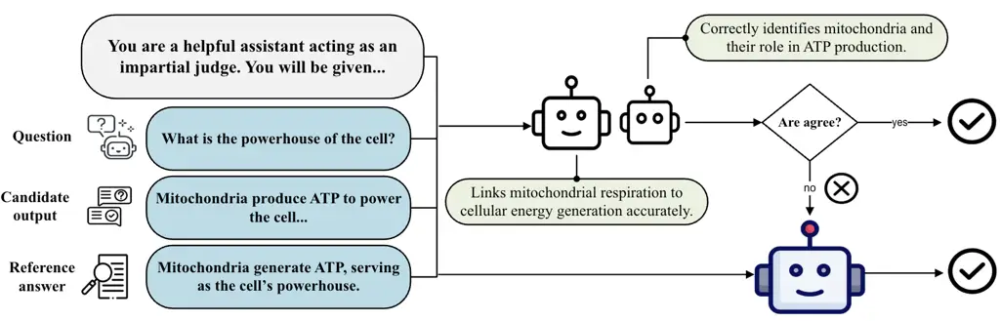
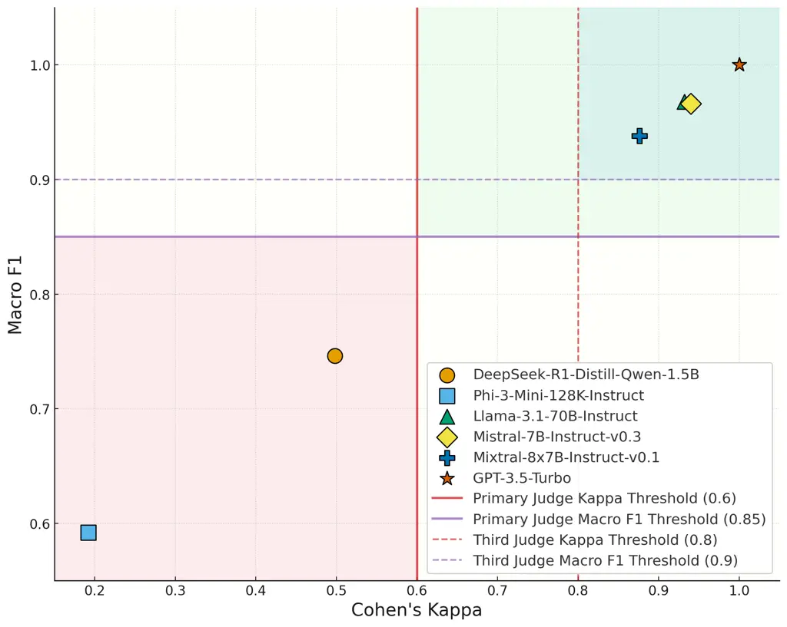
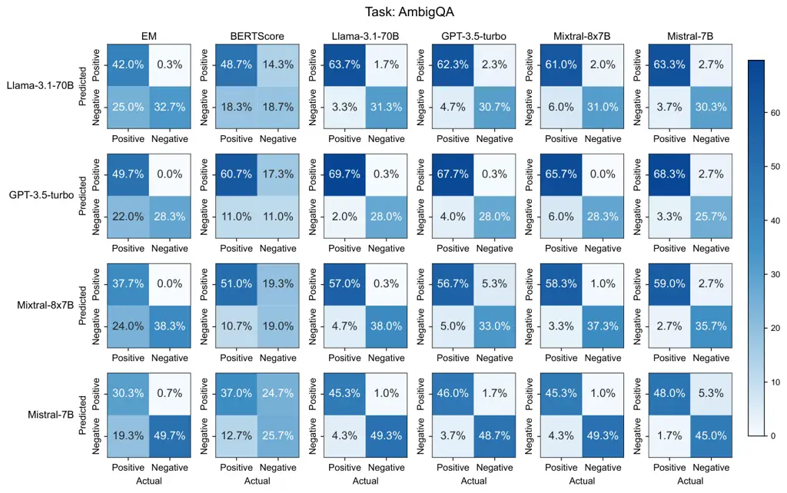
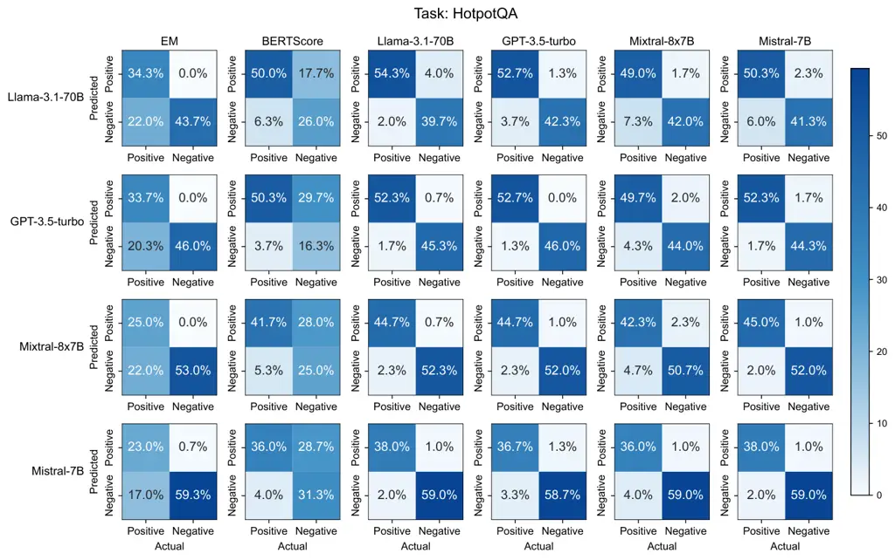
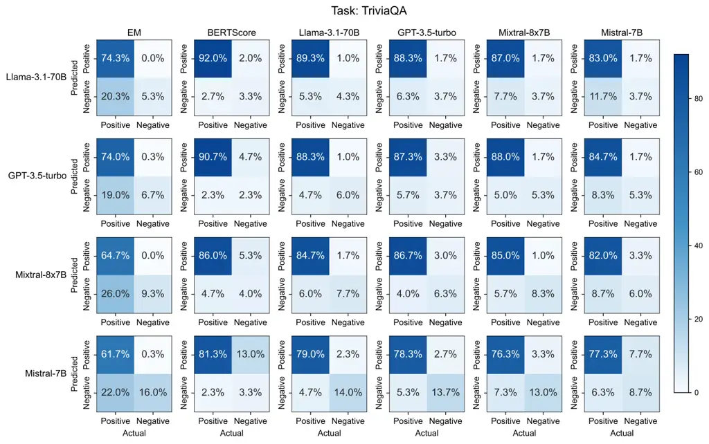

# CLEV: LLM-Based Evaluation Through Lightweight Efficient Voting for Free-Form Question-Answering

Sher Badshah Affiliation: Dalhousie University
Email: [sh545346@dal.ca](mailto:)    Moamen Moustafa
Affiliation: Alamein International University
Email: [hsajjad@dal.ca](mailto:)    Hassan Sajjad Affiliation: Dalhousie
University Email: [mmoustafa@aiu.edu.eg](mailto:)

###### Abstract

Evaluating free-form Question-Answering (QA) remains a challenge due to
its diverse and open-ended nature. Traditional automatic metrics fail to
capture semantic equivalence or accommodate the variability of
open-ended responses. Leveraging Large Language Models (LLMs) as
evaluators offers a promising alternative due to their strong language
understanding and instruction-following capabilities. We propose the
Consensus via Lightweight Efficient Voting (CLEV), which employs two
primary LLMs as judges and engages a third judge only in cases of
disagreement. This approach prioritizes evaluation reliability while
reducing unnecessary computational demands. Through experiments,
including human evaluation, we demonstrate CLEV’s ability to provide
consistent, scalable, and resource-efficient assessments, establishing
it as a robust framework for evaluating LLMs on free-form QA.

## 1 Introduction

One of the practical limitations in evaluating free‑form
Question‑Answering (QA) is the lexical–semantic mismatch between Large
Language Model (LLM) outputs and the reference answers. For the query
“Who wrote 1984?”, a dataset may list simply “George Orwell”, while a
helpful model replies: “It was penned by the British author Eric Arthur
Blair.” Although both refer to the same person, there is no surface
token overlap, so lexical-matching and even embedding-based metrics
assign it an unduly low score. For instance, Exact Match (EM) requires
strict lexical alignment (e.g., failing to equate “nuclear weapon” and
“atomic bomb”) and ignores semantic equivalence (Doostmohammadi et al.,
2024).

A reference-aware LLM-as-a-judge can instead reason over meaning,
recognize that the candidate entails the gold fact, and deliver a
verdict, thereby overcoming this lexical–semantic gap (Zheng et al.,
2024; Verga et al., 2024). Existing studies using LLM as judges
primarily focus on subjective pairwise comparison (Wang et al., 2023b;
Vu et al., 2024) and single-answer scoring (Chiang and Lee, 2023; Hu et
al., 2024a; Liu et al., 2023). However, objective evaluation using LLM
judges, particularly for free-form QA, has received limited attention.
Furthermore, LLM-based judging also lies on a cost–quality spectrum.
Querying a single judge is efficient but is less reliable due to the
known limitations, such as prompt sensitivity, inconsistency, and bias
(Ye et al., 2024), as no individual model captures the full diversity of
reasoning styles, long-tail knowledge, and user values (Feng et al.,
2025). To improve robustness, some studies employ fixed ensembles of
three or more LLM judges and aggregate their decisions via majority
voting (Badshah and Sajjad, 2025; Verga et al., 2024). While this
improves reliability, it increases computational cost and
latency (Badshah and Sajjad, 2024), limiting scalability for large-scale
evaluation (Jung et al., 2024; Adlakha et al., 2024).

To address these trade-offs, we propose the Consensus via Lightweight
Efficient Voting (CLEV) that balances the reliability and efficiency of
using LLMs as judges for free-form QA. CLEV employs two primary judges
for initial assessments and invokes a third judge only when
disagreements occur. By minimizing redundant calls in the fixed
three-judge majority vote setting, CLEV reduces computational overhead
by roughly 80 to 95% (varying by task) while achieving substantial to
perfect agreement. Our key contributions include: 1) establishing a
principled LLM-as-a-judge evaluation setup for free-form QA that moves
beyond token-level string matching metrics, 2) proposing CLEV, a
lightweight consensus-based evaluation method that preserves the
reliability of multi-judge voting while significantly reducing
computational cost, 3) empirically validating CLEV across diverse QA
datasets and multiple state-of-the-art LLMs, and 4) systematic analysis
of failure cases.



Figure 1: Our proposed Consensus via Lightweight Efficient Voting.

## 2 Methodology

This section outlines the core components of our evaluation framework.
Given a question and a candidate model’s answer, the evaluation task is
to determine whether the answer is factually correct with respect to a
reference. Because free-form QA requires an objective correctness
decision rather than scalar scoring, we prompt LLM judges to return a
binary verdict along with a brief rationale explaining their judgment.
The verdict serves as the evaluation signal, while the rationale
provides interpretability and supports later analysis.

### 2.1 Consensus via Lightweight Efficient Voting (CLEV)

In traditional human evaluation settings, when two annotators disagree
on a judgment, a third expert is often called upon to resolve the
dispute. Drawing inspiration from this efficient practice, we propose
CLEV. As illustrated in Figure 1, rather than immediately employing
three LLMs, CLEV adopts an efficient approach by beginning with two
models as primary judges. When these judges reach a consensus, no
further evaluation is needed. Only in cases of disagreement, the third
LLM is engaged, whose decision then creates a majority verdict.

### 2.2 Judges inclusion and exclusion criteria

To systematically select suitable judges for CLEV, we evaluate various
LLMs (see Figure 2) using 100 random instances from HotpotQA. For each
model, we compare binary verdicts against human annotations and compute
Cohen’s Kappa ($`\kappa`$) and Macro F1. We interpret $`\kappa`$
following the commonly used guideline where values between
$`0.61`$–$`0.80`$ indicate _substantial agreement_, and values above
$`0.80`$ indicate *near-perfect agreement* (McHugh, 2012). However,
since $`\kappa`$ is known to be sensitive to class imbalance (Cicchetti
and Feinstein, 1990), we together consider Macro F1 to ensure balanced
evaluation across both classes:

```math
\text{status}=\begin{cases}\text{primary judges},&\kappa\geq 0.6\ \text{and}\ \text{F1}\geq 0.85,\\[4.0pt]
\text{third judge},&\kappa\geq 0.8\ \text{and}\ \text{F1}\geq 0.9,\\[4.0pt]
\text{excluded},&\text{otherwise}.\end{cases}
```



Figure 2: Judges selection based on the defined criteria in Section 2.2.

## 3 Experiments

We utilize the following settings to evaluate CLEV:

##### Models

Our candidate models includes Llama-3.1 70B (Meta AI, 2024),
GPT-3.5-turbo (Brown et al., 2020), Mistral 7B (Jiang et al., 2023), and
Mixtral 8x7B (Jiang et al., 2024). For judges, Mistral‑7B met our
inclusion criteria ($`\kappa\geq 0.6`$, $`\mathrm{F1}\geq 0.85`$) while
offering low cost and fast inference. Llama‑3.1‑70B, though more
expensive, provided substantial agreement. We therefore use both as
primary judges to capture a range of capabilities (Feng et al., 2025;
Liang et al., 2024; Sun et al., 2024). GPT‑3.5‑turbo serves as the third
judge because it exceeds the required thresholds ($`\kappa\geq 0.8`$,
$`\mathrm{F1}\geq 0.9`$). All models are run with temperature 0 to
ensure reproducibility, as higher temperatures degrade evaluator
reliability (Hada et al., 2024).

##### Datasets

We utilize four datasets: AmbigQA (Min et al., 2020), HotpotQA (Yang et
al., 2018), Natural Questions (Kwiatkowski et al., 2019),
TriviaQA (Joshi et al., 2017). We only utilize FreshQA to evaluate the
judge’s ability to detect outdated information. See Appendix A for
details.

##### Prompts

We design minimal zero-shot role-playing prompts (Kong et al., 2024) for
both candidate and judge LLMs. The judge LLM is instructed to return a
binary verdict with a brief explanation, which reduces subjectivity and
simplifies automatic evaluation (see Appendix F).

##### Baselines

We compare individual LLM judges and CLEV against EM, BERTScore (Zhang
et al., 2020) computed with microsoft/deberta-xlarge-mnli and
thresholded at $`\tau=0.5`$ to yield binary decisions and majority
voting, which always invokes a fixed setup of LLM judges and returns the
model verdict (see Appendix B).

##### Human evaluation

We invite three volunteer graduate students from our lab to act as
annotators. We provided the questions, reference answers, and candidate
LLM responses, without information about model identity, to avoid bias.
Each response is scored on a binary scale based on correctness and
relevance (see Appendix C).

##### Evaluation metrics

We compute Fleiss’ Kappa ($`\kappa`$) (Fleiss and Cohen, 1973) and
percent agreement to measure inter-rater reliability among human
annotators. To compare evaluators with humans, we calculate Cohen’s
Kappa (McHugh, 2012) against the human majority on an instance level.
Because of class imbalance, kappa can appear low despite high
agreement (Cicchetti and Feinstein, 1990). Therefore, we also frame the
task as binary classification and report Macro-F1 scores.

## 4 Results

In this section, we briefly report the results and refer the readers to
Appendix E for detailed results.

|         |          |                                                                |               |               |               |               |               |               |             |
| ------- | -------- | -------------------------------------------------------------- | ------------- | ------------- | ------------- | ------------- | ------------- | ------------- | ----------- |
|         |          | Evaluators (Cohen’s $`\kappa`$ \[Macro-F1\] vs Human Majority) |               |               |               |               |               |               |             |
| Candid. | Tasks    | EM                                                             | BERTScore     | Llama         | GPT           | Mistral       | MV            | CLEV          | Disagr. (%) |
| Llama   | AmbigQA  | 0.52 \[0.74\]                                                  | 0.28 \[0.64\] | 0.89 \[0.94\] | 0.84 \[0.92\] | 0.86 \[0.93\] | 0.91 \[0.96\] | 0.91 \[0.96\] | 10.0        |
|         | HotpotQA | 0.58 \[0.78\]                                                  | 0.50 \[0.75\] | 0.88 \[0.94\] | 0.90 \[0.95\] | 0.83 \[0.92\] | 0.95 \[0.98\] | 0.95 \[0.98\] | 13.0        |
|         | NQ-Open  | 0.38 \[0.65\]                                                  | 0.44 \[0.72\] | 0.83 \[0.92\] | 0.79 \[0.90\] | 0.74 \[0.87\] | 0.93 \[0.96\] | 0.92 \[0.96\] | 18.0        |
|         | TriviaQA | 0.28 \[0.61\]                                                  | 0.56 \[0.78\] | 0.55 \[0.77\] | 0.44 \[0.72\] | 0.30 \[0.64\] | 0.68 \[0.84\] | 0.68 \[0.84\] | 17.0        |
| GPT     | AmbigQA  | 0.56 \[0.79\]                                                  | 0.25 \[0.62\] | 0.94 \[0.97\] | 0.90 \[0.95\] | 0.85 \[0.93\] | 0.97 \[0.98\] | 0.96 \[0.98\] | 7.0         |
|         | HotpotQA | 0.60 \[0.79\]                                                  | 0.30 \[0.62\] | 0.95 \[0.98\] | 0.97 \[0.99\] | 0.93 \[0.97\] | 0.99 \[0.99\] | 0.98 \[0.99\] | 5.7         |
|         | NQ-Open  | 0.45 \[0.70\]                                                  | 0.22 \[0.61\] | 0.88 \[0.94\] | 0.82 \[0.91\] | 0.83 \[0.91\] | 0.96 \[0.98\] | 0.95 \[0.98\] | 13.0        |
|         | TriviaQA | 0.34 \[0.65\]                                                  | 0.36 \[0.68\] | 0.65 \[0.82\] | 0.40 \[0.70\] | 0.47 \[0.73\] | 0.81 \[0.90\] | 0.77 \[0.89\] | 15.7        |
| Mixtral | AmbigQA  | 0.55 \[0.76\]                                                  | 0.34 \[0.67\] | 0.90 \[0.95\] | 0.78 \[0.89\] | 0.89 \[0.94\] | 0.98 \[0.99\] | 0.95 \[0.98\] | 9.0         |
|         | HotpotQA | 0.55 \[0.76\]                                                  | 0.35 \[0.66\] | 0.94 \[0.97\] | 0.93 \[0.97\] | 0.94 \[0.97\] | 0.97 \[0.99\] | 0.97 \[0.99\] | 4.7         |
|         | NQ-Open  | 0.37 \[0.65\]                                                  | 0.30 \[0.65\] | 0.88 \[0.94\] | 0.73 \[0.86\] | 0.82 \[0.91\] | 0.97 \[0.98\] | 0.91 \[0.96\] | 13.0        |
|         | TriviaQA | 0.32 \[0.63\]                                                  | 0.39 \[0.70\] | 0.63 \[0.81\] | 0.61 \[0.80\] | 0.44 \[0.72\] | 0.90 \[0.95\] | 0.76 \[0.88\] | 17.0        |
| Mistral | AmbigQA  | 0.60 \[0.79\]                                                  | 0.25 \[0.62\] | 0.89 \[0.95\] | 0.89 \[0.95\] | 0.86 \[0.93\] | 0.95 \[0.98\] | 0.95 \[0.98\] | 11.7        |
|         | HotpotQA | 0.61 \[0.80\]                                                  | 0.38 \[0.67\] | 0.94 \[0.97\] | 0.90 \[0.95\] | 0.94 \[0.97\] | 0.96 \[0.98\] | 0.95 \[0.98\] | 6.0         |
|         | NQ-Open  | 0.48 \[0.73\]                                                  | 0.29 \[0.64\] | 0.85 \[0.93\] | 0.84 \[0.92\] | 0.84 \[0.92\] | 0.95 \[0.98\] | 0.95 \[0.98\] | 14.7        |
|         | TriviaQA | 0.47 \[0.72\]                                                  | 0.24 \[0.61\] | 0.76 \[0.88\] | 0.73 \[0.86\] | 0.47 \[0.74\] | 0.87 \[0.94\] | 0.85 \[0.93\] | 20.3        |

Table 1: Cohen’s Kappa and \[Macro-F1\] scores showing the agreement of
individual evaluators, Majority Vote (MV), and CLEV with human majority
across models and tasks. Disagr. (%) indicates the percentage of
disagreements in the majority voting (Llama+GPT+Mistral), i.e., when the
third judge is called in CLEV.

##### Correlation with human evaluation

As depicted by consistently high Cohen’s kappa in Table 1, CLEV
maintains strong agreement with human evaluation. This represents an
improvement over individual model performance, where individual judges
generally showed varying levels of agreement with human evaluation.

LLM-based evaluators demonstrate strong abilities in recognizing
semantic variations while maintaining the core meaning, especially when
assessing responses that use different terminology or structural
approaches to convey the same information. For instance, evaluators
correctly identified that “Salma Hayek” and “Salma Hayek Pinault” refer
to the same individual, acknowledging the semantic equivalence despite
differences in phrasing. Similarly, when assessing responses that use
different terms for the same entity, such as recognizing “Nick Fury,
Agent of S.H.I.E.L.D.” as part of the broader “Marvel” universe, the
evaluators effectively maintain the core meaning and contextual
relevance. Their explanations show systematic assessment patterns that
combine multiple evaluation criteria (e.g., factual accuracy and
contextual relevance).

CLEV reducing third-judge calls by 80–95% while maintaining the
performance across tasks. As depicted in Table 1, even on TriviaQA,
where disagreement is high, CLEV scores remain in substantial to perfect
agreement.

EM underestimates and BERTScore overestimates. Interestingly, EM
typically accomplishes better correlation with human evaluation on the
instance-level in Table 1 than neural-based BERTScore. EM’s strict
nature leads to lower overall performance, but its high precision
ensures that when it identifies a match, it strongly aligns with human
annotations. In contrast, BERTScore takes a more lenient approach to
semantic matching. As a result, it shows more false positives,
consequently reducing instance-level agreement with human judgments.

### 4.1 Impact of Selective Third Judge

A core benefit of CLEV is that it avoids unnecessary third-judge
evaluations by only invoking a judge when the two primary judges
disagree. Table 2 summarizes the frequency of such escalation events
across five datasets and five candidate LLMs. Across all 7,500 evaluated
instances (300 examples $`\times`$ 5 models $`\times`$ 5 tasks), only
17.6% required a third judge. This reduction is substantial when
compared to the fixed three-judge majority voting setup, which always
incurs 100% of third-judge calls. In other words, CLEV reduces
evaluation overhead by approximately 80–95% while preserving agreement
levels that match majority vote outcomes (see Table 1). Tasks with
stable factual grounding (e.g., HotpotQA) trigger few escalations,
whereas more temporally dynamic datasets like FreshQA show higher
disagreement rates due to shifts in real-world facts.

| Tasks    | Third judge calls (of 1,500) | Rate (%) |
| -------- | ---------------------------- | -------- |
| AmbigQA  | 190                          | 12.7     |
| FreshQA  | 543                          | 36.2     |
| HotpotQA | 120                          | 8.0      |
| NQ-Open  | 212                          | 14.1     |
| TriviaQA | 253                          | 16.9     |
| Total    | 1,318 / 7,500                | 17.6     |

Table 2: Aggregated third-judge usage under CLEV across tasks. Each task
has 1,500 evaluation instances per candidate model (300 examples
$`\times`$ 5 candidate LLMs), and the reported counts sum over all five
models ²² 2 We also included DeepSeek as our fifth model in the
Appendix. See Table 8.. Lower values indicate fewer
disagreement-triggered escalations.

### 4.2 Error analysis

We randomly sampled 100 error cases (50 false positives and 50 false
negatives) from each evaluator to study their behavior. Given EM had 11
false positives, we included all of them in our analysis.

LLMs are prone to hallucination in justification where they fabricate
reasoning to support their evaluations, and produce detailed but
incorrect explanations. In LLM judges, false positives and negatives
often result from overlooking critical distinctions between candidate
LLM outputs and failing to account for the specificity required by the
reference answer. This pattern is particularly noticeable in Mistral 7B,
where the model disregards the ground truth and provides evaluations
influenced by unknown factors. For example, when evaluating candidate
GPT-3.5’s response “The foreign minister of Germany who signed the
Treaty of Versailles was Hermann Müller.” which is correct according to
the reference answer “Hermann Müller” and human evaluation, Mistral 7B
as-a-judge incorrectly marked this response as false and fabricated
reasoning in support of its decision.

Specificity bias occur in some judges. This approach shifts the
evaluation towards false negatives by missing semantically similar but
structurally different answers. We found many cases when such evaluators
failed to account for valid variations in phrasing or granularity,
focusing instead on rigid adherence to the reference answer. Compounding
these issues are reasoning errors within the evaluators’ own
explanations, which often contain overconfident assertions.

We found several temporal limitations in LLM-based evaluators. Despite
using mostly older datasets with up-to-date models, we observed failures
on recent events or evolving contexts. The FreshQA dataset (Vu et al.,
2023), being recent, highlights these temporal limitations. As shown in
Table 3, LLM judges deviate more from human judgment on FreshQA compared
to older datasets like HotpotQA. In dynamic or time-sensitive contexts,
they often hallucinate by marking incorrect responses as True. For
instance, when asked: “On what date did the Patriots last play the Miami
Dolphins?”, the evaluator accepted an outdated answer, “January 1,
2023,” as correct, ignoring the reference “November 24, 2024,” and
justifying its mistake. Because multiple judges rely on this same
outdated parametric knowledge, FreshQA exhibits substantially higher
disagreement between judges, who often converge on answers that were
once correct but no longer reflect the current ground-truth.

|         |            |       |         |       |             |
| ------- | ---------- | ----- | ------- | ----- | ----------- |
|         | Evaluators |       |         |       |             |
| Candid. | Llama      | GPT   | Mistral | CLEV  | Disagr. (%) |
| Llama   | 0.835      | 0.737 | 0.730   | 0.917 | 31.3        |
| GPT     | 0.695      | 0.824 | 0.746   | 0.891 | 44.3        |
| Mixtral | 0.708      | 0.779 | 0.703   | 0.936 | 37.3        |
| Mistral | 0.665      | 0.802 | 0.723   | 0.880 | 39.7        |

Table 3: Macro-F1 of judges on FreshQA and corresponding disagreement
rates. Higher disagreement indicates a more frequent need for a
resolving judge (CLEV).

## 5 Related work

Recent advances in LLMs have unlocked new opportunities for automatic
and context-aware evaluation (Li et al., 2024; Chiang and Lee, 2023;
Zheng et al., 2024). Early work primarily focused on subjective
evaluation tasks, such as pairwise comparison for ranking model outputs
or single-response scoring for open-ended generation (Chan et al., 2024;
Zheng et al., 2024; Chen et al., 2024). These approaches leverage LLMs’
strong language understanding and reasoning capabilities to assess
qualities like coherence, fluency, and helpfulness. However, such
subjective criteria and continuous scoring schemes are less suitable for
evaluating objective QA (Badshah et al., 2025), where free-form answers
are expected to be factually correct with respect to a reference
answer (Krumdick et al., 2025; Shi et al., 2024).

To address this gap, recent work has explored reference-grounded
LLM-as-judge approaches that instruct LLMs to directly verify candidate
answers against gold references and output binary True/False
verdicts (Kamalloo et al., 2023; Wang et al., 2023a). However, this line
of work also highlights key challenges: individual LLM judges can be
inconsistent across questions, may over-rely on parametric knowledge
when references are incomplete, and often require additional judges or
majority voting to stabilize decisions (Khan et al., 2024). Furthermore,
single judges often lack robustness to adversarial inputs and may
hallucinate justifications that appear plausible but are factually
incorrect (Hu et al., 2024b).

To mitigate the reliability issues of single-judge systems, multi-judge
setups have been explored (Badshah and Sajjad, 2025; Verga et al.,
2024). These approaches employ multiple diverse LLM judges and aggregate
their decisions, typically through majority voting, to improve
reliability and alignment with human evaluation. Badshah and Sajjad
(2025) demonstrated that using multiple models reduces individual model
biases and improves agreement with human judgments. However, these
approaches typically rely on fixed ensembles, where all judges are
invoked for every instance, regardless of whether the initial judges
already agree. This design leads to substantial and unnecessary
computational overhead, especially when disagreements are rare. Our work
builds on these foundations that invoke a third judge only when needed,
achieving the reliability benefits of multi-judge voting while saving
compute.

## 6 Conclusion

We studied the challenge of evaluating free-form QA, where traditional
metrics fail to capture semantic correctness and single LLM judges may
be inconsistent. To address this, we introduced CLEV, a lightweight
multi-judge framework that preserves the reliability of majority voting
while avoiding its computational cost. By invoking a third judge only
when necessary, CLEV achieves substantial to near-perfect agreement with
human evaluation while reducing redundant evaluation calls by 80–95%
across tasks. This makes LLM-based evaluation more scalable for
large-scale benchmarking. While our study focuses on binary correctness,
future work can extend CLEV to capture dimensions such as partial
correctness. Looking forward, an important direction is reference-free
evaluation, where judges are supported by external verifiers (e.g.,
retrieval) to assess correctness in settings where explicit references
are lacking.

## 7 Limitations

We acknowledge certain limitations in our study: 1) The accuracy of
evaluations depends on the quality and clarity of reference answers,
which serve as the basis for determining correctness. Incorrect or
ambiguous references could affect evaluation outcomes. 2) While we
conducted an error analysis of LLM judges and automatic metrics, there
may be error cases that were not identified during our manual review,
leaving gaps in understanding the full spectrum of evaluation
inaccuracies. 3) We acknowledge that our current study is limited to
English QA datasets. Extending CLEV to multilingual settings is a
promising and important future direction. 4) Since the evaluation is
binary, which is standard for free-form QA, signals around partial
correctness, fluency, reasoning, and justification are not captured. To
tackle this, we also collected detailed rationales that justify each
verdict. In our analysis, we leveraged these rationales to capture
various insights. We acknowledge the limitation of binary verdicts in
representing partial correctness, but we emphasize that this design
choice reduces the subjectivity inherent in continuous scoring and
promotes clearer agreement between judges. 5) CLEV assumes that primary
judges maintain a minimum reliability threshold (based on $`\kappa`$ and
Macro-F1) established during calibration. These thresholds require
recalibration when adopting new judge models, domains, or languages.
Thus, applying CLEV to new settings may involve additional upfront
calibration cost.

## Acknowledgment

We acknowledge the support of the Natural Sciences and Engineering
Research Council of Canada (NSERC), Canada Foundation for Innovation
(CFI), and Research Nova Scotia. Advanced computing resources are
provided by ACENET, the regional partner in Atlantic Canada, and the
Digital Research Alliance of Canada.

## References

- Adlakha et al. (2024) V. Adlakha, P. BehnamGhader, X. H. Lu, N. Meade,
  and S. Reddy Evaluating correctness and faithfulness of
  instruction-following models for question answering. Transactions of
  the Association for Computational Linguistics 12, pp. 681–699.
  External Links: [Link](https://aclanthology.org/2024.tacl-1.38),
  [Document](https://dx.doi.org/10.1162/tacl%5Fa%5F00667) Cited by: §1.
- Badshah et al. (2025) S. Badshah, A. Emami, and H. Sajjad TALE: a
  tool-augmented framework for reference-free evaluation of large
  language models. Note: arXiv:2504.07385 External Links: 2504.07385,
  [Link](https://arxiv.org/abs/2504.07385) Cited by: §5.
- Badshah and Sajjad (2024) S. Badshah and H. Sajjad Quantifying the
  capabilities of LLMs across scale and precision. Note:
  arXiv:2405.03146 External Links: 2405.03146,
  [Link](https://arxiv.org/abs/2405.03146) Cited by: §1.
- Badshah and Sajjad (2025) S. Badshah and H. Sajjad Reference-guided
  verdict: LLMs-as-judges in automatic evaluation of free-form QA. In
  Proceedings of the 9th Widening NLP Workshop, C. Zhang, E. Allaway, H.
  Shen, L. Miculicich, Y. Li, M. M’hamdi, P. Limkonchotiwat, R. H.
  Bai, S. T.y.s.s., S. S. Han, S. Thapa, and W. B. Rim (Eds.), Suzhou,
  China, pp. 251–267. External Links:
  [Link](https://aclanthology.org/2025.winlp-main.37/), ISBN
  979-8-89176-351-7 Cited by: §1, §5.
- Brown et al. (2020) T. Brown, B. Mann, N. Ryder, M. Subbiah, J. D.
  Kaplan, P. Dhariwal, A. Neelakantan, P. Shyam, G. Sastry, A.
  Askell, S. Agarwal, A. Herbert-Voss, G. Krueger, T. Henighan, R.
  Child, A. Ramesh, D. Ziegler, J. Wu, C. Winter, C. Hesse, M. Chen, E.
  Sigler, M. Litwin, S. Gray, B. Chess, J. Clark, C. Berner, S.
  McCandlish, A. Radford, I. Sutskever, and D. Amodei Language models
  are few-shot learners. In Advances in Neural Information Processing
  Systems, H. Larochelle, M. Ranzato, R. Hadsell, M.F. Balcan, and H.
  Lin (Eds.), Vol. 33, pp. 1877–1901. External Links:
  [Link](https://proceedings.neurips.cc/paper_files/paper/2020/file/1457c0d6bfcb4967418bfb8ac142f64a-Paper.pdf)
  Cited by: §3.
- Chan et al. (2024) C. Chan, W. Chen, Y. Su, J. Yu, W. Xue, S.
  Zhang, J. Fu, and Z. Liu ChatEval: towards better LLM-based evaluators
  through multi-agent debate. In The Twelfth International Conference on
  Learning Representations, External Links:
  [Link](https://openreview.net/forum?id=FQepisCUWu) Cited by: §5.
- Chen et al. (2024) G. H. Chen, S. Chen, Z. Liu, F. Jiang, and B. Wang
  Humans or llms as the judge? a study on judgement biases. External
  Links: 2402.10669, [Link](https://arxiv.org/abs/2402.10669) Cited by:
  §5.
- Chiang and Lee (2023) C. Chiang and H. Lee Can large language models
  be an alternative to human evaluations?. In Proceedings of the 61st
  Annual Meeting of the Association for Computational Linguistics
  (Volume 1: Long Papers), A. Rogers, J. Boyd-Graber, and N. Okazaki
  (Eds.), Toronto, Canada, pp. 15607–15631. External Links:
  [Link](https://aclanthology.org/2023.acl-long.870),
  [Document](https://dx.doi.org/10.18653/v1/2023.acl-long.870) Cited by:
  §1, §5.
- Cicchetti and Feinstein (1990) D. V. Cicchetti and A. R. Feinstein
  High agreement but low kappa: ii. resolving the paradoxes. Journal of
  clinical epidemiology 43 (6), pp. 551–558. Cited by: Appendix D, §2.2,
  §3.
- Doostmohammadi et al. (2024) E. Doostmohammadi, O. Holmström, and M.
  Kuhlmann How reliable are automatic evaluation methods for
  instruction-tuned llms?. arXiv preprint arXiv:2402.10770. Cited by:
  §1.
- Feng et al. (2025) S. Feng, W. Ding, A. Liu, Z. Wang, W. Shi, Y.
  Wang, Z. Shen, X. Han, H. Lang, C. Lee, T. Pfister, Y. Choi, and Y.
  Tsvetkov When one llm drools, multi-llm collaboration rules. External
  Links: 2502.04506, [Link](https://arxiv.org/abs/2502.04506) Cited by:
  §1, §3.
- Fleiss and Cohen (1973) J. L. Fleiss and J. Cohen The equivalence of
  weighted kappa and the intraclass correlation coefficient as measures
  of reliability. Educational and psychological measurement 33 (3),
  pp. 613–619. Cited by: §D.1, Appendix D, §3.
- Gou et al. (2024) Z. Gou, Z. Shao, Y. Gong, Y. Shen, Y. Yang, N. Duan,
  and W. Chen CRITIC: large language models can self-correct with
  tool-interactive critiquing. External Links: 2305.11738,
  [Link](https://arxiv.org/abs/2305.11738) Cited by: Appendix B.
- Hada et al. (2024) R. Hada, V. Gumma, A. de Wynter, H. Diddee, M.
  Ahmed, M. Choudhury, K. Bali, and S. Sitaram Are large language
  model-based evaluators the solution to scaling up multilingual
  evaluation?. External Links: 2309.07462,
  [Link](https://arxiv.org/abs/2309.07462) Cited by: §3.
- He et al. (2021) P. He, X. Liu, J. Gao, and W. Chen DEBERTA:
  decoding-enhanced bert with disentangled attention. In International
  Conference on Learning Representations, External Links:
  [Link](https://openreview.net/forum?id=XPZIaotutsD) Cited by: Appendix
  B.
- Hu et al. (2024a) X. Hu, M. Gao, S. Hu, Y. Zhang, Y. Chen, T. Xu,
  and X. Wan Are llm-based evaluators confusing nlg quality criteria?.
  External Links: 2402.12055 Cited by: §1.
- Hu et al. (2024b) X. Hu, M. Gao, S. Hu, Y. Zhang, Y. Chen, T. Xu,
  and X. Wan Are llm-based evaluators confusing nlg quality criteria?.
  External Links: 2402.12055, [Link](https://arxiv.org/abs/2402.12055)
  Cited by: §5.
- Izacard and Grave (2021) G. Izacard and E. Grave Leveraging passage
  retrieval with generative models for open domain question answering.
  In Proceedings of the 16th Conference of the European Chapter of the
  Association for Computational Linguistics: Main Volume, P. Merlo, J.
  Tiedemann, and R. Tsarfaty (Eds.), Online, pp. 874–880. External
  Links: [Link](https://aclanthology.org/2021.eacl-main.74),
  [Document](https://dx.doi.org/10.18653/v1/2021.eacl-main.74) Cited by:
  Appendix B.
- Jiang et al. (2023) A. Q. Jiang, A. Sablayrolles, A. Mensch, C.
  Bamford, D. S. Chaplot, D. de las Casas, F. Bressand, G. Lengyel, G.
  Lample, L. Saulnier, L. R. Lavaud, M. Lachaux, P. Stock, T. L.
  Scao, T. Lavril, T. Wang, T. Lacroix, and W. E. Sayed Mistral 7b.
  External Links: 2310.06825 Cited by: §3.
- Jiang et al. (2024) A. Q. Jiang, A. Sablayrolles, A. Roux, A.
  Mensch, B. Savary, C. Bamford, D. S. Chaplot, D. de las Casas, E. B.
  Hanna, F. Bressand, G. Lengyel, G. Bour, G. Lample, L. R. Lavaud, L.
  Saulnier, M. Lachaux, P. Stock, S. Subramanian, S. Yang, S.
  Antoniak, T. L. Scao, T. Gervet, T. Lavril, T. Wang, T. Lacroix,
  and W. E. Sayed Mixtral of experts. External Links: 2401.04088,
  [Link](https://arxiv.org/abs/2401.04088) Cited by: §3.
- Joshi et al. (2017) M. Joshi, E. Choi, D. S. Weld, and L. Zettlemoyer
  TriviaQA: a large scale distantly supervised challenge dataset for
  reading comprehension. External Links: 1705.03551,
  [Link](https://arxiv.org/abs/1705.03551) Cited by: Appendix A, §3.
- Jung et al. (2024) J. Jung, F. Brahman, and Y. Choi Trust or escalate:
  llm judges with provable guarantees for human agreement. External
  Links: 2407.18370, [Link](https://arxiv.org/abs/2407.18370) Cited by:
  §1.
- Kamalloo et al. (2023) E. Kamalloo, N. Dziri, C. Clarke, and D. Rafiei
  Evaluating open-domain question answering in the era of large language
  models. In Proceedings of the 61st Annual Meeting of the Association
  for Computational Linguistics (Volume 1: Long Papers), A. Rogers, J.
  Boyd-Graber, and N. Okazaki (Eds.), Toronto, Canada, pp. 5591–5606.
  External Links: [Link](https://aclanthology.org/2023.acl-long.307),
  [Document](https://dx.doi.org/10.18653/v1/2023.acl-long.307) Cited by:
  §5.
- Kaplan et al. (2020) J. Kaplan, S. McCandlish, T. Henighan, T. B.
  Brown, B. Chess, R. Child, S. Gray, A. Radford, J. Wu, and D. Amodei
  Scaling laws for neural language models. External Links: 2001.08361,
  [Link](https://arxiv.org/abs/2001.08361) Cited by: Appendix E.
- Khan et al. (2024) A. Khan, J. Hughes, D. Valentine, L. Ruis, K.
  Sachan, A. Radhakrishnan, E. Grefenstette, S. R. Bowman, T.
  Rocktäschel, and E. Perez Debating with more persuasive llms leads to
  more truthful answers. External Links: 2402.06782,
  [Link](https://arxiv.org/abs/2402.06782) Cited by: §5.
- Kong et al. (2024) A. Kong, S. Zhao, H. Chen, Q. Li, Y. Qin, R.
  Sun, X. Zhou, E. Wang, and X. Dong Better zero-shot reasoning with
  role-play prompting. External Links: 2308.07702,
  [Link](https://arxiv.org/abs/2308.07702) Cited by: §3.
- Krumdick et al. (2025) M. Krumdick, C. Lovering, V. Reddy, S. Ebner,
  and C. Tanner No free labels: limitations of llm-as-a-judge without
  human grounding. arXiv preprint arXiv:2503.05061. Cited by: §5.
- Kwiatkowski et al. (2019) T. Kwiatkowski, J. Palomaki, O. Redfield, M.
  Collins, A. Parikh, C. Alberti, D. Epstein, I. Polosukhin, J.
  Devlin, K. Lee, K. Toutanova, L. Jones, M. Kelcey, M. Chang, A. M.
  Dai, J. Uszkoreit, Q. Le, and S. Petrov Natural questions: a benchmark
  for question answering research. Transactions of the Association for
  Computational Linguistics 7, pp. 452–466. External Links:
  [Link](https://aclanthology.org/Q19-1026),
  [Document](https://dx.doi.org/10.1162/tacl%5Fa%5F00276) Cited by:
  Appendix A, §3.
- Lewis et al. (2020) P. Lewis, E. Perez, A. Piktus, F. Petroni, V.
  Karpukhin, N. Goyal, H. Küttler, M. Lewis, W. Yih, T. Rocktäschel, S.
  Riedel, and D. Kiela Retrieval-augmented generation for
  knowledge-intensive nlp tasks. In Proceedings of the 34th
  International Conference on Neural Information Processing Systems,
  NIPS ’20, Red Hook, NY, USA. External Links: ISBN 9781713829546 Cited
  by: Appendix B.
- Li et al. (2024) H. Li, Q. Dong, J. Chen, H. Su, Y. Zhou, Q. Ai, Z.
  Ye, and Y. Liu LLMs-as-judges: a comprehensive survey on llm-based
  evaluation methods. External Links: 2412.05579,
  [Link](https://arxiv.org/abs/2412.05579) Cited by: §5.
- Liang et al. (2024) T. Liang, Z. He, W. Jiao, X. Wang, Y. Wang, R.
  Wang, Y. Yang, S. Shi, and Z. Tu Encouraging divergent thinking in
  large language models through multi-agent debate. In Proceedings of
  the 2024 Conference on Empirical Methods in Natural Language
  Processing, Y. Al-Onaizan, M. Bansal, and Y. Chen (Eds.), Miami,
  Florida, USA, pp. 17889–17904. External Links:
  [Link](https://aclanthology.org/2024.emnlp-main.992),
  [Document](https://dx.doi.org/10.18653/v1/2024.emnlp-main.992) Cited
  by: §3.
- Liu et al. (2023) Y. Liu, D. Iter, Y. Xu, S. Wang, R. Xu, and C. Zhu
  G-eval: NLG evaluation using gpt-4 with better human alignment. In
  Proceedings of the 2023 Conference on Empirical Methods in Natural
  Language Processing, H. Bouamor, J. Pino, and K. Bali (Eds.),
  Singapore, pp. 2511–2522. External Links:
  [Link](https://aclanthology.org/2023.emnlp-main.153),
  [Document](https://dx.doi.org/10.18653/v1/2023.emnlp-main.153) Cited
  by: §E.6, §E.6, §1.
- McHugh (2012) M. L. McHugh Interrater reliability: the kappa
  statistic. Biochemia medica 22 (3), pp. 276–282. Cited by: Appendix D,
  §2.2, §3.
- Meta AI (2024) Meta AI Introducing meta llama 3: the most capable
  openly available llm to date. (English). Note: Meta AI BlogAccessed:
  2024-07-25, 12:14:31 p.m. External Links:
  [Link](https://ai.meta.com/blog/meta-llama-3/) Cited by: §3.
- Min et al. (2020) S. Min, J. Michael, H. Hajishirzi, and L.
  Zettlemoyer AmbigQA: answering ambiguous open-domain questions. In
  Proceedings of the 2020 Conference on Empirical Methods in Natural
  Language Processing (EMNLP), B. Webber, T. Cohn, Y. He, and Y. Liu
  (Eds.), Online, pp. 5783–5797. External Links:
  [Link](https://aclanthology.org/2020.emnlp-main.466),
  [Document](https://dx.doi.org/10.18653/v1/2020.emnlp-main.466) Cited
  by: Appendix A, §3.
- Shi et al. (2024) L. Shi, W. Ma, and S. Vosoughi Judging the judges: a
  systematic investigation of position bias in pairwise comparative
  assessments by llms. External Links: 2406.07791,
  [Link](https://arxiv.org/abs/2406.07791) Cited by: §5.
- Sun et al. (2024) G. Sun, A. Kagrecha, P. Manakul, P. Woodland, and M.
  Gales SkillAggregation: reference-free llm-dependent aggregation.
  arXiv preprint arXiv:2410.10215. Cited by: §3.
- Team (2025) D. Team DeepSeek-r1: incentivizing reasoning capability in
  llms via reinforcement learning. External Links: 2501.12948 Cited by:
  §E.2.
- Team (2024) O. Team GPT-4 technical report. External Links:
  2303.08774, [Link](https://arxiv.org/abs/2303.08774) Cited by:
  Appendix E.
- Verga et al. (2024) P. Verga, S. Hofstatter, S. Althammer, Y. Su, A.
  Piktus, A. Arkhangorodsky, M. Xu, N. White, and P. Lewis Replacing
  judges with juries: evaluating llm generations with a panel of diverse
  models. External Links: 2404.18796 Cited by: §1, §5.
- Vu et al. (2023) T. Vu, M. Iyyer, X. Wang, N. Constant, J. Wei, J.
  Wei, C. Tar, Y. Sung, D. Zhou, Q. Le, and T. Luong FreshLLMs:
  refreshing large language models with search engine augmentation.
  External Links: 2310.03214 Cited by: Appendix A, §4.2.
- Vu et al. (2024) T. Vu, K. Krishna, S. Alzubi, C. Tar, M. Faruqui,
  and Y. Sung Foundational autoraters: taming large language models for
  better automatic evaluation. External Links: 2407.10817,
  [Link](https://arxiv.org/abs/2407.10817) Cited by: §1.
- Wang et al. (2023a) C. Wang, S. Cheng, Q. Guo, Y. Yue, B. Ding, Z.
  Xu, Y. Wang, X. Hu, Z. Zhang, and Y. Zhang Evaluating open-qa
  evaluation. In Advances in Neural Information Processing Systems, A.
  Oh, T. Naumann, A. Globerson, K. Saenko, M. Hardt, and S. Levine
  (Eds.), Vol. 36, pp. 77013–77042. External Links:
  [Link](https://proceedings.neurips.cc/paper_files/paper/2023/file/f323d594aa5d2c68154433a131c07959-Paper-Datasets_and_Benchmarks.pdf)
  Cited by: §5.
- Wang et al. (2023b) P. Wang, L. Li, L. Chen, Z. Cai, D. Zhu, B.
  Lin, Y. Cao, Q. Liu, T. Liu, and Z. Sui Large language models are not
  fair evaluators. External Links: 2305.17926 Cited by: §1.
- Yang et al. (2018) Z. Yang, P. Qi, S. Zhang, Y. Bengio, W. W.
  Cohen, R. Salakhutdinov, and C. D. Manning HotpotQA: a dataset for
  diverse, explainable multi-hop question answering. External Links:
  1809.09600, [Link](https://arxiv.org/abs/1809.09600) Cited by:
  Appendix A, §3.
- Ye et al. (2024) J. Ye, Y. Wang, Y. Huang, D. Chen, Q. Zhang, N.
  Moniz, T. Gao, W. Geyer, C. Huang, P. Chen, N. V. Chawla, and X. Zhang
  Justice or prejudice? quantifying biases in llm-as-a-judge. External
  Links: 2410.02736, [Link](https://arxiv.org/abs/2410.02736) Cited by:
  §1.
- Yu et al. (2024) X. Yu, F. Dalvi, N. Durrani, M. Nouri, and H. Sajjad
  Latent concept-based explanation of NLP models. In Proceedings of the
  2024 Conference on Empirical Methods in Natural Language
  Processing, Y. Al-Onaizan, M. Bansal, and Y. Chen (Eds.), Miami,
  Florida, USA, pp. 12435–12459. External Links:
  [Link](https://aclanthology.org/2024.emnlp-main.692/),
  [Document](https://dx.doi.org/10.18653/v1/2024.emnlp-main.692) Cited
  by: Appendix C.
- Zhang et al. (2020) T. Zhang, V. Kishore, F. Wu, K. Q. Weinberger,
  and Y. Artzi BERTScore: evaluating text generation with BERT. In 8th
  International Conference on Learning Representations, ICLR 2020, Addis
  Ababa, Ethiopia, April 26-30, 2020, External Links:
  [Link](https://openreview.net/forum?id=SkeHuCVFDr) Cited by: Appendix
  B, §3.
- Zheng et al. (2024) L. Zheng, W. Chiang, Y. Sheng, S. Zhuang, Z.
  Wu, Y. Zhuang, Z. Lin, Z. Li, D. Li, E. P. Xing, H. Zhang, J. E.
  Gonzalez, and I. Stoica Judging llm-as-a-judge with mt-bench and
  chatbot arena. In Proceedings of the 37th International Conference on
  Neural Information Processing Systems, NIPS ’23, Red Hook, NY, USA.
  External Links:
  [Link](https://proceedings.neurips.cc/paper_files/paper/2023/file/91f18a1287b398d378ef22505bf41832-Paper-Datasets_and_Benchmarks.pdf)
  Cited by: Appendix E, §1, §5.

## Appendix A Free-form Question-Answering

In our experiments, we include AmbigQA (Min et al., 2020), FreshQA (Vu
et al., 2023), HotpotQA (Yang et al., 2018), Natural
Questions (Kwiatkowski et al., 2019), and TriviaQA (Joshi et al., 2017).

- •
  AmbigQA: Focuses on 14K ambiguous questions derived from NQ, requiring
  systems to identify multiple valid interpretations and generate
  disambiguated questions alongside corresponding answers.
- •
  FreshQA: A QA benchmark containing 600 questions that consist of a
  diverse range of types, including those requiring fast-changing world
  knowledge and questions with false premises that need debunking. It is
  regularly updated to reflect current information and is designed to
  evaluate the factual accuracy of LLMs in handling up-to-date and
  evolving knowledge.
- •
  HotpotQA: Contains 113K questions based on Wikipedia. It is designed
  to test multi-hop reasoning, requiring connections across multiple
  paragraphs, and includes annotated supporting facts for evaluation.
- •
  Natural Questions (NQ): Consists of real user queries from Google
  Search, paired with Wikipedia articles. The dataset includes 307K
  training examples annotated with both long (paragraph) and short
  (entity-level) answers.
- •
  TriviaQA: Features approximately 650K trivia questions, with evidence
  sourced from Wikipedia and web searches. These questions often require
  reasoning across multiple documents for complex answer synthesis.

We utilize the validation splits across multiple datasets: the standard
validation split for AmbigQA and Natural Questions, the “distractor”
subset’s validation split for HotpotQA, and the “unfiltered.nocontext”
subset’s validation split for TriviaQA. We randomly sampled 300 examples
from each dataset using Seed 42.

## Appendix B Baselines

##### Exact Match (EM):

For our selected datasets and also free-form QA tasks, EM serves as a
standard lexical matching metric to evaluate candidate LLM
performance (Izacard and Grave, 2021; Lewis et al., 2020; Gou et al.,
2024). Due to the verbose nature of LLM-generated responses, we adapt EM
to classify an answer as correct if any golden answer $`r_{i}\in R`$
appears within the generated response $`\bar{y}`$ (i.e.,
$`r_{i}\subseteq\bar{y}`$), rather than requiring complete strict string
equality (i.e., $`\bar{y}=r_{i}`$).

##### BERTScore:

We use BERTScore (Zhang et al., 2020) which measures similarity by
comparing contextualized word embeddings derived from a pre-trained BERT
model. This enables the evaluation to focus on semantic correctness
rather than exact lexical matches. As BERTScore is based on continuous
values between -1 and 1, we set a threshold of $`\tau=0.5`$ to convert
continuous similarity scores into binary 0 and 1. The purpose of this
conversion is to allow direct comparison with other evaluation methods.
For our implementation, we use the microsoft/deberta-xlarge-mnli³³ 3
[https://huggingface.co/microsoft/deberta-xlarge-mnli](https://huggingface.co/microsoft/deberta-xlarge-mnli)
model (He et al., 2021).

##### Majority voting

This uses three fixed LLM judges to independently evaluate each
instance. The final decision is determined by a simple majority across
the three verdicts. Unlike CLEV, which selectively invokes the third
judge only in cases of disagreement, this method uniformly engages all
judges, leading to a higher computational cost.

## Appendix C Human evaluation

This section provides detailed guidelines for human annotators
responsible for evaluating the outputs of candidate LLMs. The goal is to
ensure consistency and objectivity across all evaluations (Yu et al.,
2024). These guidelines provide clear instructions for assessing each
model’s response based on its alignment with the reference answer and
contextual relevance.

| LLMs     | AmbigQA | FreshQA | HotpotQA | NQ-Open | TriviaQA                   |
| -------- | ------- | ------- | -------- | ------- | -------------------------- |
| DeepSeek | 0.975   | 0.949   | 0.986    | 0.889   | 0.456 ($`\kappa`$ paradox) |
| Llama    | 0.945   | 0.962   | 0.973    | 0.985   | 0.935                      |
| GPT      | 0.989   | 0.973   | 0.982    | 0.990   | 0.948                      |
| Mixtral  | 0.981   | 0.945   | 0.996    | 0.977   | 0.936                      |
| Mistral  | 0.978   | 0.932   | 0.981    | 0.978   | 0.975                      |

Table 4: Fleiss’ Kappa scores of human annotators across models and
tasks.

| LLMs     | AmbigQA | FreshQA | HotpotQA | NQ-Open | TriviaQA |
| -------- | ------- | ------- | -------- | ------- | -------- |
| DeepSeek | 99.0%   | 98.0%   | 99.7%    | 92.0%   | 90.0%    |
| Llama    | 96.3%   | 98.0%   | 98.0%    | 99.0%   | 99.0%    |
| GPT      | 99.3%   | 99.3%   | 98.7%    | 99.3%   | 99.0%    |
| Mixtral  | 98.7%   | 98.0%   | 99.7%    | 98.3%   | 98.3%    |
| Mistral  | 98.3%   | 97.0%   | 98.7%    | 98.3%   | 99.0%    |

Table 5: Human annotators percent agreement scores across candidate
models and tasks.

### C.1 Guidelines

Dear Evaluator,

Thank you for your valuable contribution to this evaluation process.
These guidelines outline the process for evaluating Large Language Model
(LLM) outputs for the given tasks. As annotators, you will receive three
components for each evaluation instance: the input question, reference
answer(s), and the model’s response. Your task is to evaluate the
responses independently and score them on a binary scale: ‘1’ for ‘True’
(correct) and ‘0’ for ‘False’ (incorrect).

A response warrants a score of ‘1’ when it demonstrates semantic
equivalence with the reference answer, even if expressed through
alternative phrasing or structure. This includes acceptable variations
such as synonym usage and structural variations. Additional contextual
information is acceptable as long as it doesn’t introduce errors.

Responses receive a score of ‘0’ when they contain factual errors, miss
crucial elements from the reference answer, or demonstrate contextual
misalignment. Partial answers that omit essential information should be
marked incorrect, regardless of the accuracy of included content. When
multiple reference answers are provided, a response is correct if it
fully aligns with at least one reference.

You are encouraged to use internet resources when needed to verify
specific facts, terminology, or potential synonyms that may affect your
evaluation decision. However, the reference answer should remain the
primary basis for evaluation. Focus on whether the model’s response
conveys the same core information as the reference answer. To maintain
reliability, document any challenging cases requiring further discussion
with other annotators.

## Appendix D Evaluation Metrics

We compute Fleiss’ Kappa ($`\kappa`$) (Fleiss and Cohen, 1973) and
percent agreement to assess inter-rater reliability among human
annotators. Similarly, we use Cohen’s kappa (McHugh, 2012) to find the
agreement between each evaluator and the human majority to obtain
instance-level comparison. Due to the high-class imbalance in TriviaQA,
kappa scores can be misleadingly low despite high raw agreement - a
known limitation called the “kappa paradox” (Cicchetti and Feinstein,
1990). Therefore, we treat the evaluation as a binary classification
task where we consider each evaluator’s predictions against the human
majority and report Macro-F1 scores which give equal weight to both
classes regardless of their frequency in the selected random samples.

To quantify the efficiency of our approach, we report the disagreement
rate between the two primary judges that indicates how often the third
model is required, thereby revealing the reduction in third-model usage
compared to always employing three judges. Formally,

```math
\text{Disagreement rate (\%)}=\left(\frac{1}{N}\sum_{i=1}^{N}\mathbb{I}[V_{i_{1}}\neq V_{i_{2}}]\right)\times 100
```

where $`N`$ is the total number of evaluation instances and
$`\mathbb{I}[\cdot]`$ is the indicator function that equals 1 when the
condition is satisfied and 0 otherwise.

### D.1 Inter-human annotator agreement

We calculate Fleiss’ Kappa ($`\kappa`$) (Fleiss and Cohen, 1973) and
percent agreement to assess inter-rater reliability among human
annotators.

Fleiss’ Kappa is defined as:

```math
\kappa=\frac{\bar{P}-P_{e}}{1-P_{e}},
```

where $`\bar{P}`$ is the average observed agreement among annotators,
and $`P_{e}`$ is the expected agreement by chance.

Percent agreement is calculated as:

```math
\text{Percent Agreement}=\left(\frac{\text{Agreements}}{\text{Total Annotations}}\right)\times 100
```

Table 4 and 5 show the inter-annotator agreement across models and
tasks. The results demonstrate high reliability, with Fleiss’ Kappa
scores consistently above 0.93 for most tasks. The highest agreement is
observed in Mixtral evaluations on HotpotQA ($`\kappa=0.996`$), and GPT
on NQ-Open ($`\kappa=0.990`$). In FreshQA, which shows lower Kappa
scores, the agreement among annotators remains high including 99.3% in
GPT and 98.0% in Mixtral.

The percent agreement scores in Table 5 further confirm strong
inter-annotator consistency. Most models achieve over 98% agreement
across AmbigQA, HotpotQA, NQ-Open, and TriviaQA. However, DeepSeek
exhibits lower agreement on NQ-Open (92.0%) and TriviaQA (90.0%). This
indicates a variance in human ratings for these tasks.

## Appendix E Additional results

This section provides further results and analysis of conventional
metrics and LLM-based evaluators.

As evidenced by high Cohen’s kappa and Macro F1 scores in Table 6 and 7,
CLEV maintains a strong alignment with human evaluation. This represents
a substantial improvement over individual model performance, where
individual judges generally showed varying levels of agreement with
human evaluation. Overall, LLM-as-a-judge works better with larger
models. This is particularly noticeable in Llama and GPT, which achieve
greater performance across AmbigQA, HotpotQA, and NQ-Open compared to
smaller models. This indicates an important scaling law in evaluation
capability (Kaplan et al., 2020; Zheng et al., 2024; Team, 2024).
However, we also found that the most advanced models are not always
guaranteed to be the best evaluators. We observed slightly comparable
performance through the small open-source Mistral7B. For instance, when
evaluating candidate Mixtral 8x7B on AmbigQA (see Table  7), Mistral 7B
as-a-judge outperformed (0.944) judge GPT-3.5-turbo (0.891). Regardless,
we observe relatively lower Macro-F1 scores for all LLM judges in
TriviaQA.

|         |          | Evaluators |       |       |       |         |         |       |
| ------- | -------- | ---------- | ----- | ----- | ----- | ------- | ------- | ----- |
| LLMs    | Tasks    | EM         | BS    | Llama | GPT   | Mixtral | Mistral | CLEV  |
| Llama   | AmbigQA  | 0.518      | 0.283 | 0.888 | 0.844 | 0.824   | 0.858   | 0.911 |
|         | HotpotQA | 0.577      | 0.498 | 0.877 | 0.899 | 0.820   | 0.832   | 0.953 |
|         | NQ-Open  | 0.381      | 0.437 | 0.833 | 0.793 | 0.816   | 0.738   | 0.927 |
|         | TriviaQA | 0.281      | 0.564 | 0.547 | 0.439 | 0.396   | 0.299   | 0.684 |
| GPT     | AmbigQA  | 0.561      | 0.252 | 0.944 | 0.897 | 0.861   | 0.853   | 0.967 |
|         | HotpotQA | 0.604      | 0.300 | 0.953 | 0.973 | 0.873   | 0.933   | 0.987 |
|         | NQ-Open  | 0.453      | 0.218 | 0.884 | 0.824 | 0.824   | 0.829   | 0.956 |
|         | TriviaQA | 0.335      | 0.364 | 0.650 | 0.401 | 0.580   | 0.467   | 0.775 |
| Mixtral | AmbigQA  | 0.546      | 0.337 | 0.896 | 0.781 | 0.909   | 0.887   | 0.951 |
|         | HotpotQA | 0.546      | 0.349 | 0.940 | 0.933 | 0.859   | 0.940   | 0.973 |
|         | NQ-Open  | 0.371      | 0.301 | 0.879 | 0.728 | 0.899   | 0.815   | 0.913 |
|         | TriviaQA | 0.317      | 0.390 | 0.625 | 0.605 | 0.678   | 0.436   | 0.764 |
| Mistral | AmbigQA  | 0.599      | 0.254 | 0.893 | 0.893 | 0.893   | 0.860   | 0.953 |
|         | HotpotQA | 0.605      | 0.383 | 0.937 | 0.902 | 0.895   | 0.937   | 0.958 |
|         | NQ-Open  | 0.484      | 0.291 | 0.851 | 0.838 | 0.878   | 0.840   | 0.953 |
|         | TriviaQA | 0.467      | 0.239 | 0.758 | 0.725 | 0.645   | 0.470   | 0.854 |

Table 6: Cohen’s Kappa scores displaying the agreement levels of
individual and multiple (CLEV) evaluators with human judgments across
candidate models and tasks.

|         |          | Evaluators |       |       |       |         |         |       |
| ------- | -------- | ---------- | ----- | ----- | ----- | ------- | ------- | ----- |
| LLMs    | Tasks    | EM         | BS    | Llama | GPT   | Mixtral | Mistral | CLEV  |
| Llama   | AmbigQA  | 0.744      | 0.641 | 0.944 | 0.922 | 0.912   | 0.929   | 0.955 |
|         | HotpotQA | 0.778      | 0.745 | 0.939 | 0.949 | 0.910   | 0.916   | 0.976 |
|         | NQ-Open  | 0.653      | 0.718 | 0.916 | 0.896 | 0.907   | 0.869   | 0.964 |
|         | TriviaQA | 0.612      | 0.782 | 0.772 | 0.717 | 0.695   | 0.640   | 0.842 |
| GPT     | AmbigQA  | 0.792      | 0.622 | 0.972 | 0.949 | 0.930   | 0.927   | 0.984 |
|         | HotpotQA | 0.794      | 0.623 | 0.977 | 0.987 | 0.936   | 0.966   | 0.993 |
|         | NQ-Open  | 0.703      | 0.606 | 0.942 | 0.911 | 0.911   | 0.914   | 0.978 |
|         | TriviaQA | 0.646      | 0.681 | 0.824 | 0.700 | 0.789   | 0.730   | 0.887 |
| Mixtral | AmbigQA  | 0.760      | 0.666 | 0.948 | 0.891 | 0.955   | 0.944   | 0.975 |
|         | HotpotQA | 0.761      | 0.657 | 0.970 | 0.966 | 0.930   | 0.970   | 0.987 |
|         | NQ-Open  | 0.650      | 0.649 | 0.939 | 0.863 | 0.950   | 0.908   | 0.956 |
|         | TriviaQA | 0.625      | 0.695 | 0.812 | 0.803 | 0.838   | 0.716   | 0.882 |
| Mistral | AmbigQA  | 0.792      | 0.622 | 0.947 | 0.947 | 0.947   | 0.930   | 0.977 |
|         | HotpotQA | 0.796      | 0.673 | 0.969 | 0.951 | 0.947   | 0.969   | 0.979 |
|         | NQ-Open  | 0.726      | 0.639 | 0.925 | 0.919 | 0.939   | 0.920   | 0.976 |
|         | TriviaQA | 0.718      | 0.608 | 0.879 | 0.863 | 0.822   | 0.735   | 0.927 |

Table 7: Macro-F1 scores of individual and multiple (CLEV) evaluators
applied to different candidate LLMs and associated tasks.

Unlike lexical matching and neural-based metrics, each LLM-as-a-judge
shows overall performance close to the human majority. The proposed CLEV
method consistently achieves comparable or slightly better alignment
with the human majority. Conventional metrics such as EM severely
underestimate the candidate LLMs’ performance. Contrarily, BERTScore
tends to overestimate the performance except in some cases such as when
evaluating Llama on AmbigQA and NQ-Open.

EM underestimates performance because it requires a candidate’s response
to exactly match one of the reference answers. This rigid, lexical
approach fails to account for valid paraphrases, synonyms, or
alternative expressions that convey the same meaning. In free-form QA
tasks, where there can be multiple correct answers phrased in various
ways, EM’s strict criteria often penalize responses that are
semantically accurate but differ slightly in wording. As a result, it
underestimates the true capabilities of candidate LLMs, leading to an
incomplete assessment of their performance.

BERTScore relies on token-level semantic similarity, which rewards
shallow lexical overlap rather than actual factual accuracy. For
example, in cases where minor differences in wording (e.g., “The Treaty
of Versailles was signed in 1919.” versus “The Treaty of Versailles
ended in 1919.”) lead to opposing factual claims, BERTScore still scores
the response high due to its emphasis on matching tokens (e.g., “signed”
versus “ended”). Additionally, verbosity bias and threshold instability
further inflate its raw accuracy (see Table 10). However, when comparing
raw accuracy with instance-level agreement metrics like Cohen’s kappa,
which adjusts for class imbalance and penalizes asymmetric errors, the
limitations of BERTScore become apparent.

### E.1 Cost analysis

To assess the efficiency of CLEV, we track the number of times the third
judge is invoked, which directly corresponds to disagreement between the
two primary judges. As shown in Table 8, across 7,500 evaluation
instances, the third judge is required only 1,318 times, representing
just 17.6% of the total cases. This implies an 82.4% reduction in
third-judge usage compared to a full majority-voting setup, where every
instance would involve all three models.

Disagreement rates vary across tasks and models. For example, GPT shows
only 5.7% disagreement on HotpotQA, while FreshQA exhibits higher
disagreement (up to 44.3%) for some judge combinations. This behavior
allows CLEV to scale efficiently: it concentrates computational effort
only where model uncertainty exists, minimizing redundant inference. In
contrast to fixed-cost evaluation schemes, CLEV offers a cost-efficient
alternative that maintains high evaluation quality while significantly
reducing compute usage.

|                |          |         |                        |                   |
| -------------- | -------- | ------- | ---------------------- | ----------------- |
| Candidate LLMs | Tasks    | Samples | Disagreement Rates (%) | Third Judge Usage |
| DeepSeek       | AmbigQA  | 300     | 25.7                   | 77                |
|                | FreshQA  | 300     | 28.3                   | 85                |
|                | HotpotQA | 300     | 10.7                   | 32                |
|                | NQ-Open  | 300     | 12.0                   | 36                |
|                | TriviaQA | 300     | 14.3                   | 43                |
| Llama          | AmbigQA  | 300     | 10.0                   | 30                |
|                | FreshQA  | 300     | 31.3                   | 94                |
|                | HotpotQA | 300     | 13.0                   | 39                |
|                | NQ-Open  | 300     | 18.0                   | 54                |
|                | TriviaQA | 300     | 17.0                   | 51                |
| GPT            | AmbigQA  | 300     | 7.0                    | 21                |
|                | FreshQA  | 300     | 44.3                   | 133               |
|                | HotpotQA | 300     | 5.7                    | 17                |
|                | NQ-Open  | 300     | 13.0                   | 39                |
|                | TriviaQA | 300     | 15.7                   | 47                |
| Mixtral        | AmbigQA  | 300     | 9.0                    | 27                |
|                | FreshQA  | 300     | 37.3                   | 112               |
|                | HotpotQA | 300     | 4.7                    | 14                |
|                | NQ-Open  | 300     | 13.0                   | 39                |
|                | TriviaQA | 300     | 17.0                   | 51                |
| Mistral        | AmbigQA  | 300     | 11.7                   | 35                |
|                | FreshQA  | 300     | 39.7                   | 119               |
|                | HotpotQA | 300     | 6.0                    | 18                |
|                | NQ-Open  | 300     | 14.7                   | 44                |
|                | TriviaQA | 300     | 20.3                   | 61                |
| Total          |          | 7500    |                        | 1318              |

Table 8: Cost-efficiency analysis of CLEV: Summary of disagreement rates
and third judge usage across candidate models and tasks

### E.2 DeepSeek as the third judge

To assess the impact of using DeepSeek as the third judge in CLEV, we
conducted experiments by replacing GPT-3.5-turbo with DeepSeek-R1 (Team,
2025). We evaluated this setup using candidate GPT-3.5 on TriviaQA,
candidate DeepSeek on NQ-Open, and candidate Llama on FreshQA. The
primary judges remained Llama and Mistral, and the third judge (i.e.,
DeepSeek-R1) is invoked only in cases of disagreement. Our findings
indicate that DeepSeek, as the third judge, achieves strong performance,
with Macro-F1 scores of 91.23 on TriviaQA, 79.11 on NQ-Open, and 0.914
on FreshQA.

### E.3 Evaluating with GPT-4o as-a-judge

While a single state-of-the-art evaluator can achieve strong performance
in many cases, the dual-LLM framework remains critical for ensuring
robustness, particularly in high-stakes or ambiguous scenarios.

To explore the potential of a more powerful single LLM, we evaluated
GPT-3.5-turbo on HotpotQA and TriviaQA using GPT-4o as a judge. With
this configuration, GPT-4o as the evaluator achieved a Macro-F1 score of
0.946 on HotpotQA, demonstrating its exceptional capability. However,
the same GPT-4o judge achieved only 0.784 on TriviaQA, which falls short
of CLEV’s performance of 0.887. This shows that even the most advanced
models show inconsistencies when evaluating free-form QA. This is
particularly critical in precision-sensitive domains where minor errors
can have outsized consequences.

In such settings, CLEV’s ensemble approach acts as a safeguard. When
employing CLEV with GPT-3.5-turbo as the third judge, we achieved an
even higher Macro-F1 of 0.984 on HotpotQA, surpassing the performance of
a single GPT-4o. Interestingly, when we experimented with DeepSeek as
the third judge in CLEV, performance remained strong at 0.963 Macro-F1,
indicating that CLEV’s benefits are not solely tied to a specific third
judge model.

### E.4 Majority voting-based evaluation

We conducted additional experiments utilizing a traditional majority
voting approach for evaluating candidate LLMs performance. Given $`n`$
annotators and a binary classification, the majority label is defined
as:

```math
y_{\text{majority}}=\begin{cases}1&\text{if }\sum_{i=1}^{n}y_{i}>\frac{n}{2},\\
0&\text{otherwise},\end{cases}
```

where $`y_{i}`$ represents the label assigned by the $`i`$th annotator.

In this setup, we employed three LLM judges of equal weight: Llama,
GPT-3.5, and Mistral to evaluate candidate models’ generated responses.
For every evaluation instance, each judge provided an independent binary
verdict (True or False). The final decision is determined through a
simple majority vote across these three verdicts.

As presented in Table 9, CLEV matches or closely approaches the Macro F1
and Cohen’s Kappa scores of the three-judge majority across almost all
tasks and candidate LLMs. For example, on HotpotQA, evaluating candidate
Llama with CLEV achieves a Macro F1 of 97.6% (compared to 97.6% for
majority voting) and a Cohen’s Kappa of 0.95, while for GPT-3.5 on
AmbigQA, CLEV reaches a Macro F1 of 98.4% (versus 98.3% for majority
voting), indicating a negligible performance difference. Even in
high-disagreement tasks like TriviaQA, where the primary judges (e.g.,
Mistral) disagree 20.3% of the time, CLEV retains strong alignment (with
a Macro F1 of 92.7 compared to 93.5 for majority voting). Minor
deviations, such as the one observed for candidate Mixtral on TriviaQA
(CLEV’s Macro F1 = 0.88 vs. 0.95 for majority voting), reflect rare
instances where both the primary judges and the third judge make errors,
yet these outliers are substantially outweighed by the computational
savings offered by the selective third judge.

| Candidate LLM | Task     | Majority Voting |       | Disagreement (%) | CLEV     |       |
| ------------- | -------- | --------------- | ----- | ---------------- | -------- | ----- |
|               |          | Macro F1        | Kappa |                  | Macro F1 | Kappa |
| Llama         | AmbigQA  | 95.5            | 0.91  | 10.0             | 95.5     | 0.91  |
|               | HotpotQA | 97.6            | 0.95  | 13.0             | 97.6     | 0.95  |
|               | NQ-Open  | 96.3            | 0.93  | 18.0             | 96.4     | 0.92  |
|               | TriviaQA | 84.1            | 0.68  | 17.0             | 84.2     | 0.68  |
| GPT           | AmbigQA  | 98.3            | 0.97  | 7.0              | 98.4     | 0.96  |
|               | HotpotQA | 99.3            | 0.99  | 5.7              | 99.3     | 0.98  |
|               | NQ-Open  | 97.8            | 0.96  | 13.0             | 97.8     | 0.95  |
|               | TriviaQA | 90.5            | 0.81  | 15.7             | 88.7     | 0.77  |
| Mixtral       | AmbigQA  | 98.9            | 0.98  | 9.0              | 97.5     | 0.95  |
|               | HotpotQA | 98.6            | 0.97  | 4.7              | 98.7     | 0.97  |
|               | NQ-Open  | 98.3            | 0.97  | 13.0             | 95.6     | 0.91  |
|               | TriviaQA | 95.0            | 0.90  | 17.0             | 88.2     | 0.76  |
| Mistral       | AmbigQA  | 97.6            | 0.95  | 11.7             | 97.7     | 0.95  |
|               | HotpotQA | 97.9            | 0.96  | 6.0              | 97.9     | 0.95  |
|               | NQ-Open  | 97.6            | 0.95  | 14.7             | 97.6     | 0.95  |
|               | TriviaQA | 93.5            | 0.87  | 20.3             | 92.7     | 0.85  |

Table 9: Comparison between Majority Voting (Llama+GPT-3.5+Mistral) and
CLEV (GPT-3.5 as the third judge). For each candidate LLM and task, the
table reports Macro F1 and Cohen’s Kappa scores under Majority Voting,
the disagreement rate (in %), and the corresponding scores using CLEV.
Small differences in performance between the majority voting setup and
CLEV are due to randomness (see Section E.5.1).

### E.5 Impact of prompt variations

The effectiveness and consistency of LLM-based evaluation are
significantly influenced by prompt design. Variations in prompt
structure, reasoning order, explanation requirements, and task-specific
examples can lead to notable differences in model verdicts. To analyze
the robustness of the LLM judges in free-form QA, we conducted ablation
studies on different prompt variations using Mistral as the candidate
model and GPT as the judge.

#### E.5.1 Consistency in judgment across multiple trials

LLMs generate random text even at a temperature of 0. To assess whether
this affects evaluation consistency, we repeated the same evaluation
task five times for 300 Mistral-generated responses for HotpotQA. In
this ablation study, we use GPT-3.5 as a judge.

- •
  Verdict stability: GPT produced identical True/False verdicts in 98%
  of cases, with minor variations observed in only 1–2 instances. This
  suggest that its binary decision-making process remains largely stable
  even across multiple trials.
- •
  Explanation variability: While verdicts remained consistent, the
  rationales and explanations provided by GPT across trials, often cited
  different supporting facts for the same judgment.

#### E.5.2 Few-shot vs. zero-shot prompting

We investigated the impact of few-shot prompting where we included three
task-specific examples in the prompt to guide the judge’s
decision-making process. We found that adding few-shot examples resulted
in a 2% increase in Macro-F1 scores. However, few-shot prompting
introduced rigid decision patterns—the model sometimes over-applied
reasoning from the examples rather than adapting flexibly to novel
cases. For instance, multi-hop reasoning cases from HotpotQA, the judge
model consistently followed the structure of the provided examples, even
when the correct reasoning required a different approach.

#### E.5.3 Explanation requirement: Binary verdict vs. justification-based evaluation

To test whether requiring the model to generate explanations alongside
verdicts improves judgment reliability, we compared two settings:

- •
  Binary verdict-only evaluation: The model was instructed to provide
  only a True/False response without any explanation.
- •
  Justification-based evaluation: The model was required to explain its
  reasoning before delivering the final verdict.

We found that:

- •
  Higher verdict volatility in verdict-only mode: When explanations were
  removed, 13% of verdicts changed between repeated evaluations of the
  same responses.
- •
  Reduced alignment with human judgment: Cohen’s Kappa agreement with
  human annotators dropped from 0.95 to 0.72, highlighting that
  rationale-based prompts lead to more stable and accurate decisions.

#### E.5.4 Reason-first vs. verdict-first prompting

In the verdict-first approach, the model is instructed to provide a
True/False answer before justifying its decision, whereas in the
reason-first approach, the model is asked to generate reasoning first
and then conclude with a verdict. Experimental results showed no
significant difference in accuracy or agreement scores between these two
formats.

### E.6 G-Eval: reference-free evaluation of free-form question-answering

Existing LLM-based evaluators such as G-Eval (Liu et al., 2023) are
designed for reference-free, subjective tasks (e.g., summarization,
dialogue), where evaluation criteria (e.g., coherence, fluency) are
inherently ambiguous and scored on Likert scales. These frameworks
prioritize qualitative judgments rather than binary factual correctness.
In contrast, CLEV is explicitly tailored for reference-dependent,
objective evaluation in free-form QA, where answers are either factually
correct or incorrect based on alignment with explicit ground-truth
references.

To validate this distinction, we tailored the G-eval (Liu et al., 2023)
to investigate the capability of LLM-as-a-judge in reference-free
settings. In this setting, we modify the evaluation prompt by excluding
the reference answer $`r`$ and directly prompt the evaluator model as
$`P=\{x,\bar{y}\}`$ along with instructions such as correctness.

The performance of LLM-as-a-judge drastically changes in reference-free
settings. Without access to the ground truth references, we observe a
stark decline in evaluation capability across all models (see Table 10
and 11 values in blue). This systematic deterioration spans all tasks
and model combinations, though its severity varies by context. HotpotQA
and NQ-Open, with their demands for complex reasoning, exemplify this
challenge most clearly. The substantial gap between reference-based and
reference-free evaluation underscores the crucial role of reference
answers in reliable assessment.

| Candidate LLMs | Tasks    | Evaluators |           |                |               |               |               |               |
| -------------- | -------- | ---------- | --------- | -------------- | ------------- | ------------- | ------------- | ------------- |
|                |          | EM         | BERTScore | Human Majority | Llama-3.1-70B | GPT-3.5-turbo | Mixtral-8x7B  | Mistral-7B    |
| Llama-3.1-70B  | AmbigQA  | 42.3       | 63.0      | 67.0           | 65.3 \[83.3\] | 64.7 \[84.7\] | 63.0 \[76.0\] | 66.0 \[80.3\] |
|                | HotpotQA | 34.3       | 67.7      | 56.3           | 58.3 \[81.0\] | 54.0 \[81.0\] | 50.7 \[67.3\] | 52.7 \[69.3\] |
|                | NQ-Open  | 31.7       | 61.7      | 66.3           | 62.7 \[89.0\] | 60.0 \[89.3\] | 59.0 \[81.0\] | 66.7 \[81.0\] |
|                | TriviaQA | 74.3       | 94.0      | 94.7           | 90.3 \[90.3\] | 90.0 \[90.3\] | 88.7 \[89.0\] | 84.7 \[84.0\] |
| GPT-3.5        | AmbigQA  | 49.7       | 78.0      | 71.7           | 70.0 \[79.0\] | 68.0 \[81.0\] | 65.7 \[79.0\] | 71.0 \[84.3\] |
|                | HotpotQA | 33.7       | 80.0      | 54.0           | 53.0 \[85.3\] | 52.7 \[85.7\] | 51.7 \[82.3\] | 54.0 \[86.3\] |
|                | NQ-Open  | 36.3       | 74.0      | 65.3           | 62.7 \[83.7\] | 59.0 \[90.7\] | 59.0 \[87.0\] | 67.0 \[89.7\] |
|                | TriviaQA | 74.3       | 95.3      | 93.0           | 89.3 \[89.0\] | 90.7 \[88.7\] | 89.7 \[90.3\] | 86.3 \[84.3\] |
| Mixtral-8x7B   | AmbigQA  | 37.7       | 70.3      | 61.7           | 57.3 \[74.7\] | 62.0 \[82.3\] | 59.3 \[79.7\] | 61.7 \[80.7\] |
|                | HotpotQA | 25.0       | 69.7      | 47.0           | 45.3 \[80.0\] | 45.7 \[84.7\] | 44.7 \[72.0\] | 46.0 \[78.0\] |
|                | NQ-Open  | 23.7       | 63.7      | 56.7           | 52.7 \[81.7\] | 47.7 \[90.3\] | 52.3 \[85.7\] | 59.7 \[89.7\] |
|                | TriviaQA | 64.7       | 91.3      | 90.7           | 86.3 \[85.7\] | 89.7 \[89.0\] | 86.0 \[86.7\] | 85.3 \[86.0\] |
| Mistral-7B     | AmbigQA  | 31.0       | 61.7      | 49.7           | 46.3 \[61.0\] | 47.7 \[78.7\] | 46.3 \[74.7\] | 53.3 \[85.0\] |
|                | HotpotQA | 23.7       | 64.7      | 40.0           | 39.0 \[64.3\] | 38.0 \[83.3\] | 37.0 \[62.0\] | 39.0 \[77.0\] |
|                | NQ-Open  | 22.7       | 60.0      | 46.0           | 40.0 \[72.3\] | 43.3 \[85.7\] | 41.3 \[78.0\] | 50.0 \[92.3\] |
|                | TriviaQA | 62.0       | 94.3      | 83.7           | 81.3 \[80.7\] | 81.0 \[81.0\] | 79.7 \[80.7\] | 85.0 \[84.7\] |

Table 10: Overall performance (Raw Accuracy) of candidate LLMs across
free-form QA tasks. Values \[in blue\] represent LLM-as-a-judge in the
reference-free mood.

| Candidate LLMs | Tasks    | Evaluators |           |                 |                 |                 |                 |                 |
| -------------- | -------- | ---------- | --------- | --------------- | --------------- | --------------- | --------------- | --------------- |
|                |          | EM         | BERTScore | Llama-3.1-70B   | GPT-3.5-turbo   | Mixtral-8x7B    | Mistral-7B      | CLEV            |
| Llama-3.1-70B  | AmbigQA  | 0.744      | 0.641     | 0.944 \[0.629\] | 0.922 \[0.604\] | 0.912 \[0.669\] | 0.929 \[0.631\] | 0.955 \[0.637\] |
|                | HotpotQA | 0.778      | 0.745     | 0.939 \[0.628\] | 0.949 \[0.574\] | 0.910 \[0.665\] | 0.916 \[0.640\] | 0.976 \[0.623\] |
|                | NQ-Open  | 0.653      | 0.718     | 0.916 \[0.606\] | 0.896 \[0.560\] | 0.907 \[0.639\] | 0.869 \[0.622\] | 0.964 \[0.610\] |
|                | TriviaQA | 0.612      | 0.782     | 0.772 \[0.772\] | 0.717 \[0.628\] | 0.695 \[0.678\] | 0.640 \[0.633\] | 0.842 \[0.747\] |
| GPT-3.5        | AmbigQA  | 0.792      | 0.622     | 0.972 \[0.686\] | 0.949 \[0.603\] | 0.930 \[0.596\] | 0.927 \[0.553\] | 0.984 \[0.607\] |
|                | HotpotQA | 0.794      | 0.623     | 0.977 \[0.566\] | 0.987 \[0.521\] | 0.936 \[0.543\] | 0.966 \[0.494\] | 0.993 \[0.522\] |
|                | NQ-Open  | 0.703      | 0.606     | 0.942 \[0.671\] | 0.911 \[0.544\] | 0.911 \[0.601\] | 0.914 \[0.536\] | 0.978 \[0.575\] |
|                | TriviaQA | 0.646      | 0.681     | 0.824 \[0.817\] | 0.700 \[0.690\] | 0.789 \[0.760\] | 0.730 \[0.701\] | 0.887 \[0.882\] |
| Mixtral-8x7B   | AmbigQA  | 0.760      | 0.666     | 0.948 \[0.704\] | 0.891 \[0.636\] | 0.955 \[0.654\] | 0.944 \[0.622\] | 0.975 \[0.650\] |
|                | HotpotQA | 0.761      | 0.657     | 0.970 \[0.587\] | 0.966 \[0.470\] | 0.930 \[0.582\] | 0.970 \[0.577\] | 0.987 \[0.536\] |
|                | NQ-Open  | 0.650      | 0.649     | 0.939 \[0.652\] | 0.863 \[0.517\] | 0.950 \[0.590\] | 0.908 \[0.529\] | 0.956 \[0.563\] |
|                | TriviaQA | 0.625      | 0.695     | 0.812 \[0.800\] | 0.803 \[0.754\] | 0.838 \[0.818\] | 0.716 \[0.725\] | 0.882 \[0.858\] |
| Mistral-7B     | AmbigQA  | 0.792      | 0.622     | 0.947 \[0.730\] | 0.947 \[0.627\] | 0.947 \[0.628\] | 0.930 \[0.523\] | 0.977 \[0.647\] |
|                | HotpotQA | 0.796      | 0.673     | 0.969 \[0.649\] | 0.951 \[0.478\] | 0.947 \[0.680\] | 0.969 \[0.578\] | 0.979 \[0.673\] |
|                | NQ-Open  | 0.726      | 0.639     | 0.925 \[0.652\] | 0.919 \[0.515\] | 0.939 \[0.597\] | 0.920 \[0.433\] | 0.976 \[0.527\] |
|                | TriviaQA | 0.718      | 0.608     | 0.879 \[0.881\] | 0.863 \[0.840\] | 0.822 \[0.846\] | 0.735 \[0.744\] | 0.927 \[0.913\] |

Table 11: Performance (Macro F1) of various evaluators across candidate
LLMs and tasks. Values \[in blue\] represent the reference-free mode.

### E.7 CLEV in multi-reference answers

CLEV explicitly accommodates multiple gold reference answers by
incorporating all available references into the judge LLM’s prompt
during evaluation. For datasets like AmbigQA and TriviaQA, where
questions often have multiple valid answers (e.g., synonyms, rephrased
answers, or alternative factual representations), CLEV aggregates all
reference answers into the judge’s input prompt (e.g., concatenating
them as a comma-separated list).

This design ensures that the judge evaluates the candidate’s output
against the full spectrum of acceptable answers, mirroring the human
evaluation protocol, where annotators are instructed to mark a response
as correct if it aligns with any reference answer. However, as presented
in our paper, LLM-based judges encounter challenges with multiple
reference answers. This confusion is particularly evident in TriviaQA,
where multiple reference answers introduce difficulties for the judges
to recognize and evaluate a range of correct responses.

### E.8 Analysis of automatic metrics

Figures 3, 4, 5, and 6 illustrate the fundamental trade-offs in
automatic metrics. In TriviaQA, where multiple normalized reference
answers exist, EM achieves impressive true positives (61.7-74.3%)
compared to HotpotQA (23.0-34.3%) which contains single reference
answers. EM’s near-zero false positives across tasks (0-0.7%) stem from
its strict string matching – it only flags matches when answers are
identical to references. Our error analysis found three primary causes
of such rare false positives including preprocessing errors, where
character normalization removes crucial distinctions, and reference
ambiguities, where incomplete or ambiguous references lead to incorrect
matches. Additionally, a semantic mismatch occurs when the EM
incorrectly labels a prediction as true by matching text without
considering its context. For instance, despite their different
contextual meanings, EM wrongly marks a match between a model prediction
of “1944” (describing the start of a war) and a reference answer
containing “1944” (representing the end of the war).



Figure 3: Confusion matrices comparing the performance of automatic
metrics (EM, BERTScore) and individual LLM judges on AmbigQA.



Figure 4: Confusion matrices comparing the performance of automatic
metrics (EM, BERTScore) and individual LLM judges on HotpotQA.


Figure 5: Confusion matrices comparing the performance of automatic
metrics (EM, BERTScore) and individual LLM judges on NQ-Open.



Figure 6: Confusion matrices comparing the performance of automatic
metrics (EM, BERTScore) and individual LLM judges on TriviaQA.

EM string-matching guarantees high precision and makes EM particularly
effective when exact wording is crucial, such as mathematical problems.
However, its rigid criteria also result in substantial false negatives
(17.0-34.7%). These false negatives primarily occur when the candidate
LLM generates semantically correct responses that differ from references
in format or expression. Common cases include synonym usage and
paraphrases, structural variations in phrasing (e.g., “School of
Medicine at Harvard” vs. “Harvard Medical School”), granularity
discrepancies where answers differ in levels of detail from references
(e.g., answering “British writer” instead of “William Shakespeare”), and
partial matches that contain valid information but don’t exactly mirror
the reference.

Unlike EM, BERTScore offers advantages in capturing semantic
similarities. In TriviaQA, it gains high true positive rates
(81.3-92.0%) with relatively low false positives (2.0-13.0%).
BERTScore’s performance varies significantly across tasks and is
influenced by its sensitivity to the threshold setting. In HotpotQA,
where answers require multi-hop reasoning, true positives reach
36.0-50.3%, with an increase in false positives (17.7-29.7%). A similar
pattern appears in NQ-Open, with true positives of 43.3-53.0% and false
positives of 10.7-21.0%. Its tendency toward false positives indicates
that relying solely on embedding similarity often accepts answers that
are contextually related but factually incorrect. The false positives
emerge through semantic drift (where similar embeddings yield false
matches), contextual misalignment (where word meanings shift based on
context), and threshold instability (where similarity cutoffs fail to
distinguish subtle semantic differences). Additionally, false positives
emerge due to the verbose responses where additional content
artificially increases similarity scores.

## Appendix F Prompting

In our main experiment, we performed zero-shot prompting in the two
stages. First, we prompted candidate LLMs to obtain outputs for the
given asks. Then, we instructed LLM judges to perform evaluations.


Figure 7: Prompt given to candidate GPT-3.5-turbo to elicit an answer
for HotpotQA.


Figure 8: Candidate GPT-3.5-turbo response to the prompt shown in
Figure 7.


Figure 9: Prompting judge Llama-3.1-70B for evaluating the candidate
GPT-3.5-turbo answer.


Figure 10: Llama-3.1-70B-Judge verdict on the candidate GPT-3.5-turbo
answer.
