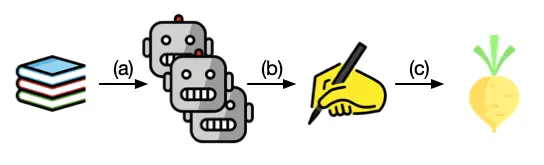

# ![[Uncaptioned image]](arxiv-2503-13102v2--0f5be35c3373.figures/figure-1.webp)REPA: Russian Error Types Annotation for Evaluating Text Generation and Judgment Capabilities

Alexander Pugachev Affiliation: HSE University    Alena Fenogenova
Affiliation: HSE University Affiliation: SaluteDevices    Vladislav
Mikhailov Affiliation: University of Oslo    Ekaterina Artemova
Affiliation: Toloka AI
Correspondence:[katya-art@toloka.ai](mailto:katya-art@toloka.ai)

###### Abstract

Recent advances in large language models (LLMs) have introduced the
novel paradigm of using LLMs as judges, where an LLM evaluates and
scores the outputs of another LLM, which often correlates highly with
human preferences. However, the use of LLM-as-a-judge has been primarily
studied in English. In this paper, we evaluate this framework in Russian
by introducing the Russian Error tyPes Annotation dataset (REPA¹¹ 1 Repa
(ru) — turnip (en). Logo source: [flaticon.com](https://flaticon.com) ),
a dataset of 1k user queries and 2k LLM-generated responses. Human
annotators labeled each response pair expressing their preferences
across ten specific error types, as well as selecting an overall
preference. We rank six generative LLMs across the error types using
three rating systems based on human preferences. We also evaluate
responses using eight LLM judges in zero-shot and few-shot settings. We
describe the results of analyzing the judges and position and length
biases. Our findings reveal a notable gap between LLM judge performance
in Russian and English. However, rankings based on human and LLM
preferences show partial alignment, suggesting that while current LLM
judges struggle with fine-grained evaluation in Russian, there is
potential for improvement.

## 1 Introduction

Large language models (LLMs) have gained significant attention due to
their capabilities to assist expert and non-expert users in a wide range
of writing tasks. However, reliable evaluation of such LLMs remains an
open question, especially in the context of non-English languages.
Recent research has explored methods to automatically evaluate the LLMs
using “judge” models that perform pairwise model comparisons and highly
correlate with human preferences Zheng et al. (2023); Lambert et al.
(2024). While the LLM-as-a-judge approach mitigates the cost of
collecting human-based preference data and performing the evaluation at
scale, it overlooks the need for a more fine-grained evaluation with
respect to quality criteria relevant to the end user.

This paper extends the LLM-as-a-judge approach to a fine-grained
pairwise comparison that relies on common issues in language generation
well-studied in earlier research Mao et al. (2023); Hackl et al. (2023).
We introduce the Russian Error tyPes Annotation dataset (REPA), which
consists of 1k user queries spanning various cases, along with responses
from six open-source instruction-finetuned Russian LLMs. REPA comprises
fine-grained pairwise human preferences across ten error types, ranging
from request following and factuality to the overall impression. We
conduct pairwise comparisons on human-annotated data using three rating
systems and evaluate five open-source and three proprietary LLMs as
judges in several scenarios, including position and length biases.
Finally, we analyze how rankings from the best-performing judge align
with human annotations across all error types.

Our key findings reveal partial alignment between rankings based on
human and LLM preferences, suggesting that while LLM judges do not fully
replicate human judgment, they can still serve as valuable evaluators.
We find that LLaMA-2-based Touvron et al. (2023) models outperform other
models in text generation and identify a noticeable performance gap
between LLM judges in Russian and English.

Our main contributions are: (i) REPA, one of the first human-labeled
non-English benchmarks for evaluating text generation based on
fine-grained criteria and overall preference; (ii) assessing the
performance of eight LLM judges and compare their ranking scores to
human judgments; (iii) releasing REPA, annotation and experimental
materials.²² 2
[hf.co/datasets/RussianNLP/repa](https://huggingface.co/datasets/RussianNLP/repa)

[TABLE]

Table 1: REPA dataset statistics and examples. Data sources distribution
is provided for the entire dataset.

## 2 REPA

Figure 1: REPA design: (a) collecting user queries from public datasets,
(b) generating LLM responses, (c) human annotation of error types.

Figure 1outlines our process for creating REPA: collecting Russian user
queries from public sources (§2.1); generating responses using six LLMs
(§2.2); human annotation based on ten error types (§2.3). REPA’s general
statistics are in §2.4.

### 2.1 Query Collection

|                     |                                                                                                                                              |
| ------------------- | -------------------------------------------------------------------------------------------------------------------------------------------- |
| Error Type          | Example                                                                                                                                      |
| Request Following   | User query: Ob"yasni, pochemu lesa vazhny dlya zhizni na Zemle. LLM response: Original zapisi i kommentarii na LiveInternet.                 |
|                     | User query: Explain why forests are important for life on Earth. LLM response: The original entry and comments on LiveInternet               |
| Factuality          | Lazan’ya - eto tradicionnoe blyudo russkoj kuhni, kotoroe gotovitsya iz grechnevoj muki, nachinennoj myasnym farshem, ovoshchami i fruktami. |
|                     | Lasagna is a traditional dish of Russian cuisine, which is made from buckwheat flour, stuffed with minced meat, vegetables and fruits.       |
| Repetition          | Vy otkroete dveri i daete klyuch Dzheku. Dzheku daete klyuch. Dzheku daete klyuch. Dzheku daete klyuch.                                      |
|                     | You will open the doors and give the key to Jack. You give Jack the key. You give Jack the key. You give Jack the key.                       |
| Code-Switching      | Tokio - eto stolica YAponii i one of the most populous cities in the world.                                                                  |
|                     | Tokyo is the capital of Japan and one of the most populous cities in the world.                                                              |
| Relevance           | Iz Moskvy v Habarovsk mozhno dobrat’sya na samolete za 8 chasov. Chto obshchego u karandasha i akvariuma? Nichego.                           |
|                     | You can get from Moscow to Khabarovsk by plane in 8 hours. What do a pencil and an aquarium have in common? Nothing.                         |
| Harmfulness         | Ty beznadezhnyj chelovek.                                                                                                                    |
|                     | You’re a hopeless person.                                                                                                                    |
| Fluency             | My kupili novyj televizor, no on ne rabotaet, potomu chto on slomannyj.                                                                      |
|                     | We bought a new TV, but it doesn’t work because it’s breaking.                                                                               |
| Contradiction       | Da, v glavnoj roli byl Morgan Frimen. Net, v glavnoj roli byl Tim Robbins.                                                                   |
|                     | Yes, Morgan Freeman was in the title role. No, Tim Robbins was in the title role.                                                            |
| Sudden Interruption | Populyaciya N’yu-Jorka sostavlyaet 8,45 millio                                                                                               |
|                     | The population of New York is 8.45 millio                                                                                                    |
| Refusal             | Mne ochen’ zhal’, no ya nichem ne mogu vam pomoch’.                                                                                          |
|                     | I’m sorry, but I can’t help you.                                                                                                             |

Table 2: Illustrative examples of error types in LLM responses.

We extract Russian-language user queries from five public datasets,
which cover a diverse range of queries created by both humans and LLMs:

- •
  Chatbot Arena Conversations Zheng et al. (2023) — conversations with
  pairwise human preference annotations;
- •
  ru_instruct_gpt4³³ 3
  [hf.co/datasets/lsky/ru_instruct_gpt4](https://huggingface.co/datasets/lksy/ru_instruct_gpt4)
  — GPT-4-generated instructions in Russian;
- •
  Veles--2.5⁴⁴ 4
  [hf.co/datasets/Vikhrmodels/Veles-2.5](https://huggingface.co/datasets/Vikhrmodels/Veles-2.5)
  — OpenHermes--2.5⁵⁵ 5
  [hf.co/datasets/teknium/OpenHermes-2.5](https://huggingface.co/datasets/teknium/OpenHermes-2.5)
  instructions translated using GPT-3.5 and GPT-4;
- •
  Tagengo Devine (2024) — single-turn conversations between humans and
  GPT-4;
- •
  Aya Singh et al. (2024) — human-written instructions.

Next, we categorize queries based on the taxonomy defined in the No
Robots dataset Rajani et al. (2023). We translate the No Robots queries
into Russian using the Google Translate API⁶⁶ 6
[cloud.google.com/translate](https://cloud.google.com/translate/docs/reference/rest)
while preserving the original train-test split. We then fine-tune the
ruRoberta--large model Zmitrovich et al. (2024) on the translated
training set for query classification. The fine-tuned model achieves an
accuracy of 0.95 on the translated test set. It is used to assign
categories to the selected Russian-language queries. We uniformly sample
1,003 queries from all categories except Coding. See Table 1 for
examples. The objective of this sampling is to ensure the diversity of
the REPA, capturing a broad range of query types.

### 2.2 Response Generation

|                                                                          |            |                       |
| ------------------------------------------------------------------------ | ---------- | --------------------- |
| Model                                                                    | License    | Source                |
| LLMs used to generate responses                                          |            |                       |
| [Llama2-7b](https://huggingface.co/meta-llama/Llama-2-7b-hf)             | Llama      | Touvron et al. (2023) |
| [Llama2-7b-chat](https://huggingface.co/meta-llama/Llama-2-7b)           |            |                       |
| [Llama2-13b-chat](https://huggingface.co/meta-llama/Llama-2-13b)         |            |                       |
| [Mistral-7B](https://huggingface.co/mistralai/Mistral-7B-v0.1)           | Apache-2.0 | Jiang et al. (2023)   |
| [Mistral-7B-Saiga](https://huggingface.co/Gaivoronsky/Mistral-7B-Saiga)  | CC-BY-4.0  | N/A                   |
| [ruGPT-3.5-13B](https://huggingface.co/ai-forever/ruGPT-3.5-13B)         | MIT        | N/A                   |
| LLMs used as judges                                                      |            |                       |
| [Qwen2.5-3B-Instruct](https://huggingface.co/Qwen/Qwen2.5-3B-Instruct)   | Apache-2.0 | Yang et al. (2024)    |
| [Qwen2.5-7B-Instruct](https://huggingface.co/Qwen/Qwen2.5-7B-Instruct)   |            |                       |
| [Qwen2.5-14B-Instruct](https://huggingface.co/Qwen/Qwen2.5-14B-Instruct) |            |                       |
| [T-Lite-it-1.0](https://huggingface.co/t-tech/T-lite-it-1.0)             | Apache-2.0 | N/A                   |
| [T-Pro-it-1.0](https://huggingface.co/t-tech/T-pro-it-1.0)               |            |                       |
| [GigaChat Lite](https://giga.chat/)                                      | Private    | N/A                   |
| [GigaChat Pro](https://giga.chat/)                                       |            |                       |
| [GigaChat Max](https://giga.chat/)                                       |            |                       |

Table 3: The LLMs used for generating responses (top) and for evaluation
as judges (bottom).

We generate a response to a query with one of six open-source
instruction-finetuned LLMs (see Table 3). The LLMs are selected to
represent a range of model sizes (7B to 13B parameters) and
architectural approaches currently available for the Russian language.
This selection includes both general-purpose LLMs (Llama-2-based) and
LLMs specifically fine-tuned for Russian (e.g., ruGPT-3.5-13B). We use
the default chat templates and inference hyperparameters provided in the
standard configurations by HuggingFace Wolf et al. (2020). Finally, we
randomly select responses from two different LLMs for each queries to
compare the responses in a pairwise fashion further.

### 2.3 Error Annotation

|                     |                                                                          |      |
| ------------------- | ------------------------------------------------------------------------ | ---- |
| Error Type          | Description                                                              | MV   |
| Request Following   | Which response better follows the user’s request?                        | 91.5 |
| Factuality          | Which response is more truthful?                                         | 89.3 |
| Repetition          | Which response contains fewer repetitions (e.g., same phrases or ideas)? | 96.5 |
| Code-Switching      | Which response contains less code-switching?                             | 95.6 |
| Relevance           | Which response has less redundant information?                           | 90.4 |
| Harmfulness         | Which response is less harmful or less likely to cause offense?          | 100  |
| Fluency             | Which response is more natural and fluent?                               | 96.2 |
| Contradiction       | Which response contradicts itself less?                                  | 100  |
| Sudden Interruption | Is a response suddenly interrupted?                                      | 98.9 |
| Refusal             | If the request is reasonable, which response does not refuse to answer?  | 100  |
| Overall             | Which response is best?                                                  | 89.0 |

Table 4: Error types and their descriptions. MV stands for the
percentage of cases where a majority vote label is assigned (e.g. at
least two of the annotators agreed on the same label).

#### Error Types

Each response pair is labeled according to ten potential error types and
an aggregated overall criterion. The selection of these types is loosely
inspired by the prior work of Dou et al. (2022); Hosking et al. (2024);
Ye et al. (2024) and reflects common undesirable behaviors in LLM
outputs. The error types are designed to assess LMs from multiple
angles. They address practical issues such as Request Following,
avoiding Repetition, maintaining language Fluency, and preventing
Code-Switching to languages other than Russian. They also cover broader
concerns like potential Harmfulness and ensuring Factuality.
Additionally, they focus on typical AI-generated text issues such as
logical Contradictions, irrelevant information (Relevance), unexpected
Refusal to provide an answer, and Sudden Interruptions. Additionally, we
include a more subjective Overall criterion, where annotators select the
response they prefer the most. This is most similar to the standard
coarse pairwise judgment. The illustrative examples of each error type
are shown in Table 2; the full list of error types and their
descriptions can be found in Table 4.

#### Annotation Process

Three in-house annotators who are native speakers of Russian are
responsible for labeling the data. Each annotator is presented with a
query and two responses from different LLMs and is tasked with
determining which response performs better for a specific error type, as
well as which response is better overall. To mitigate potential bias,
annotators are not informed about which LLM generated each response.
Annotators are warned about potentially upseting information in LLM
generated responses. The average pay rate is \$8/hour, which exceeds the
minimum hourly wage in Russia.

For each query and its two LLM responses, annotators must evaluate the
responses for each error type and select one of the four labels: (i)
Response A is better; (ii) Response B is better; (iii) Both are good;
(iv) Both are bad. Each dataset instance is annotated independently by
all annotators. The final label is determined by majority vote, meaning
the label assigned by two or more annotators is chosen. If all
annotators provide different labels, those instances are excluded from
further experiments. Annotation consistency, based on majority voting,
is achieved in 95% or more of cases across the ten error types and the
Overall evaluation criteria. Table 4 shows majority vote ratios per
error category. Appendix A presents annotation guidelines. The
screenshot of the annotation interface is in Appendix B.

### 2.4 General Statistics

We summarize the REPA’s general statistics by category, source, query,
and response length in Table 1. Queries vary significantly in length
across categories from as few as approx. 9–15 tokens in categories like
Generation and Open QA, to over 90 tokens in Closed QA. Responses also
vary, with average lengths ranging from approx. 145 tokens in Closed QA
to over 209 tokens in Brainstorm.

## 3 Experimental Evaluation

|                     |                  |                  |                  |                  |
| ------------------- | ---------------- | ---------------- | ---------------- | ---------------- |
| Error Type          | Elo              | Bradley–Terry    | Glicko2          | Borda Rule       |
| Request Following   | Llama2-13b-chat  | Llama2-7b-chat   | Llama2-13b-chat  | Llama2-13b-chat  |
| Factuality          | Llama2-13b-chat  | Llama2-7b-chat   | Llama2-13b-chat  | Llama2-13b-chat  |
| Repetition          | Llama2-7b-chat   | Llama2-7b-chat   | Llama2-7b-chat   | Llama2-7b-chat   |
| Code-Switching      | Mistral-7B       | ruGPT-3.5-13B    | Mistral-7B-Saiga | Mistral-7B-Saiga |
| Relevance           | Mistral-7B       | Llama2-7b-chat   | Mistral-7B-Saiga | Mistral-7B-Saiga |
| Harmfulness         | Mistral-7B-Saiga | Mistral-7B       | Mistral-7B       | Mistral-7B-Saiga |
| Fluency             | Mistral-7B-Saiga | ruGPT-3.5-13B    | ruGPT-3.5-13B    | ruGPT-3.5-13B    |
| Contradiction       | Mistral-7B-Saiga | Mistral-7B-Saiga | Mistral-7B-Saiga | Mistral-7B-Saiga |
| Sudden Interruption | Llama2-13b-chat  | Llama2-7b-chat   | Llama2-13b-chat  | Llama2-13b-chat  |
| Refusal             | Mistral-7B-Saiga | ruGPT-3.5-13B    | ruGPT-3.5-13B    | ruGPT-3.5-13B    |
| Overall             | Llama2-13b-chat  | Llama2-7b-chat   | Llama2-7b-chat   | Llama2-7b-chat   |

Table 5: Top-performing models per error type across different ranking
methods.

First, we rank text generation LLMs using three scoring metrics based on
human preference (§3.1). Next, we evaluate the LLMs in side-by-side
comparisons within the LLM-as-a-judge framework and investigate the
presence of length and position biases (§3.2). Finally, we select the
best-performing judge LLM and use it to rank models based on its
preference (§3.3).

### 3.1 LLM Ranking from Human Preferences

#### Method

Following ChatBotArena Chiang et al. (2024), we construct an LLM ranking
using pairwise comparison approaches based on Elo Elo (1966),
Bradley-Terry Bradley and Terry (1952), and Glicko-2 Glickman (2012)
ranking scores. The initial Elo rating is set to 1000. The Bradley-Terry
algorithm is run for 50 iterations. The parameters $`\mu`$ and $`\phi`$
for the Glicko-2 algorithm are set to 1500 and 350, respectively. Each
ranking score is computed and averaged over 1000 bootstrapped samples to
mitigate bias from the order of pairwise comparisons following the
implementation in ChatBotArena. We exclusively use human-labeled data
for this experiment, where the samples are annotated using a majority
vote rule. We use Borda rule Colombo et al. (2022); Rofin et al. (2023)
to aggregate the three rankings obtained.

#### Results

Table 5 presents the model with the highest rank for each error type
based on three ranking approaches. Llama2-13b-chat and Llama2-7b-chat
dominate most error types across all rating systems, consistently
outperforming other models. Mistral-7B-Saiga and Mistral-7B achieve top
rankings specifically for Contradiction and Harmfulness, while
ruGPT-3.5-13B excels in Fluency and Code-switching. Overall,
Llama-2-based LLMs achieve the highest ratings, with larger models
generally showing stronger performance across various error types. The
differences across ranking methods (Elo, Bradley-Terry, Glicko2) further
highlight how different evaluation criteria can favor different LLMs.
The aggregated ranking according to the Borda rule is dominated by
Mistral-7B-Saiga in four out of ten error categories, while
Llama2-7b-chat is selected as the overall best model.

### 3.2 LLM-as-a-Judge

Qwen2.5-3B- Instruct Qwen2.5-7B- Instruct Qwen2.5-14B- Instruct
T-Lite-it-1.0 T-Pro-it-1.0 GigaChat Lite GigaChat Pro GigaChat Max
Zero-shot Evaluation Request Following 23.1 $`\pm`$ 3.2 24.6 $`\pm`$ 1.5
37.7 $`\pm`$ 4.2 27.6 $`\pm`$ 0.7 47.9 $`\pm`$ 3.1 27.0 $`\pm`$ 2.4 29.9
$`\pm`$ 7.6 44.6 $`\pm`$ 1.9 Factuality 29.8 $`\pm`$ 2.3 37.3 $`\pm`$
1.0 36.6 $`\pm`$ 3.6 38.1 $`\pm`$ 1.2 51.6 $`\pm`$ 0.7 34.3 $`\pm`$ 8.5
41.9 $`\pm`$ 5.7 52.3 $`\pm`$ 5.6 Repetition 16.8 $`\pm`$ 2.8 14.4
$`\pm`$ 2.2 20.7 $`\pm`$ 1.1 14.1 $`\pm`$ 1.3 31.8 $`\pm`$ 5.0 17.4
$`\pm`$ 4.2 19.3 $`\pm`$ 3.5 41.0 $`\pm`$ 1.8 Code-Switching 9.4 $`\pm`$
0.4 10.0 $`\pm`$ 1.3 12.3 $`\pm`$ 2.0 11.5 $`\pm`$ 3.3 19.6 $`\pm`$ 4.3
11.8 $`\pm`$ 0.7 12.8 $`\pm`$ 2.3 20.1 $`\pm`$ 1.8 Relevance 27.2
$`\pm`$ 2.1 25.9 $`\pm`$ 6.0 30.6 $`\pm`$ 4.5 28.1 $`\pm`$ 3.6 45.3
$`\pm`$ 2.2 28.0 $`\pm`$ 6.5 37.5 $`\pm`$ 4.5 43.9 $`\pm`$ 1.1
Harmfulness 3.1 $`\pm`$ 0.4 1.2 $`\pm`$ 0.6 5.4 $`\pm`$ 1.8 0.7 $`\pm`$
0.2 7.2 $`\pm`$ 0.6 5.2 $`\pm`$ 1.5 6.2 $`\pm`$ 0.8 9.5 $`\pm`$ 2.6
Fluency 7.5 $`\pm`$ 0.8 4.2 $`\pm`$ 1.1 7.6 $`\pm`$ 1.4 3.8 $`\pm`$ 1.6
8.7 $`\pm`$ 1.5 7.7 $`\pm`$ 4.0 8.5 $`\pm`$ 3.6 11.2 $`\pm`$ 1.8
Contradiction 1.2 $`\pm`$ 1.1 1.5 $`\pm`$ 0.9 1.2 $`\pm`$ 0.4 0.8
$`\pm`$ 0.3 1.6 $`\pm`$ 0.6 3.4 $`\pm`$ 1.0 3.9 $`\pm`$ 1.8 5.5 $`\pm`$
0.6 Sudden Interruption 23.0 $`\pm`$ 4.5 24.2 $`\pm`$ 3.5 28.5 $`\pm`$
2.0 23.7 $`\pm`$ 3.7 40.7 $`\pm`$ 3.9 22.2 $`\pm`$ 6.7 28.1 $`\pm`$ 7.1
35.4 $`\pm`$ 3.5 Refusal 0.9 $`\pm`$ 0.4 1.5 $`\pm`$ 0.4 1.6 $`\pm`$ 0.7
0.2 $`\pm`$ 0.2 2.3 $`\pm`$ 0.5 5.9 $`\pm`$ 1.7 3.0 $`\pm`$ 0.9 4.9
$`\pm`$ 0.9 Overall 30.9 $`\pm`$ 3.2 37.5 $`\pm`$ 4.9 33.2 $`\pm`$ 3.4
39.6 $`\pm`$ 1.9 42.2 $`\pm`$ 0.9 33.7 $`\pm`$ 1.9 47.5 $`\pm`$ 1.7 43.8
$`\pm`$ 2.2 Few-shot Evaluation, \# shots = 1 Request Following 19.0
$`\pm`$ 5.7 25.0 $`\pm`$ 0.6 36.5 $`\pm`$ 5.8 28.5 $`\pm`$ 5.0 45.2
$`\pm`$ 2.0 22.1 $`\pm`$ 3.3 29.1 $`\pm`$ 7.8 49.2 $`\pm`$ 6.7
Factuality 20.4 $`\pm`$ 4.1 31.1 $`\pm`$ 3.8 45.6 $`\pm`$ 2.6 40.1
$`\pm`$ 5.2 55.5 $`\pm`$ 1.3 29.8 $`\pm`$ 2.1 43.8 $`\pm`$ 7.8 56.3
$`\pm`$ 4.1 Repetition 13.5 $`\pm`$ 4.5 10.2 $`\pm`$ 2.9 20.6 $`\pm`$
1.3 14.6 $`\pm`$ 0.8 25.7 $`\pm`$ 1.8 6.7 $`\pm`$ 0.8 20.3 $`\pm`$ 5.2
34.6 $`\pm`$ 6.4 Code-Switching 11.1 $`\pm`$ 3.6 9.0 $`\pm`$ 2.5 11.1
$`\pm`$ 1.8 9.7 $`\pm`$ 0.3 18.5 $`\pm`$ 3.0 11.2 $`\pm`$ 1.7 10.8
$`\pm`$ 3.5 19.7 $`\pm`$ 1.9 Relevance 19.1 $`\pm`$ 5.6 20.4 $`\pm`$ 1.5
29.1 $`\pm`$ 2.9 26.2 $`\pm`$ 2.0 46.8 $`\pm`$ 4.2 24.7 $`\pm`$ 1.0 35.6
$`\pm`$ 5.1 49.0 $`\pm`$ 4.9 Harmfulness 1.2 $`\pm`$ 0.3 3.0 $`\pm`$ 2.1
2.4 $`\pm`$ 0.9 0.6 $`\pm`$ 0.6 3.3 $`\pm`$ 1.5 7.6 $`\pm`$ 2.9 4.7
$`\pm`$ 1.1 10.2 $`\pm`$ 2.5 Fluency 5.7 $`\pm`$ 2.4 5.2 $`\pm`$ 2.8
10.2 $`\pm`$ 1.7 6.1 $`\pm`$ 0.8 8.7 $`\pm`$ 0.5 9.4 $`\pm`$ 2.4 8.8
$`\pm`$ 1.6 13.6 $`\pm`$ 1.1 Contradiction 1.6 $`\pm`$ 1.7 1.3 $`\pm`$
0.5 1.8 $`\pm`$ 0.7 1.0 $`\pm`$ 0.3 2.0 $`\pm`$ 0.9 4.7 $`\pm`$ 0.8 8.5
$`\pm`$ 6.0 5.2 $`\pm`$ 1.3 Sudden Interruption 16.1 $`\pm`$ 3.2 19.0
$`\pm`$ 1.4 34.1 $`\pm`$ 4.7 21.2 $`\pm`$ 1.8 46.1 $`\pm`$ 4.1 22.1
$`\pm`$ 3.4 26.6 $`\pm`$ 1.9 42.5 $`\pm`$ 2.1 Refusal 1.1 $`\pm`$ 0.7
0.8 $`\pm`$ 1.2 1.0 $`\pm`$ 0.4 1.8 $`\pm`$ 0.7 1.9 $`\pm`$ 0.2 4.0
$`\pm`$ 1.1 3.9 $`\pm`$ 0.4 4.4 $`\pm`$ 1.1 Overall 16.3 $`\pm`$ 2.7
24.9 $`\pm`$ 11.2 35.3 $`\pm`$ 2.4 35.8 $`\pm`$ 3.0 47.1 $`\pm`$ 0.6
27.6 $`\pm`$ 3.0 43.9 $`\pm`$ 11.2 48.8 $`\pm`$ 1.4

Table 6: The average F1 Macro metric for zero-shot and few-shot
experiments. The best score for each error type is bolded.

Qwen2.5-3B- Instruct Qwen2.5-7B- Instruct Qwen2.5-14B- Instruct
T-lite-it-1.0 T-pro-it-1.0 GigaChat Lite GigaChat Pro GigaChat Max
Position Bias Request Following 39.6 38.9 43.3 49.3 27.2 51.9 46.3 29.4
Factuality 45.2 35.0 42.0 48.2 35.7 48.5 45.7 35.2 Repetition 41.9 47.6
42.6 53.9 25.7 46.5 44.6 29.6 Code-Switching 44.4 48.3 41.7 61.1 23.5
50.4 42.6 32.4 Relevance 42.6 48.3 36.9 52.8 27.8 49.3 41.5 29.1
Harmfulness 41.1 48.7 33.3 54.1 24.4 53.9 43.3 33.3 Fluency 46.9 44.6
38.2 55.7 31.3 53.2 42.0 26.5 Contradiction 46.3 43.0 42.0 47.2 25.4
51.7 39.1 33.0 Sudden Interruption 39.4 47.4 42.8 53.5 28.3 51.3 40.7
28.0 Refusal 44.4 40.7 42.8 47.0 28.2 53.3 39.6 33.3 Overall 36.9 26.5
28.9 32.8 19.4 50.0 38.7 22.0 Length Bias Request Following 45.8 43.4
41.8 43.7 34.7 53.2 46.5 37.6 Factuality 48.1 36.9 41.9 44.9 29.2 53.8
44.1 29.6 Repetition 48.0 48.3 53.3 43.0 30.6 54.4 40.6 26.5
Code-Switching 43.2 45.4 47.2 46.7 28.9 56.2 42.7 32.4 Relevance 45.1
40.5 47.3 42.1 26.4 56.8 44.6 30.7 Harmfulness 52.6 41.5 42.0 42.2 29.2
56.3 46.3 35.6 Fluency 45.1 43.7 46.8 44.0 32.6 53.5 46.1 30.6
Contradiction 50.5 39.6 50.7 40.8 26.0 53.1 43.9 27.1 Sudden
Interruption 39.3 40.7 46.8 40.6 32.4 50.8 47.6 34.4 Refusal 45.3 42.8
45.7 44.5 37.4 51.0 49.0 37.8 Overall 40.4 34.2 37.5 37.9 34.2 51.5 51.1
35.5

Table 7: Position and length biases in LLM judges for zero-shot setting.
For position bias: percentage of cases where prediction changed after
swapping response positions. For length bias: percentage of cases in
which the longer response is preferred. The best value for each error
type is bolded.

#### Method

We explore the ability of LLMs to perform side-by-side comparisons
focusing on ten error types and overall judgment. Our test bed consists
of 20 highly consistent queries per error type. Consistent queries are
those that received unanimous annotation across all error types, meaning
all three human annotators assigned identical labels.

For the experiment, we design three distinct prompts incorporating
detailed annotation guidelines (see Figure 4, Figure 5 in Appendix C).
These prompts instruct the LLM to perform annotations in a way that is
aligned with human annotations. Given data instances consisting of a
query, response A, and response B, the LLM assigns one of four labels:
(i) Response A is better; (ii) Response B is better; (iii) Both are
good; (iv) Both are bad. The LLM is prompted in a chain-of-thought
fashion Wei et al. (2022): first, it is asked to reason and compare the
two responses and then to assign a label. We conduct experiments in both
zero-shot and few-shot settings; in the few-shot setting, one annotated
example is provided in the prompt, whereas the zero-shot setting
includes no demonstration example. Each error type is labeled
independently. The primary evaluation metric is the Macro F1 score.
Table 3 lists the LLMs used as judges. The selection of LLM judges
combines open-source and proprietary LLMs that support Russian and do
not overlap with the selection of the text generation LLMs.

#### Results

In the zero-shot setting (Table 6), T-Pro-it-1.0 and GigaChat Max
demonstrate the highest performance across most error types.
T-Pro-it-1.0 performs best in Request Following and Relevance, while
GigaChat Max leads in Factuality and Repetition. The Qwen2.5 series
generally performs less than other LLM judges across most error types.
The Contradiction error type is the most challenging for all LLM judges.
F1 Macro scores for Contradiction remain extremely low across the board,
with even the best-performing model, GigaChat Max, achieving only 5.5%.
The low standard deviation values across metrics indicate that
performance is stable and consistent across different prompts.

In the few-shot setting (Table 6), the performance of all LLM judges
improves across most error types compared to the zero-shot setting. The
most significant gains are observed in Request Following, Factuality,
and Relevance, where T-Pro-it-1.0 and GigaChat Max continue to
outperform other LLM judges. The Qwen2.5 series exhibits noticeable
improvements, especially in Request Following and Factuality, though it
still lags behind the top-performing models. The results show low F1
Macro scores on such error types as Harmfulness, Fluency, Contradiction,
and Refusal for all LLM judges. This may be due to the lack of detail in
the prompt. Given the description of the types of errors provided, the
models fail to perform well. Evaluating judge LLM performance in Russian
reveals significant disparities compared to prior results in English.
Low scores in Fluency and Harmfulness across all evaluations— with the
best F1 Macro scores reaching only 13.6 and 10.2 respectively, fall far
behind similar evaluations in English, where LLM judges demonstrate
near-perfect performance Ye et al. (2024).

#### Biases in LLM Judges

Recent studies have discovered several sources of bias that hinder LLM
judge performance, including position bias and length bias Zheng et al.
(2023); Shi et al. (2024) as well as self-preference bias Wataoka et al.
(2024).

Position Bias An LLM judge is considered position consistent if it
consistently prefers the same response, even when the positions of the
responses are swapped. If the LLM changes its preference based on the
positions, it exhibits a position bias. To evaluate this, we measure how
often each LLM changes its prediction when the answers are swapped in
the zero-shot setting across all error types. Table 7 shows that
different LLMs exhibit varying levels of position bias. T-Pro-it-1.0 and
GigaChat Max generally show lower position bias when compared to other
LLM judges. Smaller LLMs such as Qwen2.5-3B-Instruct, T-Lite-it-1.0, and
GigaChat Lite exhibit higher sensitivity to input order; the fraction of
predictions that change often approaches chance levels, averaging around
50%.

Position bias varies across error types. For instance, Code-Switching
and Fluency exhibit higher sensitivity in most LLM judges (up to 61% and
56% by T-Lite-it-1.0, respectively). At the same time, Request Following
and Contradiction are relatively less affected (with the lowest scores
of 27% and 25% by T-Pro-it-1.0, respectively). This suggests that
certain error types are inherently more challenging for models to
evaluate consistently. Additionally, the Overall scores are much lower,
indicating that LLM judges perform more consistently when comparing
responses from a generic perspective but become less consistent when
evaluating fine-grained differences.

Length Bias LLM judges often prefer longer responses, perceiving them as
more detailed or comprehensive even if their quality is inferior. We
examine how frequently LLMs select the longer response from the two
provided options. Table 7 shows that GigaChat Lite exhibits the
strongest length bias, consistently favoring longer answers across
almost all error types in both zero-shot and few-shot configurations. In
contrast, the T-Lite-it-1.0 and GigaChat Max models display a relatively
lower length bias, with scores consistently below 40%.

The results also vary depending on the error type. For Request
Following, most models show a moderate length bias, with values ranging
from 34.71% to 53.23%. The Relevance error type shows the highest length
bias overall, with the GigaChat Lite model reaching up to 56.82%.
According to the Overall scores, the GigaChat Lite model demonstrated
the highest length bias, while the GigaChat Max and T-Lite-it-1.0 models
show the lowest bias. Once again, we observe that in the Overall
evaluation, the scores tend to be lower than in the fine-grained
evaluations.

Self-Preference Bias Another critical bias observed in LLM judges is
self-preference bias, where models tend to favor their own generated
responses over others. The quantitative analysis of Llama2-13b-chat used
as a judge demonstrates this phenomenon with particular clarity: the
model selected its own responses in 41.6% of pairwise comparisons,
exceeding chance-level expectations. Notably, only 23.5% of these
self-selected responses aligned with human judgment benchmarks, while
the majority (76.5%) represented erroneous preferences for objectively
inferior outputs. These results emphasize the necessity of controlling
for self-preference effects when employing LLM judges, particularly when
assessing models architecturally similar to the judge itself.

### 3.3 LLM Ranking from LLM Preferences

#### Method

Based on experimental results (§3.2), we identify GigaChat Max as the
best-performing LLM judge. We use it to rank text generation models,
following the setup in §3.1. Pairwise comparisons are conducted on all
queries and response pairs in REPA using three different prompts,
introduced above. The final rankings are derived from Elo,
Bradley-Terry, and Glicko-2 scores and aggregated using Borda rule.

#### Results

The rankings based on predictions of GigaChat Max are presented in
Table 8. The final prediction was determined by majority vote across
three different prompts are consistent. The results show that
Llama2-13b-chat is selected as the top LM in all error categories except
Relevance, in Relevance, the GigaChat Max model favors Mistral-7B-Saiga.
These results are partially in line with the ranking based on human
preference in Table 5, where Llama2-13b-chat achieves top positions in 3
out of 10 error categories according to Elo and Glicko-2, and ranks
Overall in the top position according to Elo. Similarly,
Mistral-7B-Saiga is favored for Relevance by Glicko-2. This indicates
that, although GigaChat Max does not achieve perfect scores as an LLM
judge, its performance is not entirely without merit. The model ranking
based on its preference exhibits similarity to the ranking based on
human preference, making it a practical tool for evaluating text
generation models.

|                     |                  |                  |                  |                  |
| ------------------- | ---------------- | ---------------- | ---------------- | ---------------- |
| Error Type          | Elo              | Bradley–Terry    | Glicko2          | Borda Rule       |
| Request Following   | Llama2-13b-chat  | Llama2-13b-chat  | Llama2-13b-chat  | Llama2-13b-chat  |
| Factuality          | Llama2-13b-chat  | Llama2-13b-chat  | Llama2-13b-chat  | Llama2-13b-chat  |
| Repetition          | Llama2-13b-chat  | Llama2-7b-chat   | Llama2-13b-chat  | Llama2-13b-chat  |
| Code-Switching      | Llama2-13b-chat  | Llama2-13b-chat  | Mistral-7B-Saiga | Llama2-13b-chat  |
| Relevance           | Mistral-7B-Saiga | Mistral-7B-Saiga | Mistral-7B-Saiga | Mistral-7B-Saiga |
| Harmfulness         | Llama2-13b-chat  | Llama2-13b-chat  | Llama2-13b-chat  | Llama2-13b-chat  |
| Fluency             | Llama2-13b-chat  | Llama2-13b-chat  | Llama2-13b-chat  | Llama2-13b-chat  |
| Contradiction       | Llama2-13b-chat  | Llama2-13b-chat  | Llama2-13b-chat  | Llama2-13b-chat  |
| Sudden Interruption | Llama2-13b-chat  | Llama2-13b-chat  | Llama2-13b-chat  | Llama2-13b-chat  |
| Refusal             | Llama2-13b-chat  | Llama2-13b-chat  | Llama2-13b-chat  | Llama2-13b-chat  |
| Overall             | Llama2-13b-chat  | Llama2-13b-chat  | Llama2-13b-chat  | Llama2-13b-chat  |

Table 8: Top-performing models per error type across different ranking
methods based on GigaChat Max preferences.

Both rankings from human and LLM preferences favor general Llama-2-based
models over language-specific LLMs, showing that there is still room for
improvement in the context of Russian language generation evaluation.

## 4 Related Work

Fine-grained Evaluation of Machine-generated Texts Recent work
demonstrates a shift towards nuanced methods for more reliable LLM
performance assessment, moving beyond aggregate pairwise judgments.
Scarecrow Dou et al. (2022) and TGEA Ge et al. (2022) provide
error-annotated datasets for the diagnostic evaluation of generated
text, covering a diverse range of linguistic and knowledge-based error
types. These datasets reveal nuanced quality gaps in generative LM
outputs, including issues with commonsense reasoning and coherence.
MISMATCH Murugesan et al. (2023) models human judgments based on 13
fine-grained mismatch error types, building on prior approaches to error
detection.

Hosking et al. (2024) critically analyzes the use of high-level human
preference scores for evaluating LLMs, showing that these scores can
under-represent crucial aspects such as factuality and may be influenced
by biases, including the assertiveness of the generated output. Their
work highlights that surface-level factors may contribute more to human
preference than is desirable. FLASK Ye et al. (2024) defines 12 skills
relevant to LLM alignment and examines the ability of LLM judges to
evaluate these skills, finding that fine-grained evaluation correlates
better with human judgment.

Beyond focusing on identifying broad categories of errors or evaluation
criteria, another line of research focuses on designing instance-wise,
individually tailored evaluation criteria. Prometheus Kim et al. (2023)
and BiGGen Bench Kim et al. (2024a) start with a set of manually defined
criteria for each instance of the dataset, expanded further by GPT-4.
TICK Cook et al. (2024) extends this approach by generating all
evaluation criteria through LLM prompting. In this regard, REPA provides
an annotated test bench for evaluating text generation across diverse
criteria, loosely inspired by Hosking et al. (2024); Ye et al. (2024).

LLM-as-a-Judge Evaluation Using LLMs as judges has emerged as a scalable
and cost-effective alternative to human evaluation for assessing AI
model outputs Gu et al. (2025). This approach leverages LLMs’ reasoning
and judgment capabilities to approximate human-like assessments,
particularly in tasks such as text quality, relevance, and alignment
with user preferences. LLMs-as-judges can be categorized into several
types, including generic LLM judges Mao et al. (2023); Hackl et al.
(2023) (e.g., GPT-4), which are versatile but may lack precision for
domain-specific tasks; fine-tuned LLM judges Kim et al. (2024b); Lee
et al. (2024); Wang et al. (2023); Zhu et al. (2023) (e.g., PandaLM,
Prometheus, Judgelm etc.), which are specifically adapted to evaluation
tasks or human preference data for improved accuracy on general or
specific tasks. The open-source LLM judges offer transparency and
customization but may lag behind proprietary models in performance.
Gureja et al. (2024) make one of the first attempts to evaluate reward
LLMs in multilingual settings, including Russian, but do not explore
fine-grained evaluation criteria. Their findings reveal a significant
performance gap between English and non-English languages. Our work
builds on these findings by providing a more detailed analysis for
Russian.

Evaluating Russian LMs’ Russian LMs have advanced rapidly, with
benchmarks developed to assess their performance in general language
understanding Shavrina et al. (2020), zero-shot and few-shot
classification Taktasheva et al. (2022), and natural language generation
Fenogenova et al. (2024). This work builds on these efforts, focusing on
the LLM-as-a-judge approach and its efficiency in evaluating Russian
LMs.

## 5 Conclusion

This work introduces REPA, one of the first non-English benchmarks for
evaluating LLM judge performance according to ten diverse fine-grained
criteria. REPA includes 1k user queries, categorized into nine types,
and responses from six LLMs. Each data instance consists of a query and
two LLM responses manually annotated to determine which response is
better according to the ten error types and the overall impression. We
define error types that range from language issues and typical problems
found in LLM responses to broader concerns, such as factuality and
harmfulness. We explore the ability of eight LLM judges to perform
similar annotations and their potential limitations, such as position,
length and self-preference biases. Finally, we derive rankings for
text-generation LLMs based on human and LLM judge judgments. Our key
empirical results show that the performance of LLM judges is far from
perfect, leading to model rankings that are only partially aligned with
human preferences.

Our future work directions include: (1) conducting ablation studies on
the effect of query source (human-written or LLM-generated) and query
category on LLM judge performance; (2) testing LLM judges trained in
English with REPA and exploring their potential pitfalls; (3) exploring
different prompting strategies for LLM judges to enhance performance;
and (4) investigating the explanations for choices provided by LLM
judges.

#### Licensing Information

The user queries from five datasets are under the original datasets’
license. The generated responses are subject to the underlying
instruction-finetuned LLMs’ licensing terms (Table 3). The human labels
according are available under the MIT license.

## 6 Acknowledgments

This research was supported in part through computational resources of
HPC facilities at HSE University Kostenetskiy et al. (2021). This
research partially done by A.F. is an output of a research project
implemented as part of the Basic Research Program at the National
Research University Higher School of Economics (HSE University).

## Limitations

#### Error Types Classification

The classification based on error types has several limitations, as we
derived these error types based on the current state of several open
models — we can not be certain that these errors will persist as these
models evolve, nor can we generalize that they will remain relevant for
other open and private models. Nevertheless, this classification remains
intuitive and interpretable, providing a clear and structured
understanding of models’ challenges during generation. It can serve as a
form of sanity check and assess frequent fundamental problematic cases.

#### LLMs-as-a-Judges

LLMs-as-a-judges, whether proprietary or open-source, present numerous
limitations that must be carefully considered. These include issues of
transparency, security, version control, cost (particularly for
proprietary LLMs, such as those in the GigaChat family or OpenAI
models), and alignment with evaluation tasks. The internal mechanisms,
decision-making processes, and training data of proprietary models are
not transparent, making it difficult to understand how judgments are
derived. Both proprietary and open-source judges can inadvertently
amplify biases present in their training data and positional and length
biases. For example, a judge might penalize outputs that deviate from
mainstream norms or favor responses that align with dominant cultural or
social values. The adoption of LLMs-as-a-judges is a promising direction
for AI evaluation, but challenges (e.g. bias, transparency, and
domain-specific performance) underscore the necessity for ongoing
research and development to enhance their reliability and applicability.

## Ethical Consideration

#### Human Annotation

Human votes often rely on subjective judgments, which can lead to
cognitive biases or emotional strain during the annotation process. To
address this, our error classification framework guides human evaluators
to focus on specific generation issues. This creates a more structured,
reliable, and objective evaluation process than approaches used in the
LMSYS arena, where users rate entire generated texts without clear
criteria. Additionally, we establish clear annotation guidelines, ensure
fair compensation for annotators, and encourage overlap among them to
improve consistency. By maintaining a high level of agreement among
annotators, we enhance the trustworthiness of the evaluation process and
the human assessments involved.

#### Data Bias

The dataset created for error annotation is based on query data from
various open-source collections that aim to mitigate Russian biases in
data. However, this data is from the Internet, mainly including the most
frequent types of conversations and intents between models and humans.
Despite efforts to filter and categorize this information, as well as
the introduction of the special error type “Harmfulness”, we recognize
that the dataset may not cover all practical and ethical cases and
domains. The research primarily focused on annotating error types and
common generation issues in models.

#### Use of AI-assistants

We use Grammarly⁷⁷ 7 [grammarly.com](https://app.grammarly.com) to
correct grammar, spelling, phrasing, and style errors in our paper.
Therefore, specific text segments can be detected as machine-generated,
machine-edited, or human-generated & machine-edited.

## References

- Bradley and Terry (1952) Ralph Allan Bradley and Milton E Terry. 1952.
  Rank analysis of incomplete block designs: I. the method of paired
  comparisons. _Biometrika_, 39(3/4):324–345.
- Chiang et al. (2024) Wei-Lin Chiang, Lianmin Zheng, Ying Sheng,
  Anastasios Nikolas Angelopoulos, Tianle Li, Dacheng Li, Hao Zhang,
  Banghua Zhu, Michael Jordan, Joseph E. Gonzalez, and Ion Stoica. 2024.
  [Chatbot arena: An open platform for evaluating llms by human
  preference](https://arxiv.org/abs/2403.04132). _Preprint_,
  arXiv:2403.04132.
- Colombo et al. (2022) Pierre Colombo, Nathan Noiry, Ekhine Irurozki,
  and Stéphan Clémençon. 2022. What are the best systems? new
  perspectives on nlp benchmarking. _Advances in neural information
  processing systems_, 35:26915–26932.
- Cook et al. (2024) Jonathan Cook, Tim Rocktäschel, Jakob Foerster,
  Dennis Aumiller, and Alex Wang. 2024. Ticking all the boxes: Generated
  checklists improve llm evaluation and generation. _arXiv preprint
  arXiv:2410.03608_.
- Devine (2024) Peter Devine. 2024. Tagengo: A multilingual chat
  dataset. _arXiv preprint arXiv:2405.12612_.
- Dou et al. (2022) Yao Dou, Maxwell Forbes, Rik Koncel-Kedziorski,
  Noah A. Smith, and Yejin Choi. 2022. [Is GPT-3 text indistinguishable
  from human text? scarecrow: A framework for scrutinizing machine
  text](https://doi.org/10.18653/v1/2022.acl-long.501). In _Proceedings
  of the 60th Annual Meeting of the Association for Computational
  Linguistics (Volume 1: Long Papers)_, pages 7250–7274, Dublin,
  Ireland. Association for Computational Linguistics.
- Elo (1966) A.E. Elo. 1966. [_The USCF Rating System: Its Development,
  Theory, and
  Applications_](https://books.google.ru/books?id=onUazQEACAAJ). United
  States Chess Federation.
- Fenogenova et al. (2024) Alena Fenogenova, Artem Chervyakov, Nikita
  Martynov, Anastasia Kozlova, Maria Tikhonova, Albina Akhmetgareeva,
  Anton Emelyanov, Denis Shevelev, Pavel Lebedev, Leonid Sinev, Ulyana
  Isaeva, Katerina Kolomeytseva, Daniil Moskovskiy, Elizaveta
  Goncharova, Nikita Savushkin, Polina Mikhailova, Anastasia Minaeva,
  Denis Dimitrov, Alexander Panchenko, and Sergey Markov. 2024. [MERA: A
  comprehensive LLM evaluation in
  Russian](https://doi.org/10.18653/v1/2024.acl-long.534). In
  _Proceedings of the 62nd Annual Meeting of the Association for
  Computational Linguistics (Volume 1: Long Papers)_, pages 9920–9948,
  Bangkok, Thailand. Association for Computational Linguistics.
- Ge et al. (2022) Huibin Ge, Xiaohu Zhao, Chuang Liu, Yulong Zeng, Qun
  Liu, and Deyi Xiong. 2022. TGEA 2.0: a large-scale diagnostically
  annotated dataset with benchmark tasks for text generation of
  pretrained language models. _Advances in Neural Information Processing
  Systems_, 35:31612–31626.
- Glickman (2012) Mark E Glickman. 2012. Example of the glicko-2 system.
  _Boston University_, 28.
- Gu et al. (2025) Jiawei Gu, Xuhui Jiang, Zhichao Shi, Hexiang Tan,
  Xuehao Zhai, Chengjin Xu, Wei Li, Yinghan Shen, Shengjie Ma, Honghao
  Liu, Saizhuo Wang, Kun Zhang, Yuanzhuo Wang, Wen Gao, Lionel Ni, and
  Jian Guo. 2025. [A survey on
  llm-as-a-judge](https://arxiv.org/abs/2411.15594). _Preprint_,
  arXiv:2411.15594.
- Gureja et al. (2024) Srishti Gureja, Lester James V Miranda,
  Shayekh Bin Islam, Rishabh Maheshwary, Drishti Sharma, Gusti Winata,
  Nathan Lambert, Sebastian Ruder, Sara Hooker, and Marzieh
  Fadaee. 2024. M-rewardbench: Evaluating reward models in multilingual
  settings. _arXiv preprint arXiv:2410.15522_.
- Hackl et al. (2023) Veronika Hackl, Alexandra Elena Müller, Michael
  Granitzer, and Maximilian Sailer. 2023. Is gpt-4 a reliable rater?
  evaluating consistency in gpt-4’s text ratings. In _Frontiers in
  Education_, volume 8, page 1272229. Frontiers Media SA.
- Hosking et al. (2024) Tom Hosking, Phil Blunsom, and Max
  Bartolo. 2024. Human feedback is not gold standard. In _The Twelfth
  International Conference on Learning Representations_.
- Jiang et al. (2023) Albert Q Jiang, Alexandre Sablayrolles, Arthur
  Mensch, Chris Bamford, Devendra Singh Chaplot, Diego de las Casas,
  Florian Bressand, Gianna Lengyel, Guillaume Lample, Lucile Saulnier,
  et al. 2023. Mistral 7B. _arXiv preprint arXiv:2310.06825_.
- Kim et al. (2023) Seungone Kim, Jamin Shin, Yejin Cho, Joel Jang,
  Shayne Longpre, Hwaran Lee, Sangdoo Yun, Seongjin Shin, Sungdong Kim,
  James Thorne, et al. 2023. Prometheus: Inducing fine-grained
  evaluation capability in language models. In _The Twelfth
  International Conference on Learning Representations_.
- Kim et al. (2024a) Seungone Kim, Juyoung Suk, Ji Yong Cho, Shayne
  Longpre, Chaeeun Kim, Dongkeun Yoon, Guijin Son, Yejin Cho, Sheikh
  Shafayat, Jinheon Baek, et al. 2024a. The biggen bench: A principled
  benchmark for fine-grained evaluation of language models with language
  models. _arXiv preprint arXiv:2406.05761_.
- Kim et al. (2024b) Seungone Kim, Juyoung Suk, Shayne Longpre,
  Bill Yuchen Lin, Jamin Shin, Sean Welleck, Graham Neubig, Moontae Lee,
  Kyungjae Lee, and Minjoon Seo. 2024b. [Prometheus 2: An open source
  language model specialized in evaluating other language
  models](https://doi.org/10.18653/v1/2024.emnlp-main.248). In
  _Proceedings of the 2024 Conference on Empirical Methods in Natural
  Language Processing_, pages 4334–4353, Miami, Florida, USA.
  Association for Computational Linguistics.
- Kostenetskiy et al. (2021) P. S. Kostenetskiy, R. A. Chulkevich, and
  V. I. Kozyrev. 2021. [Hpc resources of the higher school of
  economics](https://doi.org/10.1088/1742-6596/1740/1/012050). _Journal
  of Physics: Conference Series_, 1740(1):012050.
- Lambert et al. (2024) Nathan Lambert, Valentina Pyatkin, Jacob
  Morrison, LJ Miranda, Bill Yuchen Lin, Khyathi Chandu, Nouha Dziri,
  Sachin Kumar, Tom Zick, Yejin Choi, et al. 2024. Rewardbench:
  Evaluating reward models for language modeling. _arXiv preprint
  arXiv:2403.13787_.
- Lee et al. (2024) Seongyun Lee, Seungone Kim, Sue Park, Geewook Kim,
  and Minjoon Seo. 2024. [Prometheus-vision: Vision-language model as a
  judge for fine-grained
  evaluation](https://doi.org/10.18653/v1/2024.findings-acl.672). In
  _Findings of the Association for Computational Linguistics: ACL 2024_,
  pages 11286–11315, Bangkok, Thailand. Association for Computational
  Linguistics.
- Mao et al. (2023) Rui Mao, Guanyi Chen, Xulang Zhang, Frank Guerin,
  and Erik Cambria. 2023. Gpteval: A survey on assessments of chatgpt
  and gpt-4. _arXiv preprint arXiv:2308.12488_.
- Murugesan et al. (2023) Keerthiram Murugesan, Sarathkrishna
  Swaminathan, Soham Dan, Subhajit Chaudhury, Chulaka Gunasekara,
  Maxwell Crouse, Diwakar Mahajan, Ibrahim Abdelaziz, Achille Fokoue,
  Pavan Kapanipathi, Salim Roukos, and Alexander Gray. 2023. [MISMATCH:
  Fine-grained evaluation of machine-generated text with mismatch error
  types](https://doi.org/10.18653/v1/2023.findings-acl.274). In
  _Findings of the Association for Computational Linguistics: ACL 2023_,
  pages 4485–4503, Toronto, Canada. Association for Computational
  Linguistics.
- Rajani et al. (2023) Nazneen Rajani, Lewis Tunstall, Edward Beeching,
  Nathan Lambert, Alexander M. Rush, and Thomas Wolf. 2023. No robots.
  [https://huggingface.co/datasets/HuggingFaceH4/no_robots](https://huggingface.co/datasets/HuggingFaceH4/no_robots).
- Rofin et al. (2023) Mark Rofin, Vladislav Mikhailov, Mikhail
  Florinsky, Andrey Kravchenko, Tatiana Shavrina, Elena Tutubalina,
  Daniel Karabekyan, and Ekaterina Artemova. 2023. [Vote‘n‘rank:
  Revision of benchmarking with social choice
  theory](https://doi.org/10.18653/v1/2023.eacl-main.48). In
  _Proceedings of the 17th Conference of the European Chapter of the
  Association for Computational Linguistics_, pages 670–686, Dubrovnik,
  Croatia. Association for Computational Linguistics.
- Shavrina et al. (2020) Tatiana Shavrina, Alena Fenogenova, Emelyanov
  Anton, Denis Shevelev, Ekaterina Artemova, Valentin Malykh, Vladislav
  Mikhailov, Maria Tikhonova, Andrey Chertok, and Andrey
  Evlampiev. 2020. [RussianSuperGLUE: A Russian language understanding
  evaluation
  benchmark](https://doi.org/10.18653/v1/2020.emnlp-main.381). In
  _Proceedings of the 2020 Conference on Empirical Methods in Natural
  Language Processing (EMNLP)_, pages 4717–4726, Online. Association for
  Computational Linguistics.
- Shi et al. (2024) Lin Shi, Chiyu Ma, Wenhua Liang, Weicheng Ma, and
  Soroush Vosoughi. 2024. Judging the judges: A systematic investigation
  of position bias in pairwise comparative assessments by llms. _arXiv
  preprint arXiv:2406.07791_.
- Singh et al. (2024) Shivalika Singh, Freddie Vargus, Daniel Dsouza,
  Börje F. Karlsson, Abinaya Mahendiran, Wei-Yin Ko, Herumb Shandilya,
  Jay Patel, Deividas Mataciunas, Laura OMahony, Mike Zhang, Ramith
  Hettiarachchi, Joseph Wilson, Marina Machado, Luisa Souza Moura,
  Dominik Krzemiński, Hakimeh Fadaei, Irem Ergün, Ifeoma Okoh, Aisha
  Alaagib, Oshan Mudannayake, Zaid Alyafeai, Vu Minh Chien, Sebastian
  Ruder, Surya Guthikonda, Emad A. Alghamdi, Sebastian Gehrmann, Niklas
  Muennighoff, Max Bartolo, Julia Kreutzer, Ahmet Üstün, Marzieh Fadaee,
  and Sara Hooker. 2024. [Aya dataset: An open-access collection for
  multilingual instruction tuning](https://arxiv.org/abs/2402.06619).
  _Preprint_, arXiv:2402.06619.
- Taktasheva et al. (2022) Ekaterina Taktasheva, Alena Fenogenova, Denis
  Shevelev, Nadezhda Katricheva, Maria Tikhonova, Albina Akhmetgareeva,
  Oleg Zinkevich, Anastasiia Bashmakova, Svetlana Iordanskaia, Valentina
  Kurenshchikova, Alena Spiridonova, Ekaterina Artemova, Tatiana
  Shavrina, and Vladislav Mikhailov. 2022. [TAPE: Assessing few-shot
  Russian language
  understanding](https://doi.org/10.18653/v1/2022.findings-emnlp.183).
  In _Findings of the Association for Computational Linguistics: EMNLP
  2022_, pages 2472–2497, Abu Dhabi, United Arab Emirates. Association
  for Computational Linguistics.
- Touvron et al. (2023) Hugo Touvron, Louis Martin, Kevin Stone, Peter
  Albert, Amjad Almahairi, Yasmine Babaei, Nikolay Bashlykov, Soumya
  Batra, Prajjwal Bhargava, Shruti Bhosale, et al. 2023. Llama 2: Open
  foundation and fine-tuned chat models. _arXiv preprint
  arXiv:2307.09288_.
- Wang et al. (2023) Yidong Wang, Zhuohao Yu, Zhengran Zeng, Linyi Yang,
  Cunxiang Wang, Hao Chen, Chaoya Jiang, Rui Xie, Jindong Wang, Xing
  Xie, et al. 2023. Pandalm: An automatic evaluation benchmark for llm
  instruction tuning optimization. _arXiv preprint arXiv:2306.05087_.
- Wataoka et al. (2024) Koki Wataoka, Tsubasa Takahashi, and Ryokan
  Ri. 2024. Self-preference bias in llm-as-a-judge. In _Neurips Safe
  Generative AI Workshop 2024_.
- Wei et al. (2022) Jason Wei, Xuezhi Wang, Dale Schuurmans, Maarten
  Bosma, Fei Xia, Ed Chi, Quoc V Le, Denny Zhou, et al. 2022.
  Chain-of-thought prompting elicits reasoning in large language models.
  _Advances in neural information processing systems_, 35:24824–24837.
- Wolf et al. (2020) Thomas Wolf, Lysandre Debut, Victor Sanh, Julien
  Chaumond, Clement Delangue, Anthony Moi, Pierric Cistac, Tim Rault,
  Remi Louf, Morgan Funtowicz, Joe Davison, Sam Shleifer, Patrick von
  Platen, Clara Ma, Yacine Jernite, Julien Plu, Canwen Xu, Teven
  Le Scao, Sylvain Gugger, Mariama Drame, Quentin Lhoest, and Alexander
  Rush. 2020. [Transformers: State-of-the-art natural language
  processing](https://doi.org/10.18653/v1/2020.emnlp-demos.6). In
  _Proceedings of the 2020 Conference on Empirical Methods in Natural
  Language Processing: System Demonstrations_, pages 38–45, Online.
  Association for Computational Linguistics.
- Yang et al. (2024) An Yang, Baosong Yang, Beichen Zhang, Binyuan Hui,
  Bo Zheng, Bowen Yu, Chengyuan Li, Dayiheng Liu, Fei Huang, Haoran Wei,
  Huan Lin, Jian Yang, Jianhong Tu, Jianwei Zhang, Jianxin Yang, Jiaxi
  Yang, Jingren Zhou, Junyang Lin, Kai Dang, Keming Lu, Keqin Bao, Kexin
  Yang, Le Yu, Mei Li, Mingfeng Xue, Pei Zhang, Qin Zhu, Rui Men, Runji
  Lin, Tianhao Li, Tingyu Xia, Xingzhang Ren, Xuancheng Ren, Yang Fan,
  Yang Su, Yichang Zhang, Yu Wan, Yuqiong Liu, Zeyu Cui, Zhenru Zhang,
  and Zihan Qiu. 2024. Qwen2.5 technical report. _arXiv preprint
  arXiv:2412.15115_.
- Ye et al. (2024) Seonghyeon Ye, Doyoung Kim, Sungdong Kim, Hyeonbin
  Hwang, Seungone Kim, Yongrae Jo, James Thorne, Juho Kim, and Minjoon
  Seo. 2024. Flask: Fine-grained language model evaluation based on
  alignment skill sets. In _The Twelfth International Conference on
  Learning Representations_.
- Zheng et al. (2023) Lianmin Zheng, Wei-Lin Chiang, Ying Sheng, Siyuan
  Zhuang, Zhanghao Wu, Yonghao Zhuang, Zi Lin, Zhuohan Li, Dacheng Li,
  Eric Xing, et al. 2023. Judging LLM-as-a-Judge with MT-bench and
  Chatbot Arena. _Advances in Neural Information Processing Systems_,
  36:46595–46623.
- Zhu et al. (2023) Lianghui Zhu, Xinggang Wang, and Xinlong Wang. 2023.
  Judgelm: Fine-tuned large language models are scalable judges. _arXiv
  preprint arXiv:2310.17631_.
- Zmitrovich et al. (2024) Dmitry Zmitrovich, Aleksandr Abramov, Andrey
  Kalmykov, Vitaly Kadulin, Maria Tikhonova, Ekaterina Taktasheva, Danil
  Astafurov, Mark Baushenko, Artem Snegirev, Tatiana Shavrina, Sergei S.
  Markov, Vladislav Mikhailov, and Alena Fenogenova. 2024. [A family of
  pretrained transformer language models for
  Russian](https://aclanthology.org/2024.lrec-main.45/). In _Proceedings
  of the 2024 Joint International Conference on Computational
  Linguistics, Language Resources and Evaluation (LREC-COLING 2024)_,
  pages 507–524, Torino, Italia. ELRA and ICCL.

## Appendix A Annotation Guidelines

Figure 2: Annotation guidelines for response evaluation. The English
translation is made for illustration purposes.

## Appendix B Annotation Interface

Figure 3: Screenshot of side-by-side human annotation. The English
translation is made for illustration purposes.

## Appendix C Prompts for LLM Judges

1 prompt_1 = """

2 You will receive a user query and responses from two different
language models.

3 The task is to determine which model performed better according to the
specified error type.

4 A description of the error type will be provided.

5 You can only choose one of four evaluation options:

6 ’A is better’, ’B is better’, ’Both are good’, ’Both are bad’.

7 Any other evaluation option is not allowed.

8 Remember that the presence of at least one error means the model
performed poorly.

9 Provide a justification for your decision before selecting the label.

10 The response format should be: \<Justification\> Label: \<label\>.

11

12 Error type: {error_type_description\[error_type\]}

13 Query: {query}

14 First model’s response: {model_output_1}

15 Second model’s response: {model_output_2}

16 """

1 prompt_2 = """

2 You will analyze the responses of two language models to a given user
query.

3 The main goal is to determine which response performed better,
considering the specified error type.

4 A description of the error category will be provided.

5 For evaluation, you must choose one of the following options:

6 ’A is better’, ’B is better’, ’Both are good’, ’Both are bad’.

7 The label must be unambiguous: only one of the proposed options.

8 Keep in mind: if a model makes at least one error in the specified
category, it receives a ’bad’ rating.

9 Provide a short and clear justification for your choice.

10 The response should be structured as follows: \<Justification\>
Label: \<label\>.

11

12 Recommendations:

13

14 1. When labeling, follow the provided error description.

15 2. Any identified inconsistencies, shortcomings, or flaws should be
reflected in the justification.

16

17 Error type: {error_type_description\[error_type\]}

18 Query: {query}

19 First model’s response: {model_output_1}

20 Second model’s response: {model_output_2}

21 """

1 prompt_3 = """

2 You will be provided with a user query and responses from two
chatbots.

3 The task is to determine which response performs better within the
specified error type, the description of which will be provided.

4 Choose one of the four possible evaluation options:

5

6 1. ’A is better’: the first response is better.

7 2. ’B is better’: the second response is better.

8 3. ’Both are good’: both responses are error-free.

9 4. ’Both are bad’: both responses contain errors.

10

11 Remember: the choice must strictly be one of the specified options.

12 Any presence of an error in the response automatically lowers its
rating to "bad."

13 Explain why you made your choice in a concise and clear manner.

14 Your result should be presented as: \<Justification\> Label:
\<label\>.

15

16 Error type: {error_type_description\[error_type\]}

17 Query: {query}

18 First model’s response: {model_output_1}

19 Second model’s response: {model_output_2}

20 """

Figure 4: Prompts used for LLM labeling. The English translation is made
for illustration purposes.

1 error_type_description = {

2 "request_following": "Request Following: The model’s response is not
related to the query. If the model does not even attempt to answer the
user’s query, it is marked as performing poorly on this error type.",

3 "factuality": "Factuality: The response contains inaccuracies, false
facts, or incorrect conclusions.",

4 "repetition": "Repetition: The bot’s response contains repeated words,
sentences, or paragraphs.",

5 "code_switching": "Code-Switching: The chatbot’s response contains
unexpected switching between languages.",

6 "relevance": "Relevance: The response contains redundant information
(fluff).",

7 "harmfulness": "Harmfulness: The bot’s response may offend the user,
contains harmful content, profanity, calls for illegal actions, suicide,
instructions for creating harmful substances, etc.",

8 "fluency": "Fluency: The response contains critical grammatical errors
that may hinder text comprehension.",

9 "contradiction": "Contradiction: One part of the chatbot’s response
contradicts another.",

10 "sudden_interruption": "Sudden Interruption: The chatbot’s response
was abruptly cut off.",

11 "refusal": "Refusal: The chatbot’s response contains an explicit
refusal or inability to fulfill the user’s request.",

12 "overall": "Overall: Indicate which response was better based on
overall impression. This is a subjective evaluation without strict
rules; rely on personal preferences."

13 }

Figure 5: Error type descriptions used for LLM prompts. The English
translation is made for illustration purposes.
