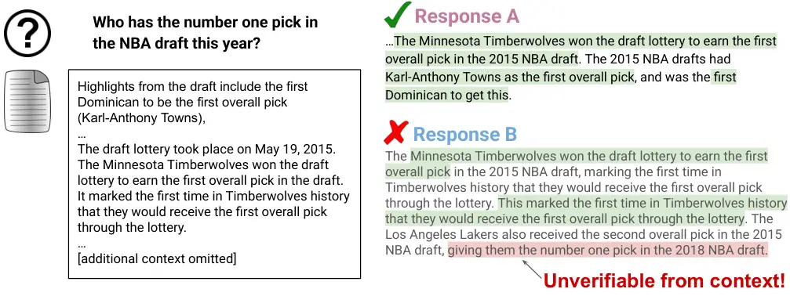
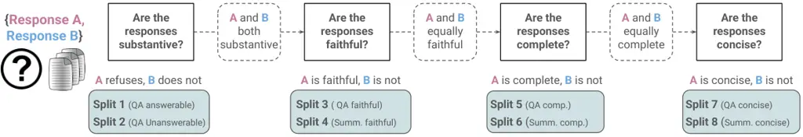
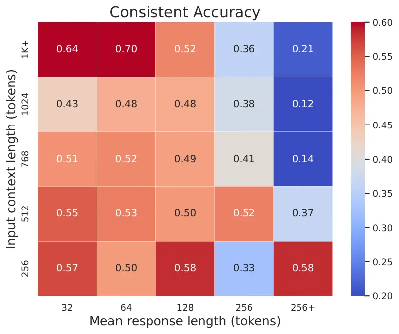
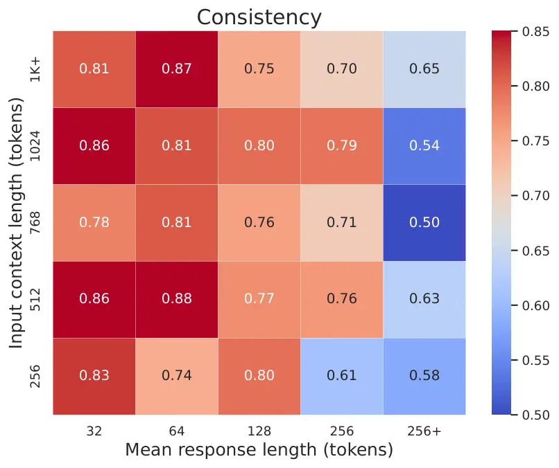

# Does Context Matter? ContextualJudgeBench for Evaluating LLM-based Judges in Contextual Settings

Austin Xu^(⋆)    Srijan Bansal^(⋆)    Yifei Ming    Semih Yavuz   
Shafiq Joty Affiliation: Salesforce AI Research Affiliation: ^(⋆)
Co-lead, equal contribution. Correspondence: {austin.xu,
srijanbansal}@salesforce.com Affiliation:   
[https://github.com/SalesforceAIResearch/ContextualJudgeBench](https://github.com/SalesforceAIResearch/ContextualJudgeBench)
Affiliation: ![[Uncaptioned
image]](arxiv-2503-15620v1--f72975e73861.figures/figure-1.webp) 
[https://huggingface.co/datasets/Salesforce/ContextualJudgeBench](https://huggingface.co/datasets/Salesforce/ContextualJudgeBench)

###### Abstract

The large language model (LLM)-as-judge paradigm has been used to meet
the demand for a cheap, reliable, and fast evaluation of model outputs
during AI system development and post-deployment monitoring. While judge
models—LLMs finetuned to specialize in assessing and critiquing model
outputs—have been touted as general purpose evaluators, they are
typically evaluated only on non-contextual scenarios, such as
instruction following. The omission of contextual settings—those where
external information is used as context to generate an output—is
surprising given the increasing prevalence of retrieval-augmented
generation (RAG) and summarization use cases. Contextual assessment is
uniquely challenging, as evaluation often depends on practitioner
priorities, leading to conditional evaluation criteria (e.g., comparing
responses based on factuality and then considering completeness if they
are equally factual). To address the gap, we
propose ContextualJudgeBench, a judge benchmark with 2,000 challenging
response pairs across eight splits inspired by real-world contextual
evaluation scenarios. We build our benchmark with a multi-pronged data
construction pipeline that leverages both existing human annotations and
model-based perturbations. Our comprehensive study across 11 judge
models and 9 general purpose models, reveals that the contextual
information and its assessment criteria present a significant challenge
to even state-of-the-art models. For example, OpenAI’s o1, the
best-performing model, barely reaches 55% consistent accuracy.

## 1 Introduction

In the LLM era, timely, affordable, and accurate evaluation of model
responses is essential for model development and monitoring. One
automated evaluation solution available to practitioners is the
LLM-as-judge approach, where relatively lightweight judge models are
trained to evaluate and critique other model responses. Judge models are
broadly touted as general-purpose evaluators (e.g., Vu et al. (2024);
Alexandru et al. (2025)), capable of being deployed across domains and
evaluation settings. However, judges are rarely evaluated on contextual
settings (Wang et al., 2024c; Saha et al., 2025; Ye et al., 2024), where
the evaluated responses are generated from an externally provided
context rather than solely from the model’s parametric knowledge, like
in retrieval-augmented generation (RAG) or summarization.

Figure 1: (Top) An overview of top-performing models on the eight splits
of ContextualJudgeBench. (Bottom) A truncated sample from the
faithfulness split, where Response A is preferred because all of its
content is factually verifiable from the context.

As contextual generation systems gain prominence, specialized
generators (Cohere Team, 2024; Contextual AI Team, 2024; Nguyen et al., 2024) have been developed to meet the stringent faithfulness demands of
business applications and high-risk fields, like medicine (Xiong et al., 2024) and law (Wiratunga et al., 2024). Reliably evaluating such systems
is increasingly important, but presents unique challenges. The presence
of contextual information magnifies challenges that exist in
non-contextual human evaluation (Liu et al., 2023): Since contextual
generation requires responses to be faithful to the provided context,
humans must first comprehend potentially long, domain-specific contexts
before they can evaluate a response. This additional “hallucination
detection” step adds another layer of complexity on top of evaluating
the substantive quality of responses.

Taken together, contextual settings are the ideal candidate for
automatic evaluation: LLMs have strong language understanding across
specialized domains Xie et al. (2023); Ke et al. (2025); Colombo et al.
(2024) and have rapidly improving long-context comprehension
abilities Kamradt (2023). Indeed, many recent benchmarks for contextual
generation use prompted (Laban et al., 2024; Jacovi et al., 2025) or
finetuned (Friel et al., 2024) LLMs to serve as evaluators due to
longer, more complex model outputs. However, to our knowledge, no
benchmarks exist to measure the quality of contextual evaluators. We
bridge this gap by proposing ContextualJudgeBench, which consists of
2,000 challenging pairwise samples across 8 splits that measure
different evaluation criteria and settings. Figure 1 showcases our
dataset splits and benchmarking results. Our work complements existing
contextual generation benchmarks by offering a way to assess contextual
evaluators.

The dominant criteria for the contextual evaluation of responses center
around faithfulness and answer relevancy (Es et al., 2023; Saad-Falcon
et al., 2023; Jacovi et al., 2025; Laban et al., 2024). Such metrics are
often assigned independently in a pointwise manner, i.e., a model
assigns a faithfulness score and a relevance score to a single response,
with each score assigned without considering the other.
ContextualJudgeBench, in contrast, proposes a pairwise evaluation setup.
This pairwise setup offers utility to practitioners (e.g., evaluation
for A/B testing) while eliciting evaluations better aligned with humans
judgment from automatic evaluators (Wang et al., 2023; Liu et al.,
2024a). However, directly using pointwise scores to do pairwise
comparisons can lead to ambiguity: If a response is more relevant but
less faithful, is it better?

To remedy this, we propose a principled conditional evaluation hierarchy
(Section 3) that prioritizes refusal accuracy and response faithfulness.
First, we evaluate if judges can assess accurate or inaccurate refusals,
where a response that refuses to answer due to a perceived lack of
evidence is compared against a substantive response. Given two
substantive responses, we next assess based on faithfulness: Which
response contains more factually supported information? If two responses
are equally faithful, then they are evaluated on completeness, with more
thorough responses being preferred. Finally, for two equally complete
responses, they are evaluated based on conciseness, as responses should
not contain extraneous information, even if factual. The splits in
ContextualJudgeBench are carefully designed to test judges in each
setting that arises in this hierarchy. Concretely, our contributions
are:

- •
  With an emphasis on refusals and faithfulness, we propose a hierarchy
  that provides an “order of operations” for pairwise contextual
  evaluation.
- •
  We present ContextualJudgeBench, a benchmark for evaluating judge
  models consisting of 2,000 response pairs across eight splits derived
  from real-world contextual outcomes.
- •
  We evaluate 11 judge models, ranging in size from 3.8B to 70B
  parameters on ContextualJudgeBench along with 9 general
  purpose/reasoning models.

Our findings reveal that contextual assessment remains an open
challenge, with GPT-o1 and SFRJudge-70B (Wang et al., 2024b) only
achieving 55.3 and 51.4 accuracy. Despite the reasoning intensive nature
of contextual evaluation, our analysis shows that inference-time scaling
for judges may actually lead to performance degradations.

## 2 Related work

Our work, rather than evaluating contextual systems, evaluates judge
models as contextual evaluators. Here, we review current judge
benchmarks and contextual evaluation setups.

Evaluation for LLM-as-judges. LLM-as-judge is a generative evaluator
paradigm where LLMs are trained to produce an evaluation (natural
language explanation and judgment) given the original user input,
evaluation protocol (rules and criteria for evaluation), and model
responses as input. As the popularity of LLM-as-judges grows, numerous
benchmarks have been proposed to evaluate these evaluators. These
benchmarks are typically for specific domains, like instruction
following (Zeng et al., 2023), fine-grained evaluation (Kim et al.,
2023; Kim et al., 2024), bias (Park et al., 2024), reward
modeling (Lambert et al., 2024; Frick et al., 2024; Gureja et al.,
2024), or reasoning (Tan et al., 2024). While new judge benchmarks are
challenging, none focus on contextual evaluation. Of judge benchmarks, a
subset of Eval-P (Li et al., 2023a) contains summarization pairs with
the winner chosen by aggregating various criteria into an overall score.
InstruSum (Liu et al., 2023) has also been used for judge
evaluation (Wang et al., 2024b; Alexandru et al., 2025; Liu et al.,
2024c). ContextualJudgeBench, in contrast, is dedicated entirely to
contextual evaluation, requiring evaluation to be done in under-explored
settings like RAG-QA along previously untested criteria such as
refusal.

Evaluation for contextual responses. RAG generators have been typically
evaluated with standard knowledge-based QA tasks, e.g.,
ContextualBench (Nguyen et al., 2024), or with newer benchmarks that
cover scenarios such as faithfulness (Ming et al., 2024; Niu et al.,
2024; Tang et al., 2024; Li et al., 2023b; Sadat et al., 2023), diverse
domains (Friel et al., 2024), refusals (Peng et al., 2024), and
reasoning (Wei et al., 2024; Krishna et al., 2024). Because RAG settings
have progressed beyond simple factoid answers, recent benchmarks have
deployed carefully prompted frontier LLMs (e.g., Jacovi et al. (2025))
to perform assessment in a pointwise manner, rather than using exact
string matching (Nguyen et al., 2024).

Initial evaluation efforts for RAG settings focused on faithfulness,
training hallucination detectors (Tang et al., 2024) as both sequence
classifiers and generative models (Wang et al., 2024a; Ravi et al.,
2024; Ramamurthy et al., 2024). More holistic evaluation systems with
multiple metrics have recently been proposed, such as Es et al. (2023);
Saad-Falcon et al. (2023). For the most part, these approaches involve
specialized prompting (Es et al., 2023), using synthetic data generation
to train specialized evaluators (Saad-Falcon et al., 2023).

Summarization evaluation has evolved from n-gram metrics like
ROUGE (Lin, 2004) and METEOR (Banerjee and Lavie, 2005) to contextual
embedding model scorers (Zhang et al., 2020; Zhao et al., 2019; Yuan
et al., 2021). However, these evaluators cannot assess based on multiple
criteria and tend to correlate poorly with humans. To evaluate quality,
the primary focus has been on model-based factual verification (Laban
et al., 2022; Cao and Wang, 2021; Goyal and Durrett, 2021; Kryscinski
et al., 2020; Laban et al., 2023). Recent studies have shifted toward
human annotations for finer-grained assessment (Song et al., 2024; Lee
et al., 2024; Oh et al., 2025), focusing on metrics such as faithfulness
and conciseness. As summarization has become more
instruction-controllable, LLM evaluators have been tasked with more
controlled assessments (Liu et al., 2023; Laban et al., 2024).

Our proposed work complements these existing benchmarks in summarization
and RAG by evaluating contextual judges, rather than the generators.

## 3 ContextualJudgeBench

Figure 2: A refusal and faithfulness-first contextual evaluation
hierarchy, as assessed by ContextualJudgeBench.

> “63 percent of respondents…said that output inaccuracy was the
> greatest risk they saw in their organizations’ use of gen AI.”
> –[McKinsey, 2024 AI
> Survey](https://www.mckinsey.com/capabilities/mckinsey-digital/our-insights/a-data-leaders-technical-guide-to-scaling-gen-ai)

Inaccuracy is the largest reported risk for practitioners using AI
systems. 30% of respondents in a [Deloitte
survey](https://www2.deloitte.com/content/dam/Deloitte/us/Documents/consulting/us-state-of-gen-ai-q4.pdf)
specifically cite trust loss due to hallucinations as a top concern.
Hallucinations are especially unacceptable in contextual settings, as
the model is expected to generate responses strictly based on the
provided context. This grounding context is typically considered a
gold-standard source of knowledge. If the relevant information is
absent, the model should refrain from responding rather than generate
unsupported content. Motivated by real-world concerns, we propose a
conditional evaluation workflow (Figure 2) that prioritizes
answerability and faithfulness before assessing other criteria. Each
evaluation step in our workflow requires creating new splits for
ContextualJudgeBench.

In developing contextual systems, practitioners often conduct A/B
testing between systems with different generator, retriever,
pre-processing configurations (Saad-Falcon et al., 2023).
ContextualJudgeBench is designed to reflect this pairwise A/B testing
setup, containing 2,000 test samples. Each sample includes a user input,
a context, and two responses, from which a judge selects the “better”
response based on our workflow. The pairwise setting is well-suited for
judge-based evaluation as it aligns closely with human preferences (Wang
et al., 2023; Liu et al., 2024a). We first describe two methods we use
to create the pairwise samples. Then, we present ContextualJudgeBench in
four stages (Section 3.2 – 3.5), each corresponding to a step in the
evaluation workflow (Figure 2).

### 3.1 Dataset creation approach

We employ two primary approaches to create ContextualJudgeBench:
utilizing existing human annotations and leveraging frontier models for
criteria-based response perturbation.

- •
  Human annotations \[H\]: We use existing human annotations (Lee
  et al., 2024; Wan et al., 2024; Wu et al., 2023; Liu et al., 2024b)
  that evaluate multiple model responses for the same context. These
  assessments include criteria-specific scores or errors, either
  holistically or sentence-level. We select responses with significant
  differences based on specific criterion to form pairs, enabling
  comparative assessments.
- •
  Model-based perturbations: In the absence of human labels, we form
  pairs through criteria-based response perturbation. Specifically, we
  use frontier LLMs to modify accurate responses based on the context to
  produce responses that do not align with the intended criteria. We
  apply this approach in two distinct ways:

  Desired output prompting \[M1\]: We ask an LLM to directly generate a
  response based on the context that fits certain output criteria. This
  includes generating context-based refusals or deliberately unfaithful
  responses.

  Existing output modification \[M2\]: We use an LLM to modify an
  existing response, introducing deviations based on predefined
  criteria. This can include making the response more verbose or
  altering its content in specific ways.

See Appendix A for details on the ContextualJudgeBench datasets,
including data sources, pair sampling approaches, prompts used, and
representative examples for each split.

### 3.2 Step 1: QA refusal validity \[splits 1 & 2\]

Knowing when to refuse to answer due to lack of information is a
critical first step specific to RAG settings.¹¹ 1 Refusals are uncommon
in summarization, as instructions and context are both user provided; In
RAG settings, the user has no control over the retrieved context.
Refusals can be viewed as a form of faithfulness: To remain faithful to
the context, the model should refuse to hallucinate an answer if no
relevant information is present. Conversely, the model should not refuse
if the context is sufficient.

Splits 1 and 2 of ContextualJudgeBench assess if judges can identify
appropriate refusals. Each sample consists of a refusal (e.g., “The
answer cannot be answered based on the context”) and a substantive
response. Split 1 contains answerable questions from LFRQA Han et al.
(2024), where the judge should pick the substantive response, whereas
split 2 contains unanswerable questions from FaithEval (Ming et al.,
2024), making refusal the correct choice. To construct split 1, we use
approach M1 from Section 3.1, using an LLM to generate context-based
refusals as negative responses to pair up with the provided positive
responses. In split 2, we again employ approach M1 to generate
context-based refusal responses to correctly decline the question as
positive responses and generate hallucinated (incorrect) responses as
negative ones. See Appendix A for generation prompt.

### 3.3 Step 2: Faithfulness \[splits 3 & 4\]

When evaluating two substantive responses, the first criterion is
faithfulness, as a response cannot be considered accurate if it contains
hallucinated content. Faithfulness measures the consistency of the
response with the context: all factual statements in a faithful response
must be attributable to the context, ensuring there are no
hallucinations. Splits 3 and 4 evaluate the judge’s ability to select
the more faithful response for QA and summarization, respectively. Each
pairwise sample is designed to include one substantively more faithful
response, allowing the judge to choose the better response based solely
on faithfulness.

We construct split 3 by combining multiple QA datasets. For QA-Feedback
(Wu et al., 2023) and RAGTruth (Niu et al., 2024), we use the approach H
to form pairs between RAG responses, annotated with either faithfulness
scores or factuality errors. For LFRQA (Han et al., 2024), LFQA (Xu
et al., 2023), and short queries from MRQA (Fisch et al., 2019), we
treat the provided responses as factually correct (positive) and apply
approach M1 to generate factually inconsistent negative responses based
on the context. See Appendix A for prompt template. We manually reviewed
the formed pairs to ensure their reliability. For Split 4, we use
approach H to create summarization response pairs of different
factuality levels. To ensure diversity, we sample contexts from Wan
et al. (2024); Lee et al. (2024), which cover both topic-specific and
general summarization instructions across diverse domains.

Figure 3: Distributions of context domain as a percent of the total set
of preference pairs in the benchmark.

### 3.4 Step 3: Completeness \[splits 5 & 6\]

Beyond faithfulness, contextual evaluation must also assess response
quality. When comparing two faithful responses, the better one should
cover all essential information needed for a thorough and useful answer.
As such, we consider completeness, i.e., how comprehensive the response
is, as the next criteria. Splits 5 and 6 assess the judge’s ability to
select more complete response when both options are faithful, for QA and
summarization tasks, respectively. Each pairwise sample is designed such
that one response is more complete than the other while both the
responses are faithful.

Judges should first confirm that both responses are faithful and then
determine which one is more complete. We construct Split 5 using the
LFRQA (Han et al., 2024) and QA-Feedback (Wu et al., 2023) datasets. For
LFRQA, we use approach M2 from Section 3.1 to modify a faithful response
by omitting lines associated with certain citations while expanding on
other citations. This yields a less complete negative response that is
still faithful and similar in length to the original (positive)
response. See Appendix A for generation prompt. For QA-Feedback, we use
approach H to create preference pairs from RAG responses annotated for
completeness scores or missing information errors. Similarly, split 6 is
created using approach H with existing human annotations that assess
faithfulness and completeness in summarization responses. To form
preference pairs, we first filter unfaithful responses. Then, we form
pairs based on completeness, ensuring that one response is significantly
more complete (positive) than the other (negative).

### 3.5 Step 4: Conciseness \[splits 7 & 8\]

Our final criterion is conciseness: does the response avoid including
more than what was asked? Our hierarchy intentionally places conciseness
after completeness, as an answer should not sacrifice relevant content
for the sake of brevity. However, complete responses may not be
minimally complete: They may contain faithful yet extraneous
information, repeated content, or unnecessary stylistic details. In
splits 7 and 8, each pairwise sample has one response that is more
concise while maintaining the same faithfulness and completeness. Judges
should first verify both responses are faithful and complete, then
choose the more concise one.

For Split 7, we use LFRQA (Han et al., 2024) and QA-Feedback (Wu et al.,
2023). For LFRQA, we apply approach M2, tasking the model to insert
direct quotations from the context without modifying the substance of
provided responses. See Appendix A for generation prompt. For
QA-Feedback, we use approach H to create pairs from responses annotated
along conciseness, redundancy, and irrelevance. Preference pairs are
formed by pairing faithful and complete responses by conciseness. For
split 8, we again use approach H, using human annotations (Lee et al.,
2024; Liu et al., 2024b) that assess summarization faithfulness,
completeness, and conciseness.

### 3.6 Overall dataset statistics

ContextualJudgeBench is constructed based on our evaluation workflow
(Fig. 2), resulting in 8 splits across 4 evaluation criteria, covering
two common use cases of contextual generation: RAG-QA (5 splits) and
Summarization (3 splits). We present the domain distribution in Figure 3
and dataset statistics in Table 1. Overall, ContextualJudgeBench
consists of 2,000 preference pairs, balanced across all splits, with
over 1,500 unique contexts to minimize duplication. We include a wide
range of context lengths, from a few tokens to nearly 10K tokens, with
summarization contexts typically longer than QA ones. Response lengths
range from brief answers to summaries over 1,000 tokens. To account for
length bias in judges (Zeng et al., 2023; Park et al., 2024), we ensure
minimal length differences between positive and negative responses
across all splits; however, conciseness correlates with response length,
resulting in longer positive responses.

|                      |          |            |                      |                      |                        |                        |
| -------------------- | -------- | ---------- | -------------------- | -------------------- | ---------------------- | ---------------------- |
| Split                | \# Pairs | \# Context | $`\mathbf{{L}_{c}}`$ | $`\mathbf{{L}_{r}}`$ | $`\mathbf{{L}_{pos}}`$ | $`\mathbf{{L}_{neg}}`$ |
| Refusal (Ans.)       | 250      | 250        | 1,444                | 102                  | 108                    | 95                     |
| Refusal (Unans.)     | 250      | 250        | 418                  | 64                   | 64                     | 63                     |
| Faithfulness (QA)    | 250      | 213        | 414                  | 100                  | 99                     | 101                    |
| Faithfulness (Summ.) | 250      | 192        | 1,754                | 94                   | 97                     | 91                     |
| Completeness (QA)    | 250      | 250        | 658                  | 106                  | 98                     | 113                    |
| Completeness (Summ.) | 251      | 171        | 1,066                | 91                   | 93                     | 89                     |
| Conciseness (QA)     | 255      | 254        | 1,086                | 199                  | 116                    | 281                    |
| Conciseness (Summ.)  | 244      | 117        | 1,557                | 98                   | 77                     | 118                    |
| Total                | 2,000    | 1,537      | 1,048                | 107                  | 94                     | 119                    |

Table 1: ContextualJudgeBench statistics. \# Context denotes unique
contexts across all pairs. $`\mathbf{{L}_{c}}`$ and $`\mathbf{{L}_{r}}`$
represent the mean context and response lengths, while
$`\mathbf{{L}_{pos}}`$ and $`\mathbf{{L}_{neg}}`$ denote the mean
positive and negative response lengths per split.

## 4 Evaluation and analysis

### 4.1 Evaluation setup and baselines

Because the order of responses influences judge decisions (Wang et al.,
2023), we adopt a consistency evaluation setup, like Tan et al. (2024);
Li et al. (2023a). We run evaluation for each test sample twice,
swapping the order of responses for the second run. We denote these as
Run 1 and Run 2, respectively. Given the judge outputs of Run 1 and Run
2, we compute the following metrics.

- •
  Consistent accuracy: A judge output is considered correct if the judge
  selects the correct response for both runs. Under this setup, randomly
  choosing responses achieves a consistent accuracy of 25%. Our main
  evaluation results report consistent accuracy.
- •
  Run 1 and 2 accuracy: A judge output is considered correct is the
  judge selects the correct response in the respective run. These
  metrics do not take consistency into account, and may reflect more
  practical settings where inference can only be run once.
- •
  Optimistic accuracy: A judge output is considered correct if either
  the Run 1 or Run 2 output is correct, regardless of if the judge is
  consistent. This provides an optimistic upper bound for judge
  performance.
- •
  Consistency: Consistency is the fraction of times a judge selects the
  same response in both runs, regardless of correctness.

To support a systemic investigation into positional bias (Section 5.2),
Run 1 sets Response A as the positive response while Run 2 sets Response
B as the positive response for all samples.

|                                       |           |       |              |
| ------------------------------------- | --------- | ----- | ------------ |
| Model                                 | \# Params | Expl. | Context len. |
| GLIDER (Deshpande et al., 2024)       | 3.8B      | ✓     | 128K         |
| Prometheus-2 (Kim et al., 2024)       | 7,8x7B    | ✓     | 16K          |
| OffsetBias (Park et al., 2024)        | 8B        | ✗     | 8K           |
| Atla-Selene (Alexandru et al., 2025)  | 8B        | ✓     | 128K         |
| Skywork-Critic (Shiwen et al., 2024)  | 8,70B     | ✗     | 128K         |
| SFRJudge (Wang et al., 2024b)         | 8,12,70B  | ✓     | 128K         |
| STEval. (Wang et al., 2024c)          | 70B       | ✓     | 128K         |
| Llama-3.1 (Dubey et al., 2024)        | 8,70B     | ✓     | 128K         |
| Llama-3.3 (Dubey et al., 2024)        | 70B       | ✓     | 128K         |
| GPT-4o,4o-mini (Hurst et al., 2024)   | ?         | ✓     | 128K         |
| GPT-o1,o3-mini (Jaech et al., 2024)   | ?         | ✓     | 128K         |
| DeepSeek-R1 Guo et al. (2025)         | 685B      | ✓     | 128K         |
| DeepSeek-R1-distill Guo et al. (2025) | 70B       | ✓     | 128K         |

Table 2: Judge (top) and general (bottom) models evaluated. Expl.
denotes if model outputs explanations.

|                      |                          |         |          |              |              |              |              |             |             |         |
| -------------------- | ------------------------ | ------- | -------- | ------------ | ------------ | ------------ | ------------ | ----------- | ----------- | ------- |
|                      | Model                    | Refusal | Refusal  | Faithfulness | Faithfulness | Completeness | Completeness | Conciseness | Conciseness | Average |
|                      |                          | (Ans.)  | (Unans.) | (QA)         | (Summ.)      | (QA)         | (Summ.)      | (QA)        | (Summ.)     |         |
| Small Judge          | Glider-3.8B              | 12.0    | 8.8      | 45.6         | 9.2          | 20.8         | 28.7         | 5.1         | 4.1         | 16.8    |
|                      | Promtheus-2-7b           | 12.4    | 44.0     | 27.2         | 32.0         | 24.0         | 42.6         | 6.7         | 29.5        | 27.3    |
|                      | Llama-3-OffsetBias-8B    | 64.8    | 11.2     | 34.0         | 26.4         | 33.2         | 21.1         | 46.3        | 23.0        | 32.6    |
|                      | Skywork-8B               | 60.8    | 12.0     | 38.8         | 31.6         | 38.4         | 26.7         | 29.4        | 21.3        | 32.4    |
|                      | Alta-Selene-8B           | 74.4    | 26.4     | 40.8         | 32.8         | 32.4         | 34.7         | 23.1        | 32.0        | 37.1    |
|                      | SFRJudge-8B              | 70.8    | 22.0     | 40.4         | 38.8         | 40.4         | 43.4         | 27.5        | 31.1        | 39.3    |
|                      | SFRJudge-12B             | 68.4    | 28.4     | 45.2         | 43.6         | 28.0         | 51.0         | 16.1        | 29.5        | 38.8    |
| Large Judge          | Promtheus-2-8x7b         | 22.0    | 29.6     | 22.4         | 29.6         | 20.4         | 39.8         | 10.2        | 18.4        | 24.1    |
|                      | Skywork-70B              | 82.4    | 11.2     | 48.0         | 47.6         | 36.8         | 41.4         | 21.6        | 27.9        | 39.6    |
|                      | ST-Eval-70B              | 50.0    | 42.0     | 51.2         | 45.6         | 40.8         | 39.4         | 36.1        | 29.9        | 41.9    |
|                      | SFRJudge-70B             | 87.6    | 32.4     | 60.8         | 54.8         | 40.8         | 53.4         | 44.7        | 36.1        | 51.4    |
| Instruct + Reasoning | Llama-3.1-8B             | 28.0    | 43.2     | 34.8         | 34.8         | 23.2         | 41.0         | 11.4        | 21.3        | 29.7    |
|                      | Llama-3.1-70B            | 59.6    | 48.0     | 58.0         | 48.4         | 38.0         | 51.8         | 15.7        | 27.5        | 43.4    |
|                      | Llama-3.3-70B            | 71.6    | 42.4     | 68.0         | 48.4         | 42.0         | 51.8         | 20.8        | 30.7        | 47.0    |
|                      | R1-Distill-Llama-3.3-70B | 89.6    | 50.4     | 74.0         | 48.4         | 42.4         | 57.4         | 19.2        | 29.5        | 51.4    |
|                      | GPT-4o-mini              | 71.2    | 22.8     | 45.6         | 42.4         | 33.2         | 54.2         | 11.8        | 29.5        | 38.8    |
|                      | GPT-4o                   | 64.0    | 52.0     | 68.0         | 50.8         | 39.6         | 56.2         | 12.9        | 22.5        | 45.8    |
|                      | o3-mini                  | 95.2    | 34.4     | 76.4         | 58.0         | 40.4         | 59.8         | 20.8        | 35.7        | 52.6    |
|                      | o1                       | 96.0    | 48.4     | 84.4         | 59.2         | 48.4         | 63.7         | 15.3        | 27.0        | 55.3    |
|                      | DeepSeek-R1              | 92.0    | 52.0     | 72.0         | 50.4         | 41.2         | 60.6         | 20.4        | 26.2        | 51.9    |
| Other                | RAGAS                    | 62.4    | 60.0     | 78.8         | 54.4         | 22.4         | 23.1         | –           | –           | –       |
|                      | Minicheck-7B             | 93.6    | 20.4     | 83.2         | 70.4         | –            | –            | –           | –           | –       |

Table 3: Consistent accuracy for judge models, open-source instruct
models, and API models on ContextualJudgeBench.

We evaluate 11 competitive LLM-as-judge models, ranging in size from
3.8B to 70B parameters: Prometheus (Kim et al., 2024), OffsetBias (Park
et al., 2024), SFRJudge (Wang et al., 2024b), Skywork-Critic (Shiwen
et al., 2024), Self-taugh-evaluator (Wang et al., 2024c),
GLIDER (Deshpande et al., 2024), and Atla-Selene (Alexandru et al.,
2025). See Table 2 for an overview of judges and Section B.1 for a more
detailed description of each evaluated judge. For each judge, we retain
the original prompt template while modifying evaluation instructions to
align with our proposed workflow. Please see Section B.2 for prompt
samples. In addition to specialized judges, we use the instruct versions
of Llama-3.1-8B and 70B and Llama-3.3-70B, along with GPT-4o,
GPT-4o-mini, o3-mini, o1, Deepseek-R1, and DeepSeek-R1-Llama-Distill as
prompted judge model baselines. For all non-reasoning model-based
judges, we generate with greedy sampling.

As a reference point, we also run RAGAS (Es et al., 2023), a pointwise
RAG evaluator that leverages both prompted frontier models and embedding
models, as well as MiniCheck (Tang et al., 2024), a hallucination
detector. We apply these two methods to benchmark splits covered by
their respective metrics: refusal and faithfulness for both, and
completeness for RAGAS. For RAGAS, we score each response pointwise and
derive corresponding pairwise outcomes in line with our hierarchy (e.g.,
for the completeness split, two responses must be considered equally
faithful). For MiniCheck, we directly compare the classifier
probabilities of each response to determine the pairwise winner.

Figure 4: (Left) Accuracy vs. verified accuracy and (Right) optimistic
accuracy vs. verified optimistic accuracy for six models, aggregated by
criteria. The larger the drop from the dashed black line, the larger
fraction of correct outcomes used incorrect criteria, as assessed by
GPT-4o.

Figure 5: Judge performance changes are minor when given exact criteria
vs. full workflow, indicating challenges in contextual evaluation beyond
criteria. Per-split metrics (Left) averaged across all models, per-judge
metrics (Right) averaged across all splits for a selected subset of
judges.

### 4.2 Judge model evaluation

The results presented in Table 3 highlight the challenges of contextual
evaluation. Overall, the best models on ContextualJudgeBench are o1
(55.3), o3-mini (52.6) and DeepSeek-R1 (51.9), two large-scale reasoning
models. The best-performing judge, SFRJudge-70B (51.4), nearly matches
DeepSeek-R1. Judge model performance generally increases with model
size, with the best-performing judges exceeding their similarly-sized
API counterparts (e.g., SFRJudge-8B at 39.3 and GPT-4o-mini at 38.8).
The scaling trend, along with the strong performance of reasoning
models, suggests that contextual evaluation is a reasoning-intensive
task.

The performance difference between Llama-3.3-70B and its DeepSeek-R1
distilled counterpart clearly demonstrates the reasoning-intensive
nature of contextual evaluation: DeepSeek-R1-Llama-70B outperforms its
base model, Llama-3.3-70B-Instruct, by 4.4 points, with the only
difference between the two models being reasoning-specific training.
Despite the importance of strong reasoning ability, we show that two
inference-time scaling techniques typically used in reasoning settings,
self-consistency and better chain-of-thought prompting, do not boost
judge performance in Section 4.4 and Section C.1.

Generative judge models tend to lag specialized evaluators. MiniCheck
naturally excels for faithfulness, while RAGAS offers more balanced, yet
still competitive performance across refusal and faithfulness splits.
However, most judges outperform the embedding-based RAGAS completeness
score, showing an advantage of generative evaluation.

Models tend to struggle with conciseness and unanswerable refusals. The
difficulty with conciseness may be exacerbated by length bias (Zeng
et al., 2023), as selecting shorter concise responses conflicts with the
tendency of judge models to prefer longer ones. Likewise, struggling to
select accurate refusals may be a special case of concreteness
bias (Park et al., 2024), as judges are biased towards substantive
responses. Further analysis in Section C.2 reveals that poor accurate
refusal performance may be an unintended result of judge finetuning. The
same issue explains why models perform best on the answerable split.
Evaluation trends show increasing difficulty with factuality,
completeness, and conciseness, due to subtle distinctions in deeper
levels of evaluation workflow and the bias toward longer responses.

### 4.3 How do judges handle criteria?

Our analysis thus far has been outcome driven: We have not verified that
judges make correct judgments based on the specified criteria. Here, we
conduct model-assisted verification on a subset of judge models that
generate explanations: SFRJudge-8B,70B, Atla-Selene-8B,
Self-taught-evaluator, and two Llama models. For all judgments with the
correct outcome, we prompt GPT-4o to determine from the judge
explanation if the judgment was decided by the correct criteria (Full
prompt in Section B.3). From this, we compute a verified consistent
accuracy. In Figure 4, we plot the verified accuracies of each judge
against its original accuracies, with the black dashed-line indicating
the upper bound, where all correct responses use the right criteria. On
average, verified accuracies tend to be 20 absolute percent lower than
outcome-based accuracy, revealing that judges are using incorrect
reasoning to reach correct outcomes. Refusals and faithfulness are
generally determined for the correct reasons, whereas completeness and
conciseness are not, further highlighting the challenges of evaluation
in the contextual settings. A similar trend holds for the optimistic
variant of verified consistent accuracy, where we consider a sample to
be correct if any of the two consistency runs (1) returns the correct
outcome and (2) uses the correct reasoning. Verified optimistic accuracy
tends to track better with unverified accuracy than the non-optimistic
pair, with line of best fit coefficients of 0.99 and 0.86, respectively.

Figure 6: Across both small (Left) and larger (Right) judges, using
inference time scaling has little effect. (Top) Ensembling judges into
juries rarely outperforms the strongest judge in the jury due to weak
judge agreement. (Bottom) Self-consistency rarely improves judge
performance.

Figure 7: Distribution of judge responses by consistency run for $`10`$
sample self consistency. Each distribution is aggregated across splits.

While judges struggle to use the correct criteria when evaluating based
on the contextual hierarchy, they are slightly more capable when given
the correct criteria to use, as shown in Figure 5. For each split, we
prompt the judge with only the split criteria, omitting any mention of
the contextual hierarchy. We compare judge performance against prompting
with the full hierarchy. Conciseness and unanswerable refusals receive
the greatest benefit, showing that length bias and concreteness bias can
be mitigated to a degree with specific prompting. However, performance
gains are relatively muted across judges due to little change in judge
consistency between the two settings. Judge inconsistency, even after
abstracting away the hierarchical structure, suggests that contextual
evaluation poses challenges beyond applying the correct criteria. Full
results for all judge models are presented in Section C.3.

### 4.4 Can scaling inference-time compute help?

Inspired by recent efforts in inference-time scaling (Jaech et al.,
2024; Snell et al., 2024), we investigate the impact of two test-time
scaling techniques: LLM-as-jury (Verga et al., 2024) and
self-consistency (Wang et al., 2022). We experiment with three smaller
(8B) and three larger (70B) judges, and for both settings, aggregate
judgments via majority vote²² 2 We treat inconsistent judgments as ties.
For a sample, if the aggregated judgments do not have a clear winner,
e.g., (A, Tie, B) or (Tie, Tie, Tie), then we consider it incorrect. .
In Figure 6, we present our results for both LLM-as-jury (top) using
responses from different three judges and self-consistency (bottom)
using 10 responses per judge (using a temperature of 0.7). The results
are similar between smaller and larger models: LLM-as-jury rarely
outperforms the strongest judge in the jury, while using
self-consistency similarly has little impact on judge performance.

Figure 8: Judge performance decreases as context length increases.
x-axis: Percentile of entire benchmark context lengths, with raw token
count in parentheses.

Figure 9: Four accuracy measures showing performance variations due to
inconsistency, averaged across all splits for judge models (Left) and
general purpose/reasoning models (Right).

Figure 10: Judge performance averaged over all splits as a function of
two measures of response length. (Left): Judge performance decreases as
response lengths increase. (Right): Judge performance increases as the
difference in response length between the positive response and negative
response grows, indicating a bias for longer responses. N(x+) and P(x+)
indicate that the negative response and positive response is longer by x
tokens or more, respectively.

These trends may be surprising given the strong performance of reasoning
models like o1 and DeepSeek-R1. The lack of jury success stems from the
fact that judges do not exhibit structured agreement. We use all judge
outputs to compute Krippendorff’s alpha coefficient (Krippendorff,
2011), which measures inter-annotator agreement on a range from -1
(complete disagreement) to 1 (complete agreement), with 0 indicating
random chance. As shown in Figure 6, judge agreement is extremely
random: Even on the best-performing split, the alpha coefficient barely
exceeds 0.2.

Lack of improvement from self-consistency likely results from the fact
that contextual assessment is largely unseen in judge training. As a
result, better judgments cannot be extracted via random sampling. To
better visualize judge performance for self-consistency, we plot a
histogram of the response distribution for each consistency run
in Figure 7. Interestingly, the self-consistency judgment distribution
may be the byproduct of positional bias, where the judge outcome changes
as a result of the order of responses in the prompt. Our findings
in Section 5.2 show that most judges exhibit slight positional
preference for the second consistency run, with the lone exception of
the positionally unbiased SFRJudge-70B. These trends are reflected in
the self-consistency judgment distribution: The judgment distribution is
more skewed towards correct responses in Run 2 compared to Run 1 for all
judges except SFRJudge-70B. However, this does not translate to
performance gains for SFRJudge-70B, as judgment pairs themselves may be
inconsistent.

Figure 11: Effects of length of both context and responses on judge
accuracy (left) and consistency (right) averaged over the same subset of
judges as in Figure 8 and Figure 10.

## 5 Bias Analysis and Discussion

### 5.1 How does input context affect judge performance?

The inclusion of context for judge models makes contextual evaluation
more difficult: The longer the context, the more information the judge
must comprehend before making a judgment. This section explores the
interplay of context length and judge performance. In Figure 8, we
visualize consistent accuracy as a function of input context tokens for
a subset of strong performing judge models, binning context tokens by
percentile. In general, judge performance decreases as the context
length increases, with relatively weaker evaluators (e.g., GPT-4o)
exhibiting larger relative drops than stronger evaluators (e.g., o1).
Interestingly, SFRJudge-70B exhibits the most stable performance, with a
slight increase in judge performance.

### 5.2 Do judges exhibit positional bias in contextual evaluation?

Past studies have noted that judges are not robust to the order of the
response pairs (Wang et al., 2023; Li et al., 2023a). This positional
bias may be further exacerbated by the inclusion of context.
Inconsistency due to positional bias leads to performance variations for
both judge models and general-purpose/reasoning models, as shown
in Figure 9. Here, we visualize the Run 1 and Run 2 accuracy along with
consistent accuracy and optimistic accuracy, as defined in Section 4.1.

The inter-run performance gap tends to be small for stronger models,
such as larger finetuned judge models or reasoning models, reflecting
more consistent judgments (higher consistency). In contrast, weaker
models exhibit greater positional bias (lower consistency). The favored
position varies by model. For example, Prometheus-7B and Llama models
prefer the first response, while OffsetBias and OpenAI models favor the
second. The optimistic accuracy shows that judges are not wrong in a
consistent manner, but often change their judgments based on the order
of responses. Notably, optimistic accuracy of finetuned judges is
generally higher than that of prompted judges (e.g., 73.1 for OffsetBias
vs. 68.3 for o1), revealing that judge finetuning may raise the upper
bound of evaluation.

### 5.3 How does response length affect judge performance?

In additional to processing a potentially lengthy context, judge models
also process the entirety of two responses. As response length
increases, evaluation difficulty is expected to increase as well, as the
judge is tasked with comparing and evaluating more content. This section
examines how response length impacts judge performance. In Figure 10
(Left), we plot consistent accuracy against the mean response length for
a subset of strong judge models. Overall, performance declines as
responses grow longer, with a similar trend across both relatively weak
and strong evaluators. Similar to trends with increasing context length
(Section 5.1), SFRJudge-70B remains the most stable, showing minimal
performance variation.

Beyond the absolute length of responses, the relative difference in the
length between Response A and Response B can also impact judge
performance. It has been widely noted in prior work that judges exhibit
response length bias (Zeng et al., 2023; Park et al., 2024), i.e.,
judges prefer longer responses, even if said responses are not
meaningfully better. Figure 10 (Right) plots judge performance as a
function of the difference in length between positive and negative
responses. Judges tend to struggle to identify the positive response if
the negative response is longer by significant (e.g., 128+ tokens) and
excell at identifying the correct response when the positive response is
longer. This overall trend indicates that judges are biased towards
longer responses, which may partially explain the relatively low
performance of judge models on the conciseness splits As reported
in Table 1, positive positive responses are shorter than negative
responses on average, meaning that a high-performing judge must fight
against its inherent bias towards longer responses to select the better
response.

### 5.4 How do context and response length compound evaluation difficulty?

Thus far, we’ve considered how the length of context and responses have
affected judge performance in isolation. In Figure 11, we visualize at
their combined affect on consistent accuracy (left) and judge
consistency (right), a measure of positional bias for the same subset of
judges as the previous two sections. In general, response length and
context length tend to have a compounding effect: As responses and
context both increase in length, judge accuracy and consistency tend to
decrease, with longer responses impacting performance more than longer
input context in general. The opposite trend generally holds as well,
with stronger judge performances coming with shorter contexts and/or
responses.

## 6 Conclusion

We introduce ContextualJudgeBench, a benchmark designed to evaluate
LLM-judges in contextual settings. Building on a principled contextual
evaluation hierarchy, we construct eight benchmark splits that assess
refusals, faithfulness, completeness, and conciseness. This benchmark
presents a significant challenge for state-of-the-art judge and
reasoning models, with SFRJudge-70B and o1 achieving consistent
accuracies of 51.4% and 55.3%, respectively. Additionally, we conduct a
thorough analysis of reasoning correctness and examine the impact of
common methods for scaling test-time compute, result of which further
validate the unique challenges of contextual evaluation.

## Limitations

Our evaluations center around generative evaluators, as they are the
most flexible in terms of incorporating context and indicating different
evaluation criteria. However, reward models (RMs) are a common class of
evaluators that may be applicable to this setting. However, to our
knowledge, no contextual reward models exist. While in practice, one can
embed the context in the input, it is unclear how to derive
criteria-specific rewards from current models. A fruitful direction of
future work is developing and benchmarking classifier based RMs for
contextual settings.

As we repurposed existing annotated datasets – particularly for
faithfulness and completeness – we are constrained by their coverage.
This limitation may prevent us from making observations that generalize
beyond their original distribution. Furthermore, ContextualJudgeBench is
constructed primarily from English sources, a language abundant with
context, model responses, and corresponding annotations. Further
research should aim to rigorously assess contextual assessment in
low-resource languages, where contextual content and corresponding
annotations may be more scarce.

## References

- Abdin et al. (2024) Marah Abdin, Jyoti Aneja, Hany Awadalla, Ahmed
  Awadallah, Ammar Ahmad Awan, Nguyen Bach, Amit Bahree, Arash
  Bakhtiari, Jianmin Bao, Harkirat Behl, et al. 2024. Phi-3 technical
  report: A highly capable language model locally on your phone. _arXiv
  preprint arXiv:2404.14219_.
- Alexandru et al. (2025) Andrei Alexandru, Antonia Calvi, Henry
  Broomfield, Jackson Golden, Kyle Dai, Mathias Leys, Maurice Burger,
  Max Bartolo, Roman Engeler, Sashank Pisupati, et al. 2025. Atla selene
  mini: A general purpose evaluation model. _arXiv preprint
  arXiv:2501.17195_.
- Banerjee and Lavie (2005) Satanjeev Banerjee and Alon Lavie. 2005.
  [METEOR: An automatic metric for MT evaluation with improved
  correlation with human judgments](https://aclanthology.org/W05-0909/).
  In _Proceedings of the ACL Workshop on Intrinsic and Extrinsic
  Evaluation Measures for Machine Translation and/or Summarization_,
  pages 65–72, Ann Arbor, Michigan. Association for Computational
  Linguistics.
- Cao and Wang (2021) Shuyang Cao and Lu Wang. 2021. [CLIFF: Contrastive
  learning for improving faithfulness and factuality in abstractive
  summarization](https://doi.org/10.18653/v1/2021.emnlp-main.532). In
  _Proceedings of the 2021 Conference on Empirical Methods in Natural
  Language Processing_, pages 6633–6649, Online and Punta Cana,
  Dominican Republic. Association for Computational Linguistics.
- Cohere Team (2024) Cohere Team. 2024. [Command r: Retrieval-augmented
  generation at production scale](https://cohere.com/blog/command-r/).
- Colombo et al. (2024) Pierre Colombo, Telmo Pires, Malik Boudiaf, Rui
  Filipe Coimbra Pereira de Melo, Gabriel Hautreux, Etienne Malaboeuf,
  Johanne Charpentier, Dominic Culver, and Michael Desa. 2024.
  Saullm-54b & saullm-141b: Scaling up domain adaptation for the legal
  domain. In _The Thirty-eighth Annual Conference on Neural Information
  Processing Systems_.
- Contextual AI Team (2024) Contextual AI Team. 2024. [Introducing rag
  2.0](https://contextual.ai/introducing-rag2/).
- Deshpande et al. (2024) Darshan Deshpande, Selvan Sunitha Ravi, Sky
  CH-Wang, Bartosz Mielczarek, Anand Kannappan, and Rebecca Qian. 2024.
  Glider: Grading llm interactions and decisions using explainable
  ranking. _arXiv preprint arXiv:2412.14140_.
- D’Oosterlinck et al. (2024) Karel D’Oosterlinck, Winnie Xu, Chris
  Develder, Thomas Demeester, Amanpreet Singh, Christopher Potts, Douwe
  Kiela, and Shikib Mehri. 2024. Anchored preference optimization and
  contrastive revisions: Addressing underspecification in alignment.
  _arXiv preprint arXiv:2408.06266_.
- Dubey et al. (2024) Abhimanyu Dubey, Abhinav Jauhri, Abhinav Pandey,
  Abhishek Kadian, Ahmad Al-Dahle, Aiesha Letman, Akhil Mathur, Alan
  Schelten, Amy Yang, Angela Fan, et al. 2024. The llama 3 herd of
  models. _arXiv preprint arXiv:2407.21783_.
- Es et al. (2023) Shahul Es, Jithin James, Luis Espinosa-Anke, and
  Steven Schockaert. 2023. Ragas: Automated evaluation of retrieval
  augmented generation. _arXiv preprint arXiv:2309.15217_.
- Fisch et al. (2019) Adam Fisch, Alon Talmor, Robin Jia, Minjoon Seo,
  Eunsol Choi, and Danqi Chen. 2019. [MRQA 2019 shared task: Evaluating
  generalization in reading
  comprehension](https://doi.org/10.18653/v1/D19-5801). In _Proceedings
  of the 2nd Workshop on Machine Reading for Question Answering_, pages
  1–13, Hong Kong, China. Association for Computational Linguistics.
- Frick et al. (2024) Evan Frick, Tianle Li, Connor Chen, Wei-Lin
  Chiang, Anastasios N Angelopoulos, Jiantao Jiao, Banghua Zhu, Joseph E
  Gonzalez, and Ion Stoica. 2024. How to evaluate reward models for
  rlhf. _arXiv preprint arXiv:2410.14872_.
- Friel et al. (2024) Robert Friel, Masha Belyi, and Atindriyo
  Sanyal. 2024. Ragbench: Explainable benchmark for retrieval-augmented
  generation systems. _arXiv preprint arXiv:2407.11005_.
- Goyal and Durrett (2021) Tanya Goyal and Greg Durrett. 2021.
  [Annotating and modeling fine-grained factuality in
  summarization](https://doi.org/10.18653/v1/2021.naacl-main.114). In
  _Proceedings of the 2021 Conference of the North American Chapter of
  the Association for Computational Linguistics: Human Language
  Technologies_, pages 1449–1462, Online. Association for Computational
  Linguistics.
- Guo et al. (2025) Daya Guo, Dejian Yang, Haowei Zhang, Junxiao Song,
  Ruoyu Zhang, Runxin Xu, Qihao Zhu, Shirong Ma, Peiyi Wang, Xiao Bi,
  et al. 2025. Deepseek-r1: Incentivizing reasoning capability in llms
  via reinforcement learning. _arXiv preprint arXiv:2501.12948_.
- Gureja et al. (2024) Srishti Gureja, Lester James V Miranda,
  Shayekh Bin Islam, Rishabh Maheshwary, Drishti Sharma, Gusti Winata,
  Nathan Lambert, Sebastian Ruder, Sara Hooker, and Marzieh
  Fadaee. 2024. M-rewardbench: Evaluating reward models in multilingual
  settings. _arXiv preprint arXiv:2410.15522_.
- Han et al. (2024) Rujun Han, Yuhao Zhang, Peng Qi, Yumo Xu, Jenyuan
  Wang, Lan Liu, William Yang Wang, Bonan Min, and Vittorio
  Castelli. 2024. [RAG-QA arena: Evaluating domain robustness for
  long-form retrieval augmented question
  answering](https://doi.org/10.18653/v1/2024.emnlp-main.249). In
  _Proceedings of the 2024 Conference on Empirical Methods in Natural
  Language Processing_, pages 4354–4374, Miami, Florida, USA.
  Association for Computational Linguistics.
- Hurst et al. (2024) Aaron Hurst, Adam Lerer, Adam P Goucher, Adam
  Perelman, Aditya Ramesh, Aidan Clark, AJ Ostrow, Akila Welihinda, Alan
  Hayes, Alec Radford, et al. 2024. Gpt-4o system card. _arXiv preprint
  arXiv:2410.21276_.
- Jacovi et al. (2025) Alon Jacovi, Andrew Wang, Chris Alberti, Connie
  Tao, Jon Lipovetz, Kate Olszewska, Lukas Haas, Michelle Liu, Nate
  Keating, Adam Bloniarz, et al. 2025. The facts grounding leaderboard:
  Benchmarking llms’ ability to ground responses to long-form input.
  _arXiv preprint arXiv:2501.03200_.
- Jaech et al. (2024) Aaron Jaech, Adam Kalai, Adam Lerer, Adam
  Richardson, Ahmed El-Kishky, Aiden Low, Alec Helyar, Aleksander Madry,
  Alex Beutel, Alex Carney, et al. 2024. Openai o1 system card. _arXiv
  preprint arXiv:2412.16720_.
- Jiang et al. (2023) Albert Q Jiang, Alexandre Sablayrolles, Arthur
  Mensch, Chris Bamford, Devendra Singh Chaplot, Diego de las Casas,
  Florian Bressand, Gianna Lengyel, Guillaume Lample, Lucile Saulnier,
  et al. 2023. Mistral 7b. _arXiv preprint arXiv:2310.06825_.
- Jiang et al. (2024) Albert Q Jiang, Alexandre Sablayrolles, Antoine
  Roux, Arthur Mensch, Blanche Savary, Chris Bamford, Devendra Singh
  Chaplot, Diego de las Casas, Emma Bou Hanna, Florian Bressand,
  et al. 2024. Mixtral of experts. _arXiv preprint arXiv:2401.04088_.
- Kamradt (2023) Greg Kamradt. 2023. Pressure testing gpt-4-128k with
  long context recall.
- Ke et al. (2025) Zixuan Ke, Yifei Ming, Xuan-Phi Nguyen, Caiming
  Xiong, and Shafiq Joty. 2025. Demystifying domain-adaptive
  post-training for financial llms. _arXiv preprint arXiv:2501.04961_.
- Kim et al. (2023) Seungone Kim, Jamin Shin, Yejin Cho, Joel Jang,
  Shayne Longpre, Hwaran Lee, Sangdoo Yun, Seongjin Shin, Sungdong Kim,
  James Thorne, et al. 2023. Prometheus: Inducing fine-grained
  evaluation capability in language models. In _The Twelfth
  International Conference on Learning Representations_.
- Kim et al. (2024) Seungone Kim, Juyoung Suk, Shayne Longpre,
  Bill Yuchen Lin, Jamin Shin, Sean Welleck, Graham Neubig, Moontae Lee,
  Kyungjae Lee, and Minjoon Seo. 2024. Prometheus 2: An open source
  language model specialized in evaluating other language models. _arXiv
  preprint arXiv:2405.01535_.
- Krippendorff (2011) Klaus Krippendorff. 2011. Computing krippendorff’s
  alpha-reliability.
- Krishna et al. (2024) Satyapriya Krishna, Kalpesh Krishna, Anhad
  Mohananey, Steven Schwarcz, Adam Stambler, Shyam Upadhyay, and Manaal
  Faruqui. 2024. Fact, fetch, and reason: A unified evaluation of
  retrieval-augmented generation. _arXiv preprint arXiv:2409.12941_.
- Kryscinski et al. (2020) Wojciech Kryscinski, Bryan McCann, Caiming
  Xiong, and Richard Socher. 2020. [Evaluating the factual consistency
  of abstractive text
  summarization](https://doi.org/10.18653/v1/2020.emnlp-main.750). In
  _Proceedings of the 2020 Conference on Empirical Methods in Natural
  Language Processing (EMNLP)_, pages 9332–9346, Online. Association for
  Computational Linguistics.
- Laban et al. (2024) Philippe Laban, Alexander R Fabbri, Caiming Xiong,
  and Chien-Sheng Wu. 2024. Summary of a haystack: A challenge to
  long-context llms and rag systems. _arXiv preprint arXiv:2407.01370_.
- Laban et al. (2023) Philippe Laban, Wojciech Kryscinski, Divyansh
  Agarwal, Alexander Fabbri, Caiming Xiong, Shafiq Joty, and Chien-Sheng
  Wu. 2023. [SummEdits: Measuring LLM ability at factual reasoning
  through the lens of
  summarization](https://doi.org/10.18653/v1/2023.emnlp-main.600). In
  _Proceedings of the 2023 Conference on Empirical Methods in Natural
  Language Processing_, pages 9662–9676, Singapore. Association for
  Computational Linguistics.
- Laban et al. (2022) Philippe Laban, Tobias Schnabel, Paul N. Bennett,
  and Marti A. Hearst. 2022. [SummaC: Re-visiting NLI-based models for
  inconsistency detection in
  summarization](https://doi.org/10.1162/tacl_a_00453). _Transactions of
  the Association for Computational Linguistics_, 10:163–177.
- Lambert et al. (2024) Nathan Lambert, Valentina Pyatkin, Jacob
  Morrison, LJ Miranda, Bill Yuchen Lin, Khyathi Chandu, Nouha Dziri,
  Sachin Kumar, Tom Zick, Yejin Choi, et al. 2024. Rewardbench:
  Evaluating reward models for language modeling. _arXiv preprint
  arXiv:2403.13787_.
- Lee et al. (2024) Yuho Lee, Taewon Yun, Jason Cai, Hang Su, and
  Hwanjun Song. 2024. [UniSumEval: Towards unified, fine-grained,
  multi-dimensional summarization evaluation for
  LLMs](https://doi.org/10.18653/v1/2024.findings-emnlp.227). In
  _Findings of the Association for Computational Linguistics: EMNLP
  2024_, pages 3941–3960, Miami, Florida, USA. Association for
  Computational Linguistics.
- Li et al. (2025) Jia Li, Ge Li, Yongmin Li, and Zhi Jin. 2025.
  Structured chain-of-thought prompting for code generation. _ACM
  Transactions on Software Engineering and Methodology_, 34(2):1–23.
- Li et al. (2023a) Junlong Li, Shichao Sun, Weizhe Yuan, Run-Ze Fan,
  Hai Zhao, and Pengfei Liu. 2023a. Generative judge for evaluating
  alignment. _arXiv preprint arXiv:2310.05470_.
- Li et al. (2023b) Junyi Li, Xiaoxue Cheng, Wayne Xin Zhao, Jian-Yun
  Nie, and Ji-Rong Wen. 2023b. Halueval: A large-scale hallucination
  evaluation benchmark for large language models. _arXiv preprint
  arXiv:2305.11747_.
- Lin (2004) Chin-Yew Lin. 2004. Rouge: A package for automatic
  evaluation of summaries. In _Text summarization branches out_, pages
  74–81.
- Liu et al. (2024a) Yinhong Liu, Han Zhou, Zhijiang Guo, Ehsan
  Shareghi, Ivan Vulić, Anna Korhonen, and Nigel Collier. 2024a.
  Aligning with human judgement: The role of pairwise preference in
  large language model evaluators. _arXiv preprint arXiv:2403.16950_.
- Liu et al. (2024b) Yixin Liu, Alexander Fabbri, Jiawen Chen, Yilun
  Zhao, Simeng Han, Shafiq Joty, Pengfei Liu, Dragomir Radev,
  Chien-Sheng Wu, and Arman Cohan. 2024b. [Benchmarking generation and
  evaluation capabilities of large language models for instruction
  controllable
  summarization](https://doi.org/10.18653/v1/2024.findings-naacl.280).
  In _Findings of the Association for Computational Linguistics: NAACL
  2024_, pages 4481–4501, Mexico City, Mexico. Association for
  Computational Linguistics.
- Liu et al. (2023) Yixin Liu, Alexander R Fabbri, Jiawen Chen, Yilun
  Zhao, Simeng Han, Shafiq Joty, Pengfei Liu, Dragomir Radev,
  Chien-Sheng Wu, and Arman Cohan. 2023. Benchmarking generation and
  evaluation capabilities of large language models for instruction
  controllable summarization. _arXiv preprint arXiv:2311.09184_.
- Liu et al. (2024c) Yixin Liu, Kejian Shi, Alexander R Fabbri, Yilun
  Zhao, Peifeng Wang, Chien-Sheng Wu, Shafiq Joty, and Arman Cohan.
  2024c. Reife: Re-evaluating instruction-following evaluation. _arXiv
  preprint arXiv:2410.07069_.
- Ming et al. (2024) Yifei Ming, Senthil Purushwalkam, Shrey Pandit,
  Zixuan Ke, Xuan-Phi Nguyen, Caiming Xiong, and Shafiq Joty. 2024.
  [Faitheval: Can your language model stay faithful to context, even if
  "the moon is made of marshmallows"](https://arxiv.org/abs/2410.03727).
  _Preprint_, arXiv:2410.03727.
- Nguyen et al. (2024) Xuan-Phi Nguyen, Shrey Pandit, Senthil
  Purushwalkam, Austin Xu, Hailin Chen, Yifei Ming, Zixuan Ke, Silvio
  Savarese, Caiming Xong, and Shafiq Joty. 2024. Sfr-rag: Towards
  contextually faithful llms. _arXiv preprint arXiv:2409.09916_.
- Niu et al. (2024) Cheng Niu, Yuanhao Wu, Juno Zhu, Siliang Xu, KaShun
  Shum, Randy Zhong, Juntong Song, and Tong Zhang. 2024. [RAGTruth: A
  hallucination corpus for developing trustworthy retrieval-augmented
  language models](https://doi.org/10.18653/v1/2024.acl-long.585). In
  _Proceedings of the 62nd Annual Meeting of the Association for
  Computational Linguistics (Volume 1: Long Papers)_, pages 10862–10878,
  Bangkok, Thailand. Association for Computational Linguistics.
- Oh et al. (2025) Jihwan Oh, Jeonghwan Choi, Nicole Hee-Yoen Kim,
  Taewon Yun, and Hwanjun Song. 2025. [Learning to verify summary facts
  with fine-grained LLM
  feedback](https://aclanthology.org/2025.coling-main.16/). In
  _Proceedings of the 31st International Conference on Computational
  Linguistics_, pages 230–242, Abu Dhabi, UAE. Association for
  Computational Linguistics.
- Pang et al. (2024) Richard Yuanzhe Pang, Weizhe Yuan, Kyunghyun Cho,
  He He, Sainbayar Sukhbaatar, and Jason Weston. 2024. Iterative
  reasoning preference optimization. _arXiv preprint arXiv:2404.19733_.
- Park et al. (2024) Junsoo Park, Seungyeon Jwa, Meiying Ren, Daeyoung
  Kim, and Sanghyuk Choi. 2024. Offsetbias: Leveraging debiased data for
  tuning evaluators. _arXiv preprint arXiv:2407.06551_.
- Peng et al. (2024) Xiangyu Peng, Prafulla Kumar Choubey, Caiming
  Xiong, and Chien-Sheng Wu. 2024. Unanswerability evaluation for
  retreival augmented generation. _arXiv preprint arXiv:2412.12300_.
- Rafailov et al. (2024) Rafael Rafailov, Archit Sharma, Eric Mitchell,
  Christopher D Manning, Stefano Ermon, and Chelsea Finn. 2024. Direct
  preference optimization: Your language model is secretly a reward
  model. _Advances in Neural Information Processing Systems_, 36.
- Ramamurthy et al. (2024) Rajkumar Ramamurthy, Meghana Arakkal Rajeev,
  Oliver Molenschot, James Zou, and Nazneen Rajani. 2024. Veritas: A
  unified approach to reliability evaluation. _arXiv preprint
  arXiv:2411.03300_.
- Ravi et al. (2024) Selvan Sunitha Ravi, Bartosz Mielczarek, Anand
  Kannappan, Douwe Kiela, and Rebecca Qian. 2024. Lynx: An open source
  hallucination evaluation model. _arXiv preprint arXiv:2407.08488_.
- Saad-Falcon et al. (2023) Jon Saad-Falcon, Omar Khattab, Christopher
  Potts, and Matei Zaharia. 2023. Ares: An automated evaluation
  framework for retrieval-augmented generation systems. _arXiv preprint
  arXiv:2311.09476_.
- Saad-Falcon et al. (2024) Jon Saad-Falcon, Rajan Vivek, William
  Berrios, Nandita Shankar Naik, Matija Franklin, Bertie Vidgen,
  Amanpreet Singh, Douwe Kiela, and Shikib Mehri. 2024. Lmunit:
  Fine-grained evaluation with natural language unit tests. _arXiv
  preprint arXiv:2412.13091_.
- Sadat et al. (2023) Mobashir Sadat, Zhengyu Zhou, Lukas Lange, Jun
  Araki, Arsalan Gundroo, Bingqing Wang, Rakesh R Menon, Md Rizwan
  Parvez, and Zhe Feng. 2023. Delucionqa: Detecting hallucinations in
  domain-specific question answering. _arXiv preprint arXiv:2312.05200_.
- Saha et al. (2025) Swarnadeep Saha, Xian Li, Marjan Ghazvininejad,
  Jason Weston, and Tianlu Wang. 2025. Learning to plan & reason for
  evaluation with thinking-llm-as-a-judge. _arXiv preprint
  arXiv:2501.18099_.
- Shiwen et al. (2024) Tu Shiwen, Zhao Liang, Chris Yuhao Liu, Liang
  Zeng, and Yang Liu. 2024. [Skywork critic model
  series](https://huggingface.co/Skywork).
  [https://huggingface.co/Skywork](https://huggingface.co/Skywork).
- Snell et al. (2024) Charlie Snell, Jaehoon Lee, Kelvin Xu, and Aviral
  Kumar. 2024. Scaling llm test-time compute optimally can be more
  effective than scaling model parameters. _arXiv preprint
  arXiv:2408.03314_.
- Song et al. (2024) Hwanjun Song, Hang Su, Igor Shalyminov, Jason Cai,
  and Saab Mansour. 2024. [FineSurE: Fine-grained summarization
  evaluation using LLMs](https://doi.org/10.18653/v1/2024.acl-long.51).
  In _Proceedings of the 62nd Annual Meeting of the Association for
  Computational Linguistics (Volume 1: Long Papers)_, pages 906–922,
  Bangkok, Thailand. Association for Computational Linguistics.
- Tan et al. (2024) Sijun Tan, Siyuan Zhuang, Kyle Montgomery, William Y
  Tang, Alejandro Cuadron, Chenguang Wang, Raluca Ada Popa, and Ion
  Stoica. 2024. Judgebench: A benchmark for evaluating llm-based judges.
  _arXiv preprint arXiv:2410.12784_.
- Tang et al. (2024) Liyan Tang, Philippe Laban, and Greg Durrett. 2024.
  Minicheck: Efficient fact-checking of llms on grounding documents.
  _arXiv preprint arXiv:2404.10774_.
- The Mistral AI Team (2024) The Mistral AI Team. 2024. Mistral NeMo.
  [https://mistral.ai/news/mistral-nemo/](https://mistral.ai/news/mistral-nemo/).
- Verga et al. (2024) Pat Verga, Sebastian Hofstatter, Sophia Althammer,
  Yixuan Su, Aleksandra Piktus, Arkady Arkhangorodsky, Minjie Xu, Naomi
  White, and Patrick Lewis. 2024. Replacing judges with juries:
  Evaluating llm generations with a panel of diverse models. _arXiv
  preprint arXiv:2404.18796_.
- Vu et al. (2024) Tu Vu, Kalpesh Krishna, Salaheddin Alzubi, Chris Tar,
  Manaal Faruqui, and Yun-Hsuan Sung. 2024. Foundational autoraters:
  Taming large language models for better automatic evaluation. _arXiv
  preprint arXiv:2407.10817_.
- Wan et al. (2024) David Wan, Jesse Vig, Mohit Bansal, and Shafiq
  Joty. 2024. [On positional bias of faithfulness for long-form
  summarization](https://arxiv.org/abs/2410.23609). _Preprint_,
  arXiv:2410.23609.
- Wang et al. (2024a) Binjie Wang, Steffi Chern, Ethan Chern, and
  Pengfei Liu. 2024a. Halu-j: Critique-based hallucination judge. _arXiv
  preprint arXiv:2407.12943_.
- Wang et al. (2024b) Peifeng Wang, Austin Xu, Yilun Zhou, Caiming
  Xiong, and Shafiq Joty. 2024b. Direct judgement preference
  optimization. _arXiv preprint arXiv:2409.14664_.
- Wang et al. (2023) Peiyi Wang, Lei Li, Liang Chen, Zefan Cai, Dawei
  Zhu, Binghuai Lin, Yunbo Cao, Qi Liu, Tianyu Liu, and Zhifang
  Sui. 2023. Large language models are not fair evaluators. _arXiv
  preprint arXiv:2305.17926_.
- Wang et al. (2024c) Tianlu Wang, Ilia Kulikov, Olga Golovneva, Ping
  Yu, Weizhe Yuan, Jane Dwivedi-Yu, Richard Yuanzhe Pang, Maryam
  Fazel-Zarandi, Jason Weston, and Xian Li. 2024c. Self-taught
  evaluators. _arXiv preprint arXiv:2408.02666_.
- Wang et al. (2022) Xuezhi Wang, Jason Wei, Dale Schuurmans, Quoc Le,
  Ed Chi, Sharan Narang, Aakanksha Chowdhery, and Denny Zhou. 2022.
  Self-consistency improves chain of thought reasoning in language
  models. _arXiv preprint arXiv:2203.11171_.
- Wei et al. (2024) Jason Wei, Nguyen Karina, Hyung Won Chung,
  Yunxin Joy Jiao, Spencer Papay, Amelia Glaese, John Schulman, and
  William Fedus. 2024. Measuring short-form factuality in large language
  models. _arXiv preprint arXiv:2411.04368_.
- Wiratunga et al. (2024) Nirmalie Wiratunga, Ramitha Abeyratne, Lasal
  Jayawardena, Kyle Martin, Stewart Massie, Ikechukwu Nkisi-Orji, Ruvan
  Weerasinghe, Anne Liret, and Bruno Fleisch. 2024. Cbr-rag: case-based
  reasoning for retrieval augmented generation in llms for legal
  question answering. In _International Conference on Case-Based
  Reasoning_, pages 445–460. Springer.
- Wu et al. (2023) Zeqiu Wu, Yushi Hu, Weijia Shi, Nouha Dziri, Alane
  Suhr, Prithviraj Ammanabrolu, Noah A. Smith, Mari Ostendorf, and
  Hannaneh Hajishirzi. 2023. [Fine-grained human feedback gives better
  rewards for language model
  training](https://arxiv.org/abs/2306.01693). _Preprint_,
  arXiv:2306.01693.
- Xie et al. (2023) Yong Xie, Karan Aggarwal, and Aitzaz Ahmad. 2023.
  Efficient continual pre-training for building domain specific large
  language models. _arXiv preprint arXiv:2311.08545_.
- Xiong et al. (2024) Guangzhi Xiong, Qiao Jin, Zhiyong Lu, and Aidong
  Zhang. 2024. Benchmarking retrieval-augmented generation for medicine.
  _arXiv preprint arXiv:2402.13178_.
- Xu et al. (2023) Fangyuan Xu, Yixiao Song, Mohit Iyyer, and Eunsol
  Choi. 2023. [A critical evaluation of evaluations for long-form
  question answering](https://doi.org/10.18653/v1/2023.acl-long.181). In
  _Proceedings of the 61st Annual Meeting of the Association for
  Computational Linguistics (Volume 1: Long Papers)_, pages 3225–3245,
  Toronto, Canada. Association for Computational Linguistics.
- Ye et al. (2024) Ziyi Ye, Xiangsheng Li, Qiuchi Li, Qingyao Ai, Yujia
  Zhou, Wei Shen, Dong Yan, and Yiqun Liu. 2024. Beyond scalar reward
  model: Learning generative judge from preference data. _arXiv preprint
  arXiv:2410.03742_.
- Yuan et al. (2021) Weizhe Yuan, Graham Neubig, and Pengfei Liu. 2021.
  [Bartscore: Evaluating generated text as text
  generation](https://arxiv.org/abs/2106.11520). _Preprint_,
  arXiv:2106.11520.
- Zeng et al. (2023) Zhiyuan Zeng, Jiatong Yu, Tianyu Gao, Yu Meng,
  Tanya Goyal, and Danqi Chen. 2023. Evaluating large language models at
  evaluating instruction following. _arXiv preprint arXiv:2310.07641_.
- Zhang et al. (2020) Tianyi Zhang, Varsha Kishore, Felix Wu, Kilian Q.
  Weinberger, and Yoav Artzi. 2020. [Bertscore: Evaluating text
  generation with bert](https://arxiv.org/abs/1904.09675). _Preprint_,
  arXiv:1904.09675.
- Zhao et al. (2019) Wei Zhao, Maxime Peyrard, Fei Liu, Yang Gao,
  Christian M Meyer, and Steffen Eger. 2019. Moverscore: Text generation
  evaluating with contextualized embeddings and earth mover distance.
  _arXiv preprint arXiv:1909.02622_.

## Appendix A ContextualJudgeBench: Additional details

|                   |                                |                                                    |                                                                                               |
| ----------------- | ------------------------------ | -------------------------------------------------- | --------------------------------------------------------------------------------------------- |
| Split             | Dataset                        | Positive Response (approach)                       | Negative Response (approach)                                                                  |
| Refusal (Ans.)    | LFRQA(Han et al., 2024)        | Provided response                                  | Context-based refusal using data prompt-1 (M1)                                                |
| Refusal (Unans.)  | FaithEval(Ming et al., 2024)   | Context-based refusal using data prompt-1 (M1)     | Generate substantive response with data prompt-2 (M1)                                         |
| Faithfulness      | LFRQAHan et al. (2024)         | Provided response                                  | Generate unfaithful response using data                                                       |
| (QA)              | LFQA(Xu et al., 2023)          |                                                    | prompt-3 (M1)                                                                                 |
|                   | MRQAFisch et al. (2019)        |                                                    |                                                                                               |
|                   | QA-Feedback(Wu et al., 2023)   | Faithful responses (H)                             | Unfaithful responses (H)                                                                      |
|                   | RAGTruth(Niu et al., 2024)     |                                                    |                                                                                               |
| Faithfulness      | FineSumFact(Oh et al., 2025)   | Fully faithful responses or response with higher   | Unfaithful response with lower faithfulness                                                   |
| (Summ.)           | InstruSum(Liu et al., 2024b)   | faithfulness (0.75 or more) (H)                    | score (H)                                                                                     |
|                   | LongformFact(Wan et al., 2024) |                                                    |                                                                                               |
|                   | UniSumEval(Lee et al., 2024)   |                                                    |                                                                                               |
|                   | FineSurE(Song et al., 2024)    |                                                    |                                                                                               |
|                   | RAGTruth (Niu et al., 2024)    |                                                    |                                                                                               |
| Completeness (QA) | LFRQA(Han et al., 2024)        | Provided response                                  | Omitted few relevant information and expanded on remaining ones using data prompt-4 (M2)      |
|                   | QA-Feedback(Wu et al., 2023)   | Response w/o ’missing-info’ error (H)              | Response with ’missing-info’ error (H)                                                        |
| Completeness      | InstruSum(Liu et al., 2024b)   | Response with faithfulness=1 and higher            | Response with faithfulness=1 and lower                                                        |
| (Summ.)           | UniSumEval(Lee et al., 2024)   | completeness score (H)                             | completeness score (H)                                                                        |
|                   | FineSurE(Song et al., 2024)    |                                                    |                                                                                               |
| Conciseness (QA)  | LFRQA(Han et al., 2024)        | Provided response                                  | Direct quotations inserted from the context in the original response using data prompt-5 (M2) |
|                   | QA-Feedback(Wu et al., 2023)   | Response w/o ’irrelevant’ or ’redundant’ error (H) | Response with ’irrelevant’ or ’redundant’ error (H)                                           |
| Conciseness       | InstruSum(Liu et al., 2024b)   | Response with faithfulness=1, completeness=1       | Response with faithfulness=1, completeness=1                                                  |
| (Summ.)           | UniSumEval(Lee et al., 2024)   | and higher conciseness score (H)                   | and lower conciseness score (H)                                                               |

Table 4: Detailed information on all eight splits of
ContextualJudgeBench, including the datasets utilized, approaches
applied for pair construction, and the prompts used for data generation.
Here (H) refers to using existing human annotations, while (M2), (M2)
refers to desired output prompting and existing output modification
respectively.

We provide detailed information on all eight splits of
ContextualJudgeBench, covering the datasets utilized, the applied
methodologies, and the prompts used for data generation. For a concise
summary, refer to Table 4, and for split-specific examples, see Table 6.

We sampled data using a model-based response perturbation approach, as
introduced in Section 3, which includes two methods: desired output
prompting (M1) and existing output modification (M2).

Prompt 1 (M1): Generate context-based refusal  
Prompt 2 (M1): Generate hallucinated response  
Prompt 3 (M1): Generate unfaithful response  
Prompt 4 (M2): Generate less-complete response  
Prompt 5 (M2): Generate less-concise response

## Appendix B Judge model details

Here, we provide additional details about evaluated judge models,
prompts used for judge models, and prompts used for model-assisted
criteria evaluation.

### B.1 Overview of judge model baselines

We evaluate the 11 judge models from the following judge families.

- •
  GLIDER (Deshpande et al., 2024): GLIDER is finetuned from
  Phi-3.5-mini-instruct (Abdin et al., 2024) to be a lightweight
  evaluator. GLIDER is trained with anchored preference
  optimization (D’Oosterlinck et al., 2024) to perform pairwise,
  single-rating, and binary classification evaluation, while producing
  explanations.
- •
  Prometheus-2 (Kim et al., 2024): The Prometheus-2 family of models are
  finetuned from Mistral 7B and 8x7B instruct models (Jiang et al.,
  2023; Jiang et al., 2024) to conduct pairwise and single-rating
  evaluation. They utilize purely synthetic data distilled from GPT-4 to
  train their models to produce explanations and judgments.
- •
  OffsetBias (Park et al., 2024): OffsetBias is finetuned from
  Llama-3-Instruct (Dubey et al., 2024) to perform pairwise comparison
  evaluation. It is trained with supervised finetuning (SFT) explicitly
  with an emphasis on bias mitigation via adversarially generated data.
  OffsetBias does not produce explanations.
- •
  Atla-Selene (Alexandru et al., 2025): Atla-Selene is a general purpose
  evaluator trained from Llama-3.1-8B instruct. It is trained to perform
  pairwise, single-rating, and binary classification evaluation via
  iterative reasoning preference optimization (Pang et al., 2024).
- •
  Skywork-Critic (Shiwen et al., 2024): Skywork-Critic judges are
  finetuned from Llama-3.1-8B and 70B instruct to perform pairwise
  evaluation. The emphasis of Skywork is in data curation, using a
  relatively small set judgments to train an evaluator with SFT.
  Skywork-Critic models do not generate explanations.
- •
  SFRJudge (Wang et al., 2024b): SFRJudge are a family of judges
  finetuned from Mistral-NeMo-12B (The Mistral AI Team, 2024) and
  Llama-3.1-8B and 70B instruct models to perform pairwise,
  single-rating, and binary classification evaluation. These models are
  trained with direct preference optimization (Rafailov et al., 2024)
  with an emphasis on training tasks. SFRJudge models are able to
  generate explanations.
- •
  Self-taught-evaluator (Wang et al., 2024c): Self-taught-evaluator is
  trained form Llama-3.1-70B instruct using an iterative DPO training
  approach. This model is trained to produce explanations and conduct
  pairwise evaluation.

### B.2 Sample judge model prompt template

For all judges, we preserve the model-developer provided template. This
informs the judge of expected data format and corresponding output
format. We additionally use provided judgment parsing code when
available. We utilize the same evaluation description across all judges.
We present full prompt examples below for our standard prompt, which
describes the entire workflow, our structured prompt, which emphasizes
faithfulness via structured chain-of-thought (as discussed
in Section C.1), and our criteria-specific prompts used in Section 4.3.

Below is our criteria-specific prompts, where for criteria, we
substitute in one of the following:

- •
  Refusal: “refusal validity. A response correctly refuses to answer if
  the context does not contain sufficient information to answer the
  user’s question.”
- •
  Faithfulness: “faithfulness. A response is faithful to the context if
  all of the factual information in the response is attributable to the
  context.”
- •
  Completeness: “completeness. A response is complete if it addresses
  all aspects of the question.”
- •
  Conciseness: “conciseness. A response is concise if it only contains
  the minimal amount of information needed to fully address the
  question.”

Figure 12: Using a structured chain-of-thought prompt by instructing
judges to explicitly list out faithfulness evaluation before evaluating
on other criteria does not lead to meaningful performance changes.

Figure 13: Non-contextual judge finetuning helps most splits relative to
base model performance, but notably hurts unanswerable refusals.

### B.3 Criteria verification GPT-4o prompt

Here, we present the prompt used for criteria verification
in Section 4.3. For each split, we prompt GPT-4o to evaluate the
response based on the judge explanation, judge output, and split
criteria. For the criteria field, we use the following descriptions:

- •
  Refusal: “Refusal validity / faithfulness: The chosen response either
  correctly refuses to answer or correctly does not refuse and answers.
  This makes the chosen response appropriately faithful.”
- •
  Faithfulness: “Faithfulness: The chosen response is more faithful,
  factual, or truthful.”
- •
  Completeness: “Completeness: The chosen response is more complete,
  thorough, or comprehensive.”
- •
  Conciseness: “Conciseness: The chosen response is more concise or less
  wordy or verbose.”

|                      |                          |         |          |              |              |              |              |             |             |         |
| -------------------- | ------------------------ | ------- | -------- | ------------ | ------------ | ------------ | ------------ | ----------- | ----------- | ------- |
|                      | Model                    | Refusal | Refusal  | Faithfulness | Faithfulness | Completeness | Completeness | Conciseness | Conciseness | Average |
|                      |                          | (Ans.)  | (Unans.) | (QA)         | (Summ.)      | (QA)         | (Summ.)      | (QA)        | (Summ.)     |         |
| Small Judge          | Glider-3.8B              | 22.0    | 8.4      | 44.4         | 13.6         | 23.6         | 34.3         | 12.2        | 5.7         | 20.6    |
|                      | Promtheus-2-7b           | 3.6     | 76.8     | 32.4         | 36.8         | 30.0         | 54.2         | 26.7        | 41.8        | 37.8    |
|                      | Llama-3-OffsetBias-8B    | 54.0    | 18.4     | 35.2         | 25.2         | 33.6         | 21.1         | 56.9        | 26.2        | 33.9    |
|                      | Skywork-8B               | 50.4    | 16.8     | 41.2         | 29.6         | 37.2         | 28.3         | 30.2        | 22.5        | 32.0    |
|                      | Alta-Selene-8B           | 8.4     | 88.4     | 36.8         | 31.2         | 31.2         | 41.4         | 69.8        | 51.2        | 44.8    |
|                      | SFRJudge-8B              | 32.0    | 46.8     | 38.8         | 37.6         | 40.4         | 43.0         | 67.1        | 44.3        | 43.8    |
|                      | SFRJudge-12B             | 58.8    | 28.0     | 44.4         | 43.2         | 28.4         | 52.6         | 60.4        | 47.5        | 45.4    |
| Large Judge          | Promtheus-2-8x7b         | 3.2     | 72.8     | 27.6         | 35.2         | 25.2         | 45.8         | 25.9        | 33.6        | 33.6    |
|                      | Skywork-70B              | 82.0    | 12.8     | 50.8         | 46.8         | 36.0         | 43.0         | 23.5        | 27.5        | 40.3    |
|                      | ST-Eval-70B              | 69.2    | 5.6      | 45.2         | 39.2         | 40.4         | 41.0         | 22.7        | 20.1        | 35.4    |
|                      | SFRJudge-70B             | 69.6    | 36.8     | 55.6         | 50.0         | 36.0         | 57.8         | 85.9        | 52.0        | 55.6    |
| Instruct + Reasoning | Llama-3.1-8B             | 0.0     | 93.6     | 30.8         | 35.6         | 27.2         | 48.2         | 56.1        | 49.6        | 42.7    |
|                      | Llama-3.1-70B            | 40.4    | 72.8     | 53.2         | 43.2         | 35.6         | 58.2         | 90.6        | 55.3        | 56.3    |
|                      | Llama-3.3-70B            | 47.2    | 53.2     | 64.0         | 44.0         | 38.8         | 55.4         | 82.7        | 55.3        | 55.1    |
|                      | R1-Distill-Llama-3.3-70B | 77.6    | 47.6     | 74.8         | 46.4         | 40.4         | 57.4         | 79.2        | 47.5        | 58.9    |
|                      | GPT-4o-mini              | 51.6    | 39.6     | 44.8         | 45.6         | 32.0         | 53.0         | 29.4        | 38.9        | 41.8    |
|                      | GPT-4o                   | 49.6    | 60.4     | 70.4         | 52.0         | 38.8         | 56.6         | 46.7        | 34.8        | 51.2    |
|                      | o3-mini                  | 95.6    | 40.4     | 81.6         | 58.4         | 36.4         | 62.9         | 70.2        | 39.8        | 60.8    |
|                      | o1                       | 94.8    | 47.2     | 85.2         | 61.2         | 50.0         | 64.5         | 64.3        | 37.3        | 63.1    |
|                      | DeepSeek-R1              | 89.2    | 58.4     | 69.6         | 51.2         | 38.8         | 61.8         | 82.4        | 43.0        | 61.9    |

Table 5: Consistent accuracy for judge models, open-source instruct
models, and API models on ContextualJudgeBench when prompted with
split-specific criteria.

|                      |                                                                                              |                                                                                                                                                                                                                                                                                                                                                                                                                                                                                                                                                                                                                                                               |                                                                                                                                                                                                                                                                                                                                                              |                                                                                                                                                                                                                                                                                                                                                                                                                                                                                                                                                                                                               |
| -------------------- | -------------------------------------------------------------------------------------------- | ------------------------------------------------------------------------------------------------------------------------------------------------------------------------------------------------------------------------------------------------------------------------------------------------------------------------------------------------------------------------------------------------------------------------------------------------------------------------------------------------------------------------------------------------------------------------------------------------------------------------------------------------------------- | ------------------------------------------------------------------------------------------------------------------------------------------------------------------------------------------------------------------------------------------------------------------------------------------------------------------------------------------------------------ | ------------------------------------------------------------------------------------------------------------------------------------------------------------------------------------------------------------------------------------------------------------------------------------------------------------------------------------------------------------------------------------------------------------------------------------------------------------------------------------------------------------------------------------------------------------------------------------------------------------- |
| Split                | User input                                                                                   | Context                                                                                                                                                                                                                                                                                                                                                                                                                                                                                                                                                                                                                                                       | Positive response                                                                                                                                                                                                                                                                                                                                            | Negative response                                                                                                                                                                                                                                                                                                                                                                                                                                                                                                                                                                                             |
| Refusal (Ans.)       | How to add a line break in a cell in excel for mac?                                          | \[1\] The answer is to use Control+Option+Enter, which will create a line break in the cell. As an alternative, Control+Command+Enter can also be used to achieve the same. These combinations work both in Excel for Mac 2011 and the new Excel for Mac 2015. As pointed out by Shameer in this answer, Alt+Enter now seems to work as well in the new Excel for Mac 2015. \[2\] The alt key is also the option key on a Mac keyboard. Hence, control+option return works too. \[3\] Control+option+enter or Command+option+enter \[4\] Use Alt+Enter. It should solve your problem.                                                                         | In Excel for Mac, Control+Option+Enter, Control+ Command+Enter or Control+ Option+Enter can be used to create a line break in a cell. Alternatively, you can use Alt+Enter.                                                                                                                                                                                  | Although the contexts mention keyboard shortcuts for Excel on a Mac, they lack essential information about different MacOS versions and Excel updates, which can affect shortcut functionality. Additionally, the contexts do not address any potential differences in Excel settings or user permissions that may influence shortcut behavior. Further details on the specific MacOS version, Excel version, and any custom keyboard configurations would be necessary to provide a comprehensive answer to this question.                                                                                   |
| Refusal (Unans.)     | The largest lake in New Hampshire sits how many vertical feet lower than Lake Kanasatka?     | Lake Kanasatka is a 371 acre lake located in Carroll County in the Lakes Region of central New Hampshire, United States, in the town of Moultonborough. Early maps refer to this pristine lake as Long Pond, presumably because of its long and narrow shape. Lake Winnipesaukee is the largest lake in the U.S. state of New Hampshire, located in the Lakes Region. It is approximately 21 mi long (northwest-southeast) and from 1 to wide (northeast-southwest), covering 69 sqmi - 71 sqmi when Paugus Bay is included with a maximum depth of 212 ft . The center area of the lake is called The Broads”                                                | The context provides information about Lake Kanasatka’s location and Lake Winnipesaukee’s size and depth but lacks specific elevation data for both lakes. To determine how many vertical feet Lake Winnipesaukee sits lower than Lake Kanasatka, detailed elevation measurements are necessary for both lakes, which are not included in the given context. | The question asks for the vertical difference in elevation between Lake Kanasatka and Lake Winnipesaukee, the largest lake in New Hampshire. The context provides information about their locations and sizes but does not directly give their elevations. To answer, we need to know the elevations of both lakes, but this specific information is missing from the context. Given typical elevations, Lake Winnipesaukee is approximately 504 feet above sea level, and Lake Kanasatka is about 510 feet above sea level. Lake Winnipesaukee sits approximately 6 vertical feet lower than Lake Kanasatka. |
| Faithfulness (QA)    | Was star wars a book or a movie first?                                                       | Star Wars : From the Adventures of Luke Skywalker is the original title of the novelization of the 1977 film Star Wars . \[…\] it was first published on November 12 , 1976 by Ballantine Books \[…\]                                                                                                                                                                                                                                                                                                                                                                                                                                                         | The book was published first.                                                                                                                                                                                                                                                                                                                                | Movie first.                                                                                                                                                                                                                                                                                                                                                                                                                                                                                                                                                                                                  |
| Faithfulness (Summ.) | Summarize the following news within 53 words                                                 | Their relationship led to jail time for her, but Mary Kay Letourneau Fualaau wants the world to know that she and her husband, Vili Fualaau, are still happily together. \[…\] in 1996 when she began an affair with Fualaau, her 13-year-old student. \[…\] went on to serve more than seven years in prison on charges related to their sexual relationship. On Friday, ABC’s “20/20” will air an exclusive interview with the couple, who will celebrate their 10th wedding anniversary on May 20. \[…\] “She also discusses her surprising plans to teach again, as well as her intentions to have her status as a registered sex offender lifted,” \[…\] | Mary Kay Letourneau Fualaau, who served over seven years in prison after having an affair with her 13-year-old student, Vili Fualaau, appears in an ABC interview with her now husband. In the interview, she discusses their marriage, her plans to teach again, and her intention to have her status as a registered sex offender lifted.                  | Mary Kay Letourneau Fualaau and her husband Vili Fualaau, who were once tabloid fodder for their controversial relationship, are celebrating their 10th wedding anniversary. Despite serving time in prison for their sexual relationship when he was a minor, they say they’re still happy together. They plan to teach again and lift Mary Kay’s status as a registered sex offender.                                                                                                                                                                                                                       |
| Completeness (QA)    | Legal age to own a pistol in Michigan?                                                       | Gun laws in Michigan \[…\] State requirements for obtaining a Concealed Pistol License in the State of Michigan 1.Be at least 21 years of age \[…\] (1).A person 18 years of age can legally purchase a pistol from a private seller, but first must obtain a purchasing permit which is good for 30 days. At the age of 18 or up, it is legal to buy a pistol with a purchase license from a private seller, at the age of 21, it is legal to buy a firearm from a Federally licensed (FFL) dealer. \[…\]                                                                                                                                                    | The age at which a person can legally purchase a pistol, from a private seller, in Michigan is age 18. At the age of 21, it is legal to buy a firearm from a Federally licensed (FFL) dealer.                                                                                                                                                                | The age at which a person can legally purchase a pistol in Michigan is age 18.                                                                                                                                                                                                                                                                                                                                                                                                                                                                                                                                |
| Completeness (Summ.) | Compose a succinct and reliable synopsis using the context given.                            | Teach your child how to describe their surroundings, in case the emergency happens outside of the home and the child doesn’t know where they are. Teach your child to look for stress signs or distinct characteristics of the buildings around them. This will help the dispatcher to send an ambulance/firetruck/police car to the correct location as quickly as possible.                                                                                                                                                                                                                                                                                 | Teach your child to describe their surroundings and identify unique features of nearby buildings in an emergency, assisting dispatchers in sending help to the correct location swiftly.                                                                                                                                                                     | Teach your child to look for stress signs or distinct characteristics of the buildings around them.                                                                                                                                                                                                                                                                                                                                                                                                                                                                                                           |
| Conciseness (QA)     | Who wrote if i could only win your love?                                                     | \[…\] “If I Could Only Win Your Love” is a song written and first performed by The Louvin Brothers, and later made a hit by American country music artist Emmylou Harris. Released in June 1975, it was the second single from her album “Pieces of the Sky". The song peaked at number 4 on the “Billboard” Hot Country Singles chart. It also reached number 1 on the “RPM” Country Tracks chart in Canada.                                                                                                                                                                                                                                                 | If I Could Only Win Your Love” is a song written and first performed by The Louvin Brothers, and later made a hit by American country music artist Emmylou Harris                                                                                                                                                                                            | If I Could Only Win Your Love” is a song written and first performed by The Louvin Brothers, and later made a hit by American country music artist Emmylou Harris. Released in June 1975, it was the second single from her album Pieces of the Sky. The song peaked at number 4 on the “Billboard” Hot Country Singles chart and also reached number 1 on the “RPM” Country Tracks chart in Canada.                                                                                                                                                                                                          |
| Conciseness (Summ.)  | Formulate a concise and faithful overview that reflects the key points of the given context. | Torrents are the most common way to share game backups. Be wary when downloading torrents, as they are often targets for viruses. Downloading backups of games that you do not own is illegal, and even if you do own it it’s a legal gray area. Click here for details on downloading torrent files.                                                                                                                                                                                                                                                                                                                                                         | Torrents are commonly used to share game backups, but they can be risky due to the potential for viruses. Downloading backups of games that you don’t own is illegal, and even if you do own it, it’s a legal gray area.                                                                                                                                     | The text discusses torrents, which are commonly used to share game backups. It warns that torrents often contain viruses and that downloading games you don’t own is illegal. It also notes that even downloading backups of games you do own is legally questionable. Finally, it provides a link for more details on downloading torrent files.                                                                                                                                                                                                                                                             |

Table 6: Examples from each split of ContextualJudgeBench, including the
user input, context, positive response, and negative response. Portions
of context are omitted (“\[…\]”) for space.

## Appendix C Additional experimental results

### C.1 Can we improve performance with structured prompting?

Our results in Section 4.2 reveal that judges struggle with verifying
factuality, a key step early on in the evaluation workflow. Here, we
experiment with a prompt (presented in Section B.2) that emphasizes
factuality via a more structured output format. For judges that produce
explanations, we ask the judge to determine each response’s faithfulness
independently, requiring it to output “Response {A,B} faithfulness
reasoning: \<reasoning\>” and “Response {A,B} faithfulness: \<yes/no\>”
before its evaluation along other workflow criteria. This can be viewed
as directing the judge to produce a more structured chain-of-thought (Li
et al., 2025) before evaluation or using user-specified test
cases (Saad-Falcon et al., 2024; Saha et al., 2025). For judges that do
not produce explanations, we omit the reasoning requirement. We
visualize the performance per-judge and per-split in Figure 12, which
reveals that structured prompting has minimal effects. Despite the
prompt focus on factuality, performance in factuality splits only
increases marginally. Performance shifts in either direction are minimal
across most judges, with the out-of-training-distribution nature of this
prompt likely offsetting any potential gains. As such, clever prompting
at inference time cannot dramatically improve judge performance.

### C.2 What does non-contextual judge finetuning help?

Judge models are typically finetuned starting from general-purpose
instruct models. Here, we analyze the effects of such finetuning by
comparing the SFRJudge-8B and Atla-Selene-8B to their original base
model, Llama-3.1-8B, and SFRJudge-70B to Llama-3.1-70B. All models use
the same prompt template for evaluation. As we visualize in Figure 13,
judge finetuning for non-contextual evaluation still helps evaluation
performance for most splits, but notably hurts performance for
identifying accurate refusals. This performance degradation may reveal
one hidden assumption in judge model training: That the responses
evaluated always attempt to satisfy the user requests. That is, judge
training data likely does not include examples of accurate refusals,
leading to skewed performance for refusals, with large boosts in
identifying inaccurate refusals, but sizable drops in identifying
accurate refusals. This same trend holds for larger judge models too,
albeit with slightly smaller changes in performance. This indicates that
larger base models come with a higher level of “fundamental judgment
ability” than smaller models, resulting in less gains from
judge-specific training. However, this does not mean there are no
tangible benefits, as highlighted in the increase in Conciseness (QA)
performance.

### C.3 Complete experimental results for criteria-specific prompting

In Table 5 we present full results for criteria-specific prompting
results presented in Section 4.3. Judge performance tends to increase
slightly with fully-specified criteria, indicating that the full
contextual hierarchy makes evaluation more difficult. However, results
are still relatively low, as consistency does not increase
significantly. This, compounded with the analysis presented
in Section 5.4, indicate that the additional context poses has unique
challenges. Of judge models evaluated, Llama-3.1-8B notably exhibits
extremely skewed performance in evaluating refusals: It is unable to
correctly identify a incorrect refusal, preferring the refusal across
both splits regardless of if the question is answerable or not.
