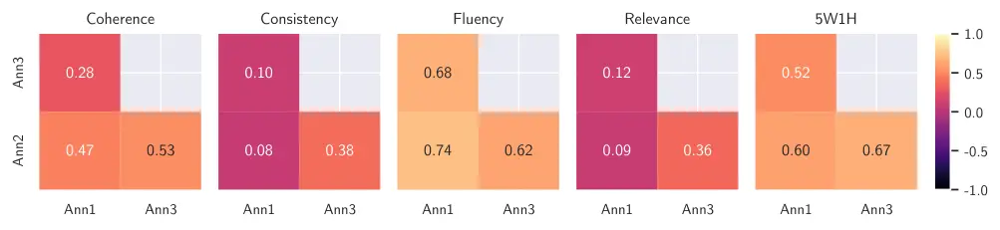
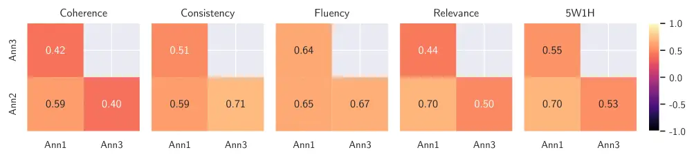
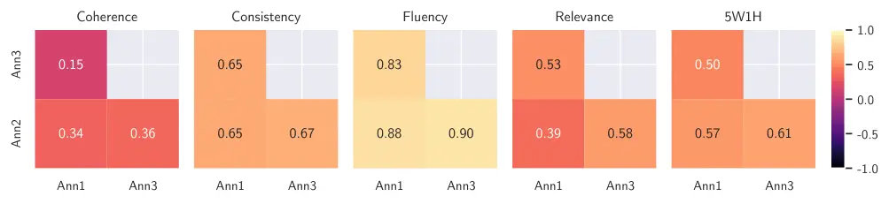

# Evaluating the Evaluator: Summarization Metrics and LLM-Judges beyond English

Jeremy Barnes Affiliation: HiTZ Center, University of the Basque Country
(UPV/EHU) Email: <jeremy.barnes@ehu.eus>    Naiara Perez Affiliation:
HiTZ Center, University of the Basque Country (UPV/EHU) Email:
<naiara.perez@ehu.eus>    Alba Bonet Affiliation: Department of Software
and Computing Systems, University of Alicante, Spain Email:
<alba.bonet@ua.es>    Begoña Altuna Affiliation: GOI Institute, Basque
Summer University (UEU) Email: <begona.altuna@ueu.eus>

Evaluando al evaluador:  
métricas de resumen y LLMs como juez más allá del inglés

Abstract: Automatic text summarization relies on automatic evaluation to
quickly determine the quality of summarization models via automatic
metrics and LLM-as-a-Judge models. However, these techniques require
meta-evaluation to ensure that they capture human judgments correctly.
In this paper, we explore this meta-evaluation beyond English by
generating a new multilingual summary meta-evaluation dataset (BASSE),
which comprises human judgments on 2,040 abstractive summaries,
generated either manually or by five Large Language Models (LLMs) with
four different prompts. For each summary, annotators evaluate five
criteria on a 5-point Likert scale: coherence, consistency, fluency,
relevance, and 5W1H. We then benchmark automatic summarization metrics
and LLM-as-a-Judge models. Our results show that currently proprietary
judge LLMs have the highest correlation with human judgments, followed
by criteria-specific automatic metrics, while open-sourced judge LLMs
perform poorly.

Keywords: summarization, meta-evaluation, under-resourced languages

Resumen: El resumen automático de textos se basa en evaluaciones
automáticas para determinar la calidad de los modelos de resumen
mediante métricas automáticas y modelos LLM-as-a-Judge. Sin embargo,
estas técnicas requieren metaevaluación para garantizar que capturen
correctamente los juicios humanos. En este artículo exploramos esta
metaevaluación más allá del inglés mediante un nuevo corpus multilingüe
para la metaevaluación de resúmenes (BASSE), que incluye juicios humanos
sobre 2.040 resúmenes abstractivos generados manualmente o por cinco
modelos de lenguaje de gran tamaño (LLMs) con cuatro prompts diferentes.
Para cada resumen, los anotadores evalúan cinco criterios en una escala
Likert de 5 puntos: coherence, consistency, fluency, relevance y 5W1H.
Luego evaluamos métricas automáticas de resumen y modelos
LLM-as-a-Judge. Nuestros resultados muestran que los LLMs propietarios
usados como jueces presentan la mayor correlación con los juicios
humanos, seguidos por métricas automáticas específicas por criterio,
mientras que los LLMs de código abierto usados como jueces presentan
bajo rendimiento.

Palabras clave: resumen, metaevaluación, idioma de pocos recursos

## 1 Introduction

Automatic text summarization seeks to create a concise and fluent text
that captures the main ideas from one or more documents \[20\]. This
task has been studied in depth in Natural Language Processing (NLP)
\[11, 9\] and plays an important role in mitigating excess information
in an age of increasing information glut \[39\].

Current approaches to summarization generally rely on abstractive
methods, leading to new challenges for evaluation, as abstractive models
are more prone to hallucinating information \[37, 32\]. Evaluation of
automatic summaries relies on three main strategies: i) human
evaluation, ii) evaluation using reference summaries and automatic
metrics, and iii) evaluation via Large Language Models (LLMs), i.e.,
LLM-as-a-Judge. Human evaluation on certain criteria, such as coherence
or fluency, allows for high-quality evaluation of abstractive summaries.
However, this approach is not apt for iterating over models, where
instead, automatic metrics, e.g., ROUGE \[34\] and, more recently, judge
LLMs \[33, 25\] are preferred.

However, selecting appropriate metrics or judge LLMs relies on
meta-evaluations that measure the correlation between human evaluations
and automatic evaluation methods \[4, 15, 12\]. While these studies
provide invaluable information, they have only been performed
comprehensively for English, leaving the assessment in other languages
to be explored.

We address this gap by collecting human annotations for automatic
summaries in Basque and Spanish—languages with respective fragmentary
and medium coverage of language resources \[19\].

Specifically, we collect abstractive summaries generated by five LLMs
and four different prompts on 45 news articles in each language. We then
collect human judgments for each summary with respect to five
criteria—namely, coherence, consistency, fluency, relevance, and 5W1H.
With this novel dataset, BAsque and Spanish Summarization Evaluation
(BASSE),¹¹ 1 Data and code available at
https://github.com/hitz-zentroa/summarization we address the following
research questions:

- •
  RQ1: Do automatic metrics for evaluating summarization correlate well
  with human judgments?
- •
  RQ2: Can judge LLMs replicate human judgments for summarization?
- •
  RQ3: Which summary criteria (coherence, consistency, fluency,
  relevance, and 5W1H) do state-of-the-art LLMs struggle with in Basque
  and Spanish?

Our results indicate that proprietary LLMs-as-a-Judge models currently
have the highest correlation with human judgments on our data, while
several traditional metrics also correlate well with specific criteria.
On the contrary, open-source LLMs-as-a-Judge currently do not correlate
well with human judgments on our data.

Our contributions are hence the following: (1) We present a new
multilingual corpus (Basque, Spanish) of summaries generated by five
LLMs manually annotated for five criteria on a 5-point Likert scale; (2)
we study the correlation between human judgments with the results of
automatic evaluation metrics and LLM judges in languages other than
English; and (3) we additionally provide the first corpus for
summarization in Basque, consisting of 22,525 news articles and their
subheads.

## 2 Related Work

##### Summarization Evaluation Methods.

Manual evaluation becomes an impossible task as corpus size increases,
motivating the need for automatic metrics for summarization evaluation,
e.g., ROUGE variants \[34, 50, 22\], S3 \[42\]. More recently, using
LLMs to automatically evaluate summaries—LLMs-as-a-Judge—has shown
promise \[33, 25, 36\]. These models often show higher correlations with
human judgments than previous token-based metrics. However, nearly all
of these metrics and models have been designed for English, and their
reliability on non-English summaries remains insufficiently understood.
Recent work has raised concerns about the reliability of LLM judges,
showing performance variability across languages and limited agreement
with human judgements \[57, 17, 44\].

##### Meta-evaluation of Automatic Metrics.

Meta-evaluation is necessary to establish the reliability of automatic
metrics, and is typically done by studying the correlation between
metric scores and human judgments \[34\]. \[15\], for example, collect
human evaluations for 23 English summarization models over four
dimensions (coherence, consistency, fluency, and relevance) and find
that automatic metrics generally correlate poorly with the human
annotations. While some studies have examined meta-evaluation beyond
English \[52, 7, 27\], none of them apply a range of automatic metrics
or LLM judges and most use automatically extracted subhead-article pairs
as a proxy for reference summaries, limiting the reliability of the
findings.

## 3 Methodology

|                |        |      |         |        |     |         |      |         |        |     |
| -------------- | ------ | ---- | ------- | ------ | --- | ------- | ---- | ------- | ------ | --- |
|                | Basque |      |         |        |     | Spanish |      |         |        |     |
|                | Doc    | ¬ eu | Tok     | Voc    | s/d | Doc     | ¬ es | Tok     | Voc    | s/d |
| Source article | 45     | \-   | 22,862  | 7,328  | 34  | 45      | \-   | 38,551  | 8,200  | 30  |
| Subhead        | 45     | 0    | 1,562   | 927    | 3   | 45      | 0    | 1,040   | 578    | 1   |
| Human summary  | 75     | 0    | 8,867   | 3,428  | 6   | 75      | 0    | 11,635  | 3,180  | 5   |
| LLM summary    | 900    | 54   | 133,755 | 15,755 | 10  | 900     | 27   | 158,945 | 10,844 | 8   |

Table 1: Statistics of the BASSE corpus, including the source articles
and their summaries. We report the number of documents (Doc)—and, of
those, how many are not in the target language (¬ eu or ¬ es)—, total
tokens (Tok), vocabulary size (Voc), and sentences per document (s/d).
Splitting and tokenization were done with stanza \[48\] and language
identification with lingua-py.¹⁰¹⁰ 10
https://github.com/pemistahl/lingua-py

We develop our multilingual summarization evaluation dataset through
three main steps. First, we collect news articles from quality sources
in both target languages ($`\lx@sectionsign`$3.1). Second, we generate a
battery of summaries that includes original subheads, human-written
summaries, and automatic summaries from various LLMs using different
prompts ($`\lx@sectionsign`$3.2). Finally, we conduct expert annotation
using five criteria through a multi-round process for reliable
assessment ($`\lx@sectionsign`$3.3).

### 3.1 Data Collection

Data collection was conducted with the aim of collecting highly
representative data. We randomly collected news articles covering
diverse topics and genres to ensure variety across both languages. For
Basque, we collect 45 articles from Berria,²² 2 https://www.berria.eus
the main newspaper in this language.³³ 3 In addition to the 45 articles
we annotate, we also collect 22,525 Basque articles from Berria with
their subhead which we release with BASSE. For Spanish, another set of
45 news articles was randomly extracted from the test set of the MLSUM
dataset \[53\]. The Spanish subset of MLSUM contains news articles of El
País newspaper⁴⁴ 4 https://www.elpais.com and provides (news body,
subhead, URL) triplets.

### 3.2 Summary Collection

For each of the 45 articles in both languages, we collected three types
of summaries, the final multilingual dataset comprising 90 source
articles and 2,040 summaries:

- •
  Subhead: We extracted the original article subheads to serve as
  baseline summaries \[24, 38\].
- •
  Human: We collected manually written summaries from our expert
  annotators. For the first 15 articles used to compute agreement
  ($`\lx@sectionsign`$3.3.2), each article has three human summaries.
  The remaining 30 articles were divided among the annotators, with one
  human summary each, yielding a total of 75 manual summaries per
  language.
- •
  Automatic: We generated automatic summaries using five different LLMs
  with four different prompts, leading to 900 automatic summaries per
  language. The specific models and prompting strategies are described
  in the following subsections.

#### 3.2.1 Models

We selected a number of proprietary and open-source LLMs that are able
to provide summaries in Basque and Spanish. Proprietary models included
Anthropic’s Claude,⁵⁵ 5 https://www.anthropic.com/claude OpenAI’s
GPT-4o,⁶⁶ 6 https://openai.com/index/gpt-4o-system-card and Reka AI’s
Reka \[51\].⁷⁷ 7 We used Claude 3.5 Sonnet for Rounds 1, 2, and 3 and
Claude 3.5 Haiku for Round 4. Similarly, we used Reka-Core for Rounds
1,2, and 3 and Reka-Flash for Round 4. The open-source options were
Cohere’s Command R+⁸⁸ 8 https://docs.cohere.com/v2/docs/command-r-plus
and Meta’s Llama 3.1 70B Instruct \[13\]. All models were prompted using
their default configurations through their respective native chat
interfaces, with the exception of Llama, which was accessed via
HuggingFace’s chat interface⁹⁹ 9 https://huggingface.co/chat due to the
absence of a proprietary chat platform.

#### 3.2.2 Prompts

Along with the selection of those five different models, we experimented
with four prompts to collect summaries from the LLMs. These prompts,
presented below, were designed in order to obtain fairly diverse
summaries. Although multilingual LLMs often show stronger performance
when prompted in English \[56, 14\], in early experiments, we found that
prompting the LLMs in English led to the summaries also being given in
English. Therefore, we opted to prompt the model directly in the
language in which it should write the summary. Table 3 in Appendix A
shows each prompt in Basque and Spanish, as well as its translation to
English; their descriptions are provided below.

- •
  Base: This prompt asks the LLM to summarize the following document.
- •
  Core: This prompt asks the model to think about the most important
  information in the original document and use that information to
  create a summary for the following document.
- •
  5W1H: This prompt, which is a further derivation of Core, uses an
  approach common in journalism \[63, 5\] consisting of answering six
  key questions: the five “W” questions (who, what, when, where, why)
  and the 1 “H” question (how).
- •
  Too long, didn’t read (tldr): This prompt appends the internet
  shorthand to elicit a concise summary.

### 3.3 Human Annotation

We followed the annotation procedure of \[15\], who based their criteria
largely on \[29\] and \[10\]. For our experiment, besides the following
descriptions of the used criteria, we elaborated a detailed set of
annotation guidelines, which we provide in Appendix B, while Appendix
C.1 contains real examples of annotated summaries in Basque and Spanish.

#### 3.3.1 Criteria

We maintain the core criteria of previous work \[15\]—coherence,
consistency, fluency, and relevance—and extended the framework with an
additional criterion, 5W1H, which measures how well important
information is preserved from the source by following a journalistic
approach. It evaluates whether key content is presented completely by
addressing the six fundamental questions (see prompt 5W1H in Appendix
A). The summary should not lack any important information available in
the source document. This recall-oriented criterion corresponds roughly
to coverage in \[26\], although it differs crucially in that we
calculate 5W1H relative to the original document, whereas they use the
reference summary to calculate coverage.

|     |     |        |      |      |      |      |         |      |      |      |      |
| --- | --- | ------ | ---- | ---- | ---- | ---- | ------- | ---- | ---- | ---- | ---- |
|     |     | Basque |      |      |      |      | Spanish |      |      |      |      |
| R#  | Doc | Coh    | Con  | Flu  | Rel  | 5W1H | Coh     | Con  | Flu  | Rel  | 5W1H |
| 1   | 210 | 0.39   | 0.56 | 0.68 | 0.34 | 0.55 | 0.31    | 0.18 | 0.13 | 0.22 | 0.39 |
| 2   | 210 | 0.59   | 0.63 | 0.75 | 0.54 | 0.64 | 0.66    | 0.37 | 0.35 | 0.49 | 0.58 |
| 3   | 105 | 0.66   | 0.44 | 0.70 | 0.63 | 0.72 | 0.29    | 0.19 | 0.34 | 0.20 | 0.39 |

Table 2: Ordinal Krippendorff’s $`\alpha`$ across triple-annotated
rounds (R#). Rounds 1 and 2 were conducted on the same set of summaries
(Doc), before and after guideline discussion respectively, while round 3
involved a new set of summaries.

#### 3.3.2 Annotation Procedure

We performed three rounds of expert annotation, where the first two
served to refine the annotation guidelines. Given the generally poor
agreement of crowdsourced annotations for summarization \[21, 15\], the
annotators were recruited among NLP linguists and engineers who had
extensive experience with annotation projects and knowledge of
summarization.

In the first round, three annotators evaluated summaries from 10
articles in each language, with each (model, prompt, document)
combination being annotated for all five criteria. They additionally
annotated the same criteria for the articles’ subheads as baseline
summaries and provided their own summaries for each text (which were
evaluated by the other two annotators). After calculating agreement
scores, annotators discussed the cases of disagreement and refined the
guidelines. In the second round, the same set of summaries was
re-annotated following the refined guidelines. The third round involved
a new set of 5 articles, with all summaries being triple-annotated.
Following the third round, given the acceptable agreement levels
achieved, annotators proceeded to individually annotate an additional
set of 10 documents each, which brings the total to 45 annotated
articles.

After each round of annotation, we calculated inter-annotator agreement
using ordinal Krippendorff’s $`\alpha`$ \[28\] to compare three-way
agreement for each of the criteria, and additionally calculated
quadratic Cohen’s $`\kappa`$ \[8\] for pairwise agreement.

## 4 The BASSE Corpus

We now present BASSE, the manually annotated multilingual corpus of
2,040 news summaries in Basque and Spanish, analyzing inter-annotator
agreement levels, corpus statistics, and qualitative differences across
summarization approaches. The diversity of summary generation methods in
BASSE enables a robust assessment of summary evaluation metrics under
varied conditions.

### 4.1 Inter-annotator Agreement

Initial annotations (R#1) yielded moderate agreement levels for Basque
across criteria and lower agreement for Spanish (Krippendorff’s
$`\alpha`$ correlations for each round and language are shown in Table
2.). By the final round (R#3), Basque annotations maintained acceptable
agreement levels (0.44–0.72), with Spanish remaining at lower values
(0.19–0.39). Consistent with prior work \[16, 30\], consistency proved
to be the most challenging for annotators to align on—0.44 and 0.19 for
Basque and Spanish, respectively, in the final round. This challenge can
be attributed to the inherent complexity of evaluating factual
alignment, where annotator’s interpretations of source article details
sometimes diverge.

While pairwise quadratic Cohen’s $`\kappa`$ values follow similar
patterns to the Krippendorff’s $`\alpha`$ scores, raw agreement
percentages show moderate to high concordance in several categories for
Spanish, notably fluency (83–90%) and consistency (65–67% (See Appendix
C.2). This apparent contradiction is explained by the score
distributions, where Basque summaries exhibit a broader distribution
across the quality spectrum, while Spanish summaries tend to concentrate
in the higher range of the quality scale, leading to higher expected
agreement and consequently lower chance-corrected scores, a known
problem with IAA scores \[61\].

Note that our agreement scores, including those for Spanish annotations,
are similar to or exceed those reported in previous large-scale summary
evaluation studies of reference \[15, 7, 1\].

Figure 1: Distribution of compression ratios (x axis) and novel 2-grams
(y axis) for different summarization approaches, in Basque (eu) and
Spanish (es). Higher compression values ($`\rightarrow`$) indicate more
concise summaries, while higher novel 2-gram values ($`\uparrow`$)
suggest more abstractive summarization.

### 4.2 Quantitative Analysis

Table 10 presents the statistics of our corpus, which comprises 45
articles with their subheads, 75 human-written summaries, and 180
summaries from each model. The source articles contain between 20–40K
tokens in total, with Basque showing a markedly lower token count due to
its agglutinative nature.

A small number of the automatically generated summaries are not written
in the target languages Basque and Spanish (6% and 3% respectively).
Summary vocabulary sizes range between 3K and 10K tokens, and they vary
considerably in length and richness across different approaches.
Statistics for LLM summaries broken down by author model and prompt can
be consulted in Appendix C.3, Table 4.

In order to quantify the diversity of summarization strategies, we
evaluate them through two metrics: compression ratio and novel 2-gram.
Compression ratio indicates summary conciseness with respect to the
source article \[55\], while novel 2-grams measure the percentage of new
word pairs in the summary \[31\]. The trade-off between these two is
shown Figure 1.

Subheads achieve the highest compression (10–100$`\times`$), while human
and model summaries typically compress around 6$`\times`$, with some
notable exceptions. GPT-4o occasionally produced expansive content
matching or exceeding source length, while Llama consistently generated
more compressed summaries.

The novel 2-gram analysis shows that model-generated summaries are more
abstractive than human-written ones, particularly from Claude (though
this finding is partially influenced by Claude’s outputs in languages
other than the target one). In contrast, GPT-4o sometimes opted for a
more extractive approach, closely reproducing the original text as
mentioned earlier.

### 4.3 Qualitative Analysis

The manual evaluation of the summaries (see Table 5 and detailed results
per model and prompt combination in Appendix C.4) shows large quality
differences across summarization approaches. While human-written
summaries achieve the highest average scores (4.75 for Basque, 4.68 for
Spanish), the subheads fail at covering key information (5W1H).

Among the model-generated summaries, we observe a clear linguistic
divide, with Spanish summaries generally achieving higher fluency
scores. This gap is most pronounced for Command R+, where poor fluency
in Basque (2.64 compared to 4.92 in Spanish) consequently impacts its
consistency. GPT-4o shows the best performance in both languages,
although all models show varying performance patterns across prompting
strategies.

Most LLMs achieve consistency scores comparable to humans, and some
models occasionally surpass human performance in relevance and 5W1H
coverage. In fact, the 5W1H prompt seems to compel models to provide a
better coverage of key information.

All models normally generate summaries with a suitable format. However,
Claude shows a tendency to generate bullet-point summaries, which
negatively impacts its coherence scores, and occasionally produces
English text with the tldr prompt, as noted earlier. Additionally, it is
the most prone to generating introductory sentences for the summaries,
e.g., “Aquí está el resumen del texto:” (Here is the summary of the
text:), which negatively impacts its relevance scores.

## 5 Evaluation

In this section, we calculate the correlation between the human
annotations from $`\lx@sectionsign`$4 and a series of evaluation metrics
and LLM-as-a-Judge commonly used for evaluating Natural Language
Generation (NLG). For rounds with more than one annotation per summary,
we take the average of the three values for each criterion. We calculate
both Spearman’s ($`\rho`$) and Kendall’s ($`\tau`$) rank correlation
coefficients at system-level following \[35\] and \[15\], but report
here only Spearman, as the results do not vary depending on the
coefficient.

### 5.1 Evaluation Metrics

We select a subset of metrics used in SummEval \[15\] which require
minimal changes to work for languages other than English, specifically
ROUGE \[34\], ROUGE-we \[40\], BertScore \[64\], BLEU \[41\], CHRF
\[45\], METEOR \[3\], CIDEr \[60\], and Data Statistics \[23\].

Due to their dependence on specialized English training data or
English-only models, several of the original metrics are excluded,
namely, BLANC \[59\], S3 \[42\], SummaQA \[54\], MoverScore \[65\],
Sentence Mover’s Similarity \[6\], and SUPERT \[18\].

For several other metrics (i.a., ROUGE-we, BertScore, METEOR, CIDEr, and
Data Statistics), we implement the necessary changes to allow for
evaluation in Spanish or Basque. Before passing the candidate or
reference summaries to each metric, we perform metric specific
preprocessing of the texts (see further details in Appendix D.1).

### 5.2 LLM-as-a-Judge

We further experiment with using LLM-as-a-Judge systems to predict the
five criteria we use for human evaluation. Currently, no LLM-judge
models officially support Basque or Spanish evaluation specifically.
Therefore, we selected a range of models that have demonstrated strong
performance as judges in English and that offer some multilingual
capabilities. Our selection represents a diverse set of characteristics:
open-source versus proprietary models, and varying parameter sizes and
specializations.

Following these selection principles, we evaluate nine models as judges:
Prometheus2 7B and 8x7B \[25\], M-Prometheus 7B and 14B \[43\], Selene
Mini \[2\], Qwen2.5 7B and 72B \[49\], GPT-4o mini¹¹¹¹ 11
gpt-4o-mini-2024-07-18 and GPT-4o.¹²¹² 12 gpt-4o-2024-08-06

We use the codebase from Prometheus-Eval¹³¹³ 13
https://github.com/prometheus-eval/prometheus-eval and format the prompt
to include the original instruction, the annotation rubric for the
criteria, the corresponding human-generated reference answer, and the
summary to be evaluated. We evaluate only one criterion at a time.
Although the original documents and summaries are in either Basque or
Spanish, we use English for the instructions and annotation rubric, as
preliminary results indicated that several models struggle to follow the
directions otherwise. The full prompt template used for all judge models
is shown in Appendix A, Figure 3.

## 6 Results

Figure 2: Spearman’s model-level rank correlation between automatic
metrics (left) or LLM judges (right), and human annotations, in Basque
(eu) and Spanish (es).

In this section, we answer the research questions by analyzing
Spearman’s $`\rho`$ correlations between model rankings derived from
automatic evaluations and those from human judgments. Selected results
are shown in Figure 2, while full results of both Spearman’s $`\rho`$
and Kendall’s $`\tau`$ rank correlation coefficients can be consulted in
Appendix D.2.

### RQ1: Do automatic metrics for evaluating summarization correlate well with human judgments in Basque and Spanish?

Overall, we observe notable patterns across languages in metric
performance. Traditional metrics show similar trends in both Basque and
Spanish for coherence, consistency, and relevance, with several metrics
showing strong correlations with human judgments, despite the gaps in
annotator agreement for these criteria. Notably, fluency and 5W1H—the
criteria with highest human agreement—result in nearly opposite
tendencies between languages, with better correlations in Basque.

Automatic metrics have a significant correlation with coherence with
overall absolute mean Spearman correlations of 0.548 and 0.454, with
BertScore-p giving the most consistent results.

Consistency has the lowest absolute mean correlations between metrics
and human judgments (0.201/0.257), indicating that the metrics struggle
to capture this criterion.

Fluency similarly has low overall absolute mean correlations
(0.367/0.164). The same metric often gives opposite results in Basque
and Spanish, as is the case of most ROUGE variants or BertScore.
Relevance has relatively high absolute mean correlations (0.501/0.358),
where statistics-based metrics have generally high correlations in both
languages. Finally, 5W1H has moderate absolute mean correlations
(0.375/0.463). Compression is the single automatic metric that best
captures 5W1H across both languages (-0.665/-0.792), although coverage
(-0.848) and novel unigram (0.816) perform the best in Spanish.

In summary, several metrics correlate strongly for both languages
($`\rho>`$ 0.6): for coherence and relevance, BertScore-p shows a strong
correlation in both languages, and compression performs well for 5W1H.
In Basque, ROUGE-2 and ROUGE-3 capture fluency well, while no automatic
metric performs well on fluency in Spanish, likely due to the low
variance in scores. Similarly, there is no metric that consistently
captures consistency across both languages. Metrics originally designed
for machine translation evaluation (namely, BLEU, CHRF, and METEOR) do
not stand out for any specific summarization criterion, generally
exhibiting weak correlations across most evaluation dimensions in both
languages.

### RQ2: Do LLM-as-a-Judge models have the ability to replicate human judgments for summarization?

In general, proprietary LLM-as-a-Judge models (GPT-4o Mini and GPT-4o)
give the highest correlations with human judgments on most criteria.
GPT-4o, for example, gives the highest correlation in four of five
criteria for Basque (0.512 $`\leq\rho\leq`$ 0.909) and one of five in
Spanish, (-0.055 $`\leq\rho\leq`$ 0.876). The smaller GPT-4o mini
performs similarly, -0.097 $`\leq\rho\leq`$ 0.874 in Basque and -0.28
$`\leq\rho\leq`$ 0.783 in Spanish.

The open-source LLM-as-a-Judge models, on the other hand, do not
generally outperform the automatic metrics. As an exception, for 5W1H
the M-Prometheus models achieve high correlations in Basque and Spanish
($`\rho\geq`$ 0.598) while Selene Mini has $`\rho`$ of 0.812 in Basque.
M-Prometheus 14B has the third highest correlation for fluency in Basque
(0.609). Prometheus 2 8x7B, M-Prometheus 14B, and Qwen2.5-72B-Instruct
perform as poorly as their smaller versions, suggesting that the low
correlation achieved is not due to model size. Furthermore, Prometheus 2
and M-Prometheus judges show more correlation in Basque than in Spanish.

Summing up, proprietary models show relatively strong correlations with
human judgments (GPT-4o above all, and GPT-4o mini to a lesser degree)
while open-source models currently are only able to capture 5W1H.

### RQ3: Which summary criteria (coherence, consistency, fluency, relevance, 5W1H) do state-of-the-art LLMs struggle with in Basque and Spanish?

As noted earlier, our goal was not to produce optimal summaries but
rather to gather a diverse range of summary qualities for
meta-evaluation purposes. We deliberately avoided hyperparameter tuning
or extensive prompt engineering that may have yielded better results.
Thus, the following results better represent what users can expect out
of the box from these models.

In Basque, coherence is the criterion with the lowest score, with an
average of 3.46/5.00 over all model prompt combinations, followed by
relevance (3.74), while consistency (4.29) and 5W1H (4.06) score
slightly better. That is, Basque summaries are fairly faithful to source
content and comprehensive in their information coverage, yet they
struggle with logical flow and content relevance. The moderate fluency
average score (3.87) masks considerable variation in linguistic
competence between different models.

In Spanish, the models generally achieve better scores. Fluency has the
highest score (4.82), followed by consistency (4.68). Coherence is
lowest (3.88) while relevance (4.14) and 5W1H (4.18) lie in the middle.
In other words, Spanish summaries excel in linguistic quality and
faithfulness while providing mostly complete and relevant information,
although logical connectivity between ideas needs some improvement.
Detailed results are available in Appendix C.4.

## 7 Discussion

This work describes an end-to-end methodology for the assessment of the
existing summary evaluation metrics and LLM-as-a-Judge models. A key
proposal in the annotation and summary quality evaluation steps is the
introduction of the 5W1H evaluation criterion, which has shown promise
as a recall-oriented measure of important information from the original
document. One may expect it to be the inverse of relevance—a
precision-oriented measure of information transfer—but our experiments
suggest that there is no direct correlation between them ($`\rho`$ =
-0.16 and -0.34 at model level) and different metrics capture each
criterion better. In fact, while LLM-as-a-Judge models generally have
$`\rho>`$ 0.561 for 5W1H, they have close to random correlations for
relevance (see Figure 2, and Tables 8 and 7).

Building on the evaluation criteria, we observed that proprietary
LLM-as-a-Judge models generally outperform traditional metrics,
especially on coherence and 5W1H, while the open-source LLM-as-a-Judge
models perform much worse (idem.). This performance gap is likely due to
the fact that neither Prometheus 2, Selene Mini nor Qwen 2.5 are trained
as judges for languages other than English, while the proprietary models
may have such training. M-Prometheus \[43\], despite being trained on 6
languages—which do not include Basque or Spanish—, shows slightly better
correlations with humans but still lags behind GPT-4o. Our experiments
thus serve as an interesting testing ground for judge LLMs in
cross-lingual contexts. Although multilingual models often can transfer
knowledge across languages, this capability does not appear to extend to
summary evaluation in our study. This does not indicate that
multilingual models are not possible, but rather points to the
importance of developing truly multilingual judge models to enable high
quality evaluation beyond English.

Finally, we observed that, although LLMs are capable of producing mostly
faithful summaries (see consistency scores in Table 5 and 6),
consistency is currently poorly captured by LLM-as-a-Judge models, as
well as by all automatic metrics, contrary to previous findings in
English \[15\]. This is likely due to the choice of summarization
models, as previous meta-evaluations have included summaries from
extractive summarization models and simpler abstractive models. Current
abstractive summarization models often have subtle inconsistencies \[30,
62\], making them more difficult to capture.

## 8 Conclusion

In this work we try to assess the adequacy of automatic methods to
evaluate summaries in languages other than English. As an
experimentation ground, we present BASSE, a dataset of 2,040 automatic
summaries in Basque and Spanish that we collected and annotated manually
across five criteria on a 5-point Likert scale: coherence, consistency,
fluency, relevance and 5W1H. The inter-annotator agreement study
performed on a subset of triple-annotated summaries yields better scores
than those found in prior large-scale summarization evaluation research.
We used this dataset to perform a meta-evaluation of traditional
automatic metrics and LLM-as-a-Judge models beyond English contexts.
Further, we share the first automatically collected summarization
dataset in Basque, which comprises 22,525 article-subhead pairs.

We observed a hierarchy of evaluation approaches: proprietary
LLM-as-a-Judge models demonstrate the strongest overall correlations
with human judgments, particularly for coherence and 5W1H coverage. On
the other hand, traditional metrics like BertScore-p, ROUGE variants,
and compression ratio show strong criterion-specific performance but
lack consistency across all dimensions. At the bottom of this hierarchy,
open-source judge LLMs perform notably poorly, suggesting that current
multilingual capabilities do not effectively transfer to the task of
summarization evaluation in non-English languages.

Among the evaluation criteria, coherence and relevance were most
reliably captured by automatic metrics, with BertScore-p showing strong
correlations across both languages. The 5W1H criterion was consistently
assessed by proprietary judge models. Fluency exhibited
language-dependent results, with several metrics performing well for
Basque but struggling with Spanish. Consistency proved the most
challenging criterion overall, with no metric or model showing strong
correlations across both languages, reflecting the difficulty of
detecting subtle factual misalignments in today’s abstractive
summarization systems’ output.

We make the dataset and code available to support future research on
multilingual evaluation methods for automatic summarization.

## Limitations

Although our corpus collection and annotation methodology are the same
for both Basque and Spanish, the outcome differs between languages. In
Basque, the summaries we collected are generally of poorer quality, but
the IAA is high, while for Spanish the quality of all summaries is quite
good, but the IAA is lower. This seems to be an artifact of the higher
quality of the summaries in Spanish. Annotators rarely used the lower
end of the scale (1–3) for several criteria, and the expected agreement
is therefore higher, affecting IAA scores, despite raw agreement often
being over 80%.

Beyond language-specific differences, the domain of our study offers
important context for interpreting our findings. This meta-evaluation is
performed on newswire data, and our results may not necessarily transfer
well to other domains or formulations of summarization, as newswire
texts tend to be written in a declarative style, avoid negative
constructions, and explicitly represent 5W1H information. However, the
standard coherence, consistency, fluency and relevance metrics have been
successfully used to annotate summaries in other domains, and it is
likely that the new 5W1H metric can be easily adapted to different types
of texts according to the relevance of each of the 5W1H elements in
text.

Finally, note that most of the news articles in our dataset have a
single human-generated summary, which limits our ability to exploit the
variability of human summaries. However, given a set annotation budget
and the goal of creating a large and varied set of summaries, previous
research has shown it is preferable to increase the number of instances,
even if they are single annotated \[58\].

## Acknowledgements

This work has been partially supported by the European Union under
Horizon Europe (Project LUMINOUS, grant number 101135724), the Ministry
of Science and Innovation of the Spanish Government (DeepThought
project: PID2024-159202OB-C21), the Ministerio para la Transformación
Digital y de la Función Pública - Funded by EU – NextGenerationEU within
the framework of the project Desarrollo de Modelos ALIA, the Basque
Government (IKER-GAITU project), and the University of Alicante, the
Spanish Ministry of Science and Innovation (MCIN), and the European
Regional Development Fund (ERDF) through the project HEART-NLP
(PID2024-156263OB-C22); funded by MCIN/AEI/10.13039/501100011033 /
“ERDF, EU”. Also, this work was partially supported by HumanAIze
projects: AIA2025-163322-C61 and AIA2025-163322-C63 funded by
MICIU/AEI/10.13039/501100011033.

## References

- \[1\] R. Aharoni, S. Narayan, J. Maynez, J. Herzig, E. Clark, and M.
  Lapata (2023) Multilingual summarization with factual consistency
  evaluation. In Findings of the Association for Computational
  Linguistics: ACL 2023, pp. 3562–3591. External Links:
  [Link](https://aclanthology.org/2023.findings-acl.220/),
  [Document](https://dx.doi.org/10.18653/v1/2023.findings-acl.220) Cited
  by: §4.1.
- \[2\] A. Alexandru, A. Calvi, H. Broomfield, J. Golden, K. Dai, M.
  Leys, M. Burger, M. Bartolo, R. Engeler, S. Pisupati, T. Drane,
  and Y. S. Park (2025) Atla Selene Mini: a general purpose evaluation
  model. ArXiv abs/2501.17195. External Links:
  [Link](https://arxiv.org/abs/2501.17195) Cited by: §5.2.
- \[3\] S. Banerjee and A. Lavie (2005) METEOR: an automatic metric for
  MT evaluation with improved correlation with human judgments. In
  Proceedings of the ACL Workshop on Intrinsic and Extrinsic Evaluation
  Measures for Machine Translation and/or Summarization, pp. 65–72.
  External Links: [Link](https://aclanthology.org/W05-0909/) Cited by:
  6th item, §5.1.
- \[4\] M. Bhandari, P. N. Gour, A. Ashfaq, P. Liu, and G. Neubig (2020)
  Re-evaluating evaluation in text summarization. In Proceedings of the
  2020 Conference on Empirical Methods in Natural Language Processing
  (EMNLP), pp. 9347–9359. External Links:
  [Link](https://aclanthology.org/2020.emnlp-main.751/),
  [Document](https://dx.doi.org/10.18653/v1/2020.emnlp-main.751) Cited
  by: §1.
- \[5\] K. Chakma, S. D. Swamy, A. Das, and S. Debbarma (2020)
  5W1H-Based semantic segmentation of tweets for event detection using
  BERT. In International Conference on Machine Learning, Image
  Processing, Network Security and Data Sciences, pp. 57–72. Cited by:
  3rd item.
- \[6\] E. Clark, A. Celikyilmaz, and N. A. Smith (2019) Sentence
  mover‘s similarity: automatic evaluation for multi-sentence texts. In
  Proceedings of the 57th Annual Meeting of the Association for
  Computational Linguistics, pp. 2748–2760. External Links:
  [Link](https://aclanthology.org/P19-1264/),
  [Document](https://dx.doi.org/10.18653/v1/P19-1264) Cited by: §5.1.
- \[7\] E. Clark, S. Rijhwani, S. Gehrmann, J. Maynez, R. Aharoni, V.
  Nikolaev, T. Sellam, A. Siddhant, D. Das, and A. Parikh (2023)
  SEAHORSE: a multilingual, multifaceted dataset for summarization
  evaluation. In Proceedings of the 2023 Conference on Empirical Methods
  in Natural Language Processing, pp. 9397–9413. External Links:
  [Link](https://aclanthology.org/2023.emnlp-main.584/),
  [Document](https://dx.doi.org/10.18653/v1/2023.emnlp-main.584) Cited
  by: §2, §4.1.
- \[8\] J. Cohen (1960) A coefficient of agreement for nominal scales.
  Educational and psychological measurement 20 (1), pp. 37–46. Cited by:
  §3.3.2.
- \[9\] H. T. Dang and K. Owczarzak (2008) Overview of the TAC 2008
  Update Summarization Task. In Text Analysis Conference (TAC),
  pp. 1–16. Cited by: §1.
- \[10\] H. T. Dang (2005) Overview of DUC 2005. In The Document
  Understanding Conference, Vol. 2005, pp. 1–12. External Links:
  [Link](https://api.semanticscholar.org/CorpusID:61825275) Cited by:
  Appendix B, §3.3.
- \[11\] H. T. Dang (2006) Overview of DUC 2006. In Document
  Understanding Conference (DUC 2006), pp. 1–10. Cited by: §1.
- \[12\] D. Deutsch, R. Dror, and D. Roth (2022) Re-examining
  system-level correlations of automatic summarization evaluation
  metrics. In Proceedings of the 2022 Conference of the North American
  Chapter of the Association for Computational Linguistics: Human
  Language Technologies, pp. 6038–6052. External Links:
  [Link](https://aclanthology.org/2022.naacl-main.442/),
  [Document](https://dx.doi.org/10.18653/v1/2022.naacl-main.442) Cited
  by: §1.
- \[13\] A. Dubey, A. Jauhri, A. Pandey, A. Kadian, A. Al-Dahle, A.
  Letman, A. Mathur, A. Schelten, A. Yang, A. Fan, et al. (2024) The
  Llama 3 herd of models. ArXiv abs/2407.21783. Cited by: §3.2.1.
- \[14\] J. Etxaniz, G. Azkune, A. Soroa, O. Lopez de Lacalle, and M.
  Artetxe (2024) Do multilingual language models think better in
  English?. In Proceedings of the 2024 Conference of the North American
  Chapter of the Association for Computational Linguistics: Human
  Language Technologies (Volume 2: Short Papers), pp. 550–564. External
  Links: [Link](https://aclanthology.org/2024.naacl-short.46/),
  [Document](https://dx.doi.org/10.18653/v1/2024.naacl-short.46) Cited
  by: §3.2.2.
- \[15\] A. R. Fabbri, W. Kryściński, B. McCann, C. Xiong, R. Socher,
  and D. Radev (2021) SummEval: re-evaluating summarization evaluation.
  Transactions of the Association for Computational Linguistics 9,
  pp. 391–409. External Links:
  [Link](https://aclanthology.org/2021.tacl-1.24/),
  [Document](https://dx.doi.org/10.1162/tacl%5Fa%5F00373) Cited by: §1,
  §2, §3.3.1, §3.3.2, §3.3, §4.1, §5.1, §5, §7.
- \[16\] T. Falke, L. F. R. Ribeiro, P. A. Utama, I. Dagan, and I.
  Gurevych (2019) Ranking generated summaries by correctness: an
  interesting but challenging application for natural language
  inference. In Proceedings of the 57th Annual Meeting of the
  Association for Computational Linguistics, pp. 2214–2220. External
  Links: [Link](https://aclanthology.org/P19-1213/),
  [Document](https://dx.doi.org/10.18653/v1/P19-1213) Cited by: §4.1.
- \[17\] X. Fu and W. Liu (2025) How reliable is multilingual
  LLM-as-a-judge?. In Findings of the Association for Computational
  Linguistics: EMNLP 2025, C. Christodoulopoulos, T. Chakraborty, C.
  Rose, and V. Peng (Eds.), Suzhou, China, pp. 11040–11053. External
  Links: [Link](https://aclanthology.org/2025.findings-emnlp.587/),
  [Document](https://dx.doi.org/10.18653/v1/2025.findings-emnlp.587),
  ISBN 979-8-89176-335-7 Cited by: §2.
- \[18\] Y. Gao, W. Zhao, and S. Eger (2020) SUPERT: towards new
  frontiers in unsupervised evaluation metrics for multi-document
  summarization. In Proceedings of the 58th Annual Meeting of the
  Association for Computational Linguistics, pp. 1347–1354. External
  Links: [Link](https://aclanthology.org/2020.acl-main.124/),
  [Document](https://dx.doi.org/10.18653/v1/2020.acl-main.124) Cited by:
  §5.1.
- \[19\] M. Giagkou, T. Lynn, J. Dunne, S. Piperidis, and G. Rehm (2023)
  European language equality: a strategic agenda for digital language
  equality. pp. 75–94. External Links: ISBN 978-3-031-28819-7,
  [Document](https://dx.doi.org/10.1007/978-3-031-28819-7%5F4),
  [Link](https://doi.org/10.1007/978-3-031-28819-7_4) Cited by: §1.
- \[20\] N. Giarelis, C. Mastrokostas, and N. Karacapilidis (2023)
  Abstractive vs. extractive summarization: an experimental review.
  Applied Sciences 13 (13), pp. 7620. Cited by: §1.
- \[21\] D. Gillick and Y. Liu (2010) Non-expert evaluation of
  summarization systems is risky. In Proceedings of the NAACL HLT 2010
  Workshop on Creating Speech and Language Data with Amazon‘s Mechanical
  Turk, pp. 148–151. External Links:
  [Link](https://aclanthology.org/W10-0722/) Cited by: §3.3.2.
- \[22\] Y. Graham (2015) Re-evaluating automatic summarization with
  BLEU and 192 shades of ROUGE. In Proceedings of the 2015 Conference on
  Empirical Methods in Natural Language Processing, pp. 128–137.
  External Links: [Link](https://aclanthology.org/D15-1013/),
  [Document](https://dx.doi.org/10.18653/v1/D15-1013) Cited by: §2.
- \[23\] M. Grusky, M. Naaman, and Y. Artzi (2018) Newsroom: a dataset
  of 1.3 million summaries with diverse extractive strategies. In
  Proceedings of the 2018 Conference of the North American Chapter of
  the Association for Computational Linguistics: Human Language
  Technologies, Volume 1 (Long Papers), pp. 708–719. External Links:
  [Document](https://dx.doi.org/10.18653/v1/N18-1065) Cited by: 8th
  item, §5.1.
- \[24\] K. M. Hermann, T. Kocisky, E. Grefenstette, L. Espeholt, W.
  Kay, M. Suleyman, and P. Blunsom (2015) Teaching machines to read and
  comprehend. In Advances in neural information processing systems,
  pp. 1693–1701. Cited by: 1st item.
- \[25\] S. Kim, J. Suk, S. Longpre, B. Y. Lin, J. Shin, S. Welleck, G.
  Neubig, M. Lee, K. Lee, and M. Seo (2024) Prometheus 2: an open source
  language model specialized in evaluating other language models. In
  Proceedings of the 2024 Conference on Empirical Methods in Natural
  Language Processing, pp. 4334–4353. External Links:
  [Link](https://aclanthology.org/2024.emnlp-main.248/),
  [Document](https://dx.doi.org/10.18653/v1/2024.emnlp-main.248) Cited
  by: §1, §2, §5.2.
- \[26\] F. Koto, J. H. Lau, and T. Baldwin (2020) FFCI: a framework for
  interpretable automatic evaluation of summarization. Journal of
  Artifcial Intelligence Research 73. External Links:
  [Link](https://www.jair.org/index.php/jair/article/view/13167) Cited
  by: §3.3.1.
- \[27\] F. Koto, J. H. Lau, and T. Baldwin (2021) Evaluating the
  efficacy of summarization evaluation across languages. In Findings of
  the Association for Computational Linguistics: ACL-IJCNLP 2021,
  pp. 801–812. External Links:
  [Link](https://aclanthology.org/2021.findings-acl.71/),
  [Document](https://dx.doi.org/10.18653/v1/2021.findings-acl.71) Cited
  by: §2.
- \[28\] K. Krippendorff (2013) Content analysis: an introduction to its
  methodology. Sage publications. Cited by: §3.3.2.
- \[29\] W. Kryscinski, N. S. Keskar, B. McCann, C. Xiong, and R.
  Socher (2019) Neural text summarization: a critical evaluation. In
  Proceedings of the 2019 Conference on Empirical Methods in Natural
  Language Processing and the 9th International Joint Conference on
  Natural Language Processing (EMNLP-IJCNLP), pp. 540–551. External
  Links: [Link](https://aclanthology.org/D19-1051/),
  [Document](https://dx.doi.org/10.18653/v1/D19-1051) Cited by: §3.3.
- \[30\] W. Kryscinski, B. McCann, C. Xiong, and R. Socher (2020)
  Evaluating the factual consistency of abstractive text summarization.
  In Proceedings of the 2020 Conference on Empirical Methods in Natural
  Language Processing (EMNLP), pp. 9332–9346. External Links:
  [Link](https://aclanthology.org/2020.emnlp-main.750/),
  [Document](https://dx.doi.org/10.18653/v1/2020.emnlp-main.750) Cited
  by: §4.1, §7.
- \[31\] W. Kryściński, R. Paulus, C. Xiong, and R. Socher (2018)
  Improving abstraction in text summarization. In Proceedings of the
  2018 Conference on Empirical Methods in Natural Language Processing,
  pp. 1808–1817. External Links:
  [Link](https://aclanthology.org/D18-1207/),
  [Document](https://dx.doi.org/10.18653/v1/D18-1207) Cited by: §C.3,
  §4.2.
- \[32\] P. Laban, T. Schnabel, P. N. Bennett, and M. A. Hearst (2022)
  SummaC: re-visiting NLI-based models for inconsistency detection in
  summarization. Transactions of the Association for Computational
  Linguistics 10, pp. 163–177. External Links:
  [Link](https://aclanthology.org/2022.tacl-1.10/),
  [Document](https://dx.doi.org/10.1162/tacl%5Fa%5F00453) Cited by: §1.
- \[33\] C. Leiter, J. Opitz, D. Deutsch, Y. Gao, R. Dror, and S.
  Eger (2023) The Eval4NLP 2023 shared task on prompting large language
  models as explainable metrics. In Proceedings of the 4th Workshop on
  Evaluation and Comparison of NLP Systems, pp. 117–138. External Links:
  [Link](https://aclanthology.org/2023.eval4nlp-1.10/),
  [Document](https://dx.doi.org/10.18653/v1/2023.eval4nlp-1.10) Cited
  by: §1, §2.
- \[34\] C. Lin (2004) ROUGE: a package for automatic evaluation of
  summaries. In Text Summarization Branches Out, pp. 74–81. External
  Links: [Link](https://aclanthology.org/W04-1013/) Cited by: 1st item,
  §1, §2, §2, §5.1.
- \[35\] A. Louis and A. Nenkova (2013) Automatically assessing machine
  summary content without a gold standard. Computational Linguistics 39
  (2), pp. 267–300. External Links:
  [Link](https://aclanthology.org/J13-2002/),
  [Document](https://dx.doi.org/10.1162/COLI%5Fa%5F00123) Cited by: §5.
- \[36\] C. Lyu, S. Gao, Y. Gu, W. Zhang, J. Gao, K. Liu, Z. Wang, S.
  Li, Q. Zhao, H. Huang, W. Cao, J. Liu, H. Liu, J. Liu, S. Zhang, D.
  Lin, and K. Chen (2025) Exploring the limit of outcome reward for
  learning mathematical reasoning. ArXiv abs/2502.06781. External Links:
  [Link](https://arxiv.org/abs/2502.06781) Cited by: §2.
- \[37\] J. Maynez, S. Narayan, B. Bohnet, and R. McDonald (2020) On
  faithfulness and factuality in abstractive summarization. In
  Proceedings of the 58th Annual Meeting of the Association for
  Computational Linguistics, pp. 1906–1919. External Links:
  [Link](https://aclanthology.org/2020.acl-main.173/),
  [Document](https://dx.doi.org/10.18653/v1/2020.acl-main.173) Cited by:
  §1.
- \[38\] S. Narayan, S. B. Cohen, and M. Lapata (2018) Don‘t give me the
  details, just the summary! Topic-aware convolutional neural networks
  for extreme summarization. In Proceedings of the 2018 Conference on
  Empirical Methods in Natural Language Processing, pp. 1797–1807.
  External Links: [Link](https://aclanthology.org/D18-1206/),
  [Document](https://dx.doi.org/10.18653/v1/D18-1206) Cited by: 1st
  item.
- \[39\] M. Á. Navas-Martin, L. Albornos-Muñoz, and C.
  Escandell-García (2012) Acceso a fuentes de información sobre salud en
  España: cómo combatir la infoxicación. Enfermería clínica 22 (3),
  pp. 154–158. Cited by: §1.
- \[40\] J. Ng and V. Abrecht (2015) Better summarization evaluation
  with word embeddings for ROUGE. In Proceedings of the 2015 Conference
  on Empirical Methods in Natural Language Processing, pp. 1925–1930.
  External Links: [Link](https://aclanthology.org/D15-1222/),
  [Document](https://dx.doi.org/10.18653/v1/D15-1222) Cited by: 2nd
  item, §5.1.
- \[41\] K. Papineni, S. Roukos, T. Ward, and W. Zhu (2002) Bleu: a
  method for automatic evaluation of machine translation. In Proceedings
  of the 40th Annual Meeting of the Association for Computational
  Linguistics, P. Isabelle, E. Charniak, and D. Lin (Eds.), pp. 311–318.
  External Links: [Link](https://aclanthology.org/P02-1040/),
  [Document](https://dx.doi.org/10.3115/1073083.1073135) Cited by: 4th
  item, §5.1.
- \[42\] M. Peyrard, T. Botschen, and I. Gurevych (2017) Learning to
  score system summaries for better content selection evaluation.. In
  Proceedings of the Workshop on New Frontiers in Summarization,
  pp. 74–84. External Links: [Link](https://aclanthology.org/W17-4510/),
  [Document](https://dx.doi.org/10.18653/v1/W17-4510) Cited by: §2,
  §5.1.
- \[43\] J. Pombal, D. Yoon, P. Fernandes, I. Wu, S. Kim, R. Rei, G.
  Neubig, and A. F. T. Martins (2025) M-prometheus: a suite of open
  multilingual llm judges. ArXiv abs/2504.04953. External Links:
  [Link](https://arxiv.org/abs/2504.04953) Cited by: §5.2, §7.
- \[44\] D. Ponce, H. Gete, T. Etchegoyhen, I. Zubiaga, and A.
  Soroa (2026) Judging instruction responses in a low-resource language:
  a case study on basque. In Proceedings of the Fifteenth Language
  Resources and Evaluation Conference (LREC 2026), S. Piperidis, N.
  Bel, H. van den Heuvel, N. Ide, S. Krek, and A. Toral (Eds.), Palma,
  Mallorca, Spain, pp. 281–298. External Links:
  [Document](https://dx.doi.org/10.63317/32e7ij6myh5i) Cited by: §2.
- \[45\] M. Popović (2017) ChrF++: words helping character n-grams. In
  Proceedings of the Second Conference on Machine Translation,
  pp. 612–618. External Links:
  [Link](https://aclanthology.org/W17-4770/),
  [Document](https://dx.doi.org/10.18653/v1/W17-4770) Cited by: 5th
  item, §5.1.
- \[46\] M. F. Porter (2001) Snowball: a language for stemming
  algorithms. Note: Published onlineAccessed 11.03.2008, 15.00h External
  Links: [Link](http://snowball.tartarus.org/texts/introduction.html)
  Cited by: 7th item.
- \[47\] M. Post (2018) A call for clarity in reporting BLEU scores. In
  Proceedings of the Third Conference on Machine Translation: Research
  Papers, pp. 186–191. External Links:
  [Link](https://aclanthology.org/W18-6319/),
  [Document](https://dx.doi.org/10.18653/v1/W18-6319) Cited by: 4th
  item.
- \[48\] P. Qi, Y. Zhang, Y. Zhang, J. Bolton, and C. D. Manning (2020)
  Stanza: a python natural language processing toolkit for many human
  languages. In Proceedings of the 58th Annual Meeting of the
  Association for Computational Linguistics: System Demonstrations,
  pp. 101–108. External Links:
  [Link](https://aclanthology.org/2020.acl-demos.14/),
  [Document](https://dx.doi.org/10.18653/v1/2020.acl-demos.14) Cited by:
  Table 1.
- \[49\] Qwen, :, A. Yang, B. Yang, B. Zhang, B. Hui, B. Zheng, B.
  Yu, C. Li, D. Liu, F. Huang, H. Wei, H. Lin, J. Yang, J. Tu, J.
  Zhang, J. Yang, J. Yang, J. Zhou, J. Lin, K. Dang, K. Lu, K. Bao, K.
  Yang, L. Yu, M. Li, M. Xue, P. Zhang, Q. Zhu, R. Men, R. Lin, T.
  Li, T. Tang, T. Xia, X. Ren, X. Ren, Y. Fan, Y. Su, Y. Zhang, Y.
  Wan, Y. Liu, Z. Cui, Z. Zhang, and Z. Qiu (2025) Qwen2.5 technical
  report. ArXiv abs/2412.15115. External Links:
  [Link](https://arxiv.org/abs/2412.15115) Cited by: §5.2.
- \[50\] P. A. Rankel, J. M. Conroy, H. T. Dang, and A. Nenkova (2013) A
  decade of automatic content evaluation of news summaries: reassessing
  the state of the art. In Proceedings of the 51st Annual Meeting of the
  Association for Computational Linguistics (Volume 2: Short Papers),
  pp. 131–136. External Links:
  [Link](https://aclanthology.org/P13-2024/) Cited by: §2.
- \[51\] Reka Team, A. Ormazabal, C. Zheng, C. d. M. d’Autume, D.
  Yogatama, D. Fu, D. Ong, E. Chen, E. Lamprecht, H. Pham, et al. (2024)
  Reka Core, Flash, and Edge: a series of powerful multimodal language
  models. ArXiv abs/2404.12387. Cited by: §3.2.1.
- \[52\] H. Saggion, J. Torres-Moreno, I. da Cunha, E. SanJuan, and P.
  Velázquez-Morales (2010) Multilingual summarization evaluation without
  human models. In Proceedings of the 23rd International Conference on
  Computational Linguistics (Coling 2010), pp. 1059–1067. External
  Links: [Link](https://aclanthology.org/C10-2122/) Cited by: §2.
- \[53\] T. Scialom, P. Dray, S. Lamprier, B. Piwowarski, and J.
  Staiano (2020) MLSUM: the multilingual summarization corpus. In
  Proceedings of the 2020 Conference on Empirical Methods in Natural
  Language Processing (EMNLP), pp. 8051–8067. External Links:
  [Link](https://aclanthology.org/2020.emnlp-main.647/),
  [Document](https://dx.doi.org/10.18653/v1/2020.emnlp-main.647) Cited
  by: §3.1.
- \[54\] T. Scialom, S. Lamprier, B. Piwowarski, and J. Staiano (2019)
  Answers unite! Unsupervised metrics for reinforced summarization
  models. In Proceedings of the 2019 Conference on Empirical Methods in
  Natural Language Processing and the 9th International Joint Conference
  on Natural Language Processing (EMNLP-IJCNLP), pp. 3246–3256. External
  Links: [Link](https://aclanthology.org/D19-1320/),
  [Document](https://dx.doi.org/10.18653/v1/D19-1320) Cited by: §5.1.
- \[55\] E. Segarra Soriano, V. Ahuir, Lluís-F. Hurtado, and J.
  González (2022) DACSA: a large-scale dataset for automatic
  summarization of Catalan and Spanish newspaper articles. In
  Proceedings of the 2022 Conference of the North American Chapter of
  the Association for Computational Linguistics: Human Language
  Technologies, pp. 5931–5943. External Links:
  [Link](https://aclanthology.org/2022.naacl-main.434/),
  [Document](https://dx.doi.org/10.18653/v1/2022.naacl-main.434) Cited
  by: §C.3, §4.2.
- \[56\] F. Shi, M. Suzgun, M. Freitag, X. Wang, S. Srivats, S.
  Vosoughi, H. W. Chung, Y. Tay, S. Ruder, D. Zhou, D. Das, and J.
  Wei (2022) Language models are multilingual chain-of-thought
  reasoners. ArXiv abs/2210.03057. External Links:
  [Link](https://api.semanticscholar.org/CorpusID:252735112) Cited by:
  §3.2.2.
- \[57\] G. Son, D. Yoon, J. Suk, J. Aula-Blasco, M. Aslan, V. T.
  Kim, S. B. Islam, J. Prats-Cristià, L. Tormo-Bañuelos, and S.
  Kim (2025) MM-eval: a multilingual meta-evaluation benchmark for
  llm-as-a-judge and reward models. External Links: 2410.17578,
  [Link](https://arxiv.org/abs/2410.17578) Cited by: §2.
- \[58\] J. Steen and K. Markert (2021) How to evaluate a summarizer:
  study design and statistical analysis for manual linguistic quality
  evaluation. In Proceedings of the 16th Conference of the European
  Chapter of the Association for Computational Linguistics: Main Volume,
  pp. 1861–1875. External Links:
  [Link](https://aclanthology.org/2021.eacl-main.160/),
  [Document](https://dx.doi.org/10.18653/v1/2021.eacl-main.160) Cited
  by: Limitations.
- \[59\] O. Vasilyev, V. Dharnidharka, and J. Bohannon (2020) Fill in
  the BLANC: human-free quality estimation of document summaries. In
  Proceedings of the First Workshop on Evaluation and Comparison of NLP
  Systems, pp. 11–20. External Links:
  [Link](https://aclanthology.org/2020.eval4nlp-1.2/),
  [Document](https://dx.doi.org/10.18653/v1/2020.eval4nlp-1.2) Cited by:
  §5.1.
- \[60\] R. Vedantam, C. L. Zitnick, and D. Parikh (2015) CIDEr:
  consensus-based image description evaluation. In 2015 IEEE Conference
  on Computer Vision and Pattern Recognition (CVPR), pp. 4566–4575.
  External Links:
  [Document](https://dx.doi.org/10.1109/CVPR.2015.7299087) Cited by: 7th
  item, §5.1.
- \[61\] S. Xu and M. F. Lorber (2014) Interrater agreement statistics
  with skewed data: evaluation of alternatives to cohen’s kappa. Journal
  of consulting and clinical psychology 82 (6), pp. 1219––1227. External
  Links: [Link](https://doi.org/10.1037/a0037489),
  [Document](https://dx.doi.org/10.1037/a0037489) Cited by: §4.1.
- \[62\] J. Yang, S. Yoon, B. Kim, and H. Lee (2024) FIZZ: factual
  inconsistency detection by zoom-in summary and zoom-out document. In
  Proceedings of the 2024 Conference on Empirical Methods in Natural
  Language Processing, pp. 30–45. External Links:
  [Document](https://dx.doi.org/10.18653/v1/2024.emnlp-main.3),
  [Link](https://aclanthology.org/2024.emnlp-main.3/) Cited by: §7.
- \[63\] H. Zhang, X. Chen, and S. Ma (2019) Dynamic news recommendation
  with hierarchical attention network. In 2019 IEEE International
  Conference on Data Mining (ICDM), pp. 1456–1461. Cited by: 3rd item.
- \[64\] T. Zhang, V. Kishore, F. Wu, K. Q. Weinberger, and Y.
  Artzi (2020) BERTScore: evaluating text generation with BERT. In The
  International Conference on Learning Representations, Vol. 2020.
  External Links: [Link](https://openreview.net/pdf?id=SkeHuCVFDr) Cited
  by: 3rd item, §5.1.
- \[65\] W. Zhao, M. Peyrard, F. Liu, Y. Gao, C. M. Meyer, and S.
  Eger (2019) MoverScore: text generation evaluating with contextualized
  embeddings and earth mover distance. In Proceedings of the 2019
  Conference on Empirical Methods in Natural Language Processing and the
  9th International Joint Conference on Natural Language Processing
  (EMNLP-IJCNLP), pp. 563–578. External Links:
  [Link](https://aclanthology.org/D19-1053/),
  [Document](https://dx.doi.org/10.18653/v1/D19-1053) Cited by: §5.1.

## Appendix A Prompts

Table 3 shows the 4 prompt variants used to collect LLM summaries in
Basque and Spanish, as well as their translation to English. Figure 3
contains the prompt passed to judge LLMs, for which we use the codebase
from Prometheus-Eval.¹⁴¹⁴ 14
https://github.com/prometheus-eval/prometheus-eval We format the prompt
to include the original instruction, the annotation rubric for the
criteria—one at a time—(see Appendix B), a human-generated reference
answer, and the summary to be evaluated.

|      |                                                                                                                                     |                                                                                                                               |                                                                                                                                               |
| ---- | ----------------------------------------------------------------------------------------------------------------------------------- | ----------------------------------------------------------------------------------------------------------------------------- | --------------------------------------------------------------------------------------------------------------------------------------------- |
|      | Basque                                                                                                                              | Spanish                                                                                                                       | English translation                                                                                                                           |
| Base | Laburtu hurrengo testua.\n\n\[doc\]                                                                                                 | Resume el siguiente texto.\n\n\[doc\]                                                                                         | Summarize the following text.\n\n\[doc\]                                                                                                      |
| Core | Pentsatu ondo zein den hurrengo testuaren edukirik garrantzitsuena eta laburtu testua edukirik garrantzitsuena erabiliz.\n\n\[doc\] | Piensa bien cuál es el contenido más relevante en el siguiente texto y resúmelo usando el contenido más relevante.\n\n\[doc\] | Think well about what the most important content of the following text is and summarize the text using the most important content.\n\n\[doc\] |
| 5W1H | Laburtu hurrengo testua, 5W1H metodoa erabiliz (zer, nork, noiz, non, zergatik, nola).\n\n\[doc\]                                   | Resume el siguiente texto usando el método de las 5W1H (qué, quién, cuándo, dónde, por qué, cómo).\n\n\[doc\]                 | Summarize the following text using the 5W1H method (what, who, when, where, why and how).\n\n\[doc\]                                          |
| tldr | \[doc\]\n\ntldr:                                                                                                                    | \[doc\]\n\ntldr:                                                                                                              | \[doc\]\n\ntldr:                                                                                                                              |

Table 3: Prompts used to collect summaries from LLMs. Note that \[doc\]
is a placeholder for the actual source document, i.e., the original
newspaper article.

Figure 3: Prompt from Prometheus-Eval used for LLM-as-a-Judge
evaluation. Note that instruction, response, reference answer, and
rubric are placeholders that are filled with specific information for
each example.

## Appendix B Annotation Guidelines

### Coherence

Coherence refers to the collective quality of all sentences. We align
this dimension with the DUC quality question \[10\] of structure and
coherence whereby “the summary should be well-structured and
well-organized. The summary should not just be a heap of related
information, but should build from sentence to sentence to a coherent
body of information about a topic”. To clarify, does the summary have a
coherent flow of ideas and does it have connectors to explicitly define
the relationships between ideas? It does not matter if there are
grammatical errors or incorrect information. If the summary is simply a
list of events, annotators should penalize it. Annotators do not
penalize single sentences for not having connectors.

Coherence is rated 1-5 according to the following guidelines:

1.  1:
    The summary contains a bullet point list of events and there is no
    internal consistency (e.g., random words).
2.  2:
    The summary contains a bullet point list of events, but there is no
    consistency between the phrases in each bullet point (e.g., 1.
    Keyboard, 2. Watching TV).
3.  3:
    The summary contains a bullet point list of events, but the phrases
    in each bullet point are well developed.
4.  4:
    The summary contains implicit coherence, but not explicit. That
    means that there are no temporal connectors or discourse markers,
    but the sentences have a temporal/causal flow.
5.  5:
    The summary contains explicit coherence via textual resources, such
    as temporal connectors or discourse markers that define the
    relationship between ideas and sentences.

### Consistency

Consistency refers to the factual alignment between the summary and the
summarized source. A factually consistent summary contains only
statements that are entailed by the source document. Annotators should
also penalize summaries that contain hallucinated facts. If the summary
contains information not found in the original document, annotators
should penalize it. For temporal expressions (today, yesterday, this
year), if the expression is consistent with the original information,
annotators should assume that the summary is consistent and should not
penalize.

Consistency is rated 1-5 according to the following guidelines:

1.  1:
    The summary does not contain any ideas from the original text.
2.  2:
    The summary contains a large amount of incorrect information.
3.  3:
    The summary contains several incorrect pieces of information.
4.  4:
    The summary contains one incorrect piece of information.
5.  5:
    The summary is completely factual.

### Fluency

Fluency refers to the quality of individual sentences. Drawing again
from the DUC quality guidelines, sentences in the summary “should have
no formatting problems, capitalization errors or obviously ungrammatical
sentences (e.g., fragments, missing components) that make the text
difficult to read”. Is the summary well written following the grammar
and spelling conventions for the language? If it has grammatical or
spelling errors, annotators should penalize it. However, this criteria
only takes grammar and fluency into account. While the style can
sometimes be forced, if it is grammatically correct, we give full
points.

Fluency is rated 1-5 according to the following guidelines:

1.  1:
    There are many important grammatical errors or the summary mixes
    language varieties/dialects in a very unnatural and uncomfortable
    way or the summary is not written in the language it is asked for.
2.  2:
    There are various important grammatical errors or the summary mixes
    language varieties/dialects in an unnatural and uncomfortable way.
3.  3:
    There are grammatical or spelling errors of lesser importance or the
    summary mixes language varieties/dialects in a somewhat unnatural
    and uncomfortable way.
4.  4:
    There are few grammatical or spelling errors.
5.  5:
    There is no grammatical or spelling errors and the variety of
    language/dialect used is coherent.

### Relevance

Relevance refers to the selection of important content from the source.
The summary should include only important information from the source
document. Annotators should penalize summaries that contain redundancies
and excess information. They should also penalize metalinguistic phrases
generated by the model, such as ‘Here is the summary:’ (-1). Finally,
they should also penalize the presence of subjective opinions if they
are not part of the original text (-1).

Relevance is rated 1-5 according to the following guidelines:

1.  1:
    The summary is the original text or only contains irrelevant
    information.
2.  2:
    The summary contains a large amount of irrelevant information.
3.  3:
    The summary contains a mix of relevant and irrelevant information.
4.  4:
    The summary contains mostly relevant information.
5.  5:
    All information in the summary is relevant.

### 5W1H

5W1H refers to the maintenance of all important information (the Ws in
5W1H—who, what, when, where, why, how) from the source document. The
summary should not lack any important information available in the
source.

5W1H is rated 1-5 according to the following guidelines:

1.  1:
    The summary contains no relevant W from the original text.
2.  2:
    The summary contains only 1-2 Ws.
3.  3:
    The summary lacks several relevant Ws.
4.  4:
    The summary is lacking one relevant W.
5.  5:
    The summary contains all the relevant Ws from the original text.

## Appendix C Dataset Information

### C.1 Annotation Examples

Figures 15 and 16 provide an example of low- and high-quality summaries
in Spanish, along with their corresponding average scores across all
five evaluation criteria.

Figure 4: Examples of low- and high-quality summaries of a news article
in Basque. Scores are the average of three annotators. Source of the
article: Berria.¹⁵¹⁵ 15
https://www.berria.eus/euskal-herria/ehunka-herritarrek-etxebarriko-sexu-erasoa-salatu-dute_2126343_102.html

Figure 5: Examples of low- and high-quality summaries of a news article
in Spanish. Scores are averages of three annotators. Source of the
article: El País.¹⁶¹⁶ 16
http://elpais.com/ccaa/2019/09/28/catalunya/1569665675\\576416.html

### C.2 Inter-annotator Agreement

Krippendorff’s $`\alpha`$ correlations for each round and language are
shown in Table 2, while Figures 11 to 11 show inter-annotator agreements
in terms of quadratic Cohen’s $`\kappa`$, agreement percentage and score
distribution for the final annotation round (Round \#3) in Basque and
Spanish.

Figure 6: Quadratic Cohen’s $`\kappa`$ in Basque R#3

Figure 7: Quadratic Cohen’s $`\kappa`$ in Spanish R#3

Figure 8: Agreement percentage in Basque R#3

Figure 9: Agreement percentage in Spanish R#3

Figure 10: Score distribution across annotators in Basque R#3

Figure 11: Score distribution across in Spanish R#3

### C.3 Dataset Statistics

Table 4 shows detailed statistics of BASSE, with summary statistics
broken down by author model and prompt. Figure 1 shows the distribution
of compression ratios and novel 2-grams for different summarization
approaches. Compression ratio indicates summary conciseness with respect
to the source article \[55\], while novel 2-grams measure the percentage
of new word pairs in the summary \[31\].

|                |        |      |         |        |     |         |      |         |        |     |
| -------------- | ------ | ---- | ------- | ------ | --- | ------- | ---- | ------- | ------ | --- |
|                | Basque |      |         |        |     | Spanish |      |         |        |     |
|                | Doc    | ¬ eu | Tok     | Voc    | s/d | Doc     | ¬ es | Tok     | Voc    | s/d |
| Source article | 45     | \-   | 22,862  | 7,328  | 34  | 45      | \-   | 38,551  | 8,200  | 30  |
| Subhead        | 45     | 0    | 1,562   | 927    | 3   | 45      | 0    | 1,040   | 578    | 1   |
| Human summary  | 75     | 0    | 8,867   | 3,428  | 6   | 75      | 0    | 11,635  | 3,180  | 5   |
| LLM summary    | 900    | 54   | 133,755 | 15,755 | 10  | 900     | 27   | 158,945 | 10,844 | 8   |
|  by model      |        |      |         |        |     |         |      |         |        |     |
|   Claude       | 180    | 38   | 29,602  | 7,589  | 12  | 180     | 26   | 32,301  | 6,226  | 10  |
|   Cmd R+       | 180    | 16   | 37,236  | 7,945  | 13  | 180     | 1    | 30,460  | 4,724  | 7   |
|   GPT-4o       | 180    | 0    | 30,859  | 7,235  | 12  | 180     | 0    | 29,647  | 4,962  | 7   |
|   Llama        | 180    | 0    | 14,671  | 3,279  | 6   | 180     | 0    | 33,918  | 4,401  | 8   |
|   Reka         | 180    | 0    | 21,387  | 4,658  | 7   | 180     | 0    | 32,619  | 4,858  | 7   |
|  by prompt     |        |      |         |        |     |         |      |         |        |     |
|   Base         | 225    | 22   | 43,452  | 9,965  | 12  | 225     | 0    | 42,242  | 5,836  | 8   |
|   Core         | 225    | 0    | 24,746  | 5,378  | 7   | 225     | 0    | 36,059  | 5,349  | 7   |
|   5W1H         | 225    | 0    | 37,273  | 6,740  | 15  | 225     | 0    | 49,885  | 5,625  | 10  |
|   tldr         | 225    | 32   | 28,284  | 7,483  | 7   | 225     | 27   | 30,759  | 6,099  | 6   |

Table 4: Statistics of the BASSE corpus, including the source articles
and their summaries. We report the number of documents (Doc)—and, of
those, how many are not in the target language (¬ eu or ¬ es)—, total
tokens (Tok), vocabulary size (Voc), and sentences per document (s/d).

### C.4 Summarization Evaluation

Table 6 presents the average human evaluation scores for summaries on a
5-point Likert scale across the five evaluation criteria: coherence
(Coh), consistency (Con), fluency (Flu), relevance (Rel), and 5W1H
coverage. The table reports scores for the original article subheads,
human-written summaries, and the summaries generated by five different
LLMs with four prompting strategies.

|             |        |      |      |      |      |      |         |      |      |      |      |      |
| ----------- | ------ | ---- | ---- | ---- | ---- | ---- | ------- | ---- | ---- | ---- | ---- | ---- |
|             | Basque |      |      |      |      |      | Spanish |      |      |      |      |      |
|             | Coh    | Con  | Flu  | Rel  | 5w1h | Avg  | Coh     | Con  | Flu  | Rel  | 5w1h | Avg  |
| Subhead     | 3.70   | 4.79 | 4.97 | 4.56 | 2.80 | 4.16 | 4.60    | 4.85 | 4.93 | 4.32 | 2.01 | 4.14 |
| Human       | 4.77   | 4.94 | 4.85 | 4.51 | 4.69 | 4.75 | 4.91    | 4.88 | 4.80 | 4.48 | 4.34 | 4.68 |
| LLM         | 3.46   | 4.29 | 3.87 | 3.74 | 4.06 | 3.89 | 3.88    | 4.68 | 4.82 | 4.14 | 4.18 | 4.34 |
|  by model   |        |      |      |      |      |      |         |      |      |      |      |      |
|   Claude    | 3.17   | 4.61 | 3.83 | 3.54 | 4.57 | 3.95 | 3.17    | 4.71 | 4.40 | 3.81 | 4.40 | 4.10 |
|   GPT-4o    | 3.88   | 4.52 | 4.55 | 3.78 | 4.62 | 4.27 | 4.13    | 4.77 | 4.94 | 4.37 | 4.37 | 4.52 |
|   Reka      | 3.72   | 4.20 | 4.05 | 4.02 | 4.14 | 4.03 | 4.21    | 4.49 | 4.87 | 4.26 | 4.17 | 4.40 |
|   LLama 3.1 | 3.59   | 4.50 | 4.29 | 4.31 | 3.45 | 4.03 | 3.78    | 4.79 | 4.93 | 3.98 | 3.94 | 4.29 |
|   Cmd R+    | 2.95   | 3.65 | 2.64 | 3.07 | 3.53 | 3.17 | 4.10    | 4.66 | 4.94 | 4.29 | 4.02 | 4.40 |
|  by prompt  |        |      |      |      |      |      |         |      |      |      |      |      |
|   Base      | 3.78   | 4.20 | 3.70 | 3.36 | 4.19 | 3.85 | 4.22    | 4.67 | 4.91 | 4.12 | 4.20 | 4.42 |
|   Core      | 3.61   | 4.33 | 4.05 | 3.73 | 3.64 | 3.87 | 4.11    | 4.73 | 4.93 | 4.08 | 3.94 | 4.36 |
|   5W1H      | 2.62   | 4.22 | 4.10 | 3.64 | 4.39 | 3.79 | 3.03    | 4.58 | 4.96 | 4.03 | 4.65 | 4.25 |
|   tldr      | 3.82   | 4.42 | 3.64 | 4.24 | 4.01 | 4.03 | 4.14    | 4.75 | 4.47 | 4.35 | 3.94 | 4.33 |

Table 5: Mean human evaluation scores on a 5-point Likert scale for
summaries across the five evaluation criteria, and their absolute
average (Avg). Highest scores for each criterion and computing class are
highlighted in bold.

|           |        |      |      |      |      |      |         |      |      |      |      |      |
| --------- | ------ | ---- | ---- | ---- | ---- | ---- | ------- | ---- | ---- | ---- | ---- | ---- |
|           | Basque |      |      |      |      |      | Spanish |      |      |      |      |      |
|           | Coh    | Con  | Flu  | Rel  | 5w1h | Avg  | Coh     | Con  | Flu  | Rel  | 5w1h | Avg  |
| Claude    |        |      |      |      |      |      |         |      |      |      |      |      |
|  Base     | 3.20   | 4.71 | 3.13 | 3.04 | 4.60 | 3.74 | 3.43    | 4.73 | 4.96 | 3.86 | 4.34 | 4.26 |
|  Core     | 3.73   | 4.57 | 4.47 | 3.76 | 4.30 | 4.17 | 3.59    | 4.81 | 4.96 | 3.81 | 4.21 | 4.28 |
|  5W1H     | 2.51   | 4.36 | 4.61 | 3.45 | 4.85 | 3.96 | 2.67    | 4.59 | 4.98 | 3.80 | 4.76 | 4.16 |
|  tldr     | 3.24   | 4.80 | 3.10 | 3.92 | 4.53 | 3.92 | 3.00    | 4.70 | 2.69 | 3.78 | 4.30 | 3.69 |
| GPT-4o    |        |      |      |      |      |      |         |      |      |      |      |      |
|  Base     | 4.41   | 4.57 | 4.59 | 2.61 | 4.83 | 4.20 | 4.53    | 4.78 | 4.96 | 4.34 | 4.33 | 4.59 |
|  Core     | 4.19   | 4.50 | 4.56 | 4.36 | 4.27 | 4.37 | 4.48    | 4.80 | 4.93 | 4.39 | 4.30 | 4.58 |
|  5W1H     | 2.82   | 4.41 | 4.56 | 3.56 | 4.81 | 4.03 | 3.05    | 4.71 | 4.93 | 4.18 | 4.65 | 4.31 |
|  tldr     | 4.08   | 4.59 | 4.47 | 4.60 | 4.58 | 4.46 | 4.47    | 4.79 | 4.94 | 4.57 | 4.21 | 4.60 |
| Reka      |        |      |      |      |      |      |         |      |      |      |      |      |
|  Base     | 4.12   | 4.10 | 3.96 | 3.91 | 4.40 | 4.10 | 4.64    | 4.39 | 4.83 | 4.26 | 4.16 | 4.46 |
|  Core     | 3.88   | 4.10 | 4.12 | 3.73 | 3.85 | 3.94 | 4.48    | 4.63 | 4.84 | 4.13 | 4.03 | 4.42 |
|  5W1H     | 2.81   | 4.19 | 4.13 | 3.87 | 4.32 | 3.86 | 3.30    | 4.33 | 4.93 | 4.10 | 4.63 | 4.25 |
|  tldr     | 4.07   | 4.39 | 3.99 | 4.57 | 3.97 | 4.20 | 4.41    | 4.61 | 4.87 | 4.54 | 3.87 | 4.46 |
| Llama 3.1 |        |      |      |      |      |      |         |      |      |      |      |      |
|  Base     | 3.94   | 4.33 | 4.31 | 4.47 | 3.39 | 4.09 | 4.07    | 4.82 | 4.87 | 3.95 | 4.09 | 4.36 |
|  Core     | 3.67   | 4.61 | 4.27 | 4.02 | 3.01 | 3.92 | 3.53    | 4.79 | 4.93 | 3.61 | 3.73 | 4.12 |
|  5W1H     | 2.64   | 4.49 | 4.23 | 3.83 | 4.09 | 3.86 | 3.09    | 4.75 | 4.95 | 3.87 | 4.54 | 4.24 |
|  tldr     | 4.09   | 4.56 | 4.36 | 4.90 | 3.30 | 4.24 | 4.42    | 4.81 | 4.98 | 4.50 | 3.41 | 4.43 |
| Cmd R+    |        |      |      |      |      |      |         |      |      |      |      |      |
|  Base     | 3.25   | 3.31 | 2.50 | 2.79 | 3.75 | 3.12 | 4.44    | 4.61 | 4.92 | 4.17 | 4.07 | 4.44 |
|  Core     | 2.56   | 3.88 | 2.82 | 2.78 | 2.79 | 2.97 | 4.49    | 4.64 | 4.97 | 4.44 | 3.45 | 4.40 |
|  5W1H     | 2.33   | 3.64 | 2.95 | 3.50 | 3.88 | 3.26 | 3.06    | 4.53 | 5.00 | 4.18 | 4.67 | 4.29 |
|  tldr     | 3.64   | 3.78 | 2.30 | 3.21 | 3.69 | 3.32 | 4.42    | 4.84 | 4.86 | 4.36 | 3.90 | 4.48 |

Table 6: Mean human evaluation scores on a 5-point Likert scale for
summaries across the five evaluation criteria, and their absolute
average (Avg). Highest scores for each criterion and computing class are
highlighted in bold.

## Appendix D Metrics

### D.1 Metric information

- •
  ROUGE \[34\] is a series of metrics that calculate token subsequence
  overlap between a candidate summary and a set of reference summaries.
  We calculate ROUGE-{1–4}, ROUGE-L, and ROUGE-su\* variants.
- •
  ROUGE-we \[40\] extends the original ROUGE metric by incorporating
  soft matching based on cosine similarity of word embeddings. We use
  FastText embeddings for both Basque and Spanish¹⁶¹⁶ 16
  https://fasttext.cc/docs/en/crawl-vectors.
- •
  BertScore \[64\] calculates the similarity of two texts as the average
  token-level cosine similarities between greedily aligned tokens in
  each text. For our experiments, we replace BERT with multilingual BERT
  base uncased¹⁷¹⁷ 17
  https://huggingface.co/google-bert/bert-base-multilingual-uncased and
  report precision (p), recall (r), and F1 (f) scores.
- •
  BLEU \[41\] is a corpus-level metric originally designed for machine
  translation evaluation. It calculates average n-gram precision,
  coupled with a brevity penalty. We specifically use the SacreBLEU
  implementation \[47\].
- •
  CHRF \[45\] calculates character-level n-gram overlaps between the
  candidate summary and the reference summary.
- •
  METEOR \[3\] computes an alignment between candidate and reference
  sentences, mapping unigrams in the generated summary to 0 or 1
  unigrams in the reference, based on stems, synonyms, and paraphrase
  matches. Precision and recall are computed and reported as a harmonic
  mean. We compute Multilingual METEOR (mMETEOR) by setting the language
  to other and only lower-casing the input.
- •
  CIDEr \[60\] is a corpus-level metric originally designed for image
  description evaluation. It calculates the average cosine similarity
  between TD-IDF weighted n-gram representations of the candidate
  summary and a set of reference summaries, taking the average score of
  1–4 grams. As this metric applies stemming, we use the Basque and
  Spanish versions of the Snowball Stemmer \[46\].
- •
  Data Statistics \[23\] calculates a series of metrics originally
  designed to describe how extractive a dataset is. This includes i)
  Coverage, which measures how derivative a summary is; ii) Density,
  which measures how well a summary can be described as a series of
  extractions from the original text or iii) Compression, which is the
  ratio of the length of the summary divided by the length of the
  original text. SummEval further introduces n-gram related
  novelty—novel {1–3} gram—and redundancy scores—repeated {1–3} gram.
  Finally, we also include the length of the generated summaries.

### D.2 Metric Correlation

Tables 7 and 8 present correlation values between automatic evaluation
metrics and human annotations for Basque and Spanish respectively. For
each automatic metric and human annotation criterion, both Kendall’s
$`\tau`$ and Spearman’s $`\rho`$ rank correlation coefficients are
reported. Rank correlation coefficients have been computed at model
level.

|              |                    |        |        |        |        |                     |        |        |        |        |
| ------------ | ------------------ | ------ | ------ | ------ | ------ | ------------------- | ------ | ------ | ------ | ------ |
|              | Kendall’s $`\tau`$ |        |        |        |        | Spearman’s $`\rho`$ |        |        |        |        |
|              | Coh                | Con    | Flu    | Rel    | 5W1H   | Coh                 | Con    | Flu    | Rel    | 5W1H   |
| ROUGE-1      | 0.432              | 0.111  | 0.354  | 0.358  | 0.242  | 0.617               | 0.082  | 0.556  | 0.459  | 0.290  |
| ROUGE-2      | 0.453              | 0.216  | 0.501  | 0.484  | 0.095  | 0.630               | 0.223  | 0.677  | 0.534  | 0.069  |
| ROUGE-3      | 0.332              | 0.201  | 0.455  | 0.364  | 0.005  | 0.463               | 0.194  | 0.606  | 0.474  | -0.042 |
| ROUGE-4      | 0.295              | 0.164  | 0.364  | 0.305  | -0.105 | 0.409               | 0.148  | 0.487  | 0.421  | -0.179 |
| ROUGE-L      | 0.537              | 0.111  | 0.311  | 0.526  | 0.032  | 0.738               | 0.126  | 0.496  | 0.683  | 0.015  |
| ROUGE-su\*   | 0.505              | 0.121  | 0.343  | 0.453  | 0.232  | 0.695               | 0.181  | 0.557  | 0.552  | 0.271  |
| mROUGE-we    | 0.442              | 0.111  | 0.290  | 0.411  | 0.000  | 0.689               | 0.088  | 0.451  | 0.523  | -0.027 |
| BertScore-p  | 0.516              | 0.037  | 0.164  | 0.568  | -0.263 | 0.746               | 0.065  | 0.243  | 0.737  | -0.395 |
| BertScore-r  | 0.316              | 0.016  | 0.343  | 0.053  | 0.421  | 0.441               | -0.071 | 0.540  | 0.045  | 0.525  |
| BertScore-f  | 0.611              | 0.079  | 0.322  | 0.432  | 0.042  | 0.814               | 0.097  | 0.475  | 0.543  | 0.033  |
| BLEU         | 0.179              | 0.142  | 0.206  | 0.463  | -0.158 | 0.245               | 0.198  | 0.223  | 0.611  | -0.217 |
| CHRF         | -0.147             | 0.132  | 0.090  | -0.011 | 0.400  | -0.269              | 0.190  | 0.108  | -0.032 | 0.523  |
| mMETEOR      | 0.347              | 0.026  | 0.332  | 0.211  | 0.368  | 0.462               | -0.005 | 0.527  | 0.208  | 0.406  |
| CIDEr        | 0.211              | 0.047  | 0.195  | 0.495  | -0.084 | 0.302               | 0.079  | 0.297  | 0.677  | -0.108 |
| Length       | -0.274             | -0.259 | -0.216 | -0.684 | 0.337  | -0.408              | -0.317 | -0.229 | -0.887 | 0.420  |
| Novel 1-gram | -0.326             | -0.142 | -0.206 | -0.611 | 0.305  | -0.537              | -0.117 | -0.351 | -0.780 | 0.412  |
| Novel 2-gram | -0.368             | -0.142 | -0.206 | -0.568 | 0.305  | -0.591              | -0.127 | -0.329 | -0.756 | 0.438  |
| Novel 3-gram | -0.421             | -0.121 | -0.195 | -0.474 | 0.295  | -0.630              | -0.104 | -0.297 | -0.668 | 0.462  |
| Rep. 1-gram  | -0.474             | -0.280 | -0.332 | -0.421 | -0.242 | -0.684              | -0.416 | -0.497 | -0.600 | -0.349 |
| Rep. 2-gram  | -0.411             | -0.343 | -0.185 | -0.463 | -0.179 | -0.597              | -0.455 | -0.282 | -0.614 | -0.280 |
| Rep. 3-gram  | -0.358             | -0.248 | -0.047 | -0.263 | -0.168 | -0.519              | -0.370 | -0.128 | -0.451 | -0.299 |
| Coverage     | 0.411              | 0.037  | 0.121  | 0.463  | -0.368 | 0.677               | 0.029  | 0.209  | 0.651  | -0.514 |
| Compression  | 0.358              | 0.069  | 0.026  | 0.516  | -0.484 | 0.492               | 0.080  | -0.002 | 0.728  | -0.665 |
| Density      | 0.379              | 0.121  | 0.195  | 0.432  | -0.295 | 0.603               | 0.125  | 0.300  | 0.597  | -0.474 |
| Prom 2 7B    | 0.106              | 0.287  | 0.047  | -0.016 | 0.417  | 0.171               | 0.421  | 0.091  | -0.045 | 0.551  |
| Prom 2 8x7b  | -0.070             | 0.272  | 0.179  | 0.101  | 0.600  | -0.112              | 0.366  | 0.248  | 0.077  | 0.767  |
| M-Prom 7B    | 0.132              | 0.360  | 0.240  | 0.176  | 0.656  | 0.186               | 0.492  | 0.368  | 0.228  | 0.810  |
| M-Prom 14B   | 0.263              | 0.269  | 0.455  | 0.116  | 0.695  | 0.344               | 0.389  | 0.609  | 0.198  | 0.829  |
| Selene Mini  | 0.187              | 0.223  | 0.049  | -0.112 | 0.684  | 0.231               | 0.291  | 0.088  | -0.148 | 0.812  |
| Qwen2.5 7B   | 0.080              | 0.122  | 0.086  | -0.257 | 0.488  | 0.149               | 0.170  | 0.173  | -0.404 | 0.654  |
| Qwen2.5 72B  | 0.112              | 0.032  | 0.106  | -0.229 | 0.526  | 0.196               | 0.064  | 0.183  | -0.375 | 0.676  |
| GPT-4o mini  | 0.660              | 0.387  | 0.319  | -0.081 | 0.744  | 0.790               | 0.509  | 0.467  | -0.097 | 0.874  |
| GPT-4o       | 0.786              | 0.430  | 0.590  | 0.381  | 0.702  | 0.909               | 0.574  | 0.761  | 0.512  | 0.859  |

Table 7: Rank correlations between automatic metrics and human
annotations for the Basque data. Largest three correlations for each
criteria in bold.

|              |                    |        |        |        |        |                     |        |        |        |        |
| ------------ | ------------------ | ------ | ------ | ------ | ------ | ------------------- | ------ | ------ | ------ | ------ |
|              | Kendall’s $`\tau`$ |        |        |        |        | Spearman’s $`\rho`$ |        |        |        |        |
|              | Coh                | Con    | Flu    | Rel    | 5W1H   | Coh                 | Con    | Flu    | Rel    | 5W1H   |
| ROUGE-1      | 0.385              | 0.032  | -0.214 | 0.164  | 0.016  | 0.528               | 0.063  | -0.280 | 0.232  | 0.011  |
| ROUGE-2      | 0.164              | 0.253  | -0.064 | 0.037  | -0.079 | 0.245               | 0.435  | -0.071 | 0.020  | -0.136 |
| ROUGE-3      | 0.069              | 0.305  | 0.096  | -0.016 | -0.111 | 0.096               | 0.478  | 0.102  | -0.003 | -0.232 |
| ROUGE-4      | -0.005             | 0.284  | 0.139  | -0.016 | -0.079 | 0.028               | 0.435  | 0.206  | -0.055 | -0.186 |
| ROUGE-L      | 0.491              | 0.263  | -0.257 | 0.364  | -0.322 | 0.675               | 0.394  | -0.343 | 0.475  | -0.479 |
| ROUGE-su\*   | 0.385              | 0.095  | -0.214 | 0.111  | -0.026 | 0.502               | 0.129  | -0.290 | 0.179  | -0.027 |
| mROUGE-we    | 0.544              | 0.084  | -0.246 | 0.290  | -0.269 | 0.752               | 0.102  | -0.310 | 0.460  | -0.426 |
| BertScore-p  | 0.596              | 0.232  | -0.021 | 0.628  | -0.544 | 0.774               | 0.322  | -0.051 | 0.801  | -0.736 |
| BertScore-r  | 0.449              | 0.116  | -0.310 | 0.142  | -0.047 | 0.572               | 0.168  | -0.369 | 0.223  | -0.091 |
| BertScore-f  | 0.501              | 0.211  | -0.139 | 0.480  | -0.396 | 0.699               | 0.307  | -0.225 | 0.617  | -0.582 |
| BLEU         | 0.005              | 0.042  | 0.225  | 0.174  | -0.185 | 0.073               | 0.030  | 0.335  | 0.219  | -0.311 |
| CHRF         | -0.121             | -0.200 | 0.064  | -0.090 | 0.406  | -0.157              | -0.233 | 0.131  | -0.105 | 0.543  |
| mMETEOR      | 0.026              | 0.137  | -0.096 | -0.142 | 0.100  | 0.026               | 0.198  | -0.082 | -0.186 | 0.083  |
| CIDEr        | 0.565              | 0.084  | -0.300 | 0.459  | -0.417 | 0.786               | 0.114  | -0.429 | 0.654  | -0.593 |
| Length       | -0.364             | -0.253 | 0.000  | -0.438 | 0.480  | -0.575              | -0.346 | 0.020  | -0.621 | 0.659  |
| Novel 1-gram | -0.459             | -0.326 | -0.043 | -0.533 | 0.660  | -0.654              | -0.418 | -0.024 | -0.686 | 0.816  |
| Novel 2-gram | -0.332             | -0.411 | 0.011  | -0.427 | 0.617  | -0.550              | -0.553 | 0.021  | -0.484 | 0.785  |
| Novel 3-gram | -0.354             | -0.453 | -0.053 | -0.364 | 0.575  | -0.482              | -0.617 | -0.109 | -0.437 | 0.737  |
| Rep. 1-gram  | -0.396             | -0.126 | 0.160  | -0.364 | 0.100  | -0.561              | -0.105 | 0.145  | -0.508 | 0.206  |
| Rep. 2-gram  | -0.311             | -0.126 | 0.118  | -0.343 | 0.142  | -0.478              | -0.140 | 0.111  | -0.446 | 0.229  |
| Rep. 3-gram  | -0.311             | -0.147 | 0.096  | -0.343 | 0.058  | -0.487              | -0.149 | 0.072  | -0.457 | 0.162  |
| Coverage     | 0.480              | 0.242  | -0.021 | 0.470  | -0.702 | 0.659               | 0.317  | -0.026 | 0.618  | -0.848 |
| Compression  | 0.322              | 0.316  | 0.011  | 0.332  | -0.586 | 0.539               | 0.445  | 0.009  | 0.466  | -0.792 |
| Density      | 0.259              | 0.337  | 0.107  | 0.332  | -0.522 | 0.388               | 0.474  | 0.131  | 0.397  | -0.682 |
| Prom 2 7B    | 0.037              | 0.005  | -0.139 | -0.159 | 0.328  | 0.027               | -0.007 | -0.170 | -0.251 | 0.403  |
| Prom 2 8x7b  | -0.215             | -0.128 | -0.033 | -0.064 | 0.639  | -0.354              | -0.194 | -0.048 | -0.096 | 0.826  |
| M-Prom 7B    | 0.148              | 0.026  | 0.086  | -0.107 | 0.525  | 0.091               | 0.109  | 0.139  | -0.140 | 0.598  |
| M-Prom 14B   | 0.174              | -0.095 | 0.070  | -0.079 | 0.765  | 0.214               | -0.12  | 0.093  | -0.142 | 0.921  |
| Selene Mini  | 0.107              | 0.005  | -0.153 | 0.011  | 0.404  | 0.103               | -0.016 | -0.202 | 0.038  | 0.561  |
| Qwen2.5 7B   | 0.138              | -0.106 | -0.103 | -0.166 | 0.538  | 0.178               | -0.147 | -0.088 | -0.207 | 0.718  |
| Qwen2.5 72B  | 0.160              | -0.037 | -0.097 | -0.096 | 0.272  | 0.220               | -0.050 | -0.102 | -0.111 | 0.412  |
| GPT-4o mini  | 0.434              | -0.116 | -0.199 | -0.130 | 0.624  | 0.576               | -0.112 | -0.280 | -0.177 | 0.783  |
| GPT-4o       | 0.587              | 0.032  | -0.029 | 0.154  | 0.698  | 0.722               | 0.105  | -0.055 | 0.218  | 0.876  |

Table 8: Rank correlations between automatic metrics and human
annotations for the Spanish data. Largest three correlations for each
criteria in bold.
