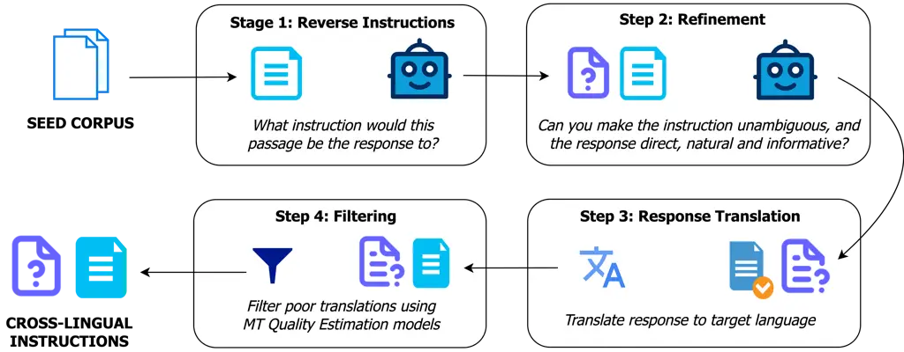
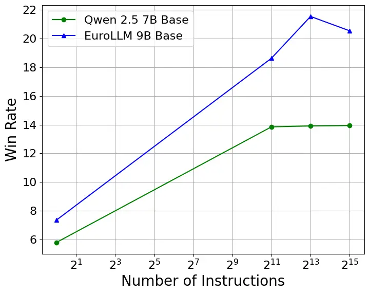
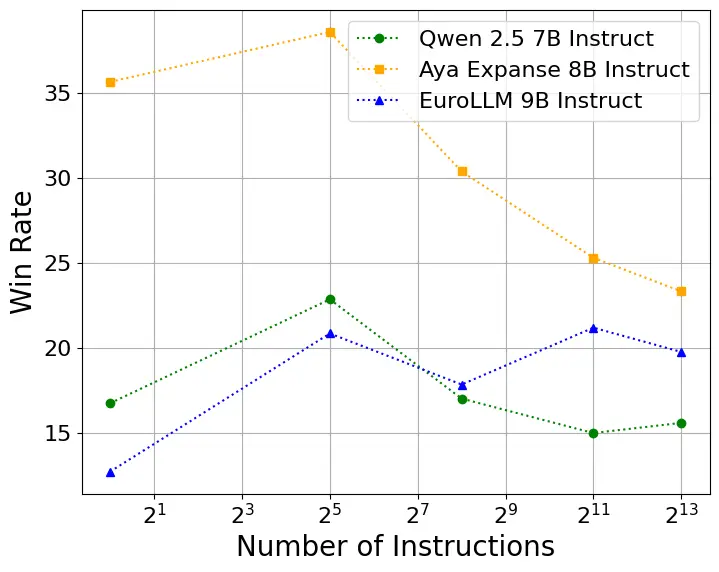

\keepXColumns

# XL-Suite: Cross-Lingual Synthetic Training and Evaluation Data for Open-Ended Generation

Vivek Iyer Affiliation: University of Edinburgh
Email: [vivek.iyer@ed.ac.uk](mailto:)    Pinzhen Chen
Affiliation: University of Edinburgh Affiliation: Queen’s University
Belfast    Ricardo Rei ^(†)^(†)thanks: Work done while at Unbabel.
Affiliation: Sword Health    Alexandra Birch Affiliation: University of
Edinburgh

###### Abstract

Cross-lingual open-ended generation—responding in a language different
from that of the query—is an important yet understudied problem. This
work proposes XL-Instruct, a novel technique for generating high-quality
synthetic data. We also introduce XL-AlpacaEval, a new benchmark for
evaluating cross-lingual generation capabilities of large language
models (LLMs). Our experiments show that fine-tuning with just 8K
instructions generated using our XL-Instruct significantly improves
model performance: increasing the win rate against GPT-4o-mini from 7.4%
to 21.5% and improving on several fine-grained quality metrics.
Moreover, base LLMs fine-tuned on XL-Instruct exhibit strong zero-shot
improvements to same-language question answering, as shown on our
machine-translated m-AlpacaEval. These consistent gains highlight the
promising role of XL-Instruct in the post-training of multilingual LLMs.
Finally, we publicly release XL-Suite, a collection of training and
evaluation data to facilitate research in cross-lingual open-ended
generation.

## 1 Introduction

Cross-lingual generation is the task of understanding a query in a given
source language and generating a response in a different target
language. This task has assumed greater relevance in the recent era of
large language models (LLMs) with multilingual capabilities. Marchisio
et al. (2024) noted its usefulness for a) companies that serve such LLMs
across dozens of languages, but optimizing a prompt for each input
language is inefficient in practice, and b) when a user needs a
generation in a language they do not speak. The conventional cascaded
approaches to cross-lingual generation (Huang et al., 2023; Qin et al.,
2023; Li et al., 2024b) could be problematic due to the noisy nature of
machine translation, which leads to information loss or an
unnatural-sounding response. It is also wasteful of inference time and
cost, since the intermediary English response is thrown away once the
desired cross-lingual output is obtained.

Figure 1: The XL-Instruct pipeline: 1) instruction generation from seed
English data; 2) data refinement; 3) response translation into
non-English; 4) data filtering, with more details in Section 4.

The adaptation of LLMs to cross-lingual open-ended generation is
relevant, given their versatile capabilities in both language conversion
and question answering, but remains understudied. A primary reason is
the absence of high-quality datasets and evaluation benchmarks. This
work addresses the data deficiency for the cross-lingual generation task
from both the modelling and evaluation perspectives. We first introduce
XL-AlpacaEval, a cross-lingual evaluation benchmark built on AlpacaEval
(Li et al., 2023b), and we observe poor off-the-shelf performance for
most open-source multilingual LLMs. As a solution, we propose
XL-Instruct, a synthetic data generation technique to create
high-quality cross-lingual data at scale (illustrated in Figure 1) and
show that fine-tuning with XL-Instruct significantly and consistently
boosts cross-lingual performance across a range of base and
instruction-tuned LLMs. Beyond cross-lingual capabilities, we also
created a machine-translated benchmark for same-language generation,
m-AlpacaEval, to demonstrate that our proposed data synthesis method
achieves strong zero-shot transfer performance.

In this work, we seek to answer the following research questions through
a comprehensive set of experiments:

- •
  RQ1: How good are off-the-shelf multilingual LLMs in cross-lingual
  generation? (§3)
- •
  RQ2: How does XL-Instruct improve cross-lingual capabilities of
  various LLMs? (§5.3)
- •
  RQ3: How does XL-Instruct fine-tuning impact standard multilingual
  same-language question answering? (§6)

Finally, to facilitate research in the cross-lingual LLM domain, which
currently lacks sufficient resources for both evaluation and
post-training, we publicly release XL-Suite¹¹ 1
[https://huggingface.co/collections/viyer98/xl-suite-68ceb97cb1cc7e8499ffb971](https://huggingface.co/collections/viyer98/xl-suite-68ceb97cb1cc7e8499ffb971)
– a comprehensive collection of cross-lingual training (XL-Instruct) and
evaluation (XL-AlpacaEval and m-AlpacaEval) data.

## 2 Related Work

##### Cross-Lingual LLM Prompting

Most of the current research on cross-lingual generation in LLMs focuses
on prompting strategies. The primary goal of generation here is to
leverage the extensive knowledge and superior reasoning capabilities of
LLMs in high-resourced languages (like English) to improve the final
answer in lower-resourced ones (Qin et al., 2023; Huang et al., 2023;
Singh et al., 2024; Wang et al., 2025). Similarly motivated, PLUG (Zhang
et al., 2024) fine-tunes an LLM for this cross-lingual process: it first
answers a non-English question by reasoning in English, then translates
the response to the target language. Other extensions to this
cross-lingual prompting paradigm have also emerged, such as X-InSTA
(Tanwar et al., 2023), which uses a semantic encoder to select relevant
cross-lingual examples, while SITR (Li et al., 2024b) employs
self-reflection and iterative refinement to improve cross-lingual
summarization. However, no prior study has approached cross-lingual
open-ended generation as the primary training objective.

##### Data Synthesis

Previous studies on the creation of synthetic data for post-training
LLMs have mostly been limited to monolingual scenarios, mostly in
English. Self-Instruct (Wang et al., 2023a) and Unnatural Instructions
(Honovich et al., 2023) were among the first to show how LLMs could be
used to generate instructions from seed data. Later efforts have focused
on generating diversified and skill-specific synthetic data. Tülu 3
(Lambert et al., 2024), for instance, used persona-driven prompting to
yield diverse synthetic instructions (Ge et al., 2024), while Llama 3
(Dubey et al., 2024) leveraged skill-specific experts as teacher models
to generate data for coding, math, multilinguality, etc. To enable
multilingual support, machine translation is often used to extend
English resources to other languages (Muennighoff et al., 2023; Lai
et al., 2023; Ranaldi and Pucci, 2023; Chen et al., 2024). Given that
English resources are often model outputs (e.g., of ChatGPT), training
on translations of these can limit models’ exposure to diversity.

##### Reverse Instruction

A subset of data synthesis approaches relevant to our work is called
“reverse instruction”, which generates instructions from seed data and
then uses the original seed data as responses to these instructions,
with back-translation being an early prominent example (Sennrich et al.,
2016). Our work follows this trend of approaches applied to LLMs, where
initial works (Li et al., 2023a; Wang et al., 2023b) presented a
two-step procedure that can be done iteratively: 1) fine-tuning a model
to perform instruction generation, followed by 2) heuristic-based
filtering to keep high-quality synthetic data. Later, Chen et al. (2023)
proposed “instruction wrapping” to refine response quality before
fine-tuning the reverse instruction model. LongForm (Köksal et al., 2023) bypassed the fine-tuning step and leveraged a strong “teacher” LLM
(InstructGPT) to generate such instructions directly, yielding
significant improvements in English text generation tasks. MURI (Köksal
et al., 2024) and X-Instruction (Li et al., 2024a) extend LongForm to
multilingual generation. The former back-translates to English,
generates reverse instructions, and then forward-translates to
low-resource languages. The latter bypasses back-translation to English
and queries the teacher LLM in the low-resource language directly,
potentially exposing the synthetic data to quality issues. The focus of
these works is on improving same-language generation performance.
Finally, Iyer et al. (2024a) and Iyer et al. (2024b) use similar
strategies to create low-resource cross-lingual data for boosting MT
performance of LLMs.

Unlike these previous works, our primary goal is to contribute data
resources for cross-lingual open-ended generation, which includes a
synthetic dataset where the instruction and response are in different
languages, as well as a cross-lingual evaluation benchmark.²² 2 To the
best of our knowledge, we are the first to propose a cross-lingual
open-ended generation benchmark, and our synthetic training dataset is
among the few publicly available. Our experiments (see Table 5) show
that it is of much higher quality than the closest prior work,
X-Instruction (Li et al., 2024a). We intend to release the XL-Instruct
dataset under a permissive open source license.

## 3 XL-AlpacaEval: A Cross-Lingual Evaluation Benchmark

##### Dataset

To evaluate cross-lingual open-ended generation, we create the
XL-AlpacaEval benchmark, which is adapted from AlpacaEval v1 (Li et al.,
2023b). AlpacaEval contains 805 multi-domain prompts sampled from
various test sets (Dubois et al., 2024), including OpenAssistant (Köpf
et al., 2024), Koala (Geng et al., 2023), Vicuna (Chiang et al., 2023),
Self-Instruct (Wang et al., 2023a) and Anthropic’s Helpfulness test set
(Bai et al., 2022). Evaluation is carried out through the LLM-as-a-judge
approach (Zheng et al., 2023), where an evaluator LLM is used to
estimate how often a model output would be preferred by humans over a
baseline reference.

To create XL-AlpacaEval, we first manually examine the AlpacaEval
dataset and filter out prompts that are tailored towards eliciting
responses in English. For example, questions about correcting grammar in
an English sentence cannot be answered cross-lingually (refer to
Section A.1.1 for a detailed justification and a list of excluded
prompts). The filtered test set consists of 797 prompts. Next, we add
cross-lingual generation instructions (such as “Answer in {language}”)
to prompts randomly sampled from a list of templates (in Section A.1.2)
and create an evaluation set for eight languages, spanning resource
availability, writing script, and geographical location: German (deu),
Portuguese (por), Hungarian (hun), Lithuanian (lit), Irish (gle),
Maltese (mlt), simplified Chinese (zho), and Hindi (hin). We focus on
the En-X direction in this work, as generating in non-English is usually
more challenging for LLMs that are usually English-centric. It should be
straightforward to extend our benchmark to other languages and pairs—by
appending the cross-lingual templated instructions to our filtered test
set.

##### Evaluation

While the original implementation used GPT-4-turbo as both reference and
evaluator models, we use GPT-4o-mini for reference and GPT-4o as the
judge, given GPT-4o’s strong multilingual capabilities. Our choice of
using GPT-4o-mini as the reference model is motivated by two reasons: 1)
we experiment with ~7–9B LLMs in this work, making the GPT-4o-mini model
a suitable baseline; and 2) using different reference and judge models,
with the more capable one as the judge, should mitigate self-preference
bias of models (Wataoka et al., 2024). Finally, GPT-4o has also been
shown to obtain state-of-the-art pairwise correlations with human
ratings in multilingual chat scenarios (Gureja et al., 2024; Son et al.,
2024).

| Model                  | Avg   | High-Res EU |       | Med-Res EU |       | Low-Res EU |       | Non-EU |       |
| ---------------------- | ----- | ----------- | ----- | ---------- | ----- | ---------- | ----- | ------ | ----- |
|                        |       | por         | deu   | hun        | lit   | gle        | mlt   | zho    | hin   |
| Salamandra 7B Instruct | 6.44  | 8.64        | 8.27  | 5.08       | 9.51  | 5.63       | 4.95  | 5.24   | 4.23  |
| Aya 23 8B              | 8.85  | 17.04       | 15.04 | 2.07       | 2.22  | 2.45       | 1.92  | 9.46   | 20.57 |
| EuroLLM 9B Instruct    | 12.70 | 18.94       | 16.49 | 8.66       | 16.57 | 9.37       | 8.51  | 14.82  | 8.23  |
| Qwen 2.5 7B Instruct   | 16.73 | 30.88       | 16.35 | 6.82       | 14.68 | 7.17       | 3.69  | 44.63  | 9.59  |
| Gemma 2 9B IT          | 23.29 | 35.42       | 32.08 | 19.80      | 27.28 | 10.09      | 10.03 | 28.12  | 23.50 |
| Llama 3.1 8B Instruct  | 24.36 | 40.28       | 35.72 | 23.07      | 20.74 | 13.20      | 8.47  | 31.21  | 22.22 |
| Aya Expanse 8B         | 35.67 | 62.75       | 60.27 | 8.62       | 19.54 | 10.43      | 9.51  | 57.22  | 56.99 |

Table 1: Zero-shot win rates against GPT-4o-mini on XL-AlpacaEval as
judged by GPT-4o.

| Model                  | Avg    | por    | deu    | hun    | lit   | gle   | mlt   | zho   | hin    |
| ---------------------- | ------ | ------ | ------ | ------ | ----- | ----- | ----- | ----- | ------ |
| Salamandra 7B Instruct | 4.45   | 3.32   | 2.47   | 2.16   | 3.71  | 7.49  | 8.00  | 6.09  | 2.37   |
| Aya 23 8B              | 1.28   | 1.12   | -1.78  | -8.62  | 4.58  | 4.52  | 11.86 | 3.11  | -4.59  |
| EuroLLM 9B Instruct    | 5.26   | -1.57  | -0.83  | 5.50   | 5.14  | 18.66 | 6.83  | 11.85 | -3.54  |
| Qwen 2.5 7B Instruct   | -1.25  | -20.01 | 2.92   | 1.59   | 2.91  | 3.62  | 4.24  | 3.80  | -9.08  |
| Gemma 2 9B IT          | -4.73  | -11.00 | -12.66 | -4.10  | -2.58 | 2.67  | -0.37 | 6.54  | -16.37 |
| Llama 3.1 8B Instruct  | -10.55 | -23.84 | -18.01 | -7.96  | -8.14 | -1.75 | -2.69 | -0.08 | -21.92 |
| Aya Expanse 8B         | -20.53 | -39.60 | -39.25 | -36.13 | -0.51 | -1.18 | -2.50 | -1.78 | -43.29 |

Table 2: Performance change over zero-shot when using
Reason-then-Translate: scores represent differences against win rates
from Table 1. Strong positive improvements are shaded.

##### Models

To evaluate off-the-shelf cross-lingual capabilities of existing
multilingual LLMs, we benchmark several strong open-weight models in the
~7–9B parameter range: Aya Expanse 8B (Dang et al., 2024), Llama 3.1 8B
Instruct (Dubey et al., 2024), Gemma 2 9B Instruct (Team et al., 2024),
Qwen 2.5 7B Instruct (Yang et al., 2024), EuroLLM 9B Instruct (Martins
et al., 2024), Aya 23 8B (Aryabumi et al., 2024), and Salamandra 7B
Instruct (Gonzalez-Agirre et al., 2025). Inference is performed using
the AlpacaEval repository (Li et al., 2023b), with the default decoding
settings: temperature 0.7, maximum tokens 2048, and models loaded in
bfloat16.

##### Zero-Shot Results

We show our benchmark scores in Table 1. Aya Expanse leads the table,
achieving a  60% win rate against GPT-4o-mini for the four languages it
supports (por, deu, zho, hin). While it was trained on significant
synthetic data using multilingual experts (Dang et al., 2024), it
remains unclear whether its superiority stems from explicit
cross-lingual tuning or implicit transfer. For other languages, Llama
3.1 and Gemma 2 yield comparable win rates ranging between 10% and 30%.
We make two critical observations here. Firstly, except for Aya Expanse,
most open LLMs trail significantly behind GPT-4o-mini in cross-lingual
generation, leaving much room for improvement. Secondly, the performance
strongly correlates with the resourcefulness of the language. While Aya
Expanse, Llama 3.1, and Gemma achieve win rates of 40% or higher for
high-resource languages like por, deu, and zho, performance drops to
20-30% for medium-resourced languages (hun, lit, hin) and 10% or less
for lower-resourced languages like gle and mlt. This underscores the
need for scalable pipelines for creating high-quality synthetic data for
lower-resourced languages, in order to achieve more consistent model
performance (see Table 9).

##### Reason-then-Translate Results

Previous works have proposed prompting LLMs to reason first in a
high-resource language (e.g., English) and then translating into the
target language (Qin et al., 2023; Huang et al., 2023; Wang et al.,
2025). We call this approach “reason-then-translate” and report results
in Table 2. The outcomes are mixed: stronger multilingual models like
Aya Expanse, Llama, and Gemma suffer significant performance drops.
Manual inspection reveals these 7B models occasionally produce empty
outputs, likely due to difficulty in following complex multi-step
instructions—this aligns with prior findings which report successful
results from only larger models (Hu et al., 2025). In contrast, weaker
LLMs like EuroLLM and Salamandra, fine-tuned on English reasoning and MT
data, can leverage this two-step approach to yield some gains over their
poor initial scores. Overall, these results show that inducing
cross-lingual capabilities in standard multilingual LLMs may not be
resolved through prompting strategies alone.

## 4 The XL-Instruct Data Synthesis Pipeline

To address this gap, we introduce the XL-Instruct pipeline to create
cross-lingual synthetic instructions from a given seed corpus, as
illustrated in Figure 1. We highlight two important considerations.
First, unlike related work (Li et al., 2024a), we seed from English data
instead of using the target language corpora directly. Given teacher
LLMs are more proficient in English than in a low-resource language, we
hypothesize that more high-quality, yet diverse, synthetic data could be
generated in English. Machine translation is employed only in the final
stages, thereby minimizing noise propagation. Second, we exclusively
utilize open-weight models with permissible licenses to generate
synthetic data, aligning with our objective of releasing a fully public
open-source dataset.

The XL-Instruct pipeline contains four stages:

1.  1.  Stage 1 Reverse Instructions: Given a passage from our seed data, we
        ask a teacher LLM to generate an instruction for which this passage
        would be a valid response.
2.  2.  Stage 2 Refinement: Next, we ask the teacher to reword the question
        and response pairs to follow four manually defined criteria.
3.  3.  Stage 3 Response Translation: Then, we translate the refined
        response to the target language, using one or more translation LLMs.
4.  4.  Stage 4 Filtering: Finally, to ensure we use the highest quality
        targets, we use translation quality estimation (QE) models to filter
        the dataset for the best translations.

After the data is synthesized, we conduct supervised fine-tuning (SFT)
on it with a range of models. We detail the minutiae in each subsection
below.

### 4.1 Stage 1: Question Generation

First, we sample an English passage from our seed corpus, CulturaX
(Nguyen et al., 2024). Then, we ask a teacher LLM (Qwen 2.5 72B (Yang
et al., 2024)) to produce an instruction _for which_ the sampled
sentence would be a valid response. Prompting in English allows us to
leverage the teacher model directly without requiring the additional
fine-tuning employed previously (Li et al., 2024a). This stage thus
yields a synthetic English instruction, paired with the English seed
passage as a response.

### 4.2 Stage 2: Refinement

Next, inspired by Self-Refine (Madaan et al., 2023), we use the teacher
LLM (again, Qwen 2.5 72B) to refine the question-response pair further.
Based on the most commonly occurring errors observed from manual
inspection, we define four goals for the refinement process:

1.  1.  Question Self-Sufficiency: The question should be clear and
        unambiguous, and should not require any additional information or
        context to produce the given response.
2.  2.  Response Naturalness: The response should be ‘natural-sounding’ as
        an LLM output — in terms of fluency, neutrality, objectivity, and
        consistency with the tone and style of LLM-generated responses.
3.  3.  Response Precision: The response should be topically relevant,
        factually accurate, and should directly answer the question. This
        can be thought of as analogous to precision since it tries to assess
        how much of the information contained in the response is relevant,
        necessary, and true.
4.  4.  Response Informativeness: The response should be informative and
        helpful, and must contain enough justification and explanation to
        make it useful to an end user. This is similar to recall, as it
        evaluates how much of the relevant and useful information for the
        response is actually provided.

We provide all four criteria and their definitions in a prompt and ask
the teacher to refine the (question, response) pair. We also instruct
the model to ensure the reworded response is grounded in the original
one, and request it not to add any of its own knowledge—in order to
avoid excessive teacher distillation and to ensure our targets are
grounded in the seed data we use.

(a) Base LLMs

(b) Instruction-Tuned LLMs

Figure 2: Performance on XL-AlpacaEval after SFT with XL-Instruct data
of varying sizes. Y-axis scores reflect win rates against GPT-4o-mini,
averaged across 8 languages, with GPT-4o as the judge. X-axis
instruction counts are shown on a log scale.

### 4.3 Stage 3: Response Translation

Now, we direct our focus towards converting the English
question-response pair to a cross-lingual En-X one. Creating the
cross-lingual instruction itself is easy — we simply add a prompt to
“Respond in {lang}” where {lang} is the target language of interest. To
create the target, the English response must be machine-translated into
the target language. Since document-level MT by open LLMs is currently
unreliable due to limited exploration, scarce datasets, and
hallucination risks, we use sentence-level translation instead. We
sentence-split using Segment Any Text (Frohmann et al., 2024) and
generate translations in one of two ways:

1.  1.  Naive: In the vanilla case, we simply prompt an LLM for the
        translation.
2.  2.  Best-of-k: We obtain $`k`$ translations from $`k`$ different LLMs
        for each sentence, and choose the one with the best QE score.

For QE, we use the WMT’23 CometKiwi-XL model (Rei et al., 2023), which
obtained state-of-the-art scores in the WMT 2023 QE Shared Task (Blain
et al., 2023). For translation, we use EuroLLM 9B Instruct (Martins
et al., 2024) in the “naive” case due to its strong translation
capabilities, while in the “best-of-k” setting, we set $`k=3`$ and
sample among EuroLLM 9B Instruct, Mistral Small 24B Instruct (Mistral AI
Team, 2025), and Gemma2 27B Instruct (Team et al., 2024). Finally, to
create the translated response, we substitute each sentence in the
original response with its sentence-level translation. This helps us
retain formatting like paragraph separators, bullet points, etc, that is
critical to response quality.

### 4.4 Stage 4: Filtering

Finally, to ensure that we select high-quality targets during
fine-tuning, we compute sentence-level QE scores using the WMT’23
CometKiwi-XL model by comparing each source sentence in a given response
and its translation. We average these QE scores across the entire
passage to obtain the final passage-level score. Then, we sort all
responses in descending order and filter the last 20% of the dataset --
creating a final dataset of about 32K instructions. We release the
prompts used in each stage on Hugging Face³³ 3
[https://huggingface.co/datasets/viyer98/xl-instruct/resolve/main/data_prompts.py](https://huggingface.co/datasets/viyer98/xl-instruct/resolve/main/data_prompts.py).

## 5 Experiments on XL-AlpacaEval: Boosting Cross-Lingual Generation

##### Models

We conduct SFT of two base (EuroLLM 9B, Qwen2.5 7B) and three
instruction-tuned (EuroLLM 9B Instruct, Qwen2.5 7B Instruct, and Aya
Expanse 8B) models. We choose EuroLLM and Qwen since they relatively
underperform on the XL-AlpacaEval benchmark (Table 1), leaving
significant scope for improvement. We also experiment with Aya Expanse
since it leads the benchmark, and we are interested in seeing how much
further it could be improved. Unfortunately, Aya Expanse does not have a
base model released, so we are unable to experiment with it.

##### Experimental Setting

We fine-tune all models for 1 epoch using low-rank adaptation (Hu
et al., 2022, LoRA,) with rank 8 matrices applied to query and value
projections. We also tune the input and output embeddings. Training used
a cosine learning rate scheduler with a peak learning rate of 1e-4 and
3% warmup steps. We used bf16 mixed-precision training with batch size
8, and fixed the random seed at 1 for reproducibility. All experiments
were run on 4 Nvidia GeForce RTX 3090 GPUs, each with 24 GB VRAM.

| Model                         | Avg   | fra   | fin   | tur   |
| ----------------------------- | ----- | ----- | ----- | ----- |
| EuroLLM 9B                    | 7.80  | 9.69  | 9.78  | 3.94  |
| EuroLLM 9B Instruct           | 14.08 | 19.39 | 14.05 | 8.81  |
| EuroLLM 9B XL-Instruct (best) | 20.62 | 25.80 | 22.72 | 13.33 |

Table 3: Fine-tuning with XL-Instruct yields zero-shot boosts in
cross-lingual performance. Scores represent zero-shot win rates of
various LLMs against GPT-4o-mini, with GPT-4o as a judge. For the
XL-Instruct baseline, we use the best-performing model from Figure 2.

### 5.1 Main Results

In Figure 2, we report XL-AlpacaEval win rates on fine-tuning with
various amounts of XL-Instruct data. We observe that for base LLMs,
performance steadily improves with data scale. Qwen advances from a win
rate of 5.8% to 13.89% against GPT-4o-mini, while EuroLLM achieves an
even larger boost, going from 7.36% to as high as 21.89% on SFT with 8K
instructions. We report language-specific scores in Table 9 and observe
that while there are consistent gains for all languages, the largest
gains are on an LLM’s pre-training language. Since EuroLLM includes all
8 XL-AlpacaEval languages in its pre-training, it observes large gains
per language, leading to a much better overall average score. Qwen,
which chiefly supports high-resource languages like Chinese, Portuguese,
and German, gains the most for these pairs but shows relatively smaller
improvements for others. This suggests that while post-training with
XL-Instruct can yield stable improvements across multiple languages,
multilingual pre-training is crucial for best performance.

We also observe consistent improvements when fine-tuning
instruction-tuned LLMs (Figure 2(b)). Unlike base LLMs, the saturation
occurs sooner here—at around 2K instructions for EuroLLM-9B-Instruct
and, only 32 instructions for the Qwen and Aya Expanse models! This is
likely because the latter two models have also undergone Preference
Optimization, and task-specific SFT at scale might lead to overfitting
and deteriorated performance. EuroLLM, on the other hand, has only
undergone SFT, and can therefore be trained for longer.

Moreover, we report full results in Section B.1, where we observe
consistent and major gains across all languages (Table 9). These results
are particularly noteworthy given the modest training costs—low-rank
fine-tuning with a few thousand instructions. Moreover, with only 32
examples, Aya Expanse achieves a win rate boost from ~57% to ~65% for
its supported languages, Portuguese, German, Hindi, and Chinese
(Table 9). Lastly, we also show in Table 3 in the Appendix how
XL-Instruct can also boost zero-shot cross-lingual performance, i.e.
even for languages _not_ included in SFT.

##### Zero-Shot Results

Moreover, we show in Table 3 zero-shot cross-lingual performance after
fine-tuning with XL-Instruct. We choose French (fra), Finnish (fin), and
Turkish (hind), which are in EuroLLM’s pre-training. We see huge gains
in win rates, largely outperforming even the official EuroLLM 9B
Instruct. This shows that even if done only for a few languages,
XL-Instruct can result in significant transfer that improves performance
in others. We hypothesize that this is likely because the model is able
to learn formatting, response structure, etc. from this process, which
also supports the boosts in English generation one observes in Table 6.

### 5.2 Fine-Grained Evaluation

Beyond win rates that focus solely on pairwise comparisons, we are also
interested in evaluating how well the produced cross-lingual generations
improve on an absolute scale, on human-desired criteria. To achieve
this, we take inspiration from recent works that define customised,
task-specific metrics and use LLM-as-a-Judge for producing scores on a
Likert scale, which achieves strong correlations with human ratings on
the evaluation of summarization (Liu et al., 2023), retrieval (Upadhyay
et al., 2024), story generation (Chiang and Lee, 2023), translation
(Kocmi and Federmann, 2023b; Kocmi and Federmann, 2023a), and open-ended
generation (Kim et al., 2023). In particular, Kim et al. (2023) showed
that using clearly defined rubrics can result in up to 0.87 Spearman
correlations with human preferences for open-ended generation. Inspired
by this, we propose four criteria pertinent to the task of cross-lingual
generation: Objectivity, Naturalness, Informativeness, and Precision. We
define detailed rubrics for each metric and provide well-defined
criteria for mapping output quality to scores on a scale of 1-5. We
include these rubrics in the context of a prompt, and ask GPT-4o to
score cross-lingual generations of EuroLLM 9B, EuroLLM 9B Instruct, and
EuroLLM 9B XL-Instruct (the best model from Figure 2(a), which is
fine-tuned with LoRA on 8K examples). We provide detailed evaluation
prompts and rubrics on Hugging Face⁴⁴ 4
[https://huggingface.co/datasets/viyer98/xl-instruct/resolve/main/eval_prompts.py](https://huggingface.co/datasets/viyer98/xl-instruct/resolve/main/eval_prompts.py).

| Model                             | Avg  | Precision | Informativeness | Naturalness | Objectivity |
| --------------------------------- | ---- | --------- | --------------- | ----------- | ----------- |
| EuroLLM 9B                        | 2.43 | 2.52      | 2.69            | 2.25        | 2.27        |
| EuroLLM 9B Instruct (official)    | 3.56 | 3.68      | 3.80            | 3.54        | 3.23        |
| EuroLLM 9B XL-Instruct (our best) | 3.60 | 3.63      | 3.88            | 3.64        | 3.24        |

Table 4: Performance of EuroLLM 9B models evaluated by Precision,
Informativeness, Naturalness, and Objectivity.

| Model                                     | Avg   | fin   | hin  | tur   |
| ----------------------------------------- | ----- | ----- | ---- | ----- |
| EuroLLM 9B + X-Instruction (full 1M)      | 9.73  | 14.35 | 7.22 | 7.63  |
| EuroLLM 9B + X-Instruction (40K)          | 10.44 | 13.69 | 8.76 | 8.86  |
| EuroLLM 9B + XL-Instruct (naive, 40K)     | 12.06 | 15.30 | 10.9 | 9.98  |
| EuroLLM 9B + XL-Instruct (best of 3, 40K) | 17.82 | 23.15 | 15.8 | 14.52 |

Table 5: Results from EuroLLM 9B fine-tuned on data from X-Instruction
(Li et al., 2024a) and XL-Instruct (ours).

We list rubric-based evaluation results in Table 4, which provides the
macro-averaged scores across criterion and model. As expected, the raw
EuroLLM 9B base model achieves the worst scores on all metrics, with the
EuroLLM-9B-Instruct model performing substantially better. We note that
the XL-Instruct model performs comparably to or marginally better than
EuroLLM-9B-Instruct. This result is particularly impressive given the
XL-Instruct baseline was trained using LoRA fine-tuning on only 8K
synthetic samples, whereas the EuroLLM-9B-Instruct was fully fine-tuned
on a mix of 2M human and synthetic examples. These results clearly
demonstrate the effectiveness and high quality of the XL-Instruct
dataset.

### 5.3 Comparison to Previous Work

We also compare the efficacy of XL-Instruct with its most similar
work—the only cross-lingual open-ended generation dataset we are aware
of: X-Instruction (Li et al., 2024a). We base all comparisons on their
public data,⁵⁵ 5
[https://huggingface.co/datasets/James-WYang/X-Instruction](https://huggingface.co/datasets/James-WYang/X-Instruction)
using Hindi (hin), Finnish (fin), and Turkish (tur), because these are
supported by EuroLLM and are also available in X-Instruction. We also
generate XL-Instruct data in these languages, by redoing the XL-Instruct
pipeline (Section 4) from Stage 3 (Response Translation) for these
languages. We LoRA fine-tune EuroLLM 9B on various X-Instruction and
XL-Instruct datasets. For the former, we use both the entire 1M-sized
dataset available for these languages (in total) and a 40K instructions
subset, which is more comparable to our XL-Instruct baselines. For
XL-Instruct, we train two baselines—one trained on “naive” translations
(i.e., using only EuroLLM 9B Instruct) and another using a “best-of-3”
method (refer to Section 4.3 for a detailed explanation).

We see that both XL-Instruct baselines significantly outperform
X-Instruction, with our best model achieving a 70.68% improvement over
the latter—showcasing the relative superiority of our pipeline. This
also suggests it might be more effective to prompt a teacher model in
English due to inherently superior capabilities, and we hypothesize it
might allow for greater quality and diversity in responses, as well as
allow for more complex operations like refinement following specifically
defined, custom criteria.

## 6 Experiments on m-AlpacaEval: Exploring Zero-Shot Transfer

| Model                    | Avg   | zho   | deu   | hin   | hun   | gle   | lit   | mlt   | por   | eng   |
| ------------------------ | ----- | ----- | ----- | ----- | ----- | ----- | ----- | ----- | ----- | ----- |
| EuroLLM 9B               | 0.73  | 1.19  | 1.47  | 0.70  | 0.14  | 0.14  | 0.65  | 0.31  | 1.25  | 35.59 |
| \+XL-Instruct (best, 8K) | 6.10  | 10.77 | 11.40 | 4.47  | 2.53  | 3.60  | 3.77  | 2.49  | 9.76  | 51.35 |
| EuroLLM 9B Instruct      | 8.94  | 13.38 | 11.99 | 8.13  | 4.81  | 5.65  | 6.68  | 6.78  | 14.12 | 55.58 |
| \+XL-Instruct (best, 8K) | 15.55 | 19.57 | 18.30 | 13.03 | 10.38 | 14.12 | 16.76 | 14.13 | 18.11 | 59.44 |
| Qwen 2.5 7B              | 2.04  | 10.40 | 1.52  | 0.98  | 0.24  | 0.03  | 0.45  | 0.29  | 2.39  | 46.93 |
| \+XL-Instruct (best, 8K) | 5.66  | 20.43 | 9.53  | 2.23  | 0.65  | 0.18  | 1.60  | 0.29  | 10.33 | 55.92 |
| Qwen 2.5 7B Instruct     | 11.47 | 45.29 | 10.53 | 5.71  | 0.97  | 0.99  | 3.22  | 1.63  | 23.39 | 75.16 |
| \+XL-Instruct (best, 32) | 18.19 | 52.12 | 31.64 | 8.34  | 5.79  | 1.59  | 5.79  | 1.83  | 38.44 | 76.72 |
| Aya Expanse 8B           | 29.90 | 58.21 | 56.91 | 56.68 | 1.11  | 1.02  | 3.04  | 2.94  | 59.29 | 76.26 |
| \+XL-Instruct (best, 32) | 32.31 | 63.24 | 59.53 | 63.22 | 2.21  | 0.78  | 5.85  | 3.66  | 60.01 | 77.70 |

Table 6: Win Rates of LLMs and their XL-Instruct fine-tuned counterparts
on m-AlpacaEval against GPT-4o-mini, judged by GPT-4o. For each model,
we choose the best cross-lingual performing baseline from Figure 2 and
evaluate transfer on m-AlpacaEval. Consistent improvement across all
models and pairs shows strong zero-shot transfer from cross-lingual
tuning, for both multilingual and English-only generation. Best scores
are bolded and cells are highlighted proportionate to performance gain.

Having seen task-specific improvements, we now seek to evaluate the
zero-shot performance of models fine-tuned with XL-Instruct on
multilingual and English open-ended generation, since these are arguably
the more common use cases of LLMs. For this purpose, we first construct
the m-AlpacaEval benchmark by machine translating the AlpacaEval test
set into our 8 languages of interest, following similar efforts to
create m-ArenaHard (Dang et al., 2024). We use GPT-4o for translation of
the prompts. The evaluation setup is similar to XL-AlpacaEval, wherein
GPT-4o-mini is used as the reference model and GPT-4o is used as the
judge.

We present our results in Table 6, for the base and instruct versions of
the LLMs from Figure 2, alongside their best-performing
XL-Instruct-tuned counterparts. We observe significant and consistent
zero-shot transfer across all models and languages. For multilingual
generation, the gains are strongest for the languages a model is
pre-trained on, similar to our observations for cross-lingual
generation. This is particularly evident in the Qwen and Aya models.
EuroLLM Instruct, on the other hand, achieves stable performances across
all languages and relatively strongest win rates for the lower-resourced
languages. Interestingly, we also note consistent gains in English-only
generation, despite there being no English responses on the target side!
This suggests that all of these models, trained heavily on English, can
learn preferred response structure and formatting from cross-lingual
tuning. These results are quite encouraging, since they suggest
cross-lingual fine-tuning need not come at the cost of standard
“monolingual” generation performance—on the contrary, it can result in
further boosts.

## 7 Conclusion

In this work, we propose data resources for advancing cross-lingual
open-ended generation—loosely defined as a task in which the query and
the desired (open-ended) response are in different languages. This can
be viewed as a distinct yet crucial subtask of multilingual generation.
While cross-lingual generation may also include more complex scenarios,
such as providing context in one language while the query and response
are in another (or even multiple) languages, we focus here on the
simpler scenario: queries posed in English with responses required in
one of eight target languages – which includes high, medium, and
low-resource EU and non-EU languages.

With this goal in mind, we make three key contributions. First, we
introduce the XL-AlpacaEval benchmark to evaluate the current state of
open LLMs, and report poor performances and significant gaps against
GPT-4o-Mini. Second, we propose the XL-Instruct technique, and show that
this synthetic data can substantially boost cross-lingual performance,
both in terms of win rates and fine-grained quality metrics. Third, we
show that it exhibits strong zero-shot transfer to monolingual
generation, both in English and beyond. Based on these results, we
strongly encourage researchers to post-train and evaluate their
multilingual LLMs on our publicly released XL-Suite.

## 8 Limitations

There has been some concern in the literature that iterative training on
synthetic data could eventually lead to model collapse (Shumailov
et al., 2024). Like any other synthetic data technique, XL-Instruct
could also share similar risks, especially since its seed data is
sourced from the Web.

We also did not perform human evaluation on the synthesized data or the
model-generated outputs due to cost and time considerations. This
drawback may have been partially mitigated by the rubric-based LLM
judgments.

## LLM Usage Statement

AI assistants were used to aid the programming and writing process in
this work. For coding, it was used to create helper functions for
preprocessing, and resolve bugs. During writing, it was used to aid in
constructing LaTeX tables, plot graphs, fix grammar, etc.

## Contributions

We list author contributions loosely following the CRediT author
statement.⁶⁶ 6
[https://www.elsevier.com/researcher/author/policies-and-guidelines/credit-author-statement](https://www.elsevier.com/researcher/author/policies-and-guidelines/credit-author-statement)

- •
  VI: Conceptualization (co-lead), Software (lead), Writing (lead),
  Methodology (lead), Formal analysis (lead), Data Curation (lead),
  Visualization (lead)
- •
  PC: Conceptualization (co-lead), Writing (supporting), Supervision
  (supporting)
- •
  RR: Writing (supporting), Supervision (supporting)
- •
  AB: Writing (supporting), Supervision (lead), Project Administration
  (lead), Funding Acquisition (lead)

## Acknowledgments

This work has received funding from UK Research and Innovation under the
UK government’s Horizon Europe funding guarantee \[grant numbers
10039436 and 10052546\]. Vivek Iyer was supported by the Apple Scholars
in AI/ML PhD fellowship. Finally, we thank EDINA team at the University
of Edinburgh for their provision of OpenAI credits through the ELM API
that facilitated all the experiments in this work.

We thank Wenhao Zhu for discussions during prior work (Iyer et al.,
2024b) that helped in the formulation of this idea. We also thank Simran
Khanuja for her feedback on initial drafts of this work.

## References

- Aryabumi et al. (2024) Viraat Aryabumi, John Dang, Dwarak Talupuru,
  Saurabh Dash, David Cairuz, Hangyu Lin, Bharat Venkitesh, Madeline
  Smith, Jon Ander Campos, Yi Chern Tan, and 1 others. 2024. Aya 23:
  Open weight releases to further multilingual progress. _arXiv preprint
  arXiv:2405.15032_.
- Bai et al. (2022) Yuntao Bai, Andy Jones, Kamal Ndousse, Amanda
  Askell, Anna Chen, Nova DasSarma, Dawn Drain, Stanislav Fort, Deep
  Ganguli, Tom Henighan, Nicholas Joseph, Saurav Kadavath, Jackson
  Kernion, Tom Conerly, Sheer El-Showk, Nelson Elhage, Zac
  Hatfield-Dodds, Danny Hernandez, Tristan Hume, and 12 others. 2022.
  Training a helpful and harmless assistant with reinforcement learning
  from human feedback. _arXiv preprint arXiv:2204.05862_.
- Blain et al. (2023) Frederic Blain, Chrysoula Zerva, Ricardo Ribeiro,
  Nuno Miguel Guerreiro, Diptesh Kanojia, José GC de Souza, Beatriz
  Silva, Tânia Vaz, Yan Jingxuan, Fatemeh Azadi, and 1 others. 2023.
  Findings of the wmt 2023 shared task on quality estimation. In _Eight
  conference on machine translation_.
- Chen et al. (2024) Pinzhen Chen, Shaoxiong Ji, Nikolay Bogoychev,
  Andrey Kutuzov, Barry Haddow, and Kenneth Heafield. 2024. Monolingual
  or multilingual instruction tuning: Which makes a better alpaca. In
  _Findings of the Association for Computational Linguistics: EACL
  2024_.
- Chen et al. (2023) Yongrui Chen, Haiyun Jiang, Xinting Huang, Shuming
  Shi, and Guilin Qi. 2023. Dog-instruct: Towards premium
  instruction-tuning data via text-grounded instruction wrapping. _arXiv
  preprint arXiv:2309.05447_.
- Chiang and Lee (2023) Cheng-Han Chiang and Hung-yi Lee. 2023. [Can
  large language models be an alternative to human
  evaluations?](https://doi.org/10.18653/v1/2023.acl-long.870) In
  _Proceedings of the 61st Annual Meeting of the Association for
  Computational Linguistics (Volume 1: Long Papers)_.
- Chiang et al. (2023) Wei-Lin Chiang and 1 others. 2023. Vicuna: An
  open-source chatbot impressing gpt-4 with 90%\* chatgpt quality. _See
  https://vicuna.lmsys.org (accessed 22 January 2025)_, 2.3:6.
- Dang et al. (2024) John Dang, Shivalika Singh, Daniel D’souza, Arash
  Ahmadian, Alejandro Salamanca, Madeline Smith, Aidan Peppin, Sungjin
  Hong, Manoj Govindassamy, Terrence Zhao, and 1 others. 2024. Aya
  expanse: Combining research breakthroughs for a new multilingual
  frontier. _arXiv preprint arXiv:2412.04261_.
- Dubey et al. (2024) Abhimanyu Dubey, Abhinav Jauhri, Abhinav Pandey,
  Abhishek Kadian, Ahmad Al-Dahle, Aiesha Letman, Akhil Mathur, Alan
  Schelten, Amy Yang, Angela Fan, and 1 others. 2024. The llama 3 herd
  of models. _arXiv preprint arXiv:2407.21783_.
- Dubois et al. (2024) Yann Dubois, Chen Xuechen Li, Rohan Taori, Tianyi
  Zhang, Ishaan Gulrajani, Jimmy Ba, Carlos Guestrin, Percy S Liang, and
  Tatsunori B Hashimoto. 2024. Alpacafarm: A simulation framework for
  methods that learn from human feedback. _Advances in Neural
  Information Processing Systems_, 36.
- Frohmann et al. (2024) Markus Frohmann, Igor Sterner, Ivan Vulić,
  Benjamin Minixhofer, and Markus Schedl. 2024. [Segment any text: A
  universal approach for robust, efficient and adaptable sentence
  segmentation](https://aclanthology.org/2024.emnlp-main.665). In
  _Proceedings of the 2024 Conference on Empirical Methods in Natural
  Language Processing_.
- Ge et al. (2024) Tao Ge, Xin Chan, Xiaoyang Wang, Dian Yu, Haitao Mi,
  and Dong Yu. 2024. Scaling synthetic data creation with 1,000,000,000
  personas. _arXiv preprint arXiv:2406.20094_.
- Geng et al. (2023) Xinyang Geng, Arnav Gudibande, Hao Liu, Eric
  Wallace, Pieter Abbeel, Sergey Levine, and Dawn Song. 2023. Koala: A
  dialogue model for academic research. Blog post.
- Gonzalez-Agirre et al. (2025) Aitor Gonzalez-Agirre, Marc Pàmies, Joan
  Llop, Irene Baucells, Severino Da Dalt, Daniel Tamayo, José Javier
  Saiz, Ferran Espuña, Jaume Prats, Javier Aula-Blasco, Mario Mina,
  Adrián Rubio, Alexander Shvets, Anna Sallés, Iñaki Lacunza, Iñigo
  Pikabea, Jorge Palomar, Júlia Falcão, Lucía Tormo, and 4 others. 2025.
  [Salamandra technical report](https://arxiv.org/abs/2502.08489).
  _Preprint_, arXiv:2502.08489.
- Gureja et al. (2024) Srishti Gureja, Lester James V Miranda,
  Shayekh Bin Islam, Rishabh Maheshwary, Drishti Sharma, Gusti Winata,
  Nathan Lambert, Sebastian Ruder, Sara Hooker, and Marzieh
  Fadaee. 2024. M-rewardbench: Evaluating reward models in multilingual
  settings. _arXiv preprint arXiv:2410.15522_.
- Honovich et al. (2023) Or Honovich, Thomas Scialom, Omer Levy, and
  Timo Schick. 2023. Unnatural instructions: Tuning language models with
  (almost) no human labor. In _Proceedings of the 61st Annual Meeting of
  the Association for Computational Linguistics (Volume 1: Long
  Papers)_.
- Hu et al. (2022) Edward J Hu, Yelong Shen, Phillip Wallis, Zeyuan
  Allen-Zhu, Yuanzhi Li, Shean Wang, Lu Wang, Weizhu Chen, and 1
  others. 2022. Lora: Low-rank adaptation of large language models.
  _ICLR_, 1(2):3.
- Hu et al. (2025) Hanxu Hu, Simon Yu, Pinzhen Chen, and Edoardo
  Ponti. 2025. [Fine-tuning large language models with sequential
  instructions](https://doi.org/10.18653/v1/2025.naacl-long.288). In
  _Proceedings of the 2025 Conference of the Nations of the Americas
  Chapter of the Association for Computational Linguistics: Human
  Language Technologies (Volume 1: Long Papers)_.
- Huang et al. (2023) Haoyang Huang, Tianyi Tang, Dongdong Zhang, Xin
  Zhao, Ting Song, Yan Xia, and Furu Wei. 2023. Not all languages are
  created equal in LLMs: Improving multilingual capability by
  cross-lingual-thought prompting. In _Findings of the Association for
  Computational Linguistics: EMNLP 2023_.
- Iyer et al. (2024a) Vivek Iyer, Bhavitvya Malik, Pavel Stepachev,
  Pinzhen Chen, Barry Haddow, and Alexandra Birch. 2024a. Quality or
  quantity? on data scale and diversity in adapting large language
  models for low-resource translation. In _Proceedings of the Ninth
  Conference on Machine Translation_.
- Iyer et al. (2024b) Vivek Iyer, Bhavitvya Malik, Wenhao Zhu, Pavel
  Stepachev, Pinzhen Chen, Barry Haddow, and Alexandra Birch. 2024b.
  Exploring very low-resource translation with LLMs: The University of
  Edinburgh‘s submission to AmericasNLP 2024 translation task. In
  _Proceedings of the 4th Workshop on Natural Language Processing for
  Indigenous Languages of the Americas (AmericasNLP 2024)_.
- Kim et al. (2023) Seungone Kim, Jamin Shin, Yejin Cho, Joel Jang,
  Shayne Longpre, Hwaran Lee, Sangdoo Yun, Seongjin Shin, Sungdong Kim,
  James Thorne, and 1 others. 2023. Prometheus: Inducing fine-grained
  evaluation capability in language models. In _The Twelfth
  International Conference on Learning Representations_.
- Kocmi and Federmann (2023a) Tom Kocmi and Christian Federmann. 2023a.
  Gemba-mqm: Detecting translation quality error spans with gpt-4. In
  _Proceedings of the Eighth Conference on Machine Translation_.
- Kocmi and Federmann (2023b) Tom Kocmi and Christian Federmann. 2023b.
  [Large language models are state-of-the-art evaluators of translation
  quality](https://aclanthology.org/2023.eamt-1.19). In _Proceedings of
  the 24th Annual Conference of the European Association for Machine
  Translation_.
- Köksal et al. (2023) Abdullatif Köksal, Timo Schick, Anna Korhonen,
  and Hinrich Schütze. 2023. Longform: Effective instruction tuning with
  reverse instructions. _arXiv preprint arXiv:2304.08460_.
- Köksal et al. (2024) Abdullatif Köksal, Marion Thaler, Ayyoob Imani,
  Ahmet Üstün, Anna Korhonen, and Hinrich Schütze. 2024. Muri:
  High-quality instruction tuning datasets for low-resource languages
  via reverse instructions. _arXiv preprint arXiv:2409.12958_.
- Köpf et al. (2024) Andreas Köpf, Yannic Kilcher, Dimitri von Rütte,
  Sotiris Anagnostidis, Zhi Rui Tam, Keith Stevens, Abdullah Barhoum,
  Duc Nguyen, Oliver Stanley, Richárd Nagyfi, and 1 others. 2024.
  Openassistant conversations-democratizing large language model
  alignment. _Advances in Neural Information Processing Systems_, 36.
- Lai et al. (2023) Viet Lai, Chien Nguyen, Nghia Ngo, Thuat Nguyen,
  Franck Dernoncourt, Ryan Rossi, and Thien Nguyen. 2023. Okapi:
  Instruction-tuned large language models in multiple languages with
  reinforcement learning from human feedback. In _Proceedings of the
  2023 Conference on Empirical Methods in Natural Language Processing:
  System Demonstrations_.
- Lambert et al. (2024) Nathan Lambert, Jacob Morrison, Valentina
  Pyatkin, Shengyi Huang, Hamish Ivison, Faeze Brahman, Lester James V
  Miranda, Alisa Liu, Nouha Dziri, Shane Lyu, and 1 others. 2024.
  T$`\backslash`$" ulu 3: Pushing frontiers in open language model
  post-training. _arXiv preprint arXiv:2411.15124_.
- Li et al. (2024a) Chong Li, Wen Yang, Jiajun Zhang, Jinliang Lu,
  Shaonan Wang, and Chengqing Zong. 2024a. X-instruction: Aligning
  language model in low-resource languages with self-curated
  cross-lingual instructions. In _Findings of the Association for
  Computational Linguistics: ACL 2024_.
- Li et al. (2023a) Xian Li, Ping Yu, Chunting Zhou, Timo Schick, Omer
  Levy, Luke Zettlemoyer, Jason Weston, and Mike Lewis. 2023a.
  Self-alignment with instruction backtranslation. _arXiv preprint
  arXiv:2308.06259_.
- Li et al. (2023b) Xuechen Li, Tianyi Zhang, Yann Dubois, Rohan Taori,
  Ishaan Gulrajani, Carlos Guestrin, Percy Liang, and Tatsunori B.
  Hashimoto. 2023b. Alpacaeval: An automatic evaluator of
  instruction-following models.
- Li et al. (2024b) Zhecheng Li, Yiwei Wang, Bryan Hooi, Yujun Cai,
  Naifan Cheung, Nanyun Peng, and Kai-wei Chang. 2024b. Think carefully
  and check again! meta-generation unlocking llms for low-resource
  cross-lingual summarization. _arXiv preprint arXiv:2410.20021_.
- Liu et al. (2023) Yang Liu, Dan Iter, Yichong Xu, Shuohang Wang,
  Ruochen Xu, and Chenguang Zhu. 2023. [G-eval: NLG evaluation using
  gpt-4 with better human
  alignment](https://doi.org/10.18653/v1/2023.emnlp-main.153). In
  _Proceedings of the 2023 Conference on Empirical Methods in Natural
  Language Processing_.
- Madaan et al. (2023) Aman Madaan, Niket Tandon, Prakhar Gupta, Skyler
  Hallinan, Luyu Gao, Sarah Wiegreffe, Uri Alon, Nouha Dziri, Shrimai
  Prabhumoye, Yiming Yang, and 1 others. 2023. Self-refine: Iterative
  refinement with self-feedback. _Advances in Neural Information
  Processing Systems_, 36:46534–46594.
- Marchisio et al. (2024) Kelly Marchisio, Wei-Yin Ko, Alexandre Berard,
  Théo Dehaze, and Sebastian Ruder. 2024. Understanding and mitigating
  language confusion in LLMs. In _Proceedings of the 2024 Conference on
  Empirical Methods in Natural Language Processing_.
- Martins et al. (2024) Pedro Henrique Martins, Patrick Fernandes, João
  Alves, Nuno M Guerreiro, Ricardo Rei, Duarte M Alves, José Pombal,
  Amin Farajian, Manuel Faysse, Mateusz Klimaszewski, and 1
  others. 2024. EuroLLM: Multilingual language models for Europe. _arXiv
  preprint arXiv:2409.16235_.
- Mistral AI Team (2025) Mistral AI Team. 2025. Mistral small 3: Apache
  2.0, 81% mmlu, 150 tokens/s.
  [https://mistral.ai/news/mistral-small-3](https://mistral.ai/news/mistral-small-3).
  Accessed: 2025-03-17.
- Muennighoff et al. (2023) Niklas Muennighoff, Thomas Wang, Lintang
  Sutawika, Adam Roberts, Stella Biderman, Teven Le Scao, M Saiful Bari,
  Sheng Shen, Zheng Xin Yong, Hailey Schoelkopf, Xiangru Tang, Dragomir
  Radev, Alham Fikri Aji, Khalid Almubarak, Samuel Albanie, Zaid
  Alyafeai, Albert Webson, Edward Raff, and Colin Raffel. 2023.
  Crosslingual generalization through multitask finetuning. In
  _Proceedings of the 61st Annual Meeting of the Association for
  Computational Linguistics (Volume 1: Long Papers)_.
- Nguyen et al. (2024) Thuat Nguyen, Chien Van Nguyen, Viet Dac Lai,
  Hieu Man, Nghia Trung Ngo, Franck Dernoncourt, Ryan A. Rossi, and
  Thien Huu Nguyen. 2024. CulturaX: A cleaned, enormous, and
  multilingual dataset for large language models in 167 languages. In
  _Proceedings of the 2024 Joint International Conference on
  Computational Linguistics, Language Resources and Evaluation
  (LREC-COLING 2024)_.
- Ortiz Suárez et al. (2020) Pedro Javier Ortiz Suárez, Laurent Romary,
  and Benoît Sagot. 2020. [A monolingual approach to contextualized word
  embeddings for mid-resource
  languages](https://doi.org/10.18653/v1/2020.acl-main.156). In
  _Proceedings of the 58th Annual Meeting of the Association for
  Computational Linguistics_.
- Qin et al. (2023) Libo Qin, Qiguang Chen, Fuxuan Wei, Shijue Huang,
  and Wanxiang Che. 2023. Cross-lingual prompting: Improving zero-shot
  chain-of-thought reasoning across languages. In _Proceedings of the
  2023 Conference on Empirical Methods in Natural Language Processing_.
- Ranaldi and Pucci (2023) Leonardo Ranaldi and Giulia Pucci. 2023. Does
  the English matter? elicit cross-lingual abilities of large language
  models. In _Proceedings of the 3rd Workshop on Multi-lingual
  Representation Learning (MRL)_.
- Rei et al. (2023) Ricardo Rei, Nuno M Guerreiro, José Pombal, Daan van
  Stigt, Marcos Treviso, Luisa Coheur, José GC de Souza, and André FT
  Martins. 2023. Scaling up cometkiwi: Unbabel-ist 2023 submission for
  the quality estimation shared task. _arXiv preprint arXiv:2309.11925_.
- Sennrich et al. (2016) Rico Sennrich, Barry Haddow, and Alexandra
  Birch. 2016. [Improving neural machine translation models with
  monolingual data](https://doi.org/10.18653/v1/P16-1009). In
  _Proceedings of the 54th Annual Meeting of the Association for
  Computational Linguistics (Volume 1: Long Papers)_.
- Shumailov et al. (2024) Ilia Shumailov, Zakhar Shumaylov, Yiren Zhao,
  Nicolas Papernot, Ross Anderson, and Yarin Gal. 2024. Ai models
  collapse when trained on recursively generated data. _Nature_,
  631(8022):755–759.
- Singh et al. (2024) Vaibhav Singh, Amrith Krishna, Karthika NJ, and
  Ganesh Ramakrishnan. 2024. A three-pronged approach to cross-lingual
  adaptation with multilingual llms. _arXiv preprint arXiv:2406.17377_.
- Son et al. (2024) Guijin Son, Dongkeun Yoon, Juyoung Suk, Javier
  Aula-Blasco, Mano Aslan, Vu Trong Kim, Shayekh Bin Islam, Jaume
  Prats-Cristià, Lucía Tormo-Bañuelos, and Seungone Kim. 2024. Mm-eval:
  A multilingual meta-evaluation benchmark for llm-as-a-judge and reward
  models. _arXiv preprint arXiv:2410.17578_.
- Tanwar et al. (2023) Eshaan Tanwar, Subhabrata Dutta, Manish
  Borthakur, and Tanmoy Chakraborty. 2023. Multilingual LLMs are better
  cross-lingual in-context learners with alignment. In _Proceedings of
  the 61st Annual Meeting of the Association for Computational
  Linguistics (Volume 1: Long Papers)_.
- Team et al. (2024) Gemma Team, Morgane Riviere, Shreya Pathak,
  Pier Giuseppe Sessa, Cassidy Hardin, Surya Bhupatiraju, Léonard
  Hussenot, Thomas Mesnard, Bobak Shahriari, Alexandre Ramé, and 1
  others. 2024. Gemma 2: Improving open language models at a practical
  size. _arXiv preprint arXiv:2408.00118_.
- Upadhyay et al. (2024) Shivani Upadhyay, Ronak Pradeep, Nandan Thakur,
  Nick Craswell, and Jimmy Lin. 2024. Umbrela: Umbrela is the
  (open-source reproduction of the) bing relevance assessor. _arXiv
  preprint arXiv:2406.06519_.
- Wang et al. (2025) Teng Wang, Zhenqi He, Wing-Yin Yu, Xiaojin Fu, and
  Xiongwei Han. 2025. Large language models are good multi-lingual
  learners : When LLMs meet cross-lingual prompts. In _Proceedings of
  the 31st International Conference on Computational Linguistics_.
- Wang et al. (2023a) Yizhong Wang, Yeganeh Kordi, Swaroop Mishra, Alisa
  Liu, Noah A. Smith, Daniel Khashabi, and Hannaneh Hajishirzi. 2023a.
  Self-instruct: Aligning language models with self-generated
  instructions. In _Proceedings of the 61st Annual Meeting of the
  Association for Computational Linguistics (Volume 1: Long Papers)_.
- Wang et al. (2023b) Yue Wang, Xinrui Wang, Juntao Li, Jinxiong Chang,
  Qishen Zhang, Zhongyi Liu, Guannan Zhang, and Min Zhang. 2023b.
  Harnessing the power of david against goliath: Exploring instruction
  data generation without using closed-source models. _arXiv preprint
  arXiv:2308.12711_.
- Wataoka et al. (2024) Koki Wataoka, Tsubasa Takahashi, and Ryokan
  Ri. 2024. Self-preference bias in llm-as-a-judge. _arXiv preprint
  arXiv:2410.21819_.
- Xue et al. (2021) Linting Xue, Noah Constant, Adam Roberts, Mihir
  Kale, Rami Al-Rfou, Aditya Siddhant, Aditya Barua, and Colin
  Raffel. 2021. [mT5: A massively multilingual pre-trained text-to-text
  transformer](https://doi.org/10.18653/v1/2021.naacl-main.41). In
  _Proceedings of the 2021 Conference of the North American Chapter of
  the Association for Computational Linguistics: Human Language
  Technologies_.
- Yang et al. (2024) An Yang, Baosong Yang, Beichen Zhang, Binyuan Hui,
  Bo Zheng, Bowen Yu, Chengyuan Li, Dayiheng Liu, Fei Huang, Haoran Wei,
  and 1 others. 2024. Qwen2.5 technical report. _arXiv preprint
  arXiv:2412.15115_.
- Zhang et al. (2024) Zhihan Zhang, Dong-Ho Lee, Yuwei Fang, Wenhao Yu,
  Mengzhao Jia, Meng Jiang, and Francesco Barbieri. 2024. PLUG:
  Leveraging pivot language in cross-lingual instruction tuning. In
  _Proceedings of the 62nd Annual Meeting of the Association for
  Computational Linguistics (Volume 1: Long Papers)_.
- Zheng et al. (2023) Lianmin Zheng, Wei-Lin Chiang, Ying Sheng, Siyuan
  Zhuang, Zhanghao Wu, Yonghao Zhuang, Zi Lin, Zhuohan Li, Dacheng Li,
  Eric Xing, and 1 others. 2023. Judging llm-as-a-judge with mt-bench
  and chatbot arena. _Advances in neural information processing
  systems_.

## Appendix A Data

### A.1 The XL-AlpacaEval Benchmark

Here we provide some additional details on the creation of the
XL-AlpacaEval benchmark, which has 797 cross-lingual prompts in total,
and currently supports 11 languages - the 8 languages used for the
primary experiments in this work (Chinese, German, Hindi, Hungarian,
Irish, Lithuanian, Maltese and Portuguese) and 3 additional languages
(French, Finnish and Turkish) which we use for zero-shot evaluation in
future sections. It is trivial to extend it to other languages – one
simply has to run a script to append cross-lingual generation
instructions (Section A.1.2) to our filtered AlpacaEval test set
(Section A.1.1) and such extensions are being planned as a part of
future work.

#### A.1.1 Manual Verification

| Prompt ID | Prompt Text                                                                                                                                                                                                                                                                                                                                                                              |
| --------- | ---------------------------------------------------------------------------------------------------------------------------------------------------------------------------------------------------------------------------------------------------------------------------------------------------------------------------------------------------------------------------------------- |
| 183       | Write a story about Anakin Skywalker encountering a Jedi who speaks and acts like a 1920s British aristocrat.                                                                                                                                                                                                                                                                            |
| 200       | Write "Test"                                                                                                                                                                                                                                                                                                                                                                             |
| 350       | I’m an English speaker trying to learn Japanese Kanji using mnemonics. Mnemonics for Kanji are created from the primitives that make them up. The Kanji for Tax has the primitives wheat and devil, so an example would be, "Taxes are like the devil taking away your hard earned wheat". Can you create a mnemonic for the Kanji meaning Wish that has the primitives clock and heart? |
| 458       | Give me a list of 5 words where the letters of the words are in alphabetical order. One example: "doors". "d" comes before "o", "o" comes before "r", and "r" comes before "s".                                                                                                                                                                                                          |
| 476       | Rewrite the given text and correct grammar, spelling, and punctuation errors. If you’d told me year ago that today I would finish a marathon, I would of laughed. Your support had a huge affect on me!                                                                                                                                                                                  |
| 495       | During writing, we added an asterisk for the word that did not come to mind. You will need to provide several examples to demonstrate all the words that can be used in the sentence instead of the asterisk.                                                                                                                                                                            |
| 635       | Correct the transcription of an excerpt containing errors. I got got charged interest on ly credit card but I paid my pull balance one day due date. I not missed a pavement year yet. Man you reverse the interest charge?                                                                                                                                                              |
| 662       | You should capitalize the sentence according to the guide. Guide: Every other letter alternates between lower case and upper case. Sentence: A giant spider blocks your path.                                                                                                                                                                                                            |
| 663       | Create alliterations by finding synonyms for words in the given sentence. David wears a hat everyday.                                                                                                                                                                                                                                                                                    |
| 714       | Rewrite the text and correct the spelling errors. It solves problems comon and uniqe to every team.                                                                                                                                                                                                                                                                                      |

Table 7: Culturally specific prompts removed from the AlpacaEval
dataset.

|                                           |                                    |
| ----------------------------------------- | ---------------------------------- |
|    Prompts                                |                                    |
|    Answer in {} language                  |    Output an answer in {} language |
|    Generate your answer in {} language    |    Respond in {} language          |
|    Produce an answer in {} language       |    Please write in {} language     |

Table 8: Cross-Lingual Generation Instructions

Before creating our cross-lingual benchmark, we conduct a rigorous stage
of manual verification to ensure that the prompts are suitable for
answering cross-lingually. In Table 7, we show the prompts we removed
from AlpacaEval that were too culturally specific (for instance, prompt 183) or tailored towards eliciting an English response (prompts 350 and
714). In the latter, we felt mandating a non-English response might make
evaluating a “correct" response challenging. In other cases where the
prompt simply requested a response in English, we replaced with a
generic templated variable {language} for downstream substitution with
the name of the desired target language. This leaves us with a total of
797 prompts. It is important to note that as far as possible, we tried
to keep complex multi-step, multilingual prompts in our evaluation set,
and only removed cases that were clearly invalid – in keeping with the
goal of this work to build robust cross-lingual models.

#### A.1.2 Generation prompts

Next, we randomly sample prompts from a list of cross-lingual generation
instructions (given in Table 8), and append it to each prompt in the
filtered test set from the previous stage. To add further diversity to
the instructions in the benchmark, we remove the word “language" from
the prompts given in Table 8 – thus converting “Answer in German
language" to “Answer in German". This leads to the creation of the final
XL-AlpacaEval benchmark.

### A.2 License

The XL-AlpacaEval dataset, which is derived from the AlpacaEval dataset,
is released under a CC-by-NC 4.0 license, following its predecessor.
This means the dataset is primarily intended for use in non-commerical
(research) contexts. In contrast, the XL-Instruct dataset, which is
provided as a training dataset, is derived from the CulturaX corpus –
which in turn sources from the mC4 (Xue et al., 2021) and OSCAR
(Ortiz Suárez et al., 2020). mC4 is released under an ODC-BY license,
and OSCAR is released under CC0 no rights reserved. Hence, XL-Instruct
can be used in both commercial and research contexts, as long as the
corresponding licenses are respected.

## Appendix B Additional Experiments and Results

### B.1 XL-AlpacaEval Results

|                      |       |       |       |       |       |       |       |       |       |
| -------------------- | ----- | ----- | ----- | ----- | ----- | ----- | ----- | ----- | ----- |
| Model                | Avg   | zho   | deu   | hin   | hun   | gle   | lit   | mlt   | por   |
| EuroLLM 9B           | 7.36  | 8.97  | 9.96  | 4.49  | 4.13  | 6.09  | 9.94  | 4.66  | 10.61 |
| +2K instructions     | 18.63 | 18.77 | 23.65 | 13.22 | 13.70 | 16.03 | 25.48 | 14.75 | 23.47 |
| +8K instructions     | 21.54 | 20.98 | 26.76 | 16.26 | 17.27 | 20.99 | 28.52 | 15.72 | 25.81 |
| +32K instructions    | 20.54 | 21.24 | 24.07 | 15.26 | 17.11 | 21.08 | 28.09 | 15.64 | 21.79 |
| EuroLLM 9B Instruct  | 12.70 | 14.82 | 16.49 | 8.23  | 8.66  | 9.37  | 16.57 | 8.51  | 18.94 |
| +32 instructions     | 20.84 | 23.52 | 22.96 | 13.10 | 17.37 | 17.10 | 25.61 | 21.30 | 25.79 |
| +256 instructions    | 17.83 | 21.13 | 21.73 | 12.90 | 14.05 | 13.25 | 21.13 | 15.32 | 23.11 |
| +2K instructions     | 21.18 | 23.62 | 24.39 | 14.49 | 16.63 | 20.17 | 27.87 | 18.02 | 24.22 |
| +8K instructions     | 19.75 | 23.10 | 22.65 | 14.50 | 14.97 | 20.55 | 26.92 | 15.34 | 19.96 |
| Qwen 2.5 7B          | 5.80  | 12.62 | 6.36  | 3.40  | 2.73  | 4.50  | 4.33  | 2.62  | 9.82  |
| +2K instructions     | 13.85 | 33.64 | 18.37 | 6.67  | 6.50  | 5.00  | 10.73 | 3.63  | 26.22 |
| +8K instructions     | 13.91 | 34.22 | 19.80 | 6.61  | 6.28  | 3.92  | 10.22 | 3.07  | 27.13 |
| +32K instructions    | 13.94 | 34.29 | 18.88 | 6.88  | 5.72  | 5.44  | 10.77 | 3.36  | 26.18 |
| Qwen 2.5 7B Instruct | 16.73 | 44.63 | 16.35 | 9.59  | 6.82  | 7.17  | 14.68 | 3.69  | 30.88 |
| +32 instructions     | 22.85 | 50.16 | 31.66 | 12.36 | 12.52 | 8.66  | 19.40 | 4.91  | 43.10 |
| +256 instructions    | 17.00 | 38.04 | 22.45 | 9.46  | 7.85  | 5.39  | 15.86 | 4.02  | 32.92 |
| +2K instructions     | 14.97 | 36.17 | 18.95 | 8.44  | 7.14  | 5.06  | 12.02 | 3.02  | 28.92 |
| +8K instructions     | 15.57 | 42.74 | 18.85 | 8.32  | 6.54  | 4.41  | 11.99 | 3.49  | 28.19 |
| Aya Expanse 8B       | 35.67 | 57.22 | 60.27 | 56.99 | 8.62  | 10.43 | 19.54 | 9.51  | 62.75 |
| +32 instructions     | 38.61 | 64.08 | 65.07 | 59.76 | 10.71 | 11.72 | 21.57 | 10.70 | 65.28 |
| +256 instructions    | 30.39 | 55.65 | 52.93 | 44.50 | 6.51  | 6.45  | 17.90 | 6.07  | 53.10 |
| +2K instructions     | 25.30 | 41.84 | 46.43 | 37.03 | 6.77  | 4.55  | 15.94 | 3.75  | 46.12 |
| +8K instructions     | 23.32 | 43.16 | 42.23 | 28.19 | 5.44  | 6.00  | 15.94 | 4.91  | 40.72 |

Table 9: Full language-wise Win Rates against GPT-4o-mini on
XL-AlpacaEval, after LoRA fine-tuning on varying sizes of XL-Instruct
data on different LLMs. GPT-4o is the judge. The best scores per model
are highlighted in bold.

##### Full Results

In Table 9, we show the complete language-wise results for each base and
instruct model we tuned on varying sizes of XL-Instruct data. Models
like EuroLLM and Qwen continue improving until 8K-32K instructions, with
gains diminishing in the last 24K instructions. This is likely because
we sort the instructions in order of translation quality, and sample
them accordingly, reducing the gains. It is possible that improving the
translation quality further could result in larger gains. For
preference-optimized (PO’ed) instruction-tuned models, performance
saturates at 32 instructions, and 2K instructions with non-PO’ed models
like EuroLLM 9B Instruct. The largest gains across all models are
consistently for the languages included during pretraining – for
instance, Qwen 7B improves on Chinese win rates from 12.62 to 34.29 and
in Portuguese from 9.82 to 27.13, suggesting the criticality of this
stage in building multilingual LLMs.

| Model                        | Avg   | zho   | deu   | hin   | hun   | gle   | lit   | mlt   | por   |
| ---------------------------- | ----- | ----- | ----- | ----- | ----- | ----- | ----- | ----- | ----- |
| EuroLLM 9B                   | 7.36  | 8.97  | 9.96  | 4.49  | 4.13  | 6.09  | 9.94  | 4.66  | 10.61 |
| +8K instructions (random)    | 22.69 | 22.66 | 25.71 | 15.59 | 18.45 | 22.40 | 29.52 | 20.50 | 26.72 |
| +8K instructions (naive)     | 21.17 | 20.26 | 24.63 | 15.53 | 16.68 | 21.96 | 28.33 | 18.24 | 23.75 |
| +8K instructions (best of 3) | 21.54 | 20.98 | 26.76 | 16.26 | 17.27 | 20.99 | 28.52 | 15.72 | 25.81 |
| EuroLLM 9B Instruct          | 12.70 | 14.82 | 16.49 | 8.23  | 8.66  | 9.37  | 16.57 | 8.51  | 18.94 |
| +32 instructions (random)    | 18.49 | 22.21 | 22.69 | 12.70 | 15.18 | 15.35 | 21.87 | 14.12 | 23.79 |
| +32 instructions (naive)     | 18.55 | 22.20 | 20.16 | 12.18 | 13.70 | 15.14 | 23.64 | 17.55 | 23.84 |
| +32 instructions (best of 3) | 20.84 | 23.52 | 22.96 | 13.10 | 17.37 | 17.10 | 25.61 | 21.30 | 25.79 |

Table 10: Ablations of the strategy for selecting response translations
for the EuroLLM 9B and EuroLLM 9B Instruct models.

### B.2 Ablations

Lastly, we conduct an ablation to verify the importance of the
translation selection strategy. Given the cross-lingual part of the
dataset mainly comes from Machine Translations, and translations can be
quite noisy, we experiment with 2 MT techniques, “naive” and “best-of-3”
responses. We also include a “random” sampling strategy, where random
responses are chosen for subsampling, regardless of MT quality. We
fine-tune the EuroLLM 9B and EuroLLM 9B Instruct models using 8K and 32
instructions respectively, which are respectively the optimal SFT data
sizes for each model (check Figure 2).

For the instruct model, “best of 3” introduces significant improvements
over naive or random sampling strategies, taking the average win rate
from 18.55 to 20.84. This is likely because at the tiny scale of 32
instructions, target response quality matters hugely and significantly
impacts performance. For EuroLLM 9B, which is fine-tuned on 8K
instructions, performance still improves for most languages with the
best-of-3 technique. The only cases where it drops are for the
least-resourced languages like Irish and Maltese, which makes the
average score much lower. It is possible the CometKiwi model we use for
Quality Estimation is not very well-suited for such low-resource
languages. As a result, we hypothesize that best-of-3 might sometimes
end up choosing a worse translation than the naive method – which uses
EuroLLM, a model known to have strong MT capabilities for all these
languages.
