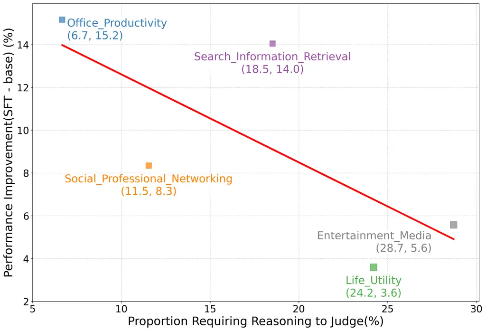
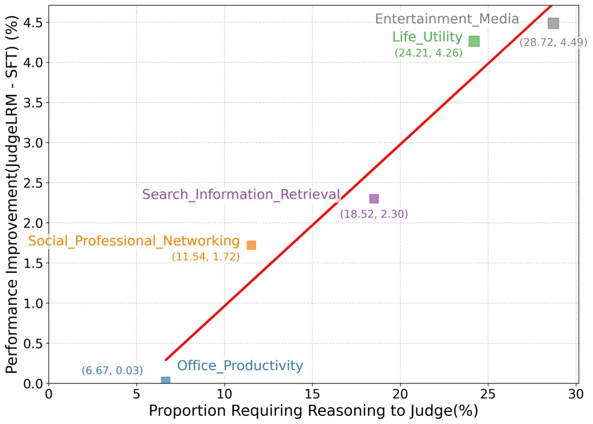
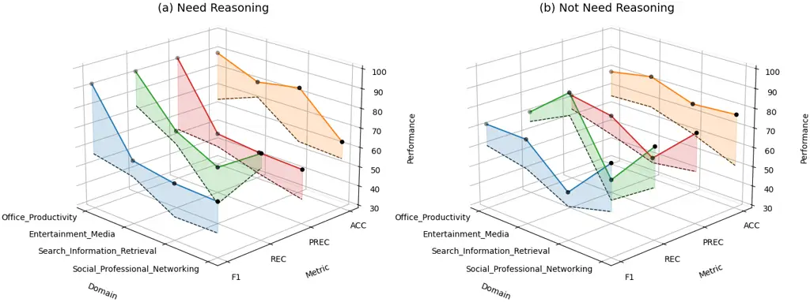
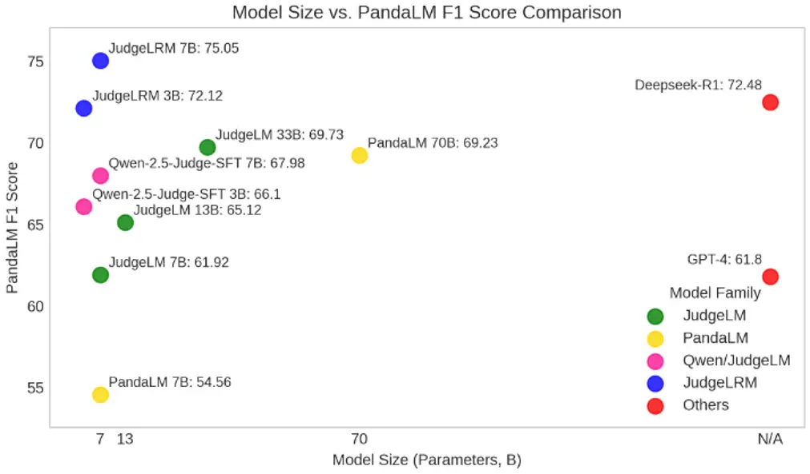
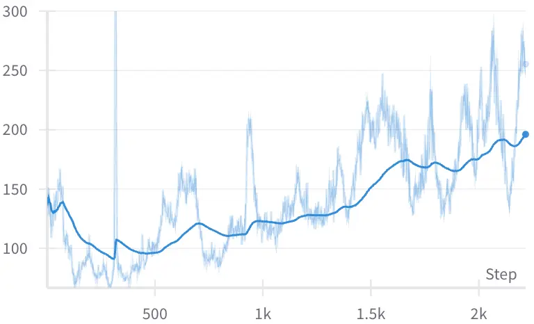
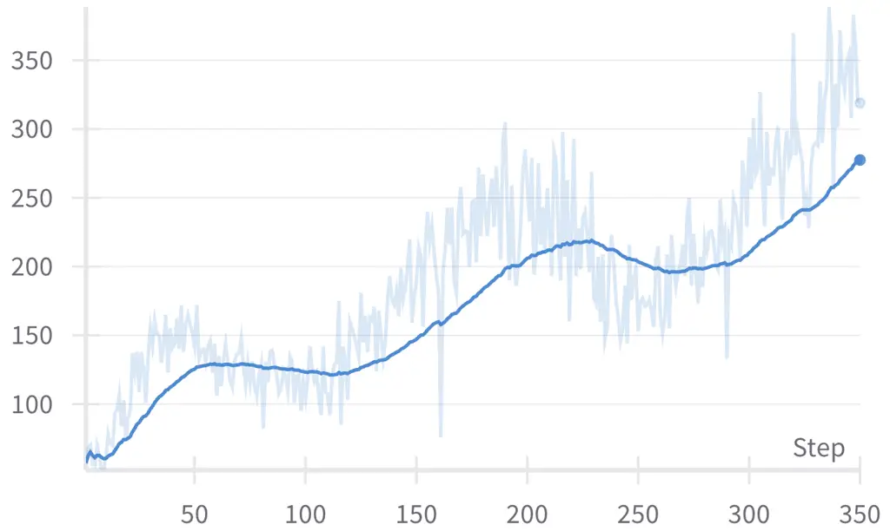

# JudgeLRM: Large Reasoning Models as a Judge

Nuo Chen Zhiyuan Hu    Qingyun Zou    Jiaying Wu Affiliation: Qian Wang
   Bryan Hooi    Bingsheng He Affiliation: National University of
Singapore
Email: [](mailto:)[nuochen@comp.nus.edu.sg](mailto:nuochen@comp.nus.edu.sg)
Affiliation: 

###### Abstract

Large Language Models (LLMs) are increasingly adopted as evaluators,
offering a scalable alternative to human annotation. However, existing
supervised fine-tuning (SFT) approaches often fall short in domains that
demand complex reasoning. Judgment is inherently reasoning-intensive:
beyond surface-level scoring, it requires verifying evidence,
identifying errors, and justifying decisions. Through the analysis of
evaluation tasks, we find a negative correlation between SFT performance
gains and the proportion of reasoning-demanding samples, revealing the
limits of SFT in such scenarios. To address this, we introduce JudgeLRM,
a family of judgment-oriented LLMs, trained using reinforcement learning
(RL) with judge-wise, outcome-driven rewards to activate reasoning
capabilities. JudgeLRM consistently outperform SFT-tuned baselines in
the same size, as well as other RL and SFT variants, and even surpass
state-of-the-art reasoning models: notably, JudgeLRM-3B/4B exceeds
GPT-4, while JudgeLRM-7B/8B/14B outperforms DeepSeek-R1 by over 2% in F1
score, with particularly strong gains on reasoning-heavy tasks. Our
findings underscore the value of RL in unlocking reasoning-aligned LLM
judges.

|     |
| --- |
|     |

| Dataset                          | JudgeLM (GPT-4 as ground truth. In distribution.) |             |              |              | PandaLM (Human as ground truth. Out of distribution.) |              |              |              |
| -------------------------------- | ------------------------------------------------- | ----------- | ------------ | ------------ | ----------------------------------------------------- | ------------ | ------------ | ------------ |
| Criteria                         | Agreement                                         | Precision   | Recall       | F1           | Agreement                                             | Precision    | Recall       | F1           |
|    Qwen2.5-3B-Instruct           | 72.29                                             | 80.19       | 64.07        | 71.23        | 68.50                                                 | 50.92        | 56.13        | 51.57        |
|    Qwen2.5-3B-Instruct-Judge-SFT | 83.58 +11.29                                      | 75.25 -4.94 | 76.12 +12.05 | 75.05 +3.82  | 70.57 +2.07                                           | 67.09 +16.17 | 73.36 +17.23 | 66.10 +14.53 |
|    JudgeLRM-3B                   | 83.72 +11.43                                      | 86.31 +6.12 | 82.98 +18.91 | 84.61 +13.38 | 77.68 +9.18                                           | 74.26 +23.34 | 70.86 +14.73 | 72.12 +20.55 |
|    Qwen2.5-7B-Instruct           | 76.85                                             | 78.71       | 77.85        | 78.28        | 63.96                                                 | 61.95        | 67.61        | 59.81        |
|    Qwen2.5-7B-Instruct-Judge-SFT | 82.00 +5.15                                       | 84.43 +5.72 | 81.74 +3.89  | 83.06 +4.78  | 73.57 +9.61                                           | 67.31 +5.36  | 72.23 +4.62  | 67.98 +8.17  |
|    JudgeLRM-7B                   | 83.74 +6.89                                       | 85.84 +7.13 | 83.65 +5.80  | 84.73 +6.45  | 78.28 +14.32                                          | 74.90 +12.95 | 75.74 +8.13  | 75.05 +15.24 |

Table 1: Performance improvement from base models to SFT and our
judge-wise RL methods on JudgeLM (in-distribution training data) and
PandaLM (out-of-distribution for generalization).

## 1 Introduction

Recent advancements in LLMs have sparked significant interest in their
use as evaluative judges (Gu et al., 2025; Li et al., 2024), offering a
reliable and scalable alternative to costly human annotation. Previous
approaches, such as JudgeLM (Zhu et al., 2025) and PandaLM (Wang et al.,
2024), have enabled LLMs to perform judgment tasks based on the large
scale SFT.

However, SFT faces inherent limitations in generalization and reasoning
depth. Do LLM judges truly require strong reasoning capabilities? To
explore this, we revisit prior work such as PandaLM (Wang et al., 2024),
which shows that smaller models can be adapted for evaluation via
post-training techniques. However, these methods still struggle with
complex reasoning demands and computational inefficiency. We investigate
whether improvements in judgment performance through SFT correlate with
the proportion of questions that require reasoning to evaluate. Using
the five question source categories defined in PandaLM (see Section
Details of PandaLM Category Analysis), we compute the proportion of
samples in each category that require reasoning (detailed in Table 8).
As shown in Figure 1 and Table 1, we observe an inverse relationship
between improvements in F1 score on the judge task and the proportion of
reasoning-required samples (elaborated in Appendix Prompt for Accessing
the Necessity of Reasoning When Judging), indicating that SFT struggles
more on categories demanding higher reasoning depth. Specifically, SFT
gains drop as the proportion of reasoning-intensive items rises,
implying that judges require flexible generalization skills rather than
memorization abilities. This suggests that effective LLM judges must
possess strong reasoning abilities to handle diverse and complex
evaluation scenarios, where rote patterns from training memorization
data fall short.

A fundamental challenge in deploying LLMs as judges lies in their
dependence on intrinsic reasoning capabilities. While the
Chain-of-Thought (CoT) (Wei et al., 2022) framework via SFT equips
models to process nuanced information, achieving accurate and
contextually grounded judgments remains non-trivial. Studies have shown
that advanced large reasoning models (LRMs), such as DeepSeek-R1
(DeepSeek-AI, 2025), demonstrate strong performance in evaluation tasks
by leveraging structured reasoning paths. To bridge this gap, we propose
JudgeLRM, a family of LLMs trained using RL with judge-wise,
outcome-driven rewards to enhance evaluative reasoning. The
task-specific reward function integrates both structural and
content-based components. The structural reward ensures well-formatted
reasoning and answer sections, while the content reward aligns model
judgments with ground-truth preferences through relation, absolute, and
confidence-based metrics. This design promotes both faithful reasoning
and accurate, confident scoring.

JudgeLRM model series (licensed under MG0-2.0¹¹ 1
[https://www.modelgo.li/](https://www.modelgo.li/)) ranges from 3B to
14B parameters, trained using Group Relative Policy Optimization (GRPO)
 (Shao et al., 2024). Empirical results demonstrate that JudgeLRM not
only surpasses proprietary models like GPT-4 and DeepSeek-R1 but also
outperforms SFT and RL baselines of comparable sizes, with an average
improvement of 8.14% in F1 score over SFT counterparts. Notably,
JudgeLRM shows consistent gains even in categories with a high
proportion of reasoning-required tasks (see Table 3, Figure 3), further
illustrating its ability to overcome SFT’s reasoning limitations. These
implications highlight that judgment is inherently a reasoning-intensive
task, not merely a scoring exercise, and that RL-based approaches can
effectively instill the flexible generalization needed for robust judge
models. Through systematic analysis, we demonstrate that reasoning
patterns, such as verification, sub-goal setting, double checking, error
identification, and decision justification, are crucial to the success
of judgment tasks.



Figure 1: Judgment performance improvement vs. reasoning requirement
across domainY-axis shows F1 score improvement (SFT – base) based on
Qwen2.5-7B-instruct; X-axis shows the proportion of tasks requiring
reasoning. Each point represents a domain. A negative linear trend (y =
-0.41x + 16.72, R² = 0.53) suggests that domains with more
reasoning-heavy tasks benefit less from SFT alone. Sample counts across
domains: 105 (Office_Productivity), 108 (Search_Information_Retrieval),
195 (Entertainment_Media), and estimated 108
(Social_Professional_Networking), 190 (Life_Utility).

## 2 Related Work

### 2.1 LLM Reasoning and Planning

Modern large language models (LLMs) demonstrate remarkable reasoning
abilities through their intrinsic Chain-of-Thought (CoT) mechanisms (Wei
et al., 2022). This capability can be elicited through prompting
techniques (Kojima et al., 2022) or explicitly integrated into model
architectures like Openai o1 (OpenAI, 2024), Deepseek R1 (DeepSeek-AI,
2025; Shao et al., 2024). Such structural enhancements enable LLMs to
perform multi-step reasoning across diverse domains, like in medical,
Huatuo-o1 (Chen et al., 2024b), Medical-R1 (Lai et al., 2025) and in
finance, Fin-o1 (Qian et al., 2025) and Fin-R1 (Liu et al., 2025a). Our
work first focuses on energizing reasoning abilities for judges,
subsequently revealing the inherently reasoning-intensive nature of the
judging task and validates the necessity and effectiveness of strong
reasoning skills for judges.

### 2.2 LLM as a Judge

Human evaluation of LLM outputs is time-consuming, resource-intensive,
and often inconsistent due to annotator subjectivity (Gu & Others,
2024). To address these limitations, researchers have explored using
LLMs themselves as evaluators, a paradigm often referred to as
’LLM-as-a-Judge’ (Zheng et al., 2024). This approach promises more
scalable and potentially cost-effective evaluation. Furthermore,
recognizing the potential benefits of specialized models, some studies
have focused on training dedicated LLMs specifically for the task of
judging LLM outputs, aiming for improved accuracy and alignment with
human preferences (Zhu et al., 2025; Wang et al., 2024). Despite its
promise, the LLM-as-a-Judge approach faces various biases inherent in
the judge LLMs themselves, which can compromise the fairness and
reliability of the evaluations (Gallegos et al., 2024; Chen et al.,
2024a; Dubois et al., 2025). We first introduce reinforcement learning
on training small-scale LLMs as a judge, demonstrating results
comparable to Deepseek-R1 and a controllable range of bias. More recent
studies have also explored RL for judge alignment (Whitehouse et al.,
2025; Xu et al., 2025), reflecting a growing consensus on the potential
of RL-based methods for this task.

## 3 Judge-wise Outcome Reward and RL Training

Inspired by the insufficiency of SFT training revealed in Fig. 1, we
introduce Large Reasoning Models as a judge (JudgeLRM), applying RL on
judge tasks through judge-wise outcome reward.


Figure 2: System Prompt for RL Training

### 3.1 Judge Task Definition

We consider a judge task where, given a query $`Q`$ and two responses
$`A_{1}`$ and $`A_{2}`$, the model evaluates them on a scale of 1–10
$`(s_{1},s_{2})`$, following the JudgeLM (Zhu et al., 2025) setting.
Evaluation criteria include helpfulness, relevance, accuracy, and level
of detail, as specified in Prompt 2. The goal is to predict scores that
align with human judgments, which determine whether $`A_{1}`$ wins, ties
with, or loses to $`A_{2}`$.

### 3.2 Reward Design for Judge Task

Rule-based rewards have shown strong performance and are widely
adopted (DeepSeek-AI, 2025). For judge tasks involving reasoning, we
design a reward function that combines structural and content-based
components. Specifically, the reward $`r`$ for sample $`i`$ is defined
as $`r_{i}=\mathcal{R}_{\text{struct}}+\mathcal{R}_{\text{content}}`$,
inspired by Xie et al. (2025).

#### Structural Reward

As shown in Figure 2, the structural reward
$`\mathcal{R}_{\text{struct}}`$ ensures that the model output includes a
structured reasoning process enclosed in \<think\>...\</think\> tags and
final judgment scores $`(s_{1},s_{2})`$ enclosed in
\<answer\>...\</answer\> tags, where $`s_{1},s_{2}\in\{1,\dots,10\}`$.
The reward components are:

```math
\mathcal{R}_{\text{format}}=\begin{cases}1.0,&\text{if all tags are correct and in proper order}\\
-0.5,&\text{if }s_{1},s_{2}\notin\{1,\dots,10\}\\
-1.0,&\text{if severe formatting errors exist}\end{cases}\vskip-11.38109pt \tag{1}
```

#### Content Reward

The content reward $`\mathcal{R}_{\text{content}}`$ evaluates the
accuracy and confidence of the predicted scores $`(s_{1},s_{2})`$
against the ground-truth labels $`(s_{1}^{*},s_{2}^{*})`$. It consists
of three parts:

Relation Reward in Eq. 2 ensures the model correctly ranks responses,
aligning with the core goal of comparative evaluation. Aligning relative
order is more important than absolute score matching in evaluation
tasks, because win-loss relationships are more concerned, so the value
is dominant in the content reward.

```math
r_{\text{relation}}=\begin{cases}2.0,&\text{if }\text{sgn}(s_{1}-s_{2})=\text{sgn}(s_{1}^{*}-s_{2}^{*})\\
-1.5,&\text{otherwise}\end{cases}\vskip-5.69054pt \tag{2}
```

Absolute Reward in Eq. 3 refines score-level accuracy, tolerating minor
errors while penalizing large deviations. The scores are gradually
refined by hierarchical rewards (complete match $`\rightarrow`$ partial
match $`\rightarrow`$ no reward) to solve ‘sparse rewards’ in
reinforcement learning: if relying only on relational rewards, the model
may learn only coarse sequential judgements and ignore score
calibration.

```math
r_{\text{absolute}}=\begin{cases}1.0,&\text{if }|s_{1}-s_{1}^{*}|+|s_{2}-s_{2}^{*}|=0\\
0.6,&\text{if }r_{\text{relation}}=2\text{ and }|s_{1}-s_{1}^{*}|+|s_{2}-s_{2}^{*}|\leq 2\\
0,&\text{otherwise}\end{cases}\vskip-9.95845pt \tag{3}
```

Confidence Reward in Eq. 4 promotes decisive judgments when the ranking
is correct, avoiding ambiguous scores. Harder judge problems result in
ambiguous scores, so we stimulate high confidence score to improve
‘decision confidence’, which results in more polarised decision output.
We activate it only when the relative order is correct to avoid the
model blindly expanding the variance.

```math
r_{\text{confidence}}=\begin{cases}0.2,&\text{if }r_{\text{relation}}=2\text{ and }|s_{1}-s_{2}|\geq|s_{1}^{*}-s_{2}^{*}|\\
0,&\text{otherwise}\end{cases}\vskip-8.53581pt \tag{4}
```

The final reward $`r(s_{1},s_{2})`$ is computed as:

```math
r(s_{1},s_{2})=\underbrace{\mathcal{R}_{\text{format}}}_{\mathcal{R}_{\text{struct}}}+\underbrace{r_{\text{relation}}+r_{\text{absolute}}+r_{\text{confidence}}}_{\mathcal{R}_{\text{content}}}\vskip-8.53581pt \tag{5}
```

The design of structural and content rewards encourages the model to
learn distinguishing good/bad and make relative judgments, rather than
pursuing absolute high rewards, which is neglected by previous SFT
methods on judges (Wang et al., 2024; Zhu et al., 2025). We discuss the
sensitiveness to reward exact values and the relative reward
relationship in RL rule-based training in Appendix Further Reward Design
Analysis.

### 3.3 RL Training Algorithm

We utilize GRPO (DeepSeek-AI, 2025) as policy gradient algorithm, which
eliminates the need for a separate value model in Proximal Proximal
Policy Optimization (PPO) (Schulman et al., 2017) by grouping samples
and normalizing intra-group advantages for more practical training.
Moreover, it reduce the data collection cost and increases
generalizability than SFT because it does not need explicit reasoning
chain to learn.

For policy $`\pi_{\theta}`$ and reference model $`\pi_{\text{ref}}`$, we
define:

#### Group-wise Advantage Calculation

For each query group $`G_{Q}`$ with its associated judgments
$`G_{Q}=\{(A_{1},A_{2},s_{1},s_{2})\}`$, the mean $`\mu_{Q}`$ and the
standard variation $`\sigma_{Q}`$ of reward $`r`$ in group $`Q`$ is
calcuated as:

```math
\mu_{Q}=\mathbb{E}_{(A_{1},A_{2})\sim G_{Q}}[r(s_{1},s_{2})],\quad\sigma_{Q}=\sqrt{\mathbb{E}_{(A_{1},A_{2})\sim G_{Q}}[(r(s_{1},s_{2})-\mu_{Q})^{2}]}\vskip-8.53581pt \tag{6}
```

The normalized advantage $`\mathcal{A}`$ for sample $`i`$ is defined for
the optimization below to quantify how good $`i`$ is relative to the
average action:

```math
\mathcal{A}_{i}(s_{1},s_{2}|Q)=\frac{r_{i}(s_{1},s_{2})-\mu_{Q}}{\sigma_{Q}+\eta}\vskip-2.84526pt \tag{7}
```

In which $`\eta`$ is a smoothing term for numerical stability during
training, preventing $`\sigma_{Q}`$ from being too small during
normalization (Schulman et al., 2017). By normalizing intra-group
advantages $`\mathcal{A}`$, variance is reduced to improve the stability
of policy updates. This allows the model to receive an effective
learning signal even on difficult tasks where rewards are generally low,
thereby alleviating the training imbalance caused by varying task
difficulties across domains in Figure 1.

#### Policy Optimization Objective

The policy $`\pi_{\theta}`$ of parameter $`\theta`$ is optimized using
the following objective:

```math
\begin{split}J_{\text{GRPO}}(\theta)=&\mathbb{E}_{Q\sim\mathcal{D}}\mathbb{E}_{(s_{1},s_{2})\sim\pi_{\theta}}\Bigg[\min\Bigg(\frac{\pi_{\theta}(s_{1},s_{2}|Q,A_{1},A_{2})}{\pi_{\text{old}}(s_{1},s_{2}|Q,A_{1},A_{2})}\mathcal{A}_{i}(s_{1},s_{2}|Q),\\
&\text{clip}\Big(\frac{\pi_{\theta}(s_{1},s_{2}|Q,A_{1},A_{2})}{\pi_{\text{old}}(s_{1},s_{2}|Q,A_{1},A_{2})},1-\epsilon,1+\epsilon\Big)\mathcal{A}_{i}(s_{1},s_{2}|Q)\Bigg)-\beta D_{\text{KL}}(\pi_{\theta}\|\pi_{\text{ref}})\Bigg]\end{split} \tag{8}
```

In which the clip range $`\epsilon`$ limits the magnitude of policy
updates to prevent training instability, and the KL divergence is set to
prevent $`\pi_{\theta}`$ from excessively deviating from reference model
$`\pi_{\text{ref}}`$ with factor $`\beta`$ (Schulman et al., 2017).

## 4 Experiments

We empirically evaluate JudgeLRM to address the following research
questions:

- •
  Effectiveness : How does JudgeLRM perform compared to other SFT and RL
  baselines (Section 4.2) and state-of-the-art LRMs and specialized
  judgement models (Section 4.3)?
- •
  Ablation Study (Section 4.4): What are the individual contributions of
  different reward components to JudgeLRM’s performance?
- •
  Reliability (Section 4.5): Can JudgeLRM provide consistent and
  accurate comparative judgments?
- •
  Case Study (Section 4.6): In what ways does JudgeLRM demonstrate
  effective reasoning to support high-quality judgments?

### 4.1 Experimental Setup

Our experiments mainly focus on pair-wise judge scenarios (since we also
support other scenario as discussed in Section 4.3), targeting on
open-ended QA evaluation rather than closed-domain or expert-level
tasks, and JudgeLM (Zhu et al., 2025) PandaLM (Wang et al., 2024),
aligning directly with our objective. By contrast, benchmarks such as
RewardBench (Lambert et al., 2024), JudgeBench (Tan et al., 2025), while
valuable, primarily address single-judge or domain-specific evaluation
scenarios that fall outside the scope of this study. Our design
emphasizes isolating the contribution of reasoning, rather than data
scaling or architectural engineering, by assessing how RL enhances the
generalization of judges over SFT, under the same dataset and base-model
conditions as JudgeLM. Following prior work (Zheng et al., 2024), we
prioritize controlled experiments on well-established benchmarks to
ensure comparability.

Datasets. We evaluate on two established benchmarks. JudgeLM uses GPT-4
annotations as gold labels, comprising 100K training instances and a 5K
test set, following the task formulation described in Section 3.1.
PandaLM provides human-annotated pairwise comparisons with win/tie/loss
labels on a 1K test set, offering complementary supervision. Together,
these datasets allow us to assess performance across both GPT-aligned
and human-grounded evaluation settings.

Baselines. We compare JudgeLRM against three categories of baselines:
(1) _Base, SFT and RL methods_: Base (Table 1), SFT (Table 1,2),
Bradley-Terry (Bradley & Terry, 1952), Direct Preference Optimization
(DPO) (Rafailov et al., 2023), etc (Table 2). (2) State-of-the-art
proprietary LLMs, including GPT-3.5, GPT-4, and Deepseek-R1 (Table 3);
(3) _Specialized judgment models_: Auto-J-13B, JudgeLM-7B/13B/33B, and
PandaLM-70B (Table 3). This setup enables a fair comparison across
different alternatives, isolating the effect of reasoning-oriented
training.

Evaluation Metrics. Following prior work, we evaluate model performance
using agreement-based metrics: precision, recall, and F1 score,which
quantify alignment with teacher model judgments.

Implementation Details. Our models, JudgeLRM-3B/7B/14B and
JudgeLRM-4B/8B, are based on Qwen2.5-Instruct and Qwen3, respectively.
All models including baselines are trained exclusively using
reinforcement learning on the JudgeLM training set. The training is
conducted over a single epoch, with a maximum prompt length of 1024
tokens and a maximum response length of 2048 tokens, using a batch size
of 16. JudgeLRM-3B/4B is trained on 4×A100 80GB GPUs with a learning
rate of 3e-7, while JudgeLRM-7B/8B/14B is trained on 8×A100 80GB GPUs
with a learning rate of 1e-6. Following Xie et al. (2025)²² 2
Realization (Xie et al., 2025) of Equation 8 (DeepSeek-AI, 2025) does
not include response-level length bias (Liu et al., 2025b) in origin
GRPO (Shao et al., 2024)., the group size of $`Q`$ is set to 8, the clip
range $`\epsilon`$ is set to 0.5, the KL divergence factor $`\beta`$ is
set to 0.001, and smooth term $`\eta`$ is set to 1e-6.

### 4.2 Baselines: Additional SFT and RL Variants

|                                     |                                                       |           |        |       |
| ----------------------------------- | ----------------------------------------------------- | --------- | ------ | ----- |
| Dataset                             | PandaLM (Human as ground truth. Out of distribution.) |           |        |       |
| Criteria                            | Agreement                                             | Precision | Recall | F1    |
| Method Baselines. (trained JudgeLM) |                                                       |           |        |       |
|    Qwen2.5-3B-Instruct              | 68.50                                                 | 50.92     | 56.13  | 51.57 |
|    Qwen2.5-3B-Instruct-Judge-SFT    | 70.57                                                 | 67.09     | 73.36  | 66.10 |
|    DPO-Answer (Qwen2.5-3B-Instruct) | 67.27                                                 | 44.79     | 50.07  | 47.27 |
|    CLS-RM (Qwen2.5-3B)              | 58.15                                                 | 51.70     | 51.69  | 51.69 |
|    Bradley-Terry (Qwen2.5-3B)       | 58.94                                                 | 59.04     | 59.06  | 58.94 |
|    SFT-Think (Qwen2.5-3B-Instruct)  | 72.49                                                 | 81.69     | 56.01  | 55.03 |
|    DPO-RC (Qwen2.5-3B-Instruct)     | 68.67                                                 | 64.54     | 69.43  | 65.23 |
| Ours.                               |                                                       |           |        |       |
|    JudgeLRM-3B                      | 77.68                                                 | 74.26     | 70.86  | 72.12 |

Table 2: Comparison with other RL and SFT methods.

To provide a comprehensive comparison, we construct several additional
baselines using the Qwen2.5-3B family (base model in parentheses). These
methods reflect alternative SFT or RL training paradigms but differ from
our JudgeLRM design in how they handle preferences and reasoning.

(1) DPO-Answer (Qwen2.5-3B-Instruct). Optimizes a generative policy via
DPO on chosen/rejected pairs using only win/loss signals, predicting
preferences by comparing response likelihoods, focusing on generation
preference rather than explicit judgment.

(2) CLS-RM (Qwen2.5-3B). Fine-tunes a reward model with a classification
head. The RM assigns absolute scores to individual responses, and
preferences are inferred by comparing these scores. Unlike JudgeLRM,
this approach does not leverage relational reasoning across responses.

(3) Bradley-Terry (Qwen2.5-3B). Implements a pairwise preference model
following the Bradley-Terry formulation, trained on chosen/rejected
pairs with associated preference scores. The model predicts a scalar
reward for each response, which is used for pairwise evaluation.

(4) SFT-Think (Qwen2.5-3B-Instruct). SFT using a JudgeLRM-style template
where the model generates an explanation enclosed in \<think\> tags
before producing its judgment. This setting isolates SFT under
structural constraints. We find explanations fail to function as
effective reasoning chains, leading to weaker adherence to structure and
underperformance compared to SFT baselines.

(5) DPO-RC (Qwen2.5-3B-Instruct). Additional RL baseline following
SPIN (Chen et al., 2024c), trained with a content-based reward
($`\mathcal{R}_{\text{content}}`$) while adopting the JudgeLRM-style
data template. This method performs competitively with SFT-trained
models but still lags behind JudgeLRM-3B.

Overall, (1-3) remain limited because they abstract judgment into
token-level preference modeling, losing relational understanding and the
ability to provide rationale. (4) highlights SFT’s structural weakness,
formatting instructions alone do not yield robust reasoning chains. (5)
draws close to SFT baselines but fails to match the reasoning strength
and structural fidelity of JudgeLRM.

### 4.3 Judge Performance

|                                     |                                                   |           |        |       |                                                       |           |        |       |
| ----------------------------------- | ------------------------------------------------- | --------- | ------ | ----- | ----------------------------------------------------- | --------- | ------ | ----- |
| Dataset                             | JudgeLM (GPT-4 as ground truth. In distribution.) |           |        |       | PandaLM (Human as ground truth. Out of distribution.) |           |        |       |
| Criteria                            | Agreement                                         | Precision | Recall | F1    | Agreement                                             | Precision | Recall | F1    |
| Baselines. (\* from original paper) |                                                   |           |        |       |                                                       |           |        |       |
|    GPT-3.5\*                        | 73.83                                             | 70.70     | 52.80  | 52.85 | 62.96                                                 | 61.95     | 63.59  | 58.20 |
|    GPT-4\*                          | \-                                                | \-        | \-     | \-    | 66.47                                                 | 66.20     | 68.15  | 61.80 |
|    PandaLM-7B                       | 68.61                                             | 40.75     | 38.82  | 39.41 | 59.26                                                 | 57.28     | 59.23  | 54.56 |
|    Auto-J-13B\*                     | 74.86                                             | 61.65     | 57.53  | 58.14 | \-                                                    | \-        | \-     | \-    |
|    JudgeLM-7B                       | 81.11                                             | 69.67     | 78.39  | 72.21 | 65.07                                                 | 66.89     | 71.95  | 61.92 |
|    JudgeLM-13B\*                    | 84.33                                             | 73.69     | 80.51  | 76.17 | 68.97                                                 | 68.21     | 74.15  | 65.12 |
|    JudgeLM-33B\*                    | 89.03                                             | 80.97     | 84.76  | 82.64 | 75.18                                                 | 69.30     | 74.93  | 69.73 |
|    PandaLM-70B\*                    | \-                                                | \-        | \-     | \-    | 66.87                                                 | 74.02     | 66.87  | 69.23 |
|    Deepseek-R1                      | \-                                                | \-        | \-     | \-    | 78.67                                                 | 77.51     | 69.97  | 72.48 |
| Ours. (Qwen3 Base)                  |                                                   |           |        |       |                                                       |           |        |       |
|    JudgeLRM-4B                      | 84.61                                             | 86.82     | 84.24  | 85.51 | 77.88                                                 | 72.33     | 73.67  | 72.87 |
|    JudgeLRM-8B                      | 86.69                                             | 89.16     | 85.76  | 87.43 | 80.68                                                 | 73.81     | 77.50  | 75.26 |
|    JudgeLRM-4B-single               | 81.17                                             | 80.13     | 86.61  | 83.24 | 64.56                                                 | 58.60     | 61.70  | 58.50 |
|    JudgeLRM-8B-single               | 83.20                                             | 81.64     | 88.84  | 85.09 | 71.27                                                 | 65.07     | 69.34  | 65.30 |
| Ours. (Qwen2.5 Base)                |                                                   |           |        |       |                                                       |           |        |       |
|    JudgeLRM-3B                      | 83.72                                             | 86.31     | 82.98  | 84.61 | 77.68                                                 | 74.26     | 70.86  | 72.12 |
|    JudgeLRM-7B                      | 83.74                                             | 85.84     | 83.65  | 84.73 | 78.28                                                 | 74.90     | 75.74  | 75.05 |
|    JudgeLRM-14B                     | 85.25                                             | 86.64     | 85.91  | 86.27 | 81.18                                                 | 78.39     | 74.80  | 76.29 |

Table 3: Performance on JudgeLM and PandaLM. As pairwise comparisons
rarely yield ties, we exclude tie cases ($`\sim`$10% of the test set)
for more interpretable evaluation, which JudgeLRM-7B’s F1 reaches 83.47,
all metrics on PandaLM surpass DeepSeek-R1 (see Table 12 for details).
More analysis of results and performance visualization are presented in
Appendix More Performance Analysis PandaLM testset.

We benchmark JudgeLRM against a range of competitive models, with
results summarized in Table 3. At the 7B scale, JudgeLRM-7B
substantially outperforms its SFT counterpart
(Qwen2.5-7B-Instruct-Judge-SFT) as well as the task-specific JudgeLM-7B
model. Remarkably, JudgeLRM-3B/4B surpasses GPT-4 on the human-annotated
PandaLM benchmark, and scaling further to JudgeLRM-7B/8B matches or even
surpass the performance of DeepSeek-R1. Moreover, we also showcase
JudgeLRM’s ability to judge single answer in ”-single” setting in
Table 3 with first testing score through prompt 4 and pairwise judge
test like CLS-RM. It surpasses all baselines with the same size, showing
the adaptability of JugdeLRM.

To investigate the source of these gains, we examine JudgeLRM-7B’s
behavior on reasoning-intensive subsets of PandaLM. Figure 3 shows a
positive correlation between performance improvements and the proportion
of reasoning-demanding instances. Specifically, when comparing
JudgeLRM-7B against its base model (Qwen2.5-7B-Instruct), we observe a
correlation coefficient of $`0.20`$ between relative improvement and
reasoning rate, with larger gains concentrated in reasoning-heavy
categories. This trend provides direct evidence that judgment is
inherently a reasoning-intensive task, and that reinforcement learning
with outcome-driven rewards equips JudgeLRM with stronger evaluative
reasoning than SFT-based baselines.



Figure 3: Judgment performance improvement vs. reasoning requirement
across domains. The Y-axis indicates the F1 score improvement of
JudgeLRM-7B over the Qwen2.5-7B-Instruct-Judge-SFT baseline; the X-axis
represents the proportion of tasks within each domain that require
reasoning. Each point corresponds to a domain. A negative linear trend
($`y=0.2x-1.05`$, $`R^{2}=0.95`$) suggests that domains with a higher
proportion of reasoning-intensive judge tasks see greater performance
gains from JudgeLRM-7B. See Appendix Improvements by different
categories for further analysis.

### 4.4 Ablation Study

To disentangle the effect of different reward components, we perform an
ablation study on the human-annotated PandaLM benchmark. Our analysis
focuses on the content-based rewards introduced in Section 3.2, namely
$`r_{\text{absolute}}`$ and $`r_{\text{confidence}}`$. These rewards
explicitly encourage accurate scoring and calibrated confidence, thereby
guiding models to verify their reasoning chains and revise errors within
the \<think\> step before finalizing a judgment.

As shown in Table 4, removing content rewards leads to a consistent 2–5%
drop in F1 score. Without these signals, models tend to produce
superficial explanations or fail to detect inconsistencies between
evidence and verdict, underscoring that judgment accuracy requires more
than structural formatting alone. It demonstrates that outcome-driven
content rewards are crucial for eliciting faithful reasoning, effective
error correction, and reliable decision-making in JudgeLRM.

| Test on PandaLM                               | Agreement | Precision | Recall | F1    |
| --------------------------------------------- | --------- | --------- | ------ | ----- |
|    JudgeLRM-7B                                | 78.28     | 74.90     | 75.74  | 75.05 |
|     - w/o. $`r_{\text{abs}}+r_{\text{conf}}`$ | 75.78     | 69.09     | 73.69  | 70.36 |
|     - w. $`\mathcal{R}_{\text{length}}`$      | 78.28     | 75.81     | 69.19  | 71.34 |

Table 4: Ablation study of 7B models on the human-annotated PandaLM
dataset.

#### Effect of Incentivizing Lengthy response

During JudgeLRM training, we observe that both reasoning and response
lengths naturally increase with training steps, with larger models
(e.g., 7B) producing longer outputs than smaller ones (3B) (Appendix,
Figure 18). To test whether explicitly encouraging longer reasoning
chains improves performance, we introduced the following length reward:

```math
\mathcal{R}_{\text{length}}=\begin{cases}0.2,&\text{if the reasoning chain exceeds 120 tokens}\\
-1.0,&\text{if the maximum token limit is reached}\\
0,&\text{otherwise}\end{cases} \tag{9}
```

However, as shown in Table 4, simply incentivizing slightly longer
answers degraded results of about 3%, suggesting that merely increasing
output length (potentially via repetition) does not benefit the judge
task.

### 4.5 Reliability of Model Judgment

A key property of judgment models is reliability – the ability to
produce consistent and accurate judgments regardless of the order in
which candidate answers are presented. To evaluate the reliability of
JudgeLRM and representative baselines, we conduct experiments on the
JudgeLM dataset by permuting the order of answers. We assess three
aspects: (1) self-consistency across permutations, (2) positional bias
toward the first or second answer, and (3) the bias gap
($`\Delta_{\text{bias}}`$), which captures variance in position-based
preferences.

As shown in Table 5, JudgeLRM substantially improves self-consistency
compared to both its base Instruct model and the task-specific JudgeLM
baseline. Additionally, JudgeLRM significantly reduces bias toward the
first answer while maintaining comparable bias levels toward the second,
achieving more balanced and robust evaluation. It demonstrate that
reinforcement learning with outcome-driven rewards not only enhances
reasoning ability but also mitigates order sensitivity.

|                        |                          |                     |                     |                           |
| ---------------------- | ------------------------ | ------------------- | ------------------- | ------------------------- |
| Methods                | Consistency $`\uparrow`$ | Bias $`\downarrow`$ | Bias $`\downarrow`$ | Delta Bias $`\downarrow`$ |
|                        | (w/ swap.)               | toward 1st          | toward 2nd          |                           |
| JudgeLM score-first\*  | 73.45                    | 19.83               | 6.72                | 13.11                     |
| GPT-4\*                | 85.82                    | 5.55                | 3.09                | 2.46                      |
| Qwen-7B-Instruct 0shot | 77.11                    | 12.96               | 9.93                | 3.04                      |
| JudgeLRM-7B            | 84.50                    | 5.39                | 10.11               | 4.72                      |
| JudgeLRM-8B            | 89.55                    | 4.04                | 6.40                | 2.36                      |

Table 5: Assessment of position bias on the val split of JudgeLM. We
evaluate model self-consistency under different answer order
permutations, quantify bias toward the first or second answer, and
report the gap between these biases ($`\Delta_{\text{bias}}`$).

### 4.6 Case Study

JudgeLRM exhibits superior judgment by learning to reason explicitly. To
probe how it produces informed, high-quality decisions, we analyze its
responses for emergent reasoning behaviors akin to the LRM-style
cognitive patterns reported for DeepSeek-R1 (Gandhi et al., 2025). We
first illustrate these patterns in DeepSeek-R1 (Figure 20), then examine
a representative JudgeLRM example (Table 7) in which the model evaluates
two study notes and selects the one that better supports learning U.S.
history.

The JudgeLRM response demonstrates several hallmark reasoning strategies
characteristic of high-quality evaluators:

- •
  Verification: Checking claims against the prompt and available
  evidence to avoid misinformation and support reliable judgments.
- •
  Subgoal setting: Decomposing the evaluation into concrete,
  interpretable criteria (coverage, chronology, specificity), yielding a
  structured assessment.
- •
  Double-checking and reflection: Re-examining intermediate conclusions
  to reduce errors and reconcile inconsistencies before finalizing the
  verdict.
- •
  Error identification: Spotting factual or logical flaws in candidate
  responses and localizing them to specific spans.
- •
  Decision justification: Articulating a clear, criterion-linked
  rationale that explains _why_ the preferred answer better satisfies
  the task.

We further observe a consistent three-stage structure: evaluate
Assistant 1, evaluate Assistant 2, then synthesize a comparative
assessment, mirroring human-like evaluation behavior (Dasgupta et al.,
2024). This structure reflects integration of semantic understanding,
logical inference, and hierarchical comparison. Notably, the judge-wise
reward design jointly incentivizes _structural coherence_ (well-formed
\<think\> and answer sections) and _content accuracy_ (relation,
absolute, and confidence signals), reinforcing these behaviors during
training.

|                                                                                                                                                                                                                                                                                           |
| ----------------------------------------------------------------------------------------------------------------------------------------------------------------------------------------------------------------------------------------------------------------------------------------- |
| 5,5. Both responses were relevant and accurate. They both provided a detailed overview of the history of the United States, including important events and dates. However, the response was repetitive, mentioning the same events twice, which is why it didn’t receive a perfect score. |
|                                                                                                                                                                                                                                                                                           |

Table 6: Qwen2.5-7B-Instruct-Judge-SFT fails to response the question in
Table 7 (ID 549).

## 5 Conclusion

Our work demonstrates that judgment tasks for LLMs are inherently
reasoning-intensive, with SFT-trained models struggling in
high-reasoning domains. By reframing evaluation as an RL problem with
judge-specific, outcome-driven rewards, JudgeLRM learns to generate
structured, trustworthy reasoning paths. Empirical results show that
JudgeLRM not only outperforms leading models like GPT-4 and DeepSeek-R1,
but also scales effectively across model sizes from 3B to 14B. Beyond
performance, our analysis reveals that successful judgment involves
complex reasoning behaviors like verification, sub-goal planning, and
justification, highlighting the need to treat judgment not as mere
scoring, but as a process of structured reasoning. We hope this paves
the way for future research on rigorous, reliable LLM evaluators.

|                                                                                                                                                                                                                                                                                                                                                                                                                                                                                                                                                                                                                                                                                                                                                                                                                                                                                                                                                                                                                                                                                                                                                                                                                                                                                                                                                                                                                                                                                                                                                                                                                                                                                                                                                                                                                                                                                                                                                                                                                                                                                                                                                                                                                                                                                                                                                                                                                                                                                                                                                                                                                                                                            |
| -------------------------------------------------------------------------------------------------------------------------------------------------------------------------------------------------------------------------------------------------------------------------------------------------------------------------------------------------------------------------------------------------------------------------------------------------------------------------------------------------------------------------------------------------------------------------------------------------------------------------------------------------------------------------------------------------------------------------------------------------------------------------------------------------------------------------------------------------------------------------------------------------------------------------------------------------------------------------------------------------------------------------------------------------------------------------------------------------------------------------------------------------------------------------------------------------------------------------------------------------------------------------------------------------------------------------------------------------------------------------------------------------------------------------------------------------------------------------------------------------------------------------------------------------------------------------------------------------------------------------------------------------------------------------------------------------------------------------------------------------------------------------------------------------------------------------------------------------------------------------------------------------------------------------------------------------------------------------------------------------------------------------------------------------------------------------------------------------------------------------------------------------------------------------------------------------------------------------------------------------------------------------------------------------------------------------------------------------------------------------------------------------------------------------------------------------------------------------------------------------------------------------------------------------------------------------------------------------------------------------------------------------------------------------- |
| Question:                                                                                                                                                                                                                                                                                                                                                                                                                                                                                                                                                                                                                                                                                                                                                                                                                                                                                                                                                                                                                                                                                                                                                                                                                                                                                                                                                                                                                                                                                                                                                                                                                                                                                                                                                                                                                                                                                                                                                                                                                                                                                                                                                                                                                                                                                                                                                                                                                                                                                                                                                                                                                                                                  |
| (Instruction:) Include important study notes and key points that someone should know about the given subject. (Input:) history of the USA                                                                                                                                                                                                                                                                                                                                                                                                                                                                                                                                                                                                                                                                                                                                                                                                                                                                                                                                                                                                                                                                                                                                                                                                                                                                                                                                                                                                                                                                                                                                                                                                                                                                                                                                                                                                                                                                                                                                                                                                                                                                                                                                                                                                                                                                                                                                                                                                                                                                                                                                  |
| \[Assistant 1’s Answer\] The history of the United States is one of the most influential and influential countries in the world. It has had a profound impact on the world and continues to shape the world today. The United States has had a long and storied history, from its founding in 1775 to the present day. It has had a tumultuous and tumultuous history, from the Revolutionary War to the Civil War and beyond. The United States has had a tumultuous and tumultuous history, from the Revolutionary War to the Civil War and beyond. The United States has had a long and storied history, from its founding in 1775 to the present day. It has had a profound impact on the world and continues to shape the world today. \[Assistant 2’s Answer\] 1. The United States of America was founded in 1776. 2. The Declaration of Independence was signed in 1776. 3. The Constitution of the United States of America was signed in 1787. 4. The Civil War began in 1861. 5. The Emancipation Proclamation was issued in 1863. 6. The 13th Amendment was ratified in 1865. 7. The 14th Amendment was ratified in 1868. 8. The 15th Amendment was ratified in 1870. 9. The 16th Amendment was ratified in 1913. 10. The 17th Amendment was ratified in 1913. 11. The 18th Amendment was ratified in 1919. 12. The 19th Amendment was ratified in 1920. 13. The 20th Amendment was ratified in 1933. 14. The 21st Amendment was ratified in 1933.                                                                                                                                                                                                                                                                                                                                                                                                                                                                                                                                                                                                                                                                                                                                                                                                                                                                                                                                                                                                                                                                                                                                                                                                             |
| Response: \<think\>                                                                                                                                                                                                                                                                                                                                                                                                                                                                                                                                                                                                                                                                                                                                                                                                                                                                                                                                                                                                                                                                                                                                                                                                                                                                                                                                                                                                                                                                                                                                                                                                                                                                                                                                                                                                                                                                                                                                                                                                                                                                                                                                                                                                                                                                                                                                                                                                                                                                                                                                                                                                                                                        |
| Assistant 1 provided a very broad, somewhat repetitive statement on the history of the United States which did not include specific key events, dates, or figures that would be considered important in the narrative of U.S. history. This kind of vague and repetitive phrasing might make it difficult for someone seeking specific historical information to gain an accurate or clear understanding. While it correctly noted the overall influence and significant historical periods like the Revolutionary War and the Civil War, this approach lacks specificity which can be misleading or uninformative. In contrast, Assistant 2’s answer is quite accurate and relevant in terms of providing a list of critical events and amendments in U.S. history. Each point listed is accurate, such as the dates when key documents were signed, the years of major constitutional changes, and significant legislative acts like the Emancipation Proclamation and various constitutional amendments related to civil rights and representation. (Verification) By including these specific details, the accuracy and relevance of the information provided by Assistant 2 is significantly higher, making it easier for someone to trace specific aspects of American history through these milestones. (Subgoal Setting) Accuracy is also a concern in Assistant 1’s answer since the statement ”from its founding in 1775” is inaccurate; the actual founding date recognized in the United States is July 4, 1776, with the signing of the Declaration of Independence, rather than 1775. (Verification, Double Checking) Additionally, the repetition might confuse readers, suggesting a lack of clarity or precision in how the history is presented, which could mislead people who are looking for a clear timeline or significant events. (Reflection, Error Identification) Both answers need to be more precise, but given the task, the importance lies in identifying key events, dates, and significant changes that shaped the nation. (Subgoal Setting) Thus, the accuracy and relevance in listing specific, factual events and their exact timing in history would be a more appropriate way to address the question asked. (Decision Justification) Given these considerations, while both answers are somewhat relevant to the history of the United States, the accuracy and level of detail in the information provided by Assistant 2 would likely be seen as more accurate and relevant because they pinpoint specific, significant events and changes in the country’s development.\</think\> \<answer\>2\</answer\>\<answer\>9\</answer\> |
|                                                                                                                                                                                                                                                                                                                                                                                                                                                                                                                                                                                                                                                                                                                                                                                                                                                                                                                                                                                                                                                                                                                                                                                                                                                                                                                                                                                                                                                                                                                                                                                                                                                                                                                                                                                                                                                                                                                                                                                                                                                                                                                                                                                                                                                                                                                                                                                                                                                                                                                                                                                                                                                                            |

Table 7: JudgeLRM-7B prediction on a PandaLM case (ID 549). Through
reinforcement learning, JudgeLRM demonstrates diverse emergent reasoning
behaviors – capabilities highlighted in blue and the corresponding
response segments in red – even though such behaviors were not
explicitly present in the training data.

## References

- Bradley & Terry (1952) Ralph Allan Bradley and Milton E Terry. Rank
  analysis of incomplete block designs: I. the method of paired
  comparisons. _Biometrika_, 39(3/4):324–345, 1952.
- Chen et al. (2024a) Guiming Hardy Chen, Shunian Chen, Ziche Liu, Feng
  Jiang, and Benyou Wang. Humans or LLMs as the judge? a study on
  judgement bias. In Yaser Al-Onaizan, Mohit Bansal, and Yun-Nung Chen
  (eds.), _Proceedings of the 2024 Conference on Empirical Methods in
  Natural Language Processing_, pp. 8301–8327, Miami, Florida, USA,
  November 2024a. Association for Computational Linguistics. doi:
  10.18653/v1/2024.emnlp-main.474. URL
  [https://aclanthology.org/2024.emnlp-main.474/](https://aclanthology.org/2024.emnlp-main.474/).
- Chen et al. (2024b) Junying Chen, Zhenyang Cai, Ke Ji, Xidong Wang,
  Wanlong Liu, Rongsheng Wang, Jianye Hou, and Benyou Wang.
  Huatuogpt-o1, towards medical complex reasoning with llms, 2024b. URL
  [https://arxiv.org/abs/2412.18925](https://arxiv.org/abs/2412.18925).
- Chen et al. (2024c) Zixiang Chen, Yihe Deng, Huizhuo Yuan, Kaixuan Ji,
  and Quanquan Gu. Self-play fine-tuning converts weak language models
  to strong language models, 2024c. URL
  [https://arxiv.org/abs/2401.01335](https://arxiv.org/abs/2401.01335).
- Dasgupta et al. (2024) Ishita Dasgupta, Andrew K. Lampinen, Stephanie
  C. Y. Chan, Hannah R. Sheahan, Antonia Creswell, Dharshan Kumaran,
  James L. McClelland, and Felix Hill. Language models show human-like
  content effects on reasoning tasks, 2024. URL
  [https://arxiv.org/abs/2207.07051](https://arxiv.org/abs/2207.07051).
- DeepSeek-AI (2025) DeepSeek-AI. Deepseek-r1: Incentivizing reasoning
  capability in llms via reinforcement learning, 2025. URL
  [https://arxiv.org/abs/2501.12948](https://arxiv.org/abs/2501.12948).
- Dubois et al. (2025) Yann Dubois, Balázs Galambosi, Percy Liang, and
  Tatsunori B. Hashimoto. Length-controlled alpacaeval: A simple way to
  debias automatic evaluators, 2025. URL
  [https://arxiv.org/abs/2404.04475](https://arxiv.org/abs/2404.04475).
- Gallegos et al. (2024) Isabel O. Gallegos, Ryan A. Rossi, Joe Barrow,
  Md Mehrab Tanjim, Sungchul Kim, Franck Dernoncourt, Tong Yu, Ruiyi
  Zhang, and Nesreen K. Ahmed. Bias and fairness in large language
  models: A survey, 2024. URL
  [https://arxiv.org/abs/2309.00770](https://arxiv.org/abs/2309.00770).
- Gandhi et al. (2025) Kanishk Gandhi, Ayush Chakravarthy, Anikait
  Singh, Nathan Lile, and Noah D. Goodman. Cognitive behaviors that
  enable self-improving reasoners, or, four habits of highly effective
  stars, 2025. URL
  [https://arxiv.org/abs/2503.01307](https://arxiv.org/abs/2503.01307).
- Gu et al. (2025) Jiawei Gu, Xuhui Jiang, Zhichao Shi, Hexiang Tan,
  Xuehao Zhai, Chengjin Xu, Wei Li, Yinghan Shen, Shengjie Ma, Honghao
  Liu, Saizhuo Wang, Kun Zhang, Yuanzhuo Wang, Wen Gao, Lionel Ni, and
  Jian Guo. A survey on llm-as-a-judge, 2025. URL
  [https://arxiv.org/abs/2411.15594](https://arxiv.org/abs/2411.15594).
- Gu & Others (2024) John Gu and Others. A comprehensive survey on
  llm-as-a-judge. _ArXiv_, abs/2401.12345, 2024. URL
  [https://arxiv.org/abs/2401.12345](https://arxiv.org/abs/2401.12345).
- Kojima et al. (2022) Takeshi Kojima, Shixiang Shane Gu, Machel Reid,
  Yutaka Matsuo, and Yusuke Iwasawa. Large language models are zero-shot
  reasoners, 2022. URL
  [https://arxiv.org/abs/2205.11916](https://arxiv.org/abs/2205.11916).
- Lai et al. (2025) Yuxiang Lai, Jike Zhong, Ming Li, Shitian Zhao, and
  Xiaofeng Yang. Med-r1: Reinforcement learning for generalizable
  medical reasoning in vision-language models, 2025. URL
  [https://arxiv.org/abs/2503.13939](https://arxiv.org/abs/2503.13939).
- Lambert et al. (2024) Nathan Lambert, Valentina Pyatkin, Jacob
  Morrison, LJ Miranda, Bill Yuchen Lin, Khyathi Chandu, Nouha Dziri,
  Sachin Kumar, Tom Zick, Yejin Choi, Noah A. Smith, and Hannaneh
  Hajishirzi. Rewardbench: Evaluating reward models for language
  modeling, 2024. URL
  [https://arxiv.org/abs/2403.13787](https://arxiv.org/abs/2403.13787).
- Li et al. (2024) Haitao Li, Qian Dong, Junjie Chen, Huixue Su, Yujia
  Zhou, Qingyao Ai, Ziyi Ye, and Yiqun Liu. Llms-as-judges: A
  comprehensive survey on llm-based evaluation methods, 2024. URL
  [https://arxiv.org/abs/2412.05579](https://arxiv.org/abs/2412.05579).
- Liu et al. (2025a) Zhaowei Liu, Xin Guo, Fangqi Lou, Lingfeng Zeng,
  Jinyi Niu, Zixuan Wang, Jiajie Xu, Weige Cai, Ziwei Yang, Xueqian
  Zhao, Chao Li, Sheng Xu, Dezhi Chen, Yun Chen, Zuo Bai, and Liwen
  Zhang. Fin-r1: A large language model for financial reasoning through
  reinforcement learning, 2025a. URL
  [https://arxiv.org/abs/2503.16252](https://arxiv.org/abs/2503.16252).
- Liu et al. (2025b) Zichen Liu, Changyu Chen, Wenjun Li, Penghui Qi,
  Tianyu Pang, Chao Du, Wee Sun Lee, and Min Lin. Understanding
  r1-zero-like training: A critical perspective, 2025b. URL
  [https://arxiv.org/abs/2503.20783](https://arxiv.org/abs/2503.20783).
- OpenAI (2024) OpenAI. Introducing openai o1, 2024. URL
  [https://openai.com/o1/](https://openai.com/o1/).
- Qian et al. (2025) Lingfei Qian, Weipeng Zhou, Yan Wang, Xueqing Peng,
  Jimin Huang, and Qianqian Xie. Fino1: On the transferability of
  reasoning enhanced llms to finance, 2025. URL
  [https://arxiv.org/abs/2502.08127](https://arxiv.org/abs/2502.08127).
- Rafailov et al. (2023) Rafael Rafailov, Archit Sharma, Eric Mitchell,
  Christopher D Manning, Stefano Ermon, and Chelsea Finn. Direct
  preference optimization: Your language model is secretly a reward
  model. _Advances in neural information processing systems_,
  36:53728–53741, 2023.
- Schulman et al. (2017) John Schulman, Filip Wolski, Prafulla Dhariwal,
  Alec Radford, and Oleg Klimov. Proximal policy optimization
  algorithms, 2017. URL
  [https://arxiv.org/abs/1707.06347](https://arxiv.org/abs/1707.06347).
- Shao et al. (2024) Zhihong Shao, Peiyi Wang, Qihao Zhu, Runxin Xu,
  Junxiao Song, Xiao Bi, Haowei Zhang, Mingchuan Zhang, Y. K. Li, Y. Wu,
  and Daya Guo. Deepseekmath: Pushing the limits of mathematical
  reasoning in open language models, 2024. URL
  [https://arxiv.org/abs/2402.03300](https://arxiv.org/abs/2402.03300).
- Tan et al. (2025) Sijun Tan, Siyuan Zhuang, Kyle Montgomery,
  William Yuan Tang, Alejandro Cuadron, Chenguang Wang, Raluca Popa, and
  Ion Stoica. Judgebench: A benchmark for evaluating LLM-based judges.
  In _The Thirteenth International Conference on Learning
  Representations_, 2025. URL
  [https://openreview.net/forum?id=G0dksFayVq](https://openreview.net/forum?id=G0dksFayVq).
- Wang et al. (2024) Yidong Wang, Zhuohao Yu, Wenjin Yao, Zhengran Zeng,
  Linyi Yang, Cunxiang Wang, Hao Chen, Chaoya Jiang, Rui Xie, Jindong
  Wang, Xing Xie, Wei Ye, Shikun Zhang, and Yue Zhang. PandaLM: An
  automatic evaluation benchmark for LLM instruction tuning
  optimization. In _The Twelfth International Conference on Learning
  Representations_, 2024. URL
  [https://openreview.net/forum?id=5Nn2BLV7SB](https://openreview.net/forum?id=5Nn2BLV7SB).
- Wei et al. (2022) Jason Wei, Xuezhi Wang, Dale Schuurmans, Maarten
  Bosma, Ed Chi, Quoc Le, and Denny Zhou. Chain-of-thought prompting
  elicits reasoning in large language models, 2022. URL
  [https://arxiv.org/abs/2201.11903](https://arxiv.org/abs/2201.11903).
- Whitehouse et al. (2025) Chenxi Whitehouse, Tianlu Wang, Ping Yu, Xian
  Li, Jason Weston, Ilia Kulikov, and Swarnadeep Saha. J1: Incentivizing
  thinking in llm-as-a-judge via reinforcement learning, 2025. URL
  [https://arxiv.org/abs/2505.10320](https://arxiv.org/abs/2505.10320).
- Xie et al. (2025) Tian Xie, Zitian Gao, Qingnan Ren, Haoming Luo,
  Yuqian Hong, Bryan Dai, Joey Zhou, Kai Qiu, Zhirong Wu, and Chong Luo.
  Logic-rl: Unleashing llm reasoning with rule-based reinforcement
  learning, 2025. URL
  [https://arxiv.org/abs/2502.14768](https://arxiv.org/abs/2502.14768).
- Xu et al. (2025) Austin Xu, Yilun Zhou, Xuan-Phi Nguyen, Caiming
  Xiong, and Shafiq Joty. J4r: Learning to judge with equivalent initial
  state group relative policy optimization, 2025. URL
  [https://arxiv.org/abs/2505.13346](https://arxiv.org/abs/2505.13346).
- Zheng et al. (2024) Lianmin Zheng, Wei-Lin Chiang, Ying Sheng, Siyuan
  Zhuang, Zhanghao Wu, Yonghao Zhuang, Zi Lin, Zhuohan Li, Dacheng Li,
  Eric Xing, et al. Judging llm-as-a-judge with mt-bench and chatbot
  arena. _Advances in Neural Information Processing Systems_, 36, 2024.
- Zhu et al. (2025) Lianghui Zhu, Xinggang Wang, and Xinlong Wang.
  JudgeLM: Fine-tuned large language models are scalable judges. In _The
  Thirteenth International Conference on Learning
  Representations_, 2025. URL
  [https://openreview.net/forum?id=xsELpEPn4A](https://openreview.net/forum?id=xsELpEPn4A).

## Appendix A Appendix

## Details of PandaLM Category Analysis

| Metric                        | Entertainment_Media | Office_Productivity | Life_Utility | Search_Information_Retrieval | Social_Professional_Networking |
| ----------------------------- | ------------------- | ------------------- | ------------ | ---------------------------- | ------------------------------ |
| Total                         | 195                 | 105                 | 190          | 108                          | 104                            |
| Reason (%)                    | 28.72               | 6.67                | 24.21        | 18.52                        | 11.54                          |
| F1_Qwen-7B-Instruct           | 56.95               | 59.71               | 57.15        | 44.06                        | 50.08                          |
| F1_Qwen-7B-Instruct-Judge-SFT | 62.52               | 74.88               | 60.75        | 58.11                        | 58.43                          |
| F1_JudgeLRM-7B                | 67.01               | 74.86               | 65.01        | 60.41                        | 60.15                          |

Table 8: Model F1 performance comparison by categories.

The five main categories are collated from PandaLM ”motivation_app”
label. Entertainment_Media includes Netflix, IMDB, Spotify, YouTube,
ESPN, Instagram, Facebook, Twitter, Telegram. Office_Productivity is
from MS Excel, MS Powerpoint, Google Sheet, Jira, Google Meet, Gmail.
Life_Utility is from Weather, Tasty, Sudoku, Goodreads, Yelp,
traipadvisor.com, Redfin, Play Store, Amazon, Wysa, Real Estate.
Search_Information_Retrieval is from Google Search, Quora, Reddit, CNN
News, Indeed, Meetup Netflix, IMDB. Social_Professional_Networking is
from LinkedIn, Messenger, Blogger. The “need reason” label is assigned
according to the evaluation scale in Prompt 5, and we define that scores
1-4 denote cases where reasoning is unnecessary, while scores 5-10
indicate that reasoning is needed. The results in Table 8. We also
showcase a subset of ”motivation_app” (query category) to demonstrate
the improvement from SFT to JudgeLRM.

| Methods                     | Wolframalpha35             | Grammarly30                | Gmail44                    |
| --------------------------- | -------------------------- | -------------------------- | -------------------------- |
| Judge w/o reference (Ours). |                            |                            |                            |
| Qwen-7B-Instruct            | 45.71, 50.93, 53.21, 45.14 | 63.33, 54.55, 41.67, 46.96 | 61.36, 54.59, 69.44, 46.69 |
| Qwen-7B-Instruct-Judge-SFT  | 48.57, 46.01, 53.97, 46.27 | 73.33, 56.37, 46.30, 50.48 | 70.45, 60.56, 77.30, 55.60 |
| JudgeLRM-7B                 | 60.00, 58.97, 64.22, 58.33 | 76.67, 61.11, 50.93, 55.56 | 75.00, 60.43, 80.71, 59.49 |

Table 9: Selected dataset results for PandaLM sub testset. Accuracy
(Acc.), Precision (Prec.), Recall (Rec.), and F1-score (F1).


Figure 4: Prompt for single case judgement.


Figure 5: Prompt format for evaluating the reasoning difficulty of
judging AI responses. Intended for appendix.


Figure 6: Example Case 1 (idx: 145) data for reasoning evaluation.


Figure 7: Example Case 2 (idx: 549) data for reasoning evaluation.


Figure 8: Prompt for JudgeLM.


Figure 9: Prompt for PandaLM.

## Prompt for Accessing the Necessity of Reasoning When Judging

We show prompt in Fig. 5 to rate the level of reasoning ability needed
to perform the judgment and two cases of rating in Fig. 6 and Fig. 7.
The reasoning rate is not totally decided by the requirement for
reasoning to answer the question. In Fig. 6, judging a math problem
doesn’t need reasoning. In Fig. 7, judging a writing problem needs
reasoning.

The “reasoning-required” scores in Figure 5 were generated by GPT-4. For
scalability, we manually label 100 samples with ‘whether reasoning is
required’ was associated with a GPT-4 score Kappa coefficient of 0.82.

## Prompt for Baselines

Fig. 2 shows the prompt for the inference of JudgeLRM. Fig. 4 shows the
prompt for single case judgement. For reference, Fig. 8 shows the prompt
for the inference of JudgeLM. Fig. 9 shows the prompt for the inference
of PandaLM.

## Further Reward Design Analysis

In this section we discuss the sensitiveness to reward exact values and
the relative reward relationship in RL rule-based training. RL
rule-based training is insensitive to reward exact values under the
setting of the paper. We reach it by slightly modifying the reward to
Relation Reward (+1.1/-1.1 in Eq. 2, Absolute Reward (+1.0/+0.5 in Eq.
3, Confidence Reward (+0.4 in Eq. 4 without disrupting their relative
order under 3B settings.

| Test on PandaLM      | Agreement | Precision | Recall | F1    |
| -------------------- | --------- | --------- | ------ | ----- |
|    Original reward   | 77.68     | 74.26     | 70.86  | 72.12 |
|    Slightly modified | 77.65     | 74.21     | 70.90  | 72.10 |

Table 10: Impact of reward function modification (JudgeLM-3B).

As the variance of each metric on multiple experiments is smaller than
0.04, the t-test shows p$`\geq`$ 0.05 on each metric, so slightly
modifying the reward is insignificant on the performance.

It is possibly an advantage of GRPO training because GRPO grouping
samples and normalizing intra-group advantages, which reduce variance
and improve stability in strategy updates and encourage the model to
learn distinguishing good/bad within problem groups and make relative
judgments, rather than pursuing absolute high rewards.

However, if we changes the relative reward relationship, the performance
decreases. We change the reward relationship to Relation Reward
(+1.0/-1.5 in Eq. 2, Absolute Reward (+2.0/+1.5 in Eq. 3), Confidence
Reward (+1.8 in Eq. 4) under 3B settings, and the results are shown
below.

| Test on PandaLM     | Agreement | Precision | Recall | F1    |
| ------------------- | --------- | --------- | ------ | ----- |
|    Original reward  | 77.68     | 74.26     | 70.86  | 72.12 |
|    Changed relative | 75.48     | 68.41     | 70.87  | 69.31 |

Table 11: Impact of relative relationship change (JudgeLM-3B).

It shows that the relative reward relationship is sensitive to the
performance.

## Improvements by different categories



Figure 10: Improvements from different categories.

Fig. 10 shows improvements the JudgeLRM-7B’s average F1 gain over SFT
and that the gains persist even in reasoning‑heavy categories,
showcasing the necessity of RL for judges.

## More Performance Analysis PandaLM testset

Visualization Figure 11 presents a visalization of performance, proving
the carefully crafted judge-wise rewards enable the model to learn
reasoning effectively.



Figure 11: Visualization of the performance.

Performance on PandaLM testset excluding ties.

Since scoring pair-wise does not easily yield a tie, we simultaneously
give the scoring of the pandalm for which the test set excludes ties
(10% in total) and treats the predicted tie as choosing the first
assistant. The result is shown in Table 12.

|                                             |                                 |           |        |       |
| ------------------------------------------- | ------------------------------- | --------- | ------ | ----- |
| Dataset                                     | PandaLM (Human as ground truth) |           |        |       |
| Criteria                                    | Agreement                       | Precision | Recall | F1    |
| Existing Baseline. (\* from original paper) |                                 |           |        |       |
| Base Models.                                |                                 |           |        |       |
|    Qwen2.5-3B-Instruct                      | 74.27                           | 74.47     | 73.89  | 73.96 |
|    Qwen2.5-7B-Instruct                      | 74.50                           | 74.49     | 74.57  | 74.48 |
|    Deepseek-R1                              | 83.48                           | 83.53     | 83.31  | 83.38 |
| Ours.                                       |                                 |           |        |       |
|    JudgeLRM-3B                              | 82.66                           | 82.97     | 82.94  | 82.66 |
|    JudgeLRM-7B                              | 83.56                           | 83.58     | 83.41  | 83.47 |
|     - w/o. judge_score_reward               | 82.44                           | 82.88     | 82.77  | 82.44 |

Table 12: Performance on PandaLM testset excluding ties.

## Case Study 1

Fig. 12 show a case of question, and Fig. 13,14 shows the result from
JudgeLRM-3B. Fig. 15 shows the result of Deepseek-R1. Fig. 16 shows the
gold answer provided by JudgeLM from GPT-4.


Figure 12: Case Question 1.


Figure 13: An example of thinking and answer from Judgelrm 3B after
training 500 steps.


Figure 14: Case 1 example of thinking and answer from Judgelrm 3B.


Figure 15: The reasoning of Deepseek-R1 of Case 1.


Figure 16: Gold Response of Case 1 from Gpt-4.

## Case study 2

Fig. 17 show another case of question, and Fig. 19 shows the result from
JudgeLRM-7B. Fig. 20 shows the result of Deepseek-R1. Fig. 21 shows the
gold answer provided by JudgeLM from GPT-4.


Figure 17: Case Question 2.

## Figure of Response Length

Fig. 18 shows the response length of JudgeLRM-3B and JudgeLRM-7B by
steps.





Figure 18: Response Length of JudgeLRM-3B and JudgeLRM-7B by Steps.


Figure 19: The reasoning of JudgeLRM-7B in Case 2.


Figure 20: Example of Deepseek-R1’s Thinking and Answer of Case 2.


Figure 21: Gold response of Case 2 from GPT-4 (Provided in PandaLM
dataset) (No reasoning from gpt-4).
