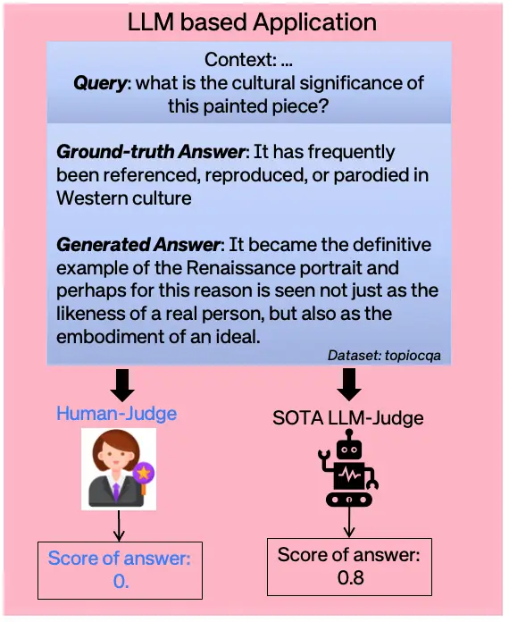
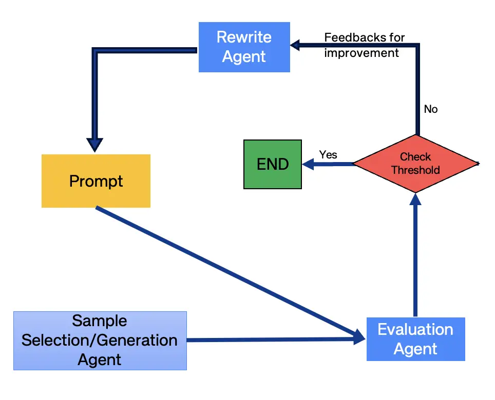
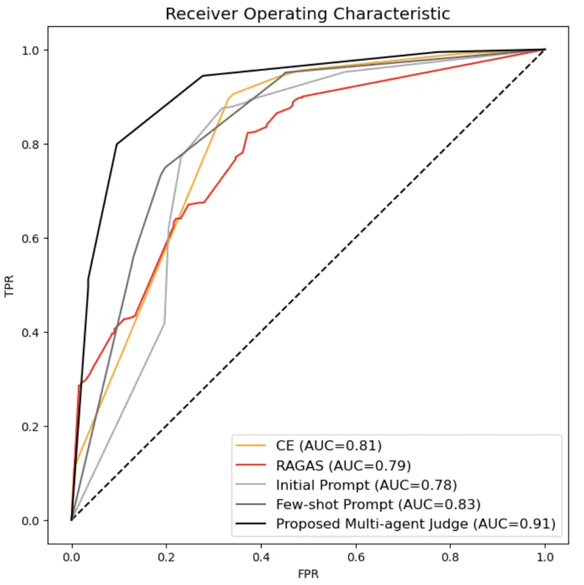
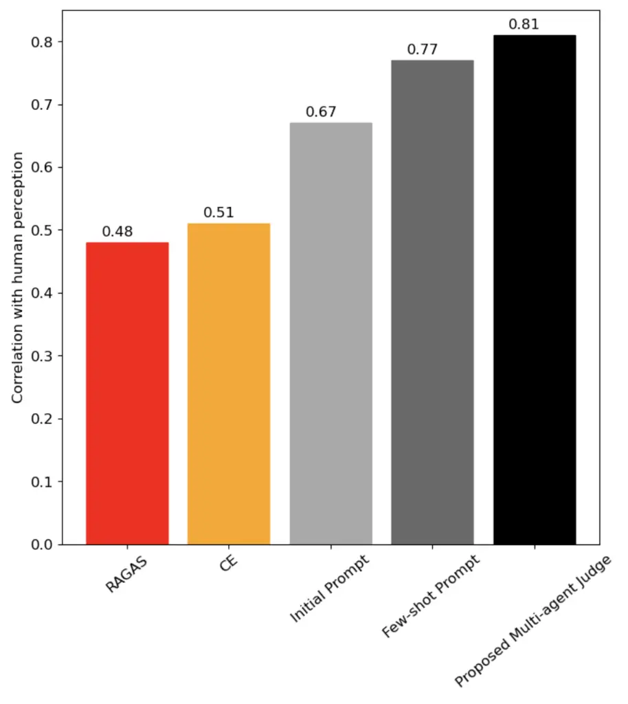
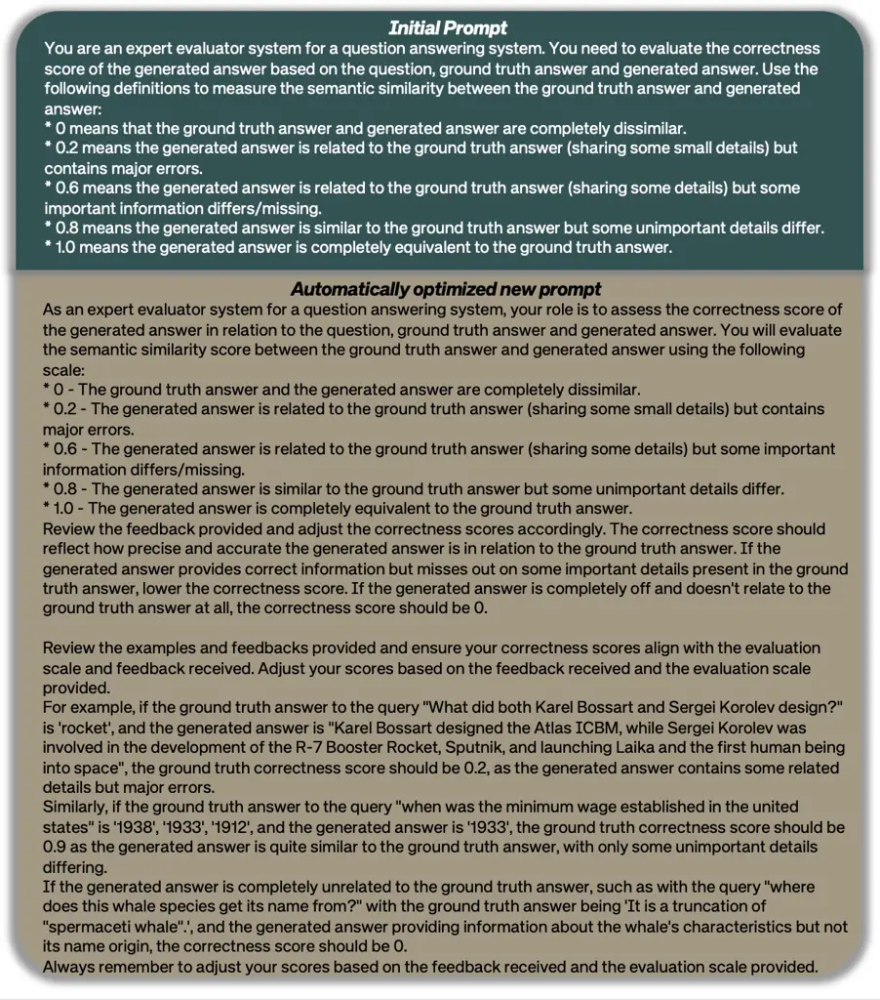

# Multi-Agent LLM Judge: automatic personalized LLM judge design for evaluating natural language generation applications

1^(st) Hongliu CAO Affiliation: Amadeus SAS  
caohongliu@gmail.com    2^(nd) Ilias DRIOUICH Affiliation: Amadeus SAS  
ilias.driouich@amadeus.com    3^(rd) Robin SINGH Affiliation:     4^(th)
Eoin Thomas Affiliation: Amadeus SAS  
eoin.thomas@amadeus.com

###### Abstract

Large Language Models (LLMs) have demonstrated impressive performance
across diverse domains, yet they still encounter challenges such as
insufficient domain-specific knowledge, biases, and hallucinations. This
underscores the need for robust evaluation methodologies to accurately
assess LLM-based applications. Traditional evaluation methods, which
rely on word overlap or text embeddings, are inadequate for capturing
the nuanced semantic information necessary to evaluate dynamic,
open-ended text generation. Recent research has explored leveraging LLMs
to mimic human reasoning and decision-making processes for evaluation
purposes known as LLM-as-a-judge framework. However, these existing
frameworks have two significant limitations. First, they lack the
flexibility to adapt to different text styles, including various answer
and ground truth styles, thereby reducing their generalization
performance. Second, the evaluation scores produced by these frameworks
are often skewed and hard to interpret, showing a low correlation with
human judgment. To address these challenges, we propose a novel dynamic
multi-agent system that automatically designs personalized LLM judges
for various natural language generation applications. This system
iteratively refines evaluation prompts and balances the trade-off
between the adaptive requirements of downstream tasks and the alignment
with human perception. Our experimental results show that the proposed
multi-agent LLM Judge framework not only enhances evaluation accuracy
compared to existing methods but also produces evaluation scores that
better align with human perception.

###### Index Terms: 

Large Language Models, LLM-as-a-judge, Multi-Agent system, Evaluation
system

## I Introduction

Large Language Models (LLMs) have demonstrated remarkable performance,
leading to their widespread use in various industries \[1, 2, 3\].
Despite their impressive performance, LLMs face critical challenges such
as the absence of domain-specific and updated knowledge, and the
prevalence of bias and hallucinations \[4, 5, 6\]. These challenges
highlight the necessity for robust evaluation methodologies to assess
the performance of LLM-based applications. However, the automatic
evaluation of text generation quality across diverse tasks, especially
for free-form text responses, remains a significant challenge \[7, 1,
8\]. Classic n-gram matching-based evaluation methods, such as BLEU
\[9\] and ROUGE \[10\], which measure word overlap between generated and
reference texts, are widely employed but prove inadequate for dynamic,
open-ended scenarios \[11, 12\]. The development of semantic text
embedding models, including Bidirectional Encoder Representations from
Transformers (BERT) \[13\], has facilitated the development of
embedding-based metrics like BERTScore \[14\]. Although these metrics
have improved semantic understanding, they still face challenges in
accurately capturing nuanced semantic information \[15\].

The extensive use of generative models like GPT \[16\] has further
highlighted the capabilities of LLMs in various aspects, including
natural language understanding, instruction-following, and in-context
learning \[2, 4\]. The advancement in this field has sparked a surge of
interest among scholars to leverage the capabilities of LLMs to emulate
human-like reasoning and decision-making processes for the purpose of
evaluating the responses/answers generated by applications based on
LLMs, a concept commonly referred to as ”LLM-as-a-judge”. Traditional
evaluation methods require significant expert effort and are often
hindered by time constraints and the high costs of qualified evaluators
\[3\]. The LLM-as-a-judge framework offers a cost-effective and scalable
alternative to human evaluators by automating the evaluation process
\[12\].



Fig. 1: Comparison of answer correctness between human judge and an
advanced LLM judge for a given query, ground-truth answer from TopicQA
\[17\], and LLM generated answer. While human judges can easily identify
the generated answer as incorrect, the state-of-the-art LLM judge fails
to recognize this simple error.

Several LLM-as-a-Judge frameworks, such as RAGAS \[18\] and
Continuous-Eval (CE) \[19\], have gained widespread adoption for the
evaluation of Question Answering (QA) systems. These frameworks employ a
critique LLM to assess the responses generated from various
applications. In these frameworks, the evaluator LLM is provided with
the generated answer and the ground truth answer, and in some cases, the
question as well. The evaluator LLM then uses well-defined scoring
rubrics and well-engineered prompts to score/grade the responses.
However, these existing frameworks exhibit two main limitations.
Firstly, they lack the flexibility to adapt to different text styles
including answer styles or ground truth styles from various natural
language generation applications, leading to reduced generalization
performance. Secondly, the evaluation scores generated by these
frameworks are often skewed and often difficult to understand, with a
low correlation to human perception as shown in the example of Figure 1.

To address these limitations, we propose a novel dynamic, multi-agent
system to design personalized LLM judges for different natural language
generation applications automatically. Initially, to align the evaluator
score with human perception, we provide the definition and rubrics of
human-perceived semantic similarity in the original prompt.
Subsequently, the Sample Selection agent selects a small, diverse set of
examples for the Evaluation agent. The Evaluation agent then uses the
original prompt and selected examples as input, providing feedback to
enhance the original prompt. Finally, the ReWrite agent uses the
original prompt and feedback from the Evaluation agent to propose
improved prompts for the LLM judge. This iterative improvement process
continues until either the predefined performance is achieved or the
maximum number of iterations is reached. Through this iterative process,
the proposed framework effectively balances the trade-off between the
predefined semantic similarity criteria and the adaptive requirements of
downstream tasks, resulting in a more robust and contextually
appropriate alignment with human perception. Our experimental results
demonstrate that the proposed multi-agent LLM Judge framework not only
improves evaluation accuracy compared to existing solutions but also
offers evaluation scores that align better with human perception.

## II Related works

LLM-as-a-Judge frameworks have been used to evaluate various Natural
Language Processing (NLP) and Natural Language Understanding (NLU) tasks
including Retrieval-Augmented Generation (RAG) \[20\], code
comprehension \[21\], machine translation \[22\] and more general
open-ended tasks \[23\]. These frameworks are designed to assess a range
of specific attributes, including but not limited to, correctness,
faithfulness, helpfulness, harmlessness, reliability, relevance,
feasibility, and overall quality \[24, 12\]. The output of
LLM-as-a-Judge frameworks can take various forms, such as a continuous
or discrete score, a ranking of potential answers, or solutions to
true/false or multiple-choice questions \[3, 12\].

The performance of LLM-as-a-Judge frameworks is often undermined by the
variability in ground truth answer styles across different evaluation
tasks and the diverse answer styles inherent to various applications
based on different LLM models \[4\]. Additionally, inherent biases in
LLMs, such as length, positional, and concreteness biases, further
compromise evaluation results \[25\]. Consequently, enhancing the
performance of LLM-as-a-Judge frameworks remains a significant challenge
for their effective use as evaluators. To tackle these issues,
state-of-the-art solutions can be broadly categorized into two groups:
tuning approaches and prompting approaches \[12\].

Tuning approaches: The LLM-as-a-judge framework requires that judge LLMs
possess the evaluative capacities to comprehend natural language, learn
from in-context examples, follow instructions consistently, reason
effectively, and align with human perception. However, even advanced
LLMs such as GPT4 encounter challenges like conceptual confusion \[26\].
This issue is even more pronounced in smaller open-source LLMs which are
significantly limited in their evaluation capabilities despite being
easier to implement as evaluators \[3\]. Consequently, many
state-of-the-art studies suggest fine-tuning these LLMs to enhance their
evaluative capacities.

Supervised fine-tuning (SFT) is a widely used method to enhance the
evaluation abilities of judge LLMs \[27, 28, 29\]. For instance,
INSTRUCTSCORE \[7\] aims to produce high-quality scores and detailed
diagnostic reports for candidate texts by iteratively fine-tuning the 7B
LLaMA model \[30\] using both explicit human instructions and automatic
feedback from GPT-4 on identified failure modes. Vu et al. have
developed the Foundational Large Autorater Models (FLAMe), which are
trained through supervised multitask fine-tuning on 102 quality
assessment tasks, incorporating over 5.3 million human judgments
standardized from publicly available evaluations in previous research
\[31\]. To enable LLM judges to generalize across various evaluation
aspects, Liu et al. \[32\] propose a two-stage instruction tuning
framework called X-EVAL. The first stage involves vanilla instruction
tuning to improve the judge model’s instruction-following ability, while
the second stage focuses on advanced instruction tuning to exploit the
connections between fine-grained evaluation aspects \[32\]. For
improving the quality of hallucination judges, Wang et al. \[33\]
propose to use both supervised fine-tuning and fine-tuning with Directed
Preference Optimization (DPO) \[34\] in a multiple-evidence setting.

Prompting approaches:

An evaluation prompt serves as a crucial input for LLM-as-a-judge
frameworks, guiding them to execute specific evaluation tasks. LLMs
exhibit instruction following and in-context learning capabilities,
enabling them to perform designated tasks by interpreting examples or
instructions embedded within prompts, without necessitating weight
updates or retraining \[35\]. More importantly, prompting strategies can
serve as effective tools in mitigating inherent biases \[23\]. This
underscores the pivotal role of evaluation prompt design in enhancing
the performance of LLM-as-a-judge \[3\].

By analyzing generic quality prompt, criteria specific prompt and full
rubric prompt with increasing levels of instructions about the target
quality of an evaluation, the authors in in \[36\] conclude that full
rubric information helps for non-default textual quality evaluations.
\[37\] proposes capturing human preferences through human-provided
labels, querying LLMs to draft initial scoring criteria via in-context
learning, and refining the best-performing criteria through
self-improvement. \[38\] examines the reliability of
LLM-as-a-personalized-judge, which incorporates persona-based
principles, and suggests enhancing this framework with verbal
uncertainty estimation. For few-shot example selection, JADE \[39\]
employs human judges to correct LLM evaluations and updates the example
sets with the most frequently corrected samples. In \[40\] the authors
propose to prompt LLMs to retrieve appropriate demonstrations based on
the candidates’ relevance in solving specific problems. There are also
several recent studies focusing on enhancing the performance of LLM
judges through multi-LLMs collaboration approaches. Li et al. \[41\]
introduce two notable methods: the Peer Rank (PR) algorithm, which
considers each peer LLM’s pairwise preferences to generate a final
ranking of models, and Peer Discussion (PD), where two LLMs engage in a
dialogue to reach a consensus on answer preferences. Additionally, Jung
et al. \[42\] propose the Cascaded Selective Evaluation method, which
begins with a smaller, cost-effective model to make initial judgments,
assesses its confidence, and escalates to a stronger model only when
necessary.

Due to the fast adoption of LLM based applications such as Retrieval
Augmented Generation (RAG) systems, several LLM-as-a-judge frameworks
have been proposed to contribute to faster evaluation cycles of RAG
architectures. Among these, the most adopted are RAGAS \[18\] and
Continuous-Eval (CE) \[19\]. RAGAS provides various evaluation metrics
including faithfulness, answer relevancy, answer correctness, etc. The
answer correctness from RAGAS takes a weighted average of the semantic
similarity and the argument-based factual similarity measured by LLMs to
arrive at the final score. Continuous-Eval instead measures the answer
correctness with a single score leveraging few-shot examples and
detailed evaluation rubrics for each of the scores.

In summary, LLM-as-a-Judge frameworks are increasingly being utilized to
evaluate a wide array of NLP and NLU tasks, their effectiveness is often
hindered by diversity in text styles and inherent biases within LLMs. To
address these issues, current research has focused on two primary
approaches: tuning and prompting. Tuning methods, such as supervised
fine-tuning and advanced instruction tuning, aim to enhance the
evaluative capacities of LLMs by refining their performance on specific
tasks. On the other hand, prompting strategies leverage the
instruction-following and in-context learning capabilities of LLMs to
guide them in executing evaluation tasks more effectively, which is more
sustainable and cost-efficient than tuning methods. Despite these
advancements, existing frameworks still face two major limitations as
illustrated in the example in Figure 1. First, they lack the flexibility
to adapt to different text styles, including answer styles (e.g.
different LLMs have different answer styles) or ground truth styles
(e.g. some applications have single ground truth answer while others can
provide multiple ground truth answers that are all correct) from various
natural language generation applications, resulting in poorer
generalization performance. Second, the evaluation scores produced by
these frameworks are often skewed and difficult to interpret, showing a
low correlation with human judgment, which hinders the meaningful
interpretation of these evaluation scores.

## III The proposed solution

In this study, we introduce a novel dynamic multi-agent system designed
to automatically create personalized LLM judges for various natural
language generation tasks, without the need for crafting large datasets
or extensive tuning of the LLMs. The overall workflow of our proposed
solution is illustrated in Figure 2. To ensure that the LLM judge’s
scores are aligned with human perception and easy to understand, we
incorporate definitions of human-perceived semantic similarity into the
initial prompt. The evaluation rubrics from established Semantic Textual
Similarity (STS) literature such as \[43, 44, 4\] are used in the
Initial Prompt:

- •
  0 means the the pair of texts are on different topics;
- •
  0.2 means the the pair of texts are not equivalent, but are on the
  same topic;
- •
  0.4 means the the pair of texts are not equivalent, but share some
  details;
- •
  0.6 means the the pair of texts are roughly equivalent, but some
  important information differs/missing;
- •
  0.8 means the the pair of texts are mostly equivalent, but some
  unimportant details differ;
- •
  1 means the the pair of texts are completely equivalent;



Fig. 2: The proposed multi-agent LLM judge framework operates through
the following workflow: Initially, the Prompt block contains the Initial
Prompt, which can be updated in later phases. The Sample Selection
agent’s role is to select a diverse and representative set of examples
for the Evaluation agent. The Evaluation agent tests these examples
against the input prompt, providing an overall evaluation score as well
as detailed feedback for improving the input prompt. The ReWrite agent
then reviews both the input prompt and the feedback from the Evaluation
agent to produce revised prompts that better guide the LLM judge. The
iteration loop continues until the evaluation score meets the user’s
requirements or the maximum number of iterations is reached.

Subsequently, the Sample Selection agent is responsible for curating a
diverse and representative set of examples for the Evaluation agent. If
there is a training dataset which contains queries, ground-truth answers
and generated answers related to a specific downstream task, text
clustering techniques are employed to organize the dataset into distinct
clusters. A single example from each cluster is then selected randomly
to compose the final few-shot examples for the Evaluation agent. The
primary objectives of the Sample Selection agent are twofold: (1) to
choose representative and diverse examples that enable the LLM judge to
adapt to various text styles, and (2) to minimize redundancy and token
size of the few-shot examples, considering the context length
limitations, speed, cost, and sustainability. In scenarios where
ground-truth question-answer pairs are unavailable, such as in new
industrial Question-Answering applications or Retrieval-Augmented
Generation (RAG) systems, small-sized few-shot examples can be generated
either by humans or by LLMs.

The Evaluation agent takes the prompt and selected examples as input.
Unlike previous studies that incorporate the selected few-shot examples
directly into the prompt, our proposed Evaluation agent tests these
examples against the prompt. Then it provides detailed feedback
specifically on the mistaken examples to refine and enhance the input
prompt.

Finally, the ReWrite agent carefully examines the input prompt along
with the feedback provided by the Evaluation agent. By analyzing this
information, the ReWrite agent identifies areas where the prompt can be
improved. It then automatically generates revised and more effective
prompts that are specifically designed to better guide the LLM judge.

With the help of the Evaluation agent and the ReWrite agent, the
proposed multi-agent LLM judge framework iteratively assesses its prompt
(initial or updated) against the selected or generated few-shot
examples, systematically incorporating complementary information from
these examples and feedback into its prompt. Through this iterative
process, the proposed framework effectively balances the trade-offs
between predefined semantic similarity criteria and the adaptive needs
of downstream tasks. This leads to a more robust and contextually
appropriate alignment with human perception. Based on the evaluation
results, the Evaluation agent also provides an overall score for the
original prompt. This score is then compared against a predefined
threshold: if the score falls short of the user’s requirements, the
feedback is forwarded to the ReWrite agent. If the score meets the
user’s requirements or the maximum number of iterations is reached, the
iteration loop terminates as shown in Algorithm 1.

1: Initial prompt $`P_{0}`$, evaluation threshold $`T`$, maximum
iterations $`I_{\max}`$

2: return Final Prompt $`P_{\text{final}}`$

3: $`P\leftarrow P_{0}`$ $`\triangleright`$ Initialize the prompt

4: repeat

5:   Sample Selection Agent:

6:   Partition dataset $`\mathcal{D}`$ into clusters
$`\{\mathcal{C}_{j}\}_{j=1}^{C}`$

7:   Select one or more representative example
$`e_{j}\sim\mathcal{C}_{j}`$ for each cluster

8:   $`E\leftarrow\{e_{j}\}_{j=1}^{C}`$

9:   Evaluation Agent:

10:   1. Evaluate the selected examples E against the prompt P and get
the average evaluation score: $`S(P,E)`$

11:   2. Generate feedback from the example evaluations
$`F=\text{GenerateFeedback}(P,E,S(P,E))`$

12:   if $`S(P,E)\geq T`$ then

13:    Terminate interation

14:   end if

15:   ReWrite Agent: Update the prompt

```math
P\leftarrow\text{ReWrite}(P,F)
```

16: until Maximum iteration $`I_{\max}`$ is reached

17: Return: $`P_{\text{final}}\leftarrow P`$

Algorithm 1 Proposed Multi-Agent LLM judge framework

## IV Experiments

### IV-A Research Question 1: How accurate is the proposed multi-agent LLM judge?

The proposed multi-agent LLM judge framework aims to achieve two primary
goals: (1) enhancing the performance and adaptability of the
LLM-as-a-judge system to different text styles from different natural
language generation tasks, and (2) improving the alignment between the
evaluation scores generated by the LLM judge and those provided by human
annotators. In this section, we will assess the proposed solution with
respect to the first objective. The evaluation of the second objective
will be covered in the subsequent section.

#### IV-A1 Dataset

In this section, we utilize the Instruct-QA dataset \[45\] due to its
inclusion of a variety of task types, distinct ground-truth styles, and
diverse generated answer styles from various LLMs. The Instruct-QA
dataset encompasses three different information-seeking
Question-Answering tasks (the overall statistics of these three datasets
are shown in Table I.), including:

- •
  Open-domain QA task: Natural Questions dataset \[46\] with queries
  from Google search engine.
- •
  Multi-hop QA task: HotpotQA dataset \[47\] with at least two Wikipedia
  passages to reason upon jointly.
- •
  Conversational QA task: TopiOCQA dataset \[17\] with open-domain
  information-seeking dialogue.

Dataset \#Questions Answer length \#Passages (millions) Natural
Questions 3,610 2.16 21 HotpotQA 7,405 2.46 5.2 TopiOCQA 2,514 10.98
25.7

TABLE I: The datasets’ statistics of Instruct-QA. Answer length is the
average number of words. The validation splits are used in Instruct-QA
\[24\] as the test sets are hidden.

RAGs based on a standardized prompt template are used to generate the
answers for the queries with 4 different LLMs including FlanT5-xxl
\[48\] with 11B parameters, Alpaca-7b \[49\], GPT3.5-turbo and Llama2-7b
\[50\]. The correctness of each generated answer is annotated by human
evaluators.

#### IV-A2 Experimental protocol

In this study, we select two widely used LLM-as-a-judge frameworks as
our baselines: RAGAS \[18\] and Continuous-Eval (CE) \[19\]. The RAGAS
framework determines the correctness of answers by calculating a
weighted average of two key factors: the semantic similarity between the
generated answer and the reference answer and the factual similarity
based on arguments measured by LLM judge to arrive at the final score.
To have a fair comparison of LLM-as-a-judge frameworks, only LLM judge
part is used. CE measures the answer correctness leveraging few-shot
examples and detailed evaluation rubrics.

GPT-3.5 Turbo has been chosen as the foundational model for all LLM
judges because it is widely used and has demonstrated reliable
performance. Additionally, the more advanced GPT-4 model is employed by
the ReWrite agent to create improved prompts based on feedback,
enhancing the overall quality of the LLM judge. To ensure consistency
and reduce randomness in the outputs, the temperature parameter for all
LLM judges is set to 0. The Instruct-QA data contain three diverse
datasets from which the Sample Selection agent randomly selects one
example per dataset. The maximum iteration number is set to 10 for the
proposed multi-agent LLM judge. The area under Receiver Operating
Characteristic (ROC) curve is used as the evaluation metric to measure
the performance of different LLM judges.

#### IV-A3 Experimental results

To evaluate how effective the proposed multi-agent LLM judge is as well
as the utility of different agents, we conduct a thorough analysis of
its performance. This analysis include two specific conditions for
comparison. First, we measure the performance of the initial prompt
before any iterative improvements are made. This condition is referred
to as the ”Initial Prompt”. Second, we assess the performance of the
initial prompt when it is simply combined with the few-shot examples
selected by the Sample Selection Agent. This condition is referred to as
the ”Few-shot Prompt”. By comparing these two conditions, we aimed to
understand how much the iterative improvements contribute to the overall
effectiveness of the proposed multi-agent LLM judge.

The experimental results on Instruct-QA datasets of different LLM judges
are shown in Figure 3: the X-axis denotes the False Positive Rate (FPR),
and the Y-axis indicates the True Positive Rate (TPR). Each method’s ROC
curve is depicted in a distinct color, with the corresponding Area Under
the Curve (AUC) values displayed in the bottom right corner of the
figure. It can be observed that the Initial Prompt method has the lowest
performance with an AUC value of 0.78. This outcome is expected, as the
Initial Prompt includes only basic information, such as the task
description and semantic similarity rubrics without any prompt
engineering. Notably, the widely adopted RAGAS framework showed only a
marginal improvement, achieving an AUC of 0.79. In contrast, the
Continuous-Eval (CE) method has better performance than both the Initial
Prompt and RAGAS frameworks with an AUC value of 0.81.



Fig. 3: The experimental results on Instruct-QA datasets of different
LLM judges: the X-axis denotes the False Positive Rate (FPR), and the
Y-axis indicates the True Positive Rate (TPR). Each method’s ROC curve
is depicted in a distinct color, with the corresponding Area Under the
Curve (AUC) values displayed in the bottom right corner of the figure.

The Few-shot Prompt method, which simply combines the Initial Prompt
with few-shot examples chosen by the Sample Selection agent, surpasses
the performance of the well engineered RAGAS and CE frameworks with an
AUC value of 0.83. This outcome highlights the limitations of the
state-of-the-art LLM-as-a-judge frameworks in adapting to diverse text
styles across various natural language generation applications,
resulting in diminished generalization performance. Furthermore, these
results underscore the efficacy of simply incorporating few-shot
examples.

To better integrate the Initial Prompt consisting of human defined
rubrics of semantic similarity (in order to align better with human
perception) with the downstream few-shot examples (in order to adapt
better to different downstream tasks and text styles), the proposed
multi-agent LLM judge makes improvements iteratively instead of simply
adding few shot examples to the prompt. The multi-agent LLM judge
iteratively assesses the its prompt (initial or updated) against the
few-shot examples, systematically incorporating complementary
information from these examples and feedback into its prompt. Through
this iterative process, the proposed framework effectively balances the
trade-off between the predefined semantic similarity criteria and the
adaptive requirements of downstream tasks, resulting in a more robust
and contextually appropriate alignment with human perception. As
illustrated in Figure 3, the proposed multi-agent LLM judge demonstrates
superior performance with an AUC value of 0.91, which is much better
than simply merging the initial prompt with the few-shot examples.

### IV-B Research Question 2: How well is the proposed multi-agent LLM judge aligned with human perception?

In the experiments and analysis described in the previous section, we
have assessed the performance of our proposed solution by comparing it
to four baseline solutions and showed that the proposed solution
outperformed all the baselines. In this section, we aim to address our
second objective: to evaluate whether the proposed multi-agent LLM judge
can improve the alignment between the evaluation scores generated by the
LLM judge and those provided by human annotators.

#### IV-B1 Dataset

The Semantic Textual Similarity Benchmark (STSB) \[44\] is selected in
this section as it provides a wide range of human annotation scores
rather than limiting the annotations to binary or categorical labels.
STSB is a collection of English datasets, which have been utilized in
the \*SEM and SemEval STS shared tasks spanning from 2012 to 2017
\[44\]. The annotation of the similarity between pairs of texts is
achieved through a crowdsourcing approach, incorporating both pragmatic
and global knowledge. The diversity in human annotated scores in STSB
allows for a more nuanced comparison between the scores produced by LLM
judges and those given by human evaluators, thereby enabling a more
thorough and meaningful evaluation of the alignment between the two sets
of scores.

#### IV-B2 Experimental protocol

The same baselines as the previous sections are compared in this
section. All the prompts from different LLM judges are also kept the
same as in the previous section. However, to measure if the score
generated by different LLM judges correlates well with human annotation,
the Pearson correlation is used as the evaluation metric in this section
following the evaluation protocol of STSB.

#### IV-B3 Experimental results



Fig. 4: Evaluation of the alignment between LLM judges and human
perception: Pearson correlation between scores generated by LLM judges
and human annotations are shown in this figure: the X-axis denotes
different LLM judges and the Y-axis denotes the correlation score with
human annotations.

The experimental results on STSB of different LLM judges are shown in
Figure 4: the X-axis denotes different LLM judges and the Y-axis denotes
the correlation score with human annotations. It is evident from the
figure that the RAGAS score has the lowest correlation with human
annotations, suggesting the poorest alignment with human perception. The
CE score demonstrates a marginally better alignment than the RAGAS
score, but it still shows a low correlation with human annotations, with
a correlation value of 0.51.

The experimental results discussed in the previous section show that the
Initial Prompt has the lowest accuracy on the Instruct-QA dataset, with
an AUC value of 0.78 (see Figure 3). This is because the Initial Prompt
proposed in this study is simply given definitions of human-perceived
semantic similarity, aiming to make the generated scores more consistent
with human annotations. However, when it comes to the alignment task on
the STSB dataset, the Initial Prompt performs much better than both the
RAGAS score and CE score, achieving a correlation value of 0.67. The
Few-shot Prompt further increases the correlation score of the Initial
Prompt to 0.77. However, the proposed multi-agent LLM judge achieves an
even higher alignment with human annotations, with a correlation score
of 0.81. These findings indicate that the proposed multi-agent LLM Judge
framework not only enhances the accuracy of LLM judges but also improves
the alignment between the evaluation scores generated by the LLM judge
and those provided by human annotators.

### IV-C Research Question 3: What does the proposed multi-agent LLM judge improve upon the Initial Prompt?

From the experimental results in the previous two sections, it can be
concluded that the proposed multi-agent LLM judge can generate more
accurate and meaningful evaluation scores that aligns better with human
perception. To explore the reasons behind its superior performance, we
conduct a detailed comparison between the Initial Prompt and the
optimized final prompt generated by the multi-agent LLM judge. The
results of this comparison are illustrated in Figure 5. The optimized
final prompt is more extended and detailed. It retains the clear
definitions of the semantic similarity scores from the Initial Prompt
but adds more context and instructions, with the focus on including
examples, additional instructions on adjusting scores based on feedback,
and a more detailed explanation of the evaluation process.



Fig. 5: A comparison between the Initial Prompt (displayed at the top)
and the automatically optimized final prompt generated by the proposed
multi-agent LLM judge (shown at the bottom).

The key enhancements from the automatically optimized final prompt from
the proposed multi-agent LLM judge can be summarized as:

- •
  The optimized prompt provides more detailed and comprehensive
  instructions, reducing ambiguity and ensuring that the designed LLM
  judge understands how to apply the scoring system correctly.
- •
  By including specific examples, the optimized prompt helps the
  designed LLM judge visualize how to apply the scoring system in
  different scenarios, leading to more accurate and consistent
  evaluations.
- •
  Emphasizing the importance of feedback and providing instructions on
  adjusting scores based on feedback ensures that the designed LLM judge
  continuously improves their scoring accuracy, leading to better
  overall performance.
- •
  The additional guidance on how to handle different situations and the
  emphasis on precision and accuracy help the designed LLM judge make
  more informed decisions, resulting in more reliable evaluations.
- •
  Repeating key concepts and instructions, such as the need to adjust
  scores based on feedback, reinforces these ideas and ensures that they
  are consistently applied.

## V Conclusion and future work

As the number of natural language generation applications continues to
rise, it becomes increasingly crucial to establish effective methods to
evaluate the performances of these applications. While human evaluators
can be both time-consuming and expensive, the LLM-as-a-judge framework
offers a cost-effective and scalable alternative. However, existing LLM
judges struggle to generalize to different text styles and often fail to
produce scores that accurately reflect human judgment. To tackle these
challenges, a dynamic multi-agent system is introduced in this work to
automatically create personalized LLM judges for different natural
language generation tasks. The proposed framework continuously improves
the evaluation prompt while balancing the adaptation to downstream tasks
and alignment with human judgment. Our experiments demonstrate that the
proposed multi-agent LLM Judge framework not only improves evaluation
accuracy over existing solutions but also generates scores that align
better with human perception. By analyzing the difference between the
Initial Prompt and the optimized final prompt generated by the
multi-agent LLM judge, we also provide insights into more effective
prompt design. However, we have focused exclusively on two main
components of the LLM-as-a-judge framework: its accuracy and how well it
aligns with human perception. Future research will explore additional
factors such as faithfulness, harmlessness, reliability, and biases.

## VI Ethical Considerations

This study investigates the potential of using multi-agent system to
automatically improve the accuracy and human perception alignment of LLM
judges. To carry out our research, we utilized LLMs and data sets that
are publicly accessible, ensuring our experiments did not raise any
ethical concerns.

## References

- \[1\] A. S. Thakur, K. Choudhary, V. S. Ramayapally, S. Vaidyanathan,
  and D. Hupkes, “Judging the judges: Evaluating alignment and
  vulnerabilities in llms-as-judges,” arXiv preprint
  arXiv:2406.12624, 2024.
- \[2\] H. Cao, “Recent advances in text embedding: A comprehensive
  review of top-performing methods on the mteb benchmark,” arXiv
  preprint arXiv:2406.01607, 2024.
- \[3\] J. Gu, X. Jiang, Z. Shi, H. Tan, X. Zhai, C. Xu, W. Li, Y. Shen,
  S. Ma, H. Liu, et al., “A survey on llm-as-a-judge,” arXiv preprint
  arXiv:2411.15594, 2024.
- \[4\] H. Cao, “Writing style matters: An examination of bias and
  fairness in information retrieval systems,” arXiv preprint
  arXiv:2411.13173, 2024.
- \[5\] I. O. Gallegos, R. A. Rossi, J. Barrow, M. M. Tanjim, S. Kim,
  F. Dernoncourt, T. Yu, R. Zhang, and N. K. Ahmed, “Bias and fairness
  in large language models: A survey,” Computational Linguistics,
  pp. 1–79, 2024.
- \[6\] M. Wu and A. F. Aji, “Style over substance: Evaluation biases
  for large language models,” arXiv preprint arXiv:2307.03025, 2023.
- \[7\] W. Xu, D. Wang, L. Pan, Z. Song, M. Freitag, W. Y. Wang, and
  L. Li, “INSTRUCTSCORE: Towards explainable text generation evaluation
  with automatic feedback,” in The 2023 Conference on Empirical Methods
  in Natural Language Processing, 2023.
- \[8\] Y. Chang, X. Wang, J. Wang, Y. Wu, L. Yang, K. Zhu, H. Chen,
  X. Yi, C. Wang, Y. Wang, et al., “A survey on evaluation of large
  language models,” ACM Transactions on Intelligent Systems and
  Technology, vol. 15, no. 3, pp. 1–45, 2024.
- \[9\] K. Papineni, S. Roukos, T. Ward, and W.-J. Zhu, “Bleu: a method
  for automatic evaluation of machine translation,” in Proceedings of
  the 40th annual meeting of the Association for Computational
  Linguistics, pp. 311–318, 2002.
- \[10\] C.-Y. Lin, “Rouge: A package for automatic evaluation of
  summaries,” in Text summarization branches out, pp. 74–81, 2004.
- \[11\] E. Reiter, “A structured review of the validity of bleu,”
  Computational Linguistics, vol. 44, no. 3, pp. 393–401, 2018.
- \[12\] D. Li, B. Jiang, L. Huang, A. Beigi, C. Zhao, Z. Tan,
  A. Bhattacharjee, Y. Jiang, C. Chen, T. Wu, et al., “From generation
  to judgment: Opportunities and challenges of llm-as-a-judge,” arXiv
  preprint arXiv:2411.16594, 2024.
- \[13\] J. Devlin, M.-W. Chang, K. Lee, and K. Toutanova, “Bert:
  Pre-training of deep bidirectional transformers for language
  understanding,” arXiv preprint arXiv:1810.04805, 2018.
- \[14\] T. Zhang, V. Kishore, F. Wu, K. Q. Weinberger, and Y. Artzi,
  “Bertscore: Evaluating text generation with bert,” arXiv preprint
  arXiv:1904.09675, 2019.
- \[15\] M. M. Hossain, D. Chinnappa, and E. Blanco, “An analysis of
  negation in natural language understanding corpora,” arXiv preprint
  arXiv:2203.08929, 2022.
- \[16\] J. Achiam, S. Adler, S. Agarwal, L. Ahmad, I. Akkaya, F. L.
  Aleman, D. Almeida, J. Altenschmidt, S. Altman, S. Anadkat, et al.,
  “Gpt-4 technical report,” arXiv preprint arXiv:2303.08774, 2023.
- \[17\] V. Adlakha, S. Dhuliawala, K. Suleman, H. de Vries, and
  S. Reddy, “Topiocqa: Open-domain conversational question answering
  with topic switching,” Transactions of the Association for
  Computational Linguistics, vol. 10, pp. 468–483, 2022.
- \[18\] S. Es, J. James, L. Espinosa-Anke, and S. Schockaert, “Ragas:
  Automated evaluation of retrieval augmented generation,” arXiv
  preprint arXiv:2309.15217, 2023.
- \[19\] Relari-ai, “Continuous-eval.”
  https://github.com/relari-ai/continuous-eval, 2024.
- \[20\] Y. Huang and J. Huang, “A survey on retrieval-augmented text
  generation for large language models,” arXiv preprint
  arXiv:2404.10981, 2024.
- \[21\] Z. Yuan, J. Liu, Q. Zi, M. Liu, X. Peng, and Y. Lou,
  “Evaluating instruction-tuned large language models on code
  comprehension and generation,” arXiv preprint arXiv:2308.01240, 2023.
- \[22\] A. Bavaresco, R. Bernardi, L. Bertolazzi, D. Elliott,
  R. Fernández, A. Gatt, E. Ghaleb, M. Giulianelli, M. Hanna, A. Koller,
  et al., “Llms instead of human judges? a large scale empirical study
  across 20 nlp evaluation tasks,” arXiv preprint
  arXiv:2406.18403, 2024.
- \[23\] L. Zheng, W.-L. Chiang, Y. Sheng, S. Zhuang, Z. Wu, Y. Zhuang,
  Z. Lin, Z. Li, D. Li, E. Xing, et al., “Judging llm-as-a-judge with
  mt-bench and chatbot arena,” Advances in Neural Information Processing
  Systems, vol. 36, pp. 46595–46623, 2023.
- \[24\] V. Adlakha, P. BehnamGhader, X. H. Lu, N. Meade, and S. Reddy,
  “Evaluating correctness and faithfulness of instruction-following
  models for question answering,” arXiv preprint arXiv:2307.16877, 2023.
- \[25\] J. Park, S. Jwa, M. Ren, D. Kim, and S. Choi, “Offsetbias:
  Leveraging debiased data for tuning evaluators,” arXiv preprint
  arXiv:2407.06551, 2024.
- \[26\] X. Hu, M. Gao, S. Hu, Y. Zhang, Y. Chen, T. Xu, and X. Wan,
  “Are llm-based evaluators confusing nlg quality criteria?,” arXiv
  preprint arXiv:2402.12055, 2024.
- \[27\] J. Li, S. Sun, W. Yuan, R.-Z. Fan, hai zhao, and P. Liu,
  “Generative judge for evaluating alignment,” in The Twelfth
  International Conference on Learning Representations, 2024.
- \[28\] T. Xie, X. Qi, Y. Zeng, Y. Huang, U. M. Sehwag, K. Huang,
  L. He, B. Wei, D. Li, Y. Sheng, et al., “Sorry-bench: Systematically
  evaluating large language model safety refusal behaviors,” arXiv
  preprint arXiv:2406.14598, 2024.
- \[29\] X. Yue, B. Wang, Z. Chen, K. Zhang, Y. Su, and H. Sun,
  “Automatic evaluation of attribution by large language models,” in
  Findings of the Association for Computational Linguistics: EMNLP 2023
  (H. Bouamor, J. Pino, and K. Bali, eds.), (Singapore), pp. 4615–4635,
  Association for Computational Linguistics, Dec. 2023.
- \[30\] H. Touvron, T. Lavril, G. Izacard, X. Martinet, M.-A. Lachaux,
  T. Lacroix, B. Rozière, N. Goyal, E. Hambro, F. Azhar, et al., “Llama:
  Open and efficient foundation language models,” arXiv preprint
  arXiv:2302.13971, 2023.
- \[31\] T. Vu, K. Krishna, S. Alzubi, C. Tar, M. Faruqui, and Y.-H.
  Sung, “Foundational autoraters: Taming large language models for
  better automatic evaluation,” arXiv preprint arXiv:2407.10817, 2024.
- \[32\] M. Liu, Y. Shen, Z. Xu, Y. Cao, E. Cho, V. Kumar, R. Ghanadan,
  and L. Huang, “X-eval: Generalizable multi-aspect text evaluation via
  augmented instruction tuning with auxiliary evaluation aspects,” in
  Proceedings of the 2024 Conference of the North American Chapter of
  the Association for Computational Linguistics: Human Language
  Technologies (Volume 1: Long Papers) (K. Duh, H. Gomez, and
  S. Bethard, eds.), (Mexico City, Mexico), pp. 8560–8579, Association
  for Computational Linguistics, June 2024.
- \[33\] B. Wang, S. Chern, E. Chern, and P. Liu, “Halu-j:
  Critique-based hallucination judge,” arXiv preprint
  arXiv:2407.12943, 2024.
- \[34\] R. Rafailov, A. Sharma, E. Mitchell, C. D. Manning, S. Ermon,
  and C. Finn, “Direct preference optimization: Your language model is
  secretly a reward model,” Advances in Neural Information Processing
  Systems, vol. 36, 2024.
- \[35\] T. Brown, B. Mann, N. Ryder, M. Subbiah, J. D. Kaplan,
  P. Dhariwal, A. Neelakantan, P. Shyam, G. Sastry, A. Askell, et al.,
  “Language models are few-shot learners,” Advances in neural
  information processing systems, vol. 33, pp. 1877–1901, 2020.
- \[36\] B. Murugadoss, C. Poelitz, I. Drosos, V. Le, N. McKenna, C. S.
  Negreanu, C. Parnin, and A. Sarkar, “Evaluating the evaluator:
  Measuring llms’ adherence to task evaluation instructions,” arXiv
  preprint arXiv:2408.08781, 2024.
- \[37\] Y. Liu, T. Yang, S. Huang, Z. Zhang, H. Huang, F. Wei, W. Deng,
  F. Sun, and Q. Zhang, “Calibrating llm-based evaluator,” arXiv
  preprint arXiv:2309.13308, 2023.
- \[38\] Y. R. Dong, T. Hu, and N. Collier, “Can llm be a personalized
  judge?,” arXiv preprint arXiv:2406.11657, 2024.
- \[39\] M. Zhang, X. Pan, and M. Yang, “Jade: A linguistics-based
  safety evaluation platform for llm,” arXiv preprint
  arXiv:2311.00286, 2023.
- \[40\] X. Li and X. Qiu, “Mot: Memory-of-thought enables chatgpt to
  self-improve,” arXiv preprint arXiv:2305.05181, 2023.
- \[41\] R. Li, T. Patel, and X. Du, “Prd: Peer rank and discussion
  improve large language model based evaluations,” arXiv preprint
  arXiv:2307.02762, 2023.
- \[42\] J. Jung, F. Brahman, and Y. Choi, “Trust or escalate: Llm
  judges with provable guarantees for human agreement,” arXiv preprint
  arXiv:2407.18370, 2024.
- \[43\] E. Agirre, D. Cer, M. Diab, A. Gonzalez-Agirre, and W. Guo, “\*
  sem 2013 shared task: Semantic textual similarity,” in Second joint
  conference on lexical and computational semantics (\* SEM), volume 1:
  proceedings of the Main conference and the shared task: semantic
  textual similarity, pp. 32–43, 2013.
- \[44\] D. Cer, M. Diab, E. Agirre, I. Lopez-Gazpio, and L. Specia,
  “SemEval-2017 task 1: Semantic textual similarity multilingual and
  crosslingual focused evaluation,” in Proceedings of the 11th
  International Workshop on Semantic Evaluation (SemEval-2017)
  (S. Bethard, M. Carpuat, M. Apidianaki, S. M. Mohammad, D. Cer, and
  D. Jurgens, eds.), (Vancouver, Canada), pp. 1–14, Association for
  Computational Linguistics, Aug. 2017.
- \[45\] V. Adlakha, P. BehnamGhader, X. H. Lu, N. Meade, and S. Reddy,
  “Evaluating correctness and faithfulness of instruction-following
  models for question answering,” Transactions of the Association for
  Computational Linguistics, vol. 12, pp. 775–793, 2024.
- \[46\] K. Lee, M.-W. Chang, and K. Toutanova, “Latent retrieval for
  weakly supervised open domain question answering,” arXiv preprint
  arXiv:1906.00300, 2019.
- \[47\] Z. Yang, P. Qi, S. Zhang, Y. Bengio, W. W. Cohen,
  R. Salakhutdinov, and C. D. Manning, “Hotpotqa: A dataset for diverse,
  explainable multi-hop question answering,” arXiv preprint
  arXiv:1809.09600, 2018.
- \[48\] H. W. Chung, L. Hou, S. Longpre, B. Zoph, Y. Tay, W. Fedus,
  Y. Li, X. Wang, M. Dehghani, S. Brahma, et al., “Scaling
  instruction-finetuned language models,” Journal of Machine Learning
  Research, vol. 25, no. 70, pp. 1–53, 2024.
- \[49\] R. Taori, I. Gulrajani, T. Zhang, Y. Dubois, X. Li,
  C. Guestrin, P. Liang, and T. B. Hashimoto, “Stanford alpaca: an
  instruction-following llama model (2023),” URL https://github.
  com/tatsu-lab/stanford_alpaca, vol. 1, no. 9, 2023.
- \[50\] H. Touvron, L. Martin, K. Stone, P. Albert, A. Almahairi,
  Y. Babaei, N. Bashlykov, S. Batra, P. Bhargava, S. Bhosale, et al.,
  “Llama 2: Open foundation and fine-tuned chat models,” arXiv preprint
  arXiv:2307.09288, 2023.
