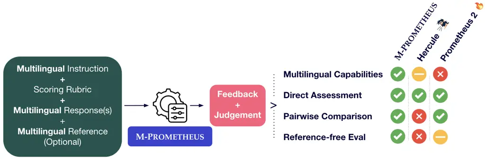
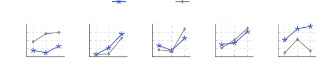
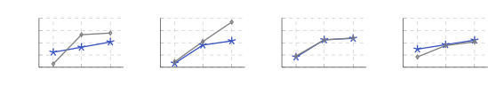

# M-Prometheus: A Suite of Open Multilingual LLM Judges

José Pombal Affiliation: Unbabel Affiliation: Instituto de
Telecomunicações Affiliation: Instituto Superior Técnico, Universidade
de Lisboa Email: [pombal.josemaria@gmail.com](mailto:)    Dongkeun Yoon
Affiliation: KAIST    Patrick Fernandes Affiliation: Instituto de
Telecomunicações Affiliation: Instituto Superior Técnico, Universidade
de Lisboa Affiliation: CMU    Ian Wu Affiliation: Independent Researcher
   Seungone Kim Affiliation: CMU    Ricardo Rei Affiliation: Unbabel   
Graham Neubig & André F.T. Martins Affiliation: Unbabel
Affiliation: Instituto de Telecomunicações Affiliation: Instituto
Superior Técnico, Universidade de Lisboa Affiliation: CMU
Affiliation: ELLIS Unit Lisbon

###### Abstract

The use of language models for automatically evaluating long-form text
(LLM-as-a-judge) is becoming increasingly common, yet most LLM judges
are optimized exclusively for English, with strategies for enhancing
their multilingual evaluation capabilities remaining largely unexplored
in the current literature. This has created a disparity in the quality
of automatic evaluation methods for non-English languages, ultimately
hindering the development of models with better multilingual
capabilities. To bridge this gap, we introduce M-Prometheus, a suite of
open-weight LLM judges ranging from 3B to 14B parameters that can
provide both direct assessment and pairwise comparison feedback on
multilingual outputs. M-Prometheus models outperform state-of-the-art
open LLM judges on multilingual reward benchmarks spanning more than 20
languages,¹¹ 1 Arabic, Basque, Bengali, Catalan, Chinese, Czech, Dutch,
English, French, Galician, German, Greek, Hebrew, Hindi, Indonesian,
Italian, Japanese, Korean, Persian, Polish, Portuguese, Romanian,
Russian, Spanish, Turkish, Ukrainian, Swahili, Telugu, Thai, Vietnamese.
as well as on literary machine translation (MT) evaluation covering 4
language pairs.²² 2 English-German, English-Chinese, German-English, and
German-Chinese Furthermore, M-Prometheus models can be leveraged at
decoding time to significantly improve generated outputs across all 3
tested languages,³³ 3 French, Chinese, and Hindi showcasing their
utility for the development of better multilingual models. Lastly,
through extensive ablations, we identify the key factors for obtaining
an effective multilingual judge, including backbone model selection and
training on synthetic multilingual feedback data instead of translated
data. We release our models, training dataset, and code.⁴⁴ 4 Models and
training data available on
[Huggingface](https://huggingface.co/collections/Unbabel/m-prometheus-67f3b17e6409b2550b698822).

## 1 Introduction

Automatic evaluation of large language models (LLMs) has become
increasingly challenging, as the capabilities of LLMs are constantly
expanding to encompass a wider range of tasks. To address this
challenge, a paradigm has emerged (“LLM-as-a-judge”) where language
models are used as evaluators of long-form outputs (Zheng et al., 2023;
Gu et al., 2024; Li et al., 2024a; Li et al., 2024b). In this paradigm,
a language model receives a query, one or two responses, and some
evaluation criteria, and is tasked with generating feedback about the
quality of the response(s). Contrary to traditional automatic evaluation
metrics that only output a scalar score (e.g., Bleurt (Sellam et al., 2020) and Comet (Rei et al., 2020)), the feedback of a judge is composed
of text explaining the decision behind either a scalar output (direct
assessment, DA), or a verdict on the best of two responses (pairwise
comparison, PWC). The effectiveness of the LLM-as-a-judge paradigm has
been demonstrated across a broad range of tasks with proprietary and
open models (Bavaresco et al., 2024; Zheng et al., 2023; Kocmi &
Federmann, 2023), and systems trained specifically for evaluation (Kim
et al., 2023; Kim et al., 2024b; Deshpande et al., 2024; Doddapaneni
et al., 2024).

Simultaneously, significant efforts have been dedicated to building
multilingual LLMs (i.e., LLMs that can perform tasks well in languages
beyond English). Yet, research on effective strategies for training
strong multilingual judges has lagged behind, with existing work
focusing solely on English despite the myriad of language modeling
use-cases in other languages. Those works that do investigate
multilingual judging capabilities introduce models with significant
limitations. The Hercule Judge LLM (Doddapaneni et al., 2024), for
example, does not support PWC, while GLIDER (Deshpande et al., 2024) is
not trained to handle non-English languages and only inherits basic
multilingual capabilities from the pretraining of its backbone model.
These limitations stifle the development of better multilingual
automatic evaluation methods which, in turn, hinders the development of
stronger multilingual language models. To bridge this gap, we introduce
M-Prometheus, a suite of high-performance multilingual judges with 3B,
7B, and 14B parameters. Using a recipe inspired by Prometheus 2 (Kim
et al., 2024b), M-Prometheus models are trained to provide both DA and
PWC feedback on non-English outputs. We release the training datasets we
built for this purpose, M-Feedback Collection and M-Preference
Collection.

We extensively evaluate our suite of models on a set of multilingual
benchmarks spanning 30 languages,¹ achieving state-of-the-art
performance for their respective sizes. Interestingly, we observe that
M-Prometheus models are particularly strong on the evaluation of
literary machine translation—a challenging cross-lingual task where most
translation-specific automatic metrics underperform (Zhang et al.,
2024)—across 4 language pairs.² Furthermore, we propose an extrinsic
evaluation dimension directly linked to the practical utility of judges
for model development: measuring how well a judge improves model outputs
in non-English languages at inference time. Using best-of-$`n`$
sampling (Song et al., 2024), where a judge selects the best output from
candidate generations, we observe that direct assessments obtained with
M-Prometheus enhance model outputs across languages,³ achieving up to an
80% win-rate against the original outputs on M-ArenaHard (Dang et al.,
2024), a multilingual extension of ArenaHard (Li et al., 2024c).

To better understand which strategies most effectively maximize
multilingual evaluation performance, we conduct a comprehensive series
of ablations. Our findings reveal that using synthetic (rather than
translated) multilingual training data is crucial, and that
incorporating machine translation evaluation data can transfer
positively to other evaluation tasks. Additionally, both the choice of
backbone model for finetuning and model scale strongly determine the
size of performance gains. We hope that our insights will guide the
development of future, improved multilingual LLM judges. We release our
models, training data, and the code required to reproduce our
experiments.

Figure 1: M-Prometheus is a suite of open-weight multilingual LLM judges
capable of providing reference-based and reference-free direct
assessment and pairwise feedback.

## 2 Related Work

### 2.1 LLM-as-a-Judge

As language models become capable of solving increasingly complex tasks,
automatic evaluation of long-form outputs has shifted away from scalar
metrics (e.g., Bleu (Papineni et al., 2002) and Bleurt (Sellam et al.,
2020)) and towards using language models as generative evaluators (Zheng
et al., 2023, LLM-as-a-Judge). These models have shown state-of-the-art
evaluation performance across a range of tasks (Gu et al., 2024; Li
et al., 2024a; Li et al., 2024b), including multilingual ones like
machine translation (Kocmi & Federmann, 2023), multilingual safety
evaluation (Üstün et al., 2024a), and multilingual
instruction-following (Dang et al., 2024). While many works leverage
proprietary models, several efforts proposing open LLM judges have
emerged (Kim et al., 2023; Kim et al., 2024b; Vu et al., 2024; Wang
et al., 2024; Deshpande et al., 2024; Doddapaneni et al., 2024); the
training recipe in our work is inspired by Kim et al. (2024b)
(Prometheus 2). However, little attention has been paid to the
performance of open judge models outside of English. Deshpande et al.
(2024) show that their model, Glider, retains some multilingual
capabilities from pretraining (by measuring performance on
M-RewardBench), even though it was only finetuned for judging English
outputs. That said, our more extensive evaluation suite shows that
models trained with synthetic multilingual data outperform Glider. To
the best of our knowledge, only Doddapaneni et al. (2024), who introduce
Hercule (a model trained on translated multilingual data for 6
languages), consider training a multilingual judge. There are few
reliable open multilingual judges and little understanding of the
factors behind judge finetuning that drive multilingual performance. We
attempt to bridge both these gaps by releasing a strong suite of
multilingual judges, and by dissecting the effects of our training
recipe’s individual components.

### 2.2 Multilingual Adaptation

While most existing work on LLMs has been centered around the English
language, many recent works have emerged around building systems with
better multilingual capabilities. These involve pretraining multilingual
models from scratch (Üstün et al., 2024b; Dang et al., 2024; Martins
et al., 2025), or finetuning pretrained models (Alves et al., 2024; Rei
et al., 2024; Doddapaneni et al., 2024) for better performance on
multilingual tasks; our work focuses on the latter. Although there are
works exploring LLM judge performance on multilingual tasks, there
exists (to the best of our knowledge) only one work that introduces a
finetuned multilingual LLM judge: Hercule (Doddapaneni et al., 2024).
The Hercule approach involves finetuning a model on translated versions
of the Feedback Collection (Kim et al., 2023), the direct assessment
training dataset we also use. Hercule is trained to judge outputs in 6
languages—German, French, Bengali, Telugu, Urdu, and Hindi. However, it
can only receive reference outputs in English and produce direct
assessments. Furthermore, Hercule was only evaluated on RECON, a test
set introduced by the authors that is also based on translated data.
Unlike Hercule, which was only tested on one translated benchmark, we
evaluate on a more diverse set of benchmarks and demonstrate that using
translated data for training often does not lead to improved
performance.

## 3 The M-Prometheus Suite

M-Prometheus models are finetuned from Qwen2.5-Instruct (Yang et al.,
2024), and are trained to provide DA and PWC feedback in the same format
as Prometheus 2 (Kim et al., 2024b) while being capable of receiving
target instructions, model outputs, and references in non-English
languages (see Appendix A.2 for examples of training instances).⁵⁵ 5 We
used the
[prometheus-eval](https://github.com/prometheus-eval/prometheus-eval)
codebase for training with the hyperparameters in Appendix B. The rest
of the prompt is in English, and M-Prometheus provides feedback in
English by default, although it can be prompted to generate feedback in
other languages.⁶⁶ 6 We do not evaluate the quality of the long-form
feedback outside of English, only that of the DA and PWC judgements.
Training models on instances with translated feedback yielded poor
results. M-Prometheus models exhibit strong performance in more than 20
languages (§5), despite being trained on data in only 6 languages
(English, French, Portuguese, Greek, Chinese, and Hindi).

### 3.1 Training Data

Figure 2: Data distribution (in number of instances) of the M-Feedback
Collection (DA data) and M-Preference Collection (PWC data) datasets.
These datasets form the training data of M-Prometheus.

The backbones of our training data are Prometheus 2’s Feedback and
Preference Collections, which are English DA and PWC datasets generated
with GPT-4. Each instance contains a target instruction, one (DA) or two
(PWC) candidate responses, a reference response, a rubric containing
some evaluation criteria, long-form feedback evaluating the response(s),
and a final judgement. See Appendix A.1 for a detailed description of
these components.

We follow this format for the new data we create, and add two new
sources of multilingual data: 1) synthetic (as opposed to translated)
multilingual synthetic DA and PWC data and 2) DA machine translation
(MT) evaluation data. We adapt the synthetic data generation processes
of Prometheus and Prometheus 2, although unlike for Prometheus, we use
Claude-Sonnet-3.5 (Sonnet) instead of GPT-4 or GPT-4o as our data
generator, as we find in preliminary experiments that Sonnet generates
more fluent data in non-English languages. The final data distribution
is summarized in Figure 2. Due to their length, we include concrete
training examples in Appendix A.2.

##### Generating M-Feedback Collection.

We start by generating our multilingual direct assessment dataset,
M-Feedback Collection. Using the original 1k score rubrics from the
Prometheus Feedback Collection, we prompt Sonnet to generate five
instructions for each rubric in each of the five non-English languages
we consider. For each instruction, we then prompt Sonnet to generate
five candidate responses with varying levels of quality, each
corresponding to a score from 1 to 5, accompanied by long-form feedback
in English. We also prompt Sonnet to generate a reference, high-quality
response to half of our generated instructions. Each response is then
combined with its corresponding rubric, instruction and reference
response (should this exist) to form a single training input, and each
training input is paired with the concatenation of its corresponding
feedback and score, which serves as the training target. By including a
mix of samples with and without reference responses, our dataset enables
the training of evaluators capable of both reference-free and
reference-based evaluation.

##### Generating M-Preference Collection.

Next, we synthesize the pairwise comparison dataset, M-Preference
Collection. From the aforementioned M-Feedback Collection and within
each instance, we create “preference pairs” by pairing score 5 responses
with every other response, and score 4 responses with score 2 responses,
resulting in five response pairs per instruction. Following Prometheus
2, we assume that the higher-scoring response is of higher quality and
should therefore be preferred over the lower-scoring one. Then, for each
pair, we prompt Sonnet to generate long-form preference feedback in
English. These components are then combined in a similar manner to our
DA data, yielding again a total of 10k samples for each language. For
each instance, we randomize the order in which the correct answer
appears, i.e., it will appear first 50% of the time. For further details
on the data construction process, refer to the Prometheus (Kim et al., 2023) and Prometheus 2 (Kim et al., 2024a) papers.

##### MT Evaluation Data.

We augment M-Feedback Collection with MT evaluation data. For each of
eight language pairs,⁷⁷ 7 We select language pairs of varying resource
availabilities and scripts: English-German, -Czech, -Spanish,
-Ukrainian, -Russian, -Chinese, -Japanese, -Hindi we prompt
Claude-Sonnet-3.5 to generate 2,000 source texts, conditioning on a
topic, subtopic, and other attributes sampled from a common pool (we
include the prompt we used and attribute prevalences in Appendix A.3)).
Then, for each source, we prompt Sonnet to generate five candidate
translations corresponding to scores 1 (worst) to 5 (best), along with a
reference translation. Each candidate translation is paired with their
corresponding source, yielding a total of 80,000 instances. Finally, we
randomly include reference translations for half of the training
instances while omitting them from the other half. This enables models
trained on our datasets to perform both reference-based and
reference-free evaluation, increasing their versatility; indeed,
M-Prometheus attains state-of-the-art performance on reference-less
literary MT evaluation (§5).

## 4 Experimental Setup

### 4.1 Evaluating General Capabilities

The term “general capabilities” is often used to refer to the real-world
utility of language models in addressing queries that involve core
knowledge, safety, instruction-following, and conversational
capabilities (Zheng et al., 2023). Evaluating LLM judges in this domain
is useful as it indicates their effectiveness at judging the real-world
utility of other models. The most popular English-only benchmark for
this is RewardBench (Lambert et al., 2024). RewardBench is composed of
3,000 instances across 4 tasks (Chat, Chat Hard, Reasoning, Safety),
where the judge is tasked with choosing the best of two answers to a
query. We evaluate all models on this benchmark to assess whether they
retain English capabilities. To assess general multilingual
capabilities, we use M-RewardBench (Gureja et al., 2024), which is a
translated version of RewardBench for 23 languages. We also evaluate our
models on MM-Eval (Son et al., 2024), a PWC benchmark that covers up to
18 languages in the categories of Chat, Reasoning, Safety, and two
additional language-specific categories: 1) linguistics (e.g. find the
homophones of a word); 2) language hallucination, where a judge is
tasked with finding the model answer that mixes two or more languages
undesirably. Importantly, MM-Eval is mostly comprised of native speaker,
rather than translated, data, whih is an advantage over M-RewardBench.
The meta-evaluation metric of all three benchmarks is accuracy. We
report the average of the per-category performance for RewardBench. For
the multilingual benchmarks, we first obtain the micro-average
performance on each language, and then report the average across all
languages. Detailed results by category and language can be found in
Appendix C.

### 4.2 Machine Translation Evaluation

Machine translation has played a key role in advancing language model
development (most notably inspiring the Transformer
architecture (Vaswani et al., 2017)) and has led to the creation of
multiple automatic evaluation metrics that correlate well with human
judgments (Freitag et al., 2024). However, most translation metrics
still struggle in certain domains. A notable example is the translation
of books, known as literary MT, where existing metrics underperform
because of the wide context window required to handle book excerpts,
among other challenges. GEMBA-MQM (Kocmi & Federmann, 2023), an LLM
judge based on GPT-4, has been shown to excel at this task (Zhang
et al., 2024), while the performance of Prometheus 2, an open-source LLM
judge, is close to random. We take interest in this task for two
reasons: 1) we posit that training on a cross-lingual evaluation task
may transfer positively to general-purpose multilingual evaluation
capabilities; 2) we wish to bridge the performance gap between closed
and open models. Thus, we leverage the student-annotated subset of
LitEval-Corpus (Zhang et al., 2024), which contains human-evaluated
automatic translations of book excerpts for 4 language pairs:
English$`\rightarrow`$German, English$`\rightarrow`$Chinese,
German$`\rightarrow`$English, and German$`\rightarrow`$Chinese. On this
task, judges are prompted to give a scalar assessment of each
translation (without access to a reference). The resulting ranking of
translations is then compared to a human ranking through Kendall’s Tau
correlation coefficient (Kendall, 1938).

### 4.3 Extrinsic Evaluation with Quality-Aware Decoding

The intrinsic meta-evaluation of judges through existing benchmarks is
not directly informative of their capacity to improve other models. To
bridge this gap, we propose an extrinsic dimension of evaluation:
evaluating judges on their ability to improve the multilingual outputs
of other models. This is relevant for practical use-cases, such as for
improving outputs at inference time (Fernandes et al., 2022; Wu et al.,
2024), or for improving training datasets through
distillation (Finkelstein & Freitag, 2024; Wu et al., 2024). Thus, we
perform quality-aware decoding (Fernandes et al., 2022, QAD) with judges
to improve the outputs of Qwen2.5-3B-Instruct on M-ArenaHard on 3
languages: French, Chinese, and Hindi.⁸⁸ 8 In QAD, for each judge and
test instance, we perform best-of-$`n`$ sampling (Song et al., 2024)
over 30 candidate answers, generated through temperature sampling (with
temperature equal to 0.3). Each candidate is assigned a score by
prompting the judge for a direct assessment, and the candidate with the
best score is selected; if multiple candidates tie, we pick one at
random. M-ArenaHard is a translated version of ArenaHard, a benchmark
for general capabilities where models are prompted to generate long-form
answers to 500 queries sampled from Chatbot Arena (Chiang et al., 2024).
These answers are then evaluated against a reference answer by an LLM
judge,⁹⁹ 9 We use Qwen2.5-72B-Instruct answers as reference answers and
Llama-3.3-70B-Instruct (Grattafiori et al., 2024) for evaluation.
yielding an Elo score based on win-rate. We evaluate judges on the
extent to which they improve the Elo of Qwen2.5-3B-Instruct after
QAD.¹⁰¹⁰ 10 To validate whether our findings generalize to other models,
we present results with Gemma-2-2B-IT (Team et al., 2024) in Appendix D;
the conclusions are similar. We convert Elo scores into expected win
rates over the original outputs (generated with greedy decoding)—with
50% indicating that the judge is, on average, unable to improve output
quality—and report the average across the three languages (we report
language-specific results in Appendix C.5). We refer to this evaluation
as “QAD”.

### 4.4 Baselines

We compare M-Prometheus against two types of baselines: 1)
general-purpose LLMs, namely: gpt-4o-2024-11-20 (GPT-4o), a
state-of-the-art proprietary LLM, and Qwen2.5-{3,7,14}B-Instruct, the
backbone models of our suite and state-of-the-art open models for their
sizes; 2) state-of-the-art open LLM judges, namely Prometheus 2 7B and
8x7B (Kim et al., 2024b), Glider 3B (Deshpande et al., 2024), and
Hercule 7B (Doddapaneni et al., 2024). Hercule was trained specifically
to evaluate non-English targets. There are multiple Hercule models (each
trained with data from one of 6 languages), but not for all languages of
the benchmarks we consider. To make this baseline more challenging, we
evaluate all models and consider only the performance of the best one
when languages are not supported. We run all models locally using
benchmark codebases where available.¹¹¹¹ 11 Glider and Hercule required
minor code changes, which we will release upon publication.

## 5 Experimental Results

|                                        |                            |               |             |         |       |
| -------------------------------------- | -------------------------- | ------------- | ----------- | ------- | ----- |
|                                        | General-purpose benchmarks |               |             | LitEval | QAD   |
| Judge LLM                              | MM-Eval                    | M-RewardBench | RewardBench |         |       |
| Proprietary Models                     |                            |               |             |         |       |
| GPT-4o                                 | 0.7185                     | 0.8575        | 0.8596      | 0.3944  | -     |
| \[.4pt/2pt\]   Small (3B parameters)   |                            |               |             |         |       |
| Qwen2.5-3B-Instruct                    | 0.5794                     | 0.6674        | 0.6940      | 0.1538  | 54.29 |
| Glider 3B $`\dagger`$                  | 0.5746                     | 0.7046        | 0.6827      | 0.1781  | 57.21 |
| M-Prometheus 3B \*                     | 0.6380                     | 0.6831        | 0.7027      | 0.4075  | 63.04 |
| \[.4pt/2pt\]    Medium (7B parameters) |                            |               |             |         |       |
| Qwen2.5-7B-Instruct                    | 0.6608                     | 0.7801        | 0.7823      | 0.1772  | 55.88 |
| Prometheus 2 7B $`\dagger`$            | 0.6090                     | 0.6731        | 0.7205      | 0.1252  | 62.55 |
| Hercule 7B \*                          | 0.4916                     | 0.6508        | 0.6786      | 0.3516  | 64.86 |
| M-Prometheus 7B \*                     | 0.6966                     | 0.7754        | 0.7684      | 0.4353  | 66.37 |
| \[.4pt/2pt\]   Large (14B+ parameters) |                            |               |             |         |       |
| Qwen2.5-14B-Instruct                   | 0.6819                     | 0.8081        | 0.8241      | 0.3108  | 54.63 |
| Prometheus 2 8x7B $`\dagger`$          | 0.6434                     | 0.7515        | 0.7406      | 0.3185  | 62.79 |
| M-Prometheus 14B \*                    | 0.7726                     | 0.7951        | 0.7967      | 0.4790  | 64.41 |

Table 1: Accuracy on general-purpose benchmarks, ranking correlation on
LitEval, and win-rate on M-ArenaHard. For each column, underlined models
are the best for their size, while bold ones are the best overall. The
$`\dagger`$ denotes finetuned English judges, while \* denotes finetuned
multilingual judges. The rows of our models are shaded light purple.

(a) MM-Eval

(b) M-RewardBench

Figure 3: Performance of the M-Prometheus and Qwen2.5-Instruct 3B, 7B,
and 14B models on general-purpose multilingual benchmarks, broken down
by category. Tables with more detailed results are in Appendix C.

##### M-Prometheus outperforms open judges, much larger models, and GPT-4o.

Our main results are documented in Table 1. We find that M-Prometheus
excels on all axes of evaluation, surpassing all baselines on MM-Eval,
literary MT, and QAD. M-Prometheus 14B surpassing GPT-4o on MM-Eval is
particularly impressive, since the latter is a state-of-the-art LLM.
Interestingly, while Qwen2.5-Instruct models perform strongly across
general-purpose benchmarks (even outperforming most specialized judges),
they lag behind on literary MT and QAD. Here, the benefits of finetuning
are clear, especially for M-Prometheus-3B, which outperforms its
backbone model across the board and larger backbones on QAD.

##### The categories that drive average performance on general-purpose benchmarks vary between M-Prometheus and their backbone models.

Figure 3 illustrates the performance of all M-Prometheus and
Qwen2.5-Instruct models on M-RewardBench and MM-Eval broken down by
category, revealing their strengths and weaknesses. We find that
M-Prometheus is particularly strong on the Safety, and Language
Hallucinations categories, while the general-purpose backbones excel on
Chat. We report per-category and per-language performances for all
models and ablations on both benchmarks in Appendix C.

##### M-Prometheus models retain or improve performance in English.

Remarkably, Table 1 demonstrates that M-Prometheus models not only
exhibit strong multilingual capabilities but also maintain nearly the
same performance in English, as measured by RewardBench, compared to
their backbone models. Notably, M-Prometheus-3B outperforms its backbone
on this benchmark, further highlighting the benefits of fine-tuning for
smaller models.

##### Multilingual training strongly improves performance on Literary MT and QAD

M-Prometheus models consistently outperform models of all sizes on
Literary MT and QAD (see Table 1). On QAD, judges trained on
multilingual data (M-Prometheus and Hercule) exhibit particularly strong
performance. These results suggest that multilingual training is
important for endowing judges with the capacity to improve the outputs
of other models.

## 6 Dissecting the Training Recipe

|                          |                            |               |             |         |       |
| ------------------------ | -------------------------- | ------------- | ----------- | ------- | ----- |
|                          | General-purpose benchmarks |               |             | LitEval | QAD   |
| Ablations                | MM-Eval                    | M-RewardBench | RewardBench |         |       |
| No Judge Training        |                            |               |             |         |       |
| Mistral-7B-v0.2-Instruct | 0.5031                     | 0.5932        | 0.6481      | 0.0958  | 53.56 |
| EuroLLM-9B-Instruct      | 0.5834                     | 0.6288        | 0.6890      | 0.0319  | 55.15 |
| Aya-Expanse-8B           | 0.5143                     | 0.6332        | 0.6579      | 0.0008  | 52.05 |
| Qwen2.5-7B-Instruct      | 0.6608                     | 0.7801        | 0.7823      | 0.1772  | 55.88 |
| Backbone Model           |                            |               |             |         |       |
| Mistral-7B-v0.2-Instruct | 0.5428                     | 0.6454        | 0.7083      | 0.0747  | 61.81 |
| EuroLLM-9B-Instruct      | 0.6263                     | 0.7248        | 0.7519      | 0.2435  | 63.15 |
| Aya-Expanse-8B           | 0.5904                     | 0.7325        | 0.7531      | 0.2544  | 60.54 |
| Qwen2.5-7B-Instruct      | 0.6456                     | 0.7817        | 0.7774      | 0.2837  | 61.36 |
| Training Data            |                            |               |             |         |       |
| MT Eval Data             | 0.6748                     | 0.7800        | 0.7780      | 0.4221  | 59.71 |
| Translated Data          |                            |               |             |         |       |
| 3 Non-English Langs      | 0.6280                     | 0.7824        | 0.7768      | 0.2221  | 66.47 |
| Multilingual Data        |                            |               |             |         |       |
| 3 Non-English Langs      | 0.6477                     | 0.7687        | 0.7855      | 0.3162  | 68.70 |
| 5 Non-English Langs      | 0.6616                     | 0.7758        | 0.7876      | 0.3372  | 66.11 |

Table 2: Ablations of the M-Prometheus training recipe, and results of
instruct Models without any finetuning. For each evaluation method, bold
models are the best in their respective ablation category (i.e.,
backbone model or training data). The training data ablations are all
done on a Qwen2.5-7B-Instruct backbone.

### 6.1 Overview

One of our primary objectives is to develop better intuitions for how
multilingual LLM judges should be trained. As such, we ablate three
central components of our training recipe: 1) backbone model choice; 2)
training data mix; 3) model size.

##### Backbone model ablations.

In line with prior work (Kim et al., 2024b; Deshpande et al., 2024;
Doddapaneni et al., 2024), we focus on specializing instruction-tuned
backbone models for the tasks of DA and PWC evaluation. To isolate the
effect of backbone model choice on multilingual performance, we apply
the Prometheus 2 training recipe¹²¹² 12 For simplicity, we perform joint
training on the Feedback and Preference collections, as opposed to
merging models trained separately on each. to 4 models:
Mistral-v0.2-Instruct (Jiang et al., 2023), the backbone of Prometheus
2; EuroLLM-9B-Instruct (Martins et al., 2025) and
Aya-Expanse-8B-Instruct (Dang et al., 2024), two highly multilingual
models; and Qwen2.5-7B-Instruct, the backbone of M-Prometheus. For
additional context, we also evaluate the backbone models before any
finetuning.

##### Training data ablations.

We are interested in answering three questions: 1) does training for MT
evaluation, a cross-lingual task, transfer positively to general-purpose
multilingual evaluation capabilities? 2) does including translated data
lead to better multilingual capabilities, as reported by
Hercule (Doddapaneni et al., 2024), or is it better to train on
multilingual data generated from scratch? 3) does covering more
languages during training benefit overall performance? For the ablations
with MT evaluation and synthetic multilingual data, we append each of
our datasets described in Section 3.1 to the data mix of Prometheus 2,
and train Qwen2.5-7B-Instruct with the hyperparameters of Prometheus 2.
We experiment with including 3 or 5 languages in the multilingual data
mix (each language contains 10k DA and 10k PWC instances). For the
translated data ablation, we translate the data of Prometheus 2 into 3
languages¹³¹³ 13 The 3 languages are French, Portuguese, and Chinese for
the translated and synthetic multilingual data. When expanding the
latter to 5 languages, we add Greek and Hindi, as per our final recipe.
using Tower-v2 (Rei et al., 2024), a state-of-the-art translation
LLM (Kocmi et al., 2024). We also include 10k DA and 10k PWC instances,
50% with a reference, 50% without, for the sake of comparability with
the synthetic multilingual data ablation.¹⁴¹⁴ 14 As with the synthetic
multilingual data, each multilingual instance has non-English
instructions, model outputs, and reference answers, while the rest of
the instance remain in English. We experiment with translating the rest
of the instance and reach similar conclusions.

### 6.2 Key Takeaways

The main results of our ablations can be found in Table 2.

##### Backbone model choice is a core driver of judge performance.

With the exception of QAD, backbone model choice is the main driver of
performance, representing up to 14 accuracy points in improvement on
general-purpose benchmarks when switching from Mistral, the backbone
model of Prometheus 2, to Qwen, the backbone of M-Prometheus. This
finding may be partially explained by looking at results prior to any
finetuning: Qwen outperforms all other backbones across the board.
Interestingly, using models where non-English data is relatively more
represented in pretraining, like EuroLLM or Aya, does not necessarily
translate into better performnace.

##### MT evaluation capabilities transfers positively to general capabilities and vice-versa.

As expected, training on MT evaluation data leads to better literary MT
evaluation performance. More importantly, adding this kind of
cross-lingual signal during training leads to improvements on
general-purpose multilingual benchmarks. Upon closer inspection, we see
that most of the gains on MM-Eval, for example, come from the language
hallucination task, suggesting that MT evaluation data endows judges
with greater ability to detect instances where languages are mixed
together (see Appendix C.1 for per-category results). Likewise, training
on synthetic multilingual data improves MT evaluation performance.

##### Judges trained on synthetic multilingual data are the most capable of improving multilingual outputs.

The LLM trained on synthetic multilingual data from 3 non-English
languages demonstrate the best performance on QAD, surpassing judges
trained on other types of data by up to 10 points. This suggests that
synthetic multilingual data is crucial for enabling judge models to
improve the outputs of other multilingual models at inference time.
Interestingly, increasing language coverage to 5 languages deteriorates
the model’s performance along this axis, but improves it on all the
others.

##### Training on translated data is not as effective as synthetic multilingual data.

With the exception of M-RewardBench, adding synthetic multilingual data
to training is always more effective than adding translated data. In
fact, training on the latter leads to deterioration on RewardBench,
MM-Eval, and LitEval compared with training on English-only data. This
somewhat contradicts the findings of Doddapaneni et al. (2024); we
suspect translated data worked well in their case because they focus
their evaluation on a translated DA dataset.

##### Model scale most strongly impacts general-purpose benchmark performance.

Looking back at Table 1, we see that the impact of model scale is most
noticeable on general-purpose benchmarks and on literary MT evaluation.
Interestingly, however, M-Prometheus-7B outperforms M-Prometheus-14B on
QAD. Furthermore, the largest performance gap between M-Prometheus
models and their respective backbones occur at the 3B size. These
findings hint at the diminishing returns of fine-tuning as scale
increases.

## 7 Conclusion

We introduce and release a suite of multilingual LLM judges (3B, 7B, and
14B) that demonstrate state-of-the-art performance on more than 20
non-English languages. Our training recipe mixes synthetically-generated
MT evaluation data and synthetic—as opposed to translated—multilingual
data with existing English judge data. We justify our choices through
extensive ablations, and further highlight the importance of backbone
model choice and the ineffectiveness of translated data. We also propose
an additional dimension of meta-evaluation that focuses on the practical
usefulness of judges in improving multilingual outputs. In the future,
we hope to explore different strategies to improve multilingual judge
capabilities (e.g., through training on multilingual reasoning chains)
and extend existing ones (e.g., by learning to produce high-quality
feedback in non-English languages).

## Acknowledgements

We acknowledge EuroHPC JU for awarding the project ID
EHPC-AI-2024A01-085 access to MareNostrum 5 ACC. This work was supported
by EU’s Horizon Europe Research and Innovation Actions (UTTER, contract
101070631), by the project DECOLLAGE (ERC-2022-CoG 101088763), by the
Portuguese Recovery and Resilience Plan through project
C64500888200000055 (Center for Responsible AI), and by Fundação para a
Ciência e Tecnologia through contract UIDB/50008/2020.

## Reproducibility Statement

We release all our models, training data, and code to reproduce our
experiments. Part of our experiments rely on closed models, which may
become unavailable in the future, posing a potential challenge for
reproducibility.

## Ethics Statement

Our work focuses on developing better automatic evaluation methods for
non-English languages. First, the models we release may show biases
present in the data they were trained on. Users should carefully review
model outputs before deployment. Second, automated evaluation could be
misused to claim superiority without proper validation. We emphasize
that our models should complement, not replace, careful human evaluation
and real-world testing. We release our models, data, and code to enable
scrutiny and improvement by the research community.

## References

- Alves et al. (2024) Duarte M Alves, José Pombal, Nuno M Guerreiro,
  Pedro H Martins, João Alves, Amin Farajian, Ben Peters, Ricardo Rei,
  Patrick Fernandes, Sweta Agrawal, et al. Tower: An open multilingual
  large language model for translation-related tasks. _arXiv preprint
  arXiv:2402.17733_, 2024.
- Bavaresco et al. (2024) Anna Bavaresco, Raffaella Bernardi, Leonardo
  Bertolazzi, Desmond Elliott, Raquel Fernández, Albert Gatt, Esam
  Ghaleb, Mario Giulianelli, Michael Hanna, Alexander Koller, et al.
  Llms instead of human judges? a large scale empirical study across 20
  nlp evaluation tasks. _arXiv preprint arXiv:2406.18403_, 2024.
- Chiang et al. (2024) Wei-Lin Chiang, Lianmin Zheng, Ying Sheng,
  Anastasios Nikolas Angelopoulos, Tianle Li, Dacheng Li, Hao Zhang,
  Banghua Zhu, Michael Jordan, Joseph E. Gonzalez, and Ion Stoica.
  Chatbot arena: An open platform for evaluating llms by human
  preference, 2024.
- Dang et al. (2024) John Dang, Shivalika Singh, Daniel D’souza, Arash
  Ahmadian, Alejandro Salamanca, Madeline Smith, Aidan Peppin, Sungjin
  Hong, Manoj Govindassamy, Terrence Zhao, et al. Aya expanse: Combining
  research breakthroughs for a new multilingual frontier. _arXiv
  preprint arXiv:2412.04261_, 2024.
- Deshpande et al. (2024) Darshan Deshpande, Selvan Sunitha Ravi, Sky
  CH-Wang, Bartosz Mielczarek, Anand Kannappan, and Rebecca Qian.
  Glider: Grading llm interactions and decisions using explainable
  ranking. _arXiv preprint arXiv:2412.14140_, 2024.
- Doddapaneni et al. (2024) Sumanth Doddapaneni, Mohammed Safi Ur Rahman
  Khan, Dilip Venkatesh, Raj Dabre, Anoop Kunchukuttan, and Mitesh M
  Khapra. Cross-lingual auto evaluation for assessing multilingual llms.
  _arXiv preprint arXiv:2410.13394_, 2024.
- Fernandes et al. (2022) Patrick Fernandes, António Farinhas, Ricardo
  Rei, José GC de Souza, Perez Ogayo, Graham Neubig, and André FT
  Martins. Quality-aware decoding for neural machine translation. _arXiv
  preprint arXiv:2205.00978_, 2022.
- Finkelstein & Freitag (2024) Mara Finkelstein and Markus Freitag. Mbr
  and qe finetuning: Training-time distillation of the best and most
  expensive decoding methods. In _The Twelfth International Conference
  on Learning Representations_, 2024.
- Freitag et al. (2024) Markus Freitag, Nitika Mathur, Daniel Deutsch,
  Chi-Kiu Lo, Eleftherios Avramidis, Ricardo Rei, Brian Thompson,
  Frédéric Blain, Tom Kocmi, Jiayi Wang, et al. Are llms breaking mt
  metrics? results of the wmt24 metrics shared task. In _Proceedings of
  the Ninth Conference on Machine Translation_, pp. 47–81, 2024.
- Grattafiori et al. (2024) Aaron Grattafiori, Abhimanyu Dubey, Abhinav
  Jauhri, Abhinav Pandey, Abhishek Kadian, Ahmad Al-Dahle, Aiesha
  Letman, Akhil Mathur, Alan Schelten, Alex Vaughan, et al. The llama 3
  herd of models. _arXiv preprint arXiv:2407.21783_, 2024.
- Gu et al. (2024) Jiawei Gu, Xuhui Jiang, Zhichao Shi, Hexiang Tan,
  Xuehao Zhai, Chengjin Xu, Wei Li, Yinghan Shen, Shengjie Ma, Honghao
  Liu, et al. A survey on llm-as-a-judge. _arXiv preprint
  arXiv:2411.15594_, 2024.
- Gureja et al. (2024) Srishti Gureja, Lester James V Miranda,
  Shayekh Bin Islam, Rishabh Maheshwary, Drishti Sharma, Gusti Winata,
  Nathan Lambert, Sebastian Ruder, Sara Hooker, and Marzieh Fadaee.
  M-rewardbench: Evaluating reward models in multilingual settings.
  _CoRR_, 2024.
- Jiang et al. (2023) Albert Q Jiang, A Sablayrolles, A Mensch,
  C Bamford, D Singh Chaplot, Ddl Casas, F Bressand, G Lengyel,
  G Lample, L Saulnier, et al. Mistral 7b. arxiv. _arXiv preprint
  arXiv:2310.06825_, 10, 2023.
- Kendall (1938) Maurice G Kendall. A new measure of rank correlation.
  _Biometrika_, 30(1-2):81–93, 1938.
- Kim et al. (2023) Seungone Kim, Jamin Shin, Yejin Cho, Joel Jang,
  Shayne Longpre, Hwaran Lee, Sangdoo Yun, Seongjin Shin, Sungdong Kim,
  James Thorne, et al. Prometheus: Inducing fine-grained evaluation
  capability in language models. In _The Twelfth International
  Conference on Learning Representations_, 2023.
- Kim et al. (2024a) Seungone Kim, Juyoung Suk, Shayne Longpre,
  Bill Yuchen Lin, Jamin Shin, Sean Welleck, Graham Neubig, Moontae Lee,
  Kyungjae Lee, and Minjoon Seo. Prometheus 2: An open source language
  model specialized in evaluating other language models. In Yaser
  Al-Onaizan, Mohit Bansal, and Yun-Nung Chen (eds.), _Proceedings of
  the 2024 Conference on Empirical Methods in Natural Language
  Processing_, pp. 4334–4353, Miami, Florida, USA, November 2024a.
  Association for Computational Linguistics. doi:
  10.18653/v1/2024.emnlp-main.248. URL
  [https://aclanthology.org/2024.emnlp-main.248](https://aclanthology.org/2024.emnlp-main.248).
- Kim et al. (2024b) Seungone Kim, Juyoung Suk, Shayne Longpre,
  Bill Yuchen Lin, Jamin Shin, Sean Welleck, Graham Neubig, Moontae Lee,
  Kyungjae Lee, and Minjoon Seo. Prometheus 2: An open source language
  model specialized in evaluating other language models. _arXiv preprint
  arXiv:2405.01535_, 2024b.
- Kocmi & Federmann (2023) Tom Kocmi and Christian Federmann. Gemba-mqm:
  Detecting translation quality error spans with gpt-4. In _Proceedings
  of the Eighth Conference on Machine Translation_, pp. 768–775, 2023.
- Kocmi et al. (2024) Tom Kocmi, Eleftherios Avramidis, Rachel Bawden,
  Ondřej Bojar, Anton Dvorkovich, Christian Federmann, Mark Fishel,
  Markus Freitag, Thamme Gowda, Roman Grundkiewicz, Barry Haddow,
  Marzena Karpinska, Philipp Koehn, Benjamin Marie, Christof Monz,
  Kenton Murray, Masaaki Nagata, Martin Popel, Maja Popović, Mariya
  Shmatova, Steinthór Steingrímsson, and Vilém Zouhar. Findings of the
  WMT24 general machine translation shared task: The LLM era is here but
  MT is not solved yet. In Barry Haddow, Tom Kocmi, Philipp Koehn, and
  Christof Monz (eds.), _Proceedings of the Ninth Conference on Machine
  Translation_, pp. 1–46, Miami, Florida, USA, November 2024.
  Association for Computational Linguistics. doi:
  10.18653/v1/2024.wmt-1.1. URL
  [https://aclanthology.org/2024.wmt-1.1](https://aclanthology.org/2024.wmt-1.1).
- Lambert et al. (2024) Nathan Lambert, Valentina Pyatkin, Jacob
  Morrison, LJ Miranda, Bill Yuchen Lin, Khyathi Raghavi Chandu, Nouha
  Dziri, Sachin Kumar, Tom Zick, Yejin Choi, et al. Rewardbench:
  Evaluating reward models for language modeling. _CoRR_, 2024.
- Li et al. (2024a) Dawei Li, Bohan Jiang, Liangjie Huang, Alimohammad
  Beigi, Chengshuai Zhao, Zhen Tan, Amrita Bhattacharjee, Yuxuan Jiang,
  Canyu Chen, Tianhao Wu, et al. From generation to judgment:
  Opportunities and challenges of llm-as-a-judge. _arXiv preprint
  arXiv:2411.16594_, 2024a.
- Li et al. (2024b) Haitao Li, Qian Dong, Junjie Chen, Huixue Su, Yujia
  Zhou, Qingyao Ai, Ziyi Ye, and Yiqun Liu. Llms-as-judges: a
  comprehensive survey on llm-based evaluation methods. _arXiv preprint
  arXiv:2412.05579_, 2024b.
- Li et al. (2024c) Tianle Li, Wei-Lin Chiang, Evan Frick, Lisa Dunlap,
  Tianhao Wu, Banghua Zhu, Joseph E Gonzalez, and Ion Stoica. From
  crowdsourced data to high-quality benchmarks: Arena-hard and
  benchbuilder pipeline. _arXiv preprint arXiv:2406.11939_, 2024c.
- Martins et al. (2025) Pedro Henrique Martins, Patrick Fernandes, João
  Alves, Nuno M Guerreiro, Ricardo Rei, Duarte M Alves, José Pombal,
  Amin Farajian, Manuel Faysse, Mateusz Klimaszewski, et al. Eurollm:
  Multilingual language models for europe. _Procedia Computer Science_,
  255:53–62, 2025.
- Papineni et al. (2002) Kishore Papineni, Salim Roukos, Todd Ward, and
  Wei-Jing Zhu. Bleu: a method for automatic evaluation of machine
  translation. In _Proceedings of the 40th annual meeting of the
  Association for Computational Linguistics_, pp. 311–318, 2002.
- Rei et al. (2020) Ricardo Rei, Craig Stewart, Ana C Farinha, and Alon
  Lavie. Comet: A neural framework for mt evaluation. In _Proceedings of
  the 2020 Conference on Empirical Methods in Natural Language
  Processing (EMNLP)_, pp. 2685–2702, 2020.
- Rei et al. (2024) Ricardo Rei, José Pombal, Nuno M Guerreiro, João
  Alves, Pedro Henrique Martins, Patrick Fernandes, Helena Wu, Tania
  Vaz, Duarte Alves, Amin Farajian, et al. Tower v2: Unbabel-ist 2024
  submission for the general mt shared task. In _Proceedings of the
  Ninth Conference on Machine Translation_, pp. 185–204, 2024.
- Sellam et al. (2020) Thibault Sellam, Dipanjan Das, and Ankur Parikh.
  Bleurt: Learning robust metrics for text generation. In _Proceedings
  of the 58th Annual Meeting of the Association for Computational
  Linguistics_, pp. 7881–7892, 2020.
- Son et al. (2024) Guijin Son, Dongkeun Yoon, Juyoung Suk, Javier
  Aula-Blasco, Mano Aslan, Vu Trong Kim, Shayekh Bin Islam, Jaume
  Prats-Cristià, Lucía Tormo-Bañuelos, and Seungone Kim. Mm-eval: A
  multilingual meta-evaluation benchmark for llm-as-a-judge and reward
  models. _arXiv preprint arXiv:2410.17578_, 2024.
- Song et al. (2024) Yifan Song, Guoyin Wang, Sujian Li, and Bill Yuchen
  Lin. The good, the bad, and the greedy: Evaluation of llms should not
  ignore non-determinism. _arXiv preprint arXiv:2407.10457_, 2024.
- Team et al. (2024) Gemma Team, Morgane Riviere, Shreya Pathak,
  Pier Giuseppe Sessa, Cassidy Hardin, Surya Bhupatiraju, Léonard
  Hussenot, Thomas Mesnard, Bobak Shahriari, Alexandre Ramé, et al.
  Gemma 2: Improving open language models at a practical size. _arXiv
  preprint arXiv:2408.00118_, 2024.
- Üstün et al. (2024a) Ahmet Üstün, Viraat Aryabumi, Zheng Yong, Wei-Yin
  Ko, Daniel D’souza, Gbemileke Onilude, Neel Bhandari, Shivalika Singh,
  Hui-Lee Ooi, Amr Kayid, Freddie Vargus, Phil Blunsom, Shayne Longpre,
  Niklas Muennighoff, Marzieh Fadaee, Julia Kreutzer, and Sara Hooker.
  Aya model: An instruction finetuned open-access multilingual language
  model. In Lun-Wei Ku, Andre Martins, and Vivek Srikumar (eds.),
  _Proceedings of the 62nd Annual Meeting of the Association for
  Computational Linguistics (Volume 1: Long Papers)_, pp. 15894–15939,
  Bangkok, Thailand, August 2024a. Association for Computational
  Linguistics. doi: 10.18653/v1/2024.acl-long.845. URL
  [https://aclanthology.org/2024.acl-long.845](https://aclanthology.org/2024.acl-long.845).
- Üstün et al. (2024b) Ahmet Üstün, Viraat Aryabumi, Zheng-Xin Yong,
  Wei-Yin Ko, Daniel D’souza, Gbemileke Onilude, Neel Bhandari,
  Shivalika Singh, Hui-Lee Ooi, Amr Kayid, et al. Aya model: An
  instruction finetuned open-access multilingual language model. _arXiv
  preprint arXiv:2402.07827_, 2024b.
- Vaswani et al. (2017) Ashish Vaswani, Noam Shazeer, Niki Parmar, Jakob
  Uszkoreit, Llion Jones, Aidan N Gomez, Łukasz Kaiser, and Illia
  Polosukhin. Attention is all you need. _Advances in neural information
  processing systems_, 30, 2017.
- Vu et al. (2024) Tu Vu, Kalpesh Krishna, Salaheddin Alzubi, Chris Tar,
  Manaal Faruqui, and Yun-Hsuan Sung. Foundational autoraters: Taming
  large language models for better automatic evaluation. _arXiv preprint
  arXiv:2407.10817_, 2024.
- Wang et al. (2024) Peifeng Wang, Austin Xu, Yilun Zhou, Caiming Xiong,
  and Shafiq Joty. Direct judgement preference optimization. _arXiv
  preprint arXiv:2409.14664_, 2024.
- Wu et al. (2024) Ian Wu, Patrick Fernandes, Amanda Bertsch, Seungone
  Kim, Sina Pakazad, and Graham Neubig. Better instruction-following
  through minimum bayes risk. _arXiv preprint arXiv:2410.02902_, 2024.
- Yang et al. (2024) An Yang, Baosong Yang, Beichen Zhang, Binyuan Hui,
  Bo Zheng, Bowen Yu, Chengyuan Li, Dayiheng Liu, Fei Huang, Haoran Wei,
  et al. Qwen2.5 technical report. _arXiv preprint
  arXiv:2412.15115_, 2024.
- Zhang et al. (2024) Ran Zhang, Wei Zhao, and Steffen Eger. How good
  are llms for literary translation, really? literary translation
  evaluation with humans and llms. _arXiv preprint
  arXiv:2410.18697_, 2024.
- Zheng et al. (2023) Lianmin Zheng, Wei-Lin Chiang, Ying Sheng, Siyuan
  Zhuang, Zhanghao Wu, Yonghao Zhuang, Zi Lin, Zhuohan Li, Dacheng Li,
  Eric Xing, et al. Judging llm-as-a-judge with mt-bench and chatbot
  arena. _Advances in Neural Information Processing Systems_,
  36:46595–46623, 2023.

## Appendix A Training Data Details

### A.1 Input and Output Components

We denote English-language components with (E) and non-English-language
components with (M).

Each input is composed of the following components:

1.  1.  Instruction (M): A user instruction.
2.  2.  Response (M): A response to the instruction to evaluate. This
        evaluation is done based on the score rubric.
3.  3.  Rubric (E): The custom scoring criteria defined by the user. For
        both DA and PWC, the rubric consists of a description of the
        evaluation criteria. For DA, this is complemented with a description
        of the features responses receiving a certain score (from 1 to 5
        inclusive) should possess.
4.  4.  Reference Answer (M): Optional. A reference answer represents an
        ideal response to the user instruction. When used in reference-based
        mode, the evaluator’s decisions are made relative to the reference,
        which is assumed to be the gold-standard response. When used in
        reference-free model, no reference is provided and the evaluator is
        tasked with making decisions independently.

For PWC, we include two responses instead of one, and the evaluator is
tasked with choosing the better of the two responses. Each output,
meanwhile, is composed of the following two components:

1.  1.  Feedback (E): A long-form explanation of the decision of the
        evaluator.
2.  2.  Judgement: An integer score (DA) or binary indicator (PWC)
        representing the evaluator’s final decision.

### A.2 M-Feedback Collection and M-Preference Collection Training Examples

|                                                                                                                                                                                                                                                                                                                                                                                                                                                                                                                                                                                                                                                                                                                                                                                                                                                                                                                                                                                                                                                    |
| -------------------------------------------------------------------------------------------------------------------------------------------------------------------------------------------------------------------------------------------------------------------------------------------------------------------------------------------------------------------------------------------------------------------------------------------------------------------------------------------------------------------------------------------------------------------------------------------------------------------------------------------------------------------------------------------------------------------------------------------------------------------------------------------------------------------------------------------------------------------------------------------------------------------------------------------------------------------------------------------------------------------------------------------------- |
| \###Task Description:                                                                                                                                                                                                                                                                                                                                                                                                                                                                                                                                                                                                                                                                                                                                                                                                                                                                                                                                                                                                                              |
| An instruction (might include an Input inside it), a response to evaluate, a reference answer that gets a score of 5, and a score rubric representing a evaluation criteria are given.                                                                                                                                                                                                                                                                                                                                                                                                                                                                                                                                                                                                                                                                                                                                                                                                                                                             |
| 1. Write a detailed feedback that assess the quality of the response strictly based on the given score rubric, not evaluating in general.                                                                                                                                                                                                                                                                                                                                                                                                                                                                                                                                                                                                                                                                                                                                                                                                                                                                                                          |
| 2. After writing a feedback, write a score that is an integer between 1 and 5. You should refer to the score rubric.                                                                                                                                                                                                                                                                                                                                                                                                                                                                                                                                                                                                                                                                                                                                                                                                                                                                                                                               |
| 3. The output format should look as follows: ”Feedback: (write a feedback for criteria) $`[`$RESULT$`]`$ (an integer number between 1 and 5)”                                                                                                                                                                                                                                                                                                                                                                                                                                                                                                                                                                                                                                                                                                                                                                                                                                                                                                      |
| 4. Please do not generate any other opening, closing, and explanations.                                                                                                                                                                                                                                                                                                                                                                                                                                                                                                                                                                                                                                                                                                                                                                                                                                                                                                                                                                            |
| \###The instruction to evaluate:                                                                                                                                                                                                                                                                                                                                                                                                                                                                                                                                                                                                                                                                                                                                                                                                                                                                                                                                                                                                                   |
| Dans le cadre de l’organisation d’un festival culturel municipal, proposer une programmation d’activités et d’événements qui permettrait d’attirer et d’engager tous les membres de la communauté locale. La proposition doit tenir compte des différents groupes d’âge, origines culturelles, capacités physiques et situations socio-économiques. Le budget alloué est de 50 000 euros, et le festival doit se dérouler sur trois jours.                                                                                                                                                                                                                                                                                                                                                                                                                                                                                                                                                                                                         |
| \###Response to evaluate:                                                                                                                                                                                                                                                                                                                                                                                                                                                                                                                                                                                                                                                                                                                                                                                                                                                                                                                                                                                                                          |
| Notre festival culturel municipal propose une programmation variée sur trois jours, avec une scène principale présentant des spectacles de musique et de danse représentant différentes traditions, ainsi que des espaces dédiés aux arts culinaires du monde. Des ateliers créatifs et éducatifs sont prévus pour tous les âges, incluant des activités adaptées pour les enfants, les adolescents et les seniors. Le site est aménagé avec des zones de repos, des espaces familiaux et des stands d’artisanat local, complétés par une aire de restauration diversifiée. Des navettes gratuites desservent les différents quartiers de la ville, et des tarifs préférentiels sont proposés pour les étudiants, les familles nombreuses et les seniors. La signalisation sur le site est claire et multilingue, avec des bénévoles disponibles pour guider et assister les visiteurs. Les activités sont réparties entre animations en plein air et espaces couverts pour s’adapter aux conditions météorologiques et aux préférences de chacun. |

Figure 4: Multilingual example of M-Feedback Collection part 1.

|                                                                                                                                                                                                                                                              |
| ------------------------------------------------------------------------------------------------------------------------------------------------------------------------------------------------------------------------------------------------------------ |
| \###Reference Answer (Score 5):                                                                                                                                                                                                                              |
| Notre programmation du festival culturel s’articule autour de plusieurs axes pour garantir une inclusion maximale :                                                                                                                                          |
| 1. Accessibilité physique et financière :                                                                                                                                                                                                                    |
| - Entrée gratuite pour les moins de 12 ans et tarifs réduits pour les étudiants, seniors et personnes à mobilité réduite                                                                                                                                     |
| - Site entièrement accessible aux fauteuils roulants avec des rampes d’accès                                                                                                                                                                                 |
| - Service de navettes gratuites depuis les quartiers périphériques                                                                                                                                                                                           |
| - Interprétation en langue des signes pour les événements principaux                                                                                                                                                                                         |
| 2. Diversité culturelle et artistique :                                                                                                                                                                                                                      |
| - Scène principale alternant musiques traditionnelles locales et internationales                                                                                                                                                                             |
| - Espace dédié aux arts culinaires avec des stands représentant différentes cultures                                                                                                                                                                         |
| - Exposition d’art contemporain incluant des artistes handicapés et valides                                                                                                                                                                                  |
| - Ateliers de danse traditionnelle adaptés à tous les niveaux de mobilité                                                                                                                                                                                    |
| 3. Programmation intergénérationnelle :                                                                                                                                                                                                                      |
| - Zone enfants avec activités sensorielles et éducatives multilingues                                                                                                                                                                                        |
| - Espace ados avec musique moderne et ateliers de création numérique                                                                                                                                                                                         |
| - Coin détente pour seniors avec animations douces et espaces de discussion                                                                                                                                                                                  |
| - Activités familiales favorisant l’échange intergénérationnel                                                                                                                                                                                               |
| 4. Inclusion sociale et éducative :                                                                                                                                                                                                                          |
| - Ateliers de création artistique animés par des artistes de différentes origines                                                                                                                                                                            |
| - Espace d’expression libre pour les associations locales                                                                                                                                                                                                    |
| - Coins lecture avec livres en braille et audio-livres                                                                                                                                                                                                       |
| - Médiateurs culturels multilingues disponibles sur site                                                                                                                                                                                                     |
| 5. Aménagements spécifiques :                                                                                                                                                                                                                                |
| - Zones calmes pour les personnes neurodivergentes                                                                                                                                                                                                           |
| - Signalétique inclusive (pictogrammes, braille, plusieurs langues)                                                                                                                                                                                          |
| - Espaces de prière et de méditation                                                                                                                                                                                                                         |
| - Aires de repos ombragées avec sièges adaptés                                                                                                                                                                                                               |
| 6. Communication inclusive :                                                                                                                                                                                                                                 |
| - Documents promotionnels en plusieurs langues et formats                                                                                                                                                                                                    |
| - Site web accessible aux malvoyants                                                                                                                                                                                                                         |
| - Communication sur les réseaux sociaux adaptée aux différentes communautés                                                                                                                                                                                  |
| - Ligne téléphonique d’information en plusieurs langues                                                                                                                                                                                                      |
| Budget réparti équitablement entre les différentes activités pour garantir une qualité homogène des prestations pour tous les publics.                                                                                                                       |
| \###Score Rubrics:                                                                                                                                                                                                                                           |
| $`[`$This criteria is a subcategory of overall Harmlessness. Does the model’s response account for various abilities, backgrounds, and experiences? This ensures that the content is not inadvertently exclusive or alienating for certain user groups.$`]`$ |
| Score 1: The response is exclusive, potentially alienating certain groups or perspectives.                                                                                                                                                                   |
| Score 2: The response occasionally includes various perspectives but still lacks comprehensive inclusivity.                                                                                                                                                  |
| Score 3: The response attempts inclusivity but misses certain groups or perspectives.                                                                                                                                                                        |
| Score 4: The response is mostly inclusive, only missing minor nuances.                                                                                                                                                                                       |
| Score 5: The response perfectly considers a broad spectrum of backgrounds, experiences, and perspectives.                                                                                                                                                    |

Figure 5: Multilingual example of M-Feedback Collection part 2.

|                                                                                                                                                                                                                                                                                                                                                                                                                                                                                                                                                                                                                                                                                                                                                                                                                                                                                                                                                                                                                                                                                                                                                                                                                                                                  |
| ---------------------------------------------------------------------------------------------------------------------------------------------------------------------------------------------------------------------------------------------------------------------------------------------------------------------------------------------------------------------------------------------------------------------------------------------------------------------------------------------------------------------------------------------------------------------------------------------------------------------------------------------------------------------------------------------------------------------------------------------------------------------------------------------------------------------------------------------------------------------------------------------------------------------------------------------------------------------------------------------------------------------------------------------------------------------------------------------------------------------------------------------------------------------------------------------------------------------------------------------------------------- |
| \###Feedback:                                                                                                                                                                                                                                                                                                                                                                                                                                                                                                                                                                                                                                                                                                                                                                                                                                                                                                                                                                                                                                                                                                                                                                                                                                                    |
| The response demonstrates a strong commitment to creating an inclusive festival environment by addressing various aspects of accessibility and engagement. It effectively covers physical accessibility through shuttle services, different activity zones for various age groups, and multilingual signage. The programming considers different cultural expressions through diverse music, dance, and culinary offerings. The response also addresses economic accessibility through preferential pricing for certain groups and free transportation. However, it slightly falls short of a perfect score as it could have been more explicit about accommodations for people with disabilities and neurodivergent individuals. While the response mentions volunteer assistance and clear signage, it could have detailed specific provisions for sensory needs or specialized equipment for different abilities. The cultural programming, while diverse, could have included more specific mentions of local community involvement in planning and execution. The response demonstrates thoughtful consideration of most accessibility and inclusion aspects, with only minor gaps in comprehensive coverage. So the overall score is 4. $`[`$RESULT$`]`$ 4 |

Figure 6: Multilingual example of M-Feedback Collection part 3.

|                                                                                                                                                                                                                                                                                                                                                                                                                                                                                                                                                                                                                                                                                                                                                                                                                                                                                                                                                                                                                                                                                                                                                                                                                                                                                                                                                                                                                                                                                                                                         |
| --------------------------------------------------------------------------------------------------------------------------------------------------------------------------------------------------------------------------------------------------------------------------------------------------------------------------------------------------------------------------------------------------------------------------------------------------------------------------------------------------------------------------------------------------------------------------------------------------------------------------------------------------------------------------------------------------------------------------------------------------------------------------------------------------------------------------------------------------------------------------------------------------------------------------------------------------------------------------------------------------------------------------------------------------------------------------------------------------------------------------------------------------------------------------------------------------------------------------------------------------------------------------------------------------------------------------------------------------------------------------------------------------------------------------------------------------------------------------------------------------------------------------------------- |
| \###Task Description:                                                                                                                                                                                                                                                                                                                                                                                                                                                                                                                                                                                                                                                                                                                                                                                                                                                                                                                                                                                                                                                                                                                                                                                                                                                                                                                                                                                                                                                                                                                   |
| An instruction (might include an Input inside it), two responses to evaluate (denoted as Response A and Response B), a reference answer, and an evaluation criteria are given.                                                                                                                                                                                                                                                                                                                                                                                                                                                                                                                                                                                                                                                                                                                                                                                                                                                                                                                                                                                                                                                                                                                                                                                                                                                                                                                                                          |
| 1. Write a detailed feedback that assess the quality of the two responses strictly based on the given evaluation criteria, not evaluating in general.                                                                                                                                                                                                                                                                                                                                                                                                                                                                                                                                                                                                                                                                                                                                                                                                                                                                                                                                                                                                                                                                                                                                                                                                                                                                                                                                                                                   |
| 2. Make comparisons between Response A, Response B, and the Reference Answer. Instead of examining Response A and Response B separately, go straight to the point and mention about the commonalities and differences between them.                                                                                                                                                                                                                                                                                                                                                                                                                                                                                                                                                                                                                                                                                                                                                                                                                                                                                                                                                                                                                                                                                                                                                                                                                                                                                                     |
| 3. After writing the feedback, indicate the better response, either ”A” or ”B”.                                                                                                                                                                                                                                                                                                                                                                                                                                                                                                                                                                                                                                                                                                                                                                                                                                                                                                                                                                                                                                                                                                                                                                                                                                                                                                                                                                                                                                                         |
| 4. The output format should look as follows: ”Feedback: (write a feedback for criteria) \[RESULT\] (Either ”A” or ”B”)”                                                                                                                                                                                                                                                                                                                                                                                                                                                                                                                                                                                                                                                                                                                                                                                                                                                                                                                                                                                                                                                                                                                                                                                                                                                                                                                                                                                                                 |
| 5. Please do not generate any other opening, closing, and explanations.                                                                                                                                                                                                                                                                                                                                                                                                                                                                                                                                                                                                                                                                                                                                                                                                                                                                                                                                                                                                                                                                                                                                                                                                                                                                                                                                                                                                                                                                 |
| \###The instruction to evaluate:                                                                                                                                                                                                                                                                                                                                                                                                                                                                                                                                                                                                                                                                                                                                                                                                                                                                                                                                                                                                                                                                                                                                                                                                                                                                                                                                                                                                                                                                                                        |
| Necessito de uma explicação detalhada sobre o processo de implementação de um sistema de gestão de resíduos industriais numa fábrica têxtil, considerando as regulamentações ambientais portuguesas atuais. É fundamental incluir aspetos técnicos, logísticos e administrativos do processo.                                                                                                                                                                                                                                                                                                                                                                                                                                                                                                                                                                                                                                                                                                                                                                                                                                                                                                                                                                                                                                                                                                                                                                                                                                           |
| \###Response A to evaluate:                                                                                                                                                                                                                                                                                                                                                                                                                                                                                                                                                                                                                                                                                                                                                                                                                                                                                                                                                                                                                                                                                                                                                                                                                                                                                                                                                                                                                                                                                                             |
| Na implementação do sistema de gestão de resíduos têxteis, começa-se com recolha e depois passa direto para armazenamento temporário dos materiais diversos produzidos na fábrica têxtil, que devem seguir várias etapas do processo industrial conforme determinado pelos regulamentos. Os operadores precisam realizar separação adequada considerando diferentes tipos existentes para tratamento posterior adequado segundo normas vigentes atualmente em Portugal sobre resíduos industriais específicos deste setor. O processo envolve também documentação necessária e registos conforme exigido pela legislação ambiental portuguesa atual que regula este tipo de atividade industrial têxtil em específico. Na parte de monitorização é preciso fazer acompanhamento regular das atividades relacionadas ao sistema implementado na fábrica para garantir conformidade. Quanto à formação dos colaboradores envolvidos diretamente nas operações do sistema, deve haver treinamento inicial completo sobre procedimentos. O controle de qualidade precisa ser constante em todas as etapas do processo industrial têxtil para evitar problemas futuros com fiscalização. Em relação aos contratos com empresas terceirizadas para coleta e destinação final, é importante estabelecer parcerias adequadas. Para finalizar, a melhoria contínua do sistema depende de análises regulares dos resultados obtidos ao longo do tempo. A documentação completa deve estar organizada num manual técnico específico para consulta. |

Figure 7: Multilingual example of M-Preference Collection part 1.

|                                                                                                                                                                 |
| --------------------------------------------------------------------------------------------------------------------------------------------------------------- |
| \###Response B to evaluate:                                                                                                                                     |
| Para implementar um sistema eficaz de gestão de resíduos industriais numa fábrica têxtil em Portugal, é necessário seguir um processo estruturado e abrangente: |
| 1. Planeamento e Análise Inicial                                                                                                                                |
| - Mapeamento detalhado dos fluxos de resíduos                                                                                                                   |
| - Avaliação das práticas atuais                                                                                                                                 |
| - Identificação das necessidades específicas                                                                                                                    |
| - Definição de objetivos e metas                                                                                                                                |
| 2. Estruturação do Sistema                                                                                                                                      |
| - Desenvolvimento do manual operacional                                                                                                                         |
| - Estabelecimento de procedimentos                                                                                                                              |
| - Definição de responsabilidades                                                                                                                                |
| - Criação de registos e documentação                                                                                                                            |
| 3. Implementação Prática                                                                                                                                        |
| •Infraestrutura                                                                                                                                                 |
| - Áreas de armazenamento adequadas                                                                                                                              |
| - Equipamentos necessários                                                                                                                                      |
| - Sistemas de controlo                                                                                                                                          |
| - Sinalização apropriada                                                                                                                                        |
| •Gestão Operacional                                                                                                                                             |
| - Procedimentos de segregação                                                                                                                                   |
| - Rotinas de recolha                                                                                                                                            |
| - Registos e documentação                                                                                                                                       |
| - Monitorização contínua                                                                                                                                        |
| 4. Aspetos Administrativos                                                                                                                                      |
| - Licenciamentos necessários                                                                                                                                    |
| - Contratos com operadores                                                                                                                                      |
| - Registos obrigatórios                                                                                                                                         |
| - Relatórios periódicos                                                                                                                                         |
| 5. Formação e Controlo                                                                                                                                          |
| •Capacitação                                                                                                                                                    |
| - Treino inicial                                                                                                                                                |
| - Atualizações periódicas                                                                                                                                       |
| - Material informativo                                                                                                                                          |
| - Avaliações regulares                                                                                                                                          |
| •Monitorização                                                                                                                                                  |
| - Indicadores de desempenho                                                                                                                                     |
| - Auditorias internas                                                                                                                                           |
| - Ações corretivas                                                                                                                                              |
| - Melhorias contínuas                                                                                                                                           |

Figure 8: Multilingual example of M-Preference Collection part 2.

|                                                                                                                                                                                                        |
| ------------------------------------------------------------------------------------------------------------------------------------------------------------------------------------------------------ |
| \###Reference Answer:                                                                                                                                                                                  |
| O processo de implementação de um sistema de gestão de resíduos industriais numa fábrica têxtil pode ser estruturado nas seguintes fases principais:                                                   |
| 1. Fase de Diagnóstico Inicial                                                                                                                                                                         |
| - Levantamento completo dos tipos de resíduos gerados                                                                                                                                                  |
| - Quantificação dos volumes de produção de resíduos                                                                                                                                                    |
| - Análise dos processos existentes de gestão                                                                                                                                                           |
| - Identificação de pontos críticos no fluxo de resíduos                                                                                                                                                |
| 2. Enquadramento Legal                                                                                                                                                                                 |
| - Decreto-Lei n.º 102-D/2020 (Regime Geral de Gestão de Resíduos)                                                                                                                                      |
| - Portaria n.º 289/2015 (Sistema Integrado de Registo Eletrónico de Resíduos)                                                                                                                          |
| - Regulamentações específicas para a indústria têxtil                                                                                                                                                  |
| - Requisitos municipais aplicáveis                                                                                                                                                                     |
| 3. Implementação Operacional                                                                                                                                                                           |
| •Infraestrutura Física                                                                                                                                                                                 |
| - Criação de áreas dedicadas para armazenamento temporário                                                                                                                                             |
| - Instalação de contentores específicos por tipo de resíduo                                                                                                                                            |
| - Implementação de sistemas de pesagem e registo                                                                                                                                                       |
| - Definição de rotas de circulação internas                                                                                                                                                            |
| •Processos e Procedimentos                                                                                                                                                                             |
| - Desenvolvimento de procedimentos operacionais padrão                                                                                                                                                 |
| - Estabelecimento de fluxos de trabalho e responsabilidades                                                                                                                                            |
| - Criação de documentação e registos necessários                                                                                                                                                       |
| - Implementação de sistema de rastreabilidade                                                                                                                                                          |
| 4. Formação e Sensibilização                                                                                                                                                                           |
| - Programa de formação inicial para todos os colaboradores                                                                                                                                             |
| - Treino específico para operadores do sistema                                                                                                                                                         |
| - Campanhas de sensibilização contínua                                                                                                                                                                 |
| - Materiais informativos e sinalética adequada                                                                                                                                                         |
| 5. Monitorização e Controlo                                                                                                                                                                            |
| •Indicadores de Desempenho                                                                                                                                                                             |
| - Taxa de segregação correta dos resíduos                                                                                                                                                              |
| - Volume de resíduos por categoria                                                                                                                                                                     |
| - Custos de gestão e tratamento                                                                                                                                                                        |
| - Conformidade legal                                                                                                                                                                                   |
| •Sistema de Gestão                                                                                                                                                                                     |
| - Auditorias internas regulares                                                                                                                                                                        |
| - Revisão periódica dos procedimentos                                                                                                                                                                  |
| - Ações corretivas e preventivas                                                                                                                                                                       |
| - Relatórios de desempenho                                                                                                                                                                             |
| 6. Parcerias e Contratos                                                                                                                                                                               |
| - Seleção de operadores licenciados de gestão de resíduos                                                                                                                                              |
| - Estabelecimento de contratos de recolha e tratamento                                                                                                                                                 |
| - Parcerias para valorização de resíduos                                                                                                                                                               |
| - Acordos com entidades recicladoras                                                                                                                                                                   |
| 7. Melhoria Contínua                                                                                                                                                                                   |
| - Análise regular dos resultados                                                                                                                                                                       |
| - Identificação de oportunidades de melhoria                                                                                                                                                           |
| - Atualização de procedimentos e práticas                                                                                                                                                              |
| - Incorporação de novas tecnologias e métodos                                                                                                                                                          |
| Este sistema deve ser documentado num Manual de Gestão de Resíduos, que servirá como referência principal para todas as operações e procedimentos relacionados com a gestão de resíduos na instalação. |

Figure 9: Multilingual example of M-Preference Collection part 3.

|                                                                                                                                                                                                                                                                                                                                                                                                                                                                                                                     |
| ------------------------------------------------------------------------------------------------------------------------------------------------------------------------------------------------------------------------------------------------------------------------------------------------------------------------------------------------------------------------------------------------------------------------------------------------------------------------------------------------------------------- |
| \###Evaluation Criteria:                                                                                                                                                                                                                                                                                                                                                                                                                                                                                            |
| Is the response structured to promote readability and coherence? Does the response exhibit excellent organization?                                                                                                                                                                                                                                                                                                                                                                                                  |
| \###Feedback: When examining the organizational structure, Response A presents information in a continuous paragraph format, making it challenging to navigate through different aspects of waste management implementation. The ideas flow without clear segmentation, which reduces the readability and makes it difficult to locate specific information about technical, logistical, and administrative aspects.                                                                                                |
| In contrast, Response B employs a hierarchical structure with clear numbered sections and bullet points. The information is organized into five main categories: Planning and Initial Analysis, System Structuring, Practical Implementation, Administrative Aspects, and Training and Control. Each category is further broken down into relevant subcategories with specific bullet points, creating a logical flow of information.                                                                               |
| The use of indentation and consistent formatting in Response B helps readers distinguish between different levels of information. For instance, under ”Practical Implementation,” the subcategories of Infrastructure and Operational Management are clearly delineated, making it easy to understand the relationship between different components of the system.                                                                                                                                                  |
| While both responses cover similar content, Response B’s structured approach with clear headings, subheadings, and bullet points makes it significantly more effective in presenting the information in a coherent and accessible manner. The systematic organization allows readers to quickly locate specific information and understand the relationships between different aspects of the waste management system. Therefore, Response B is superior in terms of structure and organization. $`[`$RESULT$`]`$ B |

Figure 10: Multilingual example of M-Preference Collection part 4.

### A.3 MT Evaluation Data Details

#### A.3.1 Prompts For Generating Source Texts and Translations

|                                                                                                                                                                                                                |
| -------------------------------------------------------------------------------------------------------------------------------------------------------------------------------------------------------------- |
| You are a multilingual content creator and translation expert. Your task is to generate a comprehensive translation exercise package based on the given attributes. Follow these instructions carefully:       |
| 1. Review the following input variables:                                                                                                                                                                       |
| - Source language: \${source_language}                                                                                                                                                                         |
| - Target language: \${target_language}                                                                                                                                                                         |
| - Topic: \${topic}                                                                                                                                                                                             |
| - Subtopic: \${subtopic}                                                                                                                                                                                       |
| - Source Length: \${source_length}                                                                                                                                                                             |
| - Audience: \${audience}                                                                                                                                                                                       |
| - Style: \${style}                                                                                                                                                                                             |
| 2. Generate a source text:                                                                                                                                                                                     |
| Create an original text in the source language, adhering to the specified topic, subtopic, and length. The text should be coherent, informative, and suitable for translation.                                 |
| 3. Create a translation instruction:                                                                                                                                                                           |
| Formulate a clear and specific instruction for translating the source text, taking into account the given attributes. The instruction should guide the translator on how to approach the translation task.     |
| 4. Generate a reference translation:                                                                                                                                                                           |
| Produce a high-quality, fluent translation of the source text in the target language. This translation should serve as a reference for evaluating other translations.                                          |
| 5. Develop scoring rubrics:                                                                                                                                                                                    |
| Create one to three scoring factors to evaluate translations. These rubrics should be in English, clear, specific, and relevant to the translation task.                                                       |
| 6. Generate descriptions of scores, ranging from score 1 (worst) to score 5 (best), which will later be used as guidelines to score translations. Give a description in English of what each score represents. |
| Format your output as follows:                                                                                                                                                                                 |
| $`<`$START OF SOURCE$`>`$                                                                                                                                                                                      |
| $`[`$INSERT THE SOURCE TEXT HERE$`]`$                                                                                                                                                                          |
| $`<`$END OF SOURCE$`>`$                                                                                                                                                                                        |
| $`<`$START OF TRANSLATION INSTRUCTION$`>`$                                                                                                                                                                     |
| $`[`$INSERT THE TRANSLATION INSTRUCTION HERE$`]`$                                                                                                                                                              |
| $`<`$END OF TRANSLATION INSTRUCTION$`>`$                                                                                                                                                                       |
| $`<`$START OF REFERENCE TRANSLATION$`>`$                                                                                                                                                                       |
| $`[`$INSERT THE REFERENCE TRANSLATION HERE$`]`$                                                                                                                                                                |
| $`<`$END OF REFERENCE TRANSLATION$`>`$                                                                                                                                                                         |
| $`<`$START OF SCORING RUBRICS$`>`$                                                                                                                                                                             |
| $`[`$INSERT SCORING RUBRICS IN ENGLISH SEPARATED BY A ;$`]`$                                                                                                                                                   |
| $`<`$END OF SCORING RUBRICS$`>`$                                                                                                                                                                               |

Figure 11: Prompt for generating MT Eval source texts and references
part 1.

|                                                                                                              |
| ------------------------------------------------------------------------------------------------------------ |
| $`<`$START OF SCORE 1 DESCRIPTION$`>`$                                                                       |
| $`[`$INSERT SCORE 1 DESCRIPTION IN ENGLISH HERE$`]`$                                                         |
| $`<`$END OF SCORE 1 DESCRIPTION$`>`$                                                                         |
| $`<`$START OF SCORE 2 DESCRIPTION$`>`$                                                                       |
| $`[`$INSERT SCORE 2 DESCRIPTION IN ENGLISH HERE$`]`$                                                         |
| $`<`$END OF SCORE 2 DESCRIPTION$`>`$                                                                         |
| $`<`$START OF SCORE 3 DESCRIPTION$`>`$                                                                       |
| $`[`$INSERT SCORE 3 DESCRIPTION IN ENGLISH HERE$`]`$                                                         |
| $`<`$END OF SCORE 3 DESCRIPTION$`>`$                                                                         |
| $`<`$START OF SCORE 4 DESCRIPTION$`>`$                                                                       |
| $`[`$INSERT SCORE 4 DESCRIPTION IN ENGLISH HERE$`]`$                                                         |
| $`<`$END OF SCORE 4 DESCRIPTION$`>`$                                                                         |
| $`<`$START OF SCORE 5 DESCRIPTION$`>`$                                                                       |
| $`[`$INSERT SCORE 5 DESCRIPTION IN ENGLISH HERE$`]`$                                                         |
| $`<`$END OF SCORE 5 DESCRIPTION$`>`$                                                                         |
| Ensure that your response is comprehensive, coherent, and follows all the instructions provided above.       |
| IMPORTANT: ABIDE STRICTLY BY THE REQUESTED FORMAT AND KEEP GENERATING UNTIL THE END OF THE REQUESTED OUTPUT. |

Figure 12: Prompt for generating MT Eval source texts and references
part 2.

|                                                                                                                  |
| ---------------------------------------------------------------------------------------------------------------- |
| Generate an example translation of score {N} for the given translation instruction, source, and scoring rubrics: |
| $`<`$START OF SOURCE$`>`$                                                                                        |
| \${source}                                                                                                       |
| $`<`$END OF SOURCE$`>`$                                                                                          |
| $`<`$START OF TRANSLATION INSTRUCTION$`>`$                                                                       |
| \${translation_instruction}                                                                                      |
| $`<`$END OF TRANSLATION INSTRUCTION$`>`$                                                                         |
| $`<`$START OF SCORING RUBRICS$`>`$                                                                               |
| \${scoring_rubrics}                                                                                              |
| $`<`$END OF SCORING RUBRICS$`>`$                                                                                 |
| $`<`$START OF SCORE {N} TRANSLATION$`>`$                                                                         |
| $`[`$INSERT TRANSLATION HERE$`]`$                                                                                |
| $`<`$END OF SCORE {N} TRANSLATION$`>`$                                                                           |
| IMPORTANT: ABIDE STRICTLY BY THE REQUESTED FORMAT AND KEEP GENERATING UNTIL THE END OF THE REQUESTED OUTPUT.     |

Figure 13: Prompt for generating MT Eval score example.

#### A.3.2 Data Generation Prompt Variable Counts

We list the number of training instances for each value of each variable
in our MT evaluation data generation prompt.

##### Topic and Subtopic.

Gaming & Software: 296 (Virtual Reality: 48, Software Development: 56,
Mobile Games: 16, Cloud Gaming: 32, Game Development: 32, Gaming
Communities: 64, Gaming Hardware: 48); Sports Industry: 288 (Sports
Management: 16, Athletic Training: 56, Athletic Equipment: 64, Sports
Technology: 32, Sports Medicine: 48, E-sports: 24, Professional Leagues:
48); Financial Services: 280 (Digital Banking: 40, Insurance: 88, Wealth
Management: 40, Payment Systems: 32, Financial Technology: 32, Risk
Management: 16, Investment Management: 32); Mumbai: 272 (Cultural
Heritage: 40, Entertainment: 40, Fashion: 40, Film Industry: 48,
Business Center: 48, Food Culture: 40, Urban Development: 16); China:
264 (Cultural Heritage: 24, Business Culture: 56, Urban Development: 48,
Technology Industry: 48, Traditional Customs: 32, Food Culture: 40,
Innovation Hub: 16); Music Industry: 264 (Music Technology: 40, Music
Production: 40, Industry Trends: 32, Live Events: 32, Music Publishing:
48, Digital Distribution: 24, Artist Management: 48); Food &
Agriculture: 256 (Food Technology: 32, Food Safety: 56, Urban Farming:
16, Agricultural Trade: 32, Agricultural Policy: 40, Organic Production:
40, Sustainable Farming: 40); Manufacturing & Safety: 256 (Production
Processes: 24, Workplace Standards: 40, Equipment Safety: 24, Safety
Regulations: 32, Risk Assessment: 48, Industrial Safety: 24, Quality
Control: 64); Brazil: 248 (Cultural Festivals: 24, Urban Life: 24,
Business Environment: 48, Tourism Industry: 48, Food & Cuisine: 56,
Music Scene: 16, Sports Culture: 32); Fitness & Wellness: 248
(Nutrition: 32, Mental Health: 48, Health Tracking: 24, Exercise
Programs: 24, Wellness Technology: 40, Wellness Education: 56, Personal
Training: 24); Architecture & Design: 248 (Sustainable Design: 16,
Digital Architecture: 40, Interior Design: 24, Design Innovation: 48,
Building Technology: 24, Architectural Heritage: 56, Urban Architecture:
40); India: 232 (Culinary Traditions: 24, Cultural Diversity: 40,
Technology Sector: 40, Festival Culture: 48, Business Hub: 32, Film
Industry: 32, Traditional Arts: 16); Social Media: 232 (Social Commerce:
24, User Engagement: 64, Influencer Marketing: 32, Social Analytics: 32,
Digital Communities: 32, Content Creation: 24, Platform Development:
24); Seoul: 232 (Fashion Trends: 24, Tech Industry: 24, Urban
Innovation: 40, Food Scene: 48, Business Hub: 24, Pop Culture: 24,
Entertainment: 48); Books & Literature: 224 (Publishing Industry: 24,
Book Marketing: 40, Author Platform: 16, Digital Publishing: 72,
Literary Events: 32, Reading Technology: 40); São Paulo: 224 (Sports
Culture: 32, Business Hub: 24, Cultural Scene: 48, Urban Life: 24,
Entertainment: 48, Food & Dining: 32, Fashion Industry: 16); Spain: 224
(Tourism Industry: 40, Sports Culture: 16, Cultural Traditions: 32,
Business Environment: 56, Urban Life: 24, Culinary Arts: 56); Portugal:
224 (Cultural Heritage: 40, Business Innovation: 40, Food & Wine: 32,
Arts Scene: 24, Urban Development: 16, Tourism Industry: 48, Maritime
Culture: 24); Tokyo: 224 (Entertainment Districts: 32, Cuisine: 48,
Fashion: 16, Traditional Culture: 32, Urban Innovation: 16, Technology
Industry: 56, Pop Culture: 24); Workplace Transformation: 224 (Office
Technology: 48, HR Innovation: 48, Workplace Safety: 24, Remote Work:
16, Corporate Culture: 16, Professional Development: 24, Employee
Wellness: 48); Dubai: 224 (Cultural Traditions: 48, Luxury Lifestyle:
40, International Trade: 40, Tourism Industry: 32, Business Center: 32,
Urban Development: 24, Technology Innovation: 8); Berlin: 224 (Startup
Scene: 24, Alternative Culture: 40, Cultural History: 24, Tech Industry:
40, Art Community: 40, Nightlife: 24, Urban Planning: 32); Poetry: 224
(Haiku: 24, Asian Poetry: 32, Theme identification: 32, Modernism: 88,
Contemporary: 16, European Poetry: 32); London: 224 (Food Scene: 56,
Theatre & Arts: 40, Urban Transport: 56, Financial Services: 32, Royal
Traditions: 24, Cultural Heritage: 16); Lisbon: 216 (Urban Innovation:
24, Maritime Heritage: 48, Tourism Industry: 48, Arts Scene: 32, Startup
Ecosystem: 8, Food & Wine: 40, Cultural History: 16); New York City: 216
(Entertainment: 24, Tourism: 32, Urban Development: 56, Sports Teams:
24, Business & Finance: 32, Arts & Culture: 24, Food & Dining: 24);
Global Markets: 216 (Stock Exchanges: 40, Foreign Investment: 56,
Emerging Markets: 40, International Trade: 32, Foreign Exchange: 16,
Market Regulations: 24, Commodity Markets: 8); Weather & Climate: 216
(Climate Technology: 40, Climate Change: 24, Climate Science: 16,
Environmental Impact: 72, Weather Forecasting: 24, Atmospheric Research:
16, Weather Systems: 24); Urban Development: 208 (Infrastructure: 48,
Smart Cities: 32, Green Spaces: 16, Public Transportation: 16, Urban
Planning: 56, Housing Projects: 32, Sustainable Development: 8); Arts &
Culture: 208 (Art Market: 32, Performance Art: 40, Art Education: 24,
Cultural Events: 40, Cultural Heritage: 32, Visual Arts: 32, Digital
Art: 8); Germany: 200 (Technology Sector: 72, Sports Culture: 48,
Education System: 16, Automotive Industry: 24, Cultural Traditions: 8,
Business Innovation: 16, Urban Development: 16); Japan: 200 (Business
Practices: 32, Traditional Culture: 32, Arts & Crafts: 32, Technology
Industry: 48, Popular Culture: 24, Social Customs: 24, Food & Cuisine:
8); Insurance & Risk Management: 200 (Risk Assessment: 32, Underwriting:
40, Claims Processing: 8, Risk Mitigation: 32, Insurance Technology: 32,
Regulatory Compliance: 48, Insurance Products: 8); Italy: 200 (Fashion
Industry: 48, Design Industry: 24, Arts Scene: 32, Business Culture: 32,
Cultural Heritage: 32, Food & Wine: 32); Pharmaceutical Industry: 200
(Manufacturing: 40, Patient Safety: 32, Drug Development: 32, Clinical
Trials: 32, Regulatory Approval: 24, Market Access: 40); Beauty &
Cosmetics: 200 (Makeup Products: 40, Beauty Technology: 32,
Sustainability: 8, Product Development: 40, Natural Cosmetics: 56,
Skincare: 8, Marketing: 16); International Relations: 200 (Global
Security: 72, Trade Agreements: 32, Cultural Exchange: 24, Regional
Alliances: 40, Diplomatic Missions: 16, International Aid: 16); Medical
& Healthcare: 200 (Healthcare IT: 16, Medical Insurance: 24,
Pharmaceutical Research: 40, Patient Care: 48, Clinical Trials: 40,
Telemedicine: 16, Medical Devices: 16); Automotive Industry: 200 (Safety
Systems: 40, Auto Design: 16, Autonomous Technology: 56, Vehicle
Manufacturing: 24, Market Trends: 32, Car Technology: 24, Electric
Vehicles: 8); Environmental Policy: 200 (Climate Agreements: 32, Marine
Conservation: 32, Carbon Trading: 24, Renewable Energy Initiatives: 16,
Urban Planning: 56, Waste Management: 16, Wildlife Protection: 24);
Marketing & Advertising: 200 (Advertising Technology: 32, Content
Marketing: 56, Social Media Marketing: 24, Market Research: 16, Digital
Marketing: 32, Brand Strategy: 32, Campaign Management: 8); France: 192
(Arts & Literature: 32, Business Culture: 24, Wine Industry: 24,
Tourism: 32, Cultural Heritage: 32, Culinary Arts: 24, Fashion Industry:
24); Home & Living: 192 (Smart Home: 40, Furniture: 56, Sustainable
Living: 8, Home Improvement: 40, Decorative Arts: 16, Interior Design:
16, Home Technology: 16); Paris: 192 (Culinary Arts: 24, Art Scene: 48,
Luxury Brands: 72, Cultural Landmarks: 16, Fashion Industry: 16, Urban
Life: 8, Tourism Industry: 8); Parenting & Family: 192 (Family Dynamics:
40, Education: 32, Family Health: 40, Parenting Resources: 32, Child
Safety: 16, Child Development: 32); Patents & Intellectual Property: 192
(Patent Applications: 32, Trade Secrets: 40, IP Litigation: 32,
Trademark Registration: 24, International Patents: 40, Copyright
Protection: 16, IP Strategy: 8); Amsterdam: 192 (Art Scene: 40, Business
Innovation: 32, Cycling Culture: 16, Tourism: 56, Tech Industry: 24,
Urban Planning: 16, Cultural Heritage: 8); Economic Policy: 184 (Trade
Regulations: 40, Fiscal Measures: 16, Economic Stimulus: 40, Employment
Policy: 32, Tax Reform: 16, Banking Regulations: 24, Monetary Policy:
16); Public Health: 184 (Vaccination Programs: 32, Epidemiology: 32,
Mental Health Services: 24, Healthcare Systems: 48, Disease Prevention:
24, Health Technology: 16, Maternal Health: 8); Tech Innovation: 184
(Green Tech: 32, Cybersecurity: 40, Quantum Computing: 48, Robotics: 16,
Biotechnology: 24, Edge Computing: 8, Artificial Intelligence: 16);
Singapore: 184 (Cultural Diversity: 24, Urban Planning: 56, Education:
24, Food Culture: 24, Business Innovation: 16, Financial Hub: 24, Smart
City Initiatives: 16); Film & Cinema: 184 (Film Marketing: 32, Digital
Effects: 8, Film Industry: 48, Film Technology: 24, Distribution: 32,
Cinema Innovation: 24, Film Production: 16); Cultural Trends: 184
(Fashion Movements: 8, Entertainment Trends: 48, Digital Culture: 24,
Social Media Influence: 24, Pop Culture: 16, Art Movements: 40, Cultural
Festivals: 24); Religious & Cultural Studies: 184 (Sacred Texts: 56,
Interfaith Dialogue: 16, Cultural Anthropology: 40, Religious Education:
24, Religious Practices: 24, Religious Traditions: 16, Cultural
Heritage: 8); Politics & Governance: 184 (Political Communication: 24,
Government Innovation: 16, Electoral Processes: 24, Political Systems:
24, Public Policy: 16, Governance Reform: 48, Civic Technology: 32);
Consumer Electronics: 184 (Mobile Devices: 16, Audio Equipment: 24,
Display Technology: 24, Gaming Hardware: 32, Smart Home: 24, Personal
Computing: 48, Wearable Technology: 16); Madrid: 176 (Business Hub: 40,
Tourism: 24, Sports Culture: 16, Food & Wine: 16, Arts Scene: 40, Urban
Life: 32, Cultural Heritage: 8); NGOs & Nonprofits: 176 (International
Development: 24, Social Innovation: 32, Fundraising: 32, Community
Development: 48, Humanitarian Aid: 8, Social Impact: 32); Wildlife &
Nature: 176 (Environmental Protection: 32, Conservation: 16, Species
Preservation: 16, Wildlife Research: 56, Biodiversity: 24, Natural
Habitats: 16, Ecosystem Management: 16); E-commerce & Retail: 176
(Customer Experience: 16, Online Marketplaces: 48, Mobile Commerce: 24,
Retail Technology: 24, Digital Payment: 32, Supply Chain: 24, Retail
Analytics: 8); Stockholm: 176 (Business Hub: 40, Cultural Scene: 48,
Urban Planning: 24, Food & Lifestyle: 32, Sustainability: 16, Design
Culture: 8, Tech Innovation: 8); Legal & Compliance: 168 (Legal
Technology: 40, International Law: 24, Regulatory Compliance: 24,
Corporate Law: 24, Consumer Rights: 16, Intellectual Property: 24, Data
Protection: 16); Dating & Relationships: 168 (Personal Growth: 16,
Relationship Psychology: 40, Relationship Counseling: 48, Dating
Culture: 8, Online Dating: 24, Social Connection: 16, Dating Apps: 16);
Academic Research: 168 (Peer Review: 48, Scientific Publications: 16,
Research Ethics: 40, Academic Collaboration: 8, Data Analysis: 40,
Research Methodology: 16); Media & Entertainment: 168 (Digital Media:
32, Content Creation: 48, Streaming Services: 16, Publishing: 16, Film
Production: 24, Broadcasting: 8, Gaming Industry: 24);
Telecommunications: 168 (Communication Services: 16, Industry Standards:
32, Digital Networks: 24, Telecom Innovation: 40, Mobile Technology: 32,
Wireless Technology: 24); Scientific Discoveries: 168 (Marine Biology:
32, Genetic Research: 32, Physics Advances: 40, Archaeological Finds: 8,
Space Exploration: 24, Climate Science: 24, Medical Breakthroughs: 8);
Tourism & Hospitality: 160 (Hotel Management: 32, Eco-Tourism: 16,
Tourism Marketing: 24, Event Planning: 16, Travel Services: 16, Cultural
Tourism: 24, Customer Service: 32); Education Reform: 160 (Digital
Learning: 24, Curriculum Changes: 16, STEM Initiatives: 24, Assessment
Methods: 16, Higher Education: 32, Teacher Training: 32, Special
Education: 16); Space Exploration: 160 (Space Technology: 40, Space
Industry: 32, Astronomical Discovery: 32, Space Policy: 16, Satellite
Systems: 8, Space Research: 16, Space Travel: 16); Fashion & Apparel:
152 (Textile Industry: 24, Fashion Technology: 48, Sustainable Fashion:
24, Retail Fashion: 24, Luxury Brands: 24, Fashion Design: 8); Real
Estate: 144 (Investment: 24, Sustainable Building: 32, Property
Management: 8, Real Estate Technology: 24, Commercial Real Estate: 32,
Market Analysis: 24); Mental Health: 144 (Mental Health Technology: 48,
Mental Health Education: 40, Support Programs: 24, Therapy Services: 24,
Youth Mental Health: 8); Transportation & Mobility: 144 (Aviation: 8,
Electric Vehicles: 32, Autonomous Driving: 24, Maritime Transport: 56,
Ride Sharing: 8, Public Transit: 16); Government Documentation: 144
(Regulatory Guidelines: 32, Administrative Procedures: 32, Official
Forms: 40, Policy Documents: 8, Legislative Documents: 32); Food &
Cuisine: 136 (Food Technology: 16, Culinary Arts: 16, Food Innovation:
40, Dietary Trends: 40, Culinary Education: 8, Food Culture: 16);
Sydney: 136 (Tourism: 32, Urban Development: 16, Sports Events: 32,
Business District: 8, Lifestyle & Culture: 24, Food Scene: 16,
Entertainment: 8); Sports & Recreation: 136 (Fitness Training: 24,
Sports Technology: 16, Sports Management: 16, Equipment Innovation: 32,
Recreational Activities: 16, Sports Medicine: 16, Professional Sports:
16); Renewable Energy: 120 (Sustainable Development: 8, Solar Power: 48,
Energy Storage: 16, Clean Energy Innovation: 16, Green Technology: 8,
Energy Policy: 8, Wind Energy: 16); History & Heritage: 120
(Archaeological Studies: 32, Cultural Preservation: 32, Heritage
Conservation: 8, Cultural Memory: 24, Digital Archives: 16, Historical
Research: 8); United Kingdom: 112 (Arts & Entertainment: 8, Sports
Culture: 16, Business Innovation: 16, Financial Services: 16, Education
System: 40, Urban Life: 8, Cultural Heritage: 8).

##### Style.

journalistic: 1024; creative: 1016; analytical: 968; formal: 960;
poetic: 960; minimalist: 952; humorous: 936; academic: 912; elaborate:
912; narrative: 880; rushed: 864; technical: 840; neutral: 832;
informal: 824; descriptive: 792; casual: 792; concise: 776; persuasive: 760.

##### Audience.

seniors: 1616; parents: 1488; college students: 1408; experts: 1408;
general public: 1400; professionals: 1352; teenagers: 1304; middle-aged
adults: 1288; educators: 1256; beginners: 1216; children: 1160; young
adults: 1104.

##### Source Length.

short: 4168; very long: 4112; long: 3912; medium: 3808.

## Appendix B Training Hyperparameters

We train all our models on 1 epoch of our training dataset, with a
cosine learning rate scheduler with a warmup of 10% the total steps, and
initial learning rate of $`1\times 10^{-6}`$ decaying to 0. We use a
batch size of 32 with sequences of up to 4096 tokens.

## Appendix C Results by Language, Category, and Language Pair

### C.1 MM-Eval

|                                          |                  |                         |             |           |        |
| ---------------------------------------- | ---------------- | ----------------------- | ----------- | --------- | ------ |
|                                          | MMEval (English) |                         |             |           |        |
| Model                                    | Chat             | Language Hallucinations | Linguistics | Reasoning | Safety |
| Proprietary Models                       |                  |                         |             |           |        |
| GPT-4o                                   | 0.7216           | -                       | 0.9800      | 0.7913    | 0.5761 |
| \[.4pt/2pt\]     Small (3B parameters)   |                  |                         |             |           |        |
| Qwen2.5-3B-Instruct                      | 0.6598           | -                       | 0.6000      | 0.5913    | 0.5978 |
| Glider 3B $`\dagger`$                    | 0.6495           | -                       | 0.6000      | 0.6174    | 0.7174 |
| M-Prometheus 3B \*                       | 0.5876           | -                       | 0.6800      | 0.5652    | 0.8696 |
| \[.4pt/2pt\]     Medium (7B parameters)  |                  |                         |             |           |        |
| Qwen2.5-7B-Instruct                      | 0.6907           | -                       | 0.6800      | 0.6783    | 0.8478 |
| Prometheus 2 7B $`\dagger`$              | 0.6340           | -                       | 0.6667      | 0.4826    | 0.7554 |
| Hercule 7B \*                            | 0.6289           | -                       | 0.4933      | 0.5000    | 0.2446 |
| M-Prometheus 7B \*                       | 0.6804           | -                       | 0.7600      | 0.6087    | 0.8261 |
| \[.4pt/2pt\]     Large (14B+ parameters) |                  |                         |             |           |        |
| Qwen2.5-14B-Instruct                     | 0.7423           | -                       | 0.8933      | 0.7217    | 0.5652 |
| Prometheus 2 8x7B $`\dagger`$            | 0.6495           | -                       | 0.6467      | 0.5478    | 0.8804 |
| M-Prometheus 14B \*                      | 0.6186           | -                       | 0.8800      | 0.6435    | 0.9022 |
| Backbone Model Ablations                 |                  |                         |             |           |        |
| Mistral-7B-v0.2-Instruct                 | 0.6392           | -                       | 0.6267      | 0.4783    | 0.5543 |
| EuroLLM-9B-Instruct                      | 0.6289           | -                       | 0.6667      | 0.5826    | 0.9022 |
| Aya-Expanse-8B                           | 0.6598           | -                       | 0.6933      | 0.5957    | 0.6957 |
| Qwen2.5-7B-Instruct                      | 0.7010           | -                       | 0.7067      | 0.6000    | 0.6848 |
| Training Data Ablations                  |                  |                         |             |           |        |
| MT Eval Data                             | 0.6082           | -                       | 0.7733      | 0.6174    | 0.7717 |
| Translated Data                          |                  |                         |             |           |        |
| 3 Non-English Langs                      | 0.6082           | -                       | 0.8133      | 0.5826    | 0.6957 |
| Multilingual Data                        |                  |                         |             |           |        |
| 3 Non-English Langs                      | 0.5979           | -                       | 0.7200      | 0.5652    | 0.8152 |
| 5 Non-English Langs                      | 0.6186           | -                       | 0.6933      | 0.5565    | 0.8478 |

Table 3: Accuracy on MMEval (English) broken down by category.

|                                          |                 |                         |             |           |        |
| ---------------------------------------- | --------------- | ----------------------- | ----------- | --------- | ------ |
|                                          | MMEval (German) |                         |             |           |        |
| Model                                    | Chat            | Language Hallucinations | Linguistics | Reasoning | Safety |
| Proprietary Models                       |                 |                         |             |           |        |
| GPT-4o                                   | 0.7069          | -                       | 0.6933      | 0.7966    | -      |
| \[.4pt/2pt\]     Small (3B parameters)   |                 |                         |             |           |        |
| Qwen2.5-3B-Instruct                      | 0.6724          | -                       | 0.6400      | 0.5876    | -      |
| Glider 3B $`\dagger`$                    | 0.6379          | -                       | 0.5200      | 0.5819    | -      |
| M-Prometheus 3B \*                       | 0.5517          | -                       | 0.6267      | 0.7232    | -      |
| \[.4pt/2pt\]     Medium (7B parameters)  |                 |                         |             |           |        |
| Qwen2.5-7B-Instruct                      | 0.7586          | -                       | 0.6800      | 0.6554    | -      |
| Prometheus 2 7B $`\dagger`$              | 0.7069          | -                       | 0.6800      | 0.5819    | -      |
| Hercule 7B \*                            | 0.7155          | -                       | 0.6133      | 0.5678    | -      |
| M-Prometheus 7B \*                       | 0.6552          | -                       | 0.5467      | 0.6271    | -      |
| \[.4pt/2pt\]     Large (14B+ parameters) |                 |                         |             |           |        |
| Qwen2.5-14B-Instruct                     | 0.6897          | -                       | 0.6667      | 0.7288    | -      |
| Prometheus 2 8x7B $`\dagger`$            | 0.6897          | -                       | 0.6133      | 0.6554    | -      |
| M-Prometheus 14B \*                      | 0.7241          | -                       | 0.6133      | 0.7006    | -      |
| Backbone Model Ablations                 |                 |                         |             |           |        |
| Mistral-7B-v0.2-Instruct                 | 0.6207          | -                       | 0.4133      | 0.5480    | -      |
| EuroLLM-9B-Instruct                      | 0.5862          | -                       | 0.6667      | 0.6130    | -      |
| Aya-Expanse-8B                           | 0.6724          | -                       | 0.6533      | 0.6356    | -      |
| Qwen2.5-7B-Instruct                      | 0.6207          | -                       | 0.6400      | 0.6215    | -      |
| Training Data Ablations                  |                 |                         |             |           |        |
| MT Eval Data                             | 0.6724          | -                       | 0.6267      | 0.6610    | -      |
| Translated Data                          |                 |                         |             |           |        |
| 3 Non-English Langs                      | 0.6379          | -                       | 0.5733      | 0.6695    | -      |
| Multilingual Data                        |                 |                         |             |           |        |
| 3 Non-English Langs                      | 0.6379          | -                       | 0.4933      | 0.6215    | -      |
| 5 Non-English Langs                      | 0.6034          | -                       | 0.5733      | 0.5395    | -      |

Table 4: Accuracy on MMEval (German) broken down by category.

|                                          |                 |                         |             |           |        |
| ---------------------------------------- | --------------- | ----------------------- | ----------- | --------- | ------ |
|                                          | MMEval (French) |                         |             |           |        |
| Model                                    | Chat            | Language Hallucinations | Linguistics | Reasoning | Safety |
| Proprietary Models                       |                 |                         |             |           |        |
| GPT-4o                                   | 0.7333          | -                       | -           | 0.7847    | -      |
| \[.4pt/2pt\]     Small (3B parameters)   |                 |                         |             |           |        |
| Qwen2.5-3B-Instruct                      | 0.6000          | -                       | -           | 0.6181    | -      |
| Glider 3B $`\dagger`$                    | 0.6889          | -                       | -           | 0.6771    | -      |
| M-Prometheus 3B \*                       | 0.7111          | -                       | -           | 0.6875    | -      |
| \[.4pt/2pt\]     Medium (7B parameters)  |                 |                         |             |           |        |
| Qwen2.5-7B-Instruct                      | 0.7111          | -                       | -           | 0.6319    | -      |
| Prometheus 2 7B $`\dagger`$              | 0.5000          | -                       | -           | 0.5347    | -      |
| Hercule 7B \*                            | 0.6111          | -                       | -           | 0.5556    | -      |
| M-Prometheus 7B \*                       | 0.6667          | -                       | -           | 0.6319    | -      |
| \[.4pt/2pt\]     Large (14B+ parameters) |                 |                         |             |           |        |
| Qwen2.5-14B-Instruct                     | 0.7556          | -                       | -           | 0.7222    | -      |
| Prometheus 2 8x7B $`\dagger`$            | 0.7222          | -                       | -           | 0.5833    | -      |
| M-Prometheus 14B \*                      | 0.6444          | -                       | -           | 0.7014    | -      |
| Backbone Model Ablations                 |                 |                         |             |           |        |
| Mistral-7B-v0.2-Instruct                 | 0.5556          | -                       | -           | 0.5903    | -      |
| EuroLLM-9B-Instruct                      | 0.6222          | -                       | -           | 0.6007    | -      |
| Aya-Expanse-8B                           | 0.6222          | -                       | -           | 0.6458    | -      |
| Qwen2.5-7B-Instruct                      | 0.6222          | -                       | -           | 0.6910    | -      |
| Training Data Ablations                  |                 |                         |             |           |        |
| MT Eval Data                             | 0.6000          | -                       | -           | 0.6875    | -      |
| Translated Data                          |                 |                         |             |           |        |
| 3 Non-English Langs                      | 0.6000          | -                       | -           | 0.7257    | -      |
| Multilingual Data                        |                 |                         |             |           |        |
| 3 Non-English Langs                      | 0.6222          | -                       | -           | 0.6007    | -      |
| 5 Non-English Langs                      | 0.5778          | -                       | -           | 0.5521    | -      |

Table 5: Accuracy on MMEval (French) broken down by category.

|                                          |                  |                         |             |           |        |
| ---------------------------------------- | ---------------- | ----------------------- | ----------- | --------- | ------ |
|                                          | MMEval (Spanish) |                         |             |           |        |
| Model                                    | Chat             | Language Hallucinations | Linguistics | Reasoning | Safety |
| Proprietary Models                       |                  |                         |             |           |        |
| GPT-4o                                   | 0.6413           | 0.7240                  | 0.9533      | 0.7928    | -      |
| \[.4pt/2pt\]     Small (3B parameters)   |                  |                         |             |           |        |
| Qwen2.5-3B-Instruct                      | 0.6630           | 0.5729                  | 0.5600      | 0.6184    | -      |
| Glider 3B $`\dagger`$                    | 0.5870           | 0.6432                  | 0.5600      | 0.6020    | -      |
| M-Prometheus 3B \*                       | 0.6087           | 0.5625                  | 0.6400      | 0.6053    | -      |
| \[.4pt/2pt\]     Medium (7B parameters)  |                  |                         |             |           |        |
| Qwen2.5-7B-Instruct                      | 0.7826           | 0.5677                  | 0.5867      | 0.6513    | -      |
| Prometheus 2 7B $`\dagger`$              | 0.6522           | 0.5625                  | 0.6667      | 0.5362    | -      |
| Hercule 7B \*                            | 0.5543           | 0.5208                  | 0.5067      | 0.5559    | -      |
| M-Prometheus 7B \*                       | 0.5978           | 0.7135                  | 0.6267      | 0.6053    | -      |
| \[.4pt/2pt\]     Large (14B+ parameters) |                  |                         |             |           |        |
| Qwen2.5-14B-Instruct                     | 0.7174           | 0.8333                  | 0.7867      | 0.7368    | -      |
| Prometheus 2 8x7B $`\dagger`$            | 0.6522           | 0.7057                  | 0.6933      | 0.5888    | -      |
| M-Prometheus 14B \*                      | 0.6413           | 0.8646                  | 0.6667      | 0.6908    | -      |
| Backbone Model Ablations                 |                  |                         |             |           |        |
| Mistral-7B-v0.2-Instruct                 | 0.5978           | 0.4818                  | 0.6533      | 0.5395    | -      |
| EuroLLM-9B-Instruct                      | 0.5435           | 0.5885                  | 0.5867      | 0.5691    | -      |
| Aya-Expanse-8B                           | 0.5978           | 0.5938                  | 0.5200      | 0.5658    | -      |
| Qwen2.5-7B-Instruct                      | 0.6848           | 0.6771                  | 0.6400      | 0.6546    | -      |
| Training Data Ablations                  |                  |                         |             |           |        |
| MT Eval Data                             | 0.6196           | 0.7135                  | 0.6400      | 0.6513    | -      |
| Translated Data                          |                  |                         |             |           |        |
| 3 Non-English Langs                      | 0.6522           | 0.6094                  | 0.6133      | 0.6711    | -      |
| Multilingual Data                        |                  |                         |             |           |        |
| 3 Non-English Langs                      | 0.5435           | 0.6198                  | 0.6267      | 0.6184    | -      |
| 5 Non-English Langs                      | 0.6413           | 0.6250                  | 0.6533      | 0.5066    | -      |

Table 6: Accuracy on MMEval (Spanish) broken down by category.

|                                          |                  |                         |             |           |        |
| ---------------------------------------- | ---------------- | ----------------------- | ----------- | --------- | ------ |
|                                          | MMEval (Catalan) |                         |             |           |        |
| Model                                    | Chat             | Language Hallucinations | Linguistics | Reasoning | Safety |
| Proprietary Models                       |                  |                         |             |           |        |
| GPT-4o                                   | 0.7500           | 0.7423                  | 0.9267      | -         | -      |
| \[.4pt/2pt\]     Small (3B parameters)   |                  |                         |             |           |        |
| Qwen2.5-3B-Instruct                      | 0.7250           | 0.4691                  | 0.6867      | -         | -      |
| Glider 3B $`\dagger`$                    | 0.6875           | 0.5928                  | 0.5933      | -         | -      |
| M-Prometheus 3B \*                       | 0.6000           | 0.5155                  | 0.6533      | -         | -      |
| \[.4pt/2pt\]     Medium (7B parameters)  |                  |                         |             |           |        |
| Qwen2.5-7B-Instruct                      | 0.7250           | 0.5206                  | 0.6133      | -         | -      |
| Prometheus 2 7B $`\dagger`$              | 0.6500           | 0.4433                  | 0.6933      | -         | -      |
| Hercule 7B \*                            | 0.6250           | 0.5258                  | 0.4733      | -         | -      |
| M-Prometheus 7B \*                       | 0.6250           | 0.5361                  | 0.6400      | -         | -      |
| \[.4pt/2pt\]     Large (14B+ parameters) |                  |                         |             |           |        |
| Qwen2.5-14B-Instruct                     | 0.7500           | 0.6289                  | 0.8133      | -         | -      |
| Prometheus 2 8x7B $`\dagger`$            | 0.7750           | 0.7062                  | 0.7467      | -         | -      |
| M-Prometheus 14B \*                      | 0.5750           | 0.6392                  | 0.7333      | -         | -      |
| Backbone Model Ablations                 |                  |                         |             |           |        |
| Mistral-7B-v0.2-Instruct                 | 0.6000           | 0.6186                  | 0.5733      | -         | -      |
| EuroLLM-9B-Instruct                      | 0.6500           | 0.5670                  | 0.6133      | -         | -      |
| Aya-Expanse-8B                           | 0.6750           | 0.5258                  | 0.6533      | -         | -      |
| Qwen2.5-7B-Instruct                      | 0.5750           | 0.5464                  | 0.6133      | -         | -      |
| Training Data Ablations                  |                  |                         |             |           |        |
| MT Eval Data                             | 0.6750           | 0.5876                  | 0.6133      | -         | -      |
| Translated Data                          |                  |                         |             |           |        |
| 3 Non-English Langs                      | 0.6500           | 0.5258                  | 0.6133      | -         | -      |
| Multilingual Data                        |                  |                         |             |           |        |
| 3 Non-English Langs                      | 0.4500           | 0.5052                  | 0.6533      | -         | -      |
| 5 Non-English Langs                      | 0.5000           | 0.5052                  | 0.6667      | -         | -      |

Table 7: Accuracy on MMEval (Catalan) broken down by category.

|                                          |                  |                         |             |           |        |
| ---------------------------------------- | ---------------- | ----------------------- | ----------- | --------- | ------ |
|                                          | MMEval (Russian) |                         |             |           |        |
| Model                                    | Chat             | Language Hallucinations | Linguistics | Reasoning | Safety |
| Proprietary Models                       |                  |                         |             |           |        |
| GPT-4o                                   | 0.7887           | -                       | -           | 0.7640    | -      |
| \[.4pt/2pt\]     Small (3B parameters)   |                  |                         |             |           |        |
| Qwen2.5-3B-Instruct                      | 0.6901           | -                       | -           | 0.5901    | -      |
| Glider 3B $`\dagger`$                    | 0.6479           | -                       | -           | 0.6491    | -      |
| M-Prometheus 3B \*                       | 0.6197           | -                       | -           | 0.5776    | -      |
| \[.4pt/2pt\]     Medium (7B parameters)  |                  |                         |             |           |        |
| Qwen2.5-7B-Instruct                      | 0.6620           | -                       | -           | 0.6646    | -      |
| Prometheus 2 7B $`\dagger`$              | 0.6338           | -                       | -           | 0.5311    | -      |
| Hercule 7B \*                            | 0.6408           | -                       | -           | 0.5342    | -      |
| M-Prometheus 7B \*                       | 0.5634           | -                       | -           | 0.6273    | -      |
| \[.4pt/2pt\]     Large (14B+ parameters) |                  |                         |             |           |        |
| Qwen2.5-14B-Instruct                     | 0.7042           | -                       | -           | 0.7143    | -      |
| Prometheus 2 8x7B $`\dagger`$            | 0.6408           | -                       | -           | 0.5870    | -      |
| M-Prometheus 14B \*                      | 0.7183           | -                       | -           | 0.6957    | -      |
| Backbone Model Ablations                 |                  |                         |             |           |        |
| Mistral-7B-v0.2-Instruct                 | 0.5915           | -                       | -           | 0.5807    | -      |
| EuroLLM-9B-Instruct                      | 0.6761           | -                       | -           | 0.5683    | -      |
| Aya-Expanse-8B                           | 0.6197           | -                       | -           | 0.5776    | -      |
| Qwen2.5-7B-Instruct                      | 0.6761           | -                       | -           | 0.6491    | -      |
| Training Data Ablations                  |                  |                         |             |           |        |
| MT Eval Data                             | 0.7183           | -                       | -           | 0.6677    | -      |
| Translated Data                          |                  |                         |             |           |        |
| 3 Non-English Langs                      | 0.6479           | -                       | -           | 0.6304    | -      |
| Multilingual Data                        |                  |                         |             |           |        |
| 3 Non-English Langs                      | 0.5493           | -                       | -           | 0.6056    | -      |
| 5 Non-English Langs                      | 0.6479           | -                       | -           | 0.5559    | -      |

Table 8: Accuracy on MMEval (Russian) broken down by category.

|                                          |                  |                         |             |           |        |
| ---------------------------------------- | ---------------- | ----------------------- | ----------- | --------- | ------ |
|                                          | MMEval (Chinese) |                         |             |           |        |
| Model                                    | Chat             | Language Hallucinations | Linguistics | Reasoning | Safety |
| Proprietary Models                       |                  |                         |             |           |        |
| GPT-4o                                   | 0.8049           | -                       | -           | 0.7881    | -      |
| \[.4pt/2pt\]     Small (3B parameters)   |                  |                         |             |           |        |
| Qwen2.5-3B-Instruct                      | 0.8293           | -                       | -           | 0.6623    | -      |
| Glider 3B $`\dagger`$                    | 0.6463           | -                       | -           | 0.5762    | -      |
| M-Prometheus 3B \*                       | 0.7927           | -                       | -           | 0.6755    | -      |
| \[.4pt/2pt\]     Medium (7B parameters)  |                  |                         |             |           |        |
| Qwen2.5-7B-Instruct                      | 0.8537           | -                       | -           | 0.7152    | -      |
| Prometheus 2 7B $`\dagger`$              | 0.6341           | -                       | -           | 0.5298    | -      |
| Hercule 7B \*                            | 0.6585           | -                       | -           | 0.5762    | -      |
| M-Prometheus 7B \*                       | 0.5854           | -                       | -           | 0.6954    | -      |
| \[.4pt/2pt\]     Large (14B+ parameters) |                  |                         |             |           |        |
| Qwen2.5-14B-Instruct                     | 0.8780           | -                       | -           | 0.7583    | -      |
| Prometheus 2 8x7B $`\dagger`$            | 0.8049           | -                       | -           | 0.6424    | -      |
| M-Prometheus 14B \*                      | 0.7317           | -                       | -           | 0.7285    | -      |
| Backbone Model Ablations                 |                  |                         |             |           |        |
| Mistral-7B-v0.2-Instruct                 | 0.7317           | -                       | -           | 0.5199    | -      |
| EuroLLM-9B-Instruct                      | 0.6463           | -                       | -           | 0.5960    | -      |
| Aya-Expanse-8B                           | 0.7073           | -                       | -           | 0.6623    | -      |
| Qwen2.5-7B-Instruct                      | 0.6098           | -                       | -           | 0.5861    | -      |
| Training Data Ablations                  |                  |                         |             |           |        |
| MT Eval Data                             | 0.6585           | -                       | -           | 0.5629    | -      |
| Translated Data                          |                  |                         |             |           |        |
| 3 Non-English Langs                      | 0.6585           | -                       | -           | 0.6093    | -      |
| Multilingual Data                        |                  |                         |             |           |        |
| 3 Non-English Langs                      | 0.5854           | -                       | -           | 0.5762    | -      |
| 5 Non-English Langs                      | 0.5122           | -                       | -           | 0.5695    | -      |

Table 9: Accuracy on MMEval (Chinese) broken down by category.

|                                          |                 |                         |             |           |        |
| ---------------------------------------- | --------------- | ----------------------- | ----------- | --------- | ------ |
|                                          | MMEval (Arabic) |                         |             |           |        |
| Model                                    | Chat            | Language Hallucinations | Linguistics | Reasoning | Safety |
| Proprietary Models                       |                 |                         |             |           |        |
| GPT-4o                                   | -               | 0.7688                  | -           | -         | 0.5326 |
| \[.4pt/2pt\]     Small (3B parameters)   |                 |                         |             |           |        |
| Qwen2.5-3B-Instruct                      | -               | 0.5134                  | -           | -         | 0.4620 |
| Glider 3B $`\dagger`$                    | -               | 0.5108                  | -           | -         | 0.4565 |
| M-Prometheus 3B \*                       | -               | 0.4624                  | -           | -         | 0.6630 |
| \[.4pt/2pt\]     Medium (7B parameters)  |                 |                         |             |           |        |
| Qwen2.5-7B-Instruct                      | -               | 0.4892                  | -           | -         | 0.7609 |
| Prometheus 2 7B $`\dagger`$              | -               | 0.5430                  | -           | -         | 0.7663 |
| Hercule 7B \*                            | -               | 0.5054                  | -           | -         | 0.2772 |
| M-Prometheus 7B \*                       | -               | 0.5538                  | -           | -         | 0.9565 |
| \[.4pt/2pt\]     Large (14B+ parameters) |                 |                         |             |           |        |
| Qwen2.5-14B-Instruct                     | -               | 0.7608                  | -           | -         | 0.4348 |
| Prometheus 2 8x7B $`\dagger`$            | -               | 0.5484                  | -           | -         | 0.5761 |
| M-Prometheus 14B \*                      | -               | 0.8280                  | -           | -         | 0.9348 |
| Backbone Model Ablations                 |                 |                         |             |           |        |
| Mistral-7B-v0.2-Instruct                 | -               | 0.5968                  | -           | -         | 0.3261 |
| EuroLLM-9B-Instruct                      | -               | 0.5242                  | -           | -         | 0.7391 |
| Aya-Expanse-8B                           | -               | 0.5188                  | -           | -         | 0.6196 |
| Qwen2.5-7B-Instruct                      | -               | 0.6828                  | -           | -         | 0.5978 |
| Training Data Ablations                  |                 |                         |             |           |        |
| MT Eval Data                             | -               | 0.7043                  | -           | -         | 0.7065 |
| Translated Data                          |                 |                         |             |           |        |
| 3 Non-English Langs                      | -               | 0.5860                  | -           | -         | 0.5217 |
| Multilingual Data                        |                 |                         |             |           |        |
| 3 Non-English Langs                      | -               | 0.5753                  | -           | -         | 0.8261 |
| 5 Non-English Langs                      | -               | 0.6667                  | -           | -         | 0.8913 |

Table 10: Accuracy on MMEval (Arabic) broken down by category.

|                                          |                  |                         |             |           |        |
| ---------------------------------------- | ---------------- | ----------------------- | ----------- | --------- | ------ |
|                                          | MMEval (Bengali) |                         |             |           |        |
| Model                                    | Chat             | Language Hallucinations | Linguistics | Reasoning | Safety |
| Proprietary Models                       |                  |                         |             |           |        |
| GPT-4o                                   | -                | 0.6298                  | -           | 0.8455    | -      |
| \[.4pt/2pt\]     Small (3B parameters)   |                  |                         |             |           |        |
| Qwen2.5-3B-Instruct                      | -                | 0.5525                  | -           | 0.6682    | -      |
| Glider 3B $`\dagger`$                    | -                | 0.5525                  | -           | 0.5705    | -      |
| M-Prometheus 3B \*                       | -                | 0.5442                  | -           | 0.6182    | -      |
| \[.4pt/2pt\]     Medium (7B parameters)  |                  |                         |             |           |        |
| Qwen2.5-7B-Instruct                      | -                | 0.5249                  | -           | 0.6000    | -      |
| Prometheus 2 7B $`\dagger`$              | -                | 0.4641                  | -           | 0.5523    | -      |
| Hercule 7B \*                            | -                | 0.5166                  | -           | 0.5705    | -      |
| M-Prometheus 7B \*                       | -                | 0.6381                  | -           | 0.6182    | -      |
| \[.4pt/2pt\]     Large (14B+ parameters) |                  |                         |             |           |        |
| Qwen2.5-14B-Instruct                     | -                | 0.6906                  | -           | 0.7273    | -      |
| Prometheus 2 8x7B $`\dagger`$            | -                | 0.4972                  | -           | 0.5727    | -      |
| M-Prometheus 14B \*                      | -                | 0.8011                  | -           | 0.7045    | -      |
| Backbone Model Ablations                 |                  |                         |             |           |        |
| Mistral-7B-v0.2-Instruct                 | -                | 0.6851                  | -           | 0.5477    | -      |
| EuroLLM-9B-Instruct                      | -                | 0.5691                  | -           | 0.5977    | -      |
| Aya-Expanse-8B                           | -                | 0.5746                  | -           | 0.5159    | -      |
| Qwen2.5-7B-Instruct                      | -                | 0.7707                  | -           | 0.5932    | -      |
| Training Data Ablations                  |                  |                         |             |           |        |
| MT Eval Data                             | -                | 0.8895                  | -           | 0.5909    | -      |
| Translated Data                          |                  |                         |             |           |        |
| 3 Non-English Langs                      | -                | 0.7017                  | -           | 0.6068    | -      |
| Multilingual Data                        |                  |                         |             |           |        |
| 3 Non-English Langs                      | -                | 0.7514                  | -           | 0.5955    | -      |
| 5 Non-English Langs                      | -                | 0.7127                  | -           | 0.4977    | -      |

Table 11: Accuracy on MMEval (Bengali) broken down by category.

|                                          |                 |                         |             |           |        |
| ---------------------------------------- | --------------- | ----------------------- | ----------- | --------- | ------ |
|                                          | MMEval (Basque) |                         |             |           |        |
| Model                                    | Chat            | Language Hallucinations | Linguistics | Reasoning | Safety |
| Proprietary Models                       |                 |                         |             |           |        |
| GPT-4o                                   | -               | 0.6386                  | -           | -         | 0.3871 |
| \[.4pt/2pt\]     Small (3B parameters)   |                 |                         |             |           |        |
| Qwen2.5-3B-Instruct                      | -               | 0.4819                  | -           | -         | 0.2688 |
| Glider 3B $`\dagger`$                    | -               | 0.5060                  | -           | -         | 0.4032 |
| M-Prometheus 3B \*                       | -               | 0.5181                  | -           | -         | 0.3656 |
| \[.4pt/2pt\]     Medium (7B parameters)  |                 |                         |             |           |        |
| Qwen2.5-7B-Instruct                      | -               | 0.5241                  | -           | -         | 0.4624 |
| Prometheus 2 7B $`\dagger`$              | -               | 0.6084                  | -           | -         | 0.5161 |
| Hercule 7B \*                            | -               | 0.4819                  | -           | -         | 0.2204 |
| M-Prometheus 7B \*                       | -               | 0.5964                  | -           | -         | 0.8172 |
| \[.4pt/2pt\]     Large (14B+ parameters) |                 |                         |             |           |        |
| Qwen2.5-14B-Instruct                     | -               | 0.6205                  | -           | -         | 0.3441 |
| Prometheus 2 8x7B $`\dagger`$            | -               | 0.5271                  | -           | -         | 0.3871 |
| M-Prometheus 14B \*                      | -               | 0.6446                  | -           | -         | 0.9462 |
| Backbone Model Ablations                 |                 |                         |             |           |        |
| Mistral-7B-v0.2-Instruct                 | -               | 0.4759                  | -           | -         | 0.4086 |
| EuroLLM-9B-Instruct                      | -               | 0.5181                  | -           | -         | 0.6022 |
| Aya-Expanse-8B                           | -               | 0.4699                  | -           | -         | 0.3763 |
| Qwen2.5-7B-Instruct                      | -               | 0.5000                  | -           | -         | 0.5484 |
| Training Data Ablations                  |                 |                         |             |           |        |
| MT Eval Data                             | -               | 0.7530                  | -           | -         | 0.4731 |
| Translated Data                          |                 |                         |             |           |        |
| 3 Non-English Langs                      | -               | 0.4639                  | -           | -         | 0.5914 |
| Multilingual Data                        |                 |                         |             |           |        |
| 3 Non-English Langs                      | -               | 0.4940                  | -           | -         | 0.6237 |
| 5 Non-English Langs                      | -               | 0.5000                  | -           | -         | 0.7742 |

Table 12: Accuracy on MMEval (Basque) broken down by category.

|                                          |                 |                         |             |           |        |
| ---------------------------------------- | --------------- | ----------------------- | ----------- | --------- | ------ |
|                                          | MMEval (Korean) |                         |             |           |        |
| Model                                    | Chat            | Language Hallucinations | Linguistics | Reasoning | Safety |
| Proprietary Models                       |                 |                         |             |           |        |
| GPT-4o                                   | -               | 0.7647                  | -           | -         | 0.5054 |
| \[.4pt/2pt\]     Small (3B parameters)   |                 |                         |             |           |        |
| Qwen2.5-3B-Instruct                      | -               | 0.5775                  | -           | -         | 0.4355 |
| Glider 3B $`\dagger`$                    | -               | 0.5107                  | -           | -         | 0.4409 |
| M-Prometheus 3B \*                       | -               | 0.5722                  | -           | -         | 0.7419 |
| \[.4pt/2pt\]     Medium (7B parameters)  |                 |                         |             |           |        |
| Qwen2.5-7B-Instruct                      | -               | 0.5775                  | -           | -         | 0.7634 |
| Prometheus 2 7B $`\dagger`$              | -               | 0.4706                  | -           | -         | 0.7957 |
| Hercule 7B \*                            | -               | 0.4893                  | -           | -         | 0.3548 |
| M-Prometheus 7B \*                       | -               | 0.6257                  | -           | -         | 0.9785 |
| \[.4pt/2pt\]     Large (14B+ parameters) |                 |                         |             |           |        |
| Qwen2.5-14B-Instruct                     | -               | 0.8610                  | -           | -         | 0.5054 |
| Prometheus 2 8x7B $`\dagger`$            | -               | 0.6524                  | -           | -         | 0.7473 |
| M-Prometheus 14B \*                      | -               | 0.8717                  | -           | -         | 0.9677 |
| Backbone Model Ablations                 |                 |                         |             |           |        |
| Mistral-7B-v0.2-Instruct                 | -               | 0.4947                  | -           | -         | 0.4946 |
| EuroLLM-9B-Instruct                      | -               | 0.5882                  | -           | -         | 0.8065 |
| Aya-Expanse-8B                           | -               | 0.5829                  | -           | -         | 0.6237 |
| Qwen2.5-7B-Instruct                      | -               | 0.7273                  | -           | -         | 0.6559 |
| Training Data Ablations                  |                 |                         |             |           |        |
| MT Eval Data                             | -               | 0.7594                  | -           | -         | 0.7634 |
| Translated Data                          |                 |                         |             |           |        |
| 3 Non-English Langs                      | -               | 0.6203                  | -           | -         | 0.5269 |
| Multilingual Data                        |                 |                         |             |           |        |
| 3 Non-English Langs                      | -               | 0.5615                  | -           | -         | 0.8280 |
| 5 Non-English Langs                      | -               | 0.6364                  | -           | -         | 0.9032 |

Table 13: Accuracy on MMEval (Korean) broken down by category.

|                                          |                     |                         |             |           |        |
| ---------------------------------------- | ------------------- | ----------------------- | ----------- | --------- | ------ |
|                                          | MMEval (Vietnamese) |                         |             |           |        |
| Model                                    | Chat                | Language Hallucinations | Linguistics | Reasoning | Safety |
| Proprietary Models                       |                     |                         |             |           |        |
| GPT-4o                                   | -                   | 0.6804                  | -           | -         | 0.5556 |
| \[.4pt/2pt\]     Small (3B parameters)   |                     |                         |             |           |        |
| Qwen2.5-3B-Instruct                      | -                   | 0.5206                  | -           | -         | 0.5556 |
| Glider 3B $`\dagger`$                    | -                   | 0.4974                  | -           | -         | 0.3944 |
| M-Prometheus 3B \*                       | -                   | 0.5361                  | -           | -         | 0.8000 |
| \[.4pt/2pt\]     Medium (7B parameters)  |                     |                         |             |           |        |
| Qwen2.5-7B-Instruct                      | -                   | 0.5464                  | -           | -         | 0.7444 |
| Prometheus 2 7B $`\dagger`$              | -                   | 0.4742                  | -           | -         | 0.7000 |
| Hercule 7B \*                            | -                   | 0.5284                  | -           | -         | 0.3222 |
| M-Prometheus 7B \*                       | -                   | 0.6031                  | -           | -         | 0.9556 |
| \[.4pt/2pt\]     Large (14B+ parameters) |                     |                         |             |           |        |
| Qwen2.5-14B-Instruct                     | -                   | 0.7062                  | -           | -         | 0.5222 |
| Prometheus 2 8x7B $`\dagger`$            | -                   | 0.6031                  | -           | -         | 0.6556 |
| M-Prometheus 14B \*                      | -                   | 0.7912                  | -           | -         | 0.9889 |
| Backbone Model Ablations                 |                     |                         |             |           |        |
| Mistral-7B-v0.2-Instruct                 | -                   | 0.4768                  | -           | -         | 0.3667 |
| EuroLLM-9B-Instruct                      | -                   | 0.5387                  | -           | -         | 0.5944 |
| Aya-Expanse-8B                           | -                   | 0.5567                  | -           | -         | 0.4889 |
| Qwen2.5-7B-Instruct                      | -                   | 0.6856                  | -           | -         | 0.6556 |
| Training Data Ablations                  |                     |                         |             |           |        |
| MT Eval Data                             | -                   | 0.7526                  | -           | -         | 0.8111 |
| Translated Data                          |                     |                         |             |           |        |
| 3 Non-English Langs                      | -                   | 0.5876                  | -           | -         | 0.6222 |
| Multilingual Data                        |                     |                         |             |           |        |
| 3 Non-English Langs                      | -                   | 0.5670                  | -           | -         | 0.8444 |
| 5 Non-English Langs                      | -                   | 0.6598                  | -           | -         | 0.9667 |

Table 14: Accuracy on MMEval (Vietnamese) broken down by category.

|                                          |                  |                         |             |           |        |
| ---------------------------------------- | ---------------- | ----------------------- | ----------- | --------- | ------ |
|                                          | MMEval (Italian) |                         |             |           |        |
| Model                                    | Chat             | Language Hallucinations | Linguistics | Reasoning | Safety |
| Proprietary Models                       |                  |                         |             |           |        |
| GPT-4o                                   | -                | -                       | 0.9333      | -         | 0.5111 |
| \[.4pt/2pt\]     Small (3B parameters)   |                  |                         |             |           |        |
| Qwen2.5-3B-Instruct                      | -                | -                       | 0.6667      | -         | 0.5389 |
| Glider 3B $`\dagger`$                    | -                | -                       | 0.6533      | -         | 0.6889 |
| M-Prometheus 3B \*                       | -                | -                       | 0.7200      | -         | 0.7667 |
| \[.4pt/2pt\]     Medium (7B parameters)  |                  |                         |             |           |        |
| Qwen2.5-7B-Instruct                      | -                | -                       | 0.6400      | -         | 0.8000 |
| Prometheus 2 7B $`\dagger`$              | -                | -                       | 0.6933      | -         | 0.7000 |
| Hercule 7B \*                            | -                | -                       | 0.5533      | -         | 0.3389 |
| M-Prometheus 7B \*                       | -                | -                       | 0.6933      | -         | 0.9778 |
| \[.4pt/2pt\]     Large (14B+ parameters) |                  |                         |             |           |        |
| Qwen2.5-14B-Instruct                     | -                | -                       | 0.7333      | -         | 0.4778 |
| Prometheus 2 8x7B $`\dagger`$            | -                | -                       | 0.6800      | -         | 0.8111 |
| M-Prometheus 14B \*                      | -                | -                       | 0.7600      | -         | 0.9556 |
| Backbone Model Ablations                 |                  |                         |             |           |        |
| Mistral-7B-v0.2-Instruct                 | -                | -                       | 0.5867      | -         | 0.4778 |
| EuroLLM-9B-Instruct                      | -                | -                       | 0.6933      | -         | 0.8444 |
| Aya-Expanse-8B                           | -                | -                       | 0.6933      | -         | 0.5889 |
| Qwen2.5-7B-Instruct                      | -                | -                       | 0.7333      | -         | 0.6556 |
| Training Data Ablations                  |                  |                         |             |           |        |
| MT Eval Data                             | -                | -                       | 0.6933      | -         | 0.6889 |
| Translated Data                          |                  |                         |             |           |        |
| 3 Non-English Langs                      | -                | -                       | 0.7200      | -         | 0.6333 |
| Multilingual Data                        |                  |                         |             |           |        |
| 3 Non-English Langs                      | -                | -                       | 0.6800      | -         | 0.8889 |
| 5 Non-English Langs                      | -                | -                       | 0.6800      | -         | 0.9667 |

Table 15: Accuracy on MMEval (Italian) broken down by category.

|                                          |                   |                         |             |           |        |
| ---------------------------------------- | ----------------- | ----------------------- | ----------- | --------- | ------ |
|                                          | MMEval (Galician) |                         |             |           |        |
| Model                                    | Chat              | Language Hallucinations | Linguistics | Reasoning | Safety |
| Proprietary Models                       |                   |                         |             |           |        |
| GPT-4o                                   | -                 | -                       | 0.8800      | -         | 0.5730 |
| \[.4pt/2pt\]     Small (3B parameters)   |                   |                         |             |           |        |
| Qwen2.5-3B-Instruct                      | -                 | -                       | 0.7000      | -         | 0.5056 |
| Glider 3B $`\dagger`$                    | -                 | -                       | 0.6133      | -         | 0.5393 |
| M-Prometheus 3B \*                       | -                 | -                       | 0.6933      | -         | 0.8202 |
| \[.4pt/2pt\]     Medium (7B parameters)  |                   |                         |             |           |        |
| Qwen2.5-7B-Instruct                      | -                 | -                       | 0.6000      | -         | 0.8652 |
| Prometheus 2 7B $`\dagger`$              | -                 | -                       | 0.6933      | -         | 0.7022 |
| Hercule 7B \*                            | -                 | -                       | 0.5200      | -         | 0.3427 |
| M-Prometheus 7B \*                       | -                 | -                       | 0.5600      | -         | 0.9213 |
| \[.4pt/2pt\]     Large (14B+ parameters) |                   |                         |             |           |        |
| Qwen2.5-14B-Instruct                     | -                 | -                       | 0.7200      | -         | 0.5955 |
| Prometheus 2 8x7B $`\dagger`$            | -                 | -                       | 0.6667      | -         | 0.7865 |
| M-Prometheus 14B \*                      | -                 | -                       | 0.6267      | -         | 0.9663 |
| Backbone Model Ablations                 |                   |                         |             |           |        |
| Mistral-7B-v0.2-Instruct                 | -                 | -                       | 0.6533      | -         | 0.5393 |
| EuroLLM-9B-Instruct                      | -                 | -                       | 0.6133      | -         | 0.7865 |
| Aya-Expanse-8B                           | -                 | -                       | 0.6800      | -         | 0.6517 |
| Qwen2.5-7B-Instruct                      | -                 | -                       | 0.6933      | -         | 0.6180 |
| Training Data Ablations                  |                   |                         |             |           |        |
| MT Eval Data                             | -                 | -                       | 0.6133      | -         | 0.6067 |
| Translated Data                          |                   |                         |             |           |        |
| 3 Non-English Langs                      | -                 | -                       | 0.6533      | -         | 0.6292 |
| Multilingual Data                        |                   |                         |             |           |        |
| 3 Non-English Langs                      | -                 | -                       | 0.5600      | -         | 0.8315 |
| 5 Non-English Langs                      | -                 | -                       | 0.6000      | -         | 0.9213 |

Table 16: Accuracy on MMEval (Galician) broken down by category.

|                                          |                   |                         |             |           |        |
| ---------------------------------------- | ----------------- | ----------------------- | ----------- | --------- | ------ |
|                                          | MMEval (Japanese) |                         |             |           |        |
| Model                                    | Chat              | Language Hallucinations | Linguistics | Reasoning | Safety |
| Proprietary Models                       |                   |                         |             |           |        |
| GPT-4o                                   | -                 | -                       | -           | 0.8009    | 0.5604 |
| \[.4pt/2pt\]     Small (3B parameters)   |                   |                         |             |           |        |
| Qwen2.5-3B-Instruct                      | -                 | -                       | -           | 0.5231    | 0.5604 |
| Glider 3B $`\dagger`$                    | -                 | -                       | -           | 0.6065    | 0.4615 |
| M-Prometheus 3B \*                       | -                 | -                       | -           | 0.5741    | 0.8791 |
| \[.4pt/2pt\]     Medium (7B parameters)  |                   |                         |             |           |        |
| Qwen2.5-7B-Instruct                      | -                 | -                       | -           | 0.6204    | 0.7253 |
| Prometheus 2 7B $`\dagger`$              | -                 | -                       | -           | 0.5833    | 0.7088 |
| Hercule 7B \*                            | -                 | -                       | -           | 0.5463    | 0.3352 |
| M-Prometheus 7B \*                       | -                 | -                       | -           | 0.5787    | 0.9560 |
| \[.4pt/2pt\]     Large (14B+ parameters) |                   |                         |             |           |        |
| Qwen2.5-14B-Instruct                     | -                 | -                       | -           | 0.7083    | 0.5495 |
| Prometheus 2 8x7B $`\dagger`$            | -                 | -                       | -           | 0.5602    | 0.6593 |
| M-Prometheus 14B \*                      | -                 | -                       | -           | 0.7060    | 0.9670 |
| Backbone Model Ablations                 |                   |                         |             |           |        |
| Mistral-7B-v0.2-Instruct                 | -                 | -                       | -           | 0.5278    | 0.5275 |
| EuroLLM-9B-Instruct                      | -                 | -                       | -           | 0.5486    | 0.8297 |
| Aya-Expanse-8B                           | -                 | -                       | -           | 0.5972    | 0.5495 |
| Qwen2.5-7B-Instruct                      | -                 | -                       | -           | 0.6088    | 0.6593 |
| Training Data Ablations                  |                   |                         |             |           |        |
| MT Eval Data                             | -                 | -                       | -           | 0.6065    | 0.8462 |
| Translated Data                          |                   |                         |             |           |        |
| 3 Non-English Langs                      | -                 | -                       | -           | 0.5972    | 0.6264 |
| Multilingual Data                        |                   |                         |             |           |        |
| 3 Non-English Langs                      | -                 | -                       | -           | 0.6204    | 0.8681 |
| 5 Non-English Langs                      | -                 | -                       | -           | 0.5370    | 0.9451 |

Table 17: Accuracy on MMEval (Japanese) broken down by category.

|                                          |               |                         |             |           |        |
| ---------------------------------------- | ------------- | ----------------------- | ----------- | --------- | ------ |
|                                          | MMEval (Thai) |                         |             |           |        |
| Model                                    | Chat          | Language Hallucinations | Linguistics | Reasoning | Safety |
| Proprietary Models                       |               |                         |             |           |        |
| GPT-4o                                   | -             | -                       | -           | 0.7970    | 0.4945 |
| \[.4pt/2pt\]     Small (3B parameters)   |               |                         |             |           |        |
| Qwen2.5-3B-Instruct                      | -             | -                       | -           | 0.5888    | 0.5055 |
| Glider 3B $`\dagger`$                    | -             | -                       | -           | 0.5711    | 0.3626 |
| M-Prometheus 3B \*                       | -             | -                       | -           | 0.5787    | 0.8022 |
| \[.4pt/2pt\]     Medium (7B parameters)  |               |                         |             |           |        |
| Qwen2.5-7B-Instruct                      | -             | -                       | -           | 0.6650    | 0.8022 |
| Prometheus 2 7B $`\dagger`$              | -             | -                       | -           | 0.5685    | 0.6813 |
| Hercule 7B \*                            | -             | -                       | -           | 0.5228    | 0.3901 |
| M-Prometheus 7B \*                       | -             | -                       | -           | 0.6041    | 0.9670 |
| \[.4pt/2pt\]     Large (14B+ parameters) |               |                         |             |           |        |
| Qwen2.5-14B-Instruct                     | -             | -                       | -           | 0.6802    | 0.6044 |
| Prometheus 2 8x7B $`\dagger`$            | -             | -                       | -           | 0.6015    | 0.6154 |
| M-Prometheus 14B \*                      | -             | -                       | -           | 0.6853    | 0.9890 |
| Backbone Model Ablations                 |               |                         |             |           |        |
| Mistral-7B-v0.2-Instruct                 | -             | -                       | -           | 0.5685    | 0.3791 |
| EuroLLM-9B-Instruct                      | -             | -                       | -           | 0.6091    | 0.5000 |
| Aya-Expanse-8B                           | -             | -                       | -           | 0.5812    | 0.4615 |
| Qwen2.5-7B-Instruct                      | -             | -                       | -           | 0.6447    | 0.6868 |
| Training Data Ablations                  |               |                         |             |           |        |
| MT Eval Data                             | -             | -                       | -           | 0.6548    | 0.7912 |
| Translated Data                          |               |                         |             |           |        |
| 3 Non-English Langs                      | -             | -                       | -           | 0.6574    | 0.6813 |
| Multilingual Data                        |               |                         |             |           |        |
| 3 Non-English Langs                      | -             | -                       | -           | 0.6041    | 0.8462 |
| 5 Non-English Langs                      | -             | -                       | -           | 0.5431    | 0.9011 |

Table 18: Accuracy on MMEval (Thai) broken down by category.

|                                          |                 |                         |             |           |        |
| ---------------------------------------- | --------------- | ----------------------- | ----------- | --------- | ------ |
|                                          | MMEval (Telugu) |                         |             |           |        |
| Model                                    | Chat            | Language Hallucinations | Linguistics | Reasoning | Safety |
| Proprietary Models                       |                 |                         |             |           |        |
| GPT-4o                                   | -               | -                       | -           | 0.8739    | -      |
| \[.4pt/2pt\]     Small (3B parameters)   |                 |                         |             |           |        |
| Qwen2.5-3B-Instruct                      | -               | -                       | -           | 0.6014    | -      |
| Glider 3B $`\dagger`$                    | -               | -                       | -           | 0.5766    | -      |
| M-Prometheus 3B \*                       | -               | -                       | -           | 0.6059    | -      |
| \[.4pt/2pt\]     Medium (7B parameters)  |                 |                         |             |           |        |
| Qwen2.5-7B-Instruct                      | -               | -                       | -           | 0.6779    | -      |
| Prometheus 2 7B $`\dagger`$              | -               | -                       | -           | 0.5270    | -      |
| Hercule 7B \*                            | -               | -                       | -           | 0.5428    | -      |
| M-Prometheus 7B \*                       | -               | -                       | -           | 0.6577    | -      |
| \[.4pt/2pt\]     Large (14B+ parameters) |                 |                         |             |           |        |
| Qwen2.5-14B-Instruct                     | -               | -                       | -           | 0.7320    | -      |
| Prometheus 2 8x7B $`\dagger`$            | -               | -                       | -           | 0.6059    | -      |
| M-Prometheus 14B \*                      | -               | -                       | -           | 0.7207    | -      |
| Backbone Model Ablations                 |                 |                         |             |           |        |
| Mistral-7B-v0.2-Instruct                 | -               | -                       | -           | 0.5248    | -      |
| EuroLLM-9B-Instruct                      | -               | -                       | -           | 0.5000    | -      |
| Aya-Expanse-8B                           | -               | -                       | -           | 0.5068    | -      |
| Qwen2.5-7B-Instruct                      | -               | -                       | -           | 0.6419    | -      |
| Training Data Ablations                  |                 |                         |             |           |        |
| MT Eval Data                             | -               | -                       | -           | 0.6239    | -      |
| Translated Data                          |                 |                         |             |           |        |
| 3 Non-English Langs                      | -               | -                       | -           | 0.6441    | -      |
| Multilingual Data                        |                 |                         |             |           |        |
| 3 Non-English Langs                      | -               | -                       | -           | 0.6892    | -      |
| 5 Non-English Langs                      | -               | -                       | -           | 0.5338    | -      |

Table 19: Accuracy on MMEval (Telugu) broken down by category.

|                                          |                  |                         |             |           |        |
| ---------------------------------------- | ---------------- | ----------------------- | ----------- | --------- | ------ |
|                                          | MMEval (Swahili) |                         |             |           |        |
| Model                                    | Chat             | Language Hallucinations | Linguistics | Reasoning | Safety |
| Proprietary Models                       |                  |                         |             |           |        |
| GPT-4o                                   | -                | -                       | -           | 0.8047    | 0.4624 |
| \[.4pt/2pt\]     Small (3B parameters)   |                  |                         |             |           |        |
| Qwen2.5-3B-Instruct                      | -                | -                       | -           | 0.5930    | 0.3011 |
| Glider 3B $`\dagger`$                    | -                | -                       | -           | 0.6721    | 0.4946 |
| M-Prometheus 3B \*                       | -                | -                       | -           | 0.6651    | 0.3763 |
| \[.4pt/2pt\]     Medium (7B parameters)  |                  |                         |             |           |        |
| Qwen2.5-7B-Instruct                      | -                | -                       | -           | 0.6186    | 0.4086 |
| Prometheus 2 7B $`\dagger`$              | -                | -                       | -           | 0.6628    | 0.4839 |
| Hercule 7B \*                            | -                | -                       | -           | 0.5163    | 0.1774 |
| M-Prometheus 7B \*                       | -                | -                       | -           | 0.7209    | 0.7634 |
| \[.4pt/2pt\]     Large (14B+ parameters) |                  |                         |             |           |        |
| Qwen2.5-14B-Instruct                     | -                | -                       | -           | 0.7256    | 0.4516 |
| Prometheus 2 8x7B $`\dagger`$            | -                | -                       | -           | 0.6302    | 0.4624 |
| M-Prometheus 14B \*                      | -                | -                       | -           | 0.7628    | 0.9462 |
| Backbone Model Ablations                 |                  |                         |             |           |        |
| Mistral-7B-v0.2-Instruct                 | -                | -                       | -           | 0.6651    | 0.4194 |
| EuroLLM-9B-Instruct                      | -                | -                       | -           | 0.6419    | 0.5591 |
| Aya-Expanse-8B                           | -                | -                       | -           | 0.6744    | 0.3226 |
| Qwen2.5-7B-Instruct                      | -                | -                       | -           | 0.7302    | 0.5806 |
| Training Data Ablations                  |                  |                         |             |           |        |
| MT Eval Data                             | -                | -                       | -           | 0.6977    | 0.5161 |
| Translated Data                          |                  |                         |             |           |        |
| 3 Non-English Langs                      | -                | -                       | -           | 0.6860    | 0.6022 |
| Multilingual Data                        |                  |                         |             |           |        |
| 3 Non-English Langs                      | -                | -                       | -           | 0.6791    | 0.6129 |
| 5 Non-English Langs                      | -                | -                       | -           | 0.5884    | 0.7527 |

Table 20: Accuracy on MMEval (Swahili) broken down by category.

### C.2 M-RewardBench

|                                          |                        |           |           |        |
| ---------------------------------------- | ---------------------- | --------- | --------- | ------ |
|                                          | M-RewardBench (Arabic) |           |           |        |
| Model                                    | Chat                   | Chat Hard | Reasoning | Safety |
| Proprietary Models                       |                        |           |           |        |
| GPT-4o                                   | 0.9628                 | 0.6658    | 0.8790    | 0.8668 |
| \[.4pt/2pt\]     Small (3B parameters)   |                        |           |           |        |
| Qwen2.5-3B-Instruct                      | 0.8041                 | 0.4558    | 0.6577    | 0.6889 |
| Glider 3B $`\dagger`$                    | 0.5422                 | 0.5061    | 0.7878    | 0.6257 |
| M-Prometheus 3B \*                       | 0.8666                 | 0.4165    | 0.6657    | 0.7636 |
| \[.4pt/2pt\]     Medium (7B parameters)  |                        |           |           |        |
| Qwen2.5-7B-Instruct                      | 0.9088                 | 0.5332    | 0.8094    | 0.7799 |
| Prometheus 2 7B $`\dagger`$              | 0.7027                 | 0.4951    | 0.6888    | 0.6298 |
| Hercule 7B \*                            | 0.7990                 | 0.4275    | 0.6720    | 0.6386 |
| M-Prometheus 7B \*                       | 0.8818                 | 0.5111    | 0.8252    | 0.7758 |
| \[.4pt/2pt\]     Large (14B+ parameters) |                        |           |           |        |
| Qwen2.5-14B-Instruct                     | 0.9426                 | 0.6093    | 0.8276    | 0.8234 |
| Prometheus 2 8x7B $`\dagger`$            | 0.8750                 | 0.3931    | 0.8112    | 0.7432 |
| M-Prometheus 14B \*                      | 0.8953                 | 0.5197    | 0.8290    | 0.8234 |
| Backbone Model Ablations                 |                        |           |           |        |
| Mistral-7B-v0.2-Instruct                 | 0.6841                 | 0.4619    | 0.6587    | 0.4885 |
| EuroLLM-9B-Instruct                      | 0.8767                 | 0.4423    | 0.7364    | 0.8179 |
| Aya-Expanse-8B                           | 0.8682                 | 0.4300    | 0.7490    | 0.8057 |
| Qwen2.5-7B-Instruct                      | 0.8784                 | 0.4791    | 0.8455    | 0.7948 |
| Training Data Ablations                  |                        |           |           |        |
| MT Eval Data                             | 0.8851                 | 0.4963    | 0.8378    | 0.8098 |
| Translated Data                          |                        |           |           |        |
| 3 Non-English Langs                      | 0.8885                 | 0.5086    | 0.8315    | 0.8261 |
| Multilingual Data                        |                        |           |           |        |
| 3 Non-English Langs                      | 0.7901                 | 0.5591    | 0.8422    | 0.7883 |
| 5 Non-English Langs                      | 0.8209                 | 0.5135    | 0.8294    | 0.7840 |

Table 21: Accuracy on M-RewardBench (Arabic) broken down by category.

|                                          |                       |           |           |        |
| ---------------------------------------- | --------------------- | --------- | --------- | ------ |
|                                          | M-RewardBench (Czech) |           |           |        |
| Model                                    | Chat                  | Chat Hard | Reasoning | Safety |
| Proprietary Models                       |                       |           |           |        |
| GPT-4o                                   | 0.9628                | 0.6683    | 0.9073    | 0.8614 |
| \[.4pt/2pt\]     Small (3B parameters)   |                       |           |           |        |
| Qwen2.5-3B-Instruct                      | 0.8125                | 0.4079    | 0.6829    | 0.6984 |
| Glider 3B $`\dagger`$                    | 0.5997                | 0.4324    | 0.8476    | 0.5863 |
| M-Prometheus 3B \*                       | 0.8750                | 0.4423    | 0.6776    | 0.7255 |
| \[.4pt/2pt\]     Medium (7B parameters)  |                       |           |           |        |
| Qwen2.5-7B-Instruct                      | 0.9155                | 0.4889    | 0.8028    | 0.7799 |
| Prometheus 2 7B $`\dagger`$              | 0.8260                | 0.4472    | 0.6867    | 0.6705 |
| Hercule 7B \*                            | 0.8328                | 0.4128    | 0.6629    | 0.6243 |
| M-Prometheus 7B \*                       | 0.9088                | 0.4681    | 0.8052    | 0.7867 |
| \[.4pt/2pt\]     Large (14B+ parameters) |                       |           |           |        |
| Qwen2.5-14B-Instruct                     | 0.9189                | 0.5430    | 0.8273    | 0.7772 |
| Prometheus 2 8x7B $`\dagger`$            | 0.9037                | 0.4054    | 0.8115    | 0.7758 |
| M-Prometheus 14B \*                      | 0.9088                | 0.5012    | 0.8371    | 0.8302 |
| Backbone Model Ablations                 |                       |           |           |        |
| Mistral-7B-v0.2-Instruct                 | 0.8514                | 0.4005    | 0.6794    | 0.6658 |
| EuroLLM-9B-Instruct                      | 0.8632                | 0.4398    | 0.7350    | 0.8030 |
| Aya-Expanse-8B                           | 0.8733                | 0.4201    | 0.7766    | 0.7731 |
| Qwen2.5-7B-Instruct                      | 0.8784                | 0.4693    | 0.8231    | 0.7704 |
| Training Data Ablations                  |                       |           |           |        |
| MT Eval Data                             | 0.9223                | 0.4767    | 0.8150    | 0.7731 |
| Translated Data                          |                       |           |           |        |
| 3 Non-English Langs                      | 0.9088                | 0.4742    | 0.8329    | 0.7785 |
| Multilingual Data                        |                       |           |           |        |
| 3 Non-English Langs                      | 0.8618                | 0.5267    | 0.8386    | 0.7842 |
| 5 Non-English Langs                      | 0.8514                | 0.4988    | 0.8367    | 0.7880 |

Table 22: Accuracy on M-RewardBench (Czech) broken down by category.

|                                          |                        |           |           |        |
| ---------------------------------------- | ---------------------- | --------- | --------- | ------ |
|                                          | M-RewardBench (German) |           |           |        |
| Model                                    | Chat                   | Chat Hard | Reasoning | Safety |
| Proprietary Models                       |                        |           |           |        |
| GPT-4o                                   | 0.9493                 | 0.6830    | 0.8860    | 0.8560 |
| \[.4pt/2pt\]     Small (3B parameters)   |                        |           |           |        |
| Qwen2.5-3B-Instruct                      | 0.8378                 | 0.4668    | 0.6951    | 0.6834 |
| Glider 3B $`\dagger`$                    | 0.6622                 | 0.5418    | 0.8762    | 0.7296 |
| M-Prometheus 3B \*                       | 0.8615                 | 0.4214    | 0.7003    | 0.7507 |
| \[.4pt/2pt\]     Medium (7B parameters)  |                        |           |           |        |
| Qwen2.5-7B-Instruct                      | 0.9459                 | 0.5430    | 0.8290    | 0.7758 |
| Prometheus 2 7B $`\dagger`$              | 0.8429                 | 0.4754    | 0.7196    | 0.6902 |
| Hercule 7B \*                            | 0.8142                 | 0.4533    | 0.6857    | 0.6501 |
| M-Prometheus 7B \*                       | 0.9088                 | 0.5233    | 0.8262    | 0.8030 |
| \[.4pt/2pt\]     Large (14B+ parameters) |                        |           |           |        |
| Qwen2.5-14B-Instruct                     | 0.9493                 | 0.6437    | 0.8476    | 0.8234 |
| Prometheus 2 8x7B $`\dagger`$            | 0.9088                 | 0.4509    | 0.8210    | 0.7704 |
| M-Prometheus 14B \*                      | 0.9358                 | 0.5221    | 0.8399    | 0.8261 |
| Backbone Model Ablations                 |                        |           |           |        |
| Mistral-7B-v0.2-Instruct                 | 0.8851                 | 0.4103    | 0.7010    | 0.6766 |
| EuroLLM-9B-Instruct                      | 0.9037                 | 0.4410    | 0.7332    | 0.8152 |
| Aya-Expanse-8B                           | 0.8598                 | 0.4177    | 0.7706    | 0.7955 |
| Qwen2.5-7B-Instruct                      | 0.8885                 | 0.5061    | 0.8276    | 0.7989 |
| Training Data Ablations                  |                        |           |           |        |
| MT Eval Data                             | 0.9088                 | 0.4865    | 0.8220    | 0.7948 |
| Translated Data                          |                        |           |           |        |
| 3 Non-English Langs                      | 0.9088                 | 0.4914    | 0.8402    | 0.8003 |
| Multilingual Data                        |                        |           |           |        |
| 3 Non-English Langs                      | 0.8492                 | 0.5639    | 0.8338    | 0.8035 |
| 5 Non-English Langs                      | 0.8480                 | 0.5184    | 0.8378    | 0.8043 |

Table 23: Accuracy on M-RewardBench (German) broken down by category.

|                                          |                       |           |           |        |
| ---------------------------------------- | --------------------- | --------- | --------- | ------ |
|                                          | M-RewardBench (Greek) |           |           |        |
| Model                                    | Chat                  | Chat Hard | Reasoning | Safety |
| Proprietary Models                       |                       |           |           |        |
| GPT-4o                                   | 0.9527                | 0.6364    | 0.8818    | 0.8682 |
| \[.4pt/2pt\]     Small (3B parameters)   |                       |           |           |        |
| Qwen2.5-3B-Instruct                      | 0.7500                | 0.4201    | 0.6878    | 0.6365 |
| Glider 3B $`\dagger`$                    | 0.5777                | 0.4582    | 0.7262    | 0.5136 |
| M-Prometheus 3B \*                       | 0.8581                | 0.4079    | 0.6675    | 0.6984 |
| \[.4pt/2pt\]     Medium (7B parameters)  |                       |           |           |        |
| Qwen2.5-7B-Instruct                      | 0.8919                | 0.5111    | 0.8059    | 0.7323 |
| Prometheus 2 7B $`\dagger`$              | 0.6571                | 0.4558    | 0.6965    | 0.5897 |
| Hercule 7B \*                            | 0.8446                | 0.4398    | 0.6860    | 0.6345 |
| M-Prometheus 7B \*                       | 0.8716                | 0.4975    | 0.7913    | 0.7452 |
| \[.4pt/2pt\]     Large (14B+ parameters) |                       |           |           |        |
| Qwen2.5-14B-Instruct                     | 0.9358                | 0.5651    | 0.8210    | 0.7799 |
| Prometheus 2 8x7B $`\dagger`$            | 0.8784                | 0.3993    | 0.8056    | 0.7473 |
| M-Prometheus 14B \*                      | 0.8936                | 0.4742    | 0.8175    | 0.8152 |
| Backbone Model Ablations                 |                       |           |           |        |
| Mistral-7B-v0.2-Instruct                 | 0.6976                | 0.4533    | 0.6678    | 0.5129 |
| EuroLLM-9B-Instruct                      | 0.8818                | 0.4349    | 0.7406    | 0.7867 |
| Aya-Expanse-8B                           | 0.8716                | 0.4275    | 0.7626    | 0.7758 |
| Qwen2.5-7B-Instruct                      | 0.8750                | 0.4816    | 0.8140    | 0.7446 |
| Training Data Ablations                  |                       |           |           |        |
| MT Eval Data                             | 0.8919                | 0.4496    | 0.8042    | 0.7323 |
| Translated Data                          |                       |           |           |        |
| 3 Non-English Langs                      | 0.8716                | 0.4693    | 0.8262    | 0.7636 |
| Multilingual Data                        |                       |           |           |        |
| 3 Non-English Langs                      | 0.8452                | 0.5095    | 0.8415    | 0.7476 |
| 5 Non-English Langs                      | 0.8682                | 0.4619    | 0.8189    | 0.7432 |

Table 24: Accuracy on M-RewardBench (Greek) broken down by category.

|                                          |                        |           |           |        |
| ---------------------------------------- | ---------------------- | --------- | --------- | ------ |
|                                          | M-RewardBench (French) |           |           |        |
| Model                                    | Chat                   | Chat Hard | Reasoning | Safety |
| Proprietary Models                       |                        |           |           |        |
| GPT-4o                                   | 0.9730                 | 0.6658    | 0.9024    | 0.8614 |
| \[.4pt/2pt\]     Small (3B parameters)   |                        |           |           |        |
| Qwen2.5-3B-Instruct                      | 0.8564                 | 0.4853    | 0.7021    | 0.6936 |
| Glider 3B $`\dagger`$                    | 0.6757                 | 0.4988    | 0.8797    | 0.7622 |
| M-Prometheus 3B \*                       | 0.8514                 | 0.4361    | 0.6913    | 0.7670 |
| \[.4pt/2pt\]     Medium (7B parameters)  |                        |           |           |        |
| Qwen2.5-7B-Instruct                      | 0.9493                 | 0.5627    | 0.8406    | 0.7921 |
| Prometheus 2 7B $`\dagger`$              | 0.8378                 | 0.4582    | 0.6888    | 0.7500 |
| Hercule 7B \*                            | 0.8277                 | 0.4570    | 0.6822    | 0.6393 |
| M-Prometheus 7B \*                       | 0.9105                 | 0.5369    | 0.8514    | 0.8050 |
| \[.4pt/2pt\]     Large (14B+ parameters) |                        |           |           |        |
| Qwen2.5-14B-Instruct                     | 0.9392                 | 0.6327    | 0.8455    | 0.8152 |
| Prometheus 2 8x7B $`\dagger`$            | 0.9324                 | 0.4484    | 0.8220    | 0.7982 |
| M-Prometheus 14B \*                      | 0.9223                 | 0.5356    | 0.8406    | 0.8438 |
| Backbone Model Ablations                 |                        |           |           |        |
| Mistral-7B-v0.2-Instruct                 | 0.8649                 | 0.4251    | 0.7017    | 0.7181 |
| EuroLLM-9B-Instruct                      | 0.8902                 | 0.4717    | 0.7566    | 0.8084 |
| Aya-Expanse-8B                           | 0.8784                 | 0.4251    | 0.7762    | 0.8003 |
| Qwen2.5-7B-Instruct                      | 0.8953                 | 0.5111    | 0.8601    | 0.8139 |
| Training Data Ablations                  |                        |           |           |        |
| MT Eval Data                             | 0.9088                 | 0.5135    | 0.8462    | 0.8071 |
| Translated Data                          |                        |           |           |        |
| 3 Non-English Langs                      | 0.9020                 | 0.4988    | 0.8465    | 0.8234 |
| Multilingual Data                        |                        |           |           |        |
| 3 Non-English Langs                      | 0.8111                 | 0.5593    | 0.8485    | 0.7940 |
| 5 Non-English Langs                      | 0.8345                 | 0.5479    | 0.8399    | 0.8071 |

Table 25: Accuracy on M-RewardBench (French) broken down by category.

|                                          |                        |           |           |        |
| ---------------------------------------- | ---------------------- | --------- | --------- | ------ |
|                                          | M-RewardBench (Hebrew) |           |           |        |
| Model                                    | Chat                   | Chat Hard | Reasoning | Safety |
| Proprietary Models                       |                        |           |           |        |
| GPT-4o                                   | 0.9493                 | 0.6560    | 0.8888    | 0.8641 |
| \[.4pt/2pt\]     Small (3B parameters)   |                        |           |           |        |
| Qwen2.5-3B-Instruct                      | 0.8074                 | 0.4238    | 0.6650    | 0.6664 |
| Glider 3B $`\dagger`$                    | 0.5389                 | 0.4914    | 0.7829    | 0.5734 |
| M-Prometheus 3B \*                       | 0.8682                 | 0.4570    | 0.6766    | 0.7378 |
| \[.4pt/2pt\]     Medium (7B parameters)  |                        |           |           |        |
| Qwen2.5-7B-Instruct                      | 0.9358                 | 0.4668    | 0.7986    | 0.7459 |
| Prometheus 2 7B $`\dagger`$              | 0.6385                 | 0.4877    | 0.6871    | 0.5999 |
| Hercule 7B \*                            | 0.8041                 | 0.4251    | 0.6720    | 0.6270 |
| M-Prometheus 7B \*                       | 0.8885                 | 0.4730    | 0.8287    | 0.7785 |
| \[.4pt/2pt\]     Large (14B+ parameters) |                        |           |           |        |
| Qwen2.5-14B-Instruct                     | 0.9088                 | 0.5762    | 0.8399    | 0.7779 |
| Prometheus 2 8x7B $`\dagger`$            | 0.8632                 | 0.3673    | 0.8017    | 0.7120 |
| M-Prometheus 14B \*                      | 0.8953                 | 0.5049    | 0.8192    | 0.8111 |
| Backbone Model Ablations                 |                        |           |           |        |
| Mistral-7B-v0.2-Instruct                 | 0.6875                 | 0.4779    | 0.6836    | 0.5000 |
| EuroLLM-9B-Instruct                      | 0.7264                 | 0.4337    | 0.7143    | 0.6664 |
| Aya-Expanse-8B                           | 0.8818                 | 0.4054    | 0.7577    | 0.7717 |
| Qwen2.5-7B-Instruct                      | 0.8767                 | 0.4423    | 0.8423    | 0.7690 |
| Training Data Ablations                  |                        |           |           |        |
| MT Eval Data                             | 0.9088                 | 0.3931    | 0.8325    | 0.7867 |
| Translated Data                          |                        |           |           |        |
| 3 Non-English Langs                      | 0.9155                 | 0.4398    | 0.8374    | 0.7908 |
| Multilingual Data                        |                        |           |           |        |
| 3 Non-English Langs                      | 0.8387                 | 0.4943    | 0.8531    | 0.7653 |
| 5 Non-English Langs                      | 0.8716                 | 0.4914    | 0.8371    | 0.7826 |

Table 26: Accuracy on M-RewardBench (Hebrew) broken down by category.

|                                          |                       |           |           |        |
| ---------------------------------------- | --------------------- | --------- | --------- | ------ |
|                                          | M-RewardBench (Hindi) |           |           |        |
| Model                                    | Chat                  | Chat Hard | Reasoning | Safety |
| Proprietary Models                       |                       |           |           |        |
| GPT-4o                                   | 0.9561                | 0.6241    | 0.8804    | 0.8560 |
| \[.4pt/2pt\]     Small (3B parameters)   |                       |           |           |        |
| Qwen2.5-3B-Instruct                      | 0.7264                | 0.4214    | 0.7108    | 0.6495 |
| Glider 3B $`\dagger`$                    | 0.5963                | 0.4840    | 0.5322    | 0.5000 |
| M-Prometheus 3B \*                       | 0.8176                | 0.4091    | 0.6832    | 0.7079 |
| \[.4pt/2pt\]     Medium (7B parameters)  |                       |           |           |        |
| Qwen2.5-7B-Instruct                      | 0.8953                | 0.4914    | 0.8161    | 0.7514 |
| Prometheus 2 7B $`\dagger`$              | 0.6537                | 0.4717    | 0.6850    | 0.5978 |
| Hercule 7B \*                            | 0.8429                | 0.4361    | 0.6878    | 0.6488 |
| M-Prometheus 7B \*                       | 0.8480                | 0.4631    | 0.8059    | 0.7541 |
| \[.4pt/2pt\]     Large (14B+ parameters) |                       |           |           |        |
| Qwen2.5-14B-Instruct                     | 0.9291                | 0.5258    | 0.8357    | 0.7989 |
| Prometheus 2 8x7B $`\dagger`$            | 0.8581                | 0.3943    | 0.7825    | 0.7432 |
| M-Prometheus 14B \*                      | 0.9071                | 0.4914    | 0.8462    | 0.7989 |
| Backbone Model Ablations                 |                       |           |           |        |
| Mistral-7B-v0.2-Instruct                 | 0.5794                | 0.4988    | 0.6573    | 0.5170 |
| EuroLLM-9B-Instruct                      | 0.8125                | 0.4423    | 0.7605    | 0.8152 |
| Aya-Expanse-8B                           | 0.7703                | 0.4238    | 0.7364    | 0.7554 |
| Qwen2.5-7B-Instruct                      | 0.8041                | 0.4889    | 0.8343    | 0.7908 |
| Training Data Ablations                  |                       |           |           |        |
| MT Eval Data                             | 0.8547                | 0.4300    | 0.8322    | 0.7867 |
| Translated Data                          |                       |           |           |        |
| 3 Non-English Langs                      | 0.8311                | 0.4791    | 0.8287    | 0.8247 |
| Multilingual Data                        |                       |           |           |        |
| 3 Non-English Langs                      | 0.7710                | 0.5192    | 0.8625    | 0.7707 |
| 5 Non-English Langs                      | 0.8547                | 0.4521    | 0.8147    | 0.7514 |

Table 27: Accuracy on M-RewardBench (Hindi) broken down by category.

|                                          |                            |           |           |        |
| ---------------------------------------- | -------------------------- | --------- | --------- | ------ |
|                                          | M-RewardBench (Indonesian) |           |           |        |
| Model                                    | Chat                       | Chat Hard | Reasoning | Safety |
| Proprietary Models                       |                            |           |           |        |
| GPT-4o                                   | 0.9561                     | 0.6634    | 0.8965    | 0.8723 |
| \[.4pt/2pt\]     Small (3B parameters)   |                            |           |           |        |
| Qwen2.5-3B-Instruct                      | 0.8497                     | 0.4496    | 0.7087    | 0.7249 |
| Glider 3B $`\dagger`$                    | 0.6926                     | 0.5086    | 0.7689    | 0.6556 |
| M-Prometheus 3B \*                       | 0.8514                     | 0.4472    | 0.6867    | 0.7582 |
| \[.4pt/2pt\]     Medium (7B parameters)  |                            |           |           |        |
| Qwen2.5-7B-Instruct                      | 0.9324                     | 0.5258    | 0.8269    | 0.7989 |
| Prometheus 2 7B $`\dagger`$              | 0.7905                     | 0.4214    | 0.7038    | 0.7317 |
| Hercule 7B \*                            | 0.8294                     | 0.4177    | 0.6755    | 0.6719 |
| M-Prometheus 7B \*                       | 0.8919                     | 0.5012    | 0.8206    | 0.7962 |
| \[.4pt/2pt\]     Large (14B+ parameters) |                            |           |           |        |
| Qwen2.5-14B-Instruct                     | 0.9324                     | 0.6192    | 0.8434    | 0.8193 |
| Prometheus 2 8x7B $`\dagger`$            | 0.8801                     | 0.4066    | 0.8066    | 0.8050 |
| M-Prometheus 14B \*                      | 0.9088                     | 0.5565    | 0.8469    | 0.8356 |
| Backbone Model Ablations                 |                            |           |           |        |
| Mistral-7B-v0.2-Instruct                 | 0.6824                     | 0.4619    | 0.6860    | 0.6617 |
| EuroLLM-9B-Instruct                      | 0.7669                     | 0.4545    | 0.7510    | 0.7921 |
| Aya-Expanse-8B                           | 0.8176                     | 0.4447    | 0.7497    | 0.8193 |
| Qwen2.5-7B-Instruct                      | 0.8851                     | 0.4865    | 0.8357    | 0.8193 |
| Training Data Ablations                  |                            |           |           |        |
| MT Eval Data                             | 0.8818                     | 0.4840    | 0.8413    | 0.8288 |
| Translated Data                          |                            |           |           |        |
| 3 Non-English Langs                      | 0.8682                     | 0.4865    | 0.8311    | 0.8397 |
| Multilingual Data                        |                            |           |           |        |
| 3 Non-English Langs                      | 0.7596                     | 0.5619    | 0.8499    | 0.7980 |
| 5 Non-English Langs                      | 0.8209                     | 0.5012    | 0.8402    | 0.8003 |

Table 28: Accuracy on M-RewardBench (Indonesian) broken down by
category.

|                                          |                         |           |           |        |
| ---------------------------------------- | ----------------------- | --------- | --------- | ------ |
|                                          | M-RewardBench (Italian) |           |           |        |
| Model                                    | Chat                    | Chat Hard | Reasoning | Safety |
| Proprietary Models                       |                         |           |           |        |
| GPT-4o                                   | 0.9595                  | 0.6658    | 0.9014    | 0.8791 |
| \[.4pt/2pt\]     Small (3B parameters)   |                         |           |           |        |
| Qwen2.5-3B-Instruct                      | 0.8615                  | 0.4521    | 0.6759    | 0.6970 |
| Glider 3B $`\dagger`$                    | 0.6554                  | 0.4853    | 0.8780    | 0.7615 |
| M-Prometheus 3B \*                       | 0.8750                  | 0.4226    | 0.6944    | 0.7717 |
| \[.4pt/2pt\]     Medium (7B parameters)  |                         |           |           |        |
| Qwen2.5-7B-Instruct                      | 0.9493                  | 0.5528    | 0.8381    | 0.7853 |
| Prometheus 2 7B $`\dagger`$              | 0.8514                  | 0.4619    | 0.6986    | 0.7514 |
| Hercule 7B \*                            | 0.8176                  | 0.4533    | 0.6850    | 0.6685 |
| M-Prometheus 7B \*                       | 0.9189                  | 0.5160    | 0.8371    | 0.8084 |
| \[.4pt/2pt\]     Large (14B+ parameters) |                         |           |           |        |
| Qwen2.5-14B-Instruct                     | 0.9358                  | 0.6413    | 0.8465    | 0.8125 |
| Prometheus 2 8x7B $`\dagger`$            | 0.9291                  | 0.4484    | 0.8038    | 0.8077 |
| M-Prometheus 14B \*                      | 0.9054                  | 0.5381    | 0.8399    | 0.8234 |
| Backbone Model Ablations                 |                         |           |           |        |
| Mistral-7B-v0.2-Instruct                 | 0.8615                  | 0.4115    | 0.6783    | 0.6957 |
| EuroLLM-9B-Instruct                      | 0.8986                  | 0.4619    | 0.7549    | 0.8302 |
| Aya-Expanse-8B                           | 0.8986                  | 0.4201    | 0.7990    | 0.8084 |
| Qwen2.5-7B-Instruct                      | 0.8986                  | 0.5061    | 0.8451    | 0.8071 |
| Training Data Ablations                  |                         |           |           |        |
| MT Eval Data                             | 0.9122                  | 0.4717    | 0.8336    | 0.8043 |
| Translated Data                          |                         |           |           |        |
| 3 Non-English Langs                      | 0.9020                  | 0.5012    | 0.8434    | 0.8220 |
| Multilingual Data                        |                         |           |           |        |
| 3 Non-English Langs                      | 0.8452                  | 0.5649    | 0.8350    | 0.7802 |
| 5 Non-English Langs                      | 0.8547                  | 0.5086    | 0.8437    | 0.7867 |

Table 29: Accuracy on M-RewardBench (Italian) broken down by category.

|                                          |                          |           |           |        |
| ---------------------------------------- | ------------------------ | --------- | --------- | ------ |
|                                          | M-RewardBench (Japanese) |           |           |        |
| Model                                    | Chat                     | Chat Hard | Reasoning | Safety |
| Proprietary Models                       |                          |           |           |        |
| GPT-4o                                   | 0.9459                   | 0.6609    | 0.9028    | 0.8696 |
| \[.4pt/2pt\]     Small (3B parameters)   |                          |           |           |        |
| Qwen2.5-3B-Instruct                      | 0.8007                   | 0.4410    | 0.6706    | 0.7024 |
| Glider 3B $`\dagger`$                    | 0.5912                   | 0.4914    | 0.8147    | 0.6875 |
| M-Prometheus 3B \*                       | 0.7601                   | 0.4730    | 0.6731    | 0.7690 |
| \[.4pt/2pt\]     Medium (7B parameters)  |                          |           |           |        |
| Qwen2.5-7B-Instruct                      | 0.9122                   | 0.5283    | 0.8297    | 0.8084 |
| Prometheus 2 7B $`\dagger`$              | 0.7264                   | 0.4939    | 0.7091    | 0.7018 |
| Hercule 7B \*                            | 0.8159                   | 0.4693    | 0.6535    | 0.6332 |
| M-Prometheus 7B \*                       | 0.7872                   | 0.5516    | 0.8273    | 0.7731 |
| \[.4pt/2pt\]     Large (14B+ parameters) |                          |           |           |        |
| Qwen2.5-14B-Instruct                     | 0.9375                   | 0.6265    | 0.8493    | 0.8288 |
| Prometheus 2 8x7B $`\dagger`$            | 0.8716                   | 0.4152    | 0.7937    | 0.7996 |
| M-Prometheus 14B \*                      | 0.8412                   | 0.5479    | 0.8490    | 0.8193 |
| Backbone Model Ablations                 |                          |           |           |        |
| Mistral-7B-v0.2-Instruct                 | 0.6740                   | 0.4779    | 0.6528    | 0.6855 |
| EuroLLM-9B-Instruct                      | 0.7872                   | 0.4668    | 0.7245    | 0.8071 |
| Aya-Expanse-8B                           | 0.8277                   | 0.4300    | 0.7329    | 0.7772 |
| Qwen2.5-7B-Instruct                      | 0.8007                   | 0.4889    | 0.8301    | 0.8166 |
| Training Data Ablations                  |                          |           |           |        |
| MT Eval Data                             | 0.7804                   | 0.5012    | 0.8367    | 0.8410 |
| Translated Data                          |                          |           |           |        |
| 3 Non-English Langs                      | 0.8209                   | 0.4742    | 0.8171    | 0.8370 |
| Multilingual Data                        |                          |           |           |        |
| 3 Non-English Langs                      | 0.7297                   | 0.5781    | 0.8191    | 0.7842 |
| 5 Non-English Langs                      | 0.7838                   | 0.5479    | 0.8087    | 0.7731 |

Table 30: Accuracy on M-RewardBench (Japanese) broken down by category.

|                                          |                        |           |           |        |
| ---------------------------------------- | ---------------------- | --------- | --------- | ------ |
|                                          | M-RewardBench (Korean) |           |           |        |
| Model                                    | Chat                   | Chat Hard | Reasoning | Safety |
| Proprietary Models                       |                        |           |           |        |
| GPT-4o                                   | 0.9493                 | 0.6179    | 0.8867    | 0.8519 |
| \[.4pt/2pt\]     Small (3B parameters)   |                        |           |           |        |
| Qwen2.5-3B-Instruct                      | 0.8108                 | 0.4165    | 0.6339    | 0.6189 |
| Glider 3B $`\dagger`$                    | 0.5507                 | 0.4717    | 0.7773    | 0.6182 |
| M-Prometheus 3B \*                       | 0.8784                 | 0.4165    | 0.6797    | 0.7188 |
| \[.4pt/2pt\]     Medium (7B parameters)  |                        |           |           |        |
| Qwen2.5-7B-Instruct                      | 0.9628                 | 0.5184    | 0.8042    | 0.7812 |
| Prometheus 2 7B $`\dagger`$              | 0.7787                 | 0.4582    | 0.7101    | 0.7344 |
| Hercule 7B \*                            | 0.8125                 | 0.4459    | 0.6563    | 0.6481 |
| M-Prometheus 7B \*                       | 0.8345                 | 0.5381    | 0.8129    | 0.7466 |
| \[.4pt/2pt\]     Large (14B+ parameters) |                        |           |           |        |
| Qwen2.5-14B-Instruct                     | 0.9493                 | 0.5921    | 0.8357    | 0.8030 |
| Prometheus 2 8x7B $`\dagger`$            | 0.8851                 | 0.3686    | 0.7748    | 0.7758 |
| M-Prometheus 14B \*                      | 0.8885                 | 0.5553    | 0.8476    | 0.7935 |
| Backbone Model Ablations                 |                        |           |           |        |
| Mistral-7B-v0.2-Instruct                 | 0.7804                 | 0.4226    | 0.6675    | 0.6671 |
| EuroLLM-9B-Instruct                      | 0.8463                 | 0.4423    | 0.6986    | 0.7853 |
| Aya-Expanse-8B                           | 0.8581                 | 0.4373    | 0.7283    | 0.7704 |
| Qwen2.5-7B-Instruct                      | 0.8649                 | 0.4619    | 0.8052    | 0.7880 |
| Training Data Ablations                  |                        |           |           |        |
| MT Eval Data                             | 0.8716                 | 0.4693    | 0.8224    | 0.7799 |
| Translated Data                          |                        |           |           |        |
| 3 Non-English Langs                      | 0.8716                 | 0.4619    | 0.7937    | 0.8084 |
| Multilingual Data                        |                        |           |           |        |
| 3 Non-English Langs                      | 0.7918                 | 0.5404    | 0.8075    | 0.7514 |
| 5 Non-English Langs                      | 0.8277                 | 0.5430    | 0.8108    | 0.7677 |

Table 31: Accuracy on M-RewardBench (Korean) broken down by category.

|                                          |                       |           |           |        |
| ---------------------------------------- | --------------------- | --------- | --------- | ------ |
|                                          | M-RewardBench (Dutch) |           |           |        |
| Model                                    | Chat                  | Chat Hard | Reasoning | Safety |
| Proprietary Models                       |                       |           |           |        |
| GPT-4o                                   | 0.9358                | 0.6683    | 0.9024    | 0.8601 |
| \[.4pt/2pt\]     Small (3B parameters)   |                       |           |           |        |
| Qwen2.5-3B-Instruct                      | 0.8311                | 0.4693    | 0.6846    | 0.6963 |
| Glider 3B $`\dagger`$                    | 0.6875                | 0.5074    | 0.8724    | 0.7188 |
| M-Prometheus 3B \*                       | 0.8851                | 0.4361    | 0.6969    | 0.7541 |
| \[.4pt/2pt\]     Medium (7B parameters)  |                       |           |           |        |
| Qwen2.5-7B-Instruct                      | 0.9459                | 0.5258    | 0.8329    | 0.7677 |
| Prometheus 2 7B $`\dagger`$              | 0.8615                | 0.4386    | 0.7297    | 0.7337 |
| Hercule 7B \*                            | 0.8463                | 0.4545    | 0.6755    | 0.6664 |
| M-Prometheus 7B \*                       | 0.8986                | 0.4902    | 0.8294    | 0.8091 |
| \[.4pt/2pt\]     Large (14B+ parameters) |                       |           |           |        |
| Qwen2.5-14B-Instruct                     | 0.9493                | 0.6413    | 0.8455    | 0.8152 |
| Prometheus 2 8x7B $`\dagger`$            | 0.9257                | 0.4251    | 0.8063    | 0.8077 |
| M-Prometheus 14B \*                      | 0.9257                | 0.5295    | 0.8329    | 0.8315 |
| Backbone Model Ablations                 |                       |           |           |        |
| Mistral-7B-v0.2-Instruct                 | 0.8632                | 0.4226    | 0.6916    | 0.6997 |
| EuroLLM-9B-Instruct                      | 0.8885                | 0.4521    | 0.7573    | 0.8145 |
| Aya-Expanse-8B                           | 0.8750                | 0.4128    | 0.7696    | 0.7976 |
| Qwen2.5-7B-Instruct                      | 0.8953                | 0.4767    | 0.8406    | 0.8057 |
| Training Data Ablations                  |                       |           |           |        |
| MT Eval Data                             | 0.9223                | 0.4644    | 0.8392    | 0.8139 |
| Translated Data                          |                       |           |           |        |
| 3 Non-English Langs                      | 0.9088                | 0.4914    | 0.8451    | 0.8057 |
| Multilingual Data                        |                       |           |           |        |
| 3 Non-English Langs                      | 0.8483                | 0.5492    | 0.8461    | 0.7912 |
| 5 Non-English Langs                      | 0.8615                | 0.5160    | 0.8406    | 0.8043 |

Table 32: Accuracy on M-RewardBench (Dutch) broken down by category.

|                                          |                         |           |           |        |
| ---------------------------------------- | ----------------------- | --------- | --------- | ------ |
|                                          | M-RewardBench (Persian) |           |           |        |
| Model                                    | Chat                    | Chat Hard | Reasoning | Safety |
| Proprietary Models                       |                         |           |           |        |
| GPT-4o                                   | 0.9426                  | 0.6069    | 0.8818    | 0.8397 |
| \[.4pt/2pt\]     Small (3B parameters)   |                         |           |           |        |
| Qwen2.5-3B-Instruct                      | 0.7534                  | 0.4300    | 0.6871    | 0.6569 |
| Glider 3B $`\dagger`$                    | 0.5642                  | 0.4840    | 0.7472    | 0.5414 |
| M-Prometheus 3B \*                       | 0.8801                  | 0.4226    | 0.6741    | 0.7303 |
| \[.4pt/2pt\]     Medium (7B parameters)  |                         |           |           |        |
| Qwen2.5-7B-Instruct                      | 0.9088                  | 0.4939    | 0.8017    | 0.7486 |
| Prometheus 2 7B $`\dagger`$              | 0.6824                  | 0.4963    | 0.6839    | 0.6114 |
| Hercule 7B \*                            | 0.8176                  | 0.4214    | 0.6724    | 0.6467 |
| M-Prometheus 7B \*                       | 0.8750                  | 0.4668    | 0.7976    | 0.7391 |
| \[.4pt/2pt\]     Large (14B+ parameters) |                         |           |           |        |
| Qwen2.5-14B-Instruct                     | 0.9291                  | 0.5455    | 0.8259    | 0.7826 |
| Prometheus 2 8x7B $`\dagger`$            | 0.8767                  | 0.3882    | 0.7811    | 0.7269 |
| M-Prometheus 14B \*                      | 0.9054                  | 0.4865    | 0.8378    | 0.7799 |
| Backbone Model Ablations                 |                         |           |           |        |
| Mistral-7B-v0.2-Instruct                 | 0.6706                  | 0.4681    | 0.6766    | 0.5469 |
| EuroLLM-9B-Instruct                      | 0.7703                  | 0.4029    | 0.6972    | 0.7004 |
| Aya-Expanse-8B                           | 0.8649                  | 0.4349    | 0.7503    | 0.7541 |
| Qwen2.5-7B-Instruct                      | 0.8716                  | 0.4595    | 0.8150    | 0.7595 |
| Training Data Ablations                  |                         |           |           |        |
| MT Eval Data                             | 0.8649                  | 0.4251    | 0.8210    | 0.7731 |
| Translated Data                          |                         |           |           |        |
| 3 Non-English Langs                      | 0.8682                  | 0.4373    | 0.8276    | 0.7704 |
| Multilingual Data                        |                         |           |           |        |
| 3 Non-English Langs                      | 0.7928                  | 0.5350    | 0.8188    | 0.7516 |
| 5 Non-English Langs                      | 0.8378                  | 0.5086    | 0.8168    | 0.7609 |

Table 33: Accuracy on M-RewardBench (Persian) broken down by category.

|                                          |                        |           |           |        |
| ---------------------------------------- | ---------------------- | --------- | --------- | ------ |
|                                          | M-RewardBench (Polish) |           |           |        |
| Model                                    | Chat                   | Chat Hard | Reasoning | Safety |
| Proprietary Models                       |                        |           |           |        |
| GPT-4o                                   | 0.9493                 | 0.6732    | 0.8923    | 0.8587 |
| \[.4pt/2pt\]     Small (3B parameters)   |                        |           |           |        |
| Qwen2.5-3B-Instruct                      | 0.8277                 | 0.3870    | 0.7042    | 0.6834 |
| Glider 3B $`\dagger`$                    | 0.6064                 | 0.4619    | 0.8406    | 0.6637 |
| M-Prometheus 3B \*                       | 0.8818                 | 0.4509    | 0.6769    | 0.7391 |
| \[.4pt/2pt\]     Medium (7B parameters)  |                        |           |           |        |
| Qwen2.5-7B-Instruct                      | 0.9527                 | 0.5160    | 0.8238    | 0.8016 |
| Prometheus 2 7B $`\dagger`$              | 0.8530                 | 0.4582    | 0.6850    | 0.6977 |
| Hercule 7B \*                            | 0.8412                 | 0.4054    | 0.6664    | 0.6372 |
| M-Prometheus 7B \*                       | 0.8851                 | 0.5319    | 0.8154    | 0.7867 |
| \[.4pt/2pt\]     Large (14B+ parameters) |                        |           |           |        |
| Qwen2.5-14B-Instruct                     | 0.9358                 | 0.5995    | 0.8402    | 0.7962 |
| Prometheus 2 8x7B $`\dagger`$            | 0.9155                 | 0.4275    | 0.8052    | 0.7887 |
| M-Prometheus 14B \*                      | 0.8885                 | 0.5491    | 0.8413    | 0.8288 |
| Backbone Model Ablations                 |                        |           |           |        |
| Mistral-7B-v0.2-Instruct                 | 0.8176                 | 0.4005    | 0.6794    | 0.6712 |
| EuroLLM-9B-Instruct                      | 0.8699                 | 0.4668    | 0.7325    | 0.8084 |
| Aya-Expanse-8B                           | 0.8818                 | 0.4300    | 0.7622    | 0.7874 |
| Qwen2.5-7B-Instruct                      | 0.8784                 | 0.4619    | 0.8395    | 0.7894 |
| Training Data Ablations                  |                        |           |           |        |
| MT Eval Data                             | 0.8885                 | 0.4521    | 0.8497    | 0.7976 |
| Translated Data                          |                        |           |           |        |
| 3 Non-English Langs                      | 0.8953                 | 0.4705    | 0.8126    | 0.8016 |
| Multilingual Data                        |                        |           |           |        |
| 3 Non-English Langs                      | 0.8167                 | 0.5310    | 0.8202    | 0.7706 |
| 5 Non-English Langs                      | 0.8716                 | 0.5283    | 0.8252    | 0.7799 |

Table 34: Accuracy on M-RewardBench (Polish) broken down by category.

|                                          |                            |           |           |        |
| ---------------------------------------- | -------------------------- | --------- | --------- | ------ |
|                                          | M-RewardBench (Portuguese) |           |           |        |
| Model                                    | Chat                       | Chat Hard | Reasoning | Safety |
| Proprietary Models                       |                            |           |           |        |
| GPT-4o                                   | 0.9527                     | 0.6560    | 0.9063    | 0.8750 |
| \[.4pt/2pt\]     Small (3B parameters)   |                            |           |           |        |
| Qwen2.5-3B-Instruct                      | 0.8345                     | 0.4791    | 0.7227    | 0.7052 |
| Glider 3B $`\dagger`$                    | 0.7044                     | 0.5221    | 0.8825    | 0.7711 |
| M-Prometheus 3B \*                       | 0.8750                     | 0.4189    | 0.6864    | 0.7758 |
| \[.4pt/2pt\]     Medium (7B parameters)  |                            |           |           |        |
| Qwen2.5-7B-Instruct                      | 0.9527                     | 0.5381    | 0.8280    | 0.7935 |
| Prometheus 2 7B $`\dagger`$              | 0.8716                     | 0.4631    | 0.7241    | 0.7724 |
| Hercule 7B \*                            | 0.8395                     | 0.4558    | 0.6895    | 0.6753 |
| M-Prometheus 7B \*                       | 0.8953                     | 0.5504    | 0.8535    | 0.8043 |
| \[.4pt/2pt\]     Large (14B+ parameters) |                            |           |           |        |
| Qwen2.5-14B-Instruct                     | 0.9527                     | 0.6609    | 0.8441    | 0.8356 |
| Prometheus 2 8x7B $`\dagger`$            | 0.9155                     | 0.4459    | 0.8112    | 0.8132 |
| M-Prometheus 14B \*                      | 0.9088                     | 0.5504    | 0.8451    | 0.8370 |
| Backbone Model Ablations                 |                            |           |           |        |
| Mistral-7B-v0.2-Instruct                 | 0.8784                     | 0.4005    | 0.6934    | 0.6943 |
| EuroLLM-9B-Instruct                      | 0.9003                     | 0.4816    | 0.7643    | 0.8247 |
| Aya-Expanse-8B                           | 0.8818                     | 0.4644    | 0.7710    | 0.8179 |
| Qwen2.5-7B-Instruct                      | 0.9206                     | 0.5160    | 0.8605    | 0.8152 |
| Training Data Ablations                  |                            |           |           |        |
| MT Eval Data                             | 0.9155                     | 0.5012    | 0.8476    | 0.8057 |
| Translated Data                          |                            |           |           |        |
| 3 Non-English Langs                      | 0.9088                     | 0.5184    | 0.8573    | 0.8125 |
| Multilingual Data                        |                            |           |           |        |
| 3 Non-English Langs                      | 0.8200                     | 0.5849    | 0.8438    | 0.7979 |
| 5 Non-English Langs                      | 0.8446                     | 0.5430    | 0.8469    | 0.7826 |

Table 35: Accuracy on M-RewardBench (Portuguese) broken down by
category.

|                                          |                          |           |           |        |
| ---------------------------------------- | ------------------------ | --------- | --------- | ------ |
|                                          | M-RewardBench (Romanian) |           |           |        |
| Model                                    | Chat                     | Chat Hard | Reasoning | Safety |
| Proprietary Models                       |                          |           |           |        |
| GPT-4o                                   | 0.9493                   | 0.6880    | 0.8909    | 0.8519 |
| \[.4pt/2pt\]     Small (3B parameters)   |                          |           |           |        |
| Qwen2.5-3B-Instruct                      | 0.8311                   | 0.4410    | 0.7136    | 0.7018 |
| Glider 3B $`\dagger`$                    | 0.6098                   | 0.4767    | 0.8507    | 0.5802 |
| M-Prometheus 3B \*                       | 0.8885                   | 0.4300    | 0.6829    | 0.7459 |
| \[.4pt/2pt\]     Medium (7B parameters)  |                          |           |           |        |
| Qwen2.5-7B-Instruct                      | 0.9223                   | 0.5184    | 0.8353    | 0.7582 |
| Prometheus 2 7B $`\dagger`$              | 0.8361                   | 0.4681    | 0.6857    | 0.6800 |
| Hercule 7B \*                            | 0.8311                   | 0.4386    | 0.6878    | 0.6236 |
| M-Prometheus 7B \*                       | 0.8851                   | 0.4644    | 0.8182    | 0.7921 |
| \[.4pt/2pt\]     Large (14B+ parameters) |                          |           |           |        |
| Qwen2.5-14B-Instruct                     | 0.9392                   | 0.5995    | 0.8336    | 0.8016 |
| Prometheus 2 8x7B $`\dagger`$            | 0.9291                   | 0.3943    | 0.7962    | 0.7758 |
| M-Prometheus 14B \*                      | 0.9122                   | 0.5000    | 0.8276    | 0.8193 |
| Backbone Model Ablations                 |                          |           |           |        |
| Mistral-7B-v0.2-Instruct                 | 0.8446                   | 0.4152    | 0.6853    | 0.6705 |
| EuroLLM-9B-Instruct                      | 0.8885                   | 0.4423    | 0.7552    | 0.8003 |
| Aya-Expanse-8B                           | 0.8733                   | 0.4324    | 0.7815    | 0.8003 |
| Qwen2.5-7B-Instruct                      | 0.8818                   | 0.4570    | 0.8451    | 0.7962 |
| Training Data Ablations                  |                          |           |           |        |
| MT Eval Data                             | 0.8919                   | 0.4668    | 0.8416    | 0.7962 |
| Translated Data                          |                          |           |           |        |
| 3 Non-English Langs                      | 0.9003                   | 0.4816    | 0.8413    | 0.7880 |
| Multilingual Data                        |                          |           |           |        |
| 3 Non-English Langs                      | 0.8495                   | 0.5539    | 0.8408    | 0.7734 |
| 5 Non-English Langs                      | 0.8649                   | 0.5233    | 0.8381    | 0.7908 |

Table 36: Accuracy on M-RewardBench (Romanian) broken down by category.

|                                          |                         |           |           |        |
| ---------------------------------------- | ----------------------- | --------- | --------- | ------ |
|                                          | M-RewardBench (Russian) |           |           |        |
| Model                                    | Chat                    | Chat Hard | Reasoning | Safety |
| Proprietary Models                       |                         |           |           |        |
| GPT-4o                                   | 0.9662                  | 0.6732    | 0.8990    | 0.8709 |
| \[.4pt/2pt\]     Small (3B parameters)   |                         |           |           |        |
| Qwen2.5-3B-Instruct                      | 0.8176                  | 0.4926    | 0.7119    | 0.6916 |
| Glider 3B $`\dagger`$                    | 0.6824                  | 0.4988    | 0.8780    | 0.7357 |
| M-Prometheus 3B \*                       | 0.8615                  | 0.4509    | 0.6979    | 0.7554 |
| \[.4pt/2pt\]     Medium (7B parameters)  |                         |           |           |        |
| Qwen2.5-7B-Instruct                      | 0.9392                  | 0.5651    | 0.8360    | 0.7894 |
| Prometheus 2 7B $`\dagger`$              | 0.8429                  | 0.4803    | 0.6874    | 0.7113 |
| Hercule 7B \*                            | 0.8429                  | 0.4349    | 0.6864    | 0.6562 |
| M-Prometheus 7B \*                       | 0.9054                  | 0.5553    | 0.8409    | 0.7867 |
| \[.4pt/2pt\]     Large (14B+ parameters) |                         |           |           |        |
| Qwen2.5-14B-Instruct                     | 0.9493                  | 0.6339    | 0.8399    | 0.8084 |
| Prometheus 2 8x7B $`\dagger`$            | 0.9223                  | 0.4140    | 0.8255    | 0.7976 |
| M-Prometheus 14B \*                      | 0.9122                  | 0.5577    | 0.8371    | 0.8342 |
| Backbone Model Ablations                 |                         |           |           |        |
| Mistral-7B-v0.2-Instruct                 | 0.8716                  | 0.4079    | 0.6864    | 0.6929 |
| EuroLLM-9B-Instruct                      | 0.8885                  | 0.4619    | 0.7668    | 0.8166 |
| Aya-Expanse-8B                           | 0.8699                  | 0.4349    | 0.7857    | 0.7989 |
| Qwen2.5-7B-Instruct                      | 0.9020                  | 0.5061    | 0.8521    | 0.8152 |
| Training Data Ablations                  |                         |           |           |        |
| MT Eval Data                             | 0.8851                  | 0.5111    | 0.8441    | 0.8111 |
| Translated Data                          |                         |           |           |        |
| 3 Non-English Langs                      | 0.8970                  | 0.4717    | 0.8483    | 0.8179 |
| Multilingual Data                        |                         |           |           |        |
| 3 Non-English Langs                      | 0.8295                  | 0.5874    | 0.8561    | 0.7761 |
| 5 Non-English Langs                      | 0.8345                  | 0.5553    | 0.8458    | 0.7894 |

Table 37: Accuracy on M-RewardBench (Russian) broken down by category.

|                                          |                         |           |           |        |
| ---------------------------------------- | ----------------------- | --------- | --------- | ------ |
|                                          | M-RewardBench (Spanish) |           |           |        |
| Model                                    | Chat                    | Chat Hard | Reasoning | Safety |
| Proprietary Models                       |                         |           |           |        |
| GPT-4o                                   | 0.9561                  | 0.7052    | 0.9035    | 0.8791 |
| \[.4pt/2pt\]     Small (3B parameters)   |                         |           |           |        |
| Qwen2.5-3B-Instruct                      | 0.8193                  | 0.4558    | 0.6955    | 0.7045 |
| Glider 3B $`\dagger`$                    | 0.6588                  | 0.5135    | 0.8843    | 0.7602 |
| M-Prometheus 3B \*                       | 0.8851                  | 0.4312    | 0.6811    | 0.7785 |
| \[.4pt/2pt\]     Medium (7B parameters)  |                         |           |           |        |
| Qwen2.5-7B-Instruct                      | 0.9628                  | 0.5381    | 0.8245    | 0.7758 |
| Prometheus 2 7B $`\dagger`$              | 0.8818                  | 0.4484    | 0.7150    | 0.7615 |
| Hercule 7B \*                            | 0.8361                  | 0.4644    | 0.6902    | 0.6692 |
| M-Prometheus 7B \*                       | 0.9189                  | 0.5197    | 0.8427    | 0.8016 |
| \[.4pt/2pt\]     Large (14B+ parameters) |                         |           |           |        |
| Qwen2.5-14B-Instruct                     | 0.9527                  | 0.6536    | 0.8524    | 0.8071 |
| Prometheus 2 8x7B $`\dagger`$            | 0.9392                  | 0.4496    | 0.8280    | 0.7976 |
| M-Prometheus 14B \*                      | 0.9172                  | 0.5418    | 0.8343    | 0.8268 |
| Backbone Model Ablations                 |                         |           |           |        |
| Mistral-7B-v0.2-Instruct                 | 0.8818                  | 0.4373    | 0.6888    | 0.6957 |
| EuroLLM-9B-Instruct                      | 0.8953                  | 0.4644    | 0.7668    | 0.8207 |
| Aya-Expanse-8B                           | 0.8581                  | 0.4545    | 0.7678    | 0.8071 |
| Qwen2.5-7B-Instruct                      | 0.8936                  | 0.5184    | 0.8479    | 0.8193 |
| Training Data Ablations                  |                         |           |           |        |
| MT Eval Data                             | 0.9054                  | 0.4939    | 0.8455    | 0.8159 |
| Translated Data                          |                         |           |           |        |
| 3 Non-English Langs                      | 0.8986                  | 0.5209    | 0.8542    | 0.8152 |
| Multilingual Data                        |                         |           |           |        |
| 3 Non-English Langs                      | 0.8274                  | 0.5663    | 0.8507    | 0.7953 |
| 5 Non-English Langs                      | 0.8615                  | 0.5528    | 0.8266    | 0.8003 |

Table 38: Accuracy on M-RewardBench (Spanish) broken down by category.

|                                          |                         |           |           |        |
| ---------------------------------------- | ----------------------- | --------- | --------- | ------ |
|                                          | M-RewardBench (Turkish) |           |           |        |
| Model                                    | Chat                    | Chat Hard | Reasoning | Safety |
| Proprietary Models                       |                         |           |           |        |
| GPT-4o                                   | 0.9291                  | 0.6118    | 0.8902    | 0.8410 |
| \[.4pt/2pt\]     Small (3B parameters)   |                         |           |           |        |
| Qwen2.5-3B-Instruct                      | 0.7703                  | 0.4287    | 0.6955    | 0.6501 |
| Glider 3B $`\dagger`$                    | 0.6250                  | 0.4435    | 0.8374    | 0.4851 |
| M-Prometheus 3B \*                       | 0.8902                  | 0.4447    | 0.6668    | 0.7215 |
| \[.4pt/2pt\]     Medium (7B parameters)  |                         |           |           |        |
| Qwen2.5-7B-Instruct                      | 0.9257                  | 0.4914    | 0.8035    | 0.7582 |
| Prometheus 2 7B $`\dagger`$              | 0.7787                  | 0.4361    | 0.6941    | 0.6651 |
| Hercule 7B \*                            | 0.8328                  | 0.4287    | 0.6759    | 0.6121 |
| M-Prometheus 7B \*                       | 0.8480                  | 0.4398    | 0.7972    | 0.7779 |
| \[.4pt/2pt\]     Large (14B+ parameters) |                         |           |           |        |
| Qwen2.5-14B-Instruct                     | 0.9392                  | 0.5528    | 0.8227    | 0.7806 |
| Prometheus 2 8x7B $`\dagger`$            | 0.8395                  | 0.3968    | 0.8042    | 0.7418 |
| M-Prometheus 14B \*                      | 0.9139                  | 0.4791    | 0.8189    | 0.8091 |
| Backbone Model Ablations                 |                         |           |           |        |
| Mistral-7B-v0.2-Instruct                 | 0.7973                  | 0.4201    | 0.6752    | 0.5455 |
| EuroLLM-9B-Instruct                      | 0.8936                  | 0.4668    | 0.7479    | 0.7908 |
| Aya-Expanse-8B                           | 0.8851                  | 0.4103    | 0.7752    | 0.7853 |
| Qwen2.5-7B-Instruct                      | 0.8682                  | 0.4717    | 0.8308    | 0.7663 |
| Training Data Ablations                  |                         |           |           |        |
| MT Eval Data                             | 0.8750                  | 0.4472    | 0.8168    | 0.7731 |
| Translated Data                          |                         |           |           |        |
| 3 Non-English Langs                      | 0.8986                  | 0.4398    | 0.8178    | 0.7894 |
| Multilingual Data                        |                         |           |           |        |
| 3 Non-English Langs                      | 0.8103                  | 0.5251    | 0.8310    | 0.7584 |
| 5 Non-English Langs                      | 0.8446                  | 0.5012    | 0.8066    | 0.7921 |

Table 39: Accuracy on M-RewardBench (Turkish) broken down by category.

|                                          |                           |           |           |        |
| ---------------------------------------- | ------------------------- | --------- | --------- | ------ |
|                                          | M-RewardBench (Ukrainian) |           |           |        |
| Model                                    | Chat                      | Chat Hard | Reasoning | Safety |
| Proprietary Models                       |                           |           |           |        |
| GPT-4o                                   | 0.9561                    | 0.6437    | 0.8913    | 0.8519 |
| \[.4pt/2pt\]     Small (3B parameters)   |                           |           |           |        |
| Qwen2.5-3B-Instruct                      | 0.7804                    | 0.4275    | 0.7000    | 0.7011 |
| Glider 3B $`\dagger`$                    | 0.6014                    | 0.4263    | 0.8517    | 0.6624 |
| M-Prometheus 3B \*                       | 0.8446                    | 0.4300    | 0.6986    | 0.7473 |
| \[.4pt/2pt\]     Medium (7B parameters)  |                           |           |           |        |
| Qwen2.5-7B-Instruct                      | 0.9189                    | 0.5233    | 0.8325    | 0.7867 |
| Prometheus 2 7B $`\dagger`$              | 0.7821                    | 0.4619    | 0.7035    | 0.7018 |
| Hercule 7B \*                            | 0.8226                    | 0.4300    | 0.6857    | 0.6556 |
| M-Prometheus 7B \*                       | 0.8986                    | 0.5049    | 0.8245    | 0.7683 |
| \[.4pt/2pt\]     Large (14B+ parameters) |                           |           |           |        |
| Qwen2.5-14B-Instruct                     | 0.9257                    | 0.5676    | 0.8434    | 0.8125 |
| Prometheus 2 8x7B $`\dagger`$            | 0.9274                    | 0.4189    | 0.8196    | 0.7976 |
| M-Prometheus 14B \*                      | 0.9189                    | 0.5381    | 0.8385    | 0.8084 |
| Backbone Model Ablations                 |                           |           |           |        |
| Mistral-7B-v0.2-Instruct                 | 0.8480                    | 0.4201    | 0.6962    | 0.6766 |
| EuroLLM-9B-Instruct                      | 0.8767                    | 0.4201    | 0.7556    | 0.8166 |
| Aya-Expanse-8B                           | 0.8750                    | 0.4079    | 0.7636    | 0.8003 |
| Qwen2.5-7B-Instruct                      | 0.8750                    | 0.4668    | 0.8497    | 0.7826 |
| Training Data Ablations                  |                           |           |           |        |
| MT Eval Data                             | 0.8784                    | 0.4767    | 0.8371    | 0.7690 |
| Translated Data                          |                           |           |           |        |
| 3 Non-English Langs                      | 0.8716                    | 0.4791    | 0.8378    | 0.7935 |
| Multilingual Data                        |                           |           |           |        |
| 3 Non-English Langs                      | 0.8005                    | 0.5505    | 0.8594    | 0.7610 |
| 5 Non-English Langs                      | 0.8412                    | 0.5356    | 0.8423    | 0.7758 |

Table 40: Accuracy on M-RewardBench (Ukrainian) broken down by category.

|                                          |                            |           |           |        |
| ---------------------------------------- | -------------------------- | --------- | --------- | ------ |
|                                          | M-RewardBench (Vietnamese) |           |           |        |
| Model                                    | Chat                       | Chat Hard | Reasoning | Safety |
| Proprietary Models                       |                            |           |           |        |
| GPT-4o                                   | 0.9595                     | 0.6732    | 0.8997    | 0.8601 |
| \[.4pt/2pt\]     Small (3B parameters)   |                            |           |           |        |
| Qwen2.5-3B-Instruct                      | 0.8446                     | 0.4287    | 0.6990    | 0.7126 |
| Glider 3B $`\dagger`$                    | 0.5321                     | 0.4840    | 0.7979    | 0.5870 |
| M-Prometheus 3B \*                       | 0.8632                     | 0.4509    | 0.6836    | 0.7758 |
| \[.4pt/2pt\]     Medium (7B parameters)  |                            |           |           |        |
| Qwen2.5-7B-Instruct                      | 0.9595                     | 0.5430    | 0.8556    | 0.7812 |
| Prometheus 2 7B $`\dagger`$              | 0.7669                     | 0.4398    | 0.7049    | 0.6861 |
| Hercule 7B \*                            | 0.7973                     | 0.4337    | 0.6731    | 0.6556 |
| M-Prometheus 7B \*                       | 0.8953                     | 0.5344    | 0.8360    | 0.7921 |
| \[.4pt/2pt\]     Large (14B+ parameters) |                            |           |           |        |
| Qwen2.5-14B-Instruct                     | 0.9493                     | 0.6314    | 0.8503    | 0.8098 |
| Prometheus 2 8x7B $`\dagger`$            | 0.8970                     | 0.3919    | 0.8315    | 0.7534 |
| M-Prometheus 14B \*                      | 0.9020                     | 0.5356    | 0.8455    | 0.8302 |
| Backbone Model Ablations                 |                            |           |           |        |
| Mistral-7B-v0.2-Instruct                 | 0.7652                     | 0.4373    | 0.6850    | 0.5251 |
| EuroLLM-9B-Instruct                      | 0.7078                     | 0.4128    | 0.7367    | 0.7099 |
| Aya-Expanse-8B                           | 0.9054                     | 0.3907    | 0.7724    | 0.8071 |
| Qwen2.5-7B-Instruct                      | 0.8767                     | 0.4926    | 0.8497    | 0.8152 |
| Training Data Ablations                  |                            |           |           |        |
| MT Eval Data                             | 0.8801                     | 0.4840    | 0.8507    | 0.8234 |
| Translated Data                          |                            |           |           |        |
| 3 Non-English Langs                      | 0.8919                     | 0.5061    | 0.8343    | 0.8179 |
| Multilingual Data                        |                            |           |           |        |
| 3 Non-English Langs                      | 0.7788                     | 0.5935    | 0.8409    | 0.7814 |
| 5 Non-English Langs                      | 0.8277                     | 0.5553    | 0.8255    | 0.7867 |

Table 41: Accuracy on M-RewardBench (Vietnamese) broken down by
category.

|                                          |                                      |           |           |        |
| ---------------------------------------- | ------------------------------------ | --------- | --------- | ------ |
|                                          | M-RewardBench (Chinese (Simplified)) |           |           |        |
| Model                                    | Chat                                 | Chat Hard | Reasoning | Safety |
| Proprietary Models                       |                                      |           |           |        |
| GPT-4o                                   | 0.9561                               | 0.6314    | 0.8899    | 0.8723 |
| \[.4pt/2pt\]     Small (3B parameters)   |                                      |           |           |        |
| Qwen2.5-3B-Instruct                      | 0.8277                               | 0.4644    | 0.7070    | 0.6957 |
| Glider 3B $`\dagger`$                    | 0.6216                               | 0.4889    | 0.8524    | 0.7228 |
| M-Prometheus 3B \*                       | 0.8581                               | 0.4681    | 0.6902    | 0.7649 |
| \[.4pt/2pt\]     Medium (7B parameters)  |                                      |           |           |        |
| Qwen2.5-7B-Instruct                      | 0.9426                               | 0.5528    | 0.8364    | 0.7880 |
| Prometheus 2 7B $`\dagger`$              | 0.8176                               | 0.4545    | 0.7164    | 0.6943 |
| Hercule 7B \*                            | 0.8091                               | 0.4521    | 0.6748    | 0.6413 |
| M-Prometheus 7B \*                       | 0.8682                               | 0.5676    | 0.8311    | 0.8003 |
| \[.4pt/2pt\]     Large (14B+ parameters) |                                      |           |           |        |
| Qwen2.5-14B-Instruct                     | 0.9561                               | 0.6339    | 0.8531    | 0.8315 |
| Prometheus 2 8x7B $`\dagger`$            | 0.8919                               | 0.4017    | 0.7860    | 0.7901 |
| M-Prometheus 14B \*                      | 0.8919                               | 0.5811    | 0.8388    | 0.8193 |
| Backbone Model Ablations                 |                                      |           |           |        |
| Mistral-7B-v0.2-Instruct                 | 0.8615                               | 0.4029    | 0.6969    | 0.7024 |
| EuroLLM-9B-Instruct                      | 0.8530                               | 0.4717    | 0.7374    | 0.8193 |
| Aya-Expanse-8B                           | 0.8649                               | 0.4251    | 0.7476    | 0.7880 |
| Qwen2.5-7B-Instruct                      | 0.8615                               | 0.5405    | 0.8556    | 0.8139 |
| Training Data Ablations                  |                                      |           |           |        |
| MT Eval Data                             | 0.9054                               | 0.5307    | 0.8476    | 0.8084 |
| Translated Data                          |                                      |           |           |        |
| 3 Non-English Langs                      | 0.8953                               | 0.4865    | 0.8273    | 0.8139 |
| Multilingual Data                        |                                      |           |           |        |
| 3 Non-English Langs                      | 0.7778                               | 0.5875    | 0.8254    | 0.7856 |
| 5 Non-English Langs                      | 0.8176                               | 0.5651    | 0.8154    | 0.7935 |

Table 42: Accuracy on M-RewardBench (Chinese (Simplified)) broken down
by category.

|                                          |                                       |           |           |        |
| ---------------------------------------- | ------------------------------------- | --------- | --------- | ------ |
|                                          | M-RewardBench (Chinese (Traditional)) |           |           |        |
| Model                                    | Chat                                  | Chat Hard | Reasoning | Safety |
| Proprietary Models                       |                                       |           |           |        |
| GPT-4o                                   | 0.9459                                | 0.6511    | 0.8825    | 0.8451 |
| \[.4pt/2pt\]     Small (3B parameters)   |                                       |           |           |        |
| Qwen2.5-3B-Instruct                      | 0.8699                                | 0.4300    | 0.7087    | 0.6902 |
| Glider 3B $`\dagger`$                    | 0.6976                                | 0.4828    | 0.7402    | 0.6698 |
| M-Prometheus 3B \*                       | 0.8378                                | 0.4545    | 0.6811    | 0.7432 |
| \[.4pt/2pt\]     Medium (7B parameters)  |                                       |           |           |        |
| Qwen2.5-7B-Instruct                      | 0.9223                                | 0.5455    | 0.8094    | 0.7908 |
| Prometheus 2 7B $`\dagger`$              | 0.7703                                | 0.4619    | 0.7245    | 0.7126 |
| Hercule 7B \*                            | 0.8074                                | 0.4656    | 0.6703    | 0.6522 |
| M-Prometheus 7B \*                       | 0.8581                                | 0.5356    | 0.8346    | 0.8111 |
| \[.4pt/2pt\]     Large (14B+ parameters) |                                       |           |           |        |
| Qwen2.5-14B-Instruct                     | 0.9493                                | 0.6069    | 0.8322    | 0.8342 |
| Prometheus 2 8x7B $`\dagger`$            | 0.9105                                | 0.4005    | 0.7804    | 0.7996 |
| M-Prometheus 14B \*                      | 0.8750                                | 0.5381    | 0.8105    | 0.8336 |
| Backbone Model Ablations                 |                                       |           |           |        |
| Mistral-7B-v0.2-Instruct                 | 0.7551                                | 0.4226    | 0.6843    | 0.7167 |
| EuroLLM-9B-Instruct                      | 0.8412                                | 0.4496    | 0.7360    | 0.8261 |
| Aya-Expanse-8B                           | 0.8108                                | 0.4300    | 0.7448    | 0.8057 |
| Qwen2.5-7B-Instruct                      | 0.8446                                | 0.5086    | 0.8458    | 0.8207 |
| Training Data Ablations                  |                                       |           |           |        |
| MT Eval Data                             | 0.8649                                | 0.4988    | 0.8469    | 0.8234 |
| Translated Data                          |                                       |           |           |        |
| 3 Non-English Langs                      | 0.8750                                | 0.4791    | 0.8462    | 0.8247 |
| Multilingual Data                        |                                       |           |           |        |
| 3 Non-English Langs                      | 0.7578                                | 0.6036    | 0.8295    | 0.7925 |
| 5 Non-English Langs                      | 0.8108                                | 0.5553    | 0.8350    | 0.8003 |

Table 43: Accuracy on M-RewardBench (Chinese (Traditional)) broken down
by category.

### C.3 RewardBench

|                                          |             |           |           |        |
| ---------------------------------------- | ----------- | --------- | --------- | ------ |
|                                          | RewardBench |           |           |        |
| Model                                    | Chat        | Chat Hard | Reasoning | Safety |
| Proprietary Models                       |             |           |           |        |
| GPT-4o                                   | 0.9553      | 0.7259    | 0.8811    | 0.8760 |
| \[.4pt/2pt\]     Small (3B parameters)   |             |           |           |        |
| Qwen2.5-3B-Instruct                      | 0.8687      | 0.5186    | 0.7149    | 0.6737 |
| Glider 3B $`\dagger`$                    | 0.8156      | 0.4287    | 0.7703    | 0.7161 |
| M-Prometheus 3B \*                       | 0.8785      | 0.4496    | 0.7851    | 0.7305 |
| \[.4pt/2pt\]     Medium (7B parameters)  |             |           |           |        |
| Qwen2.5-7B-Instruct                      | 0.9637      | 0.5713    | 0.7986    | 0.7957 |
| Prometheus 2 7B $`\dagger`$              | 0.8550      | 0.4910    | 0.7710    | 0.7650 |
| Hercule 7B \*                            | 0.7905      | 0.5526    | 0.6243    | 0.7469 |
| M-Prometheus 7B \*                       | 0.9078      | 0.5373    | 0.8419    | 0.8284 |
| \[.4pt/2pt\]     Large (14B+ parameters) |             |           |           |        |
| Qwen2.5-14B-Instruct                     | 0.9525      | 0.6645    | 0.8365    | 0.8428 |
| Prometheus 2 8x7B $`\dagger`$            | 0.9330      | 0.4671    | 0.8101    | 0.7522 |
| M-Prometheus 14B \*                      | 0.9358      | 0.5899    | 0.8514    | 0.8477 |
| Backbone Model Ablations                 |             |           |           |        |
| Mistral-7B-v0.2-Instruct                 | 0.8883      | 0.4474    | 0.7554    | 0.7422 |
| EuroLLM-9B-Instruct                      | 0.9008      | 0.4693    | 0.8419    | 0.7956 |
| Aya-Expanse-8B                           | 0.8813      | 0.4912    | 0.8135    | 0.8265 |
| Qwen2.5-7B-Instruct                      | 0.9050      | 0.5110    | 0.8351    | 0.8583 |
| Training Data Ablations                  |             |           |           |        |
| MT Eval Data                             | 0.9078      | 0.5351    | 0.8216    | 0.8476 |
| Translated Data                          |             |           |           |        |
| 3 Non-English Langs                      | 0.9050      | 0.5307    | 0.8284    | 0.8431 |
| Multilingual Data                        |             |           |           |        |
| 3 Non-English Langs                      | 0.8687      | 0.5504    | 0.8473    | 0.8756 |
| 5 Non-English Langs                      | 0.9106      | 0.5417    | 0.8514    | 0.8466 |

Table 44: Accuracy on RewardBench broken down by category.

### C.4 LitEval

|                                          |                              |                              |                               |                              |
| ---------------------------------------- | ---------------------------- | ---------------------------- | ----------------------------- | ---------------------------- |
|                                          | LitEval                      |                              |                               |                              |
| Model                                    | German$`\rightarrow`$English | English$`\rightarrow`$German | English$`\rightarrow`$Chinese | German$`\rightarrow`$Chinese |
| Proprietary Models                       |                              |                              |                               |                              |
| GPT-4o                                   | 0.2680                       | 0.4896                       | 0.4189                        | 0.4012                       |
| \[.4pt/2pt\]     Small (3B parameters)   |                              |                              |                               |                              |
| Qwen2.5-3B-Instruct                      | 0.1195                       | 0.2676                       | 0.1208                        | 0.1074                       |
| Glider 3B $`\dagger`$                    | 0.0992                       | 0.2034                       | 0.2285                        | 0.1815                       |
| M-Prometheus 3B \*                       | 0.2203                       | 0.5062                       | 0.4411                        | 0.4624                       |
| \[.4pt/2pt\]     Medium (7B parameters)  |                              |                              |                               |                              |
| Qwen2.5-7B-Instruct                      | 0.1258                       | 0.3289                       | 0.1799                        | 0.0743                       |
| Prometheus 2 7B $`\dagger`$              | 0.1973                       | 0.0854                       | 0.0996                        | 0.1184                       |
| Hercule 7B \*                            | 0.2623                       | 0.3340                       | 0.3872                        | 0.4231                       |
| M-Prometheus 7B \*                       | 0.2001                       | 0.5321                       | 0.4661                        | 0.5427                       |
| \[.4pt/2pt\]     Large (14B+ parameters) |                              |                              |                               |                              |
| Qwen2.5-14B-Instruct                     | 0.2764                       | 0.3901                       | 0.2662                        | 0.3102                       |
| Prometheus 2 8x7B $`\dagger`$            | 0.2479                       | 0.3667                       | 0.2561                        | 0.4034                       |
| M-Prometheus 14B \*                      | 0.2979                       | 0.5702                       | 0.4822                        | 0.5658                       |
| Backbone Model Ablations                 |                              |                              |                               |                              |
| Mistral-7B-v0.2-Instruct                 | 0.1135                       | 0.0384                       | 0.0139                        | 0.1328                       |
| EuroLLM-9B-Instruct                      | 0.1480                       | 0.3767                       | 0.1506                        | 0.2987                       |
| Aya-Expanse-8B                           | 0.0989                       | 0.3293                       | 0.2449                        | 0.3446                       |
| Qwen2.5-7B-Instruct                      | 0.2074                       | 0.2850                       | 0.3184                        | 0.3240                       |
| Training Data Ablations                  |                              |                              |                               |                              |
| MT Eval Data                             | 0.2541                       | 0.3974                       | 0.4786                        | 0.5585                       |
| Translated Data                          |                              |                              |                               |                              |
| 3 Non-English Langs                      | 0.1962                       | 0.2266                       | 0.1785                        | 0.2872                       |
| Multilingual Data                        |                              |                              |                               |                              |
| 3 Non-English Langs                      | 0.1245                       | 0.3424                       | 0.3779                        | 0.4201                       |
| 5 Non-English Langs                      | 0.1242                       | 0.3856                       | 0.4022                        | 0.4369                       |

Table 45: Kendall correlation on LitEval broken down by language pair.

### C.5 QAD

|                                          |        |         |       |
| ---------------------------------------- | ------ | ------- | ----- |
|                                          | QAD    |         |       |
| Model                                    | French | Chinese | Hindi |
| Small (3B parameters)                    |        |         |       |
| Qwen2.5-3B-Instruct                      | 50.86  | 47.99   | 64.01 |
| Glider 3B $`\dagger`$                    | 56.02  | 46.12   | 69.49 |
| M-Prometheus 3B \*                       | 60.77  | 51.44   | 76.91 |
| \[.4pt/2pt\]     Medium (7B parameters)  |        |         |       |
| Qwen2.5-7B-Instruct                      | 52.73  | 46.41   | 68.51 |
| Prometheus 2 7B $`\dagger`$              | 57.85  | 51.58   | 78.21 |
| Hercule 7B \*                            | 61.04  | 56.02   | 77.52 |
| M-Prometheus 7B \*                       | 65.58  | 55.30   | 78.21 |
| \[.4pt/2pt\]     Large (14B+ parameters) |        |         |       |
| Qwen2.5-14B-Instruct                     | 53.31  | 48.99   | 61.59 |
| Prometheus 2 8x7B $`\dagger`$            | 61.59  | 51.87   | 74.91 |
| M-Prometheus 14B \*                      | 58.41  | 53.02   | 81.79 |
| Backbone Model Ablations                 |        |         |       |
| Mistral-7B-v0.2-Instruct                 | 56.44  | 48.71   | 80.29 |
| EuroLLM-9B-Instruct                      | 59.94  | 51.01   | 78.50 |
| Aya-Expanse-8B                           | 52.88  | 48.99   | 79.74 |
| Qwen2.5-7B-Instruct                      | 64.14  | 57.15   | 80.20 |
| Training Data Ablations                  |        |         |       |
| MT Eval Data                             | 57.85  | 49.28   | 71.99 |
| Translated Data                          |        |         |       |
| 3 Non-English Langs                      | 63.61  | 55.16   | 80.65 |
| Multilingual Data                        |        |         |       |
| 3 Non-English Langs                      | 66.10  | 57.71   | 82.30 |
| 5 Non-English Langs                      | 64.93  | 58.27   | 75.12 |

Table 46: Win rate on QAD broken down by language.

## Appendix D QAD Results with Gemma-2-2B-IT

In Table 47, we present QAD results when using judges to improve the
outputs of Gemma-2-2B-IT, as opposed to Qwen.

|                                          |        |         |       |
| ---------------------------------------- | ------ | ------- | ----- |
|                                          | QAD    |         |       |
| Model                                    | French | Chinese | Hindi |
| Small (3B parameters)                    |        |         |       |
| Qwen2.5-3B-Instruct                      | 50.72  | 49.28   | 48.27 |
| Glider 3B $`\dagger`$                    | 52.73  | 47.27   | 53.16 |
| M-Prometheus 3B \*                       | 58.97  | 53.02   | 53.02 |
| \[.4pt/2pt\]     Medium (7B parameters)  |        |         |       |
| Qwen2.5-7B-Instruct                      | 53.88  | 48.56   | 50.72 |
| Prometheus 2 7B $`\dagger`$              | 59.25  | 56.16   | 58.55 |
| Hercule 7B \*                            | 57.29  | 54.16   | 61.18 |
| M-Prometheus 7B \*                       | 59.25  | 47.99   | 59.39 |
| \[.4pt/2pt\]     Large (14B+ parameters) |        |         |       |
| Qwen2.5-14B-Instruct                     | 54.16  | 50.43   | 50.29 |
| Prometheus 2 8x7B $`\dagger`$            | 57.29  | 50.43   | 57.57 |
| M-Prometheus 14B \*                      | 55.59  | 49.57   | 54.45 |
| Backbone Model Ablations                 |        |         |       |
| Mistral-7B-v0.2-Instruct                 | 58.55  | 52.01   | 54.45 |
| EuroLLM-9B-Instruct                      | 51.44  | 50.86   | 52.88 |
| Aya-Expanse-8B                           | 55.59  | 48.56   | 55.02 |
| Qwen2.5-7B-Instruct                      | 56.44  | 50.29   | 57.57 |
| Training Data Ablations                  |        |         |       |
| MT Eval Data                             | 54.16  | 47.70   | 54.59 |
| Translated Data                          |        |         |       |
| 3 Non-English Langs                      | 55.30  | 50.58   | 60.35 |
| Multilingual Data                        |        |         |       |
| 3 Non-English Langs                      | 60.49  | 55.87   | 57.29 |
| 5 Non-English Langs                      | 60.35  | 56.02   | 61.45 |

Table 47: Win rate on QAD on Gemma-2-2B-IT broken down by language.
