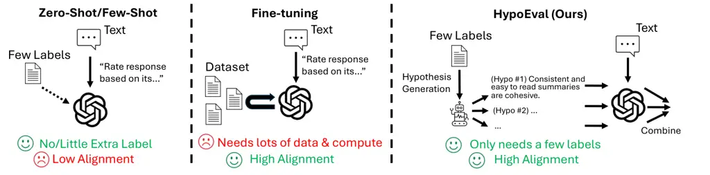

# HypoEval: Hypothesis-Guided Evaluation for Natural Language Generation

Mingxuan Li    Hanchen Li    Chenhao Tan Affiliation: Department of
Computer Science Affiliation: University of Chicago
Affiliation: Chicago, IL 60637, USA Affiliation: {mingxuanl, lihanc2002,
chenhao}@uchicago.edu

###### Abstract

Large language models (LLMs) have demonstrated great potential for
automating the evaluation of natural language generation. Previous
frameworks of LLM-as-a-judge fall short in two ways: they either use
zero-shot setting without consulting any human input, which leads to low
alignment, or fine-tune LLMs on labeled data, which requires a
non-trivial number of samples. Moreover, previous methods often provide
little reasoning behind automated evaluations. In this paper, we propose
HypoEval, Hypothesis-guided Evaluation framework, which first uses a
small corpus of human evaluations to generate more detailed rubrics for
human judgments and then incorporates a checklist-like approach to
combine LLM’s assigned scores on each decomposed dimension to acquire
overall scores. With only 30 human evaluations, HypoEval achieves
state-of-the-art performance in alignment with both human rankings
(Spearman correlation) and human scores (Pearson correlation), on
average outperforming G-Eval by 11.86% and fine-tuned
Llama-3.1-8B-Instruct with at least 3 times more human evaluations by
11.95%. Furthermore, we conduct systematic studies to assess the
robustness of HypoEval, highlighting its effectiveness as a reliable and
interpretable automated evaluation framework.¹

¹¹footnotetext: Code available at
[https://github.com/ChicagoHAI/HypoEval-Gen](https://github.com/ChicagoHAI/HypoEval-Gen).
We also provide off-the-shelf 0-shot evaluators for summarization and
story generation at
[https://github.com/ChicagoHAI/HypoEval](https://github.com/ChicagoHAI/HypoEval).

## 1 Introduction

Automated evaluation of natural language generation has been an
important and challenging task with the rapid development of automated
systems for summarization, translation, open-ended story generation, and
more (Fang et al., 2024; Yao et al., 2024). Traditional lexical metrics
such as BLEU (Papineni et al., 2002) and ROUGE (Lin, 2004) have been
shown to have low agreement with human judgments (Krishna et al., 2021).
With the advancements of large language models (LLMs), recent research
has extensively focused on LLM-as-a-judge, or using LLMs to perform
reference-free automated evaluations of natural language generation
(Chen et al., 2023; Fu et al., 2023; Gu et al., 2025).

Following Li et al. (2025), we broadly categorize existing LLM-based
automated evaluation frameworks into prompting-based and tuning-based
methods. On one hand, prompting-based evaluation methods such as G-Eval
(Liu et al., 2023a) mostly use a zero-shot approach, which imposes a
strict yet unnecessary restriction on the use of human evaluations or
groundings. As a result, they lead to limited correlations with human
annotations and leave room for improvement (Bavaresco et al., 2024;
Krumdick et al., 2025). On the other hand, tuning-based methods (Yue
et al., 2023; Liu et al., 2024a) require a large corpus of high-quality
training data, with performance constrained to the specific dataset that
they are trained on (Liu et al., 2025b), and can be computationally
expensive or hard to apply to proprietary models. Furthermore, both
categories of methods often lack explainability in their evaluation
process. Although recent works on checklist-based frameworks for
evaluating instruction-following or factuality (Que et al., 2024; Min
et al., 2023; Tan et al., 2024) shed light on providing reasoning behind
evaluations, their performance on evaluating other aspects of text
generation can be inferior to non-checklist frameworks (Lee et al.,
2024). This can be due to the fundamental difficulty of decomposing
subjective aspects (e.g., engagement) of texts into atomic and
easy-to-verify checklists.

To address these limitations, we propose HypoEval, the first LLM-based
evaluation framework that combines state-of-the-art hypothesis
generation techniques to guide judge LLMs and improve human alignment.
HypoEval consists of a light training stage for hypothesis generation
and then uses hypotheses to provide evaluation scores. With a small
corpus of human evaluation scores (in our implementation, we limit the
number to 30), HypoEval first uses a hypothesis generation framework to
generate high-quality hypotheses, which are framed as decomposed
dimensions for evaluation, from human evaluation results and existing
literature on evaluation. The decomposed dimensions serve as rubrics and
break down a subjective aspect of evaluation into different attributes
that are easier for an LLM to understand. Then in the evaluation stage,
with each decomposed dimension formulated as a non-binary checklist
(i.e., the answer to the checklist can be a range of numbers on the
Likert scale), HypoEval combines an evaluator LLM’s assigned scores on
each decomposed dimension and gets an overall score for an evaluated
text. We show that with only small-scale human evaluations and $`O(N)`$
computational complexity, HypoEval is able to achieve state-of-the-art
performance on representative tasks: on average outperforming G-Eval by
11.86% and fine-tuned Llama-3.1-8B-Instruct- with more than 3 times more
human evaluation scores - by 11.95%.



Figure 1: A Comparison between previous methods and HypoEval. We achieve
high-alignment and explainable evaluation with only a few human labels
per dataset.

To summarize, our main contributions are as follows:

- •
  We introduce HypoEval, a tuning-free, sample-efficient framework for
  evaluating natural language generation.
- •
  We demonstrate that HypoEval achieves state-of-the-art performance in
  terms of correlation with human judgments across multiple datasets.
- •
  With the generated hypotheses or decomposed dimensions in HypoEval, we
  provide more interpretable explanations in automated evaluations than
  previous methods.

## 2 Methods

We first give a formulation of hypothesis-guided text evaluation. In
direct scoring, we evaluate on an input-output pair $`(x,y)`$, where
$`x`$ is the prompt for generation (e.g. source text for summarization),
and $`y`$ is the generated content (e.g. summary). With an LLM
$`\mathcal{M}`$ and an instruction prompt $`I`$ that consists of task
descriptions and definition of the evaluated aspect (e.g. coherence of
summaries), we want to produce a score $`{\mathcal{M}}(x,y,I)`$ that
matches human score $`s`$ well (usually measured in Pearson or Spearman
correlation).

In hypothesis-guided text evaluation, we first generate a hypothesis
bank $`\mathcal{H}=\{h_{1},h_{2},\dots,h_{n}\}`$ from a training set
$`S_{\text{tr}}=\{(x_{1},y_{1},s_{1}),\dots,(x_{m},y_{m},s_{m})\}`$ and
a corpus of summaries $`\mathcal{L}`$ of relevant literature, where
$`x_{i}`$ and $`y_{i}`$ are inputs and outputs, and $`s_{i}`$ are scores
given by human experts on $`(x_{i},y_{i})`$. Here, each hypothesis is
formulated as a rubric on a decomposed dimension. Ideally, the
hypothesis bank $`\mathcal{H}`$ contains multiple decomposed dimensions
that human experts consider when giving the scores in
$`\mathcal{S}_{\text{tr}}`$. Then, we use a checklist-like approach to
use the hypotheses to evaluate on unseen sample $`(x,y)`$ and give a
score $`{\mathcal{M}}(x,y,I,\mathcal{H})`$.

#### Hypothesis Generation from Small-scale Data and Literature

Following HypoGeniC (Zhou et al., 2024b) and HypoRefine (Liu et al.,
2025a), we utilize both data-driven and literature-driven hypothesis
generation approaches to generate the hypothesis bank $`\mathcal{H}`$.
That is, with an LLM $`\mathcal{M}`$ and hypothesis generation algorithm
$`g`$, we have
$`\mathcal{H}=g_{\mathcal{M}}(S_{\text{tr}},\mathcal{L})`$.

Specifically, we build upon HypoRefine and introduce extensions tailored
for continuous value prediction. Given a small-scale training set
$`S_{\text{tr}}=\{(x_{1},y_{1},s_{1}),\dots,(x_{m},y_{m},s_{m})\}`$ (for
main experiments, we set $`|S_{\text{tr}}|=30`$) and the corpus of
summaries of relevant literature $`\mathcal{L}`$ (details of literature
collection and summary generation in Section B.1), we first want to
generate a hypothesis bank $`\mathcal{H}`$. During the initial stage, an
LLM-based hypothesis generation agent $`\mathcal{M}_{G}`$ is prompted
with a set of initial data points
$`S_{\text{init}}\subset S_{\text{tr}}`$ and $`\mathcal{L}`$ to generate
an initial hypothesis bank
$`\mathcal{H}^{\text{init}}=\mathcal{M}_{G}(S_{\text{init}},\mathcal{L})`$,
and set $`\mathcal{H}^{0}=\mathcal{H}^{\text{init}}`$. Inspired by the
Upper Confidence Bound algorithm for strategic regression (Liu & Chen,
2016), for each $`h\in\mathcal{H}^{0}`$, we use an evaluator
$`\mathcal{M}_{E}`$ to evaluate on all $`(x_{i},y_{i})`$ in
$`S_{\text{init}}`$ based on the detailed rubric stated in $`h`$ and
give a score $`{\mathcal{M}_{E}}(x_{i},y_{i},I,h)`$, where $`I`$ is the
instruction prompt. Then, we set the reward for $`h`$ by:

```math
r_{h}\coloneqq\frac{1}{|S_{\text{init}}|}\sum_{(x_{j},y_{j},s_{j})\in S_{\text{init}}}(a-b(s_{j}-{\mathcal{M}_{E}}(x_{j},y_{j},I,h))^{2})+\alpha\sqrt{\frac{\log|S_{\text{init}}|}{|S_{\text{init}}|}}
```

where $`\alpha`$ is the reward coefficient that controls the exploration
term of the reward function, and $`a`$, $`b`$ are coefficients that
control the range of the exploitation term.

In the update stage, we iterate over all data points in
$`S_{\text{update}}=S_{\text{tr}}\setminus S_{\text{init}}`$. For time
$`t`$, we consider the training sample
$`(x_{t},y_{t},s_{t})\in S_{\text{update}}`$. We first choose the top
$`k`$ hypotheses $`\mathcal{H}_{\text{top}}`$ with the highest reward
from $`\mathcal{H}^{t-1}`$. Then for each
$`h\in\mathcal{H}_{\text{top}}`$, we update the reward with:

```math
r_{h}\coloneqq\frac{1}{|S_{h}^{t}|}\sum_{(x_{j},y_{j},s_{j})\in S_{h}^{t}}(a-b(s_{j}-{\mathcal{M}_{E}}(x_{j},y_{j},I,h))^{2})+\alpha\sqrt{\frac{\log(t+|S_{\text{init}}|)}{|S_{h}^{t}|}}
```

where $`S_{h}^{t}`$ is the set of training samples seen by hypothesis
$`h`$ at time $`t`$.

For all hypotheses from $`\mathcal{H}_{\text{top}}`$, if at least
$`w_{\text{hyp}}`$ predicted a score with
$`|{\mathcal{M}_{E}}(x_{t},y_{t},I,h)-s_{t}|>\theta`$, where $`\theta`$
is the threshold for identifying a wrong prediction, the datapoint
$`(x_{t},y_{t},s_{t})`$ is added to a wrong sample bank $`\mathcal{W}`$.
Once $`|\mathcal{W}|\geq w_{\text{max}}`$, a new set of hypotheses
$`\mathcal{H}_{\mathcal{W}}`$ is generated using $`\mathcal{W}`$ and
$`\mathcal{L}`$ by an iterative refinement process:

```math
\displaystyle\mathcal{H}_{\mathcal{W}}^{0} \displaystyle=\mathcal{M}_{G}(\mathcal{W}),
```

```math
\displaystyle\mathcal{H}_{\mathcal{W}}^{i},i>0 \displaystyle=\begin{cases}\mathcal{M}_{R}(\mathcal{H}_{\mathcal{W}}^{i-1},\mathcal{L})&\text{if }i\bmod 2=0\\
\mathcal{M}_{R}(\mathcal{H}_{\mathcal{W}}^{i-1},\mathcal{W})&\text{if }i\bmod 2=1.\end{cases}
```

The refinement finishes in $`N_{\operatorname{refine}}`$ rounds, and we
get
$`\mathcal{H}_{\mathcal{W}}=\mathcal{H}_{\mathcal{W}}^{N_{\operatorname{refine}}}`$.
The wrong sample bank $`\mathcal{W}`$ is set to $`\emptyset`$
afterwards. For $`\mathcal{H}^{t}`$, we choose $`H_{\text{max}}`$
hypotheses with the highest reward from
$`\mathcal{H}_{\text{top}}\cup\mathcal{H}_{\mathcal{W}}`$.

Following Liu et al. (2025a), to accommodate for that literature-based
hypotheses can be undervalued during the update stage, we use a union
approach to combine hypotheses from literature only
$`\mathcal{H}_{\mathcal{L}}=\mathcal{M}_{G}(\mathcal{L})`$ and
$`\mathcal{H}^{|S_{\text{update}}|}`$. Specifically, for a final
hypothesis bank with size $`H_{\text{max}}`$, we first remove redundant
hypotheses from
$`\mathcal{H}_{\mathcal{L}}=\mathcal{M}_{G}(\mathcal{L})`$ and
$`\mathcal{H}^{|S_{\text{update}}|}`$, and then randomly choose at most
$`\frac{H_{\text{max}}}{2}`$ from each of them for the final hypothesis
bank $`\mathcal{H}`$.

#### Hypothesis selection.

Since that we are encouraging diverse and novel hypotheses in the
hypothesis generation process by both the exploration term in reward and
the incorporation of information from literature, it is possible that we
also include some hypotheses that are interesting but are not suitable
for a specific evaluation task. To accommodate this, we perform
hypothesis selection from $`\mathcal{H}`$ based on the hypotheses’
performance on $`S_{\text{tr}}`$.

Specifically, we choose the top $`H_{\text{eval}}`$ hypotheses with the
highest Pearson correlations with human scores on $`S_{\text{tr}}`$:

```math
\mathcal{H}_{\text{eval}}=\arg\max_{\mathcal{H}^{\prime}\subset\mathcal{H},|\mathcal{H}^{\prime}|=H_{\text{eval}}}\sum_{h\in\mathcal{H}^{\prime}}r(h,S_{\text{tr}}),
```

where $`r(h,S_{\text{tr}})`$ is the Pearson correlation between the
human scores and the scores given by the evaluator agent
$`\mathcal{M}_{E}`$ based specifically on the decomposed dimension
stated in $`h`$.

#### Hypothesis-guided text evaluation

For each hypothesis $`h`$, we first evaluate the text based solely on
the dimension entailed in $`h`$ (e.g. logical structure of events for
evaluating coherence of summaries) with chain-of-thought prompting (Wei
et al., 2022). The evaluator $`\mathcal{M}_{E}`$ is asked to give a
score rating between 1 and 5. Then, since different hypotheses in
$`\mathcal{H}_{\text{eval}}`$ often entail different decomposed
dimensions that are important for a holistic evaluation, we combine the
scores on all hypotheses to acquire the final overall score for a
sample:

```math
\mathcal{M}_{E}(x,y,I,\mathcal{H}_{\text{eval}})=\frac{1}{|\mathcal{H}_{\text{eval}}|}\sum_{h\in\mathcal{H}_{\text{eval}}}\mathcal{M}_{E}(x,y,I,h).
```

For more detailed information of the implementation, please refer to
Section B.1.

#### Efficiency Analysis

The computational complexity of HypoEval can be separated into two
parts: a preparation stage of hypothesis generation and selection, and
an evaluation stage of hypothesis-guided automated evaluation. Let $`N`$
be the total number of texts to be evaluated. For the preparation stage,
the complexity of hypothesis generation can be expressed as
$`O(N_{\text{paper}}+(k+N_{\text{refine}})|S_{\text{tr}}|+H_{\text{max}}^{2})`$,
where $`N_{\text{paper}}`$ is the number of papers as relevant
literature, and the complexity of hypothesis selection is
$`O(H_{\text{max}}|S_{\text{tr}}|)`$. For the evaluation stage,
computational complexity is $`O(H_{\text{eval}}N)`$. Under our setting
where
$`S_{\text{tr}},k,N_{\text{refine}},N_{\text{paper}},H_{\text{max}}\leq 30`$
and $`H_{\text{eval}}=5`$, the total complexity of HypoEval can be
expressed as $`O(N)`$ and is equivalent to other pointwise evaluators.

## 3 Experiment Setup

To demonstrate the effectiveness of our hypothesis-guided evaluation
framework, we first compare our method with baselines on two NLG tasks
with four datasets. We report both Spearman correlation and Pearson
correlation to account for both alignment with human rankings and with
human scores.

#### Tasks and datasets.

We report two representative tasks, summarization and open-ended story
generation, to evaluate our framework.

For the summarization task, we choose SummEval (Fabbri et al., 2021) and
NewsRoom (Grusky et al., 2020) for our experiments. SummEval consists of
100 source texts, each with 16 summaries generated by different models,
and is annotated on four aspects: coherence (CH), consistency (CON),
fluency (FLU), and relevance (RE). We use the average of annotation
scores of 3 human experts. NewsRoom has 60 source texts and 7 summaries
for each text, and is annotated on four aspects: coherence (CH),
informativeness (INF), fluency (FLU), and relevance (RE). For each
dataset, we randomly sample 30 source text-summary pairs and their human
evaluation scores as training data, and perform automated evaluation on
summaries of 40 source texts for SummEval and summaries of 30 source
texts for NewsRoom, with a total of 640 and 210 summaries, respectively.
Following (Liu et al., 2023a), we report summary-level Spearman
correlations and Pearson correlations.

For the open-ended story generation task, we use HANNA (Chhun et al., 2022) and part of WritingPrompt (WritingPrompt-A) with human annotations
collected by Chiang & yi Lee (2023). HANNA includes 96 writing prompts,
each with 11 stories annotated on 6 aspects: coherence (CH), complexity
(CX), empathy (EM), engagement (EG), relevance (RE), and surprise (SU).
WritingPrompt-A consists of 400 prompt-story pairs, each annotated on
grammaticality (GRA), cohesiveness (COH), likability (LIK), and
relevance (RE). For both datasets, we choose 30 prompt-story pairs for
training. For HANNA, we randomly select 60 prompts, each with 11
stories, for testing, and report story-level Spearman correlations and
Pearson correlations. For WritingPrompt-A, we choose 300 prompt-story
pairs for testing. Due to the lack of story batches grouped by the same
prompts, we report dataset-level Spearman correlations and Pearson
correlations.

#### Baselines and implementation.

We largely characterize baselines into two categories: zero-shot
evaluators that do not consult human evaluations, and data-augmented
evaluators that utilize specific datasets or are trained on specific
tasks.

For zero-shot evaluators, we include ROUGE-L (Lin, 2004), BERTScore
(Zhang et al., 2020), G-Eval (Liu et al., 2023a) with probabilities and
automatically generated chain-of-thought (CoT) prompting, and direct
scoring (evaluator LLM assigns a score directly to a text) with CoT. We
also consider PairS-beam (Liu et al., 2025b), a pairwise ranking
evaluator, for comparison in Spearman correlation. For comparison with
other checklist-based approaches, we implemented CheckEval, (Lee et al., 2024) on own, because human-curated key components for each aspect were
used in the original paper but not released. We leverage the LLM’s prior
knowledge to generate atomic checklists.

For data-augmented evaluators, we include UniEval (Zhong et al., 2022)
and BARTScore (Yuan et al., 2021), which are task-specific evaluators
trained with large corpora of data. We also fine-tune
Llama-3.1-8B-Instruct on each aspect of each dataset with 30 (FT-A) and
200 (FT-B) human-annotated data points. Due to the use of significantly
larger amount of training data than HypoEval, we regard UniEval,
BARTScore, and FT-B as strong but not directly comparable methods.
Furthermore, we consider direct scoring with few-shot demonstrations
from human-annotated data. For the WritingPrompt-A dataset, due to its
size (see Section 3) and the lack of references, we implement FT-B with
100 human evaluations and omit the performance of reference-based
evaluators. Implementation details of baselines are available in
Section B.2.

Our framework works for any LLM $`\mathcal{M}`$. In the experiments, we
utilize two models, GPT-4o-mini (OpenAI, 2023) and
Llama-3.3-70B-Instruct (Dubey et al., 2024) to reflect a range of
different model sizes. We abbreviate GPT-4o-mini as GPT-mini and
Llama-3.3-70B-Instruct as Llama-70B. For main experiments, we let
$`H_{\text{eval}}=5`$, and the evaluator model $`\mathcal{M}_{E}`$ is
the same as the hypothesis generator model $`\mathcal{M}_{G}`$.

|           |                  |          |       |          |       |          |       |          |       |          |       |          |       |          |       |          |       |
| --------- | ---------------- | -------- | ----- | -------- | ----- | -------- | ----- | -------- | ----- | -------- | ----- | -------- | ----- | -------- | ----- | -------- | ----- |
|           |                  | SummEval |       |          |       |          |       |          |       | NewsRoom |       |          |       |          |       |          |       |
| Models    | Methods          | CH       |       | CON      |       | FLU      |       | RE       |       | CH       |       | INF      |       | FLU      |       | RE       |       |
|           |                  | $`\rho`$ | $`r`$ | $`\rho`$ | $`r`$ | $`\rho`$ | $`r`$ | $`\rho`$ | $`r`$ | $`\rho`$ | $`r`$ | $`\rho`$ | $`r`$ | $`\rho`$ | $`r`$ | $`\rho`$ | $`r`$ |
| Other     | ROUGE-L          | 0.10     | 0.12  | 0.14     | 0.18  | 0.09     | 0.12  | 0.19     | 0.20  | 0.08     | -0.11 | 0.08     | -0.08 | 0.07     | -0.10 | 0.08     | -0.06 |
|           | BERTScore        | 0.26     | 0.27  | 0.21     | 0.21  | 0.18     | 0.17  | 0.38     | 0.40  | 0.31     | 0.18  | 0.31     | 0.20  | 0.33     | 0.17  | 0.28     | 0.18  |
|           | BARTScore        | 0.47     | 0.50  | 0.26     | 0.25  | 0.25     | 0.25  | 0.35     | 0.35  | 0.66     | 0.72  | 0.59     | 0.75  | 0.64     | 0.70  | 0.56     | 0.74  |
|           | UniEval          | 0.56     | 0.51  | 0.47     | 0.63  | 0.39     | 0.47  | 0.43     | 0.42  | –        | –     | –        | –     | –        | –     | –        | –     |
|           | FT-A             | 0.47     | 0.48  | 0.38     | 0.40  | 0.31     | 0.39  | 0.40     | 0.40  | 0.50     | 0.51  | 0.53     | 0.56  | 0.58     | 0.59  | 0.48     | 0.56  |
|           | FT-B             | 0.57     | 0.59  | 0.57     | 0.61  | 0.46     | 0.57  | 0.46     | 0.47  | 0.61     | 0.62  | 0.69     | 0.72  | 0.61     | 0.63  | 0.61     | 0.71  |
| GPT-mini  |                  |          |       |          |       |          |       |          |       |          |       |          |       |          |       |          |       |
|           | direct scoring   | 0.50     | 0.49  | 0.54     | 0.62  | 0.22     | 0.23  | 0.47     | 0.51  | 0.51     | 0.51  | 0.47     | 0.46  | 0.59     | 0.59  | 0.46     | 0.44  |
|           | few-shot scoring | 0.37     | 0.38  | 0.47     | 0.49  | 0.33     | 0.35  | 0.42     | 0.44  | 0.60     | 0.61  | 0.57     | 0.62  | 0.65     | 0.67  | 0.53     | 0.60  |
|           | G-Eval           | 0.54     | 0.54  | 0.51     | 0.65  | 0.31     | 0.30  | 0.47     | 0.55  | 0.59     | 0.53  | 0.58     | 0.52  | 0.63     | 0.62  | 0.51     | 0.44  |
|           | PairS-beam       | 0.52     | –     | 0.53     | –     | 0.31     | –     | 0.49     | –     | 0.53     | –     | 0.61     | –     | 0.43     | –     | 0.55     | –     |
|           | CheckEval        | 0.47     | 0.47  | 0.34     | 0.36  | 0.39     | 0.38  | 0.39     | 0.43  | 0.53     | 0.56  | 0.34     | 0.42  | 0.57     | 0.57  | 0.46     | 0.52  |
|           | HypoEval         | 0.58     | 0.58  | 0.51     | 0.63  | 0.40     | 0.45  | 0.54     | 0.58  | 0.64     | 0.69  | 0.62     | 0.75  | 0.67     | 0.69  | 0.60     | 0.78  |
| Llama-70B |                  |          |       |          |       |          |       |          |       |          |       |          |       |          |       |          |       |
|           | direct scoring   | 0.56     | 0.57  | 0.56     | 0.64  | 0.33     | 0.34  | 0.47     | 0.50  | 0.51     | 0.48  | 0.46     | 0.51  | 0.58     | 0.53  | 0.43     | 0.48  |
|           | few-shot scoring | 0.45     | 0.45  | 0.61     | 0.67  | 0.40     | 0.47  | 0.47     | 0.48  | 0.59     | 0.60  | 0.63     | 0.68  | 0.60     | 0.62  | 0.51     | 0.69  |
|           | G-Eval           | 0.61     | 0.57  | 0.51     | 0.68  | 0.41     | 0.48  | 0.52     | 0.49  | 0.53     | 0.57  | 0.57     | 0.59  | 0.54     | 0.55  | 0.51     | 0.65  |
|           | PairS-beam       | 0.60     | –     | 0.54     | –     | 0.37     | –     | 0.50     | –     | 0.58     | –     | 0.65     | –     | 0.58     | –     | 0.59     | –     |
|           | CheckEval        | 0.56     | 0.58  | 0.43     | 0.45  | 0.45     | 0.45  | 0.47     | 0.50  | 0.40     | 0.42  | 0.32     | 0.34  | 0.30     | 0.30  | 0.48     | 0.59  |
|           | HypoEval         | 0.63     | 0.63  | 0.49     | 0.62  | 0.35     | 0.35  | 0.54     | 0.56  | 0.62     | 0.65  | 0.65     | 0.74  | 0.65     | 0.64  | 0.52     | 0.73  |

|           |                  |          |       |          |       |          |       |          |       |          |       |          |       |                 |       |          |       |          |       |          |       |
| --------- | ---------------- | -------- | ----- | -------- | ----- | -------- | ----- | -------- | ----- | -------- | ----- | -------- | ----- | --------------- | ----- | -------- | ----- | -------- | ----- | -------- | ----- |
|           |                  | HANNA    |       |          |       |          |       |          |       |          |       |          |       | WritingPrompt-A |       |          |       |          |       |          |       |
| Models    | Methods          | CH       |       | CX       |       | EM       |       | EG       |       | RE       |       | SU       |       | GRA             |       | COH      |       | LIK      |       | RE       |       |
|           |                  | $`\rho`$ | $`r`$ | $`\rho`$ | $`r`$ | $`\rho`$ | $`r`$ | $`\rho`$ | $`r`$ | $`\rho`$ | $`r`$ | $`\rho`$ | $`r`$ | $`\rho`$        | $`r`$ | $`\rho`$ | $`r`$ | $`\rho`$ | $`r`$ | $`\rho`$ | $`r`$ |
| Other     | ROUGE-L          | 0.17     | 0.23  | 0.26     | 0.29  | 0.15     | 0.16  | 0.21     | 0.24  | 0.10     | 0.09  | 0.16     | 0.17  | –               | –     | –        | –     | –        | –     | –        | –     |
|           | BERTScore        | 0.30     | 0.36  | 0.42     | 0.48  | 0.28     | 0.31  | 0.34     | 0.39  | 0.17     | 0.18  | 0.26     | 0.26  | –               | –     | –        | –     | –        | –     | –        | –     |
|           | BARTScore        | –        | –     | –        | –     | –        | –     | –        | –     | –        | –     | –        | –     | –               | –     | –        | –     | –        | –     | –        | –     |
|           | UniEval          | –        | –     | –        | –     | –        | –     | –        | –     | –        | –     | –        | –     | –               | –     | –        | –     | –        | –     | –        | –     |
|           | FT-A             | 0.40     | 0.46  | 0.37     | 0.42  | 0.32     | 0.37  | 0.35     | 0.41  | 0.43     | 0.48  | 0.17     | 0.20  | 0.29            | 0.28  | 0.34     | 0.30  | 0.22     | 0.22  | 0.53     | 0.52  |
|           | FT-B             | 0.40     | 0.45  | 0.52     | 0.58  | 0.38     | 0.43  | 0.44     | 0.51  | 0.46     | 0.52  | 0.33     | 0.39  | 0.37            | 0.36  | 0.51     | 0.49  | 0.36     | 0.36  | 0.59     | 0.58  |
| GPT-mini  |                  |          |       |          |       |          |       |          |       |          |       |          |       |                 |       |          |       |          |       |          |       |
|           | direct scoring   | 0.47     | 0.59  | 0.51     | 0.54  | 0.35     | 0.41  | 0.49     | 0.56  | 0.48     | 0.59  | 0.37     | 0.45  | 0.47            | 0.40  | 0.56     | 0.51  | 0.41     | 0.38  | 0.63     | 0.63  |
|           | few-shot scoring | 0.47     | 0.55  | 0.44     | 0.47  | 0.40     | 0.47  | 0.46     | 0.51  | 0.42     | 0.51  | 0.36     | 0.42  | 0.40            | 0.41  | 0.55     | 0.54  | 0.42     | 0.39  | 0.65     | 0.65  |
|           | G-Eval           | 0.48     | 0.62  | 0.53     | 0.56  | 0.41     | 0.47  | 0.46     | 0.55  | 0.49     | 0.61  | 0.38     | 0.48  | 0.53            | 0.48  | 0.58     | 0.55  | 0.43     | 0.40  | 0.66     | 0.66  |
|           | PairS-beam       | 0.39     | –     | 0.51     | –     | 0.43     | –     | 0.48     | –     | 0.39     | –     | 0.38     | –     | 0.20\*          | –     | 0.57     | –     | 0.48     | –     | 0.09\*   | –     |
|           | CheckEval        | 0.46     | 0.55  | 0.40     | 0.41  | 0.37     | 0.40  | 0.46     | 0.50  | 0.52     | 0.57  | 0.26     | 0.27  | 0.17            | 0.17  | 0.58     | 0.59  | 0.29     | 0.30  | 0.67     | 0.67  |
|           | HypoEval         | 0.55     | 0.67  | 0.55     | 0.61  | 0.50     | 0.57  | 0.54     | 0.63  | 0.49     | 0.62  | 0.38     | 0.45  | 0.54            | 0.53  | 0.64     | 0.60  | 0.53     | 0.52  | 0.70     | 0.68  |
| Llama-70B |                  |          |       |          |       |          |       |          |       |          |       |          |       |                 |       |          |       |          |       |          |       |
|           | direct scoring   | 0.49     | 0.59  | 0.45     | 0.46  | 0.40     | 0.46  | 0.42     | 0.48  | 0.46     | 0.55  | 0.30     | 0.33  | 0.45            | 0.44  | 0.58     | 0.58  | 0.27     | 0.24  | 0.63     | 0.63  |
|           | few-shot scoring | 0.52     | 0.62  | 0.54     | 0.56  | 0.43     | 0.46  | 0.48     | 0.51  | 0.44     | 0.50  | 0.35     | 0.35  | 0.42            | 0.40  | 0.59     | 0.57  | 0.37     | 0.36  | 0.62     | 0.61  |
|           | G-Eval           | 0.53     | 0.65  | 0.49     | 0.53  | 0.37     | 0.44  | 0.45     | 0.52  | 0.48     | 0.57  | 0.37     | 0.44  | 0.47            | 0.45  | 0.61     | 0.61  | 0.24     | 0.19  | 0.65     | 0.63  |
|           | PairS-beam       | 0.47     | –     | 0.55     | –     | 0.46     | –     | 0.46     | –     | 0.46     | –     | 0.42     | –     | 0.26\*          | –     | 0.57     | –     | 0.49     | –     | 0.04\*   | –     |
|           | CheckEval        | 0.38     | 0.51  | 0.40     | 0.39  | 0.45     | 0.48  | 0.38     | 0.47  | 0.48     | 0.57  | 0.24     | 0.23  | 0.41            | 0.37  | 0.63     | 0.62  | 0.50     | 0.48  | 0.66     | 0.66  |
|           | HypoEval         | 0.54     | 0.67  | 0.56     | 0.66  | 0.47     | 0.54  | 0.52     | 0.60  | 0.51     | 0.63  | 0.40     | 0.50  | 0.44            | 0.41  | 0.63     | 0.62  | 0.53     | 0.51  | 0.69     | 0.68  |

Table 1: Evaluation results of GPT-4o-mini and Llama-3.3-70B-Instruct.
We report Spearman correlation ($`\rho`$) and Pearson correlation
($`r`$) for a total of 18 aspects of the 4 datasets. Some especially
lower performance of PairS-beam marked with \* is due to that the model
frequently failed to generate pairwise preferences.

## 4 Results

Table 1 presents the main results across a total of 18 aspect-dataset
settings. Comparing with baselines without large-scale tuning, HypoEval
with GPT-4o-mini achieves state-of-the-art (SOTA) performance on 15
settings with Spearman correlation and 16 settings with Pearson
correlation, on average outperforming G-Eval with CoT by 9.8% and 15.7%
respectively; HypoEval with Llama-3.3-70B-Instruct achieves SOTA on 13
settings for Spearman correlation and 15 settings for Pearson
correlation, outperforming G-Eval by 9.9% and 11.8% respectively.

Some exceptions, such as the consistency and fluency aspects of
SummEval, could be due to the human scores being highly skewed towards
5, illustrated in Appendix D.

In addition, though HypoEval is not explicitly optimized for ranking or
pairwise comparison, it still outperforms the ranking-based evaluator
PairS-beam on 16/18 and 13/18 settings for GPT-4o-mini and
Llama-3.3-70B-Instruct respectively.

Comparing with tuning-based evaluators that use at least more than 3
times more annotated data (FT-B, BARTScore, UniEval), HypoEval still
demonstrates strong performance. For the story generation task, HypoEval
with GPT-4o-mini or Llama-3.3-70B-Instruct outperforms FT-B across all
settings. For the summarization task, HypoEval on average outperforms
BARTScore by 18.66%; after excluding the exceptions of the consistency
and fluency aspects of SummEval, HypoEval on average outperforms FT-B by
4.8%.

To further illustrate our method, we include examples of hypotheses in
Table 2. As demonstrated by the coherence aspect of SummEval in the
table, these different hypotheses cover different decomposed dimensions
of what a human would consider. For example, the first hypothesis covers
that the answer should be "logically organized, with a clear
introduction, body, and conclusion"; the second hypothesis highlights
the "consistent tone and style", and the third one contains that the
answer should not introduce "unrelated themes or topics". We include
full versions of more examples in Appendix C.

| Example Hypotheses (Decomposed Dimensions) on SummEval - CH                                                                                                                                                                                   |
| --------------------------------------------------------------------------------------------------------------------------------------------------------------------------------------------------------------------------------------------- |
| - The overall structure and organization of the summary play a vital role in determining coherence scores. Summaries that are logically organized, with a clear introduction, body, and conclusion, will score higher (4 or 5), while those … |
| - Summaries that maintain a consistent tone and style throughout will be rated higher for coherence (4 or 5), as this consistency aids in reader comprehension. In contrast, …                                                                |
| - The thematic consistency of a summary is essential for achieving higher coherence scores. A summary that introduces multiple unrelated themes or topics, resulting in confusion and lack of focus, would likely receive a score of one. …   |
| Example Hypotheses (Decomposed Dimensions) on HANNA - EG                                                                                                                                                                                      |
| - The originality and creativity of the story’s premise and execution are crucial for engagement. A score of 1 is given to stories that are entirely derivative, relying on clichés and predictable plots …                                   |
| - The clarity and coherence of the narrative structure will significantly affect engagement scores. A score of 1 will be assigned to stories that are chaotic and incoherent …                                                                |
| - Stories that are overly simplistic and fail to follow the prompt effectively will receive a score of 1, while those that showcase original ideas and a compelling narrative voice will receive a score of 5.                                |

Table 2: Example hypotheses for the coherence (CH) aspect of SummEval
and the engagement (EG) aspect of HANNA, generated by GPT-4o-mini. Each
hypothesis is formulated as an evaluation rubric on a specific
decomposed dimension for the aspect.

#### Ablation Studies

To evaluate the effectiveness of both the hypothesis generation stage
and the hypothesis-guided evaluation stage, we conduct two ablation
studies. We first study the performance of HypoEval when hypothesis
generation from human evaluations and relevant literature is replaced by
hypothesis generation purely from an LLM’s prior knowledge.
Specifically, we consider 0-shot hypothesis generation, where we
directly prompt LLM $`\mathcal{M}`$ to generate $`H_{\text{eval}}`$
hypotheses for evaluating specific aspects of a text generation task,
and then perform hypothesis-guided text evaluation.

We also study the effectiveness of the hypothesis-guided evaluation
stage that first uses different hypotheses to generate scores and then
combines them with a checklist-like approach. Specifically, we test
against a pipeline similar to Liu et al. (2023b), where we concatenated
all $`H_{\text{eval}}`$ hypotheses after the hypothesis selection stage
into one single criterion and let the evaluator model directly assign
scores on a given text based on the criterion.

As shown in Table 3, we observe performance drops in most settings when
either the hypothesis generation stage or the hypothesis-guided
evaluation stage is removed. On average across both models, all
settings, and both correlations, replacing the hypothesis generation
stage by 0-shot generation drops performance by 7.25%, replacing the
hypothesis-guided evaluation stage with single criterion drops the
performance by 8.19%.

|           |                   | SummEval            |                     |                     |                     |                     |                     |                     |                     | NewsRoom            |                     |                     |                     |                     |                     |                     |                     |
| --------- | ----------------- | ------------------- | ------------------- | ------------------- | ------------------- | ------------------- | ------------------- | ------------------- | ------------------- | ------------------- | ------------------- | ------------------- | ------------------- | ------------------- | ------------------- | ------------------- | ------------------- |
| Models    | Methods           | CH                  |                     | CON                 |                     | FLU                 |                     | RE                  |                     | CH                  |                     | INF                 |                     | FLU                 |                     | RE                  |                     |
|           |                   | $`\rho`$            | $`r`$               | $`\rho`$            | $`r`$               | $`\rho`$            | $`r`$               | $`\rho`$            | $`r`$               | $`\rho`$            | $`r`$               | $`\rho`$            | $`r`$               | $`\rho`$            | $`r`$               | $`\rho`$            | $`r`$               |
| GPT-mini  |                   |                     |                     |                     |                     |                     |                     |                     |                     |                     |                     |                     |                     |                     |                     |                     |                     |
|           | HypoEval          | 0.58                | 0.58                | 0.51                | 0.62                | 0.40                | 0.45                | 0.54                | 0.58                | 0.64                | 0.69                | 0.62                | 0.75                | 0.67                | 0.69                | 0.60                | 0.78                |
|           | 0-shot generation | 0.55 $`\downarrow`$ | 0.56 $`\downarrow`$ | 0.49 $`\downarrow`$ | 0.58 $`\downarrow`$ | 0.37 $`\downarrow`$ | 0.40 $`\downarrow`$ | 0.54 $`=`$          | 0.56 $`\downarrow`$ | 0.59 $`\downarrow`$ | 0.64 $`\downarrow`$ | 0.63 $`\uparrow`$   | 0.71 $`\downarrow`$ | 0.58 $`\downarrow`$ | 0.61 $`\downarrow`$ | 0.57 $`\downarrow`$ | 0.72 $`\downarrow`$ |
|           | Single criterion  | 0.52 $`\downarrow`$ | 0.52 $`\downarrow`$ | 0.50 $`\downarrow`$ | 0.54 $`\downarrow`$ | 0.32 $`\downarrow`$ | 0.35 $`\downarrow`$ | 0.47 $`\downarrow`$ | 0.50 $`\downarrow`$ | 0.61 $`\downarrow`$ | 0.63 $`\downarrow`$ | 0.64 $`\uparrow`$   | 0.70 $`\downarrow`$ | 0.60 $`\downarrow`$ | 0.59 $`\downarrow`$ | 0.62 $`\uparrow`$   | 0.72 $`\downarrow`$ |
| Llama-70B |                   |                     |                     |                     |                     |                     |                     |                     |                     |                     |                     |                     |                     |                     |                     |                     |                     |
|           | HypoEval          | 0.63                | 0.63                | 0.49                | 0.62                | 0.35                | 0.35                | 0.54                | 0.56                | 0.62                | 0.65                | 0.65                | 0.74                | 0.65                | 0.64                | 0.52                | 0.73                |
|           | 0-shot generation | 0.62 $`\downarrow`$ | 0.64 $`\uparrow`$   | 0.51 $`\uparrow`$   | 0.67 $`\uparrow`$   | 0.24 $`\downarrow`$ | 0.24 $`\downarrow`$ | 0.47 $`\downarrow`$ | 0.50 $`\downarrow`$ | 0.60 $`\downarrow`$ | 0.65 $`=`$          | 0.63 $`\downarrow`$ | 0.75 $`\uparrow`$   | 0.51 $`\downarrow`$ | 0.50 $`\downarrow`$ | 0.50 $`\downarrow`$ | 0.73 $`=`$          |
|           | Single criterion  | 0.50 $`\downarrow`$ | 0.51 $`\downarrow`$ | 0.48 $`\downarrow`$ | 0.53 $`\downarrow`$ | 0.37 $`\uparrow`$   | 0.41 $`\uparrow`$   | 0.46 $`\downarrow`$ | 0.48 $`\downarrow`$ | 0.57 $`\downarrow`$ | 0.58 $`\uparrow`$   | 0.60 $`\downarrow`$ | 0.67 $`\downarrow`$ | 0.61 $`\downarrow`$ | 0.61 $`\downarrow`$ | 0.53 $`\uparrow`$   | 0.65 $`\downarrow`$ |

|           |                   | HANNA               |                     |                     |                     |                     |                     |                     |                     |                     |                     |                     |                     | WritingPrompt-A     |                     |                     |                     |                     |                     |                     |                     |
| --------- | ----------------- | ------------------- | ------------------- | ------------------- | ------------------- | ------------------- | ------------------- | ------------------- | ------------------- | ------------------- | ------------------- | ------------------- | ------------------- | ------------------- | ------------------- | ------------------- | ------------------- | ------------------- | ------------------- | ------------------- | ------------------- |
| Models    | Methods           | CH                  |                     | CX                  |                     | EM                  |                     | EG                  |                     | RE                  |                     | SU                  |                     | GRA                 |                     | COH                 |                     | LIK                 |                     | RE                  |                     |
|           |                   | $`\rho`$            | $`r`$               | $`\rho`$            | $`r`$               | $`\rho`$            | $`r`$               | $`\rho`$            | $`r`$               | $`\rho`$            | $`r`$               | $`\rho`$            | $`r`$               | $`\rho`$            | $`r`$               | $`\rho`$            | $`r`$               | $`\rho`$            | $`r`$               | $`\rho`$            | $`r`$               |
| GPT-mini  |                   |                     |                     |                     |                     |                     |                     |                     |                     |                     |                     |                     |                     |                     |                     |                     |                     |                     |                     |                     |                     |
|           | HypoEval          | 0.55                | 0.68                | 0.55                | 0.61                | 0.50                | 0.57                | 0.54                | 0.63                | 0.49                | 0.62                | 0.38                | 0.45                | 0.54                | 0.53                | 0.64                | 0.60                | 0.53                | 0.52                | 0.70                | 0.68                |
|           | 0-shot generation | 0.46 $`\downarrow`$ | 0.55 $`\downarrow`$ | 0.46 $`\downarrow`$ | 0.41 $`\downarrow`$ | 0.47 $`\downarrow`$ | 0.40 $`\downarrow`$ | 0.51 $`\downarrow`$ | 0.50 $`\downarrow`$ | 0.58 $`\uparrow`$   | 0.57 $`\downarrow`$ | 0.41 $`\uparrow`$   | 0.27 $`\downarrow`$ | 0.54 $`=`$          | 0.54 $`\uparrow`$   | 0.62 $`\downarrow`$ | 0.57 $`\downarrow`$ | 0.45 $`\downarrow`$ | 0.43 $`\downarrow`$ | 0.71 $`\uparrow`$   | 0.70 $`\uparrow`$   |
|           | Single criterion  | 0.49 $`\downarrow`$ | 0.59 $`\downarrow`$ | 0.56 $`\uparrow`$   | 0.63 $`\uparrow`$   | 0.44 $`\downarrow`$ | 0.49 $`\downarrow`$ | 0.50 $`\downarrow`$ | 0.57 $`\downarrow`$ | 0.48 $`\downarrow`$ | 0.57 $`\downarrow`$ | 0.42 $`\uparrow`$   | 0.46 $`\uparrow`$   | 0.44 $`\downarrow`$ | 0.42 $`\downarrow`$ | 0.57 $`\downarrow`$ | 0.54 $`\downarrow`$ | 0.50 $`\downarrow`$ | 0.48 $`\downarrow`$ | 0.65 $`\downarrow`$ | 0.65 $`\downarrow`$ |
| Llama-70B |                   |                     |                     |                     |                     |                     |                     |                     |                     |                     |                     |                     |                     |                     |                     |                     |                     |                     |                     |                     |                     |
|           | HypoEval          | 0.54                | 0.67                | 0.56                | 0.66                | 0.47                | 0.54                | 0.52                | 0.60                | 0.51                | 0.63                | 0.40                | 0.50                | 0.44                | 0.41                | 0.63                | 0.62                | 0.53                | 0.51                | 0.69                | 0.68                |
|           | 0-shot generation | 0.52 $`\downarrow`$ | 0.65 $`\downarrow`$ | 0.50 $`\downarrow`$ | 0.56 $`\downarrow`$ | 0.45 $`\downarrow`$ | 0.51 $`\downarrow`$ | 0.50 $`\downarrow`$ | 0.57 $`\downarrow`$ | 0.58 $`\uparrow`$   | 0.68 $`\uparrow`$   | 0.35 $`\downarrow`$ | 0.38 $`\downarrow`$ | 0.46 $`\uparrow`$   | 0.43 $`\uparrow`$   | 0.61 $`\downarrow`$ | 0.59 $`\downarrow`$ | 0.37 $`\downarrow`$ | 0.36 $`\downarrow`$ | 0.70 $`\uparrow`$   | 0.70 $`\uparrow`$   |
|           | Single criterion  | 0.49 $`\downarrow`$ | 0.60 $`\downarrow`$ | 0.54 $`\downarrow`$ | 0.63 $`\downarrow`$ | 0.43 $`\downarrow`$ | 0.51 $`\downarrow`$ | 0.47 $`\downarrow`$ | 0.55 $`\downarrow`$ | 0.50 $`\downarrow`$ | 0.60 $`\downarrow`$ | 0.42 $`\uparrow`$   | 0.51 $`\uparrow`$   | 0.39 $`\downarrow`$ | 0.35 $`\downarrow`$ | 0.59 $`\downarrow`$ | 0.58 $`\downarrow`$ | 0.51 $`\downarrow`$ | 0.50 $`\downarrow`$ | 0.66 $`\downarrow`$ | 0.66 $`\downarrow`$ |

Table 3: Evaluation results of the ablation studies. We use $`\uparrow`$
and $`\downarrow`$ to indicate performance changes relative to HypoEval,
where $`\uparrow`$ denotes an increase and $`\downarrow`$ a decrease, or
$`=`$ for no significant change.

#### Out-of-distribution generalizability.

In this section, we will demonstrate the out-of-distribution (OOD)
generalizability of HypoEval on different datasets. We conducted a
cross-dataset study that uses hypotheses generated from one dataset on
another (OOD) dataset of the same task.

Specifically, for the summarization task, we use hypotheses generated
from SummEval to perform hypothesis-guided evaluation for NewsRoom and
vice versa on 3 aspects: coherence, fluency, and relevance. For the
story generation task, we use hypotheses generated from HANNA to perform
evaluation for WritingPrompt-A and vice versa on coherence or
cohesiveness, and relevance. As shown in Table 4, the hypotheses
generated from one dataset can be effectively used for hypothesis-guided
evaluation on an OOD dataset of the same task, with an average
performance change of less than 1% for both models.

|           |              |          |       |          |       |          |       |          |       |          |       |          |       |          |       |          |       |                 |       |          |       |
| --------- | ------------ | -------- | ----- | -------- | ----- | -------- | ----- | -------- | ----- | -------- | ----- | -------- | ----- | -------- | ----- | -------- | ----- | --------------- | ----- | -------- | ----- |
|           |              | SummEval |       |          |       |          |       | NewsRoom |       |          |       |          |       | HANNA    |       |          |       | WritingPrompt-A |       |          |       |
| Models    | Methods      | CH       |       | FLU      |       | RE       |       | CH       |       | FLU      |       | RE       |       | CH/COH   |       | RE       |       | CH/COH          |       | RE       |       |
|           |              | $`\rho`$ | $`r`$ | $`\rho`$ | $`r`$ | $`\rho`$ | $`r`$ | $`\rho`$ | $`r`$ | $`\rho`$ | $`r`$ | $`\rho`$ | $`r`$ | $`\rho`$ | $`r`$ | $`\rho`$ | $`r`$ | $`\rho`$        | $`r`$ | $`\rho`$ | $`r`$ |
| GPT-mini  | IND HypoEval | 0.58     | 0.58  | 0.40     | 0.45  | 0.54     | 0.58  | 0.64     | 0.69  | 0.67     | 0.69  | 0.60     | 0.78  | 0.55     | 0.68  | 0.49     | 0.62  | 0.64            | 0.60  | 0.70     | 0.68  |
|           | OOD HypoEval | 0.59     | 0.61  | 0.42     | 0.44  | 0.53     | 0.56  | 0.63     | 0.68  | 0.70     | 0.73  | 0.60     | 0.77  | 0.56     | 0.68  | 0.54     | 0.65  | 0.64            | 0.59  | 0.68     | 0.66  |
| Llama-70B | IND HypoEval | 0.63     | 0.63  | 0.35     | 0.35  | 0.54     | 0.56  | 0.62     | 0.65  | 0.65     | 0.64  | 0.52     | 0.73  | 0.54     | 0.67  | 0.51     | 0.63  | 0.63            | 0.62  | 0.69     | 0.68  |
|           | OOD HypoEval | 0.62     | 0.63  | 0.31     | 0.36  | 0.51     | 0.53  | 0.62     | 0.65  | 0.67     | 0.66  | 0.53     | 0.69  | 0.53     | 0.66  | 0.54     | 0.65  | 0.61            | 0.60  | 0.70     | 0.70  |

Table 4: Results for OOD generalizability study, where columns are the
settings that HypoEval evaluates on. IND HypoEval refers to hypothesis
generation using in-distribution (IND) training data, while OOD HypoEval
refers to using OOD data.

#### Cross-model

To further assess the generalizability of the decomposed dimensions, we
conduct a cross-model study, where hypotheses generated by one model
$`\mathcal{M}_{G}`$ are used for evaluation by another model
$`\mathcal{M}_{E}`$. Results are shown in Table 5. On average, for
hypotheses generated by GPT-4o-mini, changing the evaluator model to
Llama-3.3-70B-Instruct leads to a 2.0% drop in performance; for
Llama-3.3-70B-Instruct as the generator model, changing the evaluator
model to GPT-4o-mini increases the performance by 1.37%. This shows that
hypotheses can be effectively transferred to different evaluator models.

|                     |                     | SummEval |       |          |       |          |       |          |       | NewsRoom |       |          |       |          |       |          |       |
| ------------------- | ------------------- | -------- | ----- | -------- | ----- | -------- | ----- | -------- | ----- | -------- | ----- | -------- | ----- | -------- | ----- | -------- | ----- |
| $`\mathcal{M}_{G}`$ | $`\mathcal{M}_{E}`$ | CH       |       | CON      |       | FLU      |       | RE       |       | CH       |       | INF      |       | FLU      |       | RE       |       |
|                     |                     | $`\rho`$ | $`r`$ | $`\rho`$ | $`r`$ | $`\rho`$ | $`r`$ | $`\rho`$ | $`r`$ | $`\rho`$ | $`r`$ | $`\rho`$ | $`r`$ | $`\rho`$ | $`r`$ | $`\rho`$ | $`r`$ |
| GPT-mini            |                     |          |       |          |       |          |       |          |       |          |       |          |       |          |       |          |       |
|                     | GPT-mini            | 0.58     | 0.58  | 0.51     | 0.63  | 0.40     | 0.45  | 0.54     | 0.58  | 0.64     | 0.69  | 0.62     | 0.75  | 0.67     | 0.69  | 0.60     | 0.78  |
|                     | Llama-70B           | 0.63     | 0.66  | 0.50     | 0.60  | 0.38     | 0.44  | 0.56     | 0.59  | 0.59     | 0.66  | 0.59     | 0.75  | 0.68     | 0.69  | 0.54     | 0.74  |
| Llama-70B           |                     |          |       |          |       |          |       |          |       |          |       |          |       |          |       |          |       |
|                     | Llama-70B           | 0.63     | 0.63  | 0.49     | 0.62  | 0.35     | 0.35  | 0.54     | 0.56  | 0.62     | 0.65  | 0.65     | 0.74  | 0.65     | 0.64  | 0.52     | 0.73  |
|                     | GPT-mini            | 0.56     | 0.55  | 0.50     | 0.61  | 0.40     | 0.41  | 0.52     | 0.56  | 0.65     | 0.70  | 0.60     | 0.71  | 0.66     | 0.68  | 0.58     | 0.75  |

|                     |                     | HANNA    |       |          |       |          |       |          |       |          |       |          |       | WritingPrompt-A |       |          |       |          |       |          |       |
| ------------------- | ------------------- | -------- | ----- | -------- | ----- | -------- | ----- | -------- | ----- | -------- | ----- | -------- | ----- | --------------- | ----- | -------- | ----- | -------- | ----- | -------- | ----- |
| $`\mathcal{M}_{G}`$ | $`\mathcal{M}_{E}`$ | CH       |       | CX       |       | EM       |       | EG       |       | RE       |       | SU       |       | GRA             |       | COH      |       | LIK      |       | RE       |       |
|                     |                     | $`\rho`$ | $`r`$ | $`\rho`$ | $`r`$ | $`\rho`$ | $`r`$ | $`\rho`$ | $`r`$ | $`\rho`$ | $`r`$ | $`\rho`$ | $`r`$ | $`\rho`$        | $`r`$ | $`\rho`$ | $`r`$ | $`\rho`$ | $`r`$ | $`\rho`$ | $`r`$ |
| GPT-mini            |                     |          |       |          |       |          |       |          |       |          |       |          |       |                 |       |          |       |          |       |          |       |
|                     | GPT-mini            | 0.55     | 0.68  | 0.55     | 0.61  | 0.50     | 0.57  | 0.54     | 0.63  | 0.49     | 0.62  | 0.38     | 0.45  | 0.54            | 0.53  | 0.64     | 0.60  | 0.53     | 0.52  | 0.70     | 0.68  |
|                     | Llama-70B           | 0.48     | 0.65  | 0.54     | 0.65  | 0.50     | 0.57  | 0.53     | 0.61  | 0.53     | 0.65  | 0.41     | 0.49  | 0.42            | 0.39  | 0.60     | 0.58  | 0.56     | 0.54  | 0.65     | 0.65  |
| Llama-70B           |                     |          |       |          |       |          |       |          |       |          |       |          |       |                 |       |          |       |          |       |          |       |
|                     | Llama-70B           | 0.54     | 0.67  | 0.56     | 0.66  | 0.47     | 0.54  | 0.52     | 0.60  | 0.51     | 0.63  | 0.40     | 0.50  | 0.44            | 0.41  | 0.63     | 0.62  | 0.53     | 0.51  | 0.69     | 0.69  |
|                     | GPT-mini            | 0.56     | 0.69  | 0.54     | 0.61  | 0.49     | 0.57  | 0.54     | 0.62  | 0.49     | 0.60  | 0.40     | 0.49  | 0.51            | 0.50  | 0.62     | 0.59  | 0.54     | 0.53  | 0.71     | 0.71  |

Table 5: Results for cross-model study, where the hypotheses generated
by one model are used for evaluation with different evaluator models.

#### Prompt robustness.

As LLM-as-a-judge methods often exhibit high prompt sensitivity (Zhou
et al., 2024a; Sclar et al., 2024), we analyze the robustness of
HypoEval to variations in evaluation instructions and compare it with
direct scoring with automatic chain-of-thought prompting. We use GPT-4o
(OpenAI, 2023) to generate 10 variations of the initial evaluation
prompt for both HypoEval and direct scoring that are used in the main
experiments. We then perform evaluation with GPT-4o-mini on the
coherence (CH) aspect for SummEval and the engagement (EG) aspect for
HANNA to showcase prompt robustness for the two tasks (Fig. 2). HypoEval
shows significantly lower sensitivity to evaluation prompt variations on
both settings and both meta-evaluation metrics, on average reducing the
spread of Spearman correlation and Pearson correlation by 47.5% and
29.2%.

This study demonstrates that HypoEval is robust to prompt variations.
This robustness of HypoEval may stem from its decomposed dimensions,
which often reduce subjectivity in automated evaluation and are
therefore less sensitive to variations in instructions that reinterpret
the evaluated aspect.

Figure 2: Results of prompt robustness study comparing HypoEval with
direct scoring, where each dot in the box plots refers to a specific
prompt variation. HypoEval shows significantly stronger robustness to
evaluation prompts on representative evaluation settings.

## 5 Related Work

LLMs as evaluators. Our work follows the extensive research line on
utilizing language models to automatically evaluate natural language
generations (Liu et al., 2023a; Fu et al., 2023; Chen et al., 2023;
Chiang & yi Lee, 2023; Li et al., 2025). LLM evaluators are usually
cheaper than human evaluations and have better alignment with human
judgments than lexical metrics. GPTScore (Fu et al., 2023) utilizes
generated pre-trained models and formulates automatic evaluation as a
conditional generation task. G-Eval (Liu et al., 2023a) similarly uses
pre-trained models but adopts a prompt-based scoring approach. Liu
et al. (2024b); Li et al. (2024a); Li et al. (2024b) consider
calibration methods to mitigate the inference bias when using LLMs to
assign scores. Specifically, Liu et al. (2024b) utilizes an approach
similar to ours by prompting LLMs to generate scoring criteria from
Monte-Carlo samples. However, their framework requires a much larger
corpus of ground-truth samples (e.g. up to 188 samples for
summarization) and there is no publicly available code. Alternatively, a
significant amount of research has focused on automatic evaluation as a
pairwise ranking problem (Qin et al., 2024b; Liusie et al., 2024). Liu
et al. (2025b) develops an uncertainty-guided search method for ranking
text generations, but is limited to an offline evaluation setting. Zhou
et al. (2024a) introduces a prompt optimization framework that elicits
both fairer preferences and better alignment with humans. However,
pairwise ranking evaluation can face problems in terms of scalability,
online evaluation, and cost or efficiency issues.

Checklist-based evaluation. Similar to our hypothesis-guided evaluation,
where we aggregate scores from each decomposed dimension to acquire an
overall score, there has also been previous research on aggregating
evaluation results on atomic checklists for better correlation with
human judgments. However, the checklist line of work mainly focuses on
binary checklists where the answer is restricted to YES or NO. Tan
et al. (2024); Que et al. (2024); Zhou et al. (2023); Qin et al. (2024a)
use human-curated proxy questions, checklists, or "verifiable
instructions" to benchmark LLMs’ long-form text generation or
instruction-following capabilities. Cook et al. (2024) explores
automatic checklist generation by prompting with few-shot templates and
shows effectiveness in evaluating instruction-following. Lee et al.
(2024) and Pereira et al. (2024) further utilize the binary checklist
method on evaluating natural language text generations such as
summarization, but on average it does not yield better results than
non-checklist methods like G-Eval.

## 6 Conclusion

We propose HypoEval, a tuning-free and sample-efficient automated
evaluation framework for natural language generation that achieves
state-of-the-art performance in alignment with human evaluation rankings
and scores. The generated hypotheses serve as decomposed dimensions of
desiderate and provide interpretable explanations of the automated
evaluation process. Through systematic studies, we show the robustness
of HypoEval to OOD data, prompt variations, and different evaluator
models.

## References

- Bavaresco et al. (2024) Anna Bavaresco, Raffaella Bernardi, Leonardo
  Bertolazzi, Desmond Elliott, Raquel Fernández, Albert Gatt, Esam
  Ghaleb, Mario Giulianelli, Michael Hanna, Alexander Koller, André
  F. T. Martins, Philipp Mondorf, Vera Neplenbroek, Sandro Pezzelle,
  Barbara Plank, David Schlangen, Alessandro Suglia, Aditya K Surikuchi,
  Ece Takmaz, and Alberto Testoni. Llms instead of human judges? a large
  scale empirical study across 20 nlp evaluation tasks, 2024. URL
  [https://arxiv.org/abs/2406.18403](https://arxiv.org/abs/2406.18403).
- Chen et al. (2023) Yi Chen, Rui Wang, Haiyun Jiang, Shuming Shi, and
  Ruifeng Xu. Exploring the use of large language models for
  reference-free text quality evaluation: An empirical study, 2023. URL
  [https://arxiv.org/abs/2304.00723](https://arxiv.org/abs/2304.00723).
- Chhun et al. (2022) Cyril Chhun, Pierre Colombo, Chloé Clavel, and
  Fabian M. Suchanek. Of human criteria and automatic metrics: A
  benchmark of the evaluation of story generation, 2022. URL
  [https://arxiv.org/abs/2208.11646](https://arxiv.org/abs/2208.11646).
- Chiang & yi Lee (2023) Cheng-Han Chiang and Hung yi Lee. Can large
  language models be an alternative to human evaluations?, 2023. URL
  [https://arxiv.org/abs/2305.01937](https://arxiv.org/abs/2305.01937).
- Cook et al. (2024) Jonathan Cook, Tim Rocktäschel, Jakob Foerster,
  Dennis Aumiller, and Alex Wang. Ticking all the boxes: Generated
  checklists improve llm evaluation and generation, 2024. URL
  [https://arxiv.org/abs/2410.03608](https://arxiv.org/abs/2410.03608).
- Dubey et al. (2024) Abhimanyu Dubey, Abhinav Jauhri, Abhinav Pandey,
  and et al. The llama 3 herd of models, 2024. URL
  [https://arxiv.org/abs/2407.21783](https://arxiv.org/abs/2407.21783).
- Fabbri et al. (2021) Alexander R. Fabbri, Wojciech Kryściński, Bryan
  McCann, Caiming Xiong, Richard Socher, and Dragomir Radev. Summeval:
  Re-evaluating summarization evaluation, 2021. URL
  [https://arxiv.org/abs/2007.12626](https://arxiv.org/abs/2007.12626).
- Fang et al. (2024) Jiangnan Fang, Cheng-Tse Liu, Jieun Kim, Yash
  Bhedaru, Ethan Liu, Nikhil Singh, Nedim Lipka, Puneet Mathur,
  Nesreen K. Ahmed, Franck Dernoncourt, Ryan A. Rossi, and Hanieh
  Deilamsalehy. Multi-llm text summarization, 2024. URL
  [https://arxiv.org/abs/2412.15487](https://arxiv.org/abs/2412.15487).
- Fu et al. (2023) Jinlan Fu, See-Kiong Ng, Zhengbao Jiang, and Pengfei
  Liu. Gptscore: Evaluate as you desire, 2023. URL
  [https://arxiv.org/abs/2302.04166](https://arxiv.org/abs/2302.04166).
- Grusky et al. (2020) Max Grusky, Mor Naaman, and Yoav Artzi. Newsroom:
  A dataset of 1.3 million summaries with diverse extractive
  strategies, 2020. URL
  [https://arxiv.org/abs/1804.11283](https://arxiv.org/abs/1804.11283).
- Gu et al. (2025) Jiawei Gu, Xuhui Jiang, Zhichao Shi, Hexiang Tan,
  Xuehao Zhai, Chengjin Xu, Wei Li, Yinghan Shen, Shengjie Ma, Honghao
  Liu, Saizhuo Wang, Kun Zhang, Yuanzhuo Wang, Wen Gao, Lionel Ni, and
  Jian Guo. A survey on llm-as-a-judge, 2025. URL
  [https://arxiv.org/abs/2411.15594](https://arxiv.org/abs/2411.15594).
- Krishna et al. (2021) Kalpesh Krishna, Aurko Roy, and Mohit Iyyer.
  Hurdles to progress in long-form question answering. In Kristina
  Toutanova, Anna Rumshisky, Luke Zettlemoyer, Dilek Hakkani-Tur,
  Iz Beltagy, Steven Bethard, Ryan Cotterell, Tanmoy Chakraborty, and
  Yichao Zhou (eds.), _Proceedings of the 2021 Conference of the North
  American Chapter of the Association for Computational Linguistics:
  Human Language Technologies_, pp. 4940–4957, Online, June 2021.
  Association for Computational Linguistics. doi:
  10.18653/v1/2021.naacl-main.393. URL
  [https://aclanthology.org/2021.naacl-main.393/](https://aclanthology.org/2021.naacl-main.393/).
- Krumdick et al. (2025) Michael Krumdick, Charles Lovering, Varshini
  Reddy, Seth Ebner, and Chris Tanner. No free labels: Limitations of
  llm-as-a-judge without human grounding, 2025. URL
  [https://arxiv.org/abs/2503.05061](https://arxiv.org/abs/2503.05061).
- Lee et al. (2024) Yukyung Lee, Joonghoon Kim, Jaehee Kim, Hyowon Cho,
  and Pilsung Kang. Checkeval: Robust evaluation framework using large
  language model via checklist, 2024. URL
  [https://arxiv.org/abs/2403.18771](https://arxiv.org/abs/2403.18771).
- Li et al. (2025) Dawei Li, Bohan Jiang, Liangjie Huang, Alimohammad
  Beigi, Chengshuai Zhao, Zhen Tan, Amrita Bhattacharjee, Yuxuan Jiang,
  Canyu Chen, Tianhao Wu, Kai Shu, Lu Cheng, and Huan Liu. From
  generation to judgment: Opportunities and challenges of
  llm-as-a-judge, 2025. URL
  [https://arxiv.org/abs/2411.16594](https://arxiv.org/abs/2411.16594).
- Li et al. (2024a) Haitao Li, Junjie Chen, Qingyao Ai, Zhumin Chu,
  Yujia Zhou, Qian Dong, and Yiqun Liu. Calibraeval: Calibrating
  prediction distribution to mitigate selection bias in llms-as-judges,
  2024a. URL
  [https://arxiv.org/abs/2410.15393](https://arxiv.org/abs/2410.15393).
- Li et al. (2024b) Zongjie Li, Chaozheng Wang, Pingchuan Ma, Daoyuan
  Wu, Shuai Wang, Cuiyun Gao, and Yang Liu. Split and merge: Aligning
  position biases in llm-based evaluators, 2024b. URL
  [https://arxiv.org/abs/2310.01432](https://arxiv.org/abs/2310.01432).
- Lin (2004) Chin-Yew Lin. Rouge: A package for automatic evaluation of
  summaries. In _Text summarization branches out_, pp. 74–81, 2004.
- Liu et al. (2025a) Haokun Liu, Yangqiaoyu Zhou, Mingxuan Li, Chenfei
  Yuan, and Chenhao Tan. Literature meets data: A synergistic approach
  to hypothesis generation, 2025a. URL
  [https://arxiv.org/abs/2410.17309](https://arxiv.org/abs/2410.17309).
- Liu et al. (2024a) Minqian Liu, Ying Shen, Zhiyang Xu, Yixin Cao,
  Eunah Cho, Vaibhav Kumar, Reza Ghanadan, and Lifu Huang. X-eval:
  Generalizable multi-aspect text evaluation via augmented instruction
  tuning with auxiliary evaluation aspects. In Kevin Duh, Helena Gomez,
  and Steven Bethard (eds.), _Proceedings of the 2024 Conference of the
  North American Chapter of the Association for Computational
  Linguistics: Human Language Technologies (Volume 1: Long Papers)_, pp.
  8560–8579, Mexico City, Mexico, June 2024a. Association for
  Computational Linguistics. doi: 10.18653/v1/2024.naacl-long.473. URL
  [https://aclanthology.org/2024.naacl-long.473/](https://aclanthology.org/2024.naacl-long.473/).
- Liu & Chen (2016) Yang Liu and Yiling Chen. A bandit framework for
  strategic regression. In D. Lee, M. Sugiyama, U. Luxburg, I. Guyon,
  and R. Garnett (eds.), _Advances in Neural Information Processing
  Systems_, volume 29. Curran Associates, Inc., 2016. URL
  [https://proceedings.neurips.cc/paper_files/paper/2016/file/d79aac075930c83c2f1e369a511148fe-Paper.pdf](https://proceedings.neurips.cc/paper_files/paper/2016/file/d79aac075930c83c2f1e369a511148fe-Paper.pdf).
- Liu et al. (2023a) Yang Liu, Dan Iter, Yichong Xu, Shuohang Wang,
  Ruochen Xu, and Chenguang Zhu. G-eval: Nlg evaluation using gpt-4 with
  better human alignment, 2023a. URL
  [https://arxiv.org/abs/2303.16634](https://arxiv.org/abs/2303.16634).
- Liu et al. (2025b) Yinhong Liu, Han Zhou, Zhijiang Guo, Ehsan
  Shareghi, Ivan Vulić, Anna Korhonen, and Nigel Collier. Aligning with
  human judgement: The role of pairwise preference in large language
  model evaluators, 2025b. URL
  [https://arxiv.org/abs/2403.16950](https://arxiv.org/abs/2403.16950).
- Liu et al. (2023b) Yuxuan Liu, Tianchi Yang, Shaohan Huang, Zihan
  Zhang, Haizhen Huang, Furu Wei, Weiwei Deng, Feng Sun, and Qi Zhang.
  Calibrating llm-based evaluator, 2023b. URL
  [https://arxiv.org/abs/2309.13308](https://arxiv.org/abs/2309.13308).
- Liu et al. (2024b) Yuxuan Liu, Tianchi Yang, Shaohan Huang, Zihan
  Zhang, Haizhen Huang, Furu Wei, Weiwei Deng, Feng Sun, and Qi Zhang.
  Calibrating LLM-based evaluator. In Nicoletta Calzolari, Min-Yen Kan,
  Veronique Hoste, Alessandro Lenci, Sakriani Sakti, and Nianwen Xue
  (eds.), _Proceedings of the 2024 Joint International Conference on
  Computational Linguistics, Language Resources and Evaluation
  (LREC-COLING 2024)_, pp. 2638–2656, Torino, Italia, May 2024b. ELRA
  and ICCL. URL
  [https://aclanthology.org/2024.lrec-main.237/](https://aclanthology.org/2024.lrec-main.237/).
- Liusie et al. (2024) Adian Liusie, Potsawee Manakul, and Mark J. F.
  Gales. Llm comparative assessment: Zero-shot nlg evaluation through
  pairwise comparisons using large language models, 2024. URL
  [https://arxiv.org/abs/2307.07889](https://arxiv.org/abs/2307.07889).
- Lo et al. (2020) Kyle Lo, Lucy Lu Wang, Mark Neumann, Rodney Kinney,
  and Daniel Weld. S2ORC: The semantic scholar open research corpus. In
  _Proceedings of the 58th Annual Meeting of the Association for
  Computational Linguistics_, pp. 4969–4983, Online, July 2020.
  Association for Computational Linguistics. doi:
  10.18653/v1/2020.acl-main.447. URL
  [https://www.aclweb.org/anthology/2020.acl-main.447](https://www.aclweb.org/anthology/2020.acl-main.447).
- Min et al. (2023) Sewon Min, Kalpesh Krishna, Xinxi Lyu, Mike Lewis,
  Wen tau Yih, Pang Wei Koh, Mohit Iyyer, Luke Zettlemoyer, and Hannaneh
  Hajishirzi. Factscore: Fine-grained atomic evaluation of factual
  precision in long form text generation, 2023. URL
  [https://arxiv.org/abs/2305.14251](https://arxiv.org/abs/2305.14251).
- OpenAI (2023) OpenAI. GPT-4 technical report, 2023.
- Papineni et al. (2002) Kishore Papineni, Salim Roukos, Todd Ward, and
  Wei-Jing Zhu. Bleu: a method for automatic evaluation of machine
  translation. In _Proceedings of the 40th annual meeting of the
  Association for Computational Linguistics_, pp. 311–318, 2002.
- Pereira et al. (2024) Jayr Pereira, Andre Assumpcao, and Roberto
  Lotufo. Check-eval: A checklist-based approach for evaluating text
  quality, 2024. URL
  [https://arxiv.org/abs/2407.14467](https://arxiv.org/abs/2407.14467).
- Qin et al. (2024a) Yiwei Qin, Kaiqiang Song, Yebowen Hu, Wenlin Yao,
  Sangwoo Cho, Xiaoyang Wang, Xuansheng Wu, Fei Liu, Pengfei Liu, and
  Dong Yu. Infobench: Evaluating instruction following ability in large
  language models, 2024a. URL
  [https://arxiv.org/abs/2401.03601](https://arxiv.org/abs/2401.03601).
- Qin et al. (2024b) Zhen Qin, Rolf Jagerman, Kai Hui, Honglei Zhuang,
  Junru Wu, Le Yan, Jiaming Shen, Tianqi Liu, Jialu Liu, Donald Metzler,
  Xuanhui Wang, and Michael Bendersky. Large language models are
  effective text rankers with pairwise ranking prompting, 2024b. URL
  [https://arxiv.org/abs/2306.17563](https://arxiv.org/abs/2306.17563).
- Que et al. (2024) Haoran Que, Feiyu Duan, Liqun He, Yutao Mou,
  Wangchunshu Zhou, Jiaheng Liu, Wenge Rong, Zekun Moore Wang, Jian
  Yang, Ge Zhang, Junran Peng, Zhaoxiang Zhang, Songyang Zhang, and Kai
  Chen. Hellobench: Evaluating long text generation capabilities of
  large language models, 2024. URL
  [https://arxiv.org/abs/2409.16191](https://arxiv.org/abs/2409.16191).
- Sclar et al. (2024) Melanie Sclar, Yejin Choi, Yulia Tsvetkov, and
  Alane Suhr. Quantifying language models’ sensitivity to spurious
  features in prompt design or: How i learned to start worrying about
  prompt formatting, 2024. URL
  [https://arxiv.org/abs/2310.11324](https://arxiv.org/abs/2310.11324).
- Tan et al. (2024) Haochen Tan, Zhijiang Guo, Zhan Shi, Lu Xu, Zhili
  Liu, Yunlong Feng, Xiaoguang Li, Yasheng Wang, Lifeng Shang, Qun Liu,
  and Linqi Song. Proxyqa: An alternative framework for evaluating
  long-form text generation with large language models, 2024. URL
  [https://arxiv.org/abs/2401.15042](https://arxiv.org/abs/2401.15042).
- Wei et al. (2022) Jason Wei, Xuezhi Wang, Dale Schuurmans, Maarten
  Bosma, brian ichter, Fei Xia, Ed Chi, Quoc V Le, and Denny Zhou.
  Chain-of-thought prompting elicits reasoning in large language models.
  In S. Koyejo, S. Mohamed, A. Agarwal, D. Belgrave, K. Cho, and A. Oh
  (eds.), _Advances in Neural Information Processing Systems_,
  volume 35, pp. 24824–24837. Curran Associates, Inc., 2022. URL
  [https://proceedings.neurips.cc/paper_files/paper/2022/file/9d5609613524ecf4f15af0f7b31abca4-Paper-Conference.pdf](https://proceedings.neurips.cc/paper_files/paper/2022/file/9d5609613524ecf4f15af0f7b31abca4-Paper-Conference.pdf).
- xAI (2025) xAI. Grok 3 beta — the age of reasoning agents.
  [https://x.ai/news/grok-3](https://x.ai/news/grok-3), February 2025.
  Accessed: 2025-03-27.
- Yao et al. (2024) Binwei Yao, Ming Jiang, Tara Bobinac, Diyi Yang, and
  Junjie Hu. Benchmarking machine translation with cultural
  awareness, 2024. URL
  [https://arxiv.org/abs/2305.14328](https://arxiv.org/abs/2305.14328).
- Yuan et al. (2021) Weizhe Yuan, Graham Neubig, and Pengfei Liu.
  Bartscore: Evaluating generated text as text generation, 2021. URL
  [https://arxiv.org/abs/2106.11520](https://arxiv.org/abs/2106.11520).
- Yue et al. (2023) Xiang Yue, Boshi Wang, Ziru Chen, Kai Zhang, Yu Su,
  and Huan Sun. Automatic evaluation of attribution by large language
  models, 2023. URL
  [https://arxiv.org/abs/2305.06311](https://arxiv.org/abs/2305.06311).
- Zhang et al. (2020) Tianyi Zhang, Varsha Kishore, Felix Wu, Kilian Q.
  Weinberger, and Yoav Artzi. Bertscore: Evaluating text generation with
  bert, 2020. URL
  [https://arxiv.org/abs/1904.09675](https://arxiv.org/abs/1904.09675).
- Zhong et al. (2022) Ming Zhong, Yang Liu, Da Yin, Yuning Mao, Yizhu
  Jiao, Pengfei Liu, Chenguang Zhu, Heng Ji, and Jiawei Han. Towards a
  unified multi-dimensional evaluator for text generation, 2022. URL
  [https://arxiv.org/abs/2210.07197](https://arxiv.org/abs/2210.07197).
- Zhou et al. (2024a) Han Zhou, Xingchen Wan, Yinhong Liu, Nigel
  Collier, Ivan Vulić, and Anna Korhonen. Fairer preferences elicit
  improved human-aligned large language model judgments, 2024a. URL
  [https://arxiv.org/abs/2406.11370](https://arxiv.org/abs/2406.11370).
- Zhou et al. (2023) Jeffrey Zhou, Tianjian Lu, Swaroop Mishra,
  Siddhartha Brahma, Sujoy Basu, Yi Luan, Denny Zhou, and Le Hou.
  Instruction-following evaluation for large language models, 2023. URL
  [https://arxiv.org/abs/2311.07911](https://arxiv.org/abs/2311.07911).
- Zhou et al. (2024b) Yangqiaoyu Zhou, Haokun Liu, Tejes Srivastava,
  Hongyuan Mei, and Chenhao Tan. Hypothesis generation with large
  language models. In _Proceedings of the 1st Workshop on NLP for
  Science (NLP4Science)_, pp. 117–139. Association for Computational
  Linguistics, 2024b. doi: 10.18653/v1/2024.nlp4science-1.10. URL
  [http://dx.doi.org/10.18653/v1/2024.nlp4science-1.10](http://dx.doi.org/10.18653/v1/2024.nlp4science-1.10).

## Appendix A Prompts

We include some example prompts for both the hypothesis generation and
the hypothesis-guided evaluation stages of HypoEval.

### A.1 Summarization

Instruction Prompt

You are a helpful assistant for predicting what score on \<aspect\>,
between 1 to 5 (the higher the better), will a summary of a passage
receive when judged by human experts.

Given a set of summaries and their source texts, we want to generate
hypotheses that are useful for predicting what score on \<aspect\>,
between 1 to 5 (the higher the better), will a summary of a passage
receive when judged by human experts.

The definition of \<aspect\> is given by: \<definition\>

Using the given examples and relevant literatures, please propose
\<num_hypotheses\> possible hypotheses.

These hypotheses should identify specific patterns that occur across the
provided summaries.

Each hypothesis should be about a specific trait or dimension that human
experts considers when giving score on \<aspect\>.

Each hypothesis should clearly state that based on the trait or
dimension, what kind of summary would be given a score of one, what kind
of summary a score of two, what kind of summary a score of three, what
kind of summary a score of four, and what kind of summary a score of
five.

Generate them in the format of hypothesis1. \[hypothesis\], hypothesis2.
\[hypothesis\], ... hypothesis \<num_hypotheses\>. \[hypothesis\].

The hypotheses should analyze what are the traits of the summaries human
experts considers when giving a score of one, two, three, four, or five.

Remember! when generating hypotheses, always put "hypothesis1.",
"hypothesis2.", etc. as your index, do not just generate "1.", "2.",
etc.

User Prompt

We have seen some summaries and their source texts, together with their
scores on \<aspect\> given by human experts:

\<observations\>

Please generate hypotheses that are useful for predicting what score on
\<aspect\>, between 1 to 5 (the higher the better), will a summary of a
passage receive when judged by human experts.

The definition of \<aspect\> is given by: \<definition\>

Propose \<num_hypotheses\> possible hypotheses. Generate them in the
format of hypothesis1. \[hypothesis\], hypothesis2. \[hypothesis\], ...
hypothesis \<num_hypotheses\>. \[hypothesis\].

Remember! when generating hypotheses, always put "hypothesis1.",
"hypothesis2.", etc. as your index, do not just generate "1.", "2.",
etc.

Proposed hypotheses:

Example 1: Hypothesis Generation.

Instruction Prompt

You are a helpful assistant for predicting what score on \<aspect\>,
between 1 to 5 (the higher the better), will a summary of a passage
receive when judged by human experts.

Given a set of summaries and their source texts, we want to generate
hypotheses that are useful for predicting what score on \<aspect\>,
between 1 to 5 (the higher the better), will a summary of a passage
receive when judged by human experts.

The definition of \<aspect\> is given by: \<definition\>

Using the given examples, refine the hypotheses provided.

The desired hypotheses should identify specific patterns that occur
across the provided summaries.

Each hypothesis should be about a specific trait or dimension that human
experts considers when giving score on \<aspect\>.

Each hypothesis should clearly state that based on the trait or
dimension, what kind of summary would be given a score of one, what kind
of summary a score of two, what kind of summary a score of three, what
kind of summary a score of four, and what kind of summary a score of
five.

Generate them in the format of hypothesis1. \[hypothesis\], hypothesis2.
\[hypothesis\], ... \<num_hypotheses\>. \[hypothesis\].

The hypotheses should analyze what are the traits of the summaries human
experts considers when giving a score of one, two, three, four, or five.

Remember! when generating hypotheses, always put "hypothesis1.",
"hypothesis2.", etc. as your index, do not just generate "1.", "2.",
etc.

User Prompt

We have seen some summaries and their source texts, together with their
scores on \<aspect\> given by human experts:

\<observations\>

We have some hypotheses need to be refined:

\<hypotheses\>

Please refine these hypotheses to make them more specific and useful for
predicting what score on \<aspect\>, between 1 to 5 (the higher the
better), will a summary of a passage receive when judged by human
experts.

When refining the hypotheses, feel free to change the key information or
topic of a hypothesis based on the provided prevailing patterns in data
if you think it is necessary.

Generate the refined hypotheses in the format of hypothesis1.
\[hypothesis\], hypothesis2. \[hypothesis\], ... hypothesis
\<num_hypotheses\>. \[hypothesis\].

The refined hypotheses should analyze what are the traits of the
summaries human experts considers when giving a score of one, two,
three, four, or five.

Remember! when generating the refined hypotheses, always put
"hypothesis1.", "hypothesis2.", etc. as your index, do not just generate
"1.", "2.", etc.

Refined hypotheses:

Example 2: Hypothesis Refine with Data.

Instruction Prompt

You are a helpful assistant for predicting what score on \<aspect\>,
between 1 to 5 (the higher the better), will a summary of a passage
receive when judged by human experts.

Given a set of summaries and their source texts, we want to generate
hypotheses that are useful for predicting what score on \<aspect\>,
between 1 to 5 (the higher the better), will a summary of a passage
receive when judged by human experts.

The definition of \<aspect\> is given by: \<definition\>

Using the given relevant literatures, refine the hypotheses provided.

The desired hypotheses should identify specific patterns that occur
across the provided summaries.

Each hypothesis should be about a specific trait or dimension that human
experts considers when giving score on \<aspect\>.

Each hypothesis should clearly state that based on the trait or
dimension, what kind of summary would be given a score of one, what kind
of summary a score of two, what kind of summary a score of three, what
kind of summary a score of four, and what kind of summary a score of
five.

Generate them in the format of hypothesis1. \[hypothesis\], hypothesis2.
\[hypothesis\], ... hypothesis \<num_hypotheses\>. \[hypothesis\].

The hypotheses should analyze what are the traits of the summaries human
experts considers when giving a score of one, two, three, four, or five.

Remember! when generating hypotheses, always put "hypothesis1.",
"hypothesis2.", etc. as your index, do not just generate "1.", "2.",
etc.

User Prompt

We have some key findings from a series of research papers that might be
useful for generating hypotheses:

\<relevant_papers\>

We have some hypotheses need to be refined:

\<hypotheses\>

Please refine these hypotheses to make them more specific and useful for
predicting what score on \<aspect\>, between 1 to 5 (the higher the
better), will a summary of a passage receive when judged by human
experts.

When refining the hypotheses, feel free to change the key information or
topic of a hypothesis based on the provided prevailing patterns in data
if you think it is necessary.

Generate the refined hypotheses in the format of hypothesis1.
\[hypothesis\], hypothesis2. \[hypothesis\], ... hypothesis
\<num_hypotheses\>. \[hypothesis\].

The refined hypotheses should analyze what are the traits of the
summaries human experts considers when giving a score of one, two,
three, four, or five.

Remember! when generating the refined hypotheses, always put
"hypothesis1.", "hypothesis2.", etc. as your index, do not just generate
"1.", "2.", etc.

Refined hypotheses:

Example 3: Hypothesis Refine with Literature.

Instruction Prompt

You are a helpful assistant for predicting what score on \<aspect\>,
between 1 to 5 (the higher the better), will a summary of a passage
receive when judged by human experts.

From past experiences, you learned two hypotheses that are useful for
predicting what score on \<aspect\>, between 1 to 5 (the higher the
better), will a summary of a passage receive when judged by human
experts.

You need to determine if the two hypotheses are so similar to the level
of "repeating hypotheses".

Finally, answer "yes" if the two hypotheses are repetitive and "no" if
they are not.

Keep your answer short.

Give your final answer in the format of "Final answer: \[answer\]".

User Prompt

We have two hypotheses that need you to determine if they are
repetitive:

\<hypotheses\>

Are these two hypotheses so similar to the level that they are
repetitive? If the both of them can provide significantly more
information than only one of them could, and the information is
important and useful for predicting what score on \<aspect\>, between 1
to 5 (the higher the better), will a summary of a passage receive when
judged by human experts, they should not be considered repetitive.

Note that adding specific examples does not count as "provide
significantly more information".

Give a short explanation of your decision.

Then give your final answer in the format of "Final answer: \[answer\]".

Your answer:

Example 4: Check Hypothesis Repetition

Instruction Prompt

You are a helpful assistant in answering questions about a summary of a
story.

You will be given the story, the summary, and a pattern that talks about
a specific trait to evaluate the \<aspect\> of the summary.

You should be generous and not too strict when evaluating.

The definition of \<aspect\> is given by: \<definition\>.

Story: \[story\]

Summary: \[summary\]

Pattern: \[hypothesis\]

The pattern talks about a specific trait that is related to the
summary’s score on \<aspect\>.

You need to evaluate the summary based on the trait and the rubric that
the pattern talks about.

You should give a score (ranging from 1 to 5) on that trait according to
the rubric.

Give your final evaluation score in the format of {Final score: \[your
score\]}.

User Prompt

Given story, summary, and pattern:

Story: \<story\>

Summary: \<summary\>

Pattern: \<hypothesis\>

The pattern talks about a specific trait that is related to the
summary’s score on \<aspect\>.

The definition of \<aspect\> is given by: \<definition\>

You need to evaluate the summary based on the trait and the rubric that
the pattern talks about.

You should give a score (ranging from 1 to 5) on that trait according to
the rubric.

Follow the steps and provide reasoning when giving your score.

Step 1: What is the trait that the pattern talks about?

Step 2: Based on the trait and the rubric provided in the pattern, how
is the summary on the trait?

Step 3 (final answer): Based on the rubric and your evaluations in step
2, what should be the score of the summary on the trait?

You should be generous and not too strict when evaluating.

Give your final evaluation score in the format of {Final score: \[your
score\]}.

Answer:

Example 5: Hypothesis-Guided Evaluation

### A.2 Story Generation

Instruction Prompt

You are a helpful assistant for predicting what score on \<aspect\>,
between 1 to 5 (the higher the better), will a written story of a given
prompt receive when judged by human experts.

Given a set of stories and their prompts, we want to generate hypotheses
that are useful for predicting what score on \<aspect\>, between 1 to 5
(the higher the better), will a written story of a given prompt receive
when judged by human experts.

The definition of \<aspect\> is given by: \<definition\>

Using the given examples and relevant literatures, please propose
\<num_hypotheses\> possible hypotheses.

These hypotheses should identify specific patterns that occur across the
provided stories.

Each hypothesis should be about a specific trait or dimension that human
experts considers when giving score on \<aspect\>.

Each hypothesis should clearly state that based on the trait or
dimension, what kind of story would be given a score of one, what kind
of story a score of two, what kind of story a score of three, what kind
of story a score of four, and what kind of story a score of five.

Generate them in the format of hypothesis1. \[hypothesis\], hypothesis2.
\[hypothesis\], ... hypothesis \<num_hypotheses\>. \[hypothesis\].

The hypotheses should analyze what are the traits of the stories human
experts considers when giving a score of one, two, three, four, or five.

Remember! when generating hypotheses, always put "hypothesis1.",
"hypothesis2.", etc. as your index, do not just generate "1.", "2.",
etc.

User Prompt

We have some key findings from a series of research papers that might be
useful for generating hypotheses:

\<relevant_papers\>

We have seen some stories and their prompts, together with their scores
on \<aspect\> given by human experts:

\<observations\>

Please generate hypotheses that are useful for predicting what score on
\<aspect\>, between 1 to 5 (the higher the better), will a written story
of a given prompt receive when judged by human experts.

The definition of \<aspect\> is given by: \<definition\>

Propose \<num_hypotheses\> possible hypotheses. Generate them in the
format of hypothesis1. \[hypothesis\], hypothesis2. \[hypothesis\], ...
hypothesis \<num_hypotheses\>. \[hypothesis\].

Remember! when generating hypotheses, always put "hypothesis1.",
"hypothesis2.", etc. as your index, do not just generate "1.", "2.",
etc.

Proposed hypotheses:

Example 6: Hypothesis Generation.

Instruction Prompt

You are a helpful assistant for predicting what score on \<aspect\>,
between 1 to 5 (the higher the better), will a written story of a given
prompt receive when judged by human experts.

Given a set of stories and their prompts, we want to generate hypotheses
that are useful for predicting what score on \<aspect\>, between 1 to 5
(the higher the better), will a written story of a given prompt receive
when judged by human experts.

The definition of \<aspect\> is given by: \<definition\>

Using the given examples, refine the hypotheses provided.

The desired hypotheses should identify specific patterns that occur
across the provided stories.

Each hypothesis should be about a specific trait or dimension that human
experts considers when giving score on \<aspect\>.

Each hypothesis should clearly state that based on the trait or
dimension, what kind of story would be given a score of one, what kind
of story a score of two, what kind of story a score of three, what kind
of story a score of four, and what kind of story a score of five.

Generate them in the format of hypothesis1. \[hypothesis\], hypothesis2.
\[hypothesis\], ... hypothesis \<num_hypotheses\>. \[hypothesis\].

The hypotheses should analyze what are the traits of the stories human
experts considers when giving a score of one, two, three, four, or five.

Remember! when generating hypotheses, always put "hypothesis1.",
"hypothesis2.", etc. as your index, do not just generate "1.", "2.",
etc.

User Prompt

We have seen some stories and their prompts, together with their scores
on \<aspect\> given by human experts:

\<observations\>

We have some hypotheses need to be refined:

\<hypotheses\>

Please refine these hypotheses to make them more specific and useful for
predicting what score on \<aspect\>, between 1 to 5 (the higher the
better), will a written story of a given prompt receive when judged by
human experts.

When refining the hypotheses, feel free to change the key information or
topic of a hypothesis based on the provided prevailing patterns in data
if you think it is necessary.

Generate the refined hypotheses in the format of hypothesis1.
\[hypothesis\], hypothesis2. \[hypothesis\], ... hypothesis
\<num_hypotheses\>. \[hypothesis\].

The refined hypotheses should analyze what are the traits of the stories
human experts considers when giving a score of one, two, three, four, or
five.

Remember! when generating the refined hypotheses, always put
"hypothesis1.", "hypothesis2.", etc. as your index, do not just generate
"1.", "2.", etc.

Refined hypotheses:

Example 7: Hypothesis Refine with Data.

Instruction Prompt

You are a helpful assistant for predicting what score on \<aspect\>,
between 1 to 5 (the higher the better), will a written story of a given
prompt receive when judged by human experts.

Given a set of stories and their prompts, we want to generate hypotheses
that are useful for predicting what score on \<aspect\>, between 1 to 5
(the higher the better), will a written story of a given prompt receive
when judged by human experts.

The definition of \<aspect\> is given by: \<definition\>

Using the given relevant literatures, refine the hypotheses provided.

The desired hypotheses should identify specific patterns that occur
across the provided stories.

Each hypothesis should be about a specific trait or dimension that human
experts considers when giving score on \<aspect\>.

Each hypothesis should clearly state that based on the trait or
dimension, what kind of story would be given a score of one, what kind
of story a score of two, what kind of story a score of three, what kind
of story a score of four, and what kind of story a score of five.

Generate them in the format of hypothesis1. \[hypothesis\], hypothesis2.
\[hypothesis\], ... hypothesis \<num_hypotheses\>. \[hypothesis\].

The hypotheses should analyze what are the traits of the stories human
experts considers when giving a score of one, two, three, four, or five.

Remember! when generating hypotheses, always put "hypothesis1.",
"hypothesis2.", etc. as your index, do not just generate "1.", "2.",
etc.

User Prompt

We have some key findings from a series of research papers that might be
useful for generating hypotheses:

\<relevant_papers\>

We have some hypotheses need to be refined:

\<hypotheses\>

Please refine these hypotheses to make them more specific and useful for
predicting what score on \<aspect\>, between 1 to 5 (the higher the
better), will a written story of a given prompt receive when judged by
human experts.

When refining the hypotheses, feel free to change the key information or
topic of a hypothesis based on the provided prevailing patterns in data
if you think it is necessary.

Generate the refined hypotheses in the format of hypothesis1.
\[hypothesis\], hypothesis2. \[hypothesis\], ... hypothesis
\<num_hypotheses\>. \[hypothesis\].

The refined hypotheses should analyze what are the traits of the stories
human experts considers when giving a score of one, two, three, four, or
five.

Remember! when generating the refined hypotheses, always put
"hypothesis1.", "hypothesis2.", etc. as your index, do not just generate
"1.", "2.", etc.

Refined hypotheses:

Example 8: Hypothesis Refine with Literature.

Instruction Prompt

You are a helpful assistant for predicting what score on \<aspect\>,
between 1 to 5 (the higher the better), will a written story of a given
prompt receive when judged by human experts.

From past experiences, you learned two hypotheses that are useful for
predicting what score on \<aspect\>, between 1 to 5 (the higher the
better), will a written story of a given prompt receive when judged by
human experts.

You need to determine if the two hypotheses are so similar to the level
of "repeating hypotheses".

Finally, answer "yes" if the two hypotheses are repetitive and "no" if
they are not.

Keep your answer short.

Give your final answer in the format of "Final answer: \[answer\]".

User Prompt

We have two hypotheses that need you to determine if they are
repetitive:

\<hypotheses\>

Are these two hypotheses so similar to the level that they are
repetitive? If the both of them can provide significantly more
information than only one of them could, and the information is
important and useful for predicting what score on \<aspect\>, between 1
to 5 (the higher the better), will a written story of a given prompt
receive when judged by human experts, they should not be considered
repetitive.

Note that adding specific examples does not count as "provide
significantly more information".

Give a short explanation of your decision.

Then give your final answer in the format of "Final answer: \[answer\]".

Your answer:

Example 9: Check Hypothesis Repetition

Instruction Prompt

You are a helpful assistant in answering questions about a written story
of a given prompt.

You will be given the prompt, the written story, and a pattern that
talks about a specific trait to evaluate the \<aspect\> of the story.

You should be generous and not too strict when evaluating.

The definition of \<aspect\> is given by: \<definition\>.

Prompt: \[prompt\]

Story: \[story\]

Pattern: \[hypothesis\]

The pattern talks about a specific trait that is related to the story’s
score on \<aspect\>.

You need to evaluate the story based on the trait and the rubric that
the pattern talks about.

You should give a score (ranging from 1 to 5) on that trait according to
the rubric.

Give your final evaluation score in the format of {Final score: \[your
score\]}.

User Prompt

Given prompt, story, and pattern:

Prompt: \<prompt\>

Story: \<story\>

Pattern: \<hypothesis\>

Note: the story may have been abruptly cut in the middle of a sentence.
Please rate it as if they ended just before the unfinished sentence.

The pattern talks about a specific trait that is related to the story’s
score on \<aspect\>.

The definition of \<aspect\> is given by: \<definition\>

You need to evaluate the story based on the trait and the rubric that
the pattern talks about.

You should give a score (ranging from 1 to 5) on that trait according to
the rubric.

Follow the steps and provide reasoning when giving your score.

Step 1: What is the trait that the pattern talks about?

Step 2: Based on the trait and the rubric provided in the pattern, how
is the story on the trait?

Step 3 (final answer): Based on the rubric and your evaluations in step
2, what should be the score of the story on the trait?

You should be generous and not too strict when evaluating.

Give your final evaluation score in the format of {Final score: \[your
score\]}.

Answer:

Example 10: Hypothesis-Guided Evaluation

## Appendix B Implementation Details

### B.1 Implementation Details of HypoEval and Experiments

To collect relevant literature information $`\mathcal{L}`$, we first
prompt Grok 3 with DeepSearch (xAI, 2025) to search for relevant
academic papers on the two evaluation tasks (summarization and story
generation) and retrieve 15 and 10 papers, respectively. Then, we use
S2ORC-doc2json (Lo et al., 2020) to convert the raw PDF files to a set
of JSON files that contain the abstracts and main texts of the papers.
Subsequently, the hypothesis generator model $`\mathcal{M}_{G}`$ is
prompted to generate a summary for each JSON file. The summaries are
then concatenated to get the relevant literature information
$`\mathcal{L}`$ that is later used for hypothesis generation with data
and literature.

Then in the hypothesis generation stage, we set the size of
$`S_{\text{init}}`$ to 5, $`|\mathcal{H}^{\text{init}}|=5`$, $`k=10`$,
$`\theta=0.5`$, $`\alpha=0.5`$, $`w_{\text{max}}=10`$,
$`N_{\text{refine}}=6`$, and $`H_{\text{max}}=20`$. For the
hyperparameters $`a`$, $`b`$ of the reward, we let $`a=1`$,
$`b=\frac{1}{16}`$ to ensure that the exploitation term is bounded in
$`[0,1]`$.

For hypothesis-guided evaluation, we let $`H_{\text{eval}}=5`$.
Following the implementation of PairS (Liu et al., 2025b), we set
Spearman or Pearson correlation to 1 if the human annotation scores for
all candidate responses of a source text or prompt are the same.

For all experiments and additional studies, excluding the prompt
robustness study, we run all methods on all settings with 3 seeds: 42,
2, 114514.

### B.2 Implementation Details of Baselines

For reference-based baselines, we implement ROUGE-L-F1, BERTScore-recall
with default model choice for English language, UniEval, and the
bart-score-cnn-src-hypo version of BARTScore.

For fine-tuning Llama-3.1-8B-Instruct, for FT-A, we use the same
training set $`S_{\text{tr}}`$ as HypoEval; for FT-B, we further sample
170 data points for SummEval, NewsRoom, and HANNA or 70 data points for
WritingPrompt-A from the remaining data points, excluding the test sets.
We fine-tune the model for 20 epochs.

For direct scoring and G-Eval, following the setup of the original
G-Eval paper (Liu et al., 2023a), we first let the evaluator model
$`\mathcal{M}_{E}`$ generate chain-of-thought steps for evaluation, and
then let $`\mathcal{M}_{E}`$ give evaluation scores of given texts. To
acquire the probabilities for G-Eval, we directly retrieve token
probabilities for Llama-3.3-70B-Instruct, and sample 20 times with
temperature set to 1 for GPT-4o-mini.

For direct scoring with few-shot demonstrations, we set the number of
demonstrations $`k=3`$, and randomly sample annotated data points from
$`S_{\text{tr}}`$.

For PairS-beam, we use the same hyperparameter setting across all
settings, where we set $`\text{beam\_size}=1`$ and
$`\text{prob\_gap}=0.1`$.

## Appendix C Example Hypotheses

We include full versions of more examples of generated hypotheses for
SummEval - coherence, HANNA - engagement, and NewsRoom - relevance in
Table 6, Table 7, and Table 8.

| Example Hypotheses on SummEval - Coherence                                                                                                                                                                                                                                                                                                                                                                                                                                                                                                                                                                                                                                                                                                                                                                                                                                                                                                                                                       |
| ------------------------------------------------------------------------------------------------------------------------------------------------------------------------------------------------------------------------------------------------------------------------------------------------------------------------------------------------------------------------------------------------------------------------------------------------------------------------------------------------------------------------------------------------------------------------------------------------------------------------------------------------------------------------------------------------------------------------------------------------------------------------------------------------------------------------------------------------------------------------------------------------------------------------------------------------------------------------------------------------ |
| •The overall structure and organization of the summary play a vital role in determining coherence scores. Summaries that are logically organized, with a clear introduction, body, and conclusion, will score higher (4 or 5), while those that lack a coherent structure or appear haphazardly arranged will score lower (1 or 2). A well-structured summary that guides the reader through the main points will likely receive a score of 5, while a disorganized summary will score a 1.                                                                                                                                                                                                                                                                                                                                                                                                                                                                                                      |
| •Summaries that maintain a consistent tone and style throughout will be rated higher for coherence (4 or 5), as this consistency aids in reader comprehension. In contrast, summaries that shift in tone or style abruptly, creating confusion or distraction for the reader, will be rated lower (1 or 2), reflecting a lack of coherence and engagement.                                                                                                                                                                                                                                                                                                                                                                                                                                                                                                                                                                                                                                       |
| •Summaries that are exceptionally coherent, well-structured, and articulate, effectively conveying the main ideas and integrating them in a way that enhances understanding, will receive a score of five.                                                                                                                                                                                                                                                                                                                                                                                                                                                                                                                                                                                                                                                                                                                                                                                       |
| •Summaries that are poorly structured, lack logical flow, and fail to connect ideas will receive a score of one, as they may be disjointed and confusing, making it difficult for readers to follow the main ideas.                                                                                                                                                                                                                                                                                                                                                                                                                                                                                                                                                                                                                                                                                                                                                                              |
| •The thematic consistency of a summary is essential for achieving higher coherence scores. A summary that introduces multiple unrelated themes or topics, resulting in confusion and lack of focus, would likely receive a score of one. A summary that partially maintains a central theme but includes several irrelevant details or tangents that distract from the main point may receive a score of two. A summary that presents a clear main theme but lacks depth or thorough development of supporting ideas, leading to a somewhat superficial understanding, might score a three. A summary that effectively ties together related ideas around a central theme, providing a coherent narrative with some depth and relevant context, would receive a score of four. Finally, a summary that maintains a singular, well-developed theme throughout, seamlessly integrating all points and enhancing the overall message with rich context and insights, would receive a score of five. |

Table 6: Full version of additional example hypotheses generated by
GPT-4o-mini for the coherence aspect of SummEval.

| Example Hypotheses on HANNA - Engagement                                                                                                                                                                                                                                                                                                                                                                                                                                                                                                                                                                                                                                                                                                                                                                                                                                       |
| ------------------------------------------------------------------------------------------------------------------------------------------------------------------------------------------------------------------------------------------------------------------------------------------------------------------------------------------------------------------------------------------------------------------------------------------------------------------------------------------------------------------------------------------------------------------------------------------------------------------------------------------------------------------------------------------------------------------------------------------------------------------------------------------------------------------------------------------------------------------------------ |
| •The originality and creativity of the story’s premise and execution are crucial for engagement. A score of 1 is given to stories that are entirely derivative, relying on predictable plots without any unique elements. A score of 2 may indicate a story that includes a few original ideas but is largely uninspired and fails to captivate the reader. A score of 3 suggests a moderately creative premise that engages the reader but lacks depth or surprising twists. A score of 4 reflects a highly original story that captivates the audience with innovative concepts and engaging execution, while a score of 5 is reserved for stories that present unique, unexpected twists and thought-provoking insights that challenge the reader’s expectations and provoke deeper reflection.                                                                             |
| •The clarity and coherence of the narrative structure will significantly affect engagement scores. A score of 1 will be assigned to stories that are chaotic and incoherent, making them nearly impossible to follow; a score of 2 for stories that have a basic structure but are confusing or lack logical flow, resulting in a disjointed reading experience; a score of 3 for stories with a clear but simplistic structure that conveys the plot adequately but lacks depth; a score of 4 for stories that are well-structured, logically flowing, and maintain reader interest through effective transitions and a clear narrative arc; and a score of 5 for stories that exhibit a sophisticated and intricate structure that enhances the narrative, captivates the reader, and seamlessly integrates various plot elements, creating a compelling reading experience. |
| •Stories that are overly simplistic and fail to follow the prompt effectively will receive a score of 1, while those that showcase original ideas and a compelling narrative voice will receive a score of 5.                                                                                                                                                                                                                                                                                                                                                                                                                                                                                                                                                                                                                                                                  |
| •Emotional resonance and the ability to evoke feelings in the reader are key factors in engagement scoring. Stories that fail to connect emotionally with the audience will likely receive a score of 1 or 2, while those that successfully elicit strong emotional reactions, such as joy, sadness, or suspense, will score higher (4 or 5) due to their impactful storytelling.                                                                                                                                                                                                                                                                                                                                                                                                                                                                                              |
| •The richness of character development is a key factor in determining engagement. A score of 1 is assigned to stories featuring flat, one-dimensional characters that fail to evoke any emotional connection or interest. A score of 2 may indicate characters that are somewhat developed but lack complexity and relatability, making it hard for readers to connect. A score of 3 suggests characters that are relatable but not fully fleshed out, leading to moderate engagement. A score of 4 reflects well-developed characters that enhance the overall engagement of the story, showcasing growth, complexity, and emotional depth. Conversely, stories with multi-dimensional, relatable characters that undergo meaningful development, face internal and external challenges, and elicit empathy from the reader will score a 5.                                   |

Table 7: Full version of additional example hypotheses generated by
GPT-4o-mini for the engagement aspect of HANNA.

| Example Hypotheses on NewsRoom - Relevance                                                                                                                                                                                                                                                                                                                                                                                                                                                                                                                                                                                                                                                                                                                                                                                                                                                                                                                  |
| ----------------------------------------------------------------------------------------------------------------------------------------------------------------------------------------------------------------------------------------------------------------------------------------------------------------------------------------------------------------------------------------------------------------------------------------------------------------------------------------------------------------------------------------------------------------------------------------------------------------------------------------------------------------------------------------------------------------------------------------------------------------------------------------------------------------------------------------------------------------------------------------------------------------------------------------------------------- |
| •A summary will receive a score of 1 if it contains information that directly contradicts the source text, a score of 2 if it contains some information not present in the source text, a score of 3 if it contains a mix of information present and not present in the source text, a score of 4 if it contains most information present in the source text, but lacks nuance or depth, and a score of 5 if it only contains information present in the source text, has excellent coherence, clarity, and demonstrates a high level of depth and insight, with effective use of transitional phrases and sentences to connect ideas, and the summary is accurate and reliable.                                                                                                                                                                                                                                                                            |
| •A summary will receive a score of 1 if it is completely unrelated to the source text, a score of 2 if it is partially related but contains significant inaccuracies, a score of 3 if it is partially related and contains some accurate information, but also some inaccuracies, a score of 4 if it is mostly related and contains mostly accurate information, and has good coherence and clarity, but misses some key points or lacks depth, and a score of 5 if it is entirely related to the source text, contains all accurate and key information, and demonstrates a high level of coherence, clarity, and depth, with clear and concise language, and effective use of rhetorical devices to engage the reader and convey complex ideas, and the summary is comprehensive and well-written.                                                                                                                                                        |
| •A summary will receive a score of 1 if it introduces a significant amount of new information not present in the source text, such as external knowledge or opinions, that alters the meaning or tone of the original text, a score of 2 if it introduces some new information but also includes some relevant details from the source text, a score of 3 if it includes a mix of relevant and irrelevant details with some inconsistencies, such as including information from other sources, a score of 4 if it includes mostly relevant details with minor errors or omissions, and a score of 5 if it only includes details that are present in the source text and are relevant to the main points, without any external information or opinions that could change the original meaning, based on the trait of relevance and presence of extraneous information, including the ability to distinguish between essential and non-essential information. |
| •A summary will receive a score of 1 if it fails to capture any key concepts or relationships presented in the source text, a score of 2 if it captures some key concepts but misses important relationships or nuances, a score of 3 if it captures most key concepts and relationships but with some inaccuracies or inconsistencies, a score of 4 if it accurately captures most key concepts and relationships with minor inaccuracies, and a score of 5 if it accurately and comprehensively captures all key concepts and relationships presented in the source text, including underlying themes, motivations, and implications, based on the trait of depth and quality of analysis, including the ability to identify and explain complex relationships, patterns, and concepts presented in the source text.                                                                                                                                      |

Table 8: Full version of additional example hypotheses generated by
Llama-3.3-70B-Instruct for the relevance aspect of NewsRoom.

## Appendix D Additional Illustrations

To further show the exceptions discussed in Section 4, we include the
histograms of human annotation score distribution for the consistency
and fluency aspects of SummEval in Fig. 3.

Figure 3: Illustration of the distribution of human evaluation scores of
SummEval. The scores for the consistency and fluency aspects are highly
skewed towards 5, which potentially leads to the decrease in performance
of HypoEval on theses aspects.
