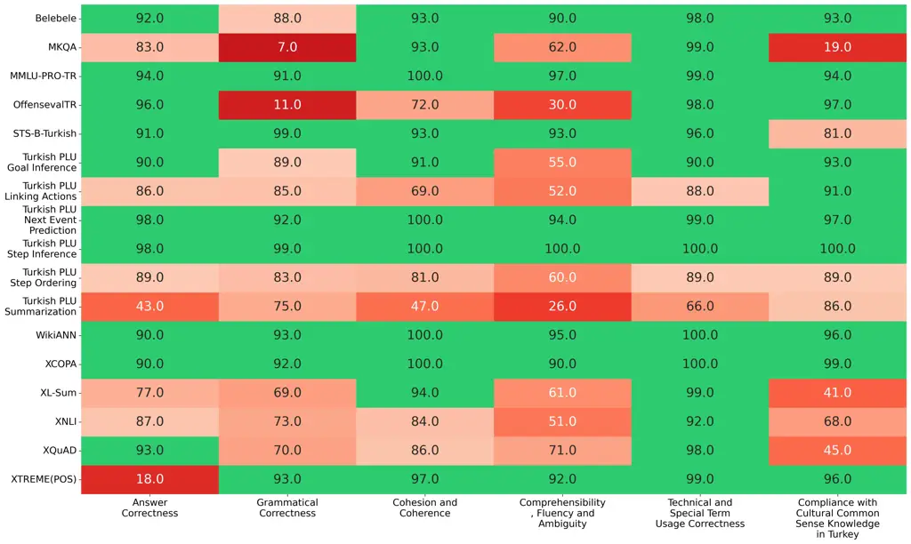
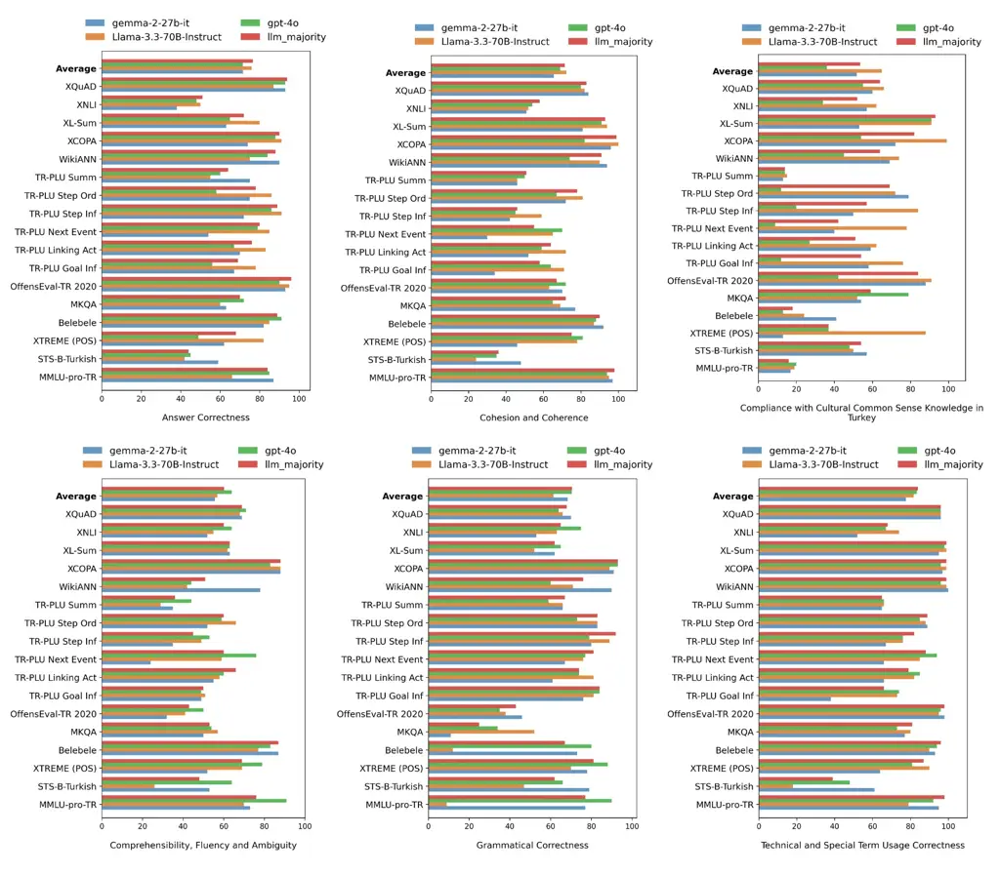
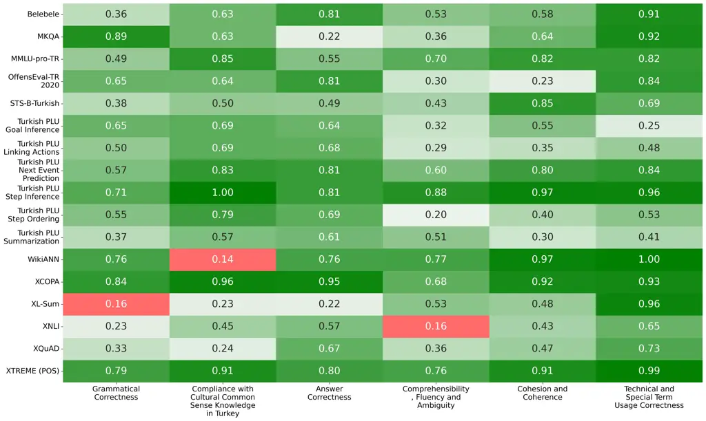
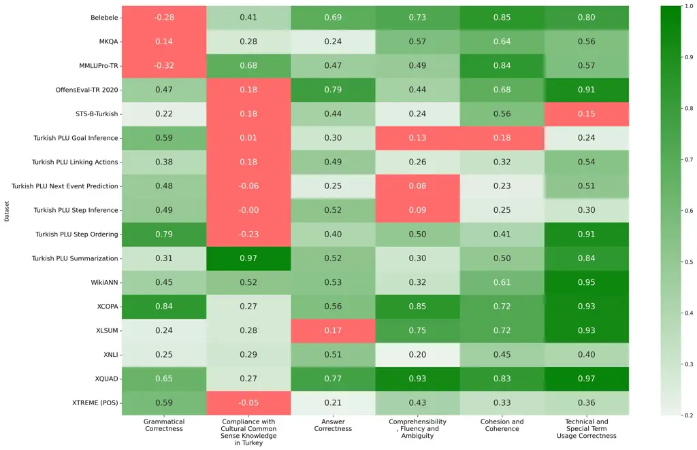
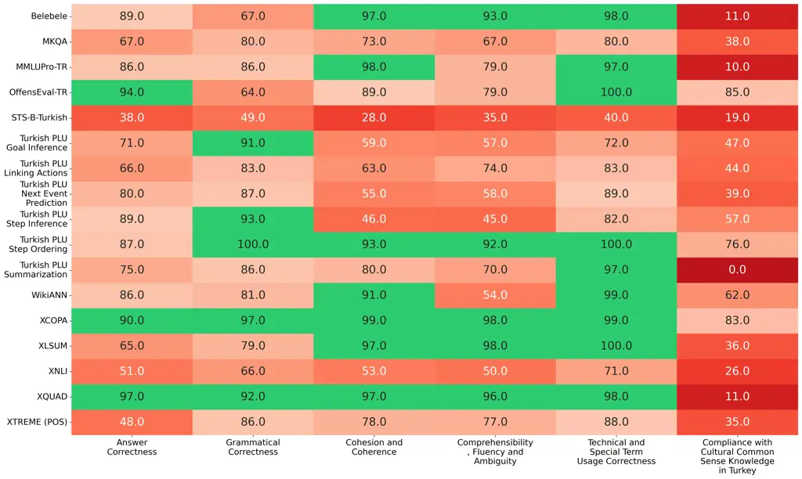

# Evaluating the Quality of Benchmark Datasets for Low-Resource Languages: A Case Study on Turkish

Ayşe Aysu Cengiz    Ahmet Kaan Sever    Elif Ecem Ümütlü    Naime Şeyma
Erdem Affiliation: Turkcell AI    Burak Aytan    Büşra Tufan    Abdullah
Topraksoy    Esra Darıcı    Cagri Toraman Affiliation: Middle East
Technical University, Computer Engineering Department
Affiliation: Turkcell AI Affiliation: Hacettepe University, Sociology
Department   Affiliation: Istanbul University, Linguistics Department
Affiliation: Middle East Technical University, Turkish Language
Department    \*Equal contribution
Affiliation: {burak.aytan,seyma.erdem}@turkcell.com.tr   
busratufan@hacettepe.edu.tr
Affiliation: abdullah.topraksoy@istanbul.edu.tr    darici@metu.edu.tr
Affiliation: Bilkent University, Computer Engineering Department  
Affiliation: {e2580371, e2448991, ctoraman}@ceng.metu.edu.tr   
kaan.sever@ug.bilkent.edu.tr

###### Abstract

The reliance on translated or adapted datasets from English or
multilingual resources introduces challenges regarding linguistic and
cultural suitability. This study addresses the need for robust and
culturally appropriate benchmarks by evaluating the quality of 17
commonly used Turkish benchmark datasets. Using a comprehensive
framework that assesses six criteria, both human and LLM-judge
annotators provide detailed evaluations to identify dataset strengths
and shortcomings.

Our results reveal that 70% of the benchmark datasets fail to meet our
heuristic quality standards. The correctness of the usage of technical
terms is the strongest criterion, but 85% of the criteria are not
satisfied in the examined datasets. Although LLM judges demonstrate
potential, they are less effective than human annotators, particularly
in understanding cultural common sense knowledge and interpreting
fluent, unambiguous text. GPT-4o has stronger labeling capabilities for
grammatical and technical tasks, while Llama3.3-70B excels at
correctness and cultural knowledge evaluation. Our findings emphasize
the urgent need for more rigorous quality control in creating and
adapting datasets for low-resource languages.

## 1 Introduction

Natural language processing has made significant advances in recent
years, with large language models achieving impressive results in
various tasks Srivastava et al. (2022); Bubeck et al. (2023). However,
the quality and reliability of these models mostly depend on the
datasets used for training and evaluation Tedeschi et al. (2023).

For languages with relatively low resources, such as Turkish, the
availability of high-quality datasets is crucial for developing robust
and accurate systems. Turkish natural language processing resources are
significantly based on datasets translated from English or adapted from
multilingual resources Hu et al. (2020); Liang et al. (2020); Kesen
et al. (2024). Although these datasets enable progress in low-resource
natural language processing, their quality and suitability for specific
tasks are not thoroughly examined. The use of translated or adapted
datasets raises concerns about their adherence to grammar, cultural
nuances, and overall coherence, potentially leading to biased or
inaccurate model performance.

Motivated by the need for reliable and culturally appropriate benchmarks
in natural language processing, this study aims to evaluate the quality
of commonly used data resources in Turkish as a case study. This
evaluation is crucial to advance the field of low-resource natural
language processing by identifying potential shortcomings.

To address this gap, we present a comprehensive analysis of 17 widely
used Turkish datasets. Our rationale for selecting these datasets is
that they are widely used datasets in the literature or published within
popular benchmarks (see Table 1). Our evaluation framework focuses on
six key aspects, including answer correctness, grammatical correctness,
cohesion and coherence, comprehensibility and fluency, technical term
usage, and alignment with cultural common sense. These aspects reflect
quality by correctness, grammar capability, and cultural sensitivity.
They are designed by domain experts who are also co-authors of this
study. A wide range of human annotators manually label samples from each
dataset according to these criteria to provide a detailed assessment of
their quality and suitability for our target language. We also examine
the LLM-as-a-Judge approach Zheng et al. (2023) to compare its labeling
performance with human annotations.

Our findings reveal that 70% of the benchmark datasets fail to meet our
criteria, and 85% of the criteria are not satisfied by these datasets.
LLM judges are not as effective as human annotators, particularly in
understanding cultural common sense knowledge, and interpreting fluent
and unambiguous text. Our results emphasize the importance of developing
high-quality and novel benchmark datasets for more accurate and
culturally sensitive settings. The observations are valuable not only
for the Turkish language but also for all languages that need
high-quality data resources in terms of correctness, grammar, and
cultural sensitivity¹¹ 1 We publish all related material including data,
annotation details, scripts, and prompts online at
https://github.com/metunlp/llmevaluation.

## 2 Related Work

##### Dataset Quality

Dataset quality is assessed by different methods in the literature.
Kreutzer et al. (2022) sampled 100 instances from each dataset, as in
our study, to identify the data quality of multilingual web-crawled
datasets. Their findings reveal that many datasets suffered from quality
issues, primarily due to the nature of web crawling.

The GSM1k dataset Zhang et al. (2024) evaluates the performance of
language models on reasoning tasks. The dataset is kept private to
prevent contamination. They conducted a three-stage annotation process
that includes an initial review by experienced annotators, a secondary
validation by independent annotators, and a final audit by a dedicated
quality assurance team.

##### Contamination

Data contamination in large language models has become an increasing
concern. As models are trained on large-scale datasets scraped from the
Internet, the integrity of benchmark datasets is challenging to
maintain. Sainz et al. (2023) emphasize the critical need to assess
whether a model’s performance is due to its genuine reasoning
capabilities or mere memorization.

Contamination is detected by matching test splits with training data.
Dodge et al. (2021) employ exact match detection methods, normalizing
text for capitalization and punctuation to identify instances of
overlap. Brown et al. (2020), on the other hand, use n-gram overlap to
measure contamination.

The MEGA benchmark Ahuja et al. (2023) has a comprehensive case study on
contamination by detecting potential training data leakage. They show
that some of the benchmark datasets, which were translated into Turkish
and analyzed in this study, exhibit data contamination.

##### Annotation Guideline

Several studies have established guidelines for human evaluation to
ensure consistency and reliability. Liang et al. (2023) emphasized the
importance of structured annotation guidelines to provide a clear and
replicable evaluation criteria.

Liang et al. (2023) designed annotation guidelines to assess
disinformation scenarios. To maintain annotation reliability, they
implemented quality control measures including hidden “secret words” in
instructions to verify comprehension and attention checks to detect
careless responses.

##### LLM-as-a-Judge

Zheng et al. (2023) propose the method of using powerful LLMs to label
and score from a group of candidates. Bavaresco et al. (2024) introduced
the Judge-Bench, a benchmark that evaluates LLM’s abilities to replicate
human judgments. This benchmark incorporates 20 diverse datasets, each
focusing on different tasks and annotation methods. Their findings
reveal that while LLMs can effectively align with human judgments in
specific tasks, their performance varies significantly across different
tasks.

Verga et al. (2024) proposed that using a smaller group of LLMs
together, called LLM Jury, instead of relying on a single model would
yield a higher correlation with human evaluation. This alternative
approach reduces costs while improving reproducibility and
applicability.

Srivastava et al. (2022) introduced BIG-bench, a collaborative benchmark
comprised of 204 diverse tasks designed to evaluate the capabilities of
LLMs. Their findings show that large models struggle with tasks that
require complex reasoning and understanding, and LLM performance is
relatively worse than human annotators.

##### Our Differences

This study evaluates the quality of LLM benchmarks in a comprehensive
framework that includes multiple criteria. We conduct a use case study
on popular Turkish datasets for this framework. The approach described
in this study can be generalized to other languages that suffer from
having low resources and cultural sensitivity.

## 3 Datasets

This study examines 17 datasets, listed in Table 1. We provide the
details of each dataset, as follows.

##### XQuAD

XQuAD Artetxe et al. (2019) is a multilingual open-ended reading
comprehension benchmark. The dataset includes 1.190 question-answer
pairs from the SQuAD v1.1 benchmark Rajpurkar (2016) and human
translations from the English text to 10 different languages including
Turkish. The model is evaluated based on its capability to extract
correct answers from a given passage.

##### XCOPA

XCOPA Ponti et al. (2020) is a multilingual dataset of common sense
causal reasoning. XCOPA is the human translation of the verification and
test sets of COPA Roemmele et al. (2011) to 11 languages including
Turkish. This dataset evaluates the model based on its understanding of
causal relations and inferential capability.

##### Belebele

Belebele Bandarkar et al. (2023) is a multiple-choice and multilingual
reading comprehension benchmark. The multilingual passages are obtained
from Flores-200 NLLB Team (2022), and the questions were written by
humans. The benchmark was translated from English into other languages
including Turkish, resulting in a 122 language multilingual dataset.
Belebele evaluates the LLM model’s understanding of the information
given in the text.

##### XL-Sum

XL-Sum Hasan et al. (2021) is a multilingual summarization benchmark.
The dataset spanning 44 languages was created with a similar process as
XSUM Narayan et al. (2018). In addition, the quality of the summaries in
10 languages were evaluated by human annotators. This benchmark aims at
abstractive summarization in which the summary can have new phrases that
are not present within the original text.

[TABLE]

Table 1: The details of 17 datasets examined in this study. _Size_
refers to the number of total instances, _Cite_ refers to the number of
citations when this study is published, _Dload_ refers to the
approximate number of downloads from Huggingface when this study is
published, and _Bench_ refers to the benchmarks that involve a
corresponding dataset (XTREME Hu et al. (2020), MEGA Ahuja et al.
(2023), XGLUE Liang et al. (2020), and Cetvel Kesen et al. (2024)).
Empty cells mean that dataset does not have a publication, or is not
published at Huggingface or in a benchmark.

##### XNLI

XNLI Conneau et al. (2018) is a multilingual natural language inference
benchmark. This dataset is obtained from the human translations of
MultiNLI Williams et al. (2017) into 15 languages. Model is evaluated on
the basis of their ability to recognize textual entailment.

##### Turkish PLU

Turkish PLU Uzunoglu and Şahin (2023) is a language understanding
benchmark based on Turkish WikiHow, having six subsets as follows. Goal
Inference evaluates the model’s ability to identify the overarching goal
based on a given step. In Step Inference, the model is expected to find
the step that needs to be taken to reach a goal. Step Ordering, given a
goal and two steps, expects the model to find the preceding step out of
the two. In Next Event Prediction, a goal and a step are given, and the
model should determine which of the four candidate steps follows the
given step. Summarization is an abstractive summarization task. Linking
Actions contains WikiHow dump, goal-step matches as the ground-truth,
and the dumped steps from WikiHow matched with the goal.

##### WikiANN

WikiANN Pan et al. (2017) is a multilingual Named Entity Recognition
(NER) dataset that spans more than 282 languages including Turkish. The
tagged sentences are directly from Turkish Wikipedia. The benchmark
utilizes Wikipedia markups to label PER (person), LOC (location), and
ORG (organization) in IOB2 format.

##### Universal Dependencies v2.5

This is a Part of Speech (POS) data from the XTREME benchmark, based on
the Universal Dependencies v2.5 tree banks Zeman et al. (2019) that
comprises of multi-lingual POS tagged sentences.

##### MKQA

MKQA Longpre et al. (2021) is a multilingual question answering
benchmark that includes human translates from the English Natural
Questions (NQ) Kwiatkowski et al. (2019), where the questions are
obtained from Google queries. The model is evaluated on the basis of
their ability to respond correctly to knowledge-based questions.

##### OffensEval-TR 2020

Çöltekin (2020) have sentences extracted from Turkish tweets that are
labeled as offensive or non-offensive. The dataset also breaks down the
offensive label into two as targeted and not-targeted. Targeted label is
further split into group, individual, and other.

##### STSb-TR

STSb-TR Beken Fikri et al. (2021) is a semantic textual similarity
benchmark in Turkish, which is machine-translated from STSb English
dataset Cer et al. (2017). Two sentences are given and a decimal score
between 0.0 and 5.0 is the target prediction, where a score closer to
5.0 means that the sentences portray more similar meaning.

##### MMLU-Pro-TR

MMLU-Pro-TR Bezir (2024) is the machine translated version of MMLU-Pro
Wang et al. (2024), which is the updated version of MMLU Hendrycks
et al. (2021). The translation is provided by Gemini 1.5 Pro with human
oversight. MMLU-Pro-TR also includes hand-picked STEM problems,
TheoremQA, and SciBench in addition to MMLU-Pro.

## 4 Methods

In this section, we present our criteria for assessing the quality of
datasets. We then explain two types of evaluation; human annotations and
LLM-Judge.

### 4.1 Criteria

In order to systematically assess the overall quality and reflectivity
of Turkish understanding in all datasets, we establish six distinct
criteria. These criteria are designed to ensure a comprehensive
evaluation, covering both linguistic precision and cultural
understanding.

##### Answer Correctness

This criterion assesses whether the dataset’s provided “gold” answer is
factually or logically correct for the given prompt or question. An
answer is considered correct if it aligns with verified knowledge, is
relevant to the question or task, and does not contain incorrectness or
information loss due to translation errors or data processing.

##### Grammatical Correctness

This criterion evaluates whether sentences comply with Turkish
morphological, orthographic, and syntactic rules. The evaluation is
supported by the grammatical rules documented by the linguistic experts,
given in Appendix 9.2.

##### Cohesion and Coherence

This criterion measures both the logical and linguistic completeness of
the text. Cohesion is a grammatical, lexical, and semantic issue, based
on the fact that linguistic elements do not contradict each other and
form a linguistic and semantic integrity.

Coherence refers to the logical connection within a text. Consistency
emerges by questioning the content expressed in language and its
semantic and logical relationship with both the text itself and the
realities in the outside world. An entry is considered coherent if the
logical relationship between words, sentences, and ideas is clear and
well-structured, ensuring that the text has a consistent meaning in its
entirety.

##### Comprehensibility, Fluency, and Ambiguity

This criterion aims to capture the naturalness of the text, i.e. whether
a native speaker would find the sentence clear, smooth, and idiomatic.
Ambiguity examines whether the text is ambiguous or vague in a way that
prevents a consistent interpretation. Ambiguity evaluation is supported
by the ambiguity guidelines documented by the linguistic experts, given
in the Appendix.

##### Technical and Special Term Usage

This criterion examines whether domain-specific or technical terms
(e.g., legal, medical, or academic) are used or translated accurately.

##### Compliance with Cultural Common Sense Knowledge

Although each individual has common sense knowledge Anacleto et al.
(2006), this knowledge varies from culture to culture and region to
region. The model should consider the behaviors and characteristics of
specific sociocultural groups Nguyen et al. (2023a). This criterion
evaluates whether the dataset is in line with the social, economic,
cultural, and geographical norms of the language.

Within the scope of this study, to evaluate the datasets’ suitability to
Turkish cultural common sense knowledge and ensure that it is
comprehensive, the cultural common sense knowledge criteria of different
studies are used together Anacleto et al. (2006); Shwartz (2022);
Deshpande et al. (2022); Yin et al. (2022). The following components
(food and meal times, drinks, clothing, rituals and traditions,
behaviors, social norms, and sports) are dynamics that express common
culture, and these dynamics are also determinants of common sense. These
judgments vary according to classes, status, beliefs, education levels,
gender, race, and ethnicity. Our aim is therefore not to present a
definitive scientific survey but to reach reasonable assumptions. In
this context, the aim is to bring cultural differences into
machine-readable form.

This evaluation is designed by sociologists who are experts in cultural
common sense, and based on two main components (details are given in
Appendix 9.2):

1.  i.
    Contextual Relevance: The information should accurately reflect
    Turkey’s rules, laws, political structure, and social customs. Data
    containing foreign legal systems, measurement units, or culturally
    irrelevant concepts (e.g., feet, inches, gallons) are considered
    non-compliant.
2.  ii.
    Cultural Appropriateness: This component examines common practices
    and traditions in Turkey. We adapt different approaches to cover
    cultural practices and traditions Nguyen et al. (2023b); Anacleto
    et al. (2006); Acharya et al. (2020); Shwartz (2022); Yin et al.
    (2022). We particularly examine cultural appropriateness in terms of
    food and meal, drinks, clothing, rituals and traditions, sports, and
    social norms.

### 4.2 Evaluation Methods

#### 4.2.1 Human Evaluation

Human evaluation is superior at casual tasks such as question and
emotion classification Aldeen et al. (2023). Due to the ambigious and
intricate nature of the definition of cultural common sense, human
annotation is a solid methodology to evaluate datasets reflectivity of
cultural understanding.

Human annotation can be misleading and unreliable if it is crowd-sourced
from non-experts Snow et al. (2008). We therefore carefully curate a
group of human annotators including domain experts, and provide detailed
guidelines when no domain experts are included. The details of
annotators and guidelines are given in Appendix 9.1 and 9.2.

#### 4.2.2 LLM-Judge

In addition to human annotations, we employ three different LLMs as
annotators in this study: Llama-3.3-70B-Instruct MetaAI (2024),
Gemma-2-27B-it Google (2024), and GPT-4o. We evaluate them with the same
datasets and metrics as those used for human annotators. We analyze the
performance of LLM-Judge for each metric separately and compared with
the results of human annotators. This comparison aims to assess the
degree to which LLM-Judge could replicate human performance in
annotation tasks.

## 5 Experiments

### 5.1 Experimental Design

There are two kinds of experiments in this study. First, we evaluate the
quality of benchmark datasets using human annotations. We then repeat
the same experiments using generative LLMs instead of human annotators.
We compare their performances to understand whether LLM-Judge is
competitive to human annotations.

#### 5.1.1 Human-Centered Experimental Design

##### Sampling

The Central Limit Theorem states that the sampling distribution of the
mean will approximate a normal distribution as the sample size
increases, regardless of the population’s original distribution. The
sample size is often context-dependent and depends on the variability
within the population. In this study, we sample 100 random instances
from each dataset to be annotated. The choice of 100 samples reflects a
practical balance between accuracy and computational effort.

##### Annotator Selection and Guidelines

To provide diversity, we assign 31 annotators from different
backgrounds. Annotators include undergraduate and graduate students,
faculty members, and industry professionals. Each instance is annotated
by three annotators and majority voting is applied. Since increasing the
annotator count might decrease the agreement monotonically Salminen
et al. (2021), we choose to have three annotators. Some annotators are
assigned more than one task based on their availability. Depending on
the difficulty of the datasets, we assign one week or two weeks to
complete a task.

Before starting annotations, all annotators were asked to study a
detailed guidelines document, which was written by experts in the
language and sociology domain. Annotator guidelines consist of two
sections. We first explain datasets in details, and then provide the
descriptions of evaluation criterion with sample annotations. The
details of the annotators and the guidelines document are given in
Appendix 9.1.

##### Inter-annotator Agreement

Random selection of annotators inherently introduces variability in
their interpretations of the assessments of the datasets.
Inter-annotator agreement is a crucial metric that quantifies the degree
of consensus among multiple annotators. Fleiss’s Kappa is an
inter-annotator agreement score that measures agreement among multiple
annotators.

Fleiss’ kappa can produce low values even when there is high observed
agreement between raters. This paradox occurs particularly when the
observed ratings are skewed towards one or a few categories, and leads
to unexpectedly large chance agreement estimates. We therefore use
Robust Fleiss’ Kappa $`K_{r}`$ which provides a more accurate
quantification of inter-annotator agreement Falotico and Quatto (2015).
The details of our approach are given in Appendix 9.3.

##### Evaluation Metric

Majority voting has statistical limitations and lacks accuracy in the
multiclass labeling scenario Hernández-González et al. (2019). We
therefore use the binary labeling where annotators label the datasets
using 1 for compliance and 0 for non-compliance to each criteria. The
evaluation metric for a criterion is then _Criteria Percentage Accuracy_
defined as the total number of positive scores determined by majority
voting, divided by the total number of data instances. To satisfy being
a high-quality dataset, we set a heuristic threshold of having equal or
higher than 90% of accuracy for all criteria.

#### 5.1.2 LLM-Judge Experimental Design

The same strategy presented in the human-centered experimental design
(sampling, inter-annotator agreement, and majority voting) is also used
in this setup. The only difference is the replacement of human
annotators by LLMs.

##### LLM-Judge Selection

We employ two open-source LLMs (Llama-3.3-70B-Instruct and
Gemma-2-27b-it) and a proprietary LLM (GPT-4o). The reason for choosing
the larger models is not to benchmark LLMs against each other but rather
to analyze the relationship between LLMs and human annotators. Our aim
is to assess in which domains, datasets, and tasks LLMs could
potentially replace human annotators or whether it is practical to do
so. We use default generation configuration settings for all models.

##### LLM-Judge Guidelines

As human annotators are guided on how to evaluate the dataset quality,
we tailor similar guidelines for LLMs, ensuring that they follow the
same structured approach as in the human-centered annotations. The
evaluation expectations given to human annotators are also shared with
the LLMs in the same way Mirzakhmedova et al. (2024). Annotators are
given clear instructions on how to assess the model’s performance, and
the same structure and prompt.

To have an iterative evaluation process for LLMs, we follow a design
where LLMs evaluate each metric separately Bavaresco et al. (2024). For
each metric, LLMs are prompted individually. For a single dataset, LLM
is first asked to evaluate accuracy, followed by other criteria. The
model is queried six separate times, once for each metric. This approach
allows LLMs to focus on each specific aspect of the data, ensuring that
its evaluation of one metric does not influence its judgment of another,
and thereby offering a more objective comparison with human annotators.
An example of LLM prompt is given in Appendix 9.4. We publish the
prompts for all datasets in our Github repository.

### 5.2 Experimental Results



Figure 1: Criteria Percentage Accuracy scores for each dataset (y-axis)
across six criteria (x-axis). The cells are colored according to the
degree of scores: Positive scores are shades of green, negative ones are
shades of red. Scores higher than 90% are heuristically considered
acceptable.

#### 5.2.1 Human Annotation Results

Among 102 evaluations (17 datasets and six criteria), we find that only
three of them (WikiANN, XL-Sum, and XNLI) have an agreement score below
0.2. In other terms, 97% of the experiments have fair or better
inter-annotator agreement Landis and Koch (1977) in this study. The
detailed results of inter-annotator agreement are given in Appendix 9.5.
In Figure 1, we present the quality evaluation of each dataset examined
in this study.

On the positive side, five of the datasets (MMLU-Pro-Tr, Turkish PLU
Next Event Prediction, Turkish PLU Step Inference, WikiANN, and XCOPA)
satisfy the criteria of our dataset having higher accuracy than 90% for
all criteria. On the negative side, two of the datasets (Turkish PLU
Step Ordering and PLU Summarization) do not satisfy our dataset criteria
by having less than 90% for all criteria. The remaining 10 datasets
partially satisfy our dataset criteria. For instance, MKQA and
OffensEvalTR have very poor accuracy scores in Grammatical Correctness,
and XTREME-POS shows inadequate results in Answer Correctness. Overall,
almost 30% of the benchmark datasets satisfy all criteria, in other
terms _70% of the benchmark datasets fail at our criteria_.

In terms of criteria, only technical and special term usage correctness
has more than 90% in more than 80% of the datasets examined in this
study. That is, _85% of the criteria are not satisfied by the benchmark
datasets_.

#### 5.2.2 LLM-Judge Results

We find that 83% of the experiments have a fair or better annotator
agreement when LLM judges are employed. The detailed results of
LLM-Judge agreement are given in Appendix 9.3.

We notice that LLM judges assign very low scores on the cultural
sensitivity of the datasets, while human annotators have relatively
higher scores on this criterion. All evaluation scores using only
LLM-Judge are provided in Appendix 9.6. Since our ground truth is human
annotations, we compare human and LLM-Judge annotations to get any
insights on LLM-Judge performance. That is, we analyze whether LLM-Judge
can be used as an alternative to human annotations.

#### 5.2.3 Human and LLM-Judge Comparison



Figure 2: Comparison between the LLM-Judge majority and human majority
labels for each dataset (y-axis) using overlapping ratio (x-axis). The
subplots represent an evaluation criterion. The colors represent an LLM
model.

This section examines how LLMs align with human majority responses. To
do so, we calculate _Overlapping Ratio_ between LLM-Judge and human
annotations to check whether the LLM majority outputs the same answer as
the human majority for all datasets. Overlapping ratio is defined as the
number of the same annotations/labels provided by LLM-Judge majority and
human majority (there are three LLMs and humans in each scenario for
labeling each data instance), divided by the total number of data
instances annotated. Figure 2 shows the results of the overlapping ratio
for each dataset.

_LLM majority have less than 80% overlapping scores on average with
human annotations_ for all criteria except technical term usage.
Cultural common sense and fluency have the worst overlapping scores
among all criteria. This shows that LLM judges are not as good as human
annotators, particularly for cultural common sense knowledge and reading
fluent and nonambiguous text.

XCOPA, OffensEval-TR 2020, WikiANN, and XQuAD consistently show high
overlapping scores across various criteria. However; STS-B-Turkish,
TR-PLU Summ, and XNLI frequently report lower overlapping scores. This
shows that LLM judges do not consistently label as humans do in all
benchmark datasets. Their labeling capability depends on the
characteristics of the dataset.

Llama3.3-70B-Instruct has better overlapping scores than Gemma2-27B and
GPT-4o in answer correctness, cohesion and coherence, and cultural
common sense knowledge. GPT-4o has better overlapping scores for the
remaining. This shows that GPT-4o has a better labeling capability for
grammatical and technical tasks, while Llama3.3-70B is good at
correctness and cultural knowledge. The discussion of the comparison
between LLM-Judge and Human annotations is given in Appendix 9.7.

## 6 Conclusion

This study evaluated the quality of 17 commonly used Turkish benchmark
datasets. Our findings reveal that 70% of the benchmark datasets fail to
meet our criteria, and 85% of the criteria are not satisfied by these
datasets. The successful datasets include MMLU-Pro-Tr, TR-PLU Next Event
Prediction, TR-PLU Step Inference, WikiANN, and XCOPA, while the
successful criterion is the correctness of technical term usage. These
results highlight the need for more rigorous quality control in curating
datasets for low-resource languages.

We also considered LLM-Judge annotations as an alternative to human
annotations. Our results show that LLM judges are not as effective as
human annotators, particularly in understanding cultural common sense
knowledge, and interpreting fluent and unambiguous text. In addition,
GPT-4o demonstrates stronger labeling capabilities for grammatical and
technical tasks, whereas Llama3.3-70B performs better in correctness and
cultural knowledge evaluation. In future work, we aim to construct a
reliable and high-quality benchmark dataset that addresses the
shortcomings identified in this study.

## 7 Limitations

The framework evaluates 17 widely used datasets curated in Turkish
language. More datasets, especially those in specialized domains, can be
included to reflect more general results. Furthermore, our findings,
while significant for Turkish natural language processing, may not be
directly transferable to some other low-resource languages.

The reliance on human annotations introduces potential challenges.
Although human evaluators are effective in assessing particular criteria
such as cultural common sense, their judgments could be still
subjective.

Criteria in the study emphasize linguistic and cultural alignment but
may overlook broader notions such as representational biases and
regional sensitive topics. The focus of our study on the quality
criteria of the data set could also be expanded to consider ethical
dimensions.

## 8 Ethical Considerations

Relying on the datasets that fail to meet quality criteria could produce
models that are poorly performed for diverse real-world scenarios,
particularly in critical domains like healthcare, law, and education.

Our study highlights the limitations of LLM judges compared to human
annotators. There is a risk that future reliance on automated systems
for dataset evaluation could compromise the quality of models and
systems, particularly for cultural sensitivity or linguistic coherence.

Our experiments on LLM-Judge annotations involve computationally
intensive dataset evaluation. There are environmental impacts to
consider, given the energy consumption of such processes.

##### Acknowledgments:

We thank to Havelsan for their support at the beginning of this study.
We express our sincere gratitude to all annotators who contributed to
this study. Special thanks to (listed in alphabetical order) Abdullah
Topraksoy, Ahmet Enes Salman, Ahmet Kaan Sever, Ayşe Aysu Cengiz, Başar
Yılmaz, Çağatay Akpınar, Deniz Yılmaz, Elif Özge Yılmaz, Erdem Orman,
Esra Darıcı, Fatih Sinan Esen, Görkem Sevinç, Güney Kırık, İpek Sönmez,
İsmail Furkan Atasoy Kaan Engür, Kuntay Yılmaz, Muhammed İkbal Özbey,
Mustafa Mert Satılmış, Oğuzhan Yusuf Aslanalp, Osman Gürlek, Saime İpek
İşçelebi, Sarp Kantar, Selçuk Tekgöz, Tanay Sütçü, Tufan Özkan, Yahya
Bahadır Karataş, Yaren Mercan, Yiğit Polat, Yusuf Mücahit Çetinkaya,
Zeynep Berda Akkuş.

## 9 Appendix

### 9.1 Details of Human Annotations

The annotators are composed of 31 people from a broad spectrum of
backgrounds. The following demographic information is provided by the
annotators. The annotators include 24 undergraduate students, two M.Sc.
students, two research assistants, one faculty member, and two industry
professionals. The annotators include 24 male and seven female
participants. There are 24 participants who are between 20 and 25 years
old, and seven participants who are older than 25 years.

### 9.2 Details of Annotation Guidelines

The annotator guidelines document aims to guide annotators in their
tasks. These guidelines consist of two sections, which are the Common
Guideline, and Dataset Specifications. The former is the same for all
guidelines. The latter one contains dataset specific information.

Every annotator is expected to follow the guidelines in order to make
the results as much objective and decisive as possible. Depending on the
difficulty of the datasets, annotators were assigned one or two weeks to
complete the task.

The annotator guidelines document provides detailed explanations with
examples of the six criteria outlined in 4.1 Criteria. The document can
be found in [this link](https://github.com/metunlp/llmevaluation/). The
document also provides a detailed explanation of the dataset to guide
the annotator. This document outlines the column names along with their
corresponding definitions and clarifies the specific tasks associated
with the dataset. Additionally, it offers an in-depth discussion of the
"Answer Correctness" criteria and its relevance within this context

### 9.3 Details of Inter-annotator Agreement

Cohen’s Kappa measures the agreement between two annotators. Fleiss’s
Kappa extends Cohen’s Kappa to multiple annotators, and Krippendorffs’s
Alpha additionally handles missing data.

Fleiss’ Kappa is given as follows.

```math
\kappa=\frac{\bar{P}-\bar{P_{e}}}{1-\bar{P_{e}}}
```

```math
\bar{P}=\frac{1}{N}\sum_{i=1}^{N}P_{i},\quad P_{i}=\frac{1}{n(n-1)}\sum_{j=1}^{k}n_{ij}(n_{ij}-1)
```

```math
\bar{P_{e}}=\sum_{j=1}^{k}p_{j}^{2},\quad p_{j}=\frac{\sum_{i=1}^{N}n_{ij}}{Nn}
```

where:

```math
\displaystyle N
```

```math
\displaystyle n
```

```math
\displaystyle k
```

```math
\displaystyle n_{ij} \displaystyle\text{: Number of who assign label }j\text{ to sample }i
```

```math
\displaystyle p_{j} \displaystyle\text{: Proportion of all assignments to label }j
```



Figure 3: Robust Fleiss’ Kappa scores for each dataset annotated by
three human annotators across six criteria.

Although Fleiss’ Kappa fits our purpose, there is a drawback to use this
metric. It is inconsistent to use Fleiss’ Kappa when there is strong
agreement among raters. That is, it shows unexpected behavior when there
is near-perfect agreement. For example, if annotators vote the same for
all entries (perfect agreement), the expected agreement $`\bar{P_{e}}`$
would be 1, and the observed agreement $`\bar{P}`$ would also be 1,
which would lead to an undefined value. In a near-perfect agreement
situation, $`\bar{P_{e}}`$ gets a higher value than $`\bar{P}`$, and
leads to a negative value.

In Falotico and Quatto (2015), they proposed a permutation-based method
to address this issue. They show that Fleiss’ kappa is inadequate in
interpreting high levels of agreement. In addition, they recommend
bootstrap techniques for constructing confidence intervals that avoid
paradoxes. Their research aligns with our earlier observations.

As we are interested in the agreement of annotators rather than what
they voted for here, the proposed solution involves generating
permutations of category frequencies for each row of the data table,
substituting the original vectors with these permutations, and
recalculating Fleiss’ kappa. By repeating this process C times and
summarizing the resulting kappa values using a robust statistic like the
median, the authors derive a new measure, Robust Fleiss’ Kappa $`K_{r}`$
which provides a more accurate quantification of inter-annotator
agreement.

In our experiments, we set C, the number of permutations, to 100. For
each permutation, we calculated the Fleiss’ Kappa based on the permuted
score combinations and then averaged these values, following the method
outlined in the paper.

To compute the confidence intervals, we again used the methods explained
in the paper. We generate bootstrap samples from the original voting
matrix by randomly sampling rows with replacements. For each bootstrap
sample, we calculate the Robust Fleiss’ Kappa. This process is repeated
B times (with B=1000 in our experiments), resulting in B values of
Robust Fleiss’ Kappa. Using a confidence level of $`1-\alpha`$ = 0.95
(95$`\%`$), we determine the bounds of the confidence interval based on
these B values. This implies that there is a 95$`\%`$ likelihood that
the true inter-annotator agreement value lies within the confidence
intervals reported in the tables.

To ensure the success of Robust Fleiss’ Kappa in our research, we aim
for an agreement score higher than 0.2, which is considered a fair level
of agreement, as shown in Table 2.

| Fleiss’ Kappa | Interpretation           |
| ------------- | ------------------------ |
| $`\kappa<0`$  | Poor agreement           |
| $`0.00-0.20`$ | Slight agreement         |
| $`0.21-0.40`$ | Fair agreement           |
| $`0.41-0.60`$ | Moderate agreement       |
| $`0.61-0.80`$ | Substantial agreement    |
| $`0.81-1.00`$ | Almost perfect agreement |

Table 2: Interpretation of Fleiss’ Kappa Values according to Landis and
Koch (1977).

### 9.4 Sample LLM-Judge Prompt

A sample prompt for the MMLUPro-TR dataset with the accuracy metric is
given as follows (English translations are given in parantheses).

Veri kümesi sütunları (Dataset Columns):

question_id: Soruya özel numara (Unique identifier for each question).

question: Soru metni (Text of the question).

options: On adet cevap şıkkı (Ten answer choices).

answer: Doğru cevabın İngilizce alfabede karşılık geldiği harf (The
letter corresponding to the correct answer in the English alphabet).
(örn: 1. şık → A, 4. şık → D) (e.g., choice 1 → A, choice 4 → D).

answer_index: Doğru cevabın listedeki indisi (The index of the correct
answer in the list). (indisler 0’dan başlıyor; indices start from 0).

category: Sorunun gerektirdiği bilginin alanı (The field of knowledge
required by the question).

src: Kaynak (Source).

Değerlendirme sütunları (Evaluation Columns):

Doğruluk (Accuracy): Aşağıdaki iki soruya da cevabınız “evet” ise kutuya
1 yazın, birine bile cevabınız hayır ise 0 yazın.  
(If your answer to both of the following questions is “yes,” write 1 in
the box. If the answer is "no" for one question,” write 0).

- •
  a. Doğru cevap şıklarda var mı? (Is the correct answer among the
  options?)
- •
  b. Soru için verilen cevap şıkkı doğru şık mı? (Is the selected option
  the correct answer for the question?)

### 9.5 Detailed Results of Inter-Annotator Agreement

In Figure 3, we present Robust Fleiss’ Kappa Scores among three human
annotators who labeled each dataset based on six criteria. The y-axis
represents different datasets, and the x-axis represents our six
criteria. The $`cell(i,j)`$ represents the Fleiss’ Kappa score of
$`dataset_{j}`$ for $`criteria_{i}`$. Since a score of 0.2 or higher is
considered fair agreement, we accept this as a sufficient threshold in
our study. All green values in the table has thereby scores above 0.2.
For the WikiANN, XL-Sum, and XNLI datasets; there is a single criterion
where the agreement score falls below 0.2.

In Figure 4, we present Robust Fleiss’ Kappa Scores among three
LLM-Judge annotators. The number of agreement scores are mostly below
0.2 in cultural common sense knowledge. The inter-annotator agreement
between LLM-Judge models is worse than the one between human annotators,
since 17 comparisons have below 0.2 score in LLM-Judge while this number
is only three comparisons in human annotations. In other terms, 17 out
of 102 experiments (17%) have poor agreement.



Figure 4: Robust Fleiss’ Kappa scores for each dataset annotated by
three LLM-Judge annotators across six criteria.

### 9.6 Detailed Results of LLM-Judge

In Figure 5, we present LLM-Judge evaluation results. The results show
that LLMs perform consistently well in the datasets such as XQUAD,
Belebele, and Turkish PLU Step Ordering, especially in the metrics such
as Accuracy and Grammar Correctness. For instance, in the XQUAD dataset,
high scores were achieved in answer accuracy (97%), grammar correctness
(92%), and technical term usage (98%). This suggests that LLMs are
aligned with evaluators and handle technical aspects of language well.
Similar consistency is seen in grammar and technical term usage in the
Belebele and Turkish PLU Step Ordering datasets.

However, the result also reveals inconsistencies in datasets such as
STS-B Turkish and XTREME (POS), particularly in the metrics including
fluency, contextual understanding, and cultural knowledge. In the STS-B
Turkish dataset, low scores in answer accuracy (38%) and contextual
alignment (28%) suggest that the model struggles with these tasks. In
XTREME (POS), although grammar accuracy is high (86%), performance drops
in more challenging metrics like cultural alignment and fluency (35%).

Overall, the results indicate that LLMs perform well in technical
accuracy and grammar-focused metrics but show inconsistencies in tasks
requiring natural language flow, contextual understanding, and cultural
awareness. This can suggest that while models excel in certain tasks,
they still have room for improvement in more complex and context-driven
tasks.



Figure 5: Criteria Percentage Accuracy scores (Majority Voting) for each
dataset annotated by three LLMs Across six criteria.

### 9.7 Detailed Results of Comparison between LLM and Human Labels

LLM Majority typically demonstrates high accuracy, particularly on
datasets like OffensEval-TR 2020 (96%) and XQuAD (94%). However, its
performance drops on certain datasets such as STS-B-Turkish (44%) and
XNLI (51%). The model’s consistency varies depending on the dataset; for
example, it shows strong agreement on XCOPA (99%) and Belebele (90%),
but weak consistency on STS-B-Turkish (36%) and TR-PLU Summ (51%). In
terms of cultural sensitivity, the model excels on XL-Sum (93%) and
OffensEval-TR 2020 (84%), but falls short on TR-PLU Summ (14%) and
MMLU-pro-TR (16%). For metrics like comprehensibility, fluency, and
ambiguity, the model performs well on datasets like XCOPA (88%) and
Belebele (87%), but faces challenges on TR-PLU Summ (36%) and TR-PLU
Step Inf (45%). Grammatical accuracy is strong on XCOPA (93%) and TR-PLU
Step Inf (92%), but problematic on MKQA (25%) and OffensEval-TR 2020
(43%). Technical terminology is well-handled on WikiANN (99%) and XCOPA
(99%), but more challenging on STS-B-Turkish (39%) and TR-PLU Summ
(65%).

GPT-4o performs exceptionally on datasets such as MMLU-pro-TR (85%) and
XQuAD (93%). However, its performance lags on datasets like TR-PLU Step
Ord (58%) and XNLI (48%). The model’s consistency is solid on datasets
like XCOPA (82%) and XL-Sum (91%), but weak on STS-B-Turkish (35%) and
TR-PLU Step Inf (45%). In terms of cultural sensitivity, it excels on
XL-Sum (91%) and MKQA (79%), but underperforms on TR-PLU Next Event (9%)
and TR-PLU Goal Inf (12%). For comprehensibility and fluency, the model
shows strong performance on MMLUPro-TR (91%) and XCOPA (83%), but
experiences ambiguity on TR-PLU Summ (44%) and TR-PLU Step Inf (53%).
Grammatical accuracy is high on XCOPA (93%) and MMLU-pro-TR (90%), but
weak on MKQA (34%) and OffensEval-TR 2020 (35%). Technical terminology
is well-managed on WikiANN (96%) and XCOPA (96%), but lacks precision on
TR-PLU Goal Inf (74%) and TR-PLU Step Inf (76%).

Llama achieves its best results on OffensEval-TR 2020 (95%) and TR-PLU
Step Inf (91%), but performs poorly on datasets like STS-B-Turkish (42%)
and XNLI (50%). Its consistency is strong on XCOPA (99%) and XL-Sum
(94%), but inconsistent on STS-B-Turkish (24%) and TR-PLU Summ (46%). In
terms of cultural sensitivity, it performs well on XCOPA (99%) and
OffensEval-TR 2020 (91%), but struggles with TR-PLU Summ (15%) and
MMLU-pro-TR (19%). For comprehensibility and fluency, it excels on XCOPA
(88%) and MMLUPro-TR (70%), but faces ambiguity on TR-PLU Summ (29%) and
TR-PLU Next Event (59%). Grammatical accuracy is high on XCOPA (89%) and
TR-PLU Step Inf (89%), but poor on MMLU-pro-TR (9%) and Belebele (12%).
Technical terminology is well-handled on WikiANN (99%) and XCOPA (99%),
but problematic on STS-B-Turkish (18%) and TR-PLU Goal Inf (73%).

Gemma performs well on datasets like XCOPA (96%) and TR-PLU Step Ord
(79%), but struggles on TR-PLU Next Event (24%) and TR-PLU Step Inf
(35%). Its consistency is strong on XCOPA (96%) and Belebele (87%), but
weak on TR-PLU Next Event (24%) and TR-PLU Step Inf (35%). In terms of
cultural sensitivity, it excels on OffensEval-TR 2020 (88%) and TR-PLU
Step Ord (79%), but underperforms on TR-PLU Summ (13%) and XTREME (POS)
(13%). For comprehensibility and fluency, it performs well on XCOPA
(88%) and Belebele (87%), but shows ambiguity on TR-PLU Next Event (24%)
and TR-PLU Step Inf (35%). Grammatical accuracy is excellent on WikiANN
(99%) and XCOPA (91%), but low on MKQA (11%) and XTREME (POS) (13%).
Technical terminology is handled well on WikiANN (99%) and XCOPA (97%),
but lacks precision on TR-PLU Goal Inf (38%) and TR-PLU Next Event
(66%).

## References

- Acharya et al. (2020) Anurag Acharya, Kartik Talamadupula, and Mark A
  Finlayson. 2020. [Towards an atlas of cultural commonsense for machine
  reasoning](http://arxiv.org/abs/2009.05664).
- Ahuja et al. (2023) Kabir Ahuja, Harshita Diddee, Rishav Hada,
  Millicent Ochieng, Krithika Ramesh, Prachi Jain, Akshay Nambi, Tanuja
  Ganu, Sameer Segal, Maxamed Axmed, Kalika Bali, and Sunayana
  Sitaram. 2023. [Mega: Multilingual evaluation of generative
  ai](http://arxiv.org/abs/2303.12528).
- Aldeen et al. (2023) Mohammed Aldeen, Joshua Luo, Ashley Lian, Venus
  Zheng, Allen Hong, Preethika Yetukuri, and Long Cheng. 2023. [Chatgpt
  vs. human annotators: A comprehensive analysis of chatgpt for text
  annotation](https://doi.org/10.1109/ICMLA58977.2023.00089). In _2023
  International Conference on Machine Learning and Applications
  (ICMLA)_, pages 602–609.
- Anacleto et al. (2006) Junia Anacleto, Henry Lieberman, Marie
  Tsutsumi, Vânia Neris, Aparecido Carvalho, Jose Espinosa, Muriel
  Godoi, and Silvia Zem-Mascarenhas. 2006. Can common sense uncover
  cultural differences in computer applications? In _Artificial
  Intelligence in Theory and Practice: IFIP 19th World Computer
  Congress, TC 12: IFIP AI 2006 Stream, August 21–24, 2006, Santiago,
  Chile 1_, pages 1–10. Springer.
- Artetxe et al. (2019) Mikel Artetxe, Sebastian Ruder, and Dani
  Yogatama. 2019. On the cross-lingual transferability of monolingual
  representations. _arXiv preprint arXiv:1910.11856_.
- Bandarkar et al. (2023) Lucas Bandarkar, Davis Liang, Benjamin Muller,
  Mikel Artetxe, Satya Narayan Shukla, Donald Husa, Naman Goyal,
  Abhinandan Krishnan, Luke Zettlemoyer, and Madian Khabsa. 2023. The
  belebele benchmark: a parallel reading comprehension dataset in 122
  language variants. _arXiv preprint arXiv:2308.16884_.
- Bavaresco et al. (2024) Anna Bavaresco, Raffaella Bernardi, Leonardo
  Bertolazzi, Desmond Elliott, Raquel Fernández, Albert Gatt, Esam
  Ghaleb, Mario Giulianelli, Michael Hanna, Alexander Koller,
  et al. 2024. Llms instead of human judges? a large scale empirical
  study across 20 nlp evaluation tasks. _arXiv preprint
  arXiv:2406.18403_.
- Beken Fikri et al. (2021) Figen Beken Fikri, Kemal Oflazer, and Berrin
  Yanikoglu. 2021. [Semantic similarity based evaluation for abstractive
  news summarization](https://doi.org/10.18653/v1/2021.gem-1.3). In
  _Proceedings of the 1st Workshop on Natural Language Generation,
  Evaluation, and Metrics (GEM 2021)_, pages 24–33, Online. Association
  for Computational Linguistics.
- Bezir (2024) Abdullah Bezir. 2024. bezir/mmlu-pro-tr.
  https://huggingface.co/datasets/bezir/MMLU-pro-TR.
- Brown et al. (2020) Tom B. Brown, Benjamin Mann, Nick Ryder, Melanie
  Subbiah, Jared Kaplan, Prafulla Dhariwal, Arvind Neelakantan, Pranav
  Shyam, Girish Sastry, Amanda Askell, Sandhini Agarwal, Ariel
  Herbert-Voss, Gretchen Krueger, Tom Henighan, Rewon Child, Aditya
  Ramesh, Daniel M. Ziegler, Jeffrey Wu, Clemens Winter, Christopher
  Hesse, Mark Chen, Eric Sigler, Mateusz Litwin, Scott Gray, Benjamin
  Chess, Jack Clark, Christopher Berner, Sam McCandlish, Alec Radford,
  Ilya Sutskever, and Dario Amodei. 2020. [Language models are few-shot
  learners](http://arxiv.org/abs/2005.14165).
- Bubeck et al. (2023) Sébastien Bubeck, Varun Chadrasekaran, Ronen
  Eldan, Johannes Gehrke, Eric Horvitz, Ece Kamar, Peter Lee, Yin Tat
  Lee, Yuanzhi Li, Scott Lundberg, et al. 2023. Sparks of artificial
  general intelligence: Early experiments with gpt-4.
- Cer et al. (2017) Daniel Cer, Mona Diab, Eneko Agirre, Inigo
  Lopez-Gazpio, and Lucia Specia. 2017. Semeval-2017 task 1: Semantic
  textual similarity-multilingual and cross-lingual focused evaluation.
  _arXiv preprint arXiv:1708.00055_.
- Çöltekin (2020) Çağrı Çöltekin. 2020. A corpus of turkish offensive
  language on social media. In _Proceedings of the Twelfth language
  resources and evaluation conference_, pages 6174–6184.
- Conneau et al. (2018) Alexis Conneau, Guillaume Lample, Ruty Rinott,
  Adina Williams, Samuel R Bowman, Holger Schwenk, and Veselin
  Stoyanov. 2018. Xnli: Evaluating cross-lingual sentence
  representations. _arXiv preprint arXiv:1809.05053_.
- Deshpande et al. (2022) Awantee Deshpande, Dana Ruiter, Marius
  Mosbach, and Dietrich Klakow. 2022. Stereokg: Data-driven knowledge
  graph construction for cultural knowledge and stereotypes. In
  _Proceedings of the Sixth Workshop on Online Abuse and Harms (WOAH)_,
  pages 67–78.
- Dodge et al. (2021) Jesse Dodge, Maarten Sap, Ana Marasović, William
  Agnew, Gabriel Ilharco, Dirk Groeneveld, Margaret Mitchell, and Matt
  Gardner. 2021. [Documenting large webtext corpora: A case study on the
  colossal clean crawled corpus](http://arxiv.org/abs/2104.08758).
- Falotico and Quatto (2015) Rosa Falotico and Piero Quatto. 2015.
  Fleiss’ kappa statistic without paradoxes. _Quality & Quantity_,
  49:463–470.
- Google (2024) Google. 2024. [Gemma-2 27b
  it](https://huggingface.co/google/gemma-2-27b-it).
- Hasan et al. (2021) Tahmid Hasan, Abhik Bhattacharjee, Md Saiful
  Islam, Kazi Samin, Yuan-Fang Li, Yong-Bin Kang, M Sohel Rahman, and
  Rifat Shahriyar. 2021. Xl-sum: Large-scale multilingual abstractive
  summarization for 44 languages. _arXiv preprint arXiv:2106.13822_.
- Hendrycks et al. (2021) Dan Hendrycks, Collin Burns, Steven Basart,
  Andy Zou, Mantas Mazeika, Dawn Song, and Jacob Steinhardt. 2021.
  [Measuring massive multitask language
  understanding](http://arxiv.org/abs/2009.03300).
- Hernández-González et al. (2019) Jerónimo Hernández-González, Iñaki
  Inza, and Jose A. Lozano. 2019. [A note on the behavior of majority
  voting in multi-class domains with biased
  annotators](https://doi.org/10.1109/TKDE.2018.2845400). _IEEE
  Transactions on Knowledge and Data Engineering_, 31(1):195–200.
- Hu et al. (2020) Junjie Hu, Sebastian Ruder, Aditya Siddhant, Graham
  Neubig, Orhan Firat, and Melvin Johnson. 2020. Xtreme: A massively
  multilingual multi-task benchmark for evaluating cross-lingual
  generalisation. In _International Conference on Machine Learning_,
  pages 4411–4421. PMLR.
- Kesen et al. (2024) Ilker Kesen, Mustafa Cemil Guney, Aykut Erdem, and
  Gozde Gul Sahin. 2024. [Cetvel: A unified benchmark for evaluating
  turkish llms](https://github.com/KUIS-AI/cetvel).
- Kreutzer et al. (2022) Julia Kreutzer, Isaac Caswell, Lisa Wang, Ahsan
  Wahab, Daan van Esch, Nasanbayar Ulzii-Orshikh, Allahsera Tapo,
  Nishant Subramani, Artem Sokolov, Claytone Sikasote, et al. 2022.
  Quality at a glance: An audit of web-crawled multilingual datasets.
  _Transactions of the Association for Computational Linguistics_,
  10:50–72.
- Kwiatkowski et al. (2019) Tom Kwiatkowski, Jennimaria Palomaki, Olivia
  Redfield, Michael Collins, Ankur Parikh, Chris Alberti, Danielle
  Epstein, Illia Polosukhin, Jacob Devlin, Kenton Lee, Kristina
  Toutanova, Llion Jones, Matthew Kelcey, Ming-Wei Chang, Andrew M. Dai,
  Jakob Uszkoreit, Quoc Le, and Slav Petrov. 2019. [Natural questions: A
  benchmark for question answering
  research](https://doi.org/10.1162/tacl_a_00276). _Transactions of the
  Association for Computational Linguistics_, 7:452–466.
- Landis and Koch (1977) J Richard Landis and Gary G Koch. 1977. The
  measurement of observer agreement for categorical data. _biometrics_,
  pages 159–174.
- Liang et al. (2023) Percy Liang, Rishi Bommasani, Tony Lee, Dimitris
  Tsipras, Dilara Soylu, Michihiro Yasunaga, Yian Zhang, Deepak
  Narayanan, Yuhuai Wu, Ananya Kumar, Benjamin Newman, Binhang Yuan,
  Bobby Yan, Ce Zhang, Christian Cosgrove, Christopher D. Manning,
  Christopher Ré, Diana Acosta-Navas, Drew A. Hudson, Eric Zelikman,
  Esin Durmus, Faisal Ladhak, Frieda Rong, Hongyu Ren, Huaxiu Yao, Jue
  Wang, Keshav Santhanam, Laurel Orr, Lucia Zheng, Mert Yuksekgonul,
  Mirac Suzgun, Nathan Kim, Neel Guha, Niladri Chatterji, Omar Khattab,
  Peter Henderson, Qian Huang, Ryan Chi, Sang Michael Xie, Shibani
  Santurkar, Surya Ganguli, Tatsunori Hashimoto, Thomas Icard, Tianyi
  Zhang, Vishrav Chaudhary, William Wang, Xuechen Li, Yifan Mai, Yuhui
  Zhang, and Yuta Koreeda. 2023. [Holistic evaluation of language
  models](http://arxiv.org/abs/2211.09110).
- Liang et al. (2020) Yaobo Liang, Nan Duan, Yeyun Gong, Ning Wu, Fenfei
  Guo, Weizhen Qi, Ming Gong, Linjun Shou, Daxin Jiang, Guihong Cao,
  Xiaodong Fan, Ruofei Zhang, Rahul Agrawal, Edward Cui, Sining Wei,
  Taroon Bharti, Ying Qiao, Jiun-Hung Chen, Winnie Wu, Shuguang Liu, Fan
  Yang, Daniel Campos, Rangan Majumder, and Ming Zhou. 2020. [XGLUE: A
  new benchmark datasetfor cross-lingual pre-training, understanding and
  generation](https://doi.org/10.18653/v1/2020.emnlp-main.484). In
  _Proceedings of the 2020 Conference on Empirical Methods in Natural
  Language Processing (EMNLP)_, pages 6008–6018, Online. Association for
  Computational Linguistics.
- Longpre et al. (2021) Shayne Longpre, Yi Lu, and Joachim Daiber. 2021.
  [MKQA: A linguistically diverse benchmark for multilingual open domain
  question answering](https://doi.org/10.1162/tacl_a_00433).
  _Transactions of the Association for Computational Linguistics_,
  9:1389–1406.
- MetaAI (2024) MetaAI. 2024. [Llama-3.3 70b
  instruct](https://huggingface.co/meta-llama/Llama-3.3-70B-Instruct).
- Mirzakhmedova et al. (2024) Nailia Mirzakhmedova, Marcel Gohsen,
  Chia Hao Chang, and Benno Stein. 2024. Are large language models
  reliable argument quality annotators? In _Conference on Advances in
  Robust Argumentation Machines_, pages 129–146. Springer.
- Narayan et al. (2018) Shashi Narayan, Shay B Cohen, and Mirella
  Lapata. 2018. Don’t give me the details, just the summary! topic-aware
  convolutional neural networks for extreme summarization. _arXiv
  preprint arXiv:1808.08745_.
- Nguyen et al. (2023a) Tuan-Phong Nguyen, Simon Razniewski, Aparna
  Varde, and Gerhard Weikum. 2023a. Extracting cultural commonsense
  knowledge at scale. In _Proceedings of the ACM Web Conference 2023_,
  pages 1907–1917.
- Nguyen et al. (2023b) Tuan-Phong Nguyen, Simon Razniewski, Aparna
  Varde, and Gerhard Weikum. 2023b. [Extracting cultural commonsense
  knowledge at scale](https://doi.org/10.1145/3543507.3583535). In
  _Proceedings of the ACM Web Conference 2023_, WWW ’23, page 1907–1917.
  ACM.
- NLLB Team (2022) James Cross Onur Çelebi Maha Elbayad Kenneth Heafield
  Kevin Heffernan Elahe Kalbassi Janice Lam Daniel Licht Jean Maillard
  Anna Sun Skyler Wang Guillaume Wenzek Al Youngblood Bapi Akula Loic
  Barrault Gabriel Mejia Gonzalez Prangthip Hansanti John Hoffman
  Semarley Jarrett Kaushik Ram Sadagopan Dirk Rowe Shannon Spruit Chau
  Tran Pierre Andrews Necip Fazil Ayan Shruti Bhosale Sergey Edunov
  Angela Fan Cynthia Gao Vedanuj Goswami Francisco Guzmán Philipp Koehn
  Alexandre Mourachko Christophe Ropers Safiyyah Saleem Holger Schwenk
  Jeff Wang NLLB Team, Marta R. Costa-jussà. 2022. No language left
  behind: Scaling human-centered machine translation.
- Pan et al. (2017) Xiaoman Pan, Boliang Zhang, Jonathan May, Joel
  Nothman, Kevin Knight, and Heng Ji. 2017. [Cross-lingual name tagging
  and linking for 282 languages](https://doi.org/10.18653/v1/P17-1178).
  In _Proceedings of the 55th Annual Meeting of the Association for
  Computational Linguistics (Volume 1: Long Papers)_, pages 1946–1958,
  Vancouver, Canada. Association for Computational Linguistics.
- Ponti et al. (2020) Edoardo Maria Ponti, Goran Glavaš, Olga Majewska,
  Qianchu Liu, Ivan Vulić, and Anna Korhonen. 2020. Xcopa: A
  multilingual dataset for causal commonsense reasoning. _arXiv preprint
  arXiv:2005.00333_.
- Rajpurkar (2016) P Rajpurkar. 2016. Squad: 100,000+ questions for
  machine comprehension of text. _arXiv preprint arXiv:1606.05250_.
- Roemmele et al. (2011) Melissa Roemmele, Cosmin Adrian Bejan, and
  Andrew S Gordon. 2011. Choice of plausible alternatives: An evaluation
  of commonsense causal reasoning. In _2011 AAAI spring symposium
  series_.
- Sainz et al. (2023) Oscar Sainz, Jon Ander Campos, Iker
  García-Ferrero, Julen Etxaniz, and Eneko Agirre. 2023. Did chatgpt
  cheat on your test?
- Salminen et al. (2021) Joni Salminen, Ahmed Mohamed Sayed Kamel,
  Soon-Gyo Jung, and Bernard J. Jansen. 2021. [The problem of majority
  voting in crowdsourcing with binary
  classes](https://doi.org/10.48340/ecscw2021_n12). In _ECSCW_.
- Shwartz (2022) Vered Shwartz. 2022. Good night at 4 pm?! time
  expressions in different cultures. In _Findings of the Association for
  Computational Linguistics: ACL 2022_, pages 2842–2853.
- Snow et al. (2008) Rion Snow, Brendan O’Connor, Daniel Jurafsky, and
  Andrew Ng. 2008. [Cheap and fast – but is it good? evaluating
  non-expert annotations for natural language
  tasks](https://aclanthology.org/D08-1027). In _Proceedings of the 2008
  Conference on Empirical Methods in Natural Language Processing_, pages
  254–263, Honolulu, Hawaii. Association for Computational Linguistics.
- Srivastava et al. (2022) Aarohi Srivastava, Abhinav Rastogi, Abhishek
  Rao, Abu Awal Md Shoeb, Abubakar Abid, Adam Fisch, Adam R Brown, Adam
  Santoro, Aditya Gupta, Adrià Garriga-Alonso, et al. 2022. Beyond the
  imitation game: Quantifying and extrapolating the capabilities of
  language models. _arXiv preprint arXiv:2206.04615_.
- Tedeschi et al. (2023) Simone Tedeschi, Johan Bos, Thierry Declerck,
  Jan Hajic, Daniel Hershcovich, Eduard H Hovy, Alexander Koller, Simon
  Krek, Steven Schockaert, Rico Sennrich, et al. 2023. What’s the
  meaning of superhuman performance in today’s nlu? _arXiv preprint
  arXiv:2305.08414_.
- Uzunoglu and Şahin (2023) Arda Uzunoglu and Gözde Gül Şahin. 2023.
  Benchmarking procedural language understanding for low-resource
  languages: A case study on turkish. _arXiv preprint arXiv:2309.06698_.
- Verga et al. (2024) Pat Verga, Sebastian Hofstatter, Sophia Althammer,
  Yixuan Su, Aleksandra Piktus, Arkady Arkhangorodsky, Minjie Xu, Naomi
  White, and Patrick Lewis. 2024. Replacing judges with juries:
  Evaluating llm generations with a panel of diverse models. _arXiv
  preprint arXiv:2404.18796_.
- Wang et al. (2024) Yubo Wang, Xueguang Ma, Ge Zhang, Yuansheng Ni,
  Abhranil Chandra, Shiguang Guo, Weiming Ren, Aaran Arulraj, Xuan He,
  Ziyan Jiang, Tianle Li, Max Ku, Kai Wang, Alex Zhuang, Rongqi Fan,
  Xiang Yue, and Wenhu Chen. 2024. [Mmlu-pro: A more robust and
  challenging multi-task language understanding
  benchmark](http://arxiv.org/abs/2406.01574).
- Williams et al. (2017) Adina Williams, Nikita Nangia, and Samuel R
  Bowman. 2017. A broad-coverage challenge corpus for sentence
  understanding through inference. _arXiv preprint arXiv:1704.05426_.
- Yin et al. (2022) Da Yin, Hritik Bansal, Masoud Monajatipoor,
  Liunian Harold Li, and Kai-Wei Chang. 2022. Geomlama: Geo-diverse
  commonsense probing on multilingual pre-trained language models. In
  _Proceedings of the 2022 Conference on Empirical Methods in Natural
  Language Processing_, pages 2039–2055.
- Zeman et al. (2019) Daniel Zeman, Joakim Nivre, Mitchell Abrams, Noëmi
  Aepli, Željko Agić, Lars Ahrenberg, Gabrielė Aleksandravičiūtė, Lene
  Antonsen, Katya Aplonova, Maria Jesus Aranzabe, Gashaw Arutie,
  Masayuki Asahara, Luma Ateyah, Mohammed Attia, Aitziber Atutxa,
  Liesbeth Augustinus, Elena Badmaeva, Miguel Ballesteros, Esha
  Banerjee, Sebastian Bank, Verginica Barbu Mititelu, Victoria Basmov,
  Colin Batchelor, John Bauer, Sandra Bellato, Kepa Bengoetxea, Yevgeni
  Berzak, Irshad Ahmad Bhat, Riyaz Ahmad Bhat, Erica Biagetti, Eckhard
  Bick, Agnė Bielinskienė, Rogier Blokland, Victoria Bobicev, Loïc
  Boizou, Emanuel Borges Völker, Carl Börstell, Cristina Bosco, Gosse
  Bouma, Sam Bowman, Adriane Boyd, Kristina Brokaitė, Aljoscha
  Burchardt, Marie Candito, Bernard Caron, Gauthier Caron, Tatiana
  Cavalcanti, Gülşen Cebiroğlu Eryiğit, Flavio Massimiliano Cecchini,
  Giuseppe G. A. Celano, Slavomír Čéplö, Savas Cetin, Fabricio Chalub,
  Jinho Choi, Yongseok Cho, Jayeol Chun, Alessandra T. Cignarella,
  Silvie Cinková, Aurélie Collomb, Çağrı Çöltekin, Miriam Connor, Marine
  Courtin, Elizabeth Davidson, Marie-Catherine de Marneffe, Valeria
  de Paiva, Elvis de Souza, Arantza Diaz de Ilarraza, Carly Dickerson,
  Bamba Dione, Peter Dirix, Kaja Dobrovoljc, Timothy Dozat, Kira
  Droganova, Puneet Dwivedi, Hanne Eckhoff, Marhaba Eli, Ali Elkahky,
  Binyam Ephrem, Olga Erina, Tomaž Erjavec, Aline Etienne, Wograine
  Evelyn, Richárd Farkas, Hector Fernandez Alcalde, Jennifer Foster,
  Cláudia Freitas, Kazunori Fujita, Katarína Gajdošová, Daniel
  Galbraith, Marcos Garcia, Moa Gärdenfors, Sebastian Garza, Kim Gerdes,
  Filip Ginter, Iakes Goenaga, Koldo Gojenola, Memduh Gökırmak, Yoav
  Goldberg, Xavier Gómez Guinovart, Berta González Saavedra, Bernadeta
  Griciūtė, Matias Grioni, Normunds Grūzītis, Bruno Guillaume, Céline
  Guillot-Barbance, Nizar Habash, Jan Hajič, Jan Hajič jr., Mika
  Hämäläinen, Linh Hà Mỹ, Na-Rae Han, Kim Harris, Dag Haug, Johannes
  Heinecke, Felix Hennig, Barbora Hladká, Jaroslava Hlaváčová, Florinel
  Hociung, Petter Hohle, Jena Hwang, Takumi Ikeda, Radu Ion, Elena
  Irimia, Ọlájídé Ishola, Tomáš Jelínek, Anders Johannsen, Fredrik
  Jørgensen, Markus Juutinen, Hüner Kaşıkara, Andre Kaasen, Nadezhda
  Kabaeva, Sylvain Kahane, Hiroshi Kanayama, Jenna Kanerva, Boris Katz,
  Tolga Kayadelen, Jessica Kenney, Václava Kettnerová, Jesse Kirchner,
  Elena Klementieva, Arne Köhn, Kamil Kopacewicz, Natalia Kotsyba,
  Jolanta Kovalevskaitė, Simon Krek, Sookyoung Kwak, Veronika Laippala,
  Lorenzo Lambertino, Lucia Lam, Tatiana Lando, Septina Dian Larasati,
  Alexei Lavrentiev, John Lee, Phuong Lê Hồng, Alessandro Lenci, Saran
  Lertpradit, Herman Leung, Cheuk Ying Li, Josie Li, Keying Li, KyungTae
  Lim, Maria Liovina, Yuan Li, Nikola Ljubešić, Olga Loginova, Olga
  Lyashevskaya, Teresa Lynn, Vivien Macketanz, Aibek Makazhanov, Michael
  Mandl, Christopher Manning, Ruli Manurung, Cătălina Mărănduc, David
  Mareček, Katrin Marheinecke, Héctor Martínez Alonso, André Martins,
  Jan Mašek, Yuji Matsumoto, Ryan McDonald, Sarah McGuinness, Gustavo
  Mendonça, Niko Miekka, Margarita Misirpashayeva, Anna Missilä, Cătălin
  Mititelu, Maria Mitrofan, Yusuke Miyao, Simonetta Montemagni, Amir
  More, Laura Moreno Romero, Keiko Sophie Mori, Tomohiko Morioka,
  Shinsuke Mori, Shigeki Moro, Bjartur Mortensen, Bohdan Moskalevskyi,
  Kadri Muischnek, Robert Munro, Yugo Murawaki, Kaili Müürisep, Pinkey
  Nainwani, Juan Ignacio Navarro Horñiacek, Anna Nedoluzhko, Gunta
  Nešpore-Bērzkalne, Luong Nguyễn Thị, Huyền Nguyễn Thị Minh, Yoshihiro
  Nikaido, Vitaly Nikolaev, Rattima Nitisaroj, Hanna Nurmi, Stina Ojala,
  Atul Kr. Ojha, Adédayọ Olúòkun, Mai Omura, Petya Osenova, Robert
  Östling, Lilja Øvrelid, Niko Partanen, Elena Pascual, Marco
  Passarotti, Agnieszka Patejuk, Guilherme Paulino-Passos, Angelika
  Peljak-Łapińska, Siyao Peng, Cenel-Augusto Perez, Guy Perrier, Daria
  Petrova, Slav Petrov, Jason Phelan, Jussi Piitulainen, Tommi A
  Pirinen, Emily Pitler, Barbara Plank, Thierry Poibeau, Larisa
  Ponomareva, Martin Popel, Lauma Pretkalniņa, Sophie Prévost, Prokopis
  Prokopidis, Adam Przepiórkowski, Tiina Puolakainen, Sampo Pyysalo,
  Peng Qi, Andriela Rääbis, Alexandre Rademaker, Loganathan Ramasamy,
  Taraka Rama, Carlos Ramisch, Vinit Ravishankar, Livy Real, Siva Reddy,
  Georg Rehm, Ivan Riabov, Michael Rießler, Erika Rimkutė, Larissa
  Rinaldi, Laura Rituma, Luisa Rocha, Mykhailo Romanenko, Rudolf Rosa,
  Davide Rovati, Valentin Ro
  | |
  |-----|
  | s |
  | , |

  ca, Olga Rudina, Jack Rueter, Shoval Sadde, Benoît Sagot, Shadi Saleh,
  Alessio Salomoni, Tanja Samardžić, Stephanie Samson, Manuela
  Sanguinetti, Dage Särg, Baiba Saulīte, Yanin Sawanakunanon, Nathan
  Schneider, Sebastian Schuster, Djamé Seddah, Wolfgang Seeker, Mojgan
  Seraji, Mo Shen, Atsuko Shimada, Hiroyuki Shirasu, Muh Shohibussirri,
  Dmitry Sichinava, Aline Silveira, Natalia Silveira, Maria Simi, Radu
  Simionescu, Katalin Simkó, Mária Šimková, Kiril Simov, Aaron Smith,
  Isabela Soares-Bastos, Carolyn Spadine, Antonio Stella, Milan Straka,
  Jana Strnadová, Alane Suhr, Umut Sulubacak, Shingo Suzuki, Zsolt
  Szántó, Dima Taji, Yuta Takahashi, Fabio Tamburini, Takaaki Tanaka,
  Isabelle Tellier, Guillaume Thomas, Liisi Torga, Trond Trosterud, Anna
  Trukhina, Reut Tsarfaty, Francis Tyers, Sumire Uematsu, Zdeňka
  Urešová, Larraitz Uria, Hans Uszkoreit, Andrius Utka, Sowmya Vajjala,
  Daniel van Niekerk, Gertjan van Noord, Viktor Varga, Eric Villemonte
  de la Clergerie, Veronika Vincze, Lars Wallin, Abigail Walsh,
  Jing Xian Wang, Jonathan North Washington, Maximilan Wendt, Seyi
  Williams, Mats Wirén, Christian Wittern, Tsegay Woldemariam, Tak-sum
  Wong, Alina Wróblewska, Mary Yako, Naoki Yamazaki, Chunxiao Yan,
  Koichi Yasuoka, Marat M. Yavrumyan, Zhuoran Yu, Zdeněk Žabokrtský,
  Amir Zeldes, Manying Zhang, and Hanzhi Zhu. 2019. [Universal
  dependencies 2.5](http://hdl.handle.net/11234/1-3105).
  LINDAT/CLARIAH-CZ digital library at the Institute of Formal and
  Applied Linguistics (ÚFAL), Faculty of Mathematics and Physics,
  Charles University.

- Zhang et al. (2024) Hugh Zhang, Jeff Da, Dean Lee, Vaughn Robinson,
  Catherine Wu, William Song, Tiffany Zhao, Pranav Raja, Charlotte
  Zhuang, Dylan Slack, et al. 2024. A careful examination of large
  language model performance on grade school arithmetic. _Advances in
  Neural Information Processing Systems_, 37:46819–46836.
- Zheng et al. (2023) Lianmin Zheng, Wei-Lin Chiang, Ying Sheng, Siyuan
  Zhuang, Zhanghao Wu, Yonghao Zhuang, Zi Lin, Zhuohan Li, Dacheng Li,
  Eric Xing, et al. 2023. Judging llm-as-a-judge with mt-bench and
  chatbot arena. _Advances in Neural Information Processing Systems_,
  36:46595–46623.
