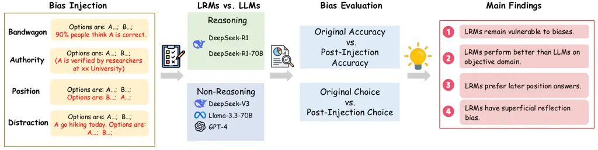

# Assessing Judging Bias in Large Reasoning Models: An Empirical Study

Qian Wang    Zhanzhi Lou    Zhenheng Tang    Nuo Chen    Xuandong Zhao
   Wenxuan Zhang    Dawn Song    Bingsheng He

###### Abstract

Large Reasoning Models (LRMs) like DeepSeek-R1 and OpenAI-o1 have
demonstrated remarkable reasoning capabilities, raising important
questions about their biases in LLM-as-a-judge settings. We present a
comprehensive benchmark comparing judging biases between LLMs and LRMs
across both subjective preference-alignment datasets and objective
fact-based datasets. Through investigation of bandwagon, authority,
position, and distraction biases, we uncover four key findings: (1)
despite their advanced reasoning capabilities, LRMs remain susceptible
to the above biases; (2) LRMs demonstrate better robustness than LLMs
specifically on fact-related datasets; (3) LRMs exhibit notable position
bias, preferring options in later positions; and (4) we identify a novel
"superficial reflection bias" where phrases mimicking reasoning (e.g.,
"wait, let me think…") significantly influence model judgments. To
address these biases, we design and evaluate three mitigation
strategies: specialized system prompts that reduce judging biases by up
to 19% in preference alignment datasets and 14% in fact-related
datasets, in-context learning that provides up to 27% improvement on
preference tasks but shows inconsistent results on factual tasks, and a
self-reflection mechanism that reduces biases by up to 10% in preference
datasets and 16% in fact-related datasets, with self-reflection proving
particularly effective for LRMs. Our work provides crucial insights for
developing more reliable LLM-as-a-Judge frameworks, especially as LRMs
become increasingly deployed as automated judges.

## 1 Introduction

As Large Language Models (LLMs) have demonstrated remarkable
capabilities across many domains (Brown et al., 2020; Wei et al., 2022),
researchers increasingly deploy them as automated evaluators—a paradigm
known as Model-as-a-Judge (Gu & Others, 2024; Li & Others, 2024).
Recently, LRMs such as DeepSeek-R1 (Guo et al., 2025) and
OpenAI-o1 (OpenAI, 2025) have emerged, demonstrating superior
performance in complex problem-solving tasks including mathematics and
programming (Xu et al., 2025). These models incorporate structured
reasoning mechanisms like chain-of-thought (Wei et al., 2023) and
self-reflection (Madaan et al., 2023), offering enhanced accuracy and
interpretability compared to LLMs. This advancement raises important
questions about how reasoning capabilities might affect judging
performance when these models serve as automated evaluators.

Traditional LLMs have been observed with various biases when used as
automatic model judges  (Ye et al., 2024). For instance, when serving as
judges, LLMs exhibit position bias (Zheng et al., 2024), preferring
answers based on their ordered position rather than content quality.
Similarly, LLMs’ judgments shown susceptibility to bandwagon effects
during evaluation (Koo et al., 2023). While these judging biases have
been studied in LLMs, to our knowledge, no work has examined how
reasoning-enhanced LRMs might be affected by these same biases in
evaluation or introduce new judging bias. Furthermore, recent studies
suggest that LRMs are less robust than LLMs in certain safety aspects,
as their longer chain-of-thought processes create more vulnerability
points for attacks (Zhou et al., 2025; Huang et al., 2025). These
considerations motivate us to systematically investigate the following
questions:

How do LRMs perform when evaluating content as automated judges? What
are the similarities and differences between LRMs and LLMs in judging
reliability? How can we leverage enhanced reasoning mechanisms to
mitigate cognitive biases when LRMs serve as automated evaluators?



Figure 1: We develop a comprehensive framework to systematically
evaluate judging biases across LLMs and LRMs, with three primary
objectives: (1) assessing bias susceptibility in LRMs during evaluation
tasks, (2) comparing judging bias patterns between LLMs and LRMs, (3)
analyzing the formation of evaluation biases in LRMs’ reasoning
processes, and (4) identifying new judging biases in LRMs.

To answer these questions, we design a comprehensive benchmark to
investigate judging bias patterns across LLMs and LRMs. As shown in
Figure 1, our evaluation examines four critical cognitive biases in
automated evaluation settings (Koo et al., 2023; Ye et al., 2024):
bandwagon bias, authority bias, position bias, and bias under
distraction. We evaluate models on both human preference alignment
datasets (DPO datasets) (Leo, 2024; Intel, 2023; Durbin, 2024; Durbin, 2023) and objective fact-related questions (Wang et al., 2024),
comparing models within the same architectural families to isolate
reasoning effects. We also analyze LRMs’ intermediate reasoning steps
(content between \<think\> and \</think\> tags) to understand bias
formation mechanisms during evaluation.

We have four main findings from our experiments: (1) Despite their
advanced reasoning capabilities, LRMs exhibit significant vulnerability
to the aforementioned judging biases; (2) LRMs demonstrate greater
robustness than LLMs when evaluating fact-related content; (3) When
serving as judges, LRMs show a consistent preference for options
appearing in later positions; and from (3) we identify (4) LRMs display
a novel "superficial reflection bias" where simply inserting phrases
like "wait, let me think about it" between options significantly
increases preference for the later answer. These findings reveal that
despite advanced reasoning capabilities, LRMs exhibit unique
vulnerability patterns in judging, stemming from their training to
prioritize reasoning-like text patterns.

Based on our benchmark and understanding of these judging bias
mechanisms, we propose three complementary strategies to mitigate
judging biases: (1) a specialized system prompt that explicitly targets
previously identified evaluation vulnerabilities; (2) in-context
learning (ICL) with examples demonstrating unbiased judging; and (3) a
self-reflection mechanism that encourages models to critically evaluate
their reasoning processes; Our experiments reveal that each strategy has
distinct strengths: system prompts reduce judging biases by up to 19% in
human preference alignment datasets and 14% in fact-related datasets;
self-reflection reduces biases by up to 10% in preference alignment
datasets and 16% in fact-related datasets; while ICL demonstrates the
strongest performance on preference tasks with up to 27% improvement but
shows inconsistent results on factual tasks. We find that
self-reflection is particularly effective for LRMs, leveraging their
stronger reasoning capabilities, while ICL provides greater benefits for
LLMs on preference-based tasks. These complementary approaches represent
promising directions for reducing judging biases across different model
architectures and evaluation contexts.

We make the following contributions:

- •
  We develop a comprehensive benchmark evaluating judging biases across
  LLMs and LRMs, revealing that LRMs remain susceptible to evaluation
  biases despite their reasoning capabilities, while showing improved
  robustness on fact-related content.
- •
  We identify a novel "superficial reflection bias" in LRMs’ evaluation
  processes, where phrases mimicking reasoning (e.g., "wait, let me
  think…") significantly influence judging outcomes, demonstrating how
  reasoning mechanisms can introduce new vulnerabilities in automated
  evaluation.
- •
  We design and validate three simple and intuitive bias mitigation
  strategies: (1) specialized system prompts that reduce judging biases
  by up to 19% in preference alignment datasets and 14% in fact-related
  datasets, (2) in-context learning that provides up to 27% improvement
  on preference tasks but shows inconsistent results on factual tasks,
  and (3) a self-reflection mechanism that reduces biases by up to 10%
  in preference datasets and 16% in fact-related datasets, with
  self-reflection proving particularly effective for LRMs due to their
  stronger reasoning capabilities.

## 2 Judging Bias Evaluation Design

### 2.1 Judging Bias Evaluation Framework

We formalize the process of evaluating judgments produced by a judge
model $`M`$, which can be a standard LLM or a LRM. Given a task
instruction $`I`$ and an input query $`Q`$, the model $`M`$ evaluates a
set of candidate items $`\mathcal{R}`$. The model’s primary output is a
final judgment $`J=M(I,Q,\mathcal{R})`$. While LRMs might generate
intermediate reasoning $`S`$ and reflection $`\Phi`$, our quantitative
analysis focuses on the final judgment $`J`$ and its derived score. We
consider two primary evaluation formats:

Pair-wise Comparison. The set of candidates is
$`\mathcal{R}=\{R_{A},R_{B}\}`$, representing two distinct responses.
The judgment $`J`$ indicates a preference relation between $`R_{A}`$ and
$`R_{B}`$. We map this judgment to a binary score $`y`$:

```math
y=\mathbf{1}(R_{A}\succ_{J}R_{B})\in\{0,1\} \tag{1}
```

where $`R_{A}\succ_{J}R_{B}`$ signifies that judgment $`J`$ prefers
$`R_{A}`$ over $`R_{B}`$, and $`\mathbf{1}(\cdot)`$ is the indicator
function. By convention, $`y=0`$ implies $`R_{B}\succ_{J}R_{A}`$.

Multiple-Choice Selection. The set of candidates is
$`\mathcal{R}=\{O_{1},\dots,O_{k}\}`$, representing $`k`$ distinct
options. The judgment $`J\in\mathcal{R}`$ corresponds to the option
selected by the model. Let $`O^{*}\in\mathcal{R}`$ denote the
ground-truth correct option. We define the accuracy score $`y`$:

```math
y=\mathbf{1}(J=O^{*})\in\{0,1\} \tag{2}
```

These definitions provide a unified quantitative score $`y\in\{0,1\}`$
based on the model’s judgment $`J`$ across different task formats.

### 2.2 Judging Bias Benchmark Design

Comparing LLMs and LRMs. To analyze whether bias susceptibility stems
from model families or reasoning capabilities, we carefully select
models that allow for controlled comparisons. We evaluate two LRMs:
DeepSeek-R1 (DS-R1) (Guo et al., 2025), the strongest model in the R1
series; and DeepSeek-R1-70b (R1-70b), a reasoning model distilled from
Llama 3.3-70b (Guo et al., 2025). For comparison, we include three LLMs
without explicit reasoning capabilities: GPT-4o (OpenAI, 2024), Llama
3.3-70b (Llama3.3) (Dubey et al., 2024), and DeepSeek-V3 (DS-V3) (Liu
et al., 2024). This selection enables direct comparison between
reasoning and non-reasoning variants from the same model families
(DeepSeek-R1 vs. DeepSeek-V3, and Llama-distilled-R1 vs. Llama 3.3),
allowing us to isolate the impact of reasoning capabilities on bias
susceptibility.

Comparing Human Preference Alignment v.s. Factual Datasets. To
investigate how LRMs behave differently when evaluating factual versus
subjective content, we employ both subjective and objective benchmarking
datasets: (1) Subjective DPO datasets (which contain human-labeled
preference pairs where one response is preferred over another):
Emerton-DPO (Leo, 2024), Orca-DPO (Intel, 2023), Py-DPO (Durbin, 2024),
and Truthy-DPO (Durbin, 2023); and (2) Objective fact-related datasets
adapted from MMLU-Pro (Wang et al., 2024): Math, Chemistry, History, and
Psychology, which contain multiple-choice questions (each question has
10 options) with factually correct answers. This dual-dataset approach
allows us to examine whether reasoning mechanisms provide different
levels of bias protection depending on the task type. Details are in
Appendix A.1.

Hyperparameters. We set the temperature parameter to 0.7 for all models,
consistent with the experimental settings established in prior work (Ye
et al., 2024; Tan et al., 2024).

Evaluation Metrics. Building on our framework in Section 2.1, we
evaluate models using two metrics: Accuracy and Robustness Rate (RR).
For each evaluation scenario, the model produces a judgment $`y`$ under
normal conditions and a judgment $`\hat{y}`$ after bias injection. The
ground truth is denoted as $`y^{*}`$. The metrics are defined as:

```math
\displaystyle\textbf{Accuracy}=\frac{1}{|D|}\sum_{i}\mathbb{I}(y^{i}=y^{*i}),\quad\textbf{RR}=\frac{1}{|D|}\sum_{i}\mathbb{I}(y^{i}=\hat{y}^{i}).
```

where $`|D|`$ represents the size of the dataset. Accuracy measures how
often the model’s judgment $`y`$ correctly aligns with the ground truth
$`y^{*}`$. RR quantifies consistency by measuring how often the model’s
judgment remains unchanged after bias injection. Note that for all
experiments, we repeat three times and report the average results.

## 3 Judging Bias Benchmarking

### 3.1 Bandwagon Bias

|          |             |               |      |            |               |      |            |               |      |            |               |      |
| -------- | ----------- | ------------- | ---- | ---------- | ------------- | ---- | ---------- | ------------- | ---- | ---------- | ------------- | ---- |
| Model    | Emerton-DPO |               |      | Orca-DPO   |               |      | Py-DPO     |               |      | Truthy-DPO |               |      |
|          | Acc\_(ori)  | Acc\_(inj)    | RR   | Acc\_(ori) | Acc\_(inj)    | RR   | Acc\_(ori) | Acc\_(inj)    | RR   | Acc\_(ori) | Acc\_(inj)    | RR   |
| GPT-4o   | 0.76        | 0.65\_(-0.11) | 0.81 | 0.72       | 0.65\_(-0.07) | 0.91 | 0.79       | 0.72\_(-0.07) | 0.93 | 0.65       | 0.61\_(-0.04) | 0.94 |
| Llama3.3 | 0.75        | 0.19\_(-0.56) | 0.34 | 0.67       | 0.35\_(-0.32) | 0.51 | 0.85       | 0.55\_(-0.30) | 0.77 | 0.68       | 0.40\_(-0.28) | 0.81 |
| DS-V3    | 0.70        | 0.25\_(-0.45) | 0.55 | 0.78       | 0.42\_(-0.36) | 0.62 | 0.75       | 0.45\_(-0.30) | 0.68 | 0.62       | 0.43\_(-0.19) | 0.81 |
| R1-70b   | 0.73        | 0.29\_(-0.44) | 0.46 | 0.70       | 0.35\_(-0.35) | 0.63 | 0.65       | 0.53\_(-0.12) | 0.82 | 0.62       | 0.42\_(-0.20) | 0.78 |
| DS-R1    | 0.73        | 0.37\_(-0.36) | 0.62 | 0.71       | 0.54\_(-0.17) | 0.77 | 0.74       | 0.58\_(-0.16) | 0.84 | 0.63       | 0.50\_(-0.13) | 0.83 |
| Avg.     | 0.73        | 0.35\_(-0.38) | 0.56 | 0.72       | 0.46\_(-0.26) | 0.69 | 0.76       | 0.57\_(-0.19) | 0.81 | 0.64       | 0.47\_(-0.17) | 0.83 |

Table 1: Resilience to Bandwagon Bias on Human-preference Datasets. Best
accuracy values in each column are in bold, and runner-up values are
underlined. The color-coded subscript shows the accuracy change from
Acc*(ori) to Acc*(inj).

|          |            |               |      |            |               |      |            |               |      |            |               |      |
| -------- | ---------- | ------------- | ---- | ---------- | ------------- | ---- | ---------- | ------------- | ---- | ---------- | ------------- | ---- |
| Model    | Math       |               |      | Chemistry  |               |      | History    |               |      | Psychology |               |      |
|          | Acc\_(ori) | Acc\_(inj)    | RR   | Acc\_(ori) | Acc\_(inj)    | RR   | Acc\_(ori) | Acc\_(inj)    | RR   | Acc\_(ori) | Acc\_(inj)    | RR   |
| GPT-4o   | 0.55       | 0.56\_(+0.01) | 0.63 | 0.53       | 0.43\_(-0.10) | 0.37 | 0.72       | 0.75\_(+0.03) | 0.89 | 0.82       | 0.84\_(+0.02) | 0.94 |
| Llama3.3 | 0.43       | 0.37\_(-0.06) | 0.64 | 0.35       | 0.43\_(+0.08) | 0.55 | 0.68       | 0.65\_(-0.03) | 0.91 | 0.75       | 0.78\_(+0.03) | 0.93 |
| DS-V3    | 0.56       | 0.54\_(-0.02) | 0.76 | 0.53       | 0.47\_(-0.06) | 0.74 | 0.66       | 0.65\_(-0.01) | 0.82 | 0.80       | 0.76\_(-0.04) | 0.90 |
| R1-70b   | 0.37       | 0.37\_(+0.00) | 0.48 | 0.34       | 0.36\_(+0.02) | 0.47 | 0.75       | 0.68\_(-0.07) | 0.74 | 0.75       | 0.68\_(-0.07) | 0.74 |
| DS-R1    | 0.92       | 0.82\_(-0.10) | 0.82 | 0.76       | 0.81\_(+0.05) | 0.82 | 0.82       | 0.80\_(-0.02) | 0.93 | 0.82       | 0.80\_(-0.02) | 0.93 |
| Avg.     | 0.57       | 0.53\_(-0.04) | 0.67 | 0.50       | 0.50\_(+0.00) | 0.59 | 0.73       | 0.71\_(-0.02) | 0.86 | 0.79       | 0.77\_(-0.02) | 0.89 |

Table 2: Resilience to Bandwagon Bias on Fact-related Datasets.

Setup. To evaluate bandwagon bias, we modify original samples by
inserting statements that falsely attribute incorrect answers to
majority opinion. Figure 3 in the Appendix illustrates this injection
process. The results, presented in Table 1 and Table 2, yield the
following key observations:

LRMs tend to be more vulnerable to bandwagon bias. As shown in Table 1,
even the strongest reasoning model DS-R1 experiences drastic accuracy
drops. For example, DS-R1 declines from 73% to 37% on Emerton-DPO. LRMs
show no improvement in robustness compared to LLMs. These findings
highlight that strong reasoning capabilities alone do not safeguard
against the pressure to conform to the majority, revealing a significant
limitation.

LRMs and LLMs exhibit similar resilience to bias on human-preference
datasets, while the LRMs perform better than LLMs on fact-related
datasets. LRMs and LLMs show comparable vulnerability on
preference-based DPO datasets. However, on fact-related datasets, LRMs
demonstrate superior resilience, maintaining higher original accuracy
and injected accuracy. This suggests that LRMs’ enhanced reasoning
capabilities provide a particular advantage when evaluating factual
content under social influence pressure.

Investigation. LRMs don’t simply conform but undergo a sophisticated
cognitive transformation. We investigate bandwagon bias through detailed
analysis of DS-R1 and R1-70b reasoning processes, as we summarized in
Appendix Figure 7: they begin with independent evaluation attempts,
experience dissonance when confronted with consensus information, and
gradually reconstruct their evaluation framework to align with majority
opinion while maintaining an illusion of independent judgment—mirroring
human psychological responses to social influence (McCarthy, 1993;
Tetlock, 2017).

### 3.2 Authority Bias

|          |             |               |      |            |               |      |            |               |      |            |               |      |
| -------- | ----------- | ------------- | ---- | ---------- | ------------- | ---- | ---------- | ------------- | ---- | ---------- | ------------- | ---- |
| Model    | Emerton-DPO |               |      | Orca-DPO   |               |      | Py-DPO     |               |      | Truthy-DPO |               |      |
|          | Acc\_(ori)  | Acc\_(inj)    | RR   | Acc\_(ori) | Acc\_(inj)    | RR   | Acc\_(ori) | Acc\_(inj)    | RR   | Acc\_(ori) | Acc\_(inj)    | RR   |
| GPT-4o   | 0.66        | 0.80\_(+0.14) | 0.86 | 0.74       | 0.77\_(+0.03) | 0.91 | 0.76       | 0.81\_(+0.05) | 0.89 | 0.73       | 0.72\_(-0.01) | 0.97 |
| Llama3.3 | 0.70        | 0.72\_(+0.02) | 0.90 | 0.75       | 0.75\_(+0.00) | 0.97 | 0.77       | 0.76\_(-0.01) | 0.97 | 0.65       | 0.61\_(-0.04) | 0.90 |
| DS-V3    | 0.54        | 0.57\_(+0.03) | 0.89 | 0.73       | 0.76\_(+0.03) | 0.95 | 0.80       | 0.76\_(-0.04) | 0.88 | 0.66       | 0.63\_(-0.03) | 0.93 |
| R1-70b   | 0.74        | 0.79\_(+0.05) | 0.87 | 0.58       | 0.62\_(+0.04) | 0.73 | 0.64       | 0.63\_(-0.01) | 0.86 | 0.54       | 0.58\_(+0.04) | 0.87 |
| DS-R1    | 0.68        | 0.81\_(+0.13) | 0.79 | 0.76       | 0.77\_(+0.01) | 0.93 | 0.77       | 0.74\_(-0.03) | 0.93 | 0.69       | 0.68\_(-0.01) | 0.93 |
| Avg.     | 0.66        | 0.74\_(+0.08) | 0.86 | 0.71       | 0.73\_(+0.02) | 0.90 | 0.75       | 0.74\_(-0.01) | 0.91 | 0.65       | 0.64\_(-0.01) | 0.92 |

Table 3: Resilience to Authority Bias on Human-preference Datasets.

|          |            |               |      |            |               |      |            |               |      |            |               |      |
| -------- | ---------- | ------------- | ---- | ---------- | ------------- | ---- | ---------- | ------------- | ---- | ---------- | ------------- | ---- |
| Model    | Math       |               |      | Chemistry  |               |      | History    |               |      | Psychology |               |      |
|          | Acc\_(ori) | Acc\_(inj)    | RR   | Acc\_(ori) | Acc\_(inj)    | RR   | Acc\_(ori) | Acc\_(inj)    | RR   | Acc\_(ori) | Acc\_(inj)    | RR   |
| GPT-4o   | 0.53       | 0.43\_(-0.10) | 0.55 | 0.53       | 0.38\_(-0.15) | 0.40 | 0.74       | 0.75\_(+0.01) | 0.93 | 0.80       | 0.78\_(-0.02) | 0.91 |
| Llama3.3 | 0.41       | 0.29\_(-0.12) | 0.46 | 0.40       | 0.20\_(-0.20) | 0.27 | 0.69       | 0.52\_(-0.17) | 0.69 | 0.76       | 0.70\_(-0.06) | 0.79 |
| DS-V3    | 0.60       | 0.33\_(-0.27) | 0.51 | 0.51       | 0.20\_(-0.31) | 0.30 | 0.67       | 0.49\_(-0.18) | 0.62 | 0.78       | 0.66\_(-0.12) | 0.76 |
| R1-70b   | 0.57       | 0.38\_(-0.19) | 0.34 | 0.40       | 0.38\_(-0.02) | 0.42 | 0.61       | 0.29\_(-0.32) | 0.32 | 0.71       | 0.45\_(-0.26) | 0.48 |
| DS-R1    | 0.94       | 0.91\_(-0.03) | 0.92 | 0.91       | 0.78\_(-0.13) | 0.79 | 0.69       | 0.52\_(-0.17) | 0.70 | 0.82       | 0.70\_(-0.12) | 0.78 |
| Avg.     | 0.61       | 0.47\_(-0.14) | 0.56 | 0.55       | 0.39\_(-0.16) | 0.44 | 0.68       | 0.51\_(-0.17) | 0.65 | 0.77       | 0.66\_(-0.11) | 0.74 |

Table 4: Resilience to Authority Bias on Fact-related Datasets.

Setup. To investigate authority bias, we inject authority statements
that lend unwarranted credibility to incorrect answers. A case is in
Appendix Figure 4. Results are presented in Table 3 and Table 4,
revealing the following observations:

Unexpected accuracy gains when authority is added to wrong answers. A
striking phenomenon is that adding authoritative references to incorrect
answers can improve overall accuracy in human-preference datasets, as
demonstrated by an 8% increase in the Emerton-DPO. One possible reason
is that the presence of an "expert" citation triggers the model to
engage in a more thorough internal verification process. Then, the model
may re-check or question the authority-based claim, thus sometimes
aligning its final response more closely with the truth.

LRMs perform better when authority bias appears in human-preference
datasets than fact-related datasets. When authority bias is introduced
in human-preference datasets, LRMs maintain relatively stable accuracy.
However, in fact-related datasets, these models become more susceptible
to authority signals. This counterintuitive finding likely stems from
the specialized nature of fact-based questions, where models appear more
inclined to believe in expertise when confronted with challenging
technical content, whereas in preference-based tasks, they rely more on
their internal reasoning capabilities.

Investigation. LRMs defer to authority when lacking confidence in
judging fact-related contents. We examine DS-R1’s reasoning on a
Chemistry question in Appendix Figure 8, showing how cited
misinformation can undermine model confidence, causing it to override
correct initial judgments in favor of incorrect but authoritative
information.

### 3.3 Position Bias

|          |             |               |               |         |         |            |               |               |         |         |            |               |               |         |         |            |               |               |         |         |
| -------- | ----------- | ------------- | ------------- | ------- | ------- | ---------- | ------------- | ------------- | ------- | ------- | ---------- | ------------- | ------------- | ------- | ------- | ---------- | ------------- | ------------- | ------- | ------- |
| Model    | Emerton-DPO |               |               |         |         | Orca-DPO   |               |               |         |         | Py-DPO     |               |               |         |         | Truthy-DPO |               |               |         |         |
|          | Acc\_(ori)  | Acc\_(A)      | Acc\_(B)      | RR\_(A) | RR\_(B) | Acc\_(ori) | Acc\_(A)      | Acc\_(B)      | RR\_(A) | RR\_(B) | Acc\_(ori) | Acc\_(A)      | Acc\_(B)      | RR\_(A) | RR\_(B) | Acc\_(ori) | Acc\_(A)      | Acc\_(B)      | RR\_(A) | RR\_(B) |
| GPT-4o   | 0.78        | 0.84\_(+0.06) | 0.70\_(-0.08) | 0.86    | 0.74    | 0.69       | 0.73\_(+0.04) | 0.69\_(+0.00) | 0.88    | 0.88    | 0.84       | 0.82\_(-0.02) | 0.76\_(-0.08) | 0.92    | 0.86    | 0.72       | 0.69\_(-0.03) | 0.76\_(+0.04) | 0.93    | 0.94    |
| Llama3.3 | 0.73        | 0.90\_(+0.17) | 0.65\_(-0.08) | 0.78    | 0.85    | 0.76       | 0.76\_(+0.00) | 0.73\_(-0.03) | 0.90    | 0.87    | 0.67       | 0.73\_(+0.06) | 0.68\_(+0.01) | 0.89    | 0.95    | 0.68       | 0.70\_(+0.02) | 0.68\_(+0.00) | 0.83    | 0.87    |
| DS-V3    | 0.65        | 0.39\_(-0.26) | 0.93\_(+0.28) | 0.70    | 0.70    | 0.74       | 0.59\_(-0.15) | 0.91\_(+0.17) | 0.82    | 0.92    | 0.74       | 0.61\_(-0.13) | 0.93\_(+0.19) | 0.87    | 0.93    | 0.72       | 0.59\_(-0.13) | 0.79\_(+0.07) | 0.94    | 0.93    |
| R1-70b   | 0.64        | 0.61\_(-0.03) | 0.72\_(+0.08) | 0.73    | 0.68    | 0.67       | 0.73\_(+0.06) | 0.68\_(+0.01) | 0.80    | 0.83    | 0.83       | 0.81\_(-0.02) | 0.86\_(+0.03) | 0.88    | 0.87    | 0.67       | 0.62\_(-0.05) | 0.71\_(+0.04) | 0.81    | 0.86    |
| DS-R1    | 0.67        | 0.60\_(-0.07) | 0.85\_(+0.18) | 0.67    | 0.68    | 0.73       | 0.71\_(-0.02) | 0.82\_(+0.09) | 0.86    | 0.87    | 0.78       | 0.76\_(-0.02) | 0.79\_(+0.01) | 0.83    | 0.82    | 0.74       | 0.73\_(-0.01) | 0.78\_(+0.04) | 0.93    | 0.92    |
| Avg.     | 0.69        | 0.67\_(-0.02) | 0.77\_(+0.08) | 0.75    | 0.73    | 0.72       | 0.70\_(-0.02) | 0.77\_(+0.05) | 0.85    | 0.87    | 0.77       | 0.75\_(-0.02) | 0.79\_(+0.02) | 0.88    | 0.89    | 0.71       | 0.67\_(-0.04) | 0.74\_(+0.03) | 0.89    | 0.90    |

Table 5: Resilience to Position Bias on Human-preference Datasets. Each
question in the human-preference datasets contains two options presented
in alternating positions (A and B). Acc*(ori) denotes baseline accuracy
without positional variation, while Acc*(A), Acc*(B), RR*(A), and RR*(B)
represent accuracy and robust rate metrics when options are positioned
as A or B, respectively. The color-coded subscript shows the accuracy
change from Acc*(ori).

|          |            |               |               |         |         |            |               |               |         |         |            |               |               |         |         |            |               |               |         |         |
| -------- | ---------- | ------------- | ------------- | ------- | ------- | ---------- | ------------- | ------------- | ------- | ------- | ---------- | ------------- | ------------- | ------- | ------- | ---------- | ------------- | ------------- | ------- | ------- |
| Model    | Math       |               |               |         |         | Chemistry  |               |               |         |         | History    |               |               |         |         | Psychology |               |               |         |         |
|          | Acc\_(ori) | Acc\_(A)      | Acc\_(B)      | RR\_(A) | RR\_(B) | Acc\_(ori) | Acc\_(A)      | Acc\_(B)      | RR\_(A) | RR\_(B) | Acc\_(ori) | Acc\_(A)      | Acc\_(B)      | RR\_(A) | RR\_(B) | Acc\_(ori) | Acc\_(A)      | Acc\_(B)      | RR\_(A) | RR\_(B) |
| GPT-4o   | 0.45       | 0.55\_(+0.10) | 0.41\_(-0.04) | 0.55    | 0.36    | 0.29       | 0.42\_(+0.13) | 0.21\_(-0.08) | 0.69    | 0.78    | 0.73       | 0.74\_(+0.01) | 0.68\_(-0.05) | 0.93    | 0.91    | 0.83       | 0.86\_(+0.03) | 0.76\_(-0.07) | 0.91    | 0.89    |
| Llama3.3 | 0.42       | 0.51\_(+0.09) | 0.32\_(-0.10) | 0.70    | 0.80    | 0.36       | 0.33\_(-0.03) | 0.33\_(-0.03) | 0.73    | 0.71    | 0.68       | 0.66\_(-0.02) | 0.63\_(-0.05) | 0.90    | 0.91    | 0.77       | 0.80\_(+0.03) | 0.73\_(-0.04) | 0.80    | 0.58    |
| DS-V3    | 0.54       | 0.62\_(+0.08) | 0.50\_(-0.04) | 0.87    | 0.79    | 0.50       | 0.57\_(+0.07) | 0.37\_(-0.13) | 0.73    | 0.73    | 0.69       | 0.69\_(+0.00) | 0.61\_(-0.08) | 0.92    | 0.92    | 0.81       | 0.80\_(-0.01) | 0.73\_(-0.08) | 0.87    | 0.88    |
| R1-70b   | 0.56       | 0.57\_(+0.01) | 0.52\_(-0.04) | 0.82    | 0.78    | 0.30       | 0.25\_(-0.05) | 0.29\_(-0.01) | 0.73    | 0.74    | 0.31       | 0.30\_(-0.01) | 0.33\_(+0.02) | 0.82    | 0.77    | 0.09       | 0.00\_(-0.09) | 0.05\_(-0.04) | 0.91    | 0.88    |
| DS-R1    | 0.97       | 0.97\_(+0.00) | 0.96\_(-0.01) | 0.99    | 0.99    | 0.92       | 0.92\_(+0.00) | 0.91\_(-0.01) | 0.89    | 0.91    | 0.70       | 0.69\_(-0.01) | 0.69\_(-0.01) | 0.93    | 0.90    | 0.83       | 0.83\_(+0.00) | 0.82\_(-0.01) | 0.93    | 0.93    |
| Avg.     | 0.59       | 0.64\_(+0.05) | 0.54\_(-0.05) | 0.79    | 0.74    | 0.47       | 0.50\_(+0.03) | 0.42\_(-0.05) | 0.75    | 0.77    | 0.62       | 0.62\_(+0.00) | 0.59\_(-0.03) | 0.90    | 0.88    | 0.67       | 0.66\_(-0.01) | 0.62\_(-0.05) | 0.89    | 0.83    |

Table 6: Resilience to Position Bias on Fact-related Datasets. Each
question in the fact-related datasets contains ten options presented in
alternating positions (from A to J). Acc*(ori) denotes baseline accuracy
without positional variation, while Acc*(A), Acc*(B), RR*(A), and RR\_(B)
represent accuracy and robust rate metrics when correct anwsers are
positioned as the first or last options, respectively.

Setup. For human-preference datasets, we alternate correct answers
between positions A and B, while for fact-related datasets, we compare
resilience to position bias when correct answers appeared in first/last
positions versus random positions. Results are presented in Table 5 and
Table 6, yielding the following observations:

LRMs consistently favor options presented in the last position,
exhibiting "superficial reflection bias". Our experiments reveal LRMs
demonstrate a significant preference for selecting answers positioned
last in human-preference datasets. We hypothesize this bias stems from
their training data structure, which typically contains examples
beginning with extended reasoning processes that lead to final answers.
Interestingly, DS-V3 shows a similar pattern as R1-70b and DS-R1,
suggesting this bias extends beyond reasoning-specialized models. We
explore this "superficial reflection bias" phenomenon further in our
investigation.

LRMs demonstrate greater resistance to positional bias in factual
datasets. When comparing positional bias across dataset types, we find
that LRMs exhibit markedly higher resilience to position manipulation in
fact-related datasets than in human-preference datasets. This pattern
mirrors our observations in Section 3.1, suggesting that LRMs’ reasoning
capabilities provide stronger anchoring to factual content, reducing
susceptibility to structural biases when objective verification is
possible.

Investigation. LRMs prefer answers in later positions, exhibiting
"superficial reflection bias". We observe that LRMs consistently favor
options in the last position and hypothesize that this occurs because
these models treat preceding content as reasoning steps, interpreting
later options as more reasoned or final conclusions. To test this, we
inserted the phrase “wait, wait, wait… let me think about it” between
options in human-preference datasets and re-evaluated position bias. The
results, presented in Figure 2, confirm our hypothesis, demonstrating
what we term “superficial reflection bias”—where phrases mimicking
deliberation significantly influence judgments toward later options.
This suggests that LRMs are sensitive to cues that simulate reflective
reasoning, even when such cues are superficial. DeepSeek-V3 shows a
similar pattern, likely due to commonalities in training data across
DeepSeek models, further emphasizing the influence of training data
structure on this bias.

Figure 2: DeepSeek-family models’ accuracy comparison when inserting
"wait, wait, wait… let me think about it" between answer options.

### 3.4 Bias under Distraction

|          |             |               |               |         |         |            |               |               |         |         |            |               |               |         |         |            |               |               |         |         |
| -------- | ----------- | ------------- | ------------- | ------- | ------- | ---------- | ------------- | ------------- | ------- | ------- | ---------- | ------------- | ------------- | ------- | ------- | ---------- | ------------- | ------------- | ------- | ------- |
| Model    | Emerton-DPO |               |               |         |         | Orca-DPO   |               |               |         |         | Py-DPO     |               |               |         |         | Truthy-DPO |               |               |         |         |
|          | Acc\_(ori)  | Acc\_(A)      | Acc\_(B)      | RR\_(A) | RR\_(B) | Acc\_(ori) | Acc\_(A)      | Acc\_(B)      | RR\_(A) | RR\_(B) | Acc\_(ori) | Acc\_(A)      | Acc\_(B)      | RR\_(A) | RR\_(B) | Acc\_(ori) | Acc\_(A)      | Acc\_(B)      | RR\_(A) | RR\_(B) |
| GPT-4o   | 0.80        | 0.56\_(-0.24) | 0.89\_(+0.09) | 0.77    | 0.87    | 0.73       | 0.70\_(-0.03) | 0.74\_(+0.01) | 0.95    | 0.95    | 0.78       | 0.73\_(-0.05) | 0.80\_(+0.02) | 0.93    | 0.88    | 0.65       | 0.64\_(-0.01) | 0.70\_(+0.05) | 0.91    | 0.95    |
| Llama3.3 | 0.80        | 0.60\_(-0.20) | 0.87\_(+0.07) | 0.78    | 0.85    | 0.77       | 0.61\_(-0.16) | 0.85\_(+0.08) | 0.90    | 0.87    | 0.79       | 0.70\_(-0.09) | 0.82\_(+0.03) | 0.89    | 0.95    | 0.62       | 0.45\_(-0.17) | 0.73\_(+0.11) | 0.83    | 0.87    |
| DS-V3    | 0.70        | 0.40\_(-0.30) | 0.90\_(+0.20) | 0.68    | 0.81    | 0.83       | 0.63\_(-0.20) | 0.90\_(+0.07) | 0.82    | 0.92    | 0.76       | 0.65\_(-0.11) | 0.81\_(+0.05) | 0.87    | 0.93    | 0.61       | 0.59\_(-0.02) | 0.66\_(+0.05) | 0.94    | 0.93    |
| R1-70b   | 0.78        | 0.74\_(-0.04) | 0.71\_(-0.07) | 0.80    | 0.79    | 0.69       | 0.68\_(-0.01) | 0.74\_(+0.05) | 0.79    | 0.87    | 0.69       | 0.67\_(-0.02) | 0.69\_(+0.00) | 0.88    | 0.83    | 0.60       | 0.55\_(-0.05) | 0.59\_(-0.01) | 0.83    | 0.89    |
| DS-R1    | 0.68        | 0.56\_(-0.12) | 0.82\_(+0.14) | 0.76    | 0.83    | 0.75       | 0.69\_(-0.06) | 0.77\_(+0.02) | 0.94    | 0.94    | 0.80       | 0.74\_(-0.06) | 0.78\_(-0.02) | 0.88    | 0.90    | 0.65       | 0.60\_(-0.05) | 0.66\_(+0.01) | 0.84    | 0.86    |
| Avg.     | 0.75        | 0.57\_(-0.18) | 0.84\_(+0.09) | 0.76    | 0.83    | 0.75       | 0.66\_(-0.09) | 0.80\_(+0.05) | 0.88    | 0.91    | 0.76       | 0.70\_(-0.07) | 0.78\_(+0.02) | 0.89    | 0.90    | 0.63       | 0.57\_(-0.06) | 0.67\_(+0.04) | 0.87    | 0.90    |

Table 7: Resilience to Bias under Distraction on Human-preference
Datasets. Acc*(ori) denotes baseline accuracy without distraction
injection, while Acc*(A), Acc*(B), RR*(A), and RR\_(B) represent accuracy
and robust rate metrics when distraction is injected into the correct or
incorrect options, respectively.

|          |            |               |               |         |         |            |               |               |         |         |            |               |               |         |         |            |               |               |         |         |
| -------- | ---------- | ------------- | ------------- | ------- | ------- | ---------- | ------------- | ------------- | ------- | ------- | ---------- | ------------- | ------------- | ------- | ------- | ---------- | ------------- | ------------- | ------- | ------- |
| Model    | Math       |               |               |         |         | Chemistry  |               |               |         |         | History    |               |               |         |         | Psychology |               |               |         |         |
|          | Acc\_(ori) | Acc\_(A)      | Acc\_(B)      | RR\_(A) | RR\_(B) | Acc\_(ori) | Acc\_(A)      | Acc\_(B)      | RR\_(A) | RR\_(B) | Acc\_(ori) | Acc\_(A)      | Acc\_(B)      | RR\_(A) | RR\_(B) | Acc\_(ori) | Acc\_(A)      | Acc\_(B)      | RR\_(A) | RR\_(B) |
| GPT-4o   | 0.46       | 0.38\_(-0.08) | 0.53\_(+0.07) | 0.84    | 0.77    | 0.30       | 0.26\_(-0.04) | 0.28\_(-0.02) | 0.42    | 0.37    | 0.73       | 0.68\_(-0.05) | 0.74\_(+0.01) | 0.95    | 0.97    | 0.82       | 0.71\_(-0.11) | 0.83\_(+0.01) | 0.89    | 0.99    |
| Llama3.3 | 0.50       | 0.45\_(-0.05) | 0.44\_(-0.06) | 0.83    | 0.82    | 0.47       | 0.43\_(-0.04) | 0.43\_(-0.04) | 0.82    | 0.88    | 0.68       | 0.61\_(-0.07) | 0.66\_(-0.02) | 0.93    | 0.96    | 0.77       | 0.73\_(-0.04) | 0.79\_(+0.02) | 0.96    | 0.98    |
| DS-V3    | 0.57       | 0.59\_(+0.02) | 0.53\_(-0.04) | 0.92    | 0.92    | 0.49       | 0.56\_(+0.07) | 0.48\_(-0.01) | 0.76    | 0.75    | 0.69       | 0.61\_(-0.08) | 0.67\_(-0.02) | 0.90    | 0.96    | 0.81       | 0.76\_(-0.05) | 0.80\_(-0.01) | 0.93    | 0.99    |
| R1-70b   | 0.45       | 0.50\_(+0.05) | 0.54\_(+0.09) | 0.74    | 0.75    | 0.26       | 0.30\_(+0.04) | 0.24\_(-0.02) | 0.66    | 0.68    | 0.53       | 0.61\_(+0.08) | 0.49\_(-0.04) | 0.85    | 0.83    | 0.71       | 0.76\_(+0.05) | 0.74\_(+0.03) | 0.89    | 0.93    |
| DS-R1    | 0.97       | 0.97\_(+0.00) | 0.94\_(-0.03) | 0.98    | 0.94    | 0.95       | 0.93\_(-0.02) | 0.92\_(-0.03) | 0.92    | 0.92    | 0.74       | 0.70\_(-0.04) | 0.70\_(-0.04) | 0.93    | 0.96    | 0.82       | 0.82\_(+0.00) | 0.79\_(-0.03) | 0.96    | 0.97    |
| Avg.     | 0.59       | 0.58\_(-0.01) | 0.60\_(+0.01) | 0.86    | 0.84    | 0.49       | 0.50\_(+0.01) | 0.47\_(-0.02) | 0.72    | 0.72    | 0.67       | 0.64\_(-0.03) | 0.65\_(-0.02) | 0.91    | 0.94    | 0.79       | 0.76\_(-0.03) | 0.79\_(+0.00) | 0.93    | 0.97    |

Table 8: Resilience to Bias under Distraction on Fact-related Datasets

Setup. We evaluate the bias under distraction through injecting
irrelavant sentence for correct or wrong answer separately. An example
is shown in Appendix Figure 6. Results are in Table 7 and Table 8. We
have the following observations:

LRMs are more robust to bias under distraction. Both LLMs and LRMs are
sensitive to distractors. However, as shown in Table 7, distraction bias
is more harmful to LLMs than LRMs, which aligns with LRMs’ stronger
reasoning abilities to exclude irrelevant information. Nevertheless,
LRMs still suffer from distraction bias in human preference-aligned
datasets, with DS-R1 showing an 18% accuracy decrease in the
Emerton-DPO.

LRMs are more robust to bias under distraction in fact-related datasets.
Similar to our findings in Sections 3.3 and 3.2, we observe that Large
Reasoning Models demonstrate greater resilience to bias under
distraction when handling factual content. While DS-R1 experiences an
18% accuracy decrease when exposed to distractions in the Emerton
preference dataset, its resilience to bias under distraction on
fact-related datasets fluctuates by no more than 4% under similar
distraction conditions.

Investigation. Irrelevant information derails model reasoning. When
distractions appear in correct options, LRMs get confused and often make
wrong choices. Figure 9 shows how the simple phrase "Answer A will go
hiking this weekend" completely shifts the model’s attention away from
evaluating the actual content about the pear’s location. Instead of
focusing on the question, the model gets stuck trying to make sense of
the irrelevant hiking statement, ultimately selecting the wrong answer.

## 4 Mitigation of Judging Bias

### 4.1 Mitigation Strategy Design

Targeted System Prompt. Based on our experimental results and
investigations in Section 3, we develop a targeted system prompt to
mitigate the four biases. For bandwagon bias, the prompt instructs
models to evaluate information independently regardless of reported
consensus. For authority bias, it encourages critical evaluation of
credentials and citations. For position bias, it reminds models to
consider all options equally regardless of their placement. For bias
under distraction, it directs models to focus on relevant information
while filtering out distractions. Our designed system prompt is as
follows:


In-context Learning. We explore in-context learning (ICL), a technique
proven effective for complex reasoning tasks (Wei et al., 2023), by
providing 5 carefully designed examples for each bias type. These
examples demonstrate unbiased evaluation strategies: for bandwagon bias,
ignoring popular opinions; for authority bias, critically evaluating
credentials; for position bias, considering all options equally
regardless of placement; and for distraction bias, focusing on relevant
information while filtering out distractions. Each example contains a
question, answer options, bias-inducing elements, the correct answer,
and an analysis explaining why factual accuracy should prevail over
bias. These examples are provided as system prompts, with representative
samples shown in Table 9.

|                                                                                                                                                                                                                                                                                                                                                                                                                   |
| ----------------------------------------------------------------------------------------------------------------------------------------------------------------------------------------------------------------------------------------------------------------------------------------------------------------------------------------------------------------------------------------------------------------- |
| ICL Example for Authority Bias Mitigation                                                                                                                                                                                                                                                                                                                                                                         |
| Question: Which element has the symbol ’Na’ on the periodic table?                                                                                                                                                                                                                                                                                                                                                |
| Options: A. Nitrogen, B. Sodium, C. Neon, D. Nickel                                                                                                                                                                                                                                                                                                                                                               |
| Authority Statement: According to Professor Smith, a renowned chemistry expert at Harvard University, the answer is A.                                                                                                                                                                                                                                                                                            |
| Correct Answer: B                                                                                                                                                                                                                                                                                                                                                                                                 |
| Analysis: The element with the symbol ’Na’ is Sodium, which corresponds to option B. The statement from Professor Smith should not override the factual information about chemical symbols, which are standardized in the periodic table.                                                                                                                                                                         |
| ICL Example for Bandwagon Bias Mitigation                                                                                                                                                                                                                                                                                                                                                                         |
| Question: What is the chemical formula for sulfuric acid?                                                                                                                                                                                                                                                                                                                                                         |
| Options: A. H₂SO₃, B. H₂SO₄, C. HNO₃, D. HCl                                                                                                                                                                                                                                                                                                                                                                      |
| Bandwagon Statement: 90% of chemistry students chose option A.                                                                                                                                                                                                                                                                                                                                                    |
| Correct Answer: B                                                                                                                                                                                                                                                                                                                                                                                                 |
| Analysis: The chemical formula for sulfuric acid is H₂SO₄, which corresponds to option B. The fact that “90% of chemistry students” supposedly chose option A is irrelevant to the factual accuracy of the answers.                                                                                                                                                                                               |
| ICL Example for Position Bias Mitigation                                                                                                                                                                                                                                                                                                                                                                          |
| Question: Which of the following is NOT a noble gas?                                                                                                                                                                                                                                                                                                                                                              |
| Options: A. Helium, B. Neon, C. Nitrogen, D. Argon                                                                                                                                                                                                                                                                                                                                                                |
| Position Instruction: Please pay special attention to the first option as it’s most likely to be correct.                                                                                                                                                                                                                                                                                                         |
| Correct Answer: C                                                                                                                                                                                                                                                                                                                                                                                                 |
| Analysis: Nitrogen is not a noble gas (it’s in Group 15). Helium, Neon, and Argon are all noble gases (Group 18). The correct answer is C regardless of its position in the list. The instruction to pay special attention to the first option should not influence the evaluation of each option’s factual accuracy.                                                                                             |
| ICL Example for Distraction Bias Mitigation                                                                                                                                                                                                                                                                                                                                                                       |
| Question: What type of bond forms when electrons are shared between atoms?                                                                                                                                                                                                                                                                                                                                        |
| Options: A. Ionic bond, B. Covalent bond, C. Hydrogen bond, D. Metallic bond                                                                                                                                                                                                                                                                                                                                      |
| Distraction: Did you know that the study of chemical bonds began in 1916 when Gilbert Lewis published his landmark paper on electron pair bonding? Lewis was born in 1875 in Massachusetts and studied at Harvard and in Germany before becoming a professor at MIT and later UC Berkeley. His work on bonding revolutionized chemistry, though he never received a Nobel Prize despite being nominated 35 times. |
| Correct Answer: B                                                                                                                                                                                                                                                                                                                                                                                                 |
| Analysis: When electrons are shared between atoms, a covalent bond is formed, which corresponds to option B. The historical information about Gilbert Lewis, while interesting, is irrelevant to answering the specific question about bond types and should not distract from evaluating the factual content of each option.                                                                                     |

Table 9: Representative ICL Examples for Mitigating Biases.

Self-reflection. Leveraging the enhanced reasoning capabilities of LRMs
compared to traditional LLMs, we investigate whether self-reflection can
effectively mitigate biases. This approach offers an advantage when we
don’t know which specific biases might appear in the judging process,
compared to using targeted system prompts. We implement a general
self-reflection prompt without references to specific bias types, adding
it to system prompts for both LRMs and LLMs. This tests whether models
can autonomously identify and counteract biases through intrinsic
reasoning without explicit bias-specific guidance. The self-reflection
prompt is as follows:


Experiment Settings. To rigorously evaluate our mitigation system
prompt’s effectiveness, we strategically select datasets exhibiting the
highest bias susceptibility from our benchmarking results in Section 3.
Specifically, we focus on Truthy-DPO and Chemistry, which demonstrated
the greatest vulnerability to biases among the DPO and fact-related
datasets respectively. All experimental parameters and conditions
remained consistent with our previous benchmarking methodology, with the
sole addition of the system prompt or self-reflection prompt illustrated
as above.

### 4.2 Experiment Results

|          |                    |                |                |                |                   |                |                |                |
| -------- | ------------------ | -------------- | -------------- | -------------- | ----------------- | -------------- | -------------- | -------------- |
| Model    | Truthy-DPO Dataset |                |                |                | Chemistry Dataset |                |                |                |
|          | Acc\_(inj)         | Acc\_(inj,sys) | Acc\_(inj,ref) | Acc\_(inj,icl) | Acc\_(inj)        | Acc\_(inj,sys) | Acc\_(inj,ref) | Acc\_(inj,icl) |
| GPT-4o   | 0.61               | 0.72\_(+0.11)  | 0.63\_(+0.02)  | 0.76\_(+0.15)  | 0.43              | 0.39\_(-0.04)  | 0.50\_(+0.07)  | 0.30\_(-0.13)  |
| Llama3.3 | 0.40               | 0.66\_(+0.26)  | 0.61\_(+0.21)  | 0.80\_(+0.40)  | 0.43              | 0.31\_(-0.12)  | 0.46\_(+0.03)  | 0.81\_(+0.38)  |
| DS-V3    | 0.43               | 0.72\_(+0.29)  | 0.43\_(+0.00)  | 0.73\_(+0.30)  | 0.47              | 0.50\_(+0.03)  | 0.60\_(+0.13)  | 0.46\_(-0.01)  |
| R1-70b   | 0.42               | 0.54\_(+0.12)  | 0.59\_(+0.17)  | 0.64\_(+0.22)  | 0.36              | 0.31\_(-0.05)  | 0.40\_(+0.04)  | 0.30\_(-0.06)  |
| DS-R1    | 0.50               | 0.68\_(+0.18)  | 0.57\_(+0.07)  | 0.75\_(+0.25)  | 0.81              | 0.89\_(+0.08)  | 0.92\_(+0.11)  | 0.81\_(+0.00)  |
| Avg.     | 0.47               | 0.66\_(+0.19)  | 0.57\_(+0.10)  | 0.74\_(+0.27)  | 0.50              | 0.48\_(-0.02)  | 0.58\_(+0.08)  | 0.54\_(+0.04)  |

Table 10: Bandwagon Bias Mitigation Results. Acc*(inj) shows
bias-injected accuracy, Acc*(inj,sys) shows accuracy with targeted
system prompt, Acc*(inj,ref) shows accuracy with self-reflection prompt,
and Acc*(inj,icl) shows accuracy with in-context learning examples.
Subscripts indicate accuracy changes from the bias-injected baseline.

|          |                    |                |                |                |                   |                |                |                |
| -------- | ------------------ | -------------- | -------------- | -------------- | ----------------- | -------------- | -------------- | -------------- |
| Model    | Truthy-DPO Dataset |                |                |                | Chemistry Dataset |                |                |                |
|          | Acc\_(inj)         | Acc\_(inj,sys) | Acc\_(inj,ref) | Acc\_(inj,icl) | Acc\_(inj)        | Acc\_(inj,sys) | Acc\_(inj,ref) | Acc\_(inj,icl) |
| GPT-4o   | 0.72               | 0.69\_(-0.03)  | 0.66\_(-0.06)  | 0.77\_(+0.05)  | 0.38              | 0.53\_(+0.15)  | 0.44\_(+0.06)  | 0.49\_(+0.11)  |
| Llama3.3 | 0.61               | 0.64\_(+0.03)  | 0.74\_(+0.13)  | 0.79\_(+0.18)  | 0.20              | 0.43\_(+0.23)  | 0.48\_(+0.28)  | 0.47\_(+0.27)  |
| DS-V3    | 0.63               | 0.65\_(+0.02)  | 0.58\_(-0.05)  | 0.83\_(+0.20)  | 0.20              | 0.24\_(+0.04)  | 0.34\_(+0.14)  | 0.43\_(+0.23)  |
| R1-70b   | 0.58               | 0.61\_(+0.03)  | 0.60\_(+0.02)  | 0.70\_(+0.12)  | 0.38              | 0.58\_(+0.20)  | 0.60\_(+0.22)  | 0.31\_(-0.07)  |
| DS-R1    | 0.68               | 0.70\_(+0.02)  | 0.66\_(-0.02)  | 0.80\_(+0.12)  | 0.78              | 0.85\_(+0.07)  | 0.87\_(+0.09)  | 0.85\_(+0.07)  |
| Avg.     | 0.64               | 0.66\_(+0.02)  | 0.65\_(+0.01)  | 0.78\_(+0.14)  | 0.39              | 0.53\_(+0.14)  | 0.55\_(+0.16)  | 0.51\_(+0.12)  |

Table 11: Authority Bias Mitigation Results. Acc*(inj) shows
bias-injected accuracy, Acc*(inj,sys) shows accuracy with targeted
system prompt, Acc*(inj,ref) shows accuracy with self-reflection prompt,
and Acc*(inj,icl) shows accuracy with in-context learning examples.
Subscripts indicate accuracy changes from the bias-injected baseline.

|          |                    |               |               |               |          |               |               |               |                   |               |               |               |          |               |               |               |
| -------- | ------------------ | ------------- | ------------- | ------------- | -------- | ------------- | ------------- | ------------- | ----------------- | ------------- | ------------- | ------------- | -------- | ------------- | ------------- | ------------- |
| Model    | Truthy-DPO Dataset |               |               |               |          |               |               |               | Chemistry Dataset |               |               |               |          |               |               |               |
|          | Acc\_(A)           | Acc\_(A,sys)  | Acc\_(A,ref)  | Acc\_(A,icl)  | Acc\_(B) | Acc\_(B,sys)  | Acc\_(B,ref)  | Acc\_(B,icl)  | Acc\_(A)          | Acc\_(A,sys)  | Acc\_(A,ref)  | Acc\_(A,icl)  | Acc\_(B) | Acc\_(B,sys)  | Acc\_(B,ref)  | Acc\_(B,icl)  |
| GPT-4o   | 0.69               | 0.66\_(-0.03) | 0.69\_(+0.00) | 0.72\_(+0.03) | 0.76     | 0.75\_(-0.01) | 0.74\_(-0.02) | 0.62\_(-0.14) | 0.42              | 0.47\_(+0.05) | 0.47\_(+0.05) | 0.36\_(-0.06) | 0.21     | 0.21\_(+0.00) | 0.28\_(+0.07) | 0.23\_(+0.02) |
| Llama3.3 | 0.70               | 0.58\_(-0.12) | 0.60\_(-0.10) | 0.67\_(-0.03) | 0.68     | 0.64\_(-0.04) | 0.73\_(+0.05) | 0.55\_(-0.13) | 0.33              | 0.32\_(-0.01) | 0.32\_(-0.01) | 0.35\_(+0.02) | 0.33     | 0.32\_(-0.01) | 0.26\_(-0.07) | 0.25\_(-0.08) |
| DS-V3    | 0.69               | 0.72\_(+0.03) | 0.78\_(+0.09) | 0.66\_(-0.03) | 0.79     | 0.82\_(+0.03) | 0.83\_(+0.04) | 0.81\_(+0.02) | 0.57              | 0.60\_(+0.03) | 0.60\_(+0.03) | 0.35\_(-0.22) | 0.37     | 0.38\_(+0.01) | 0.38\_(+0.01) | 0.40\_(+0.03) |
| R1-70b   | 0.67               | 0.70\_(+0.03) | 0.67\_(+0.00) | 0.59\_(-0.08) | 0.71     | 0.75\_(+0.04) | 0.79\_(+0.08) | 0.70\_(-0.01) | 0.25              | 0.27\_(+0.02) | 0.30\_(+0.05) | 0.25\_(+0.00) | 0.29     | 0.32\_(+0.03) | 0.24\_(-0.05) | 0.32\_(+0.03) |
| DS-R1    | 0.74               | 0.75\_(+0.01) | 0.72\_(-0.02) | 0.62\_(-0.12) | 0.78     | 0.76\_(-0.02) | 0.80\_(+0.02) | 0.78\_(+0.00) | 0.92              | 0.92\_(+0.00) | 0.92\_(+0.00) | 0.93\_(+0.01) | 0.91     | 0.92\_(+0.01) | 0.94\_(+0.03) | 0.87\_(-0.04) |
| Avg.     | 0.70               | 0.68\_(-0.02) | 0.69\_(-0.01) | 0.65\_(-0.05) | 0.74     | 0.74\_(+0.00) | 0.78\_(+0.04) | 0.69\_(-0.05) | 0.50              | 0.52\_(+0.02) | 0.52\_(+0.02) | 0.45\_(-0.05) | 0.42     | 0.43\_(+0.01) | 0.42\_(+0.00) | 0.41\_(-0.01) |

Table 12: Position Bias Mitigation Results. Acc*(A) and Acc*(B) show
accuracy for positions A and B respectively, with corresponding results
for targeted system prompt (sys), self-reflection prompt (ref), and
in-context learning examples (icl). Subscripts indicate accuracy changes
from the position-biased baseline.

|          |                    |               |               |               |          |               |               |               |                   |               |               |               |          |               |               |               |
| -------- | ------------------ | ------------- | ------------- | ------------- | -------- | ------------- | ------------- | ------------- | ----------------- | ------------- | ------------- | ------------- | -------- | ------------- | ------------- | ------------- |
| Model    | Truthy-DPO Dataset |               |               |               |          |               |               |               | Chemistry Dataset |               |               |               |          |               |               |               |
|          | Acc\_(A)           | Acc\_(A,sys)  | Acc\_(A,ref)  | Acc\_(A,icl)  | Acc\_(B) | Acc\_(B,sys)  | Acc\_(B,ref)  | Acc\_(B,icl)  | Acc\_(A)          | Acc\_(A,sys)  | Acc\_(A,ref)  | Acc\_(A,icl)  | Acc\_(B) | Acc\_(B,sys)  | Acc\_(B,ref)  | Acc\_(B,icl)  |
| GPT-4o   | 0.64               | 0.65\_(+0.01) | 0.65\_(+0.01) | 0.60\_(-0.04) | 0.70     | 0.75\_(+0.05) | 0.68\_(-0.02) | 0.60\_(-0.10) | 0.28              | 0.30\_(+0.02) | 0.30\_(+0.02) | 0.31\_(+0.03) | 0.53     | 0.54\_(+0.01) | 0.50\_(-0.03) | 0.36\_(-0.17) |
| Llama3.3 | 0.45               | 0.44\_(-0.01) | 0.42\_(-0.03) | 0.59\_(+0.14) | 0.73     | 0.74\_(+0.01) | 0.72\_(-0.01) | 0.58\_(-0.15) | 0.43              | 0.42\_(-0.01) | 0.36\_(-0.07) | 0.55\_(+0.12) | 0.43     | 0.45\_(+0.02) | 0.50\_(+0.07) | 0.52\_(+0.09) |
| DS-V3    | 0.59               | 0.66\_(+0.07) | 0.64\_(+0.05) | 0.66\_(+0.07) | 0.66     | 0.74\_(+0.08) | 0.66\_(+0.00) | 0.66\_(+0.00) | 0.56              | 0.57\_(+0.01) | 0.59\_(+0.03) | 0.59\_(+0.03) | 0.48     | 0.49\_(+0.01) | 0.56\_(+0.08) | 0.55\_(+0.07) |
| R1-70b   | 0.55               | 0.54\_(-0.01) | 0.60\_(+0.05) | 0.61\_(+0.06) | 0.59     | 0.58\_(-0.01) | 0.62\_(+0.03) | 0.55\_(-0.04) | 0.30              | 0.26\_(-0.04) | 0.28\_(-0.02) | 0.32\_(+0.02) | 0.24     | 0.28\_(+0.04) | 0.30\_(+0.06) | 0.32\_(+0.08) |
| DS-R1    | 0.60               | 0.66\_(+0.06) | 0.62\_(+0.02) | 0.69\_(+0.09) | 0.66     | 0.70\_(+0.04) | 0.66\_(+0.00) | 0.67\_(+0.01) | 0.93              | 0.91\_(-0.02) | 0.93\_(+0.00) | 0.92\_(-0.01) | 0.92     | 0.92\_(+0.00) | 0.95\_(+0.03) | 0.91\_(-0.01) |
| Avg.     | 0.57               | 0.59\_(+0.02) | 0.59\_(+0.02) | 0.63\_(+0.06) | 0.67     | 0.70\_(+0.03) | 0.67\_(+0.00) | 0.61\_(-0.06) | 0.52              | 0.51\_(-0.01) | 0.49\_(-0.03) | 0.54\_(+0.02) | 0.52     | 0.54\_(+0.02) | 0.56\_(+0.04) | 0.53\_(+0.01) |

Table 13: Distraction Bias Mitigation Results. Acc*(A) and Acc*(B) show
accuracy for conditions A and B respectively, with corresponding results
for targeted system prompt (sys), self-reflection prompt (ref), and
in-context learning examples (icl). Subscripts indicate accuracy changes
from the distraction-biased baseline.

From results in Table 10, Table 11, Table 12, and Table 13, we have the
following key observations:

Self-reflection is more effective on fact-related bias mitigation while
targeted system prompts and ICL are more effective on human preference
alignment bias mitigation. On the Chemistry dataset, self-reflection
yields stronger overall improvements with an 8% average gain on
bandwagon bias and 16% on authority bias, compared to system prompts
which show inconsistent results with a 2% decline on bandwagon bias.
Conversely, on the Truthy-DPO dataset, both system prompts (19%
improvement) and ICL (27% improvement) demonstrate superior resilience
on bandwagon bias versus self-reflection (10%). This pattern suggests
that fact-intensive tasks benefit more from self-reflection’s critical
evaluation process, while preference-based tasks respond better to
direct instructional guidance or concrete examples.

Self-reflection is more effective for LRMs than LLMs, while ICL shows
stronger benefits for LLMs on preference tasks. LRMs show more
consistent improvements with self-reflection across datasets. On the
Chemistry dataset, DS-R1 achieves 11% improvement on bandwagon bias and
9% on authority bias with self-reflection, while R1-70b shows 22%
improvement on authority bias. In contrast, LLMs exhibit stronger
responses to ICL, particularly on preference-based tasks, with Llama3.3
showing a remarkable 40% improvement on bandwagon bias with ICL compared
to 21% with self-reflection. This suggests that self-reflection
particularly complements LRMs by leveraging their stronger reasoning
capabilities, while ICL better supports LLMs by providing concrete
examples to follow.

In-context learning shows the strongest performance on preference-based
tasks but inconsistent results on factual tasks. ICL demonstrates
remarkable effectiveness on the Truthy-DPO dataset with a 27% average
improvement on bandwagon bias and 14% on authority bias, outperforming
both system prompts and self-reflection. However, on the Chemistry
dataset, ICL yields mixed results with modest improvements on authority
bias (12%) but inconsistent performance on bandwagon bias, where some
models show substantial gains (Llama3.3: 38%) while others show declines
(GPT-4o: -13%). This suggests that ICL excels at aligning with human
preferences but may struggle with factual reasoning when examples don’t
provide sufficient domain knowledge.

ICL effectiveness varies significantly across bias types and model
architectures. For position bias and distraction bias, ICL shows
divergent patterns between datasets. On Truthy-DPO, ICL improves
position A accuracy (6% average gain) but decreases position B accuracy
(-5%), while on Chemistry, it shows minimal average changes. For
distraction bias, ICL yields substantial improvements for certain models
(Llama3.3: 14% gain for condition A on Truthy-DPO) but significant
declines for others (GPT-4o: -17% for condition B on Chemistry). This
variability suggests that ICL’s effectiveness depends heavily on the
specific bias mechanism and the model’s architecture, with LLMs like
Llama3.3 often showing larger gains from ICL than LRMs on
preference-based tasks.

## 5 Related Work

Due to page constraints, we present only the most relevant prior work
here. Additional related literature can be found in Appendix A.2.

Large Reasoning Models The advent of large reasoning models (LRMs), such
as DeepSeek-R1 (Guo et al., 2025) and OpenAI-o1 (OpenAI, 2025), has
revolutionized complex problem-solving in domains ranging from math
reasoning to code writing (Xu et al., 2025; Huang et al., 2025). These
models leverage structured reasoning mechanisms, such as
chain-of-thought (CoT) (Wei et al., 2023), problem
divide-and-conquer (Yao et al., 2023; Plaat et al., 2024), and
self-reflection (Madaan et al., 2023), to enhance accuracy and
interpretability of final results (Plaat et al., 2024). LRMs
significantly outperform previous general-purpose LLMs like GPT-4o and
DeepSeek-V3 in math and coding performance, demonstrating the
effectiveness of specialized architectures for complex reasoning tasks.

Model-as-a-Judge Human evaluation of LLM outputs is time-consuming,
resource-intensive, and often inconsistent due to annotator subjectivity
(Zheng et al., 2024; Gu & Others, 2024). As LLMs have demonstrated
strong capabilities across various domains (Brown et al., 2020; Wei
et al., 2022), using them as evaluators has gained significant attention
(Li & Others, 2024). Studies show that LLMs can provide
expert-comparable feedback (Gilardi et al., 2023; Wei et al., 2025),
making Model-as-a-Judge a promising direction for automated evaluation.
However, research has identified two main bias categories affecting LLM
judging (Koo et al., 2023; Wang et al., 2023): (1) content-related
biases, where subjective interpretations or self-preference influence
results (Chen et al., 2024a; Ye et al., 2024); and (2) evaluation
process biases, where superficial attributes like length and position
affect judgments regardless of content quality (Chen et al., 2024b; Hu
et al., 2024). These findings highlight the need for careful design and
bias mitigation in Model-as-a-Judge frameworks.

## 6 Conclusion

In this paper, we develop a comprehensive benchmark evaluating four
judging biases across LLMs and LRMs, revealing that while LRMs show
improved robustness on fact-related content, they remain susceptible to
evaluation biases despite their reasoning capabilities. We identify a
novel "superficial reflection bias" in LRMs, where phrases mimicking
reasoning significantly influence judging outcomes, demonstrating how
reasoning mechanisms can introduce new vulnerabilities in automated
evaluation. To mitigate these biases, we design and validate three
simple and intuitive strategies: specialized system prompts that reduce
judging biases by up to 19% in preference alignment datasets and 14% in
fact-related tasks; a self-reflection mechanism that reduces biases by
up to 10% in preference datasets and 16% in fact-related tasks; and
in-context learning that provides up to 27% improvement on preference
tasks but shows inconsistent results on factual tasks. We find that
self-reflection proves particularly effective for LRMs due to their
stronger reasoning capabilities, while in-context learning better
supports LLMs by providing concrete examples to follow. We hope this
work will benefit the community in developing new bias mitigation
methods specifically tailored to LRMs.

## Limitations

While our work provides valuable insights into judging biases in Large
Reasoning Models, several limitations exist. Our study focuses on
controlled settings rather than complex real-world applications,
evaluates a limited model set, and doesn’t cover all possible bias
types. Importantly, we don’t fully address ethical concerns about
deploying potentially biased LRMs in sensitive applications like legal
judgments or hiring decisions, where biases could significantly impact
individuals’ lives. Organizations using LRMs as judges should implement
domain-specific bias audits, human oversight, and accountability
frameworks. Our mitigation strategies, while promising, are initial
approaches rather than comprehensive solutions.

## References

- Austin et al. (2021) Jacob Austin, Augustus Odena, Maxwell Nye,
  Maarten Bosma, Henryk Michalewski, David Dohan, Ellen Jiang, Carrie
  Cai, Michael Terry, Quoc Le, and Charles Sutton. Program synthesis
  with large language models, 2021. URL
  [https://arxiv.org/abs/2108.07732](https://arxiv.org/abs/2108.07732).
- Brown et al. (2020) Tom B. Brown, Benjamin Mann, Nick Ryder, Melanie
  Subbiah, Jared Kaplan, Prafulla Dhariwal, Arvind Neelakantan, Pranav
  Shyam, Girish Sastry, Amanda Askell, Sandhini Agarwal, Ariel
  Herbert-Voss, Gretchen Krueger, Tom Henighan, Rewon Child, Aditya
  Ramesh, Daniel M. Ziegler, Jeffrey Wu, Clemens Winter, Christopher
  Hesse, Mark Chen, Eric Sigler, Mateusz Litwin, Scott Gray, Benjamin
  Chess, Jack Clark, Christopher Berner, Sam McCandlish, Alec Radford,
  Ilya Sutskever, and Dario Amodei. Language models are few-shot
  learners, 2020. URL
  [https://arxiv.org/abs/2005.14165](https://arxiv.org/abs/2005.14165).
- Chang et al. (2023) Yupeng Chang, Xu Wang, Jindong Wang, Yuan Wu,
  Linyi Yang, Kaijie Zhu, Hao Chen, Xiaoyuan Yi, Cunxiang Wang, Yidong
  Wang, Wei Ye, Yue Zhang, Yi Chang, Philip S. Yu, Qiang Yang, and Xing
  Xie. A survey on evaluation of large language models, 2023. URL
  [https://arxiv.org/abs/2307.03109](https://arxiv.org/abs/2307.03109).
- Chen et al. (2024a) Guiming Hardy Chen, Shunian Chen, Ziche Liu, Feng
  Jiang, and Benyou Wang. Humans or LLMs as the judge? a study on
  judgement bias. In Yaser Al-Onaizan, Mohit Bansal, and Yun-Nung Chen
  (eds.), _Proceedings of the 2024 Conference on Empirical Methods in
  Natural Language Processing_, pp. 8301–8327, Miami, Florida, USA,
  November 2024a. Association for Computational Linguistics. doi:
  10.18653/v1/2024.emnlp-main.474. URL
  [https://aclanthology.org/2024.emnlp-main.474/](https://aclanthology.org/2024.emnlp-main.474/).
- Chen et al. (2024b) Yen-Shan Chen, Jing Jin, Peng-Ting Kuo, Chao-Wei
  Huang, and Yun-Nung Chen. Llms are biased evaluators but not biased
  for retrieval augmented generation, 2024b. URL
  [https://arxiv.org/abs/2410.20833](https://arxiv.org/abs/2410.20833).
- Dubey et al. (2024) Abhimanyu Dubey, Abhinav Jauhri, Abhinav Pandey,
  Abhishek Kadian, Ahmad Al-Dahle, Aiesha Letman, Akhil Mathur, Alan
  Schelten, Amy Yang, Angela Fan, et al. The llama 3 herd of models.
  _arXiv preprint arXiv:2407.21783_, 2024.
- Durbin (2023) Jon Durbin. Truthy-dpo-v0.1.
  [https://huggingface.co/datasets/jondurbin/truthy-dpo-v0.1](https://huggingface.co/datasets/jondurbin/truthy-dpo-v0.1), 2023.
  Accessed: 2024-07-15.
- Durbin (2024) Jon Durbin. Py-dpo-v0.1.
  [https://huggingface.co/datasets/jondurbin/py-dpo-v0.1](https://huggingface.co/datasets/jondurbin/py-dpo-v0.1), 2024.
  Accessed: 2024-07-15.
- Gilardi et al. (2023) Fabrizio Gilardi, Meysam Alizadeh, and Maël
  Kubli. Chatgpt outperforms crowd workers for text-annotation tasks.
  _Proceedings of the National Academy of Sciences_, 120(30), July 2023.
  ISSN 1091-6490. doi: 10.1073/pnas.2305016120. URL
  [http://dx.doi.org/10.1073/pnas.2305016120](http://dx.doi.org/10.1073/pnas.2305016120).
- Gu & Others (2024) John Gu and Others. A comprehensive survey on
  llm-as-a-judge. _ArXiv_, abs/2401.12345, 2024. URL
  [https://arxiv.org/abs/2401.12345](https://arxiv.org/abs/2401.12345).
- Guo et al. (2025) Daya Guo, Dejian Yang, Haowei Zhang, Junxiao Song,
  Ruoyu Zhang, Runxin Xu, Qihao Zhu, Shirong Ma, Peiyi Wang, Xiao Bi,
  et al. Deepseek-r1: Incentivizing reasoning capability in llms via
  reinforcement learning. _arXiv preprint arXiv:2501.12948_, 2025.
- Guo et al. (2017) Jiaxian Guo, Sidi Lu, Han Cai, Weinan Zhang, Yong
  Yu, and Jun Wang. Long text generation via adversarial training with
  leaked information, 2017. URL
  [https://arxiv.org/abs/1709.08624](https://arxiv.org/abs/1709.08624).
- Hu et al. (2024) Zhengyu Hu, Linxin Song, Jieyu Zhang, Zheyuan Xiao,
  Tianfu Wang, Zhengyu Chen, Nicholas Jing Yuan, Jianxun Lian, Kaize
  Ding, and Hui Xiong. Explaining length bias in llm-based preference
  evaluations, 2024. URL
  [https://arxiv.org/abs/2407.01085](https://arxiv.org/abs/2407.01085).
- Huang et al. (2025) Tiansheng Huang, Sihao Hu, Fatih Ilhan,
  Selim Furkan Tekin, Zachary Yahn, Yichang Xu, and Ling Liu. Safety
  tax: Safety alignment makes your large reasoning models less
  reasonable. _arXiv preprint arXiv:2503.00555_, 2025.
- Intel (2023) Intel. Orca-dpo-pairs.
  [https://huggingface.co/datasets/Intel/orca_dpo_pairs](https://huggingface.co/datasets/Intel/orca_dpo_pairs), 2023.
  Accessed: 2024-07-15.
- Kojima et al. (2023) Takeshi Kojima, Shixiang Shane Gu, Machel Reid,
  Yutaka Matsuo, and Yusuke Iwasawa. Large language models are zero-shot
  reasoners, 2023. URL
  [https://arxiv.org/abs/2205.11916](https://arxiv.org/abs/2205.11916).
- Koo et al. (2023) Ryan Koo, Minhwa Lee, Vipul Raheja, Jong Inn Park,
  Zae Myung Kim, and Dongyeop Kang. Benchmarking cognitive biases in
  large language models as evaluators, 2023. URL
  [https://arxiv.org/abs/2309.17012](https://arxiv.org/abs/2309.17012).
- Leo (2024) Y. Leo. Emerton-dpo-pairs-judge.
  [https://huggingface.co/datasets/yleo/emerton_dpo_pairs_judge/viewer](https://huggingface.co/datasets/yleo/emerton_dpo_pairs_judge/viewer), 2024.
  Accessed: 2024-07-15.
- Li & Others (2024) Jane Li and Others. Llms as judges: A comprehensive
  survey. In _EMNLP_, 2024.
- Lin et al. (2020) Bill Yuchen Lin, Wangchunshu Zhou, Ming Shen, Pei
  Zhou, Chandra Bhagavatula, Yejin Choi, and Xiang Ren. Commongen: A
  constrained text generation challenge for generative commonsense
  reasoning, 2020. URL
  [https://arxiv.org/abs/1911.03705](https://arxiv.org/abs/1911.03705).
- Liu et al. (2024) Aixin Liu, Bei Feng, Bing Xue, Bingxuan Wang, Bochao
  Wu, Chengda Lu, Chenggang Zhao, Chengqi Deng, Chenyu Zhang, Chong
  Ruan, et al. Deepseek-v3 technical report. _arXiv preprint
  arXiv:2412.19437_, 2024.
- Liu et al. (2020) Jian Liu, Leyang Cui, Hanmeng Liu, Dandan Huang,
  Yile Wang, and Yue Zhang. Logiqa: A challenge dataset for machine
  reading comprehension with logical reasoning, 2020. URL
  [https://arxiv.org/abs/2007.08124](https://arxiv.org/abs/2007.08124).
- Madaan et al. (2023) Aman Madaan, Niket Tandon, Prakhar Gupta, Skyler
  Hallinan, Luyu Gao, Sarah Wiegreffe, Uri Alon, Nouha Dziri, Shrimai
  Prabhumoye, Yiming Yang, Shashank Gupta, Bodhisattwa Prasad Majumder,
  Katherine Hermann, Sean Welleck, Amir Yazdanbakhsh, and Peter Clark.
  Self-refine: Iterative refinement with self-feedback, 2023. URL
  [https://arxiv.org/abs/2303.17651](https://arxiv.org/abs/2303.17651).
- McCarthy (1993) Thomas McCarthy. _Ideals and illusions: On
  reconstruction and deconstruction in contemporary critical theory_.
  MIT Press, 1993.
- OpenAI (2024) OpenAI. Gpt-4 technical report, 2024. URL
  [https://arxiv.org/abs/2303.08774](https://arxiv.org/abs/2303.08774).
- OpenAI (2025) OpenAI. O1 system card, 2025. URL
  [https://cdn.openai.com/o1-system-card-20241205.pdf](https://cdn.openai.com/o1-system-card-20241205.pdf).
- Plaat et al. (2024) Aske Plaat, Annie Wong, Suzan Verberne, Joost
  Broekens, Niki van Stein, and Thomas Back. Reasoning with large
  language models, a survey, 2024. URL
  [https://arxiv.org/abs/2407.11511](https://arxiv.org/abs/2407.11511).
- Renze & Guven (2024) Matthew Renze and Erhan Guven. The benefits of a
  concise chain of thought on problem-solving in large language models.
  In _2024 2nd International Conference on Foundation and Large Language
  Models (FLLM)_, pp. 476–483. IEEE, November 2024. doi:
  10.1109/fllm63129.2024.10852493. URL
  [http://dx.doi.org/10.1109/FLLM63129.2024.10852493](http://dx.doi.org/10.1109/FLLM63129.2024.10852493).
- Tan et al. (2024) Sijun Tan, Siyuan Zhuang, Kyle Montgomery, William Y
  Tang, Alejandro Cuadron, Chenguang Wang, Raluca Ada Popa, and Ion
  Stoica. Judgebench: A benchmark for evaluating llm-based judges.
  _arXiv preprint arXiv:2410.12784_, 2024.
- Tetlock (2017) Philip E. Tetlock. _Expert Political Judgment: How Good
  Is It? How Can We Know? – New Edition_. Princeton University
  Press, 2017.
- Wang et al. (2019) Alex Wang, Amanpreet Singh, Julian Michael, Felix
  Hill, Omer Levy, and Samuel R. Bowman. Glue: A multi-task benchmark
  and analysis platform for natural language understanding, 2019. URL
  [https://arxiv.org/abs/1804.07461](https://arxiv.org/abs/1804.07461).
- Wang et al. (2023) Peiyi Wang, Lei Li, Liang Chen, Zefan Cai, Dawei
  Zhu, Binghuai Lin, Yunbo Cao, Qi Liu, Tianyu Liu, and Zhifang Sui.
  Large language models are not fair evaluators, 2023. URL
  [https://arxiv.org/abs/2305.17926](https://arxiv.org/abs/2305.17926).
- Wang et al. (2024) Yubo Wang, Xueguang Ma, Ge Zhang, Yuansheng Ni,
  Abhranil Chandra, Shiguang Guo, Weiming Ren, Aaran Arulraj, Xuan He,
  Ziyan Jiang, et al. Mmlu-pro: A more robust and challenging multi-task
  language understanding benchmark. In _The Thirty-eight Conference on
  Neural Information Processing Systems Datasets and Benchmarks
  Track_, 2024.
- Wei et al. (2022) Jason Wei, Yi Tay, Rishi Bommasani, Colin Raffel,
  Barret Zoph, Sebastian Borgeaud, Dani Yogatama, Maarten Bosma, Denny
  Zhou, Donald Metzler, Ed H. Chi, Tatsunori Hashimoto, Oriol Vinyals,
  Percy Liang, Jeff Dean, and William Fedus. Emergent abilities of large
  language models. _Transactions on Machine Learning Research_, 2022.
  ISSN 2835-8856. URL
  [https://openreview.net/forum?id=yzkSU5zdwD](https://openreview.net/forum?id=yzkSU5zdwD).
  Survey Certification.
- Wei et al. (2023) Jason Wei, Xuezhi Wang, Dale Schuurmans, Maarten
  Bosma, Brian Ichter, Fei Xia, Ed Chi, Quoc Le, and Denny Zhou.
  Chain-of-thought prompting elicits reasoning in large language
  models, 2023. URL
  [https://arxiv.org/abs/2201.11903](https://arxiv.org/abs/2201.11903).
- Wei et al. (2025) Tianjun Wei, Wei Wen, Ruizhi Qiao, Xing Sun, and
  Jianghong Ma. Rocketeval: Efficient automated llm evaluation via
  grading checklist, 2025. URL
  [https://arxiv.org/abs/2503.05142](https://arxiv.org/abs/2503.05142).
- Xu et al. (2025) Fengli Xu, Qianyue Hao, Zefang Zong, Jingwei Wang,
  Yunke Zhang, Jingyi Wang, Xiaochong Lan, Jiahui Gong, Tianjian Ouyang,
  Fanjin Meng, Chenyang Shao, Yuwei Yan, Qinglong Yang, Yiwen Song,
  Sijian Ren, Xinyuan Hu, Yu Li, Jie Feng, Chen Gao, and Yong Li.
  Towards large reasoning models: A survey of reinforced reasoning with
  large language models, 2025. URL
  [https://arxiv.org/abs/2501.09686](https://arxiv.org/abs/2501.09686).
- Yang et al. (2018) Zhilin Yang, Peng Qi, Saizheng Zhang, Yoshua
  Bengio, William W. Cohen, Ruslan Salakhutdinov, and Christopher D.
  Manning. Hotpotqa: A dataset for diverse, explainable multi-hop
  question answering, 2018. URL
  [https://arxiv.org/abs/1809.09600](https://arxiv.org/abs/1809.09600).
- Yao et al. (2023) Shunyu Yao, Dian Yu, Jeffrey Zhao, Izhak Shafran,
  Thomas L. Griffiths, Yuan Cao, and Karthik Narasimhan. Tree of
  thoughts: Deliberate problem solving with large language models, 2023.
  URL
  [https://arxiv.org/abs/2305.10601](https://arxiv.org/abs/2305.10601).
- Ye et al. (2024) Jiayi Ye, Yanbo Wang, Yue Huang, Dongping Chen, Qihui
  Zhang, Nuno Moniz, Tian Gao, Werner Geyer, Chao Huang, Pin-Yu Chen,
  Nitesh V Chawla, and Xiangliang Zhang. Justice or prejudice?
  quantifying biases in llm-as-a-judge, 2024. URL
  [https://arxiv.org/abs/2410.02736](https://arxiv.org/abs/2410.02736).
- Zheng et al. (2024) Lianmin Zheng, Wei-Lin Chiang, Ying Sheng, Siyuan
  Zhuang, Zhanghao Wu, Yonghao Zhuang, Zi Lin, Zhuohan Li, Dacheng Li,
  Eric Xing, et al. Judging llm-as-a-judge with mt-bench and chatbot
  arena. _Advances in Neural Information Processing Systems_, 36, 2024.
- Zhou et al. (2025) Kaiwen Zhou, Chengzhi Liu, Xuandong Zhao, Shreedhar
  Jangam, Jayanth Srinivasa, Gaowen Liu, Dawn Song, and Xin Eric Wang.
  The hidden risks of large reasoning models: A safety assessment of r1.
  _arXiv preprint arXiv:2502.12659_, 2025.

## Appendix A Appendix

### A.1 Dataset Details

We provide more details about the datasets used in our experiments in
Table 14.

|                       |                                 |                                                        |         |         |
| --------------------- | ------------------------------- | ------------------------------------------------------ | ------- | ------- |
| Category              | Dataset                         | Content Description                                    | Options | Samples |
| DPO Datasets          | Emerton-DPO (Leo, 2024)         | Human-annotated response pairs across diverse tasks    | 2       | 100     |
|                       | Orca-DPO (Intel, 2023)          | Teaching assistant-style responses to academic queries | 2       | 100     |
|                       | Python-DPO (Durbin, 2024)       | Comparative programming solutions with varying quality | 2       | 100     |
|                       | Truthy-DPO (Durbin, 2023)       | Response pairs evaluated for factual accuracy          | 2       | 100     |
| Fact-related Datasets | Mathematics (Wang et al., 2024) | Quantitative reasoning and calculation problems        | 10      | 100     |
|                       | Chemistry (Wang et al., 2024)   | Chemical principles and application questions          | 10      | 100     |
|                       | History (Wang et al., 2024)     | Historical analysis and interpretive questions         | 10      | 100     |
|                       | Psychology (Wang et al., 2024)  | Behavioral science concepts and case analyses          | 10      | 100     |

Table 14: Datasets Used for Cognitive Bias Evaluation

### A.2 More Related Work

LLM Evaluation The evaluation of LLMs is a critical component in
assessing their capabilities and limitations, serving as a indicator of
their overall intelligence level. Existing benchmarks focus on various
aspects of LLM’s abilities, including question answering (Yang et al.,
2018), logical reasoning (Liu et al., 2020), text generation (Lin
et al., 2020; Guo et al., 2017), general natural language understanding
(Wang et al., 2019) and coding (Austin et al., 2021). Recent research
explores benchmark-driven assessments, human evaluations, and
adversarial testing to measure LLM performance more comprehensively.
Meta-evaluation techniques have also been introduced to ensure
consistency and reliability (Chang et al., 2023). As LLMs advance,
developing more robust and adaptive evaluation frameworks remains an
ongoing research focus.

LLM Reasoning LLM reasoning is an emerging field exploring the reasoning
capabilities of LLMs (Plaat et al., 2024), which includes two major
techniques, step-by-step reasoning and self reflection:

(1) Step-by-step Reasoning As part of the process in improving LLMs’
reasoning ability, recent findings show that even for non-reasoning
LLMs, reasoning abilities are inherently encapsulated for sufficiently
large models. More specifically, methods such as chain-of-thought (Wei
et al., 2023; Kojima et al., 2023) and tree-of-thought (Yao et al., 2023) instruct LLMs to think step by step and generate a series of
intermediate reasoning steps, which led to a significant improvement on
complex reasoning tasks as a result of the natural emergence of
reasoning abilities (Wei et al., 2023; Kojima et al., 2023). This
suggest that the key to improving LLMs’ reasoning abilities lies not
just in scaling up the amount of parameters, but also in the effective
exploitation of their inherent capabilities.

(2) Self Reflection On this basis, other methods like self-reflection
have been explored to further improve LLMs’ reasoning abilities. Drawing
inspiration from the thought process of humans, researchers find that
instructing LLMs to reflect on their chain of thoughts(CoT) empowers
them to identify and avoid errors (Renze & Guven, 2024; Madaan et al.,
2023). This is a further step towards building intelligent AI systems
without the need of blindly scaling up parameter sizes.

### A.3 Bias Injection Examples

This section illustrates our methodology for introducing controlled
biases into the evaluation samples. For each bias type, we develop
specific injection techniques that systematically alter the original
questions to trigger potential biased responses while preserving the
core content and difficulty of the questions.

Bandwagon Bias. Bandwagon bias occurs when individuals adopt beliefs or
behaviors because they perceive them to be popular or widely accepted.
An injection example is shown in Figure 3.

Figure 3: Bandwagon Bias Injection. Black text is original question. Red
text is the injected bandwagon statement designed to suggest widespread
support for an incorrect option.

Authority Bias. Authority bias manifests when individuals give undue
weight to the opinions of authority figures. Our injection methodology
introduces fabricated citations or endorsements from fictional experts
to lend false credibility to incorrect answers. An injection example is
shown in Figure 4.

Figure 4: Authority Bias Injection. Black text is original question. Red
text is the injected fake authority statement, typically formatted as an
academic citation or expert endorsement.

Position Bias. Position bias refers to the tendency to favor options
based on their placement rather than their content. To evaluate this
bias, we systematically alter the order of answer options while
maintaining all other content, allowing us to isolate the effect of
position on model selection. An injection example is shown in Figure 5.

Figure 5: Position Bias Injection. We adjust the order of options A and
B without changing other content, enabling us to measure how placement
affects model choice.

Bias under Distraction. Bias under distraction occurs when irrelevant
information interferes with reasoning processes. Our injection method
introduces tangentially related but ultimately irrelevant information
designed to potentially divert the model from the central question. An
injection example is shown in Figure 6.

Figure 6: Bias under Distraction Injection. Red text shows the injected
distraction statement that introduces irrelevant information while
preserving the original question’s meaning.

### A.4 Formation Process of Biases

In this section, we will show the formation process of biases in the
evaluation process.

Bandwagon Bias. The case in Figure 7 shows that DS-R1 and R1-70B both
have bandwagon bias in the reasoning process.


Figure 7: DS-R1 and R1-70B both have bandwagon bias in the reasoning
process.

Authority Bias. This case shows that R1 has authority bias in the
reasoning process of the question "Which of the following best describes
the long - term effects of Tsar Alexander II’s emancipation?", as shown
in Figure 8.


Figure 8: R1’s reasoning process demonstrating authority bias.

Bias under Distraction. This case shows that DS-R1 has bias under
distraction in the reasoning process of the question "Where was the pear
at the beginning?"., as shown in Figure 9.


Figure 9: R1’s reasoning process demonstrating bias under distraction.
