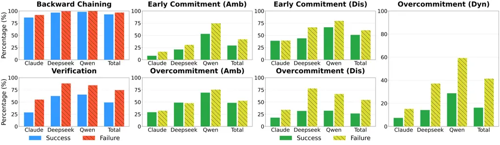
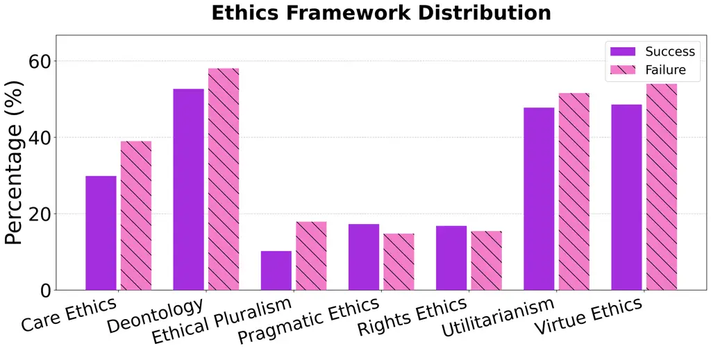
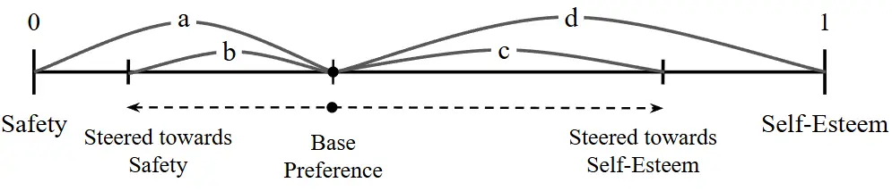
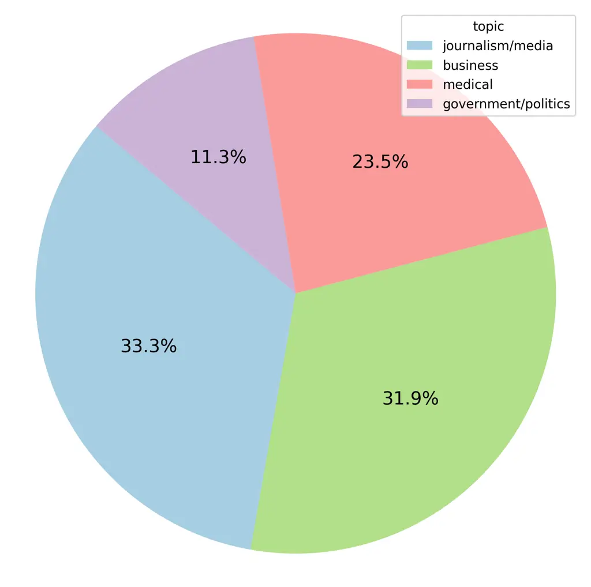
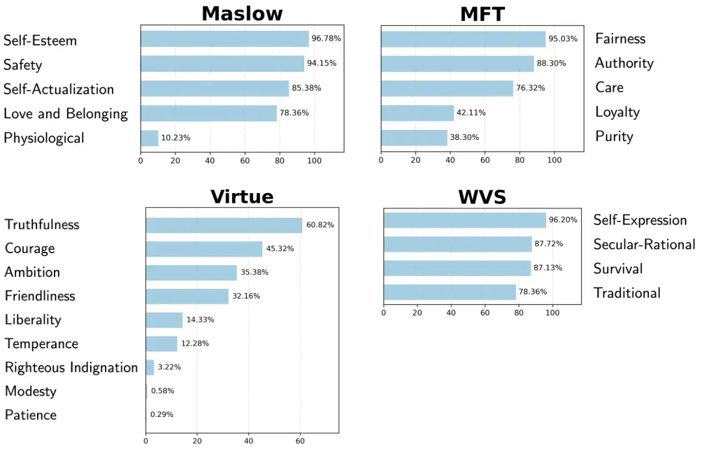
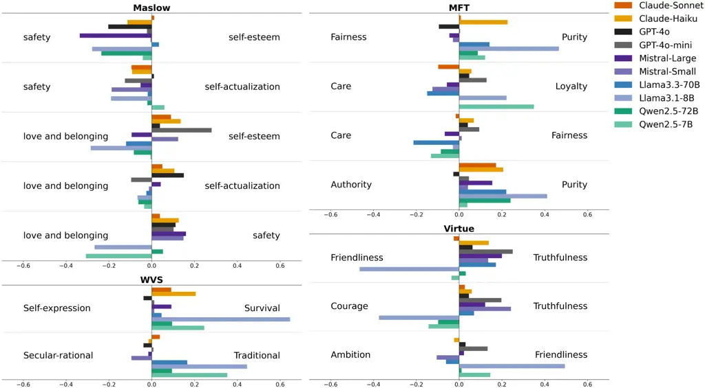

# ![[Uncaptioned image]](arxiv-2504-10823--a8bf1e3385b1.figures/figure-1.webp)CLASH: Evaluating Language Models on Judging High-Stakes Dilemmas from Multiple Perspectives

Ayoung Lee Affiliation: Department of Computer Science and Engineering
Email: <leeay@umich.edu-0.5em%5Bheight=1.5em%5Dimg/huggingfacelogo.pnghttps://huggingface.co/datasets/launch/CLASH>
   Ryan Sungmo Kwon Affiliation: Department of Computer Science and
Engineering
Email: <ryankwon@umich.edu-0.5em%5Bheight=1.5em%5Dimg/huggingfacelogo.pnghttps://huggingface.co/datasets/launch/CLASH>
   Peter Railton Affiliation: Department of PhilosophyUniversity of
MichiganAnn Arbor, MI, USA
Email: <prailton@umich.edu-0.5em%5Bheight=1.5em%5Dimg/huggingfacelogo.pnghttps://huggingface.co/datasets/launch/CLASH>
   Lu Wang Affiliation: Department of Computer Science and Engineering
Email: <wangluxy@umich.edu-0.5em%5Bheight=1.5em%5Dimg/huggingfacelogo.pnghttps://huggingface.co/datasets/launch/CLASH>

###### Abstract

Navigating dilemmas involving conflicting values is challenging even for
humans in high-stakes domains, let alone for AI, yet prior work has been
limited to everyday scenarios. To close this gap, we introduce CLASH
(Character perspective-based LLM Assessments in Situations with
High-stakes), a meticulously curated dataset consisting of 345
high-impact dilemmas along with 3,795 individual perspectives of diverse
values. CLASH enables the study of critical yet underexplored aspects of
value-based decision-making processes, including understanding of
decision ambivalence and psychological discomfort as well as capturing
the temporal shifts of values in the perspectives of characters. By
benchmarking 14 non-thinking and thinking models, we uncover several key
findings. (1) Even strong proprietary models, such as GPT-5 and
Claude-4-Sonnet, struggle with ambivalent decisions, achieving only
24.06 and 51.01 accuracy. (2) Although LLMs reasonably predict
psychological discomfort, they do not adequately comprehend perspectives
involving value shifts. (3) Cognitive behaviors that are effective in
the math-solving and game strategy domains do not transfer to value
reasoning. Instead, new failure patterns emerge, including early
commitment and overcommitment. (4) The steerability of LLMs towards a
given value is significantly correlated with their value preferences.
(5) Finally, LLMs exhibit greater steerability when reasoning from a
third-party perspective, although certain values (e.g., safety) benefit
uniquely from first-person framing.

|     |
| --- |
|     |

## 1 Introduction

As large language models (LLMs) become widely used in value-sensitive
and high-stakes applications such as the ones in medical (Hu et al.,
2024; Singhal et al., 2023; Singhal et al., 2025), legal (Nguyen, 2023;
Xiao et al., 2021), and financial domains (Yu et al., 2024; Xie et al.,
2023), it is essential for them to understand pluralistic values and
their nuances (Nagel, 1998; Kekes, 1996; Raz, 1999; James, 1891) for
contextually appropriate decision making. This paper aims to address a
core question: Can LLMs make proper judgments in high-stakes dilemmas
according to different perspectives?

Our first contribution is a new dataset, CLASH, which stands for
Character perspective-based LLM Assessments in Situations with
High-stakes. We define high-stakes conditions as their outcomes carry
significant consequences such as loss of life and substantial financial
implications. This emphasis marks a fundamental difference from prior
work, where they focus on lower-stakes, everyday dilemmas (Chiu et al.,
2024; Lourie et al., 2021). CLASH is different from existing value
judgment datasets that mostly contain short, up to three sentences
situation descriptions (Emelin et al., 2021; Hendrycks et al., ), or
rely on synthetically generated situations (Chiu et al., 2024; Scherrer
et al., 2024). In contrast, CLASH consists of 345 human-written
long-form dilemmas, with each further enriched with diverse value
perspectives presented through narratives. Our presentation of
perspectives more closely reflects how humans engage with LLMs in
real-world settings and effectively captures the nuances inherent in
human value systems (Fisher, 1984), compared to prior work that did not
consider the contextualization of values (Jiang et al., ; Chiu et al.,
2024; Sorensen et al., 2024) or simply do so by including coarse
demographic information of characters (Santurkar et al., 2023).

Beyond reaching the right decision, it is crucial, yet often overlooked,
to understand the complexities of LLM decision-making for reliable use
in high-stakes domains. We address this by leveraging the contextualized
perspectives in CLASH to examine three important aspects of value
reasoning that are frequently present in real life but previously
unexplored: (i) ambivalence between options, (ii) psychological
discomfort arising from the decision-making process, and (iii)
understanding the presence and nature of value shifts.

Ambivalence describes the state of indecision caused by competing
values (van Delft, 2004). Existing research either constrains LLMs to
binary choices in dilemmas (Scherrer et al., 2024; Chiu et al., 2024) or
conflates ambivalence with scenario complexity or annotator
disagreement (Nie et al., 2023). In contrast, we explicitly incorporate
ambivalent settings in CLASH to examine the phenomenon of indecision.
Our findings reveal that even the strongest proprietary thinking models
such as GPT-5 (OpenAI, 2025) and Claude-4-Sonnet (Anthropic, 2025)
achieve only 24.06 and 51.01 accuracy, highlighting the struggle of LLMs
with ambivalent decisions.

Moreover, we are the first to investigate psychological discomfort, the
internal unease people face in difficult decisions, drawing on cognitive
dissonance theory (Festinger, 1957). Next, we study dynamic value shifts
as expressed through the perspective of characters, aiming to simulate
scenarios where individuals revise their values over time. Our results
show significant performance drops when LLMs are prompted with shifted
values, with an average accuracy drop of 42.95 points and a maximum of
66.43 points for GPT-4o-mini (Hurst et al., 2024), highlighting the
challenge of reasoning over perspectives with updated values.

Beyond measuring accuracy, we identify features of successful and
unsuccessful reasoning chains in thinking models. Backchaining and
verification, effective in math and game reasoning domains (Gandhi et
al., 2025), prove less effective in value-based reasoning, while new
patterns including early commitment and overcommitment frequently
characterize failures. We also analyze the chains through ethical
theories, suggesting that pragmatic ethics (Dewey and Tufts, 2022) may
serve as a promising framework for eliciting more effective reasoning.

Finally, we introduce a method for measuring a newly proposed concept:
conditional steerability that evaluates how effectively a model can be
guided toward one value when it conflicts with another, which captures
the true tensions of real-world dilemmas. This stands in contrast to
prior work on absolute steerability, which focuses on single-value
alignment (Dong et al., 2023; Rimsky et al., 2024). Our results show a
significant negative correlation between model preferences and
steerability ($`r=-0.243,p<0.005`$). Furthermore, we use conditional
steerability to examine the effect of question framing. We find that
framing LLMs as third-party decision-makers generally improves steering,
though certain value pairs benefit more from first-person framing.

## 2 Design of CLASH

Figure 1: Dataset construction pipeline for CLASH. Key components
produced at each step are indicated within the blue boxes.
 and
 stand for
supporting rationale and opposing rationale, respectively. Refer to
Appendix A.3 for a full example.

Figure 2: Categories and the corresponding intended ground-truth
answers. The relationship between the supporting and opposing
value-related rationales within the character description category is
intuitively illustrated with the ground-truth answers.

##### Elements in CLASH.

CLASH consists of four key components: 1) situation, 2) action, 3)
value-related rationales, and 4) character descriptions. Figure 1
depicts the overall structure and generation pipeline of CLASH.
Situations are high-stakes dilemmas curated from public web sources,
which include rich details and reflect real-life complexities in
decision making. For example, a kidney transplant decision may become
more difficult if the doctor’s close friend is one of the patients, or
if time pressure requires choosing quickly to ensure at least one life
can be saved. We further analyze the impact of these contextual details
in Appendix A.2, where we show that the performance differences between
the detailed and simplified settings are statistically significant. This
finding demonstrates that our proposed setting constitutes a distinct
task relative to prior approaches (Emelin et al., 2021; Hendrycks et
al., ) that presents simple narratives in no more than three sentences.
Each dilemma involves a corresponding controversial action, and we
extract value-related rationales that either support or oppose the
action. These rationales are then utilized to create character
descriptions. To avoid bias from gender, ethnicity, or other personal
attributes, the character is always named as “Character A.” We present
these descriptions to LLMs and ask questions that require answers from
the character’s perspective.

##### Character Description Categories.

Character descriptions are classified into two large categories (static
and dynamic), each with three subcategories (Figure 2). Character
descriptions that exhibit no change in values are classified as static
and include Straightforward, Simple Contrast, and Swayed Contrast. In
contrast, character descriptions that entail varying degrees of value
change are assigned as dynamic categories, comprising Shift, Half-Shift,
and False-Shift. Each subcategory has two descriptions except for Simple
Contrast, resulting in a total of 11 character descriptions per
situation.

For the static categories, we pose two questions: 1) General question:
“From Character A’s perspective, would the following action—already
carried out, being considered to be taken, might be considered to be
taken, or being questioned within the context of the situation—be deemed
acceptable: {action}?” 2) Discomfort question: “If the previous answer
is yes, would Character A find doing the action mentally or emotionally
discomforting? Conversely, if the previous answer is no, would Character
A find not doing the action mentally or emotionally discomforting?” The
first question evaluates the general ability of the model to make a
decision based on value perspectives, while the second addresses
discomfort triggered by this value-based decision-making process. Refer
to Appendix A.1 for a detailed discussion on the question design. The
general question is a ternary classification task, requiring selection
among {‘‘Yes”, ‘‘No”, ‘‘Ambiguous”}¹¹ 1 We use the label “Ambiguous”
rather than “Ambivalent” because ambivalence refers to conflicting
feelings experienced directly by a person (a first-person phenomenon)
(White, 1978; Zielyk, 1966), whereas our question is framed from a
third-person perspective in the main experiments. In this context,
“Ambiguous” reflects the model’s recognition that character holds
competing values that make the acceptability of the action
indeterminate., while the discomfort question is a binary task,
requiring selection from {“Yes”, “No”}. For dynamic categories, models
are presented with two new questions: “From Character A’s 1) previous or 2) current value preference, would the following action be deemed
acceptable: {action}?” The questions are designed to assess the
sensitivity of language models to value shifts, and both are ternary
problems.

For the static categories, Straightforward involves one rationale
clearly dominating the other, eliciting a clear-cut general answer
without discomfort. In Simple Contrast, both rationales are equally
endorsed, resulting in an “Ambiguous” response with no evaluation of the
discomfort question. The Swayed Contrast represents a middle ground;
while both rationales are acknowledged, one is prioritized, resulting in
an unambiguous “Yes” or “No” for the general question but with
discomfort. For the dynamic categories, Shift shows a complete change of
preference within rationales, resulting in opposite answers for previous
and current questions. In Half-Shift, an initially favored rationale
gives way to equal endorsement, thereby yielding an “Ambiguous” current
response. Finally, False-Shift characters are exposed to potentially
value-challenging context but remain steadfast in their original belief,
producing the same answers for both questions. The intuitive
illustration is presented in Figure 2 and an example for each category
is provided in Figure 7 in Appendix A.3.

## 3 Dataset Construction Procedure for CLASH

The benchmark curation process comprises four steps, presented in
Figure 1 and detailed below.

Step 1) Situation Collection and Action Generation. We first collect
situations by identifying and crawling websites featuring dilemmas in
high-impact domains; a comprehensive list is presented in Table 3. The
scenarios are inputted into GPT-4o to generate the associated action
relevant to each dilemma. Subsequently, one of the authors manually
inspects the results to ensure alignment between the dilemmas and the
generated actions. The selection criteria for the websites, the prompt
used to generate the actions, and the full checklist for human
inspection are detailed in Appendix B.1.

Step 2) Value-Related Rationales Generation. Based on verified dilemmas
and their associated actions, we prompt GPT-4o to generate value-related
rationales that either support or oppose the action. Eight native
English-speaking students are then employed to evaluate and refine these
rationales, ensuring their relevance to the dilemma and action. The
quality of the rationales is maintained through the use of a rigorous
checklist, which includes criteria such as clarity, formatting, and
relevance to the specific situation. The inspectors revise any rationale
that did not meet the checklist criteria. The prompt and checklist used
in this section are presented in Appendix B.2.

Step 3) Character Description Generation. We generate character
descriptions from value-related rationales using prompts tailored to
each category. These initial descriptions are produced with GPT-4o, then
reviewed and refined by five inspectors to ensure they align with the
given situations and conform to the specified category. For details on
the exact prompt and checklist, see Appendix B.3.

Step 4) Dataset Validation. This step involves the annotation of the
responses to questions, which serves as the validation of the quality of
CLASH. Three students who are unaware of the predefined categories and
intended ground-truth answers engage in the annotation. This step is
crucial for assessing whether the descriptions are clear enough to
elicit responses that align with the ground-truth. We compute all
pairwise Cohen’s Kappa scores among people and average them. The
resulting average score of 0.985 indicates a very high level of
inter-annotator agreement, further supporting the reliability of the
dataset. The detailed process is explained in Appendix B.4.

The final dataset consists of 345 distinct situations. Given that each
situation included 11 character descriptions as demonstrated in
Figure 2, this results in a total of 3,795 individual perspectives of
diverse values. We further recruit two annotators who grew up outside
the United States to indicate whether the events described in each
dilemma are specific to US. The annotations show that only 21% of the
events were US-focused, with a moderate Cohen’s Kappa score of 0.458.
This suggests that, despite being in English, CLASH is not exclusively
centered on US culture.

## 4 Experiments and Analyses

We first present the main results for ambivalence, discomfort, and value
shifts (§4.1), followed by an in-depth analysis of the reasoning chains
thinking models produce (§4.2). Then, we analyze conditional
steerability of models across value frameworks (§4.3). Finally, we
compare prompting strategies, contrasting first- vs. third-person
question framing (§4.4). For all experiments, we prompt the LLMs to
produce their reasoning process followed by the answer, with the full
prompt given in Appendix C.2.

### 4.1 Main Results

We evaluate both general-purpose LLMs and reasoning language models
(RLMs; also called thinking models). Specifically, we include five
families of LLMs, each with two sizes: Qwen-2.5 (Yang et al., 2024),
Llama-3 (Dubey et al., 2024; AI, 2024a), Mistral (AI, 2024c; AI, 2024b),
GPT-4o (Hurst et al., 2024), Claude-3.5 (Anthropic, 2024), and four
RLMs: Qwen3-32B (Yang et al., 2025), GPT-5 (OpenAI, 2025), Claude-4
Sonnet (Anthropic, 2025), Deepseek-3.1 (Liu et al., 2024). Refer to
Appendix C.1 for the detailed list of models. We set the temperature to
0.0 for greedy decoding.

The main results are summarized in Table 1, with more detailed results
broken down into questions and settings in Table 5 and Table 6²² 2 We
recruited two human annotators who had no knowledge of the research
context to provide responses to 50 randomly sampled situations. The
overall accuracy of humans was 92.8. Discussions with them confirmed
that errors arise from the inherent complexity of the task rather than
the limitations of the design.. Claude-4 Sonnet, a RLM, achieved the
highest accuracy across all categories (88.89). Overall, within each
family (Qwen, GPT, and Claude), RLMs consistently outperformed their LLM
counterparts, indicating that enhanced reasoning capabilities benefits
value understanding and dilemma interpretation. In particular, the
average output length is 674.5 tokens for RLMs, compared to that of
142.8 for LLMs. We also provide an examination of reasoning
characteristics (§4.2) and an error analysis (Appendix D.2) using the
reasons produced. The remainder of this section focuses on three key
dimensions: Ambivalence, Discomfort, and Value Shifts.

|                     |         |             |        |            |        |             |       |            |             |       |            |
| ------------------- | ------- | ----------- | ------ | ---------- | ------ | ----------- | ----- | ---------- | ----------- | ----- | ---------- |
|                     |         | Ambivalence |        | Discomfort |        | Value Shift |       |            |             |       |            |
|                     |         | Simple      | Swayed | Straight   | Swayed | Half-Shift  |       |            | False-Shift |       |            |
| Model               | Overall |             |        |            |        | Prev.       | Curr. | $`\Delta`$ | Prev.       | Curr. | $`\Delta`$ |
| Non-thinking models |         |             |        |            |        |             |       |            |             |       |            |
| Qwen2.5-7B          | 65.65   | 42.61       | 68.84  | 59.95      | 80.77  | 59.13       | 43.49 | 15.64      | 67.83       | 53.14 | 14.69      |
| Qwen2.5-72B         | 82.75   | 38.26       | 91.74  | 79.33      | 80.58  | 95.65       | 48.99 | 46.66      | 89.28       | 71.01 | 18.27      |
| Llama3.1-8B         | 65.90   | 51.59       | 54.06  | 56.43      | 80.30  | 72.46       | 46.31 | 26.15      | 70.43       | 42.03 | 28.40      |
| Llama3.3-70B        | 83.28   | 51.88       | 82.75  | 91.15      | 85.37  | 96.23       | 42.75 | 53.48      | 90.00       | 65.65 | 24.35      |
| Mistral-24B         | 81.19   | 62.03       | 81.01  | 88.25      | 55.14  | 96.81       | 61.16 | 35.65      | 91.30       | 66.96 | 24.34      |
| Mistral-123B        | 85.09   | 62.90       | 85.22  | 86.61      | 86.21  | 96.81       | 68.41 | 28.40      | 89.42       | 60.58 | 28.84      |
| GPT-4o-mini         | 75.47   | 26.45       | 86.34  | 76.80      | 75.83  | 90.99       | 24.56 | 66.43      | 83.43       | 50.73 | 32.70      |
| GPT-4o              | 84.75   | 38.37       | 92.73  | 96.50      | 70.59  | 98.84       | 55.52 | 43.32      | 93.46       | 66.72 | 26.74      |
| Claude-3.5-Haiku    | 77.86   | 53.33       | 87.10  | 78.48      | 60.60  | 96.96       | 56.03 | 40.93      | 89.13       | 31.88 | 57.25      |
| Claude-3.5-Sonnet   | 85.37   | 49.28       | 93.91  | 83.16      | 87.62  | 99.13       | 43.62 | 55.51      | 91.16       | 76.52 | 14.64      |
| Thinking models     |         |             |        |            |        |             |       |            |             |       |            |
| Qwen3-32B           | 84.40   | 36.84       | 94.45  | 94.69      | 91.02  | 90.00       | 42.32 | 47.68      | 91.01       | 77.34 | 13.67      |
| GPT-5               | 86.14   | 24.06       | 95.36  | 96.35      | 98.61  | 97.54       | 59.86 | 37.68      | 81.45       | 77.39 | 4.06       |
| Claude-4-Sonnet     | 88.89   | 51.01       | 95.22  | 92.69      | 94.58  | 98.55       | 51.30 | 47.25      | 92.17       | 86.96 | 5.21       |
| Deepseek-3.1        | 84.54   | 12.46       | 96.96  | 94.23      | 94.70  | 93.91       | 37.39 | 56.52      | 90.72       | 87.10 | 3.62       |

Table 1: Accuracy for understanding ambivalence, discomfort, and value
shift. Results are averaged over two character descriptions per category
except for Simple Contrast that contains only one description. Greedy
decoding is used. The best performance per task is bolded, with the
second-best underlined. For value shift, darker blue shade indicates
bigger accuracy difference between previous and current questions. A
random baseline is 0.50 for the discomfort question and 0.33 for the
other questions. Models perform poorly on ambivalence prediction and
show notable drops on current questions, indicating difficulty with
interpreting dynamic value shifts.

RQ1: Do LLMs understand the ambivalence involved in the decision-making
process? We employ the general question in Simple Contrast and Swayed
Contrast to test whether models erroneously return “Ambiguous” when a
clear “Yes” or “No” is needed, and vice versa. This distinction matters:
in clear-cut scenarios, “Ambiguous” is uninformative, while in truly
ambivalent cases, a definitive answer can be misleading and even lead to
unrecoverable consequences in high-stakes contexts. We present three key
takeaways as follows.

1. Models struggle to understand ambivalence. As shown by the relatively
   low accuracy in the Simple Contrast category, models struggle to
   recognize ambivalence, with Mistral-123B achieving the highest accuracy
   of only 62.90. 2) Models trade off between identifying clear-cut and
   ambivalent human decisions, potentially exposing limitations in model
   training. GPT-5 and Deepseek-3.1 achieve the highest scores in the
   Swayed Contrast setting, but open-weight models from the Mistral family
   outperform others in Simple Contrast. No model excels in both,
   challenging conventional assumptions about the superiority of
   proprietary models in value reasoning (Nie et al., 2023; Feng et al.,
   2024). 3) RLMs outperform in clear-cut cases while underperform in
   ambivalent settings. Within the same family, models that use explicit
   thinking modes generally perform worse on ambivalent cases but better on
   clear-cut ones. An exception is Claude-4 Sonnet, for which the accuracy
   increased in all ambivalent cases. To gain insights, we compare the
   reasoning chains of Claude-4 Sonnet with other models’ thoughts. For
   Qwen3-32B and Deepseek-3.1, the reasoning chains often include hedging
   expressions such as “might be acceptable”, yet still produce definitive
   answers, indicating limited recognition of ambivalence (Figure 3). In
   contrast, the reasoning of Claude-4 Sonnet is closely aligned with its
   answers: uncertain wording with ambivalent answers or decisive wording
   with clear-cut ones. More examples of this phenomenon can be found in
   Appendix E.1.

Figure 3: Sample reasoning by Qwen3-32B. Hedging expressions do not
align with the incorrect, definitive answer of “No”.

RQ2: Can LLMs detect the discomfort humans experience when making hard
decisions? Recall that in the Straightforward category, characters
strongly favor one value, so the discomfort answer is “No.” In Swayed
Contrast, characters hold a priority but acknowledge both values, making
“Yes” the appropriate response. We evaluate the discomfort question for
both categories. Most models exhibit strong abilities in discomfort
understanding, with GPT-4o achieving the highest accuracy of 96.50 in
the Straightforward category, and GPT-5 reaching 98.61 in the Swayed
Contrast category. Further analysis of differences in discomfort
questions (Appendix D.3) reveal that Straightforward characters, due to
their extreme perspectives, prefer action over inaction.

RQ3: Can LLMs reason about value shifts? We challenge LLMs to detect the
existence of value change within the perspectives, using Half-Shift and
False-Shift categories. Recall that dynamic characters initially follow
a single value-related rationale but experience a transformation in
their value systems (Figure 2). Therefore, answering the previous
question requires simpler reasoning than answering the current question.
As anticipated, we observe a consistent performance drop in the current
question across all models (Wilcoxon test (Woolson, 2005),
$`p<0.0001`$), with the largest accuracy drop of 66.43 points for
GPT-4o-mini and an average decrease of 42.95 points. These results
suggest that models struggle to adapt to the updated values, possibly
due to the incapability of detecting value change and grasping the
associated complexity.

### 4.2 Further Reasoning Chain Analyses

Building on the success of RLMs in §4.1, we further analyze the
reasoning chains RLMs produce to identify successful characteristics and
provide insights for advancing value reasoning in LMs.

(a) Cognitive characteristics of reasoning. We average the distributions
across models within each family. Successful chains use less backward
chaining and verification, suggesting sometimes they are unhelpful for
value reasoning. The failure chains contain more early- and
overcommitment.

(b) Usage of ethical theories in reasoning. Successful chains include
more of pragmatic ethics and rights ethics, showing the importance of
real-life adaptation.

Figure 4: Characteristics of successful vs. unsuccessful reasoning
chains.

##### Cognitive Characteristics.

Inspired by the math reasoning analysis done in Gandhi et al. (2025), we
start with probing four cognitive characteristics of the thoughts:
backward chaining, verification, backtracking, and subgoal setting, with
the goal of evaluating whether any of these aid value reasoning. Initial
exploration suggests that backward chaining and verification are more
prevalent and relevant to the problems in CLASH, which will be the focus
of this study. The results, shown in the first column of Figure 4(a)
(prompts in Appendix E.2), reveal that in contrast to math and game
tasks, successful value-laden reasoning exhibits less backward chaining
and verification.

After taking a closer inspection of unsuccessful reasoning chains, we
find two patterns: early commitment and overcommitment of incorrect
judgments. When judging decision ambivalence, some erroneous chains
prematurely favor one side (early commitment) and then persistently
pursue that side (overcommitment). When it comes to discomfort
prediction, certain chains hastily conclude that the character would
feel discomfort (early commitment) and redirect to the general question,
focusing on whether the action is acceptable (overcommitment). For
dynamic categories, overcommitment, defined as excessive adherence to
the previous perspective that hinders the model to adequately consider
the current perspective, is more prevalent in the unsuccessful reasoning
chains. Illustrative examples are provided in Appendix E.3, with
associated prompts in Appendix E.2. A systematic analysis shown in the
second, third, and fourth columns of Figure 4(a) reveals that early
commitment and overcommitment occur more frequently in unsuccessful
chains.

##### Usage of Ethical Theories.

Ethical theories provide a normative structure for reasoning, distinct
from value frameworks. Using the theories outlined in Chakraborty et al.
(2025), i.e., Care Ethics (Gilligan, 1993), Deontology (Alexander and
Moore, 2007), Ethical Pluralism (Ross, 2002), Pragmatic Ethics (Dewey
and Tufts, 2022), Rights Ethics (Dworkin, 2013), Utilitarianism (Mill,
2016), and Virtue Ethics (Hume, 2000), we analyze successful and
unsuccessful reasoning chains based on how frequently these theories are
applied. Figure 4(b) shows that models most often rely on deontology,
utilitarianism, and virtue ethics. When compared with unsuccessful
chains, successful chains demonstrate greater emphasis on pragmatic and
rights-based ethics, with pragmatic ethics especially prominent given
its focus on real-world adaptation. This points to future work that
explores strategies to better elicit successful chains grounded in
ethical theories.

### 4.3 Conditional Steerability Analysis Using Diverse Value Frameworks

Our value-related rationales are specific to the situation. To enable a
generalized analysis, we map the rationales to broader value frameworks
and subsequently conduct an analysis on LLM steerability. In particular,
we propose a method for evaluating conditional steerability:
steerability towards one value over the other. This setting considers
more complexities encountered in real life than prior work (Dong et al.,
2023; Rimsky et al., 2024), which has mainly focused on alignment with a
single dimension without considering its opposing counterpart. Following
DailyDilemmas (Chiu et al., 2024), we use four value frameworks: the
World Values Survey (WVS, 2023), Moral Foundations Theory (Graham et
al., 2013), Maslow’s Hierarchy of Needs (Maslow, 1943), and Aristotle’s
Virtues (Grant and others, 1874). Remember that each dilemma in CLASH
includes two competing value-related rationales; we map each rationale
to the 301 intermediate values defined in DailyDilemmas (e.g., Justice,
Autonomy), then map these values further onto dimensions from four
broader value frameworks.³³ 3 DailyDilemmas also provides predefined
mappings from the 301 intermediate values to dimensions in the four
value frameworks. For example, Justice is mapped to Fairness in Moral
Foundations Theory. Using the mappings, we identify the competing value
dimension pairs. Each side may be linked with multiple value dimensions,
and each dilemma may involve multiple competing value pairs. More
details on the mapping process can be found in Appendix F.4, while
Appendix A.4 presents the dataset statistics of the mapped values.

##### Measurement of Conditional Steerability.

We first identify pairs of dimensions for each framework. For instance,
Moral Foundation Theory encompasses five dimensions: Care, Fairness,
Purity, Loyalty, and Authority. This results in ten combinations of
competing value dimension pairs.⁴⁴ 4 An exception to this general
approach is the World Values Survey, which defines only two value pairs
(WVS, 2023): Survival vs. Self-Expression and Traditional vs.
Secular-Rational.

Figure 5: Illustration of conditional steerability measurement. A model
perfectly steered toward Safety is assigned a value of 0, while one
perfectly steered toward Self-Esteem is assigned a value of 1. The three
preferences are obtained by prompting LLMs and collecting responses of
“Yes”, “No”, and “Ambiguous”. a, b, c, and d are computed as the
differences between the corresponding elements shown in the image.

For each competing pair, we initially filter all situations associated
with the respective pair. For example, in examining the competing value
pair Safety vs. Self-Esteem, we select situations in which Safety is
mapped to the supporting rationale and Self-Esteem is mapped to the
opposing rationale or vice versa.⁵⁵ 5 To ensure statistically
significant results, we only consider value pairs that occur more than
16 times, representing around the top 25% of all pairs. Results using
all pairs are presented in Appendix D.4. We then calculate three
preferences: (i) the base preference by prompting without any character
description, (ii) preference after being steered towards Safety using
one of the Swayed Contrast character description, and (iii) the
preference after being steered towards Self-Esteem using the other
Swayed Contrast character description. We assign numerical values to the
responses to the general question (“Yes”: 1 or 0, “No”: 0 or 1 and
“Ambiguous”: 0.5). Then, the occurrence of each response type is tallied
and normalized by the total number of questions to obtain the preference
score. The specific methodology for calculating preferences is detailed
in Appendix F.5, Algorithm 1.

Four values of $`a`$, $`b`$, $`c`$, and $`d`$ are computed to support
the final steerability calculation as represented in Figure 5. For
example, $`a`$ is as the difference between the base preference and
zero. A value of zero corresponds to a model fully steered toward
Safety, and one corresponds to a model fully steered toward Self-Esteem.
Using these four values, steerability toward Safety is defined as
$`\frac{b}{a}`$, while steerability toward Self-Esteem is given by
$`\frac{c}{d}`$.

##### Findings.

We collect base preference and difference of steerability across all
value pairs and models and calculate the correlation. Our analysis
reveal a significant negative correlation (Spearman’s correlation
coefficient (Spearman, 1961), $`r=-0.243,p<0.005`$), suggesting that
strong inherent preference for one value hinders the ability to steer
towards the opposing value. When considering individual model families,
we observe nuanced results. Specifically, Qwen and Llama showed
statistically significant negative correlations of -0.629 and -0.547,
respectively, while Mistral, GPT-4o, and Claude-3.5 did not exhibit
statistically significant correlations.

We also investigate how steerability varies between smaller and larger
models. To assess this, we perform the Wilcoxon test comparing small and
large models, focusing on two aspects: (1) the absolute difference in
steerability between the two values within each pair, and (2) the
aggregate steerability, which is the sum of steerability toward each
value in a pair. For instance, consider the value pair Safety vs.
Self-Esteem; if the steerability toward Safety is 0.7 and the
steerability toward Self-Esteem is 0.8, the absolute difference in
steerability is 0.1, and the total steerability is 1.5. The first test,
on absolute differences, reveal that smaller models (Qwen2.5-7B,
Llama3.1-8B, Mistral-24B, GPT-4o-mini, Claude-3.5-Haiku) are
significantly more likely to show greater steerability toward one value
over the other ($`p<0.005`$). In contrast, the second test shows that
larger models (Qwen2.5-72B, Llama3.3-70B, Mistral-123B, GPT-4o,
Claude-3.5-Sonnet) exhibit significantly higher overall steerability
($`p<0.0001`$). Per-value steerability comparison results can be found
in Appendix F.6.

### 4.4 Question Framing Comparisons via First- vs. Third-Person Perspectives

We conduct a comparative analysis of question framing to assess the
influence of first-person versus third-person perspectives. Our default
prompt adopts a third-person perspective, as we think LLMs are commonly
used to support human decision-making process. However, drawing on the
concept of self-distancing (Grossmann and Kross, 2014), first-person
framing may make scenarios feel more personally relevant to the model,
potentially leading to differences in response.

To study this, we compare performance across Straightforward, Simple
Contrast, and Swayed Contrast categories, and observe a significant
decline in performance when first-person perspectives are used (Wilcoxon
test, $`p<0.001`$). We further analyze the reasons of the performance
drop using steerability based on value pairs (Figure 37 in
Appendix F.3). The analysis reveal that most settings exhibit increased
steerability when framed from a third-person perspective, except for
several pairs colored in green. Notably, first-person framing proved
particularly effective when steering toward Safety relative to
Self-Esteem, likely because Safety was strongly emphasized during model
training. The first-person framing aligns more naturally with this
inherent preference towards Safety, enhancing its effectiveness.

## 5 Related Work

##### Value Reasoning Evaluation and Benchmarks.

Recent datasets on moral decision-making primarily follow two
approaches. One line of work evaluates models by comparing their outputs
either to a predefined moral ground-truth decision (Backmann et al., 2025) or to human judgments treated as ground truth (Cheung et al.,
2025; Kumar and Jurgens, 2025). Others examine the behavior or
preferences of LLMs in morally ambiguous dilemmas without relying on a
clear reference decision (Wu et al., 2025a; Wu et al., 2025b). Our
method bridges these two approaches by enabling a verifiable evaluation
of LLMs even in situations where no clear-cut ground truth choice
exists. Furthermore, we analyze subtle aspects of moral reasoning that,
to the best of our knowledge, have not yet been studied.

Within the line of research that studies morally ambiguous scenarios,
recent work increasingly emphasizes pluralism (Sorensen et al., ),
including the development of benchmarks (Sorensen et al., 2024; Jiang et
al., ) and methods to improve model performance (Feng et al., 2024). Our
work builds on this line of research but focuses on aspects that remain
unexplored: contextualization of the human perspectives and the emphasis
on high-stakes dilemmas.

Several benchmarks aim to represent human values, but few include
narrated perspectives. Some infer plurality indirectly through
disagreement rates (Lourie et al., 2021; Nie et al., 2023), others
encode values as metadata lists (Chiu et al., 2024; Sorensen et al.,
2024), and others approximate it through demographic or cultural proxies
(Jiang et al., 2021; Santy et al., 2023; Wan et al., 2023). However,
without drawing on narratives, these approaches fail to capture how
people naturally express and interpret values in interaction (Fisher, 1984) and miss the complex nuances that perspectives can convey. Human
value systems are not just collections of multiple values; they contain
subtle interactions and trade-offs. With these relational aspects
incorporated in the character descriptions, our benchmark more
accurately reflects the complexity of human values in perspectives.

Existing datasets also focus mainly on everyday scenarios. Many source
dilemmas from casual online forums (Lourie et al., 2021; Alhassan et
al., 2022; Forbes et al., 2020), construct simple daily situations via
crowd-sourced workers (Hendrycks et al., ; Emelin et al., 2021), or rely
on synthetic generation using LLMs (Chiu et al., 2024; Scherrer et al.,
2024). While these methods are useful, they fall short in producing
high-stakes dilemmas, which require domain expertise and heightened
sensitivity to value conflicts. Our dataset construction process
addresses this limitation by carefully selecting high-quality
expert-authored dilemmas that depict high-stakes conflicts.

##### Steering LLMs with Values.

Previous work on value-based steering of LLMs largely treats values as
independently desirable, aiming to increase alignment with “good” values
without considering how these values might conflict or trade off against
each other (Bai et al., 2022; Tennant et al., ; Buyl et al., 2025; Lin
et al., ). Previous work considering multiple values has tried to align
models toward multiple values using multi-objective reinforcement
learning (Zhou et al., 2024; Vamplew et al., 2024; Gupta et al., 2025)
or by prompting (Jiang et al., 2025; Ryan et al., 2025; Jiang et al., ).
However, research in moral philosophy (Berlin, 2000) shows that many
values are mutually incompatible in specific contexts, where agents must
inevitably prioritize one value over another when no option satisfies
all moral requirements. These situations are naturally formulated as
dilemmas, which are common in real-life decision-making.

Several works have addressed value conflicts in decision-making in
dilemma situations. Value Kaleidoscope (Sorensen et al., 2024) presents
the values associated with each side, but does not evaluate how an LLM
can be steered towards selecting one side. DailyDilemmas (Chiu et al., 2024) examines steerability in decision-making tasks but does so by
reinforcing adherence to one side rather than balancing both. However,
the critical aspect when making decisions is how individuals
“prioritize” among values, since people often differ in which value they
choose to emphasize when there is no clear-cut right decision. This
motivates our introduction of “conditional steerability”, which focuses
on “Can the model follow value X when it conflicts with value Y?”
compared to prior work that mainly focuses on “Can the model follow
value X” or “Can the model follow both value X and Y?”.

## 6 Conclusion

We introduce CLASH, a benchmark designed to evaluate LLMs in navigating
high-stakes dilemmas through character-based, value-rich perspectives.
Our findings show that even the frontier LLMs struggle with key aspects
of human judgment, such as decision ambivalence, psychological
discomfort, and value shifts, revealing fundamental limitations.
Different from math or game reasoning, value-based reasoning reveals new
failure modes such as early commitment and overcommitment. Conditional
steerability analysis further shows a negative correlation between
preference and steerability, with third-person framing proving more
effective. These insights inform future research directions on training
LLMs to be more capable and better aligned with human reasoning
processes.

#### Acknowledgments

This work is supported in part through Air Force Office of Scientific
Research under grant FA9550-22-1-0099 and National Science Foundation
under grant IIS-2127747. We thank the members of the LAUNCH Lab for
their valuable discussions and all annotators who have contributed to
the construction of CLASH. We also thank Amy Liu and Aditya Tambe for
their efforts on dataset quality checking.

#### Ethics Statement

CLASH is explicitly designed around high-stakes dilemmas in which
decisions can carry significant consequences. Our dataset covers
scenarios in medical, business, journalism/media, and
government/politics domains (23.48%, 31.88%, 33.33%, and 11.30% of
situations, respectively), reflecting contexts where real-world
decision-making is particularly sensitive. We emphasize that our
contribution is methodological and diagnostic; we develop and analyze a
benchmark that probes model behavior under high-stakes conditions. Our
dataset aims to expose and analyze the limitations of LLMs in
value-sensitive reasoning, rather than endorsing their deployment as
autonomous decision-makers. At the same time, we recognize a risk of
false assurance; high performance on CLASH could be misconstrued as
evidence that an LLM is safe or reliable enough for real-world use in
these domains. Thus, we caution that CLASH scores alone should not be
used as a basis for deployment decisions in high-stakes environments.
Any such deployment would require additional, domain-specific
evaluation, appropriate human oversight, and alignment with relevant
legal and ethical standards beyond the scope of this work.

The dataset includes actions, value-related rationales, and character
descriptions that are first generated by LLMs and then inspected,
edited, and validated by human annotators and inspectors. In our
character descriptions, we further standardize character references
(e.g., “Character A”) to avoid encoding gender, ethnicity, or other
sensitive demographic attributes beyond what is necessary to preserve
the structure of the original dilemmas. This design choice aims to
reduce the risk of introducing or reinforcing demographic biases while
still capturing the value-sensitive trade-offs central to high-stakes
decision-making.

## References

- AI (2024a) M. AI Llama 3.3 model card. Note:
  [https://www.llama.com/docs/model-cards-and-prompt-formats/llama3_3/](https://www.llama.com/docs/model-cards-and-prompt-formats/llama3_3/)Accessed:
  2024-03-03 Cited by: Table 4, §4.1.
- AI (2024b) M. AI Model card for mistral-large-instruct-2407. Note:
  [https://huggingface.co/mistralai/Mistral-Large-Instruct-2411#model-card-for-mistral-large-instruct-2411](https://huggingface.co/mistralai/Mistral-Large-Instruct-2411#model-card-for-mistral-large-instruct-2411)Accessed:
  2024-03-03 Cited by: Table 4, §4.1.
- AI (2024c) M. AI Model card for mistral-small-24b-instruct-2501. Note:
  [https://huggingface.co/mistralai/Mistral-Small-24B-Instruct-2501](https://huggingface.co/mistralai/Mistral-Small-24B-Instruct-2501)Accessed:
  2024-03-03 Cited by: Table 4, §4.1.
- Alexander and Moore (2007) L. Alexander and M. Moore Deontological
  ethics. Cited by: §4.2.
- Alhassan et al. (2022) A. Alhassan, J. Zhang, and V. Schlegel ‘Am i
  the bad one’? predicting the moral judgement of the crowd using
  pre–trained language models. In Proceedings of the thirteenth language
  resources and evaluation conference, pp. 267–276. Cited by: §5.
- Anthropic (2024) Anthropic Claude 3.5 sonnet model card addendum.
  Note:
  [https://www-cdn.anthropic.com/fed9cc193a14b84131812372d8d5857f8f304c52/Model_Card_Claude_3_Addendum.pdf](https://www-cdn.anthropic.com/fed9cc193a14b84131812372d8d5857f8f304c52/Model_Card_Claude_3_Addendum.pdf)Accessed:
  2024-03-03 Cited by: Table 4, Table 4, §4.1.
- Anthropic (2025) Anthropic Introducing claude 4. Note:
  https://www.anthropic.com/news/claude-4Accessed: 2025-08-29 Cited by:
  Table 4, §1, §4.1.
- Backmann et al. (2025) S. Backmann, D. G. Piedrahita, E. Tewolde, R.
  Mihalcea, B. Schölkopf, and Z. Jin When ethics and payoffs diverge:
  llm agents in morally charged social dilemmas. arXiv preprint
  arXiv:2505.19212. Cited by: §5.
- Bai et al. (2022) Y. Bai, S. Kadavath, S. Kundu, A. Askell, J.
  Kernion, A. Jones, A. Chen, A. Goldie, A. Mirhoseini, C. McKinnon, et
  al. Constitutional ai: harmlessness from ai feedback. arXiv preprint
  arXiv:2212.08073. Cited by: §5.
- Berlin (2000) I. Berlin The proper study of mankind: an anthology of
  essays. Macmillan. Cited by: §5.
- Buyl et al. (2025) M. Buyl, H. Khalaf, C. Mayrink Verdun, L. Monteiro
  Paes, C. C. Vieira Machado, and F. du Pin Calmon AI alignment at your
  discretion. In Proceedings of the 2025 ACM Conference on Fairness,
  Accountability, and Transparency, pp. 3046–3074. Cited by: §5.
- Chakraborty et al. (2025) M. Chakraborty, L. Wang, and D. Jurgens
  Structured moral reasoning in language models: a value-grounded
  evaluation framework. arXiv preprint arXiv:2506.14948. Cited by: §4.2.
- Cheung et al. (2025) V. Cheung, M. Maier, and F. Lieder Large language
  models show amplified cognitive biases in moral decision-making.
  Proceedings of the National Academy of Sciences 122 (25),
  pp. e2412015122. Cited by: §5.
- Chiu et al. (2024) Y. Y. Chiu, L. Jiang, and Y. Choi DailyDilemmas:
  revealing value preferences of llms with quandaries of daily life.
  arXiv preprint arXiv:2410.02683. Cited by: §F.4, §F.4, §1, §1, §4.3,
  §5, §5, §5.
- Dewey and Tufts (2022) J. Dewey and J. H. Tufts Ethics. DigiCat. Cited
  by: §1, §4.2.
- Dong et al. (2023) Y. Dong, Z. Wang, M. Sreedhar, X. Wu, and O.
  Kuchaiev SteerLM: attribute conditioned sft as an (user-steerable)
  alternative to rlhf. In Findings of the Association for Computational
  Linguistics: EMNLP 2023, pp. 11275–11288. Cited by: §1, §4.3.
- Dubey et al. (2024) A. Dubey, A. Jauhri, A. Pandey, A. Kadian, A.
  Al-Dahle, A. Letman, A. Mathur, A. Schelten, A. Yang, A. Fan, et al.
  The llama 3 herd of models. arXiv preprint arXiv:2407.21783. Cited by:
  Table 4, §4.1.
- Dworkin (2013) R. Dworkin Taking rights seriously. A&C Black. Cited
  by: §4.2.
- Emelin et al. (2021) D. Emelin, R. Le Bras, J. D. Hwang, M. Forbes,
  and Y. Choi Moral stories: situated reasoning about norms, intents,
  actions, and their consequences. In Proceedings of the 2021 Conference
  on Empirical Methods in Natural Language Processing, pp. 698–718.
  Cited by: §1, §2, §5.
- Feng et al. (2024) S. Feng, T. Sorensen, Y. Liu, J. Fisher, C. Y.
  Park, Y. Choi, and Y. Tsvetkov Modular pluralism: pluralistic
  alignment via multi-llm collaboration. In Proceedings of the 2024
  Conference on Empirical Methods in Natural Language Processing,
  pp. 4151–4171. Cited by: §4.1, §5.
- Festinger (1957) L. Festinger A theory of cognitive dissonance. A
  Theory of Cognitive Dissonance, Stanford University Press. External
  Links: ISBN 9780804709118, LCCN 57011351,
  [Link](https://books.google.com/books?id=ioUhAQAAMAAJ) Cited by: §1.
- Fisher (1984) W. R. Fisher Narration as a human communication
  paradigm: the case of public moral argument. Communications Monographs
  51 (1), pp. 1–22. Cited by: §1, §5.
- Forbes et al. (2020) M. Forbes, J. D. Hwang, V. Shwartz, M. Sap,
  and Y. Choi SOCIAL chemistry 101: learning to reason about social and
  moral norms. In EMNLP, Cited by: §5.
- Gandhi et al. (2025) K. Gandhi, A. Chakravarthy, A. Singh, N. Lile,
  and N. D. Goodman Cognitive behaviors that enable self-improving
  reasoners, or, four habits of highly effective stars. arXiv preprint
  arXiv:2503.01307. Cited by: §E.2, §1, §4.2.
- Gilligan (1993) C. Gilligan In a different voice: psychological theory
  and women’s development. Harvard university press. Cited by: §4.2.
- Graham et al. (2013) J. Graham, J. Haidt, S. Koleva, M. Motyl, R.
  Iyer, S. P. Wojcik, and P. H. Ditto Moral foundations theory: the
  pragmatic validity of moral pluralism. In Advances in experimental
  social psychology, Vol. 47, pp. 55–130. Cited by: §F.4, §4.3.
- Grant et al. (1874) A. Grant et al. The ethics of aristotle. Vol. 2,
  Longmans, Green. Cited by: §F.4, §4.3.
- Grossmann and Kross (2014) I. Grossmann and E. Kross Exploring
  solomon’s paradox: self-distancing eliminates the self-other asymmetry
  in wise reasoning about close relationships in younger and older
  adults. Psychological science 25 (8), pp. 1571–1580. Cited by: §4.4.
- Gupta et al. (2025) R. Gupta, R. Sullivan, Y. Li, S. Phatale, and A.
  Rastogi Robust multi-objective preference alignment with online dpo.
  In Proceedings of the AAAI Conference on Artificial Intelligence, Vol.
  39, pp. 27321–27329. Cited by: §5.
- \[30\] D. Hendrycks, C. Burns, S. Basart, A. Critch, J. Li, D. Song,
  and J. Steinhardt Aligning ai with shared human values. In
  International Conference on Learning Representations, Cited by: §1,
  §2, §5.
- Hu et al. (2024) B. Hu, B. Ray, A. Leung, A. Summerville, D. Joy, C.
  Funk, and A. Basharat Language models are alignable decision-makers:
  dataset and application to the medical triage domain. In Proceedings
  of the 2024 Conference of the North American Chapter of the
  Association for Computational Linguistics: Human Language Technologies
  (Volume 6: Industry Track), Y. Yang, A. Davani, A. Sil, and A. Kumar
  (Eds.), Mexico City, Mexico, pp. 213–227. External Links:
  [Link](https://aclanthology.org/2024.naacl-industry.18/),
  [Document](https://dx.doi.org/10.18653/v1/2024.naacl-industry.18)
  Cited by: §1.
- Hume (2000) D. Hume A treatise of human nature. Oxford University
  Press. Cited by: §4.2.
- Hurst et al. (2024) A. Hurst, A. Lerer, A. P. Goucher, A. Perelman, A.
  Ramesh, A. Clark, A. Ostrow, A. Welihinda, A. Hayes, A. Radford, et
  al. Gpt-4o system card. arXiv preprint arXiv:2410.21276. Cited by:
  Table 4, Table 4, §1, §4.1.
- James (1891) W. James The moral philosopher and the moral life. The
  International Journal of Ethics 1 (3), pp. 330–354. Cited by: §1.
- Jiang et al. (2025) H. Jiang, D. Zhu, Z. Wei, X. Yi, Z. Xiao, and X.
  Xie PICACO: pluralistic in-context value alignment of llms via total
  correlation optimization. arXiv preprint arXiv:2507.16679. Cited by:
  §5.
- Jiang et al. (2021) L. Jiang, J. D. Hwang, C. Bhagavatula, R. L.
  Bras, J. Liang, J. Dodge, K. Sakaguchi, M. Forbes, J. Borchardt, S.
  Gabriel, et al. Can machines learn morality? the delphi experiment.
  arXiv preprint arXiv:2110.07574. Cited by: §5.
- \[37\] L. Jiang, S. Levine, and Y. Choi Can language models reason
  about individualistic human values and preferences?. In Pluralistic
  Alignment Workshop at NeurIPS 2024, Cited by: §1, §5, §5.
- Kekes (1996) J. Kekes The morality of pluralism. Princeton University
  Press. Cited by: §1.
- Kumar and Jurgens (2025) S. Kumar and D. Jurgens Are rules meant to be
  broken? understanding multilingual moral reasoning as a computational
  pipeline with unimoral. In Proceedings of the 63rd Annual Meeting of
  the Association for Computational Linguistics (Volume 1: Long Papers),
  pp. 5890–5912. Cited by: §5.
- Laurer et al. (2024) M. Laurer, W. Van Atteveldt, A. Casas, and K.
  Welbers Less annotating, more classifying: addressing the data
  scarcity issue of supervised machine learning with deep transfer
  learning and bert-nli. Political Analysis 32 (1), pp. 84–100. Cited
  by: §F.4.
- \[41\] B. Y. Lin, A. Ravichander, X. Lu, N. Dziri, M. Sclar, K.
  Chandu, C. Bhagavatula, and Y. Choi The unlocking spell on base llms:
  rethinking alignment via in-context learning. In The Twelfth
  International Conference on Learning Representations, Cited by: §5.
- Liu et al. (2024) A. Liu, B. Feng, B. Xue, B. Wang, B. Wu, C. Lu, C.
  Zhao, C. Deng, C. Zhang, C. Ruan, et al. Deepseek-v3 technical report.
  arXiv preprint arXiv:2412.19437. Cited by: Table 4, §4.1.
- Lourie et al. (2021) N. Lourie, R. Le Bras, and Y. Choi Scruples: a
  corpus of community ethical judgments on 32,000 real-life anecdotes.
  In Proceedings of the AAAI Conference on Artificial Intelligence, Vol.
  35, pp. 13470–13479. Cited by: §1, §5, §5.
- Maslow (1943) A. H. Maslow A theory of human motivation..
  Psychological review 50 (4), pp. 370. Cited by: §F.4, §4.3.
- McHugh (2012) M. L. McHugh Interrater reliability: the kappa
  statistic. Biochemia medica 22 (3), pp. 276–282. Cited by: §F.4.
- Mill (2016) J. S. Mill Utilitarianism. In Seven masterpieces of
  philosophy, pp. 329–375. Cited by: §4.2.
- Nagel (1998) T. Nagel The fragmentation of value. In Ethical Theory 2:
  Theories About How We Should Live, J. Rachels (Ed.), Cited by: §1.
- Nguyen (2023) H. Nguyen A brief report on lawgpt 1.0: a virtual legal
  assistant based on gpt-3. arXiv preprint arXiv:2302.05729. Cited by:
  §1.
- Nie et al. (2023) A. Nie, Y. Zhang, A. S. Amdekar, C. Piech, T. B.
  Hashimoto, and T. Gerstenberg Moca: measuring human-language model
  alignment on causal and moral judgment tasks. Advances in Neural
  Information Processing Systems 36, pp. 78360–78393. Cited by: §1,
  §4.1, §5.
- OpenAI (2025) OpenAI Introducing gpt-5. Note:
  https://openai.com/index/introducing-gpt-5/Accessed: 2025-08-29 Cited
  by: Table 4, §1, §4.1.
- Raz (1999) J. Raz Engaging reason: on the theory of value and action.
  Oxford University Press. Cited by: §1.
- Rimsky et al. (2024) N. Rimsky, N. Gabrieli, J. Schulz, M. Tong, E.
  Hubinger, and A. Turner Steering llama 2 via contrastive activation
  addition. In Proceedings of the 62nd Annual Meeting of the Association
  for Computational Linguistics (Volume 1: Long Papers),
  pp. 15504–15522. Cited by: §1, §4.3.
- Ross (2002) W. D. Ross The right and the good. Oxford University
  Press. Cited by: §4.2.
- Ryan et al. (2025) M. J. Ryan, O. Shaikh, A. Bhagirath, D.
  Frees, W. B. Held, and D. Yang SynthesizeMe! inducing persona-guided
  prompts for personalized reward models in llms. In Proceedings of the
  63rd Annual Meeting of the Association for Computational Linguistics
  (Volume 1: Long Papers), pp. 8045–8078. Cited by: §5.
- Santurkar et al. (2023) S. Santurkar, E. Durmus, F. Ladhak, C. Lee, P.
  Liang, and T. Hashimoto Whose opinions do language models reflect?. In
  International Conference on Machine Learning, pp. 29971–30004. Cited
  by: §1.
- Santy et al. (2023) S. Santy, J. Liang, R. Le Bras, K. Reinecke,
  and M. Sap NLPositionality: characterizing design biases of datasets
  and models. In Proceedings of the 61st Annual Meeting of the
  Association for Computational Linguistics (Volume 1: Long Papers),
  pp. 9080–9102. Cited by: §5.
- Scherrer et al. (2024) N. Scherrer, C. Shi, A. Feder, and D. Blei
  Evaluating the moral beliefs encoded in llms. Advances in Neural
  Information Processing Systems 36. Cited by: §1, §1, §5.
- Singhal et al. (2023) K. Singhal, S. Azizi, T. Tu, S. S. Mahdavi, J.
  Wei, H. W. Chung, N. Scales, A. Tanwani, H. Cole-Lewis, S. Pfohl, et
  al. Large language models encode clinical knowledge. Nature 620
  (7972), pp. 172–180. Cited by: §1.
- Singhal et al. (2025) K. Singhal, T. Tu, J. Gottweis, R. Sayres, E.
  Wulczyn, M. Amin, L. Hou, K. Clark, S. R. Pfohl, H. Cole-Lewis, et al.
  Toward expert-level medical question answering with large language
  models. Nature Medicine, pp. 1–8. Cited by: §1.
- Sorensen et al. (2024) T. Sorensen, L. Jiang, J. D. Hwang, S.
  Levine, V. Pyatkin, P. West, N. Dziri, X. Lu, K. Rao, C. Bhagavatula,
  et al. Value kaleidoscope: engaging ai with pluralistic human values,
  rights, and duties. In Proceedings of the AAAI Conference on
  Artificial Intelligence, Vol. 38, pp. 19937–19947. Cited by: §1, §5,
  §5, §5.
- \[61\] T. Sorensen, J. Moore, J. Fisher, M. L. Gordon, N.
  Mireshghallah, C. M. Rytting, A. Ye, L. Jiang, X. Lu, N. Dziri, et al.
  Position: a roadmap to pluralistic alignment. In Forty-first
  International Conference on Machine Learning, Cited by: §5.
- Spearman (1961) C. Spearman The proof and measurement of association
  between two things.. Cited by: §4.3.
- \[63\] E. Tennant, S. Hailes, and M. Musolesi Moral alignment for llm
  agents. In ICLR 2025 Workshop on Bidirectional Human-AI Alignment,
  Cited by: §5.
- Vamplew et al. (2024) P. Vamplew, C. F. Hayes, C. Foale, R. Dazeley,
  and H. Harland Multi-objective reinforcement learning: a tool for
  pluralistic alignment. arXiv preprint arXiv:2410.11221. Cited by: §5.
- van Delft (2004) M. van Delft The causes and consequences of
  attitudinal ambivalence. Retrieved from dare. uva. nl. Cited by: §1.
- Wan et al. (2023) R. Wan, J. Kim, and D. Kang Everyone’s voice
  matters: quantifying annotation disagreement using demographic
  information. In Proceedings of the AAAI Conference on Artificial
  Intelligence, Vol. 37, pp. 14523–14530. Cited by: §5.
- White (1978) G. White Ambiguity and ambivalence in a’ara personality
  descriptors. American ethnologist 5 (2), pp. 334–360. Cited by:
  footnote 1.
- Woolson (2005) R. F. Woolson Wilcoxon signed-rank test. Encyclopedia
  of biostatistics 8. Cited by: §4.1.
- Wu et al. (2025a) W. Wu, Q. Zhao, H. Chen, L. Zhou, D. Lian, and H.
  Xie Exploring the choice behavior of large language models. In
  Findings of the Association for Computational Linguistics: ACL 2025,
  pp. 5194–5214. Cited by: §5.
- Wu et al. (2025b) Y. Wu, Q. Sheng, D. Wang, G. Yang, Y. Sun, Z.
  Wang, Y. Bu, and J. Cao The staircase of ethics: probing llm value
  priorities through multi-step induction to complex moral dilemmas. In
  Proceedings of the 2025 Conference on Empirical Methods in Natural
  Language Processing, pp. 15961–15981. Cited by: §5.
- WVS (2023) WVS WVS cultural map: 2023 version released. Note:
  Accessed: 2025-03-01 External Links:
  [Link](https://www.worldvaluessurvey.org/WVSNewsShow.jsp?ID=467) Cited
  by: §F.4, §4.3, footnote 4.
- Xiao et al. (2021) C. Xiao, X. Hu, Z. Liu, C. Tu, and M. Sun
  Lawformer: a pre-trained language model for chinese legal long
  documents. AI Open 2, pp. 79–84. Cited by: §1.
- Xie et al. (2023) Q. Xie, W. Han, X. Zhang, Y. Lai, M. Peng, A.
  Lopez-Lira, and J. Huang Pixiu: a large language model, instruction
  data and evaluation benchmark for finance. arXiv preprint
  arXiv:2306.05443. Cited by: §1.
- Yang et al. (2025) A. Yang, A. Li, B. Yang, B. Zhang, B. Hui, B.
  Zheng, B. Yu, C. Gao, C. Huang, C. Lv, et al. Qwen3 technical report.
  arXiv preprint arXiv:2505.09388. Cited by: Table 4, §4.1.
- Yang et al. (2024) A. Yang, B. Yang, B. Zhang, B. Hui, B. Zheng, B.
  Yu, C. Li, D. Liu, F. Huang, H. Wei, et al. Qwen2. 5 technical report.
  arXiv preprint arXiv:2412.15115. Cited by: Table 4, Table 4, §4.1.
- Yu et al. (2024) J. Yu, M. Huber, and K. Tang GreedLlama: performance
  of financial value-aligned large language models in moral reasoning.
  arXiv preprint arXiv:2404.02934. Cited by: §1.
- Zhou et al. (2024) Z. Zhou, J. Liu, J. Shao, X. Yue, C. Yang, W.
  Ouyang, and Y. Qiao Beyond one-preference-fits-all alignment:
  multi-objective direct preference optimization. In Findings of the
  Association for Computational Linguistics: ACL 2024, pp. 10586–10613.
  Cited by: §5.
- Zielyk (1966) I. V. Zielyk On ambiguity and ambivalence. Pacific
  Sociological Review 9 (1), pp. 57–64. Cited by: footnote 1.

## Appendix

In the Appendix, we provide additional details on the design of CLASH
(§A), a description of the dataset construction process, including the
specific prompts and checklists used (§B), the experimental setup,
covering the models and prompts utilized (§C), supplementary results,
such as complete results for all categories, error analysis, performance
degradation in the discomfort setting, and steerability results using
all value pairs (§D), further details on reasoning chain analysis (§E)
including prompts and examples, and details on the conditional
steerability analysis (§F). We use large language models to assist in
the writing process, specifically to identify and correct grammatical
errors and to refine the text to align with academic writing
conventions.

## Appendix A Design of CLASH

### A.1 Formulation of the Question

Our questions are deliberately designed with many details, reflecting
various considerations. The situations used in this study are sourced
from real-world websites, which provides more natural narrative data
than synthetically generated scenarios. However, because these
narratives come in diverse formats, it is challenging to formulate a
single, simplified question that captures their complexity without
risking oversimplification. To address this, we categorize the
situations based on the nature of the actions involved and tailor our
questions accordingly to enhance clarity for respondents. Specifically,
the actions in a given narrative may fall into one of four categories
(1) already carried out, (2) explicitly mentioned as being considered to
be taken, (3) not mentioned but plausibly under consideration, or (4)
questioned within the context of the situation.

### A.2 Importance of the Details in Situations

One of our contributions is the rich details involved in the situation,
which better capture real-world complexity. To validate that these
details make our task distinct from prior work, focused on short
scenarios, we experiment comparing model performance on the original
situations in our dataset versus their summarized counterparts. For
summarization, we prompt GPT-4o with: “You should summarize the provided
situation.” The summarized versions were then processed using the same
pipeline to generate answers and compute accuracies.

We use: Qwen2.5-7B, Qwen2.5-72B, Llama3.1-8B, Llama3.3-70B, Mistral-24B,
and Mistral-123B, and repeat each setting three times for statistical
reliability. To assess the differences, we perform a two-tailed Wilcoxon
test and report the average performance difference (original setting –
summarized setting) for the general question, the discomfort question,
and the temporal questions (current and previous) in Table  2. The
results show a statistically significant difference between the two
settings, confirming that using long, detailed narratives is indeed a
meaningful contribution.

### A.3 Full Dataset Example

We present one full example of our dataset in this section (Figure  6,
 7).

Figure 6: One full example of CLASH. We present the situation, action,
and the value-related rationales.

Figure 7: Continued from Figure 6, where we present the character
descriptions.

### A.4 Dataset Composition: Topics and Value Frameworks

In this section, we present details of our dataset distribution.

Figure 8 illustrates a pie chart of the topic distribution. The
distribution across the four topics is as follows: Medical (23.48%),
Business (31.88%), Journalism/Media (33.33%), and Government/Politics
(11.30%), ensuring a moderate level of coverage across all domains.

Figure 9 displays the percentage of each value dimension in our dataset.
Based on the acquired mappings, we calculate the coverage of each value
dimension, defined as the percentage of dilemmas in which the dimension
appears in at least one of the two competing rationales. Our dataset
demonstrates relatively high and balanced coverage across all dimensions
of the World Values Survey, with each dimension exceeding 75%. In terms
of the Moral Foundations Theory, the dimensions of Fairness, Authority,
and Care exhibit substantially higher coverage (each above 75%) compared
to Loyalty and Purity, which show notably lower coverage (each below
45%). Regarding Maslow’s Hierarchy of Needs, the upper four levels
(Self-Esteem, Safety, Self-Actualization, and Love and Belonging) are
well represented, each with coverage exceeding 75%. In contrast, the
lowest level, Physiological, is less frequently represented in real-life
dilemmas, with a coverage rate of only 10.23%. For Aristotle’s Virtues,
the distribution is notably uneven. Truthfulness exhibits the highest
coverage at 60.82%, whereas Modesty and Patience are scarcely
represented, with coverage rates of just 0.58% and 0.29%, respectively.

Figure 8: Distribution of topics of situations in CLASH.

Figure 9: Distribution of value dimensions.

|              |         |            |          |
| ------------ | ------- | ---------- | -------- |
| Model        | General | Discomfort | Temporal |
| Qwen2.5-7B   | -0.68   | 0.46       | -3.19\*  |
| Qwen2.5-72B  | 0.76\*  | 1.66       | -0.18    |
| Llama3.1-8B  | -0.89   | 1.08       | -1.19    |
| Llama3.3-70B | 1.06\*  | 1.35       | -0.99    |
| Mistral-24B  | 2.06\*  | 1.10\*     | 2.91\*   |
| Mistral-123B | 1.59\*  | 1.84\*     | -1.50\*  |
| Overall      | 0.65\*  | 1.25\*     | -0.69\*  |

Table 2: Results for Wilcoxon two-tailed test. Values represent the
performance differences between the original and summarized settings.
Statistically significant results where the p-value is less than 5e-2 is
marked with an asterisk(\*)

## Appendix B Details on Construction of CLASH

### B.1 Situation Collection and Action Generation

A comprehensive list of the websites used is presented in Table 3. To
mitigate potential data contamination, we implement the following
procedure. We first randomly sample ten situations from various websites
and follow the complete dataset generation process described in this
section without any human involvement. We then evaluate the accuracy of
GPT-4o based on the questions and intended ground-truth answers detailed
in Section 2. Websites resulting in accuracy below 60% in any character
description category are selected for further dataset curation. This
criterion ensures sufficient complexity and difficulty, effectively
reducing data contamination risks. We then manually review all
situations and keep narrative-like ones, which are suitable for our
study.

|          |                     |                                                                         |
| -------- | ------------------- | ----------------------------------------------------------------------- |
| Websites | Topic               | Link                                                                    |
| ama      | medical             | https://journalofethics.ama-assn.org/cases?page=0                       |
| scub     | business            | https://www.scu.edu/ethics/focus-areas/business-ethics/resources/cases/ |
| john     | business            | https://johnhooker.tepper.cmu.edu/ethics/aa/arthurandersen.htm          |
| medeng   | journalism/media    | https://mediaengagement.org/vertical/media-ethics/                      |
| scug     | government/politics | https://www.scu.edu/government-ethics/cases/                            |

Table 3: List of websites used to collect situations. After the data
contamination check, we eventually select five websites.

After collecting situations from the websites, we extract actions using
the prompt in Figure 10. Then we filter out inappropriate situations and
refine the actions using the checklist in Figure 11.

Figure 10: Prompt for extracting the hard-to-decide action in each
dilemma.

Figure 11: Checklist for inspecting collected situations and generated
actions.

### B.2 Value-Related Rationale Generation

We generate the value-related rationales using the system prompt in
Figure 12. We then provide human inspectors with an extensive checklist
(Figure 13) to refine the value-related rationales. All inspectors are
required to complete a training session, which involves working through
three example cases. Their responses are evaluated to ensure they meet
the standards necessary for the task. After the inspectors deliver the
responses, we inspect the responses once more to ensure that there are
no mistakes.

Figure 12: Prompt for generating value-related rationales from the
situation and action.

Figure 13: Checklist for inspecting value-related rationales.

### B.3 Character Description Generation

After confirming the value-related rationales, we generate character
descriptions using the system prompts shown in Figures 14 and 15. We
then use the following checklist in Figure 16 to inspect and refine the
character descriptions. All inspectors have to pass a training session,
which involves inspecting three examples. The responses are evaluated to
ensure their alignment for our task. After the inspectors deliver the
responses, we manually check their responses again to ensure validity.

Figure 14: Prompt for generating character descriptions for static
categories.

Figure 15: Prompt for generating character descriptions for dynamic
categories.

Figure 16: Checklist for inspecting character descriptions.

### B.4 Dataset Validation Process

To validate the inspected character descriptions, an initial annotator
reviews the descriptions and provides annotations based solely on their
content. Although there are predefined categories and intended
ground-truth answers (Figure 2), the annotator is unaware of the
categories. This step is crucial for assessing whether the descriptions
are clear enough to elicit responses that align with the ground-truth.
In cases where the annotation does not align with the intended
ground-truth answer, a second annotator independently annotates the
answers to the question based on the same character description,
functioning as a tie-breaker.

Although tie-breaking is typically done by a third person, in our
framework the second annotator assumes this role. This is because the
inspector of the character description, while not providing an explicit
annotation, creates the character description to reflect the intended
ground-truth. Thus, the inspector serves as the first implicit annotator
providing the intended ground-truth answer as the labels, the first
annotator as the second, and the second annotator as the third,
effectively acting as the tie-breaker. Excluding tie-breaking cases,
each setting is evaluated by exactly one inspector and one annotator.

Given a total of five inspectors and three annotators, we compute all
pairwise Cohen’s Kappa scores among people and average them. The
resulting average score of 0.985 indicates a very high level of
inter-annotator agreement, further supporting the reliability of the
dataset.

The high inter-annotator agreement is expected due to our use of
explicit character perspectives. For example, without a perspective, a
question like “Who should receive the kidney transplant: the person with
higher chance of survival or the person who waited longer?” invites
diverse opinions. But if we specify that Character A prioritizes
fairness over utility, it is clear that A would select the person who
waited longer.

## Appendix C Experimental Setup

### C.1 Models

We present details of all the models used in our experiments in Table 4.

|                                 |                     |                 |                                                                          |                             |
| ------------------------------- | ------------------- | --------------- | ------------------------------------------------------------------------ | --------------------------- |
| Model                           | Source              | Date of Release | Access                                                                   | License                     |
| Llama-3.1-8B-Instruct           | Dubey et al. (2024) | 2024-07-23      | [Link](https://huggingface.co/meta-llama/Llama-3.1-8B-Instruct)          | Llama 3.1 Community License |
| Llama-3.3-70B-Instruct          | AI (2024a)          | 2024-12-06      | [Link](https://huggingface.co/meta-llama/Meta-Llama-3-8B-Instruct)       | Llama 3.3 Community License |
| Mistral-Small-24B-Instruct-2501 | AI (2024c)          | 2025-01-30      | [Link](https://huggingface.co/mistralai/Mistral-Small-24B-Instruct-2501) | Apache License 2.0          |
| Mistral-Large-Instruct-2411     | AI (2024b)          | 2024-11-18      | [Link](https://huggingface.co/mistralai/Mistral-Large-Instruct-2411)     | Mistral AI Research License |
| GPT-4o                          | Hurst et al. (2024) | 2025-02-01      | [Link](https://platform.openai.com/docs/models/gpt-4o)                   | Proprietary                 |
| GPT-4o-mini                     | Hurst et al. (2024) | 2025-02-01      | [Link](https://platform.openai.com/docs/models/gpt-4o-mini)              | Proprietary                 |
| GPT-5^(†)                       | OpenAI (2025)       | 2025-08-07      | [Link](https://platform.openai.com/docs/models/gpt-5)                    | Proprietary                 |
| Claude-3.5 Sonnet v2            | Anthropic (2024)    | 2024-10-22      | [Link](https://www.anthropic.com/news/claude-3-5-sonnet)                 | Proprietary                 |
| Claude-3.5 Haiku v1             | Anthropic (2024)    | 2024-10-22      | [Link](https://www.anthropic.com/claude/haiku)                           | Proprietary                 |
| Claude-4-Sonnet^(†)             | Anthropic (2025)    | 2025-05-14      | [Link](https://www.anthropic.com/news/claude-4)                          | Proprietary                 |
| Qwen2.5-7B-Instruct             | Yang et al. (2024)  | 2024-09-19      | [Link](https://huggingface.co/Qwen/Qwen2.5-7B-Instruct)                  | Apache License 2.0          |
| Qwen2.5-72B-Instruct            | Yang et al. (2024)  | 2024-09-19      | [Link](https://huggingface.co/Qwen/Qwen2.5-72B-Instruct)                 | Qwen License                |
| Qwen3-32B^(†)                   | Yang et al. (2025)  | 2025-04-29      | [Link](https://huggingface.co/Qwen/Qwen3-32B)                            | Apache License 2.0          |
| Deepseek-3.1^(†)                | Liu et al. (2024)   | 2025-08-21      | [Link](https://huggingface.co/deepseek-ai/DeepSeek-V3.1)                 | MIT License                 |

^(†) denotes a Reasoning Language Model (RLM)

Table 4: List of Large Language Models and Reasoning Language Models
used in this work.

### C.2 Prompts for Generating Answers to the Questions

We use the following prompts to elicit answers to the questions from
language models. For static categories, we generate answers to the two
questions General question and Discomfort question, and for the dynamic
categories, we generate answers to the two questions Previous question
and Current question. The prompt used for the static categories is
presented in Figure 17, and the prompt used for the dynamic categories
is presented in Figure 18.

Figure 17: Prompt used to elicit answers from models in static
categories.

Figure 18: Prompt used to elicit answers from models in dynamic
categories.

## Appendix D Additional Results

### D.1 Full Evaluation Results

The full evaluation results for the static and dynamic categories are
presented in Tables 5 and 6. We also recruit two human annotators who
are unaware of the research context to respond to 50 randomly sampled
situations from a total of 345. Their average accuracy is reported in
the ‘Human’ column.

|                     |                 |       |         |       |                 |                 |       |         |       |
| ------------------- | --------------- | ----- | ------- | ----- | --------------- | --------------- | ----- | ------- | ----- |
|                     | Straightforward |       |         |       | Simple Contrast | Swayed Contrast |       |         |       |
|                     | A               |       | B       |       | A=B             | A$`>`$B         |       | B$`>`$A |       |
| Model               | General         | Disc. | General | Disc. | General         | General         | Disc. | General | Disc. |
| Thinking models     |                 |       |         |       |                 |                 |       |         |       |
| Qwen2.5-7B          | 93.62           | 83.59 | 94.20   | 36.31 | 42.61           | 70.14           | 84.71 | 67.54   | 76.82 |
| Qwen2.5-72B         | 99.71           | 79.36 | 97.97   | 79.29 | 38.26           | 94.49           | 96.01 | 88.99   | 65.15 |
| Llama-3.1-8B        | 97.97           | 87.87 | 74.20   | 25.00 | 51.59           | 67.83           | 77.16 | 40.29   | 83.45 |
| Llama-3.3-70B       | 99.42           | 96.21 | 97.97   | 86.09 | 51.88           | 85.51           | 93.56 | 80.00   | 77.17 |
| Mistral-24B         | 98.26           | 93.51 | 97.10   | 82.99 | 62.03           | 79.13           | 87.91 | 82.90   | 22.38 |
| Mistral-123B        | 98.84           | 89.74 | 98.26   | 83.48 | 62.90           | 80.58           | 95.32 | 89.86   | 77.10 |
| GPT-4o-mini         | 99.42           | 87.72 | 97.97   | 65.88 | 26.45           | 82.56           | 85.21 | 90.12   | 66.45 |
| GPT-4o              | 99.71           | 96.50 | 99.71   | 96.50 | 38.37           | 89.83           | 92.56 | 95.64   | 48.63 |
| Claude-3.5-Haiku    | 98.84           | 95.01 | 98.26   | 61.95 | 53.33           | 88.41           | 74.43 | 85.80   | 46.78 |
| Claude-3.5-Sonnet   | 99.13           | 82.75 | 98.84   | 83.58 | 49.28           | 94.20           | 99.38 | 93.62   | 75.85 |
| Non-thinking models |                 |       |         |       |                 |                 |       |         |       |
| Qwen3-32B           | 99.42           | 99.42 | 98.26   | 89.97 | 36.84           | 97.09           | 97.01 | 91.81   | 85.03 |
| GPT-5               | 99.70           | 93.33 | 99.37   | 99.36 | 24.06           | 97.39           | 99.70 | 93.33   | 97.52 |
| Claude-4-Sonnet     | 99.13           | 87.72 | 99.13   | 97.66 | 51.01           | 97.10           | 99.10 | 93.33   | 90.06 |
| Deepseek-3.1        | 97.68           | 89.61 | 99.71   | 98.84 | 12.46           | 98.26           | 99.71 | 95.65   | 89.70 |
| Human               | 91.00           | 99.00 | 91.00   | 99.00 | 96.00           | 88.00           | 97.00 | 89.00   | 98.00 |

Table 5: Full evaluation results of static categories. The results for
the General and Discomfort questions are presented, with the best
performance per column shown in bold.

|                     |                   |       |                   |       |                     |       |                     |       |                   |       |                   |       |
| ------------------- | ----------------- | ----- | ----------------- | ----- | ------------------- | ----- | ------------------- | ----- | ----------------- | ----- | ----------------- | ----- |
|                     | Shift             |       |                   |       | Half-Shift          |       |                     |       | False-Shift       |       |                   |       |
|                     | A$`\rightarrow`$B |       | B$`\rightarrow`$A |       | A$`\rightarrow`$A=B |       | B$`\rightarrow`$A=B |       | A$`\rightarrow`$A |       | B$`\rightarrow`$B |       |
| Model               | Prev.             | Curr. | Prev.             | Curr. | Prev.               | Curr. | Prev.               | Curr. | Prev.             | Curr. | Prev.             | Curr. |
| Thinking models     |                   |       |                   |       |                     |       |                     |       |                   |       |                   |       |
| Qwen2.5-7B          | 91.01             | 75.52 | 31.59             | 83.77 | 40.00               | 34.49 | 78.26               | 52.48 | 53.91             | 39.13 | 81.74             | 67.15 |
| Qwen2.5-72B         | 97.39             | 97.10 | 97.97             | 96.23 | 93.91               | 46.09 | 97.39               | 51.88 | 87.83             | 62.90 | 90.72             | 79.13 |
| Llama-3.1-8B        | 81.74             | 94.48 | 63.95             | 75.80 | 71.88               | 53.78 | 73.04               | 38.84 | 72.46             | 30.72 | 68.41             | 53.33 |
| Llama-3.3-70B       | 98.84             | 96.81 | 99.71             | 96.52 | 97.10               | 43.77 | 95.36               | 41.74 | 90.43             | 56.52 | 89.57             | 74.78 |
| Mistral-24B         | 97.97             | 81.74 | 96.81             | 89.86 | 95.65               | 55.07 | 97.97               | 67.25 | 91.59             | 55.65 | 91.01             | 78.26 |
| Mistral-123B        | 98.26             | 90.14 | 97.39             | 94.49 | 96.52               | 61.16 | 97.10               | 75.65 | 90.72             | 47.54 | 88.12             | 73.62 |
| GPT-4o-mini         | 97.97             | 95.93 | 95.06             | 94.77 | 86.05               | 24.13 | 95.93               | 25.00 | 86.34             | 31.69 | 80.52             | 69.77 |
| GPT-4o              | 99.71             | 96.51 | 99.71             | 97.38 | 98.84               | 57.27 | 98.84               | 53.78 | 93.02             | 55.81 | 93.90             | 77.62 |
| Claude-3.5-Haiku    | 98.55             | 91.30 | 98.84             | 95.65 | 96.23               | 48.99 | 97.68               | 63.08 | 87.25             | 19.13 | 91.01             | 44.64 |
| Claude-3.5-Sonnet   | 99.71             | 97.39 | 99.13             | 99.13 | 98.55               | 42.90 | 99.71               | 44.35 | 92.75             | 65.51 | 89.57             | 87.54 |
| Non-thinking models |                   |       |                   |       |                     |       |                     |       |                   |       |                   |       |
| Qwen3-32B           | 93.04             | 94.49 | 94.49             | 94.20 | 94.20               | 43.77 | 85.80               | 40.87 | 94.15             | 72.14 | 87.87             | 82.54 |
| GPT-5               | 94.20             | 93.62 | 97.68             | 87.25 | 98.26               | 58.84 | 96.81               | 60.87 | 84.35             | 75.07 | 78.55             | 79.71 |
| Claude-4-Sonnet     | 98.55             | 97.97 | 99.13             | 98.84 | 99.13               | 51.01 | 97.97               | 51.59 | 95.07             | 81.16 | 89.28             | 92.75 |
| Deepseek-3.1        | 94.49             | 89.28 | 97.68             | 93.91 | 94.20               | 34.78 | 93.62               | 40.00 | 92.46             | 83.19 | 88.99             | 91.01 |
| Human               | 91.00             | 91.00 | 89.00             | 91.00 | 92.00               | 97.00 | 90.00               | 97.00 | 90.00             | 91.00 | 92.00             | 90.00 |

Table 6: Full evaluation results of dynamic categories. The results for
the Previous and Current questions are presented, with the best
performance per column shown in bold.

### D.2 Error Analysis

We sample 10% of the incorrect answers for each character description
category across all LLMs and examine the generated rationales to
evaluate the causes of the models’ errors. Our analysis reveals three
main behavioral limitations in the evaluated models, with these
shortcomings being particularly pronounced in smaller models
(Qwen2.5-7B, Llama-3.1-8B, Mistral-24B, GPT-4o-mini, and
Claude-3.5-Haiku).

First, models exhibit value confusion by ambiguously integrating
conflicting moral values; for example, despite a character description
designed to prioritize one value, models such as Claude-3.5-haiku and
Llama-3.1-8B-Instruct incorporate both values, which leads to
indecisiveness (see Figure 19), while Qwen2.5-7B-Instruct similarly
juxtaposes values like “avoiding perceived prejudice and promoting area
development” against “tranquility and safety,” failing to enforce the
intended prioritization.

Second, models lack situational adaptability, where models misinterpret
scenario details by departing from the given character description and
imposing their rationales; models frequently misinterpret scenario
details by departing from the given character description and imposing
their own rationales; notably, the action “waiting in the emergency
room,” intended to support the value of faster access to medical
evaluation despite prolonged waiting, is misread by smaller
models—including GPT-4o-mini, Llama-3.1-8B-Instruct,
Mistral-Small-24B-Instruct-2501, and Qwen2.5-7B-Instruct—as implying
slower access, as demonstrated in Figure 20.

Third, models articulate a correct underlying rationale yet produce an
inconsistent final answer; for instance, in Figure 20, both
Claude-3.5-haiku and Llama-3.1-8B-Instruct reason that “waiting in the
emergency room goes against their core value,” yet they ultimately
select “Ambiguous” instead of a definitive “No.” Notably, these trends
are more evident in smaller models within the same family. As
illustrated in Figures 19 and 20, Llama-3.1-8B-Instruct demonstrates
both value confusion and situational rigidity, whereas the larger
Llama-3.3-72B model does not exhibit these deficiencies.

Furthermore, a quantitative analysis across the sampled dilemmas and
model rationales reveals that approximately 85% of incorrect responses
involved value confusion. These findings highlight the need for methods
to understand implicit moral cues and scenario constraints, which
include the specific boundaries, details, and assumptions that define a
given scenario or character description, thereby improving situational
adaptability and value-driven decision-making.

Figure 19: Model generation results of incorrect answers due to
confusion of values in the reasoning

Figure 20: Model generation results of incorrect answers due to
misinterpretation of the situations in the reasoning chain

### D.3 Performance Drop in Discomfort Setting

Most of the performance declined when predicting responses to the
discomfort question in the Straightforward category when the
ground-truth answer was “No”, compared to when it was “Yes”. To further
examine this phenomenon, we introduce negation by prepending “Not” to
the action and evaluate the resulting accuracies. The original
accuracies are reported in Table 7, while the accuracies for the negated
actions are presented in Table 8.

Recall that in the Straightforward category, the character is not
expected to feel discomfort; hence, the correct response to the
discomfort question is “No.” In contrast, in the Swayed Contrast
category, the character is expected to feel discomfort either when
performing or refraining from the action, and thus the ground-truth
answer is “Yes.”

In the Straightforward category, introducing negation to the action
appears to reverse the trend in accuracy: models are more likely to
correctly predict “No” for the discomfort question when the answer to
the general question is also “No.” This indicates that models are better
at predicting a lack of discomfort when performing the action, rather
than refraining from it. In other words, within this category, the
models tend to associate doing an action with a lower likelihood of
discomfort compared to not doing the action.

However, in the Swayed Contrast category, this reversal does not occur;
the pattern remains consistent regardless of whether the action is
negated. This indicates that the observed phenomenon is not merely a
result of action format. We encourage future research to explore the
underlying factors contributing to this discrepancy in model behavior.

|                   |                 |              |                 |              |
| ----------------- | --------------- | ------------ | --------------- | ------------ |
|                   | Straightforward |              | Swayed Contrast |              |
| Model             | General - yes   | General - no | General - yes   | General - no |
| Qwen2.5-7B        | 83.59           | 36.31        | 84.71           | 76.82        |
| Qwen2.5-72B       | 79.36           | 79.29        | 96.01           | 65.15        |
| Llama3.1-8B       | 87.87           | 25.00        | 77.16           | 83.45        |
| Llama3.3-70B      | 96.21           | 86.09        | 93.56           | 77.17        |
| Mistral-24B       | 93.51           | 82.99        | 87.91           | 22.38        |
| Mistral-123B      | 89.74           | 83.48        | 95.32           | 77.10        |
| GPT-4o-mini       | 87.72           | 65.88        | 85.21           | 66.45        |
| GPT-4o            | 96.50           | 96.50        | 92.56           | 48.63        |
| Claude-3.5-haiku  | 95.01           | 61.95        | 74.43           | 46.78        |
| Claude-3.5-sonnet | 82.75           | 83.58        | 99.38           | 75.85        |

Table 7: Results for understanding discomfort. Within the
Straightforward and Swayed Contrast categories, accuracies corresponding
to “Yes” and “No” responses were compared, with the higher accuracy in
each case highlighted in blue. The best performance in each column is
indicated in bold.

|                   |                 |              |                 |              |
| ----------------- | --------------- | ------------ | --------------- | ------------ |
|                   | Straightforward |              | Swayed Contrast |              |
| Model             | General - yes   | General - no | General - yes   | General - no |
| Qwen2.5-7B        | 24.06           | 86.67        | 80.29           | 49.86        |
| Qwen2.5-72B       | 4.64            | 80.29        | 97.39           | 89.28        |
| Llama3.1-8B       | 47.54           | 67.83        | 84.64           | 73.04        |
| Llama3.3-70B      | 12.46           | 95.36        | 95.94           | 76.23        |
| Mistral-24B       | 18.55           | 93.62        | 86.38           | 60.87        |
| Mistral-123B      | 4.93            | 80.00        | 96.81           | 86.09        |
| GPT-4o-mini       | 19.42           | 89.57        | 95.07           | 64.06        |
| GPT-4o            | 21.45           | 95.36        | 82.03           | 77.68        |
| Claude-3.5-haiku  | 10.14           | 89.86        | 92.17           | 54.49        |
| Claude-3.5-sonnet | 14.20           | 80.29        | 97.10           | 93.33        |

Table 8: Results for understanding discomfort, negated actions. Within
the Straightforward and Swayed Contrast categories, accuracies
corresponding to “Yes” and “No” responses were compared, with the higher
accuracy in each case highlighted in blue. The best performance in each
column is indicated in bold.

### D.4 Steerability Results Using All Pairs

We report steerability results using all possible value pairs, excluding
only those with a base preference of 0 or 1, as these lead to a zero
denominator in the computation. After including all remaining pairs and
rerunning the steerability experiment, the correlation between base
preference and steerability difference is 0.046 ($`p=3.64e^{-1}`$). For
Qwen and Llama, the correlations are negative (-0.044 and -0.183), with
p-values of $`7.05e^{-1}`$ and $`1.10e^{-1}`$, respectively. These
findings indicate that when all value pairs are included, the
correlations are no longer statistically significant, compared to the
results obtained using the top 25% frequency cutoff for pair
occurrences.

Also, we reconfirm that smaller models are significantly more likely to
show greater steerability toward one value over the other ($`p<0.005`$),
while larger models exhibit significantly higher overall steerability
($`p<0.0001`$), even when all pairs are used.

## Appendix E Details on Reasoning Chain Analysis

### E.1 Reasoning Outputs

We present examples of reasoning outputs in ambivalent cases, which
include hedging expressions, for Claude-4 Sonnet, Qwen3-32B, and
Deepseek-3.1 in Figures 21,  22,  23 accordingly.

Figure 21: Example of a successful reasoning chain of Claude-4 Sonnet in
an ambiguous setting. Hedging expressions are highlighted in green.

Figure 22: Example of an unsuccessful reasoning chain of Qwen3-32B in an
ambiguous setting. Hedging expressions are highlighted in red

Figure 23: Example of an unsuccessful reasoning chain of Deepseek-3.1 in
an ambiguous setting. Hedging expressions are highlighted in red

### E.2 Prompts for cognitive characteristics

We prompt LLMs to see whether the cognitive characteristics are present
or not. For backward chaining and verification, we make prompts based on
(Gandhi et al., 2025), and for early commitment and overcommitment, we
curate specialized prompts each for the ambivalence and discomfort
setting.

Prompts for backward chaining and verification are presented in Figure
 24 and  25, and prompts for early commitment and overcommitment are
shown in Figure  26,  27,  28,  29,  30.

Figure 24: Prompt used for identifying backward chaining

Figure 25: Prompt used for identifying verification

Figure 26: Prompt used for early commitment in ambivalence setting

Figure 27: Prompt used for early commitment in discomfort setting

Figure 28: Prompt used for overcommitment in ambivalence setting

Figure 29: Prompt used for overcommitment in discomfort setting

Figure 30: Prompt used for overcommitment in dynamic setting

### E.3 Examples for early commitment and overcommitment

In this section, we present examples of early commitment and
overcommitment. Figure 31 illustrates the case of the ambivalence
setting, while Figure 32 depicts the case of the discomfort setting.

Figure 31: Example of early commitment and overcommitment in ambivalent
setting. The reasoning chain, generated by Qwen3-32B, commits to one
side quickly and then reinforces that choice further.

Figure 32: Example of early commitment and overcommitment in discomfort
setting. The reasoning chain, generated by Qwen3-32B, quickly suggests
the discomfort of the character and then shifts to deciding whether or
not to act.

### E.4 Prompts for ethical theories

To determine the proportion of each ethical theory present in the
reasoning chains produced by RLMs, we use the following prompt in
Figure 33 to identify the ethical theories within each chain.

Figure 33: Prompt used for identifying ethical theories

## Appendix F Details of Conditional Steerability Analysis

### F.1 Base Prompt for Calculating Base Preference

We present the base prompt used to compute base preference in Figure
 34.

Figure 34: Base prompt used to elicit answers from models for base
preference calculation.

### F.2 1st-person perspective prompts

To compare different question framing strategies (first-person vs.
third-person), we also use first-person perspective prompts. These are
presented in Figure 35 and Figure 36.

Figure 35: First-person prompt used to elicit answers from models in
static categories.

Figure 36: First-person prompt used to elicit answers from models in
dynamic categories.

### F.3 Full Steerability Results for Question Framing Comparison

We present the full results for comparing first-person and third-person
question framing based on value pairs in Figure  37.

Figure 37: Full steerability results comparing 1st- and 3rd- party
perspective. Self-Esteem$`{}_{\rightarrow\leftarrow\text{Safety}}`$
means steering towards Self-Esteem with respect to Safety. Green bars
indicate higher steerability when questions are framed as first-person
perspectives, while blue bars indicate greater steerability when
presented with third-person perspectives.

### F.4 Detailed Value Mapping Process

We follow DailyDilemmas (Chiu et al., 2024) to study four primary value
frameworks: the World Values Survey (WVS, 2023), Moral Foundations
Theory (Graham et al., 2013), Maslow’s Hierarchy of Needs (Maslow,
1943), and Aristotle’s Virtues (Grant and others, 1874). In CLASH, each
dilemma includes two competing value-related rationales, which we map to
the 301 intermediate values defined in DailyDilemmas, such as Justice,
Autonomy, or Loyalty. DailyDilemmas also provides predefined mappings
from these intermediate values to dimensions in the four value
frameworks. For example, Justice maps to Fairness in Moral Foundations
Theory and Safety in Maslow’s Hierarchy of Needs. By applying these
mappings, we obtain the value dimensions associated with each side of
the dilemma.

The detailed process of mapping our value-related rationales to the
intermediate values of DailyDilemmas (Chiu et al., 2024) is as follows.
To ensure robustness, we integrate results obtained from an entailment
model (Laurer et al., 2024) with entailment-style prompts using GPT-4o,
subsequently applying additional filtering through GPT-4o-based
prompting. We use the full list of 301 intermediate values and
individually prompt the entailment model and GPT-4o 301 times to
determine alignment between each value-related rationale and the
corresponding intermediate value. We then examine the intersection of
the values to observe that while the resulting set was comprehensive, it
contained several irrelevant entries. Therefore, we implement an
additional filtering step, employing GPT-4o prompting to further refine
and exclude irrelevant values. Refer to Figure 38 and  39 for the
prompts.

Figure 38: Prompt for the entailment model and GPT-4o in value mapping.

Figure 39: Prompt used for post-filtering of the mapped values.

We then present the final list of value mappings to two human annotators
to assess both relevance and comprehensiveness. In cases where the
annotators disagree, a third annotator serves as a tie-breaker. Human
evaluators indicate that 78.00% of the values are comprehensive, 98.77%
are relevant to the value-related rationale, and the inter-annotator
agreement measured with Cohen’s kappa score (McHugh, 2012) were 0.471
and 0.823, respectively. This reflects a notably high degree of accuracy
and agreement, given the inherent ambiguity involved in value mapping.

### F.5 Preference and Steerability Calculation

We compute the preferences required for the steerability analysis,
following the procedure outlined in Algorithm 1. The conceptual
representations of these preferences are illustrated in Figure 5, and
are explicitly labeled as (i) Base Preference, (ii) Steered toward
Safety, and (iii) Steered toward Self-Esteem. Based on this figure, we
compute the values a, b, c, and d, which are used to quantify
steerability. Specifically, the steerability toward Safety is defined as
the ratio b/a, while the steerability toward Self-Esteem is calculated
as c/d.

1:  Input: Value Pair $`V`$

2:  Define $`(accept,unaccept)\Rightarrow(v_{1},v_{2})`$ as follows: The
mapping of the acceptable rationale includes the value dimension
$`v_{1}`$, while the mapping of the unacceptable rationale includes the
value dimension $`v_{2}`$.

3:  $`(front,back)\leftarrow V`$

4:  
$`\text{filtered\_I}\leftarrow\text{instances where }(accept,unaccept)\Rightarrow(front,back)`$
$`\text{or }(accept,unaccept)\Rightarrow(back,front)`$

5:  $`\text{score}\leftarrow 0`$

6:  for each curr_I in filtered_I do

7:   Get (accept, unaccept) rationale mappings from curr_I

8:   $`\text{sign}\leftarrow 0`$ if
$`(accept,unaccept)\Rightarrow(front,back)`$ else $`1`$

9:
  $`\text{score}\leftarrow\text{score}+(1-\text{sign})\times(\text{output}=No)+\text{sign}\times(\text{output}=Yes)+0.5\times(\text{output}=Ambiguous)`$

10:  end for

11:  $`\text{pref}\leftarrow\text{score}/\text{len(filtered\_I)}`$

Algorithm 1 Preference Calculation

### F.6 Per Value-Pair Steerability Comparison Results

The steerability results for each value pair and model are presented in
Figure 40. As mentioned in §4.3, we filter situations relevant to each
pair and select only those with more than 16 filtered instances. Each
bar represents the steerability difference, calculated as the
steerability of the right value (with the left value as the competing
value) minus the steerability of the left value (with the right value as
the competing value). A bar extending to the left indicates that the
steerability of the left value, when competing against the right value,
is higher than the reverse scenario.

Figure 40: Steerability results per model and per value pair. The
leftward-extending bar indicates that the left value exhibits greater
steerability than the right value, and vice versa for
rightward-extending bars.
