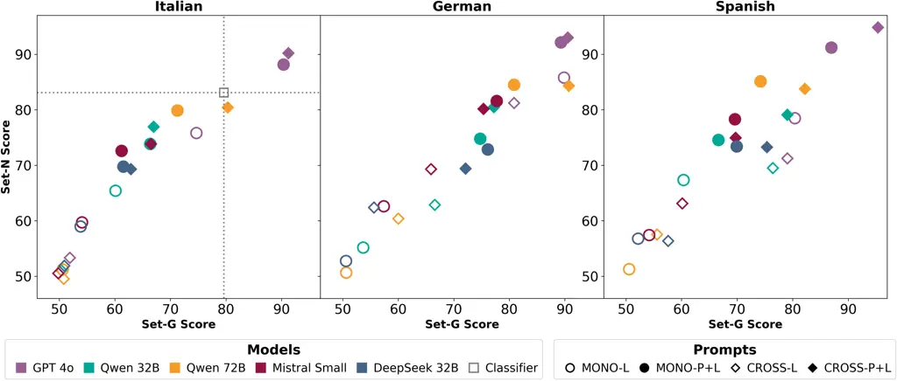
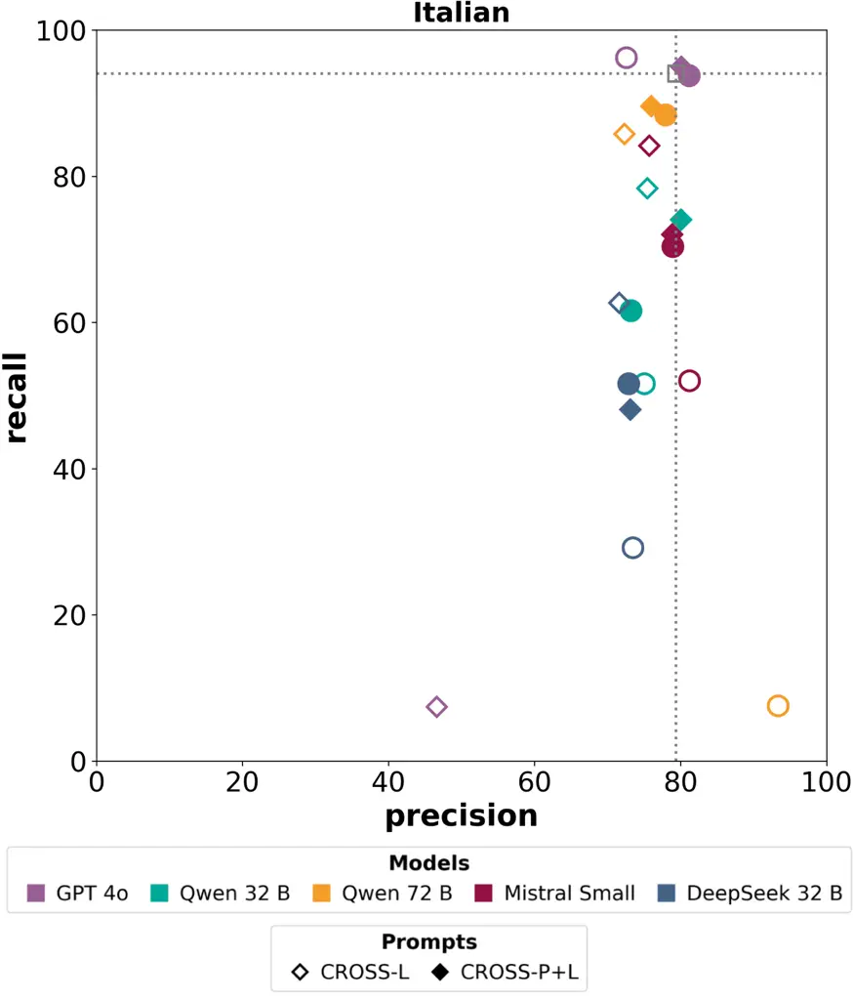
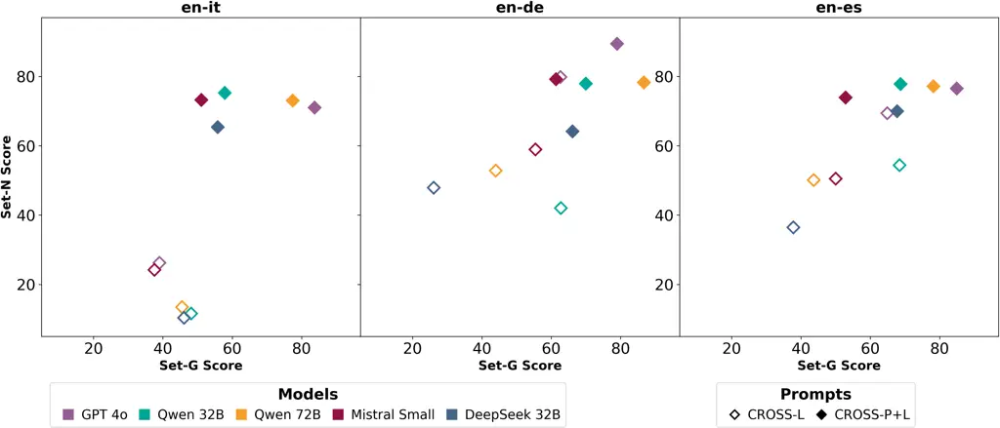

# An LLM-as-a-judge Approach for Scalable Gender-Neutral Translation Evaluation

Andrea Piergentili Affiliation: Fondazione Bruno Kessler
Affiliation: University of Trento Email: <apiergentili@fbk.eu>   
Beatrice Savoldi Affiliation: Fondazione Bruno Kessler
Email: <bsavoldi@fbk.eu>    Matteo Negri Affiliation: Fondazione Bruno
Kessler Email: <negri@fbk.eu>    Luisa Bentivogli
Affiliation: Fondazione Bruno Kessler Email: <bentivo@fbk.eu>

###### Abstract

Gender-neutral translation (GNT) aims to avoid expressing the gender of
human referents when the source text lacks explicit cues about the
gender of those referents. Evaluating GNT automatically is particularly
challenging, with current solutions being limited to monolingual
classifiers. Such solutions are not ideal because they do not factor in
the source sentence and require dedicated data and fine-tuning to scale
to new languages. In this work, we address such limitations by
investigating the use of large language models (LLMs) as evaluators of
GNT. Specifically, we explore two prompting approaches: one in which
LLMs generate sentence-level assessments only, and another—akin to a
chain-of-thought approach---where they first produce detailed
phrase-level annotations before a sentence-level judgment. Through
extensive experiments on multiple languages with five models, both open
and proprietary, we show that LLMs can serve as evaluators of GNT.
Moreover, we find that prompting for phrase-level annotations before
sentence-level assessments consistently improves the accuracy of all
models, providing a better and more scalable alternative to current
solutions.¹¹ 1 Software and data available at
[https://github.com/hlt-mt/fbk-NEUTR-evAL](https://github.com/hlt-mt/fbk-NEUTR-evAL)

## 1 Introduction

Gender-neutral translation (GNT) is the task of translating from one
language into another while avoiding gender-specific references in the
target text when the source does not provide explicit gender information
Piergentili et al. (2023a). Consider the examples in Table 1: the source
sentence (S) lacks gender information, therefore the translation should
avoid gendered terms such as ‘profesor’ (masculine) or ‘profesora’
(feminine), and rather use neutral terms like docente or the paraphrase
persona que enseña, thus preserving neutrality. This serves to prevent
undesired gender associations in machine translation (MT) outputs, which
could result in different types of harm, such as the reiteration of
harmful stereotypes Stanovsky et al. (2019); Triboulet and Bouillon
(2023), the unfair representation of gender groups Blodgett et al.
(2020), and disparities in quality of service Savoldi et al. (2024a).
These issues are especially relevant in grammatical gender languages,
such as Italian, Spanish, and German, which assign nouns with a
grammatical gender and inflect words linked to them accordingly
(examples M and F in Table 1).

| S   | Working as a teacher makes me happy                                                                                    |
| --- | ---------------------------------------------------------------------------------------------------------------------- |
| M   | Trabajar como profesor me hace contento                                                                                |
| F   | Trabajar como profesora me hace contenta                                                                               |
| N₁  | Trabajar como docente me hace feliz                                                                                    |
| N₂  | Trabajar como persona que enseña me procura mucha alegría \_(\[Working as someone who teaches gives me a lot of joy\]) |

Table 1: Examples of gendered and neutral Spanish translations of an
English sentence (S) featuring mentions of a human referent and no
gender information. Gendered words are underlined, neutral formulations
are italicized.

One of the challenges implied by GNT is how to evaluate it
automatically, thereby enabling fast, cheap, and replicable assessments.
Indeed, GNT is a complex open natural language generation task where
individual word choices make the difference between success and failure
(e.g. en: ‘as a teacher’ → es: ‘como una docente’ \[F\] vs ‘como
docente’ \[N\]) with valid gender-neutralization strategies ranging from
pinpointed lexical interventions (example N₁) to complex and verbose
reformulations (N₂) Piergentili et al. (2023a). The variability in valid
neutralization solutions makes GNT a complicated task to evaluate. Both
traditional and modern MT evaluation metrics struggle to account for
these variations, as they are hard to capture at a surface-level
Piergentili et al. (2023b), and neutral outputs are systematically
penalized by neural metrics Zaranis et al. (2024). Currently, the only
viable approaches to automatically identify gendered or neutral text
rely on dedicated classifiers Attanasio et al. (2021); Piergentili
et al. (2023b), which however do not factor in the source sentence.
Moreover, so far such solutions were only developed for the evaluation
of Italian texts, and require dedicated data and training to scale
across languages. The lack of easily scalable evaluation solutions
hinders advancements in GNT research and system development.

To fill this gap, we look at the LLM-as-a-Judge paradigm Gu et al.
(2025), where large language models (LLMs) are prompted to perform
task-specific evaluations. Specifically, we ask: RQ1) Can we use LLMs to
evaluate GNT? RQ2) Does performing intermediate analytical steps improve
the accuracy of LLM-based GNT evaluations? To answer these questions, we
conduct experiments with five LLMs, evaluating their ability to assess
neutrality in Italian, Spanish, and German texts. We experiment with
four evaluation approaches. Two approaches focus on generating
sentence-level assessments, while the other two simulate a
chain-of-thought Wei et al. (2022), prompting LLMs to perform
fine-grained phrase-level analysis before providing higher-level
judgments. Overall, we find that LLMs can serve as evaluators of GNT and
that generating phrase-level annotations significantly improves LLMs’
accuracy.

## 2 Background

##### Gender-inclusivity in language technology

In recent years, the research community’s efforts to improve gender
fairness in natural language processing (NLP) technologies has grown
significantly. With LLMs becoming the state-of-the-art in many NLP tasks
Zhao et al. (2024), several works have highlighted their shortcomings in
language fairness (Dev et al., 2021; Lauscher et al., 2022; Hossain
et al., 2023; Waldis et al., 2024, inter alia). However, other works
identified approaches to improve LLM fairness, both with Bartl and Leavy
(2024) and without Hossain et al. (2024) fine-tuning.

In MT, while LLMs have been proven not to be immune from gender bias
Vanmassenhove (2024); Lardelli et al. (2024); Sant et al. (2024), their
in-context learning ability Brown et al. (2020) allowed to mitigate it
by controlling the gender in the target sentence Sánchez et al. (2024);
Lee et al. (2024). Moreover, prompting LLMs with more advanced
techniques enabled new approaches to gender-inclusive translation, such
as using gender-inclusive neopronouns in the target languages
Piergentili et al. (2024), or performing GNT Savoldi et al. (2024b).
Here we focus on the latter, for which further progress is still
hampered by the lack of automatic evaluation methods.

##### GNT evaluation

Evaluating GNT is a complex task due to the variability in valid
gender-neutralization strategies, which range from minor lexical
substitutions to significant structural reformulations, and are specific
to each language, as different languages encode gender differently in
their grammar. Currently, automatic GNT evaluation solutions are based
on fine-tuned BERT-based Devlin et al. (2019) monolingual
gender-inclusivity/neutrality classifiers Attanasio et al. (2021);
Savoldi et al. (2024b). This method has significant limitations. First,
it does not factor in the source, thus it cannot assess whether GNT was
necessary or appropriate in light of features of the source sentence
without dedicated gold labels. Moreover, it requires task-specific data
to fine-tune dedicated models to scale to other target languages, with
limited flexibility across domains.

To address these limitations, we look at the emerging language
model-based approach.

| Source                      | All this must be carried out in a climate of transparency and regularity so that the citizens do not feel that they are being swindled or sacrificed on the altar of major economic interests.                  |                                                                                           |
| --------------------------- | --------------------------------------------------------------------------------------------------------------------------------------------------------------------------------------------------------------- | ----------------------------------------------------------------------------------------- |
| Target (REF-G)              | Todo esto se ha de llevar a cabo en un clima de transparencia y de corrección con el fin de que los ciudadanos no se sientan estafados o víctimas sacrificadas en el altar de los grandes intereses económicos. |                                                                                           |
| ❍ Mono-L                    | label:                                                                                                                                                                                                          | GENDERED                                                                                  |
| ⚫ Mono-P+L                 | phrases:                                                                                                                                                                                                        | los ciudadanos Mg, se sientan estafados Mg, víctimas sacrificadas Ng                      |
|                             | label:                                                                                                                                                                                                          | GENDERED                                                                                  |
| $`\lozenge`$ Cross-L        | label:                                                                                                                                                                                                          | WRONGLY GENDERED                                                                          |
| $`\blacklozenge`$ Cross-P+L | phrases:                                                                                                                                                                                                        | los ciudadanos MgwrongN, se sientan estafados MgwrongN, víctimas sacrificadas NgcorrectgN |
|                             | label:                                                                                                                                                                                                          | WRONGLY GENDERED                                                                          |

Table 2: Examples of GPT-4o’s outputs for each prompt, for a Spanish
mGeNTE entry. This is a Set-N entry with a REF-G reference, thus the
source includes no gender cue and the target features undue gendered
words (in bold). For the Mono prompts (❍ and ⚫) only the target
sentence is provided as input, whereas for the Cross prompts
($`\lozenge`$ and $`\blacklozenge`$) both the source and target
sentences are included. The field label is a sentence-level assessment,
whereas phrases is a list of annotations of phrases referred to human
beings. Each element of this list includes the piece of text being
annotated (in italic), the gender it expresses (M, F, or N), and an
assessment of whether that gender expression is correctg or wrongt with
respect to the information available in the source (only in
$`\blacklozenge`$). Both the label and the list of phrases are generated
by the models.

##### LLM-as-a-Judge

Recently, LLMs have been successfully employed as evaluators of
natural-language generation tasks Wang et al. (2023); Liu et al. (2023);
Bavaresco et al. (2024) including MT, where proprietary LLMs have been
employed as state-of-the-art MT quality evaluators Kocmi and Federmann
(2023b); Leiter and Eger (2024) without the need for dedicated
fine-tuning data. Several works used LLMs to provide insights into
fine-grained aspects, such as fluency, accuracy, and style Fu et al.
(2024); Lu et al. (2024). Moreover, LLMs have successfully been employed
to generate the error annotations required for Multidimensional Quality
Metrics assessments Fernandes et al. (2023); Kocmi and Federmann
(2023a); Feng et al. (2024); Zouhar et al. (2025), an evaluation
paradigm designed for human evaluators, which requires pinpointed
analyses and attention to context. Furthermore, and more related to our
work, LLMs have also been found to be accurate evaluators of
masculine/feminine references to human beings in monolingual contexts
Derner et al. (2024).

Here, we investigate whether LLMs’ ability to generate fine-grained
assessments can be leveraged to build a GNT evaluation method scalable
across languages without the need for dedicated fine-tuning data.

| Set-G | SRC (F) | Madam President, I should like to thank Mrs Oostlander for her sterling contribution as delegate.                                 |
| ----- | ------- | --------------------------------------------------------------------------------------------------------------------------------- |
| de    | REF-G   | Frau Präsidentin! Ich möchte der Kollegin Oostlander für ihre verdienstvolle Arbeit als Delegierte danken.                        |
| de    | REF-N   | Geehrtes Präsidium! Ich möchte dem Kollegiumsmitglied Oostlander für seine verdienstvolle Arbeit als Delegierte danken.           |
| es    | REF-G   | Señora Presidenta, quiero agradecer a la Sra. Oostlander sus valiosos esfuerzos como delegada.                                    |
| es    | REF-N   | Con la venia de la Presidencia, quiero agradecer a su Señoría Oostlander sus valiosos esfuerzos como integrante de la delegación. |
| it    | REF-G   | Signora Presidente, ringrazio la onorevole Oostlander per il lavoro meritorio che ha assolto come delegata.                       |
| it    | REF-N   | Gentile Presidente, ringrazio l’onorevole Oostlander per il lavoro meritorio che ha assolto come membro della delegazione.        |
| Set-N | SRC     | There are no better guardians of the Treaties than the European citizens.                                                         |
| de    | REF-G   | Niemand eignet sich als Hüter der Verträge besser als die europäischen Bürger.                                                    |
| de    | REF-N   | Niemand eignet sich zum Hüten der Verträge besser als die europäische Bevölkerung.                                                |
| es    | REF-G   | No hay mejores custodios de los Tratados que los ciudadanos europeos.                                                             |
| es    | REF-N   | No hay mejores vigilantes de los Tratados que la ciudadanía europea.                                                              |
| it    | REF-G   | I migliori guardiani dei Trattati sono gli stessi cittadini europei.                                                              |
| it    | REF-N   | Le popolazioni residenti sul suolo europeo sono le migliori custodi dei Trattati.                                                 |

Table 3: Examples of mGeNTE entries from Set-G and Set-N, with both
REF-G and REF-N, and parallel across the three target languages. Gender
cues in the source and gendered words in the references are in bold. The
matching reference for the entry is highlighted.

## 3 GNT evaluation prompts

To explore the LLM-as-a-Judge approach to GNT evaluation and investigate
whether prompting for intermediate analytical steps leads to higher
evaluation accuracy, we experiment with four prompts targeting different
approaches to evaluation. We design prompts dedicated to the evaluation
of the target language text only (Mono) and the source sentence paired
with the translation (Cross). With the Mono prompts we attempt to
replicate the evaluation enabled by the gender-neutrality classifier
introduced in Piergentili et al. (2023b) on new languages, without
generating dedicated data and fine-tuning new models. Mono prompts can
be used as is to evaluate intra-lingual neutral rewriting tasks
Vanmassenhove et al. (2021); Veloso et al. (2023); Frenda et al. (2024).
However, for GNT evaluation, they still require gold labels specifying
whether the source sentence should be translated neutrally, as with
classifier-based methods. The Cross prompts instead task the models not
just with classifying the target text as gendered or neutral, but also
to determine if the target’s gender correctly aligns with the source
sentence. This allows for GNT evaluation in realistic scenarios, i.e.
outside of the benchmarking enabled by gold source sentence labels.

For both the Mono and Cross approaches we experiment with one prompt
that requires the model to generate a sentence-level label only (L) and
another where the model must generate phrase-level annotations first and
then provide a sentence-level label (P+L). Examples of the output of
each prompt are available in Table 2. Complete instructions and further
details are provided in Appendix A.

##### ❍Mono-L

We provide the model with the target sentence and instruct it to
classify the sentence as

GENDEREDif at least one masculine or feminine reference to human beings
is found, or as

NEUTRALif the whole sentence is gender-neutral. This prompt does not
imply any intermediate annotation, only requesting one sentence-level
label.

##### ⚫Mono-P+L

The model is instructed to first generate annotations for all phrases
that refer to human beings in the target sentence. For each phrase, the
model must also provide a label indicating its semantic gender:

M(masculine),

F(feminine), or

N(neutral). Finally, the model must provide the same sentence-level
label as in Mono-L, based on the same principle: if one or more of the
annotated phrases is gendered, the sentence label should be

GENDERED; otherwise, it should be

NEUTRAL. This prompt introduces intermediate annotations, which are
expected to inform the models’ choice of the final sentence-level label.

##### $`\lozenge`$ Cross-L

We provide the model with both the source and target sentences,
instructing it to classify the target as

NEUTRALif fully gender-neutral,

CORRECTLY GENDEREDif it accurately reflects gender information from the
source, or

WRONGLY GENDEREDif the target’s gender does not match the source or the
target adds gender information when the source lacks it. We do not
distinguish between correct and incorrect NEUTRAL translations. While
using gendered language when gender is unspecified in the source is
undesirable (i.e.

WRONGLY GENDERED), neutral translations---though not always
necessary---merely avoid gender marking and therefore cannot be
considered wrong by definition.²² 2 We note that there are instances
where gender is essential to the meaning of a sentence and should then
be preserved in translation. For example, to refer to specific groups,
as in ‘men tend to suffer from heart attacks at higher rates’).
Accounting for this aspect in the evaluation requires finer-grained
analyses factoring in translation adequacy as well. As such instances
represent less than 3% of our test data, we retain them in our
experiments and leave this analysis to future work.

##### $`\blacklozenge`$ Cross-P+L

We instruct the model to generate the same annotations as Mono-P+L, with
the addition of an assessment of whether each phrase’s gender is

correctgor

wrongtwith respect to the source. Finally, the model must provide the
same sentence-level label as in Cross-L. Similarly to Mono-P+L, this
prompt introduces the intermediate phrase annotations that the model is
expected to leverage to provide more accurate labels.

## 4 Experimental settings

We experiment with LLM-based evaluation of GNT from English into three
target languages—Italian, Spanish, and German—in two scenarios:

- •
  Target-only, where LLMs only evaluate the target language text. In
  this scenario, models are tasked with assessing whether the text
  contains any gendered mention of human beings and label it

  GENDERED, or no such mention and label it

  NEUTRAL.

- •
  Source-target, where LLMs receive both the source sentence and the
  target language translation as input. Here, the models must assess
  whether the target language text is

  NEUTRAL,

  CORRECTLY GENDERED, or

  WRONGLY GENDEREDwith respect to the information available in the
  source.

### 4.1 Test data and evaluation metrics

We conduct our experiments on mGeNTE Savoldi et al. (2025), a
multilingual test set for GNT. Available for en-it/es/de, for each
language pair it comprises 1,500 parallel sentences, evenly divided in
two subsets (see Table 3): Set-G entries feature words in the source
that provide information about the gender of human referents (e.g.,
Madam, Mrs, and her in the Set-G example in Table 3) whereas Set-N
entries do not. The Set-G sentences are further split into
masculine-only and feminine-only, and labeled M and F respectively.

We use mGeNTE as the test set to validate our evaluation approaches
because it provides dedicated human-made translations and gold labels
for GNT. Although evaluating human-made translations is not fully
representative of realistic conditions, this dataset remains the only
multilingual resource available with GNT-specific gold labels. To
further explore automatic GNT evaluation in realistic conditions, we
also experiment with model-generated translations of a subset of mGeNTE.

mGeNTE references and the automatic translations we use in our
experiments are described in sections 4.1.1 and 4.1.2 respectively.
Statistics on our experimental data are reported in Table 4.

| Set               | Split | GENDERED | NEUTRAL | TOTAL |
| ----------------- | ----- | -------- | ------- | ----- |
| mGeNTE references | Set-G | 750      | 750     | 1,500 |
| (x3: en-it/de/es) | Set-N | 750      | 750     | 1,500 |
| Automatic GNTs    | Set-N | 340      | 740     | 1,080 |
| (en-it only)      |       |          |         |       |

Table 4: Statistics about the test data. mGeNTE values are referred to
each target language, whereas the automatic GNTs are available only for
en-it.

#### 4.1.1 mGeNTE references

To run experiments on Italian, Spanish, and German texts, we use the
reference translations in mGeNTE. Each source sentence in the corpus
corresponds to two reference translations produced by professionals: a
gendered reference (REF-G), considered ideal for Set-G but incorrect for
Set-N, and a gender-neutral reference (REF-N), correct for Set-N and not
ideal for Set-G. We use both REF-G and REF-N in isolation as input in
our target-only scenario, and we pair them with the source sentence in
the source-target scenario.

To evaluate on this data set, we compute sentence-level label accuracies
by matching models’ predictions against the true labels in mGeNTE. We
use the data split labels (Set-G and Set-N) in combination with the
reference labels to determine the true labels for each scenario and data
split. For the target-only scenario, we map REF-G and REF-N to

GENDEREDand

NEUTRALrespectively. For the source-target scenario, REF-G is further
categorized as

CORRECTLY GENDEREDfor Set-G entries and

WRONGLY GENDEREDfor Set-N entries.

#### 4.1.2 Automatic GNTs

We also experiment on a more realistic evaluation scenario, where
evaluator LLMs are tasked with assessing automatic
gender-neutralizations instead of human references, using a set of
automatic translations of mGeNTE en-it sentences taken from Set-N
(Savoldi et al., 2024b).³³ 3
[https://mt.fbk.eu/gente/](https://mt.fbk.eu/gente/) The translations
were produced by GPT-4⁴⁴ 4 Model gpt-4-0613 OpenAI (2024a) and manually
evaluated by human experts, who provided gold labels about the
neutrality of the outputs.⁵⁵ 5 The outputs were originally divided into
neutral, partially neutral, and gendered. Here, we adjusted this
tripartition to our label system by merging the partially neutral
category into the GENDEREDlabel, in line with the classifier’s binary
label system.

As the classes in this dataset are unbalanced (see Table 4), to assess
the performance of evaluator LLMs we compute precision and recall scores
rather than a simple label accuracy in this case. Since all the source
sentences from this data set originally belonged to Set-N, we consider

NEUTRALthe positive class. Moreover, since this set of automatic GNTs
does not include Set-G entries, and consequently one of the three labels
from the source-target scenario (

CORRECTLY GENDERED) is not represented within it, we only use this data
set in the target-only scenario.

| Model         | en-de  | en-es  | en-it  |
| ------------- | ------ | ------ | ------ |
| Tower 13B     | 0.4407 | 0.4610 | 0.4587 |
| GPT-4o        | 0.4635 | 0.4720 | 0.4730 |
| Qwen 32B      | 0.4485 | 0.4608 | 0.4601 |
| Qwen 72B      | 0.4533 | 0.4647 | 0.4646 |
| Mistral Small | 0.4552 | 0.4623 | 0.4623 |
| DS Qwen 32B   | 0.4365 | 0.4559 | 0.4517 |

Table 5: COMET scores of all models’ MT outputs on FLORES+. Instances
where one of the models outperform Tower 13B are underlined.

### 4.2 Prompting details

For each of the prompts described in section 3, we use the same 8 task
exemplars to elicit LLMs’ in-context learning Brown et al. (2020); Min
et al. (2022). These exemplars were selected from mGeNTE entries
parallel across the three languages, and were balanced across the
Set-G/N, REF-G/N, and gender combinations. The entries used as exemplars
were excluded from the test data in the experiments.

Figure 1: Accuracy of all models in target-only GNT evaluation
experiments on mGeNTE references. The Italian experiments include the
performance of the gender-neutrality classifier, which is not available
for other languages.

We constrain models’ generations to adhere to specific JSON schemas via
structured generation Willard and Louf (2023), which, at each generation
step, restricts the model’s vocabulary to the tokens allowed at that
step by the schema, masking out the invalid ones. This ensures that all
models’ outputs adhere to the same formats without the need for
post-processing or parsing within open ended generations.

### 4.3 Models

We experiment with open models of different families and sizes: Qwen 2.5
32B and 72B Team (2024), Mistral Small 3 24B,⁶⁶ 6
[https://mistral.ai/en/news/mistral-small-3](https://mistral.ai/en/news/mistral-small-3)
DeepSeek-R1-Distill-Qwen-32B DeepSeek-AI (2025).⁷⁷ 7 We performed a
first selection of models that perform best on instruction following
tasks on Open LLM Leaderboard Fourrier et al. (2024), then further
selected the models that performed best in preliminary experiments. We
also include GPT-4o⁸⁸ 8 Model gpt-4o-2024-08-06 OpenAI (2024b) as
representative of the closed, commercial models. All models are
fine-tuned for instruction following Ouyang et al. (2022); Chung et al.
(2024).

To ensure that the models we selected perform well on the target
languages we include in our experiments, we assess all models’
performance on generic translation into Italian, Spanish, and German
using FLORES+ NLLB Team et al. (2024). Table 5 reports their COMET⁹⁹ 9
Model Unbabel/wmt22-cometkiwi-da Rei et al. (2022) Rei et al. (2020)
scores, which measure how well model outputs represent the source
sentence meaning. As a baseline we report the performance of Tower 13B
Instruct Alves et al. (2024), a state-of-the-art open LLM fine-tuned for
MT tasks. All models were prompted to perform MT with default settings
and three shots randomly selected from the dev split of FLORES+. The
results show that all models perform well in all target languages
compared to Tower 13B, indicating consistently strong performance across
the languages evaluated.

## 5 Results and discussion

We report the results of our experiments in target-only and
source-target GNT evaluation experiments on mGeNTE references in Figures
1 and 3 respectively. Results on automatic GNTs are reported in Figure 2. In the target-only charts we include the performance of the
gender-neutrality classifier¹⁰¹⁰ 10
[https://huggingface.co/FBK-MT/GeNTE-evaluator](https://huggingface.co/FBK-MT/GeNTE-evaluator)
on the test data as a baseline for the Italian experiments. The detailed
results of all evaluation experiments are reported in Appendix B, along
with additional discussions.

To make the performance of the Mono and Cross prompts comparable in the
target-only scenario, we count the labels

CORRECTLY GENDEREDand

WRONGLY GENDEREDas correct matches of

GENDERED.

Figure 2: Precision and recall scores of all models in target-only GNT
evaluation of automatic GNTs.

Figure 3: Accuracy of all models in source-target GNT evaluation
experiments on mGeNTE source-reference pairs. Note that the axes here
encompass a wider range of values compared to the target-only chart.

### 5.1 Target-only evaluation

##### Results on mGeNTE references

Looking at the target-only results we note that GPT-4o is consistently
the best overall performer, and the only model outperforming the
gender-neutrality classifier in the Italian scenario (90.72% vs 81.37%
overall accuracy, see Table 10). Among the open models, Qwen 2.5 72B
performs best and comes close to the classifier’s performance with the
Cross-P+L prompt ($`\blacklozenge`$). We note that all models perform
better in the Spanish and German experiments, with GPT-4o reaching
95.08% overall accuracy in the latter ($`\blacklozenge`$) and Qwen 2.5
72B (⚫, $`\blacklozenge`$) and 32B ($`\blacklozenge`$) showing solid
performance in both languages. To answer RQ1, the target-only results
indicate that LLMs can serve as evaluators of gender-neutrality in
multiple languages with good accuracy.

To answer RQ2, we compare the performance of the four prompting
strategies and notice that the P+L prompts (⚫ and $`\blacklozenge`$)
produce more accurate results than the label-only prompts (❍ and
$`\lozenge`$) across all languages. Furthermore, the richer annotation
prompt CROSS-P+L ($`\blacklozenge`$) generally outperforms the others.
We conclude that guiding models to generate intermediate finer-grained
annotations improves the accuracy of the sentence-level assessments.

##### Results on automatic GNTs

Results on the target-only experiments on automatic GNTs (Figure 2),
confirm the findings discussed above. We find analogous rankings, with
only GPT-4o slightly outperforming the classifier (⚫,
$`\blacklozenge`$) and Qwen 2.5 72B being the best open model. Comparing
prompt strategies, here we see the P+L prompts outperforming the
others—though only for the best models, with no coherent trend for the
others.

Specific to these results, looking at precision and recall we note that
most of the model/prompt combinations produce similar precision values,
meaning that they show similar abilities in correctly labeling gendered
sentences (few false positives). It is the recall score that ultimately
makes the difference in performance, i.e. their ability to correctly
label neutral sentences.

### 5.2 Source-target evaluation results

The results of the source-target evaluation experiments (Figure 3)
support our previous findings. First, we observe that, with dedicated
prompting, LLMs can serve as multilingual evaluators of GNT with solid
accuracy. This enables the evaluation of GNT in absence of gender
information about the source sentence. Second, we confirm that phrase
annotation ($`\blacklozenge`$) consistently improves evaluation accuracy
across all models.

Moreover, similarly to the target-only scenario, GPT-4o outperforms the
open models in this setting as well. All models generally exhibit better
performance on Spanish and German rather than Italian in cross-lingual
evaluation here too. Overall, scores are generally lower than in the
target-only setting. This is likely due to the further distinction of
the

GENDEREDlabel into

CORRECTLYand

WRONGLY GENDERED, which increases task complexity, and to the added
challenge of incorporating the source sentence. As found by Huang et al.
(2024), LLMs generally perform better in MT evaluation when provided
with a reference translation rather than the source. Our results reflect
this trend, suggesting that despite their strong translation
capabilities, LLMs still have limited ability to leverage cross-lingual
information for evaluation. Additionally, model performance gaps are
narrower in this scenario, indicating that even the models that perform
best in target-only evaluation are not immune to these limitations.

## 6 Conclusions

We investigated several LLMs’ ability in performing GNT evaluation
across three target languages—Italian, German, and Spanish—comparing
their performance against the previously available solutions, namely
classifier-based approaches. We experimented with two prompting
approaches and constrained LLMs to generate sentence-level labels only
in one case and phrase-level annotation as well as sentence-level labels
in the other, with the latter being akin to a chain-of-thought approach.
Our experimental results show that guiding the models to generate
fine-grained annotations before providing a higher level assessment
significantly improves their accuracy. However, while in target language
evaluation some of the models reach almost perfect accuracy, assessing
neutrality with reference to the source sentence emerges as a harder
task for LLM evaluators, in line with findings from the literature.
Overall, our LLM-based approach outperforms existing solutions, and
provides a scalable method for automatic GNT evaluation that generalizes
effectively across languages, without requiring additional task-specific
data.

## 7 Limitations

Naturally, our work comes with some limitations. First, while the
explored evaluation approaches address some of the limitations of
previous solutions, they are still confined to discrete sentence-level
labels. These make our approaches unable to distinguish degrees of
success or failure in using the appropriate gender expression in
relation to specific human referents. For instance, this means that we
are not able to assess whether a non-neutral output includes only one
gendered mention of a human entity or multiple ones, thus we cannot
perform more nuanced analyses or rankings of different outputs or
systems. Second, our approaches do not factor in an important aspect of
GNT: the acceptability of neutral text Savoldi et al. (2024b).
Acceptability is a complex aspect, determined by the adequacy of the
target text with respect to the source sentence meaning and its fluency
in the target language. Developing evaluation systems that can account
for acceptability in the evaluation calls for dedicated research work,
and the validation of such systems requires fine-grained human reference
annotations that are currently not available. For similar reasons, in
our analyses we only focused on the sentence-level annotations generated
by the models, and leaving aside the phrase-level annotations generated
with the P+L prompts. Since the mGeNTE corpus does not include gold
annotations of phrases that refer to human beings we only measured
sentence-level accuracy and could not evaluate the phrase-level
annotations generated by the models.

While we are interested in exploring all the aspects mentioned above in
the future, with this work we focused on tackling limitations of
previously available solutions, enabling and improving the evaluation of
GNT across new languages, and doing so with an easy to replicate method,
so as to foster the development and research of GNT in further languages
as well.

## 8 Bias statement

This paper addresses representational and allocational harms as defined
by Blodgett et al. (2020) arising from gender biases in automatic
translation, particularly when translation systems unnecessarily default
to gender-specific terms, perpetuating harmful stereotypes or excluding
non-binary identities. Our approach leverages LLMs for scalable,
automatic evaluation of GNT. We assume GNT is desirable when the source
text does not specify gender explicitly, aiming to prevent unfair
gendered expressions. However, we acknowledge that gender-neutral
language is only one of the approaches to inclusive language Lardelli
and Gromann (2023), and is not necessarily perceived as inclusive by all
speakers Spinelli et al. (2023). We also acknowledge potential biases
inherent to LLMs from their training data, possibly affecting evaluation
outcomes across languages and cultural contexts.

## Acknowledgments

This paper has received funding from the European Union’s Horizon
research and innovation programme under grant agreement No 101135798,
project Meetween (My Personal AI Mediator for Virtual MEETings BetWEEN
People). We also acknowledge the support of the PNRR project FAIR -
Future AI Research (PE00000013), under the NRRP MUR program funded by
the NextGenerationEU. Finally, we acknowledge the CINECA award under the
ISCRA initiative (AGeNTE), for the availability of high-performance
computing resources and support.

## References

- Alves et al. (2024) Duarte M. Alves, José Pombal, Nuno M. Guerreiro,
  Pedro H. Martins, João Alves, Amin Farajian, Ben Peters, Ricardo Rei,
  Patrick Fernandes, Sweta Agrawal, Pierre Colombo, José G. C. de Souza,
  and André F. T. Martins. 2024. [Tower: An open multilingual large
  language model for translation-related
  tasks](https://arxiv.org/abs/2402.17733). _Preprint_,
  arXiv:2402.17733.
- Attanasio et al. (2021) Giuseppe Attanasio, Salvatore Greco, Moreno
  La Quatra, Luca Cagliero, Michela Tonti, Tania Cerquitelli, and
  Rachele Raus. 2021. [E-mimic: Empowering multilingual inclusive
  communication](https://doi.org/10.1109/BigData52589.2021.9671868). In
  _2021 IEEE International Conference on Big Data (Big Data)_, pages
  4227–4234.
- Bartl and Leavy (2024) Marion Bartl and Susan Leavy. 2024. [From
  ‘showgirls’ to ‘performers’: Fine-tuning with gender-inclusive
  language for bias reduction in
  LLMs](https://doi.org/10.18653/v1/2024.gebnlp-1.18). In _Proceedings
  of the 5th Workshop on Gender Bias in Natural Language Processing
  (GeBNLP)_, pages 280–294, Bangkok, Thailand. ACL.
- Bavaresco et al. (2024) Anna Bavaresco, Raffaella Bernardi, Leonardo
  Bertolazzi, Desmond Elliott, Raquel Fernández, Albert Gatt, Esam
  Ghaleb, Mario Giulianelli, Michael Hanna, Alexander Koller, André
  F. T. Martins, Philipp Mondorf, Vera Neplenbroek, Sandro Pezzelle,
  Barbara Plank, David Schlangen, Alessandro Suglia, Aditya K Surikuchi,
  Ece Takmaz, and Alberto Testoni. 2024. [Llms instead of human judges?
  a large scale empirical study across 20 nlp evaluation
  tasks](https://arxiv.org/abs/2406.18403). _Preprint_,
  arXiv:2406.18403.
- Blodgett et al. (2020) Su Lin Blodgett, Solon Barocas, Hal Daumé III,
  and Hanna Wallach. 2020. [Language (technology) is power: A critical
  survey of “bias” in
  NLP](https://doi.org/10.18653/v1/2020.acl-main.485). In _Proc. of the
  58th Annual Meeting of the ACL_, pages 5454–5476, Online. ACL.
- Brown et al. (2020) Tom Brown, Benjamin Mann, Nick Ryder, Melanie
  Subbiah, Jared D Kaplan, Prafulla Dhariwal, Arvind Neelakantan, Pranav
  Shyam, Girish Sastry, Amanda Askell, Sandhini Agarwal, Ariel
  Herbert-Voss, Gretchen Krueger, Tom Henighan, Rewon Child, Aditya
  Ramesh, Daniel Ziegler, Jeffrey Wu, Clemens Winter, Chris Hesse, Mark
  Chen, Eric Sigler, Mateusz Litwin, Scott Gray, Benjamin Chess, Jack
  Clark, Christopher Berner, Sam McCandlish, Alec Radford, Ilya
  Sutskever, and Dario Amodei. 2020. [Language models are few-shot
  learners](https://proceedings.neurips.cc/paper_files/paper/2020/file/1457c0d6bfcb4967418bfb8ac142f64a-Paper.pdf).
  In _Advances in Neural Information Processing Systems_, volume 33,
  pages 1877–1901. Curran Associates, Inc.
- Chung et al. (2024) Hyung Won Chung, Le Hou, Shayne Longpre, Barret
  Zoph, Yi Tay, William Fedus, Yunxuan Li, Xuezhi Wang, Mostafa
  Dehghani, Siddhartha Brahma, et al. 2024. Scaling
  instruction-finetuned language models. _Journal of Machine Learning
  Research_, 25(70):1–53.
- DeepSeek-AI (2025) DeepSeek-AI. 2025. [Deepseek-r1: Incentivizing
  reasoning capability in llms via reinforcement
  learning](https://arxiv.org/abs/2501.12948). _Preprint_,
  arXiv:2501.12948.
- Derner et al. (2024) Erik Derner, Sara Sansalvador de la Fuente, Yoan
  Gutiérrez, Paloma Moreda, and Nuria Oliver. 2024. [Leveraging large
  language models to measure gender representation bias in gendered
  language corpora](https://arxiv.org/abs/2406.13677). _Preprint_,
  arXiv:2406.13677.
- Dev et al. (2021) Sunipa Dev, Masoud Monajatipoor, Anaelia Ovalle,
  Arjun Subramonian, Jeff M Phillips, and Kai-Wei Chang. 2021. [Harms of
  gender exclusivity and challenges in non-binary representation in
  language technologies](https://arxiv.org/abs/2108.12084). _Preprint_,
  arXiv:2108.12084.
- Devlin et al. (2019) Jacob Devlin, Ming-Wei Chang, Kenton Lee, and
  Kristina Toutanova. 2019. [BERT: Pre-training of deep bidirectional
  transformers for language
  understanding](https://doi.org/10.18653/v1/N19-1423). In _Proceedings
  of the 2019 Conference of the North American Chapter of the ACL: Human
  Language Technologies, Volume 1 (Long and Short Papers)_, pages
  4171–4186, Minneapolis, Minnesota. ACL.
- Dey et al. (2024) Krishno Dey, Prerona Tarannum, Md. Arid Hasan, Imran
  Razzak, and Usman Naseem. 2024. [Better to ask in english: Evaluation
  of large language models on english, low-resource and cross-lingual
  settings](https://arxiv.org/abs/2410.13153). _Preprint_,
  arXiv:2410.13153.
- Feng et al. (2024) Zhaopeng Feng, Jiayuan Su, Jiamei Zheng, Jiahan
  Ren, Yan Zhang, Jian Wu, Hongwei Wang, and Zuozhu Liu. 2024. [M-mad:
  Multidimensional multi-agent debate framework for fine-grained machine
  translation evaluation](https://arxiv.org/abs/2412.20127). _Preprint_,
  arXiv:2412.20127.
- Fernandes et al. (2023) Patrick Fernandes, Daniel Deutsch, Mara
  Finkelstein, Parker Riley, André Martins, Graham Neubig, Ankush Garg,
  Jonathan Clark, Markus Freitag, and Orhan Firat. 2023. [The devil is
  in the errors: Leveraging large language models for fine-grained
  machine translation
  evaluation](https://doi.org/10.18653/v1/2023.wmt-1.100). In
  _Proceedings of the Eighth Conference on Machine Translation_, pages
  1066–1083, Singapore. ACL.
- Fourrier et al. (2024) Clémentine Fourrier, Nathan Habib, Alina
  Lozovskaya, Konrad Szafer, and Thomas Wolf. 2024. Open llm leaderboard
  v2.
  [https://huggingface.co/spaces/open-llm-leaderboard/open_llm_leaderboard](https://huggingface.co/spaces/open-llm-leaderboard/open_llm_leaderboard).
- Frenda et al. (2024) Simona Frenda, Andrea Piergentili, Beatrice
  Savoldi, Marco Madeddu, Martina Rosola, Silvia Casola, Chiara
  Ferrando, Viviana Patti, Matteo Negri, and Luisa Bentivogli. 2024.
  [GFG - gender-fair generation: A CALAMITA
  challenge](https://aclanthology.org/2024.clicit-1.122/). In
  _Proceedings of the 10th Italian Conference on Computational
  Linguistics (CLiC-it 2024)_, pages 1106–1115, Pisa, Italy. CEUR
  Workshop Proceedings.
- Fu et al. (2024) Jinlan Fu, See-Kiong Ng, Zhengbao Jiang, and Pengfei
  Liu. 2024. [GPTScore: Evaluate as you
  desire](https://doi.org/10.18653/v1/2024.naacl-long.365). In
  _Proceedings of the 2024 Conference of the North American Chapter of
  the ACL: Human Language Technologies (Volume 1: Long Papers)_, pages
  6556–6576, Mexico City, Mexico. ACL.
- Gu et al. (2025) Jiawei Gu, Xuhui Jiang, Zhichao Shi, Hexiang Tan,
  Xuehao Zhai, Chengjin Xu, Wei Li, Yinghan Shen, Shengjie Ma, Honghao
  Liu, Saizhuo Wang, Kun Zhang, Yuanzhuo Wang, Wen Gao, Lionel Ni, and
  Jian Guo. 2025. [A survey on
  llm-as-a-judge](https://arxiv.org/abs/2411.15594). _Preprint_,
  arXiv:2411.15594.
- Hossain et al. (2023) Tamanna Hossain, Sunipa Dev, and Sameer
  Singh. 2023. [MISGENDERED: Limits of large language models in
  understanding
  pronouns](https://doi.org/10.18653/v1/2023.acl-long.293). In
  _Proceedings of the 61st Annual Meeting of the ACL (Volume 1: Long
  Papers)_, pages 5352–5367, Toronto, Canada. ACL.
- Hossain et al. (2024) Tamanna Hossain, Sunipa Dev, and Sameer
  Singh. 2024. [Misgendermender: A community-informed approach to
  interventions for misgendering](https://arxiv.org/abs/2404.14695).
  _Preprint_, arXiv:2404.14695.
- Huang et al. (2024) Xu Huang, Zhirui Zhang, Xiang Geng, Yichao Du,
  Jiajun Chen, and Shujian Huang. 2024. [Lost in the source language:
  How large language models evaluate the quality of machine
  translation](https://doi.org/10.18653/v1/2024.findings-acl.211). In
  _Findings of the ACL: ACL 2024_, pages 3546–3562, Bangkok, Thailand.
  ACL.
- Kocmi and Federmann (2023a) Tom Kocmi and Christian Federmann. 2023a.
  [GEMBA-MQM: Detecting translation quality error spans with
  GPT-4](https://doi.org/10.18653/v1/2023.wmt-1.64). In _Proceedings of
  the Eighth Conference on Machine Translation_, pages 768–775,
  Singapore. ACL.
- Kocmi and Federmann (2023b) Tom Kocmi and Christian Federmann. 2023b.
  [Large language models are state-of-the-art evaluators of translation
  quality](https://aclanthology.org/2023.eamt-1.19). In _Proceedings of
  the 24th Annual Conference of the European Association for Machine
  Translation_, pages 193–203, Tampere, Finland. European Association
  for Machine Translation.
- Lardelli et al. (2024) Manuel Lardelli, Giuseppe Attanasio, and Anne
  Lauscher. 2024. [Building bridges: A dataset for evaluating
  gender-fair machine translation into
  german](https://arxiv.org/abs/2406.06131). _Preprint_,
  arXiv:2406.06131.
- Lardelli and Gromann (2023) Manuel Lardelli and Dagmar Gromann. 2023.
  [Gender-fair post-editing: A case study beyond the
  binary](https://aclanthology.org/2023.eamt-1.24/). In _Proceedings of
  the 24th Annual Conference of the European Association for Machine
  Translation_, pages 251–260, Tampere, Finland. European Association
  for Machine Translation.
- Lauscher et al. (2022) Anne Lauscher, Archie Crowley, and Dirk
  Hovy. 2022. [Welcome to the modern world of pronouns:
  Identity-inclusive natural language processing beyond
  gender](https://aclanthology.org/2022.coling-1.105/). In _Proceedings
  of the 29th International Conference on Computational Linguistics_,
  pages 1221–1232, Gyeongju, Republic of Korea. International Committee
  on Computational Linguistics.
- Lee et al. (2024) Minwoo Lee, Hyukhun Koh, Minsung Kim, and Kyomin
  Jung. 2024. [Fine-grained gender control in machine translation with
  large language
  models](https://doi.org/10.18653/v1/2024.naacl-long.303). In
  _Proceedings of the 2024 Conference of the North American Chapter of
  the ACL: Human Language Technologies (Volume 1: Long Papers)_, pages
  5416–5430, Mexico City, Mexico. ACL.
- Leiter and Eger (2024) Christoph Leiter and Steffen Eger. 2024.
  [PrExMe! large scale prompt exploration of open source LLMs for
  machine translation and summarization
  evaluation](https://doi.org/10.18653/v1/2024.emnlp-main.641). In
  _Proceedings of the 2024 Conference on Empirical Methods in Natural
  Language Processing_, pages 11481–11506, Miami, Florida, USA. ACL.
- Liu et al. (2023) Yang Liu, Dan Iter, Yichong Xu, Shuohang Wang,
  Ruochen Xu, and Chenguang Zhu. 2023. [G-eval: Nlg evaluation using
  gpt-4 with better human alignment](https://arxiv.org/abs/2303.16634).
  _Preprint_, arXiv:2303.16634.
- Lu et al. (2024) Qingyu Lu, Baopu Qiu, Liang Ding, Kanjian Zhang, Tom
  Kocmi, and Dacheng Tao. 2024. [Error analysis prompting enables
  human-like translation evaluation in large language
  models](https://doi.org/10.18653/v1/2024.findings-acl.520). In
  _Findings of the ACL ACL 2024_, pages 8801–8816, Bangkok, Thailand and
  virtual meeting. ACL.
- Min et al. (2022) Sewon Min, Xinxi Lyu, Ari Holtzman, Mikel Artetxe,
  Mike Lewis, Hannaneh Hajishirzi, and Luke Zettlemoyer. 2022.
  [Rethinking the Role of Demonstrations: What Makes In-Context Learning
  Work?](https://doi.org/10.18653/v1/2022.emnlp-main.759) In
  _Proceedings of the 2022 Conference on Empirical Methods in Natural
  Language Processing_, pages 11048–11064, Abu Dhabi, United Arab
  Emirates. ACL.
- NLLB Team et al. (2024) NLLB Team, Marta R. Costa-jussà, James Cross,
  Onur Çelebi, Maha Elbayad, Kenneth Heafield, Kevin Heffernan, Elahe
  Kalbassi, Janice Lam, Daniel Licht, Jean Maillard, Anna Sun, Skyler
  Wang, Guillaume Wenzek, Al Youngblood, Bapi Akula, Loic Barrault,
  Gabriel Mejia Gonzalez, Prangthip Hansanti, John Hoffman, Semarley
  Jarrett, Kaushik Ram Sadagopan, Dirk Rowe, Shannon Spruit, Chau Tran,
  Pierre Andrews, Necip Fazil Ayan, Shruti Bhosale, Sergey Edunov,
  Angela Fan, Cynthia Gao, Vedanuj Goswami, Francisco Guzmán, Philipp
  Koehn, Alexandre Mourachko, Christophe Ropers, Safiyyah Saleem, Holger
  Schwenk, and Jeff Wang. 2024. [Scaling neural machine translation to
  200 languages](https://doi.org/10.1038/s41586-024-07335-x). _Nature_,
  630(8018):841–846.
- OpenAI (2024a) OpenAI. 2024a. [Gpt-4 technical
  report](https://arxiv.org/abs/2303.08774). _Preprint_,
  arXiv:2303.08774.
- OpenAI (2024b) OpenAI. 2024b. [Gpt-4o system
  card](https://arxiv.org/abs/2410.21276). _Preprint_, arXiv:2410.21276.
- Ouyang et al. (2022) Long Ouyang, Jeff Wu, Xu Jiang, Diogo Almeida,
  Carroll L. Wainwright, Pamela Mishkin, Chong Zhang, Sandhini Agarwal,
  Katarina Slama, Alex Ray, John Schulman, Jacob Hilton, Fraser Kelton,
  Luke Miller, Maddie Simens, Amanda Askell, Peter Welinder, Paul
  Christiano, Jan Leike, and Ryan Lowe. 2022. Training language models
  to follow instructions with human feedback. In _Proceedings of the
  36th International Conference on Neural Information Processing
  Systems_, NIPS ’22, Red Hook, NY, USA. Curran Associates Inc.
- Piergentili et al. (2023a) Andrea Piergentili, Dennis Fucci, Beatrice
  Savoldi, Luisa Bentivogli, and Matteo Negri. 2023a. [Gender
  neutralization for an inclusive machine translation: from theoretical
  foundations to open
  challenges](https://aclanthology.org/2023.gitt-1.7). In _Proceedings
  of the First Workshop on Gender-Inclusive Translation Technologies_,
  pages 71–83, Tampere, Finland. European Association for Machine
  Translation.
- Piergentili et al. (2023b) Andrea Piergentili, Beatrice Savoldi,
  Dennis Fucci, Matteo Negri, and Luisa Bentivogli. 2023b. [Hi guys or
  hi folks? benchmarking gender-neutral machine translation with the
  GeNTE corpus](https://doi.org/10.18653/v1/2023.emnlp-main.873). In
  _Proceedings of the 2023 Conference on Empirical Methods in Natural
  Language Processing_, pages 14124–14140, Singapore. ACL.
- Piergentili et al. (2024) Andrea Piergentili, Beatrice Savoldi, Matteo
  Negri, and Luisa Bentivogli. 2024. [Enhancing gender-inclusive machine
  translation with neomorphemes and large language
  models](https://aclanthology.org/2024.eamt-1.25/). In _Proceedings of
  the 25th Annual Conference of the European Association for Machine
  Translation (Volume 1)_, pages 300–314, Sheffield, UK. European
  Association for Machine Translation (EAMT).
- Rei et al. (2020) Ricardo Rei, Craig Stewart, Ana C. Farinha, and Alon
  Lavie. 2020. COMET: A Neural Framework for MT Evaluation. In
  _Proceedings of the 2020 Conference on Empirical Methods in Natural
  Language Processing (EMNLP)_, pages 2685–2702.
- Rei et al. (2022) Ricardo Rei, Marcos Treviso, Nuno M. Guerreiro,
  Chrysoula Zerva, Ana C Farinha, Christine Maroti, José G. C. de Souza,
  Taisiya Glushkova, Duarte Alves, Luisa Coheur, Alon Lavie, and André
  F. T. Martins. 2022. [CometKiwi: IST-unbabel 2022 submission for the
  quality estimation shared
  task](https://aclanthology.org/2022.wmt-1.60/). In _Proceedings of the
  Seventh Conference on Machine Translation (WMT)_, pages 634–645, Abu
  Dhabi, United Arab Emirates (Hybrid). ACL.
- Sánchez et al. (2024) Eduardo Sánchez, Pierre Andrews, Pontus
  Stenetorp, Mikel Artetxe, and Marta R. Costa-jussà. 2024.
  [Gender-specific machine translation with large language
  models](https://doi.org/10.18653/v1/2024.mrl-1.10). In _Proceedings of
  the Fourth Workshop on Multilingual Representation Learning (MRL 2024)_, pages 148–158, Miami, Florida, USA. ACL.
- Sant et al. (2024) Aleix Sant, Carlos Escolano, Audrey Mash, Francesca
  De Luca Fornaciari, and Maite Melero. 2024. [The power of prompts:
  Evaluating and mitigating gender bias in mt with
  llms](https://arxiv.org/abs/2407.18786). _Preprint_, arXiv:2407.18786.
- Savoldi et al. (2025) Beatrice Savoldi, Eleonora Cupin, Manjinder
  Thind, Anne Lauscher, Andrea Piergentili, Matteo Negri, and Luisa
  Bentivogli. 2025. [mGeNTE: A multilingual resource for gender-neutral
  language and translation](https://arxiv.org/abs/2501.09409).
  _Preprint_, arXiv:2501.09409.
- Savoldi et al. (2024a) Beatrice Savoldi, Sara Papi, Matteo Negri, Ana
  Guerberof-Arenas, and Luisa Bentivogli. 2024a. [What the harm?
  quantifying the tangible impact of gender bias in machine translation
  with a human-centered
  study](https://doi.org/10.18653/v1/2024.emnlp-main.1002). In
  _Proceedings of the 2024 Conference on Empirical Methods in Natural
  Language Processing_, pages 18048–18076, Miami, Florida, USA. ACL.
- Savoldi et al. (2024b) Beatrice Savoldi, Andrea Piergentili, Dennis
  Fucci, Matteo Negri, and Luisa Bentivogli. 2024b. [A prompt response
  to the demand for automatic gender-neutral
  translation](https://aclanthology.org/2024.eacl-short.23/). In
  _Proceedings of the 18th Conference of the European Chapter of the ACL
  (Volume 2: Short Papers)_, pages 256–267, St. Julian’s, Malta. ACL.
- Spinelli et al. (2023) Elsa Spinelli, Jean-Pierre Chevrot, and Léo
  Varnet. 2023. Neutral is not fair enough: testing the efficiency of
  different language gender-fair strategies. _Frontiers in psychology_,
  14:1256779.
- Stanovsky et al. (2019) Gabriel Stanovsky, Noah A. Smith, and Luke
  Zettlemoyer. 2019. [Evaluating gender bias in machine
  translation](https://doi.org/10.18653/v1/P19-1164). In _Proceedings of
  the 57th Annual Meeting of the ACL_, pages 1679–1684, Florence, Italy.
  ACL.
- Team (2024) Qwen Team. 2024. [Qwen2.5: A party of foundation
  models](https://qwenlm.github.io/blog/qwen2.5/).
- Triboulet and Bouillon (2023) Bertille Triboulet and Pierrette
  Bouillon. 2023. [Evaluating the impact of stereotypes and language
  combinations on gender bias occurrence in NMT generic
  systems](https://aclanthology.org/2023.ltedi-1.9/). In _Proceedings of
  the Third Workshop on Language Technology for Equality, Diversity and
  Inclusion_, pages 62–70, Varna, Bulgaria. INCOMA Ltd., Shoumen,
  Bulgaria.
- Vanmassenhove (2024) Eva Vanmassenhove. 2024. [Gender bias in machine
  translation and the era of large language
  models](https://arxiv.org/abs/2401.10016). _Preprint_,
  arXiv:2401.10016.
- Vanmassenhove et al. (2021) Eva Vanmassenhove, Chris Emmery, and
  Dimitar Shterionov. 2021. [NeuTral Rewriter: A rule-based and neural
  approach to automatic rewriting into gender neutral
  alternatives](https://doi.org/10.18653/v1/2021.emnlp-main.704). In
  _Proceedings of the 2021 Conference on Empirical Methods in Natural
  Language Processing_, pages 8940–8948, Online and Punta Cana,
  Dominican Republic. ACL.
- Veloso et al. (2023) Leonor Veloso, Luisa Coheur, and Rui
  Ribeiro. 2023. [A rewriting approach for gender inclusivity in
  Portuguese](https://doi.org/10.18653/v1/2023.findings-emnlp.585). In
  _Findings of the ACL: EMNLP 2023_, pages 8747–8759, Singapore. ACL.
- Waldis et al. (2024) Andreas Waldis, Joel Birrer, Anne Lauscher, and
  Iryna Gurevych. 2024. [The Lou dataset - exploring the impact of
  gender-fair language in German text
  classification](https://doi.org/10.18653/v1/2024.emnlp-main.592). In
  _Proceedings of the 2024 Conference on Empirical Methods in Natural
  Language Processing_, pages 10604–10624, Miami, Florida, USA. ACL.
- Wang et al. (2023) Jiaan Wang, Yunlong Liang, Fandong Meng, Zengkui
  Sun, Haoxiang Shi, Zhixu Li, Jinan Xu, Jianfeng Qu, and Jie
  Zhou. 2023. [Is chatgpt a good nlg evaluator? a preliminary
  study](https://arxiv.org/abs/2303.04048). _Preprint_,
  arXiv:2303.04048.
- Wei et al. (2022) Jason Wei, Xuezhi Wang, Dale Schuurmans, Maarten
  Bosma, brian ichter, Fei Xia, Ed Chi, Quoc V Le, and Denny Zhou. 2022.
  [Chain-of-thought prompting elicits reasoning in large language
  models](https://proceedings.neurips.cc/paper_files/paper/2022/file/9d5609613524ecf4f15af0f7b31abca4-Paper-Conference.pdf).
  In _Advances in Neural Information Processing Systems_, volume 35,
  pages 24824–24837. Curran Associates, Inc.
- Willard and Louf (2023) Brandon T Willard and Rémi Louf. 2023.
  Efficient guided generation for llms. _arXiv preprint
  arXiv:2307.09702_.
- Zaranis et al. (2024) Emmanouil Zaranis, Giuseppe Attanasio, Sweta
  Agrawal, and André F. T. Martins. 2024. [Watching the watchers:
  Exposing gender disparities in machine translation quality
  estimation](https://arxiv.org/abs/2410.10995). _Preprint_,
  arXiv:2410.10995.
- Zhao et al. (2024) Wayne Xin Zhao, Kun Zhou, Junyi Li, Tianyi Tang,
  Xiaolei Wang, Yupeng Hou, Yingqian Min, Beichen Zhang, Junjie Zhang,
  Zican Dong, Yifan Du, Chen Yang, Yushuo Chen, Zhipeng Chen, Jinhao
  Jiang, Ruiyang Ren, Yifan Li, Xinyu Tang, Zikang Liu, Peiyu Liu,
  Jian-Yun Nie, and Ji-Rong Wen. 2024. [A survey of large language
  models](https://arxiv.org/abs/2303.18223). _Preprint_,
  arXiv:2303.18223.
- Zouhar et al. (2025) Vilém Zouhar, Tom Kocmi, and Mrinmaya
  Sachan. 2025. [Ai-assisted human evaluation of machine
  translation](https://arxiv.org/abs/2406.12419). _Preprint_,
  arXiv:2406.12419.

## Appendix A Prompting details

We include verbalized instructions and attribute descriptions in English
to facilitate the models’ understanding of the task Dey et al. (2024).
We report the system instruction of prompts Mono-L, Mono-P+L, Cross-L,
and Cross-P+L in Tables 6, 7, 8, and 9 respectively.

|                                                                                                                                                                                                         |
| ------------------------------------------------------------------------------------------------------------------------------------------------------------------------------------------------------- |
| You are a language expert specializing in evaluating gender neutrality in Italian texts. Your task is to assess each provided sentence and determine whether it is gendered or neutral.                 |
| Guidelines:                                                                                                                                                                                             |
| 1. Identify relevant phrases: carefully analyze the Italian sentence and focus on all phrases that refer to human beings or groups of human beings, including:                                          |
| - Noun phrases (e.g., "un’ottima oratrice", "la cittadinanza"),                                                                                                                                         |
| - Verb phrases (e.g., "è molto felice", "ho purtroppo dovuto"),                                                                                                                                         |
| - Adjective phrases (e.g., "felicemente sposato", "molto competente").                                                                                                                                  |
| 2. Evaluate gender information: consider only the social gender conveyed by the phrases, not grammatical gender. For example:                                                                           |
| - Phrases like "un oratore", "è molto contento", "tutti i colleghi", and "i cittadini" are masculine;                                                                                                   |
| - Phrases like "un’oratrice", "è molto contenta", "tutte le colleghe", and "le cittadine" are feminine;                                                                                                 |
| - Phrases like "una persona che parla in pubblico", "è molto felice", "tutte le persone con cui lavoro", and "la cittadinanza" do not express social gender, therefore they must be considered neutral. |
| 3. Assign a label:                                                                                                                                                                                      |
| - If all references to human beings are gender-neutral, label the sentence as "NEUTRAL".                                                                                                                |
| - If one or more expressions convey a specific masculine or feminine gender, label the sentence as "GENDERED".                                                                                          |

Table 6: System message for prompt Mono-L (Italian).

|                                                                                                                                                                                                                                                                                                                  |
| ---------------------------------------------------------------------------------------------------------------------------------------------------------------------------------------------------------------------------------------------------------------------------------------------------------------- |
| You are a language expert specializing in evaluating gender neutrality in German texts. Your task is to extract target German phrases that refer to human beings and determine whether each phrase is masculine, feminine, or neutral. Based on the phrases, assess whether the sentence is gendered or neutral. |
| Guidelines:                                                                                                                                                                                                                                                                                                      |
| 1. Identify relevant phrases: carefully analyze the German sentence and focus on all phrases that refer to human beings or groups of human beings (e.g., "eine ausgezeichnete Rednerin", "die Bürgerschaft", "Sie").                                                                                             |
| 2. Evaluate gender information: consider only the social gender conveyed by the phrases, not grammatical gender, and assign a label to each phrase \[M/F/N\]. For example:                                                                                                                                       |
| - Phrases like "Ein Redner", "Der Student", "Der Bürger", and "alle Kollegen" are masculine \[M\];                                                                                                                                                                                                               |
| - Phrases like "Eine Rednerin", "Die Studentin", "Die Bürgerinnen", and "alle Kolleginnen" are feminine \[F\];                                                                                                                                                                                                   |
| - Phrases like "Eine referierende Person", "Die Studierenden", "Die Bürgerschaft", and "alle Kollegiumsmitgliedern" do not express social gender, therefore they must be considered neutral \[N\].                                                                                                               |
| 3. Assign a sentence-level label:                                                                                                                                                                                                                                                                                |
| - If all references to human beings are gender-neutral, label the sentence as "NEUTRAL".                                                                                                                                                                                                                         |
| - If one or more phrases convey a specific masculine or feminine gender, label the sentence as "GENDERED".                                                                                                                                                                                                       |

Table 7: System message for prompt Mono-P+L (German).

|                                                                                                                                                                                                                                                                                          |
| ---------------------------------------------------------------------------------------------------------------------------------------------------------------------------------------------------------------------------------------------------------------------------------------- |
| You are a language expert specializing in evaluating gender-neutral translation from English into Spanish. Your task is to assess each provided source-target sentence pair and determine whether the sentence was translated in a correctly gendered, wrongly gendered, or neutral way. |
| Guidelines:                                                                                                                                                                                                                                                                              |
| 1. Identify relevant phrases: carefully read the Spanish sentence and identify all phrases that refer to human beings or groups of human beings, including:                                                                                                                              |
| - Noun phrases (e.g., "una excelente oradora", "la ciudadanía"),                                                                                                                                                                                                                         |
| - Verb phrases (e.g., "es muy feliz", "lamentablemente tuve que hacerlo"),                                                                                                                                                                                                               |
| - Adjective phrases (e.g., "felizmente casado", "muy competente").                                                                                                                                                                                                                       |
| 2. Evaluate gender information: consider only the social gender conveyed by the phrases, not grammatical gender. For example:                                                                                                                                                            |
| - Phrases like "un orador", "es muy contento", "todos los colegas", and "los ciudadanos" are masculine;                                                                                                                                                                                  |
| - Phrases like "una oradora", "es muy contenta", "todas las colegas", and "las ciudadanas" are feminine;                                                                                                                                                                                 |
| - Phrases like "una persona que habla en público", "es muy feliz", "todas las personas con las que trabajo", and "la ciudadanía" do not express social gender, therefore they must be considered neutral.                                                                                |
| 3. Assess gender correctness: for each extracted phrase, assess the correctness of the social gender expressed in the Spanish phrase based on the information available in the source English sentence. Consider that:                                                                   |
| - Masculine phrases must correspond to masculine gender cues in English (e.g., he, him, Mr, man) to be considered correct.                                                                                                                                                               |
| - Feminine phrases must correspond to feminine gender cues in English (e.g., she, her, Ms, woman) to be considered correct.                                                                                                                                                              |
| - Neutral phrases do not need to be matched with gender cues in the source to be correct. Note that proper names do not count as valid gender cues, ignore them.                                                                                                                         |
| 4. Assign a label to the translation:                                                                                                                                                                                                                                                    |
| - If there are masculine or feminine phrases in the Spanish text and the source contains matching gender cues, label the sentence as "CORRECTLY GENDERED".                                                                                                                               |
| - If there are masculine or feminine phrases in the Spanish text and the source does not contain matching gender cues, label the sentence as "WRONGLY GENDERED".                                                                                                                         |
| - If there are only neutral phrases in the Spanish text, label the sentence as "NEUTRAL".                                                                                                                                                                                                |

Table 8: System message for prompt Mono-L (Spanish).

|                                                                                                                                                                                                                                                                                                                                                                                                                                                                            |
| -------------------------------------------------------------------------------------------------------------------------------------------------------------------------------------------------------------------------------------------------------------------------------------------------------------------------------------------------------------------------------------------------------------------------------------------------------------------------- |
| You are an expert language annotator and evaluator of gender-neutral translation for English-Italian. Your task is to extract target Italian phrases that refer to human beings, determine whether each phrase is masculine, feminine, or neutral, and assess if the gender expressed in each phrase is correct with respect to the source. Based on the phrases, determine whether the sentence was translated in a correctly gendered, wrongly gendered, or neutral way. |
| Guidelines:                                                                                                                                                                                                                                                                                                                                                                                                                                                                |
| 1. Identify relevant phrases: carefully read the Italian sentence and extract all phrases that refer to human beings or groups of human beings, including:                                                                                                                                                                                                                                                                                                                 |
| - Noun phrases (e.g., "un’ottima oratrice", "la cittadinanza"),                                                                                                                                                                                                                                                                                                                                                                                                            |
| - Verb phrases (e.g., "è molto felice", "ho purtroppo dovuto"),                                                                                                                                                                                                                                                                                                                                                                                                            |
| - Adjective phrases (e.g., "felicemente sposato", "molto competente").                                                                                                                                                                                                                                                                                                                                                                                                     |
| 2. Evaluate gender information: consider only the social gender conveyed by the phrases, not grammatical gender, and assign a label to each phrase \[M/F/N\]. For example:                                                                                                                                                                                                                                                                                                 |
| - Phrases like "un oratore", "è molto contento", "tutti i colleghi", and "i cittadini" are masculine \[M\];                                                                                                                                                                                                                                                                                                                                                                |
| - Phrases like "un’oratrice", "è molto contenta", "tutte le colleghe", and "le cittadine" are feminine \[F\];                                                                                                                                                                                                                                                                                                                                                              |
| - Phrases like "una persona che parla in pubblico", "è molto felice", "tutte le persone con cui lavoro", and "la cittadinanza" do not express social gender, therefore they must be considered neutral \[N\].                                                                                                                                                                                                                                                              |
| 3. Assess gender correctness: for each extracted phrase, assess the correctness of the social gender expressed in the Italian phrase based on the information available in the source English sentence \[correct/wrong\]. Consider that:                                                                                                                                                                                                                                   |
| - If a phrase is masculine, the English source must contain masculine gender cues (e.g., he, him, Mr, man) for it to be correct.                                                                                                                                                                                                                                                                                                                                           |
| - If a phrase is feminine, the English source must contain feminine gender cues (e.g., she, her, Ms, woman) for it to be correct.                                                                                                                                                                                                                                                                                                                                          |
| - If a phrase is neutral, it is always correct, regardless of gender cues in the source. Note that proper names do not count as valid gender cues, ignore them.                                                                                                                                                                                                                                                                                                            |
| 4. Assign a sentence-level label to the translation:                                                                                                                                                                                                                                                                                                                                                                                                                       |
| - If there are masculine or feminine phrases in the Italian text and the source contains matching gender cues, label the sentence as "CORRECTLY GENDERED".                                                                                                                                                                                                                                                                                                                 |
| - If there are masculine or feminine phrases in the Italian text and the source does not contain matching gender cues, label the sentence as "WRONGLY GENDERED".                                                                                                                                                                                                                                                                                                           |
| - If there are only neutral phrases in the Italian text, label the sentence as "NEUTRAL".                                                                                                                                                                                                                                                                                                                                                                                  |

Table 9: System message for prompt Mono-P+L (Italian).

## Appendix B Complete results

This section contains the detailed results of the evaluation experiments
introduced in Section 4. Tables 10, 11, and 12 report the accuracy of
all models in target-only evaluation of Italian, German, and Spanish
mGeNTE references respectively, whereas Table 13 reports their
precision, recall, and F1 scores in the evaluation of Italian automatic
GNTs. Tables 14, 15, and 16 report models’ accuracy in GNT evaluation.

While in Figures 1 and 3 we aggregated the results each model/prompt
combination by Set (G or N), here we report the results of the
experiments on mGeNTE references on each set/reference split too, as
well as their average. This allows for the analysis of models’ accuracy
in each configuration on the different references.

By comparing models’ performance on REF-G and REF-N, we notice a general
gap between performance on the first versus the latter, especially for
the label-only prompts. The instances where the simpler prompts result
in higher scores on REF-G are due to models’ inability to recognize
neutral phrases, which causes them to default to the

GENDEREDlabel(s). This is reflected in their low scores on REF-N, which
ultimately sinks the overall performance of those prompts shown in the
charts. When guided towards the generation of richer annotations before
providing sentence-level assessments, the performance of all models on
REF-N improves significantly, with a small impact on REF-G performance.
This improvement is the main driver of the higher overall accuracy.

This behavior reflects the one we noticed and discussed in 5.2, and
confirm models’ tendency to generate the

GENDEREDlabel(s) rather than

NEUTRALon mGeNTE references as well.

| en-it         |         | REF-G  |       |              |                   | REF-N |       |              |                   | OVERALL |       |              |                   |
| ------------- | ------- | ------ | ----- | ------------ | ----------------- | ----- | ----- | ------------ | ----------------- | ------- | ----- | ------------ | ----------------- |
| SYSTEM        | SPLIT   | ❍      | ⚫    | $`\lozenge`$ | $`\blacklozenge`$ | ❍     | ⚫    | $`\lozenge`$ | $`\blacklozenge`$ | ❍       | ⚫    | $`\lozenge`$ | $`\blacklozenge`$ |
| GPT-4o        | Set-G   | 96.38  | 99.06 | 99.73        | 99.33             | 52.95 | 61.66 | 4.02         | 83.11             | 74.67   | 80.36 | 51.88        | 91.22             |
|               | Set-N   | 62.33  | 89.54 | 88.34        | 90.21             | 89.28 | 86.73 | 18.36        | 90.21             | 75.81   | 88.14 | 53.35        | 90.21             |
|               | Overall | 79.36  | 94.30 | 94.03        | 94.77             | 71.12 | 74.20 | 11.19        | 86.66             | 75.24   | 84.25 | 52.61        | 90.72             |
| Qwen 32B      | Set-G   | 99.06  | 98.93 | 98.93        | 99.46             | 21.18 | 33.78 | 1.74         | 34.45             | 60.12   | 66.36 | 50.34        | 66.96             |
|               | Set-N   | 82.71  | 91.82 | 93.16        | 93.70             | 48.12 | 55.90 | 8.98         | 60.19             | 65.42   | 73.86 | 51.07        | 76.95             |
|               | Overall | 90.89  | 95.38 | 96.05        | 96.58             | 34.65 | 44.84 | 5.36         | 47.32             | 62.77   | 70.11 | 50.71        | 71.95             |
| Qwen 72B      | Set-G   | 100.00 | 98.79 | 98.66        | 98.66             | 1.12  | 43.70 | 2.95         | 61.93             | 50.61   | 71.25 | 50.81        | 80.30             |
|               | Set-N   | 96.65  | 83.24 | 87.94        | 80.56             | 5.76  | 76.54 | 11.13        | 80.29             | 51.21   | 79.89 | 49.54        | 80.43             |
|               | Overall | 98.33  | 91.02 | 93.30        | 89.61             | 3.49  | 60.12 | 7.04         | 71.11             | 50.91   | 75.57 | 50.17        | 80.46             |
| Mistral Small | Set-G   | 98.12  | 99.33 | 98.93        | 99.73             | 10.05 | 23.06 | 0.67         | 3.24              | 54.09   | 61.20 | 49.80        | 66.49             |
|               | Set-N   | 77.88  | 90.48 | 95.98        | 93.97             | 41.55 | 54.69 | 5.09         | 53.75             | 59.72   | 72.59 | 50.54        | 73.86             |
|               | Overall | 88.00  | 94.91 | 97.45        | 96.85             | 25.80 | 38.88 | 2.88         | 43.50             | 56.90   | 66.89 | 50.17        | 70.17             |
| DS Qwen 32B   | Set-G   | 98.12  | 99.20 | 94.91        | 99.06             | 8.58  | 23.86 | 6.84         | 26.68             | 53.82   | 61.53 | 50.88        | 62.87             |
|               | Set-N   | 77.88  | 91.82 | 86.60        | 93.57             | 31.10 | 47.72 | 16.16        | 45.04             | 58.98   | 69.77 | 51.88        | 69.31             |
|               | Overall | 88.00  | 95.51 | 90.75        | 96.32             | 19.84 | 35.79 | 12.00        | 35.86             | 56.40   | 65.65 | 51.38        | 66.09             |
| Classifier    | Set-G   | 92.76  |       |              |                   | 66.49 |       |              |                   | 79.63   |       |              |                   |
|               | Set-N   | 76.81  |       |              |                   | 89.41 |       |              |                   | 83.11   |       |              |                   |
|               | Overall | 84.79  |       |              |                   | 77.95 |       |              |                   | 81.37   |       |              |                   |

Table 10: Accuracy of all models in target-only English → Italian GNT
evaluation on mGeNTE references, including those of the
gender-neutrality classifier Savoldi et al. (2024b), which acts as a
baseline for these experiments. Instances where models outperform the
classifier in a specific data split are underlined. The best-performing
settings for each data split are in bold. The best performing strategy
per model and data split is highlighted.

| en-de         |         | REF-G  |       |              |                   | REF-N |       |              |                   | OVERALL |       |              |                   |
| ------------- | ------- | ------ | ----- | ------------ | ----------------- | ----- | ----- | ------------ | ----------------- | ------- | ----- | ------------ | ----------------- |
| SYSTEM        | SPLIT   | ❍      | ⚫    | $`\lozenge`$ | $`\blacklozenge`$ | ❍     | ⚫    | $`\lozenge`$ | $`\blacklozenge`$ | ❍       | ⚫    | $`\lozenge`$ | $`\blacklozenge`$ |
| GPT-4o        | Set-G   | 99.06  | 99.73 | 96.38        | 99.60             | 80.56 | 78.82 | 65.28        | 81.37             | 89.81   | 89.28 | 80.83        | 90.49             |
|               | Set-N   | 81.10  | 88.47 | 66.89        | 88.47             | 90.48 | 95.84 | 95.58        | 97.59             | 85.79   | 92.16 | 81.24        | 93.03             |
|               | Overall | 90.08  | 94.10 | 81.64        | 94.03             | 85.52 | 87.33 | 80.43        | 89.48             | 87.80   | 90.72 | 81.03        | 91.76             |
| Qwen 32B      | Set-G   | 99.73  | 99.60 | 95.04        | 99.73             | 7.64  | 49.87 | 38.07        | 54.69             | 53.69   | 74.74 | 66.56        | 77.21             |
|               | Set-N   | 96.65  | 90.08 | 66.22        | 84.99             | 13.67 | 59.52 | 59.52        | 76.01             | 55.16   | 74.80 | 62.87        | 80.50             |
|               | Overall | 98.19  | 94.84 | 80.63        | 92.36             | 10.66 | 54.69 | 48.79        | 65.35             | 54.42   | 74.77 | 64.71        | 78.86             |
| Qwen 72B      | Set-G   | 100.00 | 99.60 | 98.66        | 99.46             | 1.21  | 62.06 | 21.31        | 81.90             | 50.61   | 80.83 | 59.99        | 90.68             |
|               | Set-N   | 99.73  | 82.71 | 63.00        | 75.60             | 1.61  | 86.33 | 57.77        | 93.03             | 50.67   | 84.52 | 60.39        | 84.32             |
|               | Overall | 99.87  | 91.15 | 80.83        | 87.53             | 1.41  | 74.20 | 39.54        | 87.47             | 50.64   | 82.68 | 60.19        | 87.50             |
| Mistral Small | Set-G   | 98.12  | 99.60 | 96.38        | 99.46             | 15.55 | 57.85 | 33.51        | 52.82             | 54.16   | 69.57 | 60.12        | 69.71             |
|               | Set-N   | 79.09  | 88.47 | 56.30        | 94.64             | 35.92 | 81.23 | 64.34        | 74.66             | 57.44   | 78.29 | 63.14        | 74.94             |
|               | Overall | 88.61  | 94.03 | 76.34        | 97.05             | 25.74 | 69.55 | 48.93        | 63.74             | 55.80   | 73.93 | 61.63        | 72.32             |
| DS Qwen 32B   | Set-G   | 99.73  | 99.33 | 91.69        | 99.60             | 1.47  | 52.89 | 19.57        | 44.64             | 50.60   | 76.11 | 55.63        | 72.12             |
|               | Set-N   | 95.98  | 92.63 | 70.24        | 92.63             | 9.52  | 53.08 | 54.56        | 46.18             | 52.75   | 72.86 | 62.40        | 69.41             |
|               | Overall | 97.86  | 95.98 | 80.97        | 96.11             | 5.50  | 52.98 | 37.06        | 45.41             | 51.68   | 74.48 | 59.0         | 70.76             |

Table 11: Accuracy of all models in target-only English → German GNT
evaluation on mGeNTE references. The best-performing settings for each
data split are in bold. The best performing strategy per model and data
split is highlighted.

| en-es         |         | REF-G  |       |              |                   | REF-N |       |              |                   | OVERALL |       |              |                   |
| ------------- | ------- | ------ | ----- | ------------ | ----------------- | ----- | ----- | ------------ | ----------------- | ------- | ----- | ------------ | ----------------- |
| SYSTEM        | SPLIT   | ❍      | ⚫    | $`\lozenge`$ | $`\blacklozenge`$ | ❍     | ⚫    | $`\lozenge`$ | $`\blacklozenge`$ | ❍       | ⚫    | $`\lozenge`$ | $`\blacklozenge`$ |
| GPT-4o        | Set-G   | 98.39  | 99.73 | 95.71        | 99.87             | 62.33 | 74.13 | 62.33        | 90.75             | 80.36   | 86.93 | 79.02        | 95.31             |
|               | Set-N   | 70.11  | 91.42 | 46.38        | 95.58             | 86.86 | 91.02 | 96.11        | 94.10             | 78.49   | 91.22 | 71.25        | 94.84             |
|               | Overall | 84.25  | 95.58 | 71.05        | 97.72             | 74.60 | 82.57 | 79.22        | 92.43             | 79.43   | 89.08 | 75.14        | 95.08             |
| Qwen 32B      | Set-G   | 98.93  | 99.60 | 94.10        | 99.60             | 21.72 | 33.65 | 58.71        | 58.45             | 60.33   | 66.63 | 76.41        | 79.03             |
|               | Set-N   | 83.65  | 96.25 | 60.05        | 96.78             | 51.07 | 52.85 | 78.95        | 61.39             | 67.36   | 74.55 | 69.50        | 79.09             |
|               | Overall | 91.29  | 97.29 | 77.08        | 98.19             | 36.39 | 43.23 | 68.83        | 59.62             | 63.84   | 70.59 | 72.95        | 78.91             |
| Qwen 72B      | Set-G   | 100.00 | 99.73 | 99.06        | 99.33             | 1.07  | 48.66 | 12.06        | 65.01             | 50.54   | 74.20 | 55.56        | 82.17             |
|               | Set-N   | 98.93  | 87.27 | 57.64        | 85.52             | 3.62  | 82.98 | 57.37        | 82.04             | 51.28   | 85.13 | 57.51        | 83.78             |
|               | Overall | 99.46  | 93.50 | 78.35        | 92.43             | 2.35  | 65.28 | 34.72        | 73.53             | 50.91   | 79.39 | 56.54        | 82.98             |
| Mistral Small | Set-G   | 98.12  | 99.60 | 96.38        | 99.46             | 10.19 | 39.54 | 23.86        | 39.95             | 54.16   | 69.57 | 60.12        | 69.71             |
|               | Set-N   | 79.09  | 88.47 | 56.30        | 94.64             | 35.79 | 68.10 | 69.97        | 55.23             | 57.44   | 78.29 | 63.14        | 74.94             |
|               | Overall | 88.61  | 94.03 | 76.34        | 97.05             | 22.99 | 53.82 | 46.92        | 47.59             | 55.80   | 73.93 | 61.63        | 72.32             |
| DS Qwen 32B   | Set-G   | 98.53  | 99.46 | 83.11        | 99.33             | 5.76  | 40.35 | 32.04        | 51.34             | 52.15   | 69.91 | 57.58        | 75.34             |
|               | Set-N   | 90.75  | 93.83 | 61.80        | 96.51             | 22.79 | 52.95 | 50.94        | 50.00             | 56.77   | 73.39 | 56.37        | 73.26             |
|               | Overall | 94.64  | 96.65 | 72.45        | 97.92             | 14.28 | 46.65 | 41.49        | 50.67             | 54.46   | 71.65 | 56.97        | 74.30             |

Table 12: Accuracy of all models in target-only English → Spanish GNT
evaluation on mGeNTE references. The best-performing settings for each
data split are in bold. The best performing strategy per model and data
split is highlighted.

|               |           |       |              |                   |        |       |              |                   |       |       |              |                   |
| ------------- | --------- | ----- | ------------ | ----------------- | ------ | ----- | ------------ | ----------------- | ----- | ----- | ------------ | ----------------- |
| Italian       | Precision |       |              |                   | Recall |       |              |                   | F1    |       |              |                   |
| SYSTEM        | ❍         | ⚫    | $`\lozenge`$ | $`\blacklozenge`$ | ❍      | ⚫    | $`\lozenge`$ | $`\blacklozenge`$ | ❍     | ⚫    | $`\lozenge`$ | $`\blacklozenge`$ |
| GPT-4o        | 72.58     | 81.17 | 46.61        | 80.07             | 96.22  | 93.78 | 7.43         | 95.00             | 82.74 | 87.02 | 12.82        | 86.90             |
| Qwen 32B      | 75.05     | 73.19 | 75.42        | 80.03             | 51.62  | 61.62 | 78.38        | 74.05             | 61.17 | 67.21 | 76.87        | 77.29             |
| Qwen 72B      | 93.33     | 77.95 | 72.32        | 75.95             | 7.57   | 88.38 | 85.81        | 89.59             | 14.00 | 82.84 | 78.49        | 82.21             |
| Mistral Small | 81.22     | 78.94 | 75.70        | 78.85             | 52.03  | 70.41 | 84.19        | 72.03             | 63.43 | 74.43 | 79.72        | 75.28             |
| DS Qwen 32B   | 73.47     | 72.90 | 71.60        | 73.11             | 29.19  | 51.62 | 62.70        | 48.11             | 41.78 | 60.44 | 66.86        | 58.03             |
| Classifier    | 79.36     |       |              |                   | 94.05  |       |              |                   | 86.09 |       |              |                   |

Table 13: Precision, recall, and F1 scores of all models in target-only
English → Italian GNT evaluation on automatic GNTs, including those of
the gender-neutrality classifier Savoldi et al. (2024b), which acts as a
baseline for these experiments. Instances where models outperform the
classifier are underlined. The best-performing settings are in bold. The
best performing strategy per model is highlighted.

| en-it         |         | REF-G        |                   | REF-N        |                   | OVERALL      |                   |
| ------------- | ------- | ------------ | ----------------- | ------------ | ----------------- | ------------ | ----------------- |
| SYSTEM        | SPLIT   | $`\lozenge`$ | $`\blacklozenge`$ | $`\lozenge`$ | $`\blacklozenge`$ | $`\lozenge`$ | $`\blacklozenge`$ |
| GPT-4o        | Set-G   | 73.99        | 84.32             | 4.02         | 83.11             | 39.01        | 83.72             |
|               | Set-N   | 34.18        | 51.88             | 18.36        | 90.21             | 26.27        | 71.05             |
|               | Overall | 54.09        | 68.10             | 11.19        | 86.66             | 32.64        | 77.38             |
| Qwen 32B      | Set-G   | 94.50        | 81.23             | 1.74         | 34.45             | 48.12        | 57.84             |
|               | Set-N   | 14.21        | 90.32             | 8.98         | 60.19             | 11.60        | 75.26             |
|               | Overall | 54.36        | 85.78             | 5.36         | 47.32             | 29.86        | 66.55             |
| Qwen 72B      | Set-G   | 88.07        | 92.90             | 2.95         | 61.93             | 45.51        | 77.42             |
|               | Set-N   | 15.82        | 65.82             | 11.13        | 80.29             | 13.48        | 73.06             |
|               | Overall | 51.95        | 79.36             | 7.04         | 71.11             | 29.49        | 75.24             |
| Mistral Small | Set-G   | 74.40        | 68.77             | 0.67         | 33.42             | 37.54        | 51.10             |
|               | Set-N   | 43.30        | 92.76             | 5.09         | 53.75             | 24.20        | 73.26             |
|               | Overall | 58.85        | 80.77             | 2.88         | 43.59             | 30.87        | 60.74             |
| DS Qwen 32B   | Set-G   | 85.25        | 84.85             | 6.84         | 6.68              | 46.05        | 55.77             |
|               | Set-N   | 3.62         | 85.79             | 17.16        | 45.04             | 10.39        | 65.42             |
|               | Overall | 44.44        | 85.32             | 12.00        | 35.86             | 28.22        | 60.59             |

Table 14: Accuracy of all models in source-target English → Italian GNT
evaluation on mGeNTE source-reference pairs. The best-performing
settings for each data split are in bold. The best performing strategy
per model and data split is highlighted.

| en-de         |         | REF-G        |                   | REF-N        |                   | OVERALL      |                   |
| ------------- | ------- | ------------ | ----------------- | ------------ | ----------------- | ------------ | ----------------- |
| SYSTEM        | SPLIT   | $`\lozenge`$ | $`\blacklozenge`$ | $`\lozenge`$ | $`\blacklozenge`$ | $`\lozenge`$ | $`\blacklozenge`$ |
| GPT-4o        | Set-G   | 59.92        | 76.54             | 65.28        | 81.37             | 62.60        | 78.96             |
|               | Set-N   | 64.21        | 81.37             | 95.58        | 97.59             | 79.90        | 89.48             |
|               | Overall | 62.07        | 78.96             | 80.43        | 89.48             | 71.25        | 84.22             |
| Qwen 32B      | Set-G   | 87.40        | 85.12             | 38.07        | 54.69             | 62.74        | 69.91             |
|               | Set-N   | 24.53        | 79.89             | 59.52        | 76.01             | 42.03        | 77.95             |
|               | Overall | 55.97        | 82.51             | 48.80        | 65.35             | 52.38        | 73.93             |
| Qwen 72B      | Set-G   | 66.62        | 91.42             | 21.31        | 81.90             | 43.97        | 86.66             |
|               | Set-N   | 47.99        | 63.54             | 57.77        | 93.03             | 52.88        | 78.29             |
|               | Overall | 57.31        | 77.48             | 39.54        | 87.47             | 48.42        | 82.48             |
| Mistral Small | Set-G   | 77.35        | 69.80             | 33.51        | 52.82             | 55.43        | 61.31             |
|               | Set-N   | 53.62        | 83.78             | 64.34        | 74.66             | 58.98        | 79.22             |
|               | Overall | 65.49        | 76.79             | 48.93        | 63.74             | 57.21        | 70.27             |
| DS Qwen 32B   | Set-G   | 32.57        | 87.53             | 19.57        | 44.64             | 26.07        | 66.09             |
|               | Set-N   | 41.29        | 82.17             | 54.56        | 46.18             | 47.93        | 64.18             |
|               | Overall | 36.93        | 84.85             | 37.07        | 45.41             | 37.00        | 65.13             |

Table 15: Accuracy of all models in source-target English → German GNT
evaluation on mGeNTE source-reference pairs. The best-performing
settings for each data split are in bold. The best performing strategy
per model and data split is highlighted.

| en-es         |         | REF-G        |                   | REF-N        |                   | OVERALL      |                   |
| ------------- | ------- | ------------ | ----------------- | ------------ | ----------------- | ------------ | ----------------- |
| SYSTEM        | SPLIT   | $`\lozenge`$ | $`\blacklozenge`$ | $`\lozenge`$ | $`\blacklozenge`$ | $`\lozenge`$ | $`\blacklozenge`$ |
| GPT-4o        | Set-G   | 67.43        | 79.09             | 62.33        | 90.75             | 64.88        | 84.92             |
|               | Set-N   | 42.76        | 58.98             | 96.11        | 94.10             | 69.44        | 76.54             |
|               | Overall | 55.10        | 69.04             | 79.22        | 92.43             | 67.16        | 80.73             |
| Qwen 32B      | Set-G   | 78.15        | 78.95             | 58.71        | 58.45             | 68.43        | 68.70             |
|               | Set-N   | 29.89        | 94.24             | 78.95        | 61.39             | 54.42        | 77.82             |
|               | Overall | 54.02        | 86.60             | 68.83        | 59.92             | 61.43        | 73.26             |
| Qwen 72B      | Set-G   | 75.20        | 91.29             | 12.06        | 65.01             | 43.63        | 78.15             |
|               | Set-N   | 42.90        | 72.39             | 57.37        | 82.04             | 50.14        | 77.22             |
|               | Overall | 59.05        | 81.84             | 34.72        | 73.53             | 46.88        | 77.68             |
| Mistral Small | Set-G   | 76.14        | 65.68             | 23.86        | 39.95             | 50.00        | 52.82             |
|               | Set-N   | 31.10        | 92.63             | 69.97        | 55.23             | 50.54        | 73.93             |
|               | Overall | 53.62        | 79.16             | 23.86        | 47.59             | 38.74        | 63.37             |
| DS Qwen 32B   | Set-G   | 43.57        | 84.05             | 32.04        | 51.34             | 37.81        | 67.70             |
|               | Set-N   | 21.98        | 89.95             | 50.94        | 50.00             | 36.46        | 69.98             |
|               | Overall | 32.78        | 87.00             | 41.49        | 50.67             | 37.13        | 68.84             |

Table 16: Accuracy of all models in source-target English → Spanish GNT
evaluation on mGeNTE source-reference pairs. The best-performing
settings for each data split are in bold. The best performing strategy
per model and data split is highlighted.
