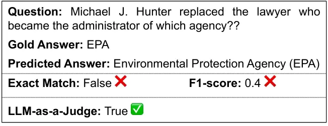

# Reassessing Extractive QA Datasets at Scale: LLM-as-a-Judge and In-Depth Analyses

Xanh Ho Email: <xanh@nii.ac.jp>    Jiahao Huang Affiliation: National
Institute of Informatics, Japan Email: <aizawa@nii.ac.jp>    Florian
Boudin Affiliation: The University of Tokyo, Japan
Email: <jiahao-huang@g.ecc.u-tokyo.ac.jp>    Akiko Aizawa
Affiliation: National Institute of Informatics, Japan Affiliation: The
University of Tokyo, Japan Affiliation: Inria, LS2N, Nantes Université,
France Email: <florian.boudin@univ-nantes.fr>

###### Abstract

Extractive QA tasks are commonly evaluated using Exact Match (EM) and
F1-score, but these metrics often fail to reflect true model
performance. Recent studies have proposed using large language models
(LLMs) as judges (LLM-as-a-judge), yet they often lack comprehensive
evaluation across datasets and overlook key factors such as sensitivity
to answer types, prompt variations, and self-preference bias. In this
work, we conduct a systematic study of LLM-as-a-judge across four
extractive QA datasets and various prompt variations, assessing multiple
LLM families in both answering and judging roles. Our results show that
LLM-as-a-judge judgments correlate much more strongly with human
evaluations than EM (0.22) and F1 (0.40), achieving correlations up to
0.85 with open-source models. Further analysis reveals that
LLM-as-a-judge performs particularly well on number-related answers but
faces challenges with more complex types, such as job titles. Contrary
to findings in other NLP tasks, we observe no self-preference bias, even
when the same model serves as both QA model and judge. Finally, we find
that prompt phrasing has minimal impact, and zero-shot, context-free
judging often yields the best evaluation performance.¹¹ 1 Our data and
code are available at
[https://github.com/Alab-NII/llm-judge-extract-qa](https://github.com/Alab-NII/llm-judge-extract-qa)

## 1 Introduction

Machine reading comprehension (MRC) is a crucial task for evaluating
natural language understanding, designed to test a model’s reading
comprehension by requiring it to answer questions based on a given
text (Hirschman et al., 1999). Many datasets have been proposed over the
past several years, such as SQuAD (Rajpurkar et al., 2016; Rajpurkar et
al., 2018) for simple MRC, QuAC (Choi et al., 2018) and CoQA (Reddy et
al., 2019) for conversational MRC, and QAngaroo (Welbl et al., 2018),
HotpotQA (Yang et al., 2018), and FanOutQA (Zhu et al., 2024) for
multi-hop MRC. Based on the answer format, Chen (2018) classify existing
MRC tasks into four types: extraction, multiple-choice (MC),
cloze-style, and free-form. Some recent datasets also introduce yes/no
answers (Clark et al., 2019; Geva et al., 2021).

Figure 1: An example that shows EM and F1-score underestimate the
performance of models, while LLM-as-a-judge provides a more robust
perspective.

Depending on the answer type, corresponding evaluation metrics are used.
While yes/no, multiple-choice, and cloze-style (select-from-options)
questions are typically straightforward to evaluate using accuracy as
the standard metric, other types of datasets face greater challenges.
For example, extractive QA datasets often rely on Exact Match (EM) and
F1-score for evaluation. However, these metrics frequently fail to
capture the true performance of models Risch et al. (2021); Bulian et
al. (2022), as they can underestimate correctness when answers are
phrased differently but semantically equivalent (as illustrated in
Figure 1). This limitation becomes even more pronounced with generative
AI models Kamalloo et al. (2023), which can produce valid answers in a
variety of forms. Recognizing this, many recent studies Kamalloo et al.
(2023); Verga et al. (2024); Adlakha et al. (2024); Kamalloo et al.
(2024) have highlighted the inadequacy of traditional metrics and
proposed LLM-as-a-judge approaches to provide more reliable and nuanced
evaluations of QA systems.

While prior studies have laid the groundwork for using LLMs as judges in
QA evaluation, critical aspects of their performance remain unexplored.
Specifically, it is unclear how LLM-as-a-judge handles different answer
types, whether it exhibits biases, and how robust its judgments are
under varying prompting strategies. We argue that systematically
analyzing these dimensions is essential for providing more reliable and
practical guidance for future research on employing LLM-as-a-judge to
evaluate extractive QA answers. Building on previous research that has
explored LLM-as-a-judge for QA evaluation (Kamalloo et al., 2023; Verga
et al., 2024; Adlakha et al., 2024; Kamalloo et al., 2024), our work
extends this line of inquiry through broader experiments and novel
analytical perspectives, providing deeper insights into the strengths
and limitations of this evaluation paradigm.

Specifically, in this paper, we conduct experiments on four diverse
datasets featuring multiple answer types: Quoref (Dasigi et al., 2019),
DROP (Dua et al., 2019), HotpotQA (Yang et al., 2018), and
2WikiMultiHopQA (Ho et al., 2020). To gain deeper insights into the
effectiveness of LLM-as-a-judge for evaluating QA tasks, we analyze the
various answer types to identify where LLM-as-a-judge performs well and
where it falls short. Additionally, we employ different families of LLMs
both as QA models and as judges, and investigate the presence of
self-preference bias (Liu et al., 2024; Panickssery et al., 2024) as
well as sibling-preference bias (see Section 6.2 for details). Finally,
to evaluate the robustness and consistency of LLM-as-a-judge, we
experiment with various prompt variations, such as changing the number
of shots or altering the wording of the prompt.

Our results show that using LLM-as-a-judge correlates highly with human
judgments, improving from 0.22 (EM) and 0.40 (F1-score) to 0.85,
highlighting its potential to replace these traditional metrics. Our
analysis demonstrates that LLMs as judges are particularly effective for
answer types involving numbers and dates in extractive QA tasks.
Additionally, we observe no evidence of self-preference bias when the
same model is used for both QA and judging tasks, nor of
sibling-preference bias when a model from the same family serves as the
judge. Finally, changes in both the wording and setup of prompts have
little effect on evaluation outcomes, while zero-shot, context-free
judging consistently yields the strongest results.

In summary, our work makes four key contributions: (1) we conduct a
comprehensive evaluation of multiple open-weight models across four QA
datasets, with code and data released for reproducibility; (2) we
perform the first fine-grained analysis of how judgment quality varies
across answer types; (3) we investigate the presence of self-preference
and sibling-preference biases, finding no evidence of such effects; (4)
we provide a systematic study of prompt robustness, showing that
outcomes remain stable across wording and setup variations. Together,
our findings offer comprehensive insights that can guide future work on
using LLM-as-a-Judge for evaluating extractive or short-form QA
datasets.

## 2 Related Work

#### Extractive QA.

An extractive QA task requires a model to extract a text span from the
provided context to answer a question. Early datasets for this task
include SQuAD (Rajpurkar et al., 2016; Rajpurkar et al., 2018),
CNN/DailyMail (Hermann et al., 2015), and NewsQA (Trischler et al.,
2017). Later datasets introduced additional challenges, such as
multi-hop reasoning (Welbl et al., 2018; Yang et al., 2018; Trivedi et
al., 2022), coreferential reasoning (Dasigi et al., 2019), and numerical
reasoning (Dua et al., 2019). To the best of our knowledge, previous
extractive datasets have primarily relied on automatic evaluation
metrics such as EM, F1, or accuracy in their default evaluation
protocols.

#### Evaluation Before the LLM-as-a-Judge Era.

Before the era of LLMs, there were earlier efforts to develop models
that assess semantic similarity between candidate answers and gold
answers Chen et al. (2019); Risch et al. (2021); Bulian et al. (2022).
For example, Bulian et al. (2022) introduced BEM (BERT Matching), an
automatic metric for evaluating QA performance, and demonstrated that
BEM correlates more closely with human judgments than previous metrics
such as EM and F1 score.

#### LLM-as-a-Judge Evaluation.

Thanks to their success and capabilities, LLMs have been applied to a
wide range of tasks, including serving as judges for text generation
tasks, such as machine translation (Kocmi and Federmann, 2023), text
summarization (Liu et al., 2023; Skopek et al., 2023; Wu et al., 2023),
story generation (Chiang and Lee, 2023), and QA (Kamalloo et al., 2023;
Zheng et al., 2023; Verga et al., 2024; Chen et al., 2024; Adlakha et
al., 2024; Kamalloo et al., 2024).

Using LLMs as judges raises several concerns regarding their
reliability. One common approach to evaluate their performance is by
comparing their scores with human judgments to assess
correlation (Kamalloo et al., 2023; Thakur et al., 2025). However, prior
studies have identified notable biases in LLM-as-a-judge settings,
including order bias (Wang et al., 2024) and egocentric bias (Koo et
al., 2024), which can distort evaluation outcomes. Additionally, LLMs
are vulnerable to adversarial attacks that can manipulate their
scoring (Shi et al., 2024; Raina et al., 2024), further challenging
their robustness in judgment tasks. For a more detailed discussion on
the use of LLM-as-a-judge, we refer readers to the comprehensive survey
papers by Li et al. (2024) and Gu et al. (2025).

Unlike previous studies that use LLMs as judges for QA tasks, we conduct
a deeper analysis, examining the effects of using LLM-as-a-Judge across
different answer types, investigating the presence of self-preference
and sibling-preference biases, and assessing the robustness of
LLM-as-a-judge under various prompt variations.

## 3 Datasets

We select four reading comprehension QA datasets for our experiments
based on the following criteria: (1) they use EM and F1 as evaluation
metrics, (2) they have not yet been fully solved, (3) they provide
context for the given questions, and (4) they contain diverse types of
answers. These four datasets are: Quoref (Dasigi et al., 2019),
DROP (Dua et al., 2019), HotpotQA (Yang et al., 2018), and
2WikiMultiHopQA (Ho et al., 2020, 2Wiki;). To ensure consistency in our
comparisons, we only use datasets that employ EM and F1 as evaluation
metrics. To assess whether the current EM and F1 scores may
underestimate the true performance of the models, we select datasets
where these scores are not excessively high (e.g., below 95%). To
simplify the judgement process, we choose datasets that provide the
corresponding context, allowing us to refer to it when determining
whether a predicted answer is acceptable. Regarding answer types, we
select datasets from various tasks, such as numerical reasoning and
multi-hop reasoning, to ensure a diverse range of answer types for our
analysis.

#### Quoref.

Quoref is a reading comprehension dataset designed to assess the
coreferential reasoning abilities of models. In the default dataset
setup, a passage can contain multiple QA pairs. We treat each pair as an
individual sample in our experiments. The questions are created through
crowdsourcing, with a focus on the coreference resolution phenomenon.
Most of the answer types are in string format, such as person names.

#### DROP.

DROP is a reading comprehension dataset designed to evaluate the
numerical reasoning abilities of models. Similar to Quoref, a single
paragraph can contain multiple QA pairs, and we treat each pair as an
individual sample. It is worth noting that, in addition to extractive
answer types, DROP also includes number and date answer types. These two
types may not always be extractive (i.e., a span of text appearing
directly in the context), such as when a question asks about the next
day of a specific day. However, we include them in our analyses, as they
do not pose challenges for generative models in predicting the correct
answer.

|          |        |       |       |     |      |        |      |       |
| -------- | ------ | ----- | ----- | --- | ---- | ------ | ---- | ----- |
| Dataset  | String | Place | Name  | Job | Date | Number | Year | Total |
| Quoref   | 55     | 74    | 878   | 23  | \-   | 21     | \-   | 1,051 |
| DROP     | 124    | 24    | 107   | 5   | 18   | 740    | \-   | 1,018 |
| HotpotQA | 146    | 257   | 460   | 92  | 78   | 77     | 14   | 1,124 |
| 2Wiki    | 296    | 383   | 292   | \-  | 29   | \-     | \-   | 1,000 |
| Total    | 621    | 738   | 1,737 | 120 | 125  | 838    | 14   | 4,193 |

Table 1: The number of samples per answer type and the total number of
samples for the four datasets. A dash (‘-’) indicates that the
corresponding answer type is not present in the dataset. In the case of
Quoref, we observed that the date and year answer types were frequently
mispredicted by rules due to the specific nature of the related
questions. Therefore, we chose to exclude these samples from our
experiments.

#### HotpotQA.

HotpotQA is a multi-hop QA task that requires multiple reasoning steps
to answer each question. The dataset comprises two main question types:
bridge and comparison. Notably, the presence of comparison questions
introduces yes/no answers into the dataset. HotpotQA is designed for two
tasks: answer prediction and supporting fact prediction. In our work, we
focus exclusively on the answer prediction task.

#### 2Wiki.

Similar to HotpotQA, 2Wiki also features two main question types, bridge
and comparison. In addition, it includes a separate task designed to
evaluate the explanatory abilities of models. As with HotpotQA, our
focus is solely on the answer prediction task.

#### Obtaining Answer Types.

From the development set of each dataset, we use heuristic rules to
obtain the answer type. We define 8 answer types as follows: Place:
questions starting with “where” or asking about locations (city,
country, region, etc.); Name: questions starting with “who” or “whom” or
asking about names, roles, players, actors, etc.; Job: questions about
occupation, profession, or career; Date: questions asking for a specific
date; Number: questions starting with “how many,” “how much,” or asking
about quantities like percentages or populations; Year: questions asking
for a specific year; Bool: yes/no questions; String: questions that do
not fit the other categories.

Our goal is to carefully select a representative subset of approximately
1,000 samples from each dataset to ensure sufficient and meaningful
analysis. It is important to note that our rules may not capture every
question from the full development set. To ensure diversity in answer
types for our experiment, we include all samples from answer types with
fewer than 100 instances. For answer types exceeding this threshold, we
randomly sample in proportion to their representation in the entire
dataset. Since the boolean answer type (yes/no) does not pose
significant challenges when evaluated using EM and F1 metrics, we
exclude samples with boolean answers from our experiments. Table 1
presents the number of samples for each answer type, along with the
total number of samples for each dataset used in our experiments.

## 4 Experimental Settings

### 4.1 Models

#### QA Task.

We use four different model families: Mistral v0.1 (7B and 8x7B) (Jiang
et al., 2023; Jiang et al., 2024), Qwen 2 (7B and 72B) (Yang et al.,
2024), Gemma 2 (9B and 27B) (Team, 2024), and Llama 3.1 (8B and
70B) (Grattafiori et al., 2024).

#### LLM-as-a-Judge.

We use three model families as LLM-as-a-judge systems:
Mistral-Instruct-7B-v0.3 (Jiang et al., 2023), Llama 3.3
70B (Grattafiori et al., 2024) and Qwen 2.5 72B (Yang et al., 2025). It
is noted that these model families are similar to those used in our QA
task, but we employ an enhanced version. To examine the self-preference
bias (Liu et al., 2024; Panickssery et al., 2024), we also run Qwen 2
(7B and 72B) and Llama 3.1 (8B and 70B) as judges in our analyses.
Notably, all models are instruction-tuned.

|                 |            |               |              |       |       |
| --------------- | ---------- | ------------- | ------------ | ----- | ----- |
| QA Model        | Mistral 7B | Llama 3.3 70B | Qwen 2.5 72B | EM    | F1    |
| Mistral 7B v0.1 | 0.627      | 0.627         | 0.851        | 0.157 | 0.311 |
| Mixtral 8x7B    | 0.592      | 0.549         | 0.723        | 0.126 | 0.244 |
| Qwen 2 7B       | 0.598      | 0.781         | 0.863        | 0.234 | 0.434 |
| Qwen 2 72B      | 0.653      | 0.680         | 0.793        | 0.157 | 0.274 |
| Gemma 2 9B      | 0.715      | 0.833         | 0.848        | 0.288 | 0.572 |
| Gemma 2 27B     | 0.711      | 0.850         | 0.908        | 0.247 | 0.487 |
| Llama 3.1 8B    | 0.700      | 0.876         | 0.945        | 0.331 | 0.628 |
| Llama 3.1 70B   | 0.626      | 0.803         | 0.848        | NaN   | 0.281 |
| Average         | 0.653      | 0.750         | 0.847        | 0.220 | 0.404 |

Table 2: Pearson correlation coefficients between human judgments and
the LLM-as-a-judge evaluations from three models (Mistral 7B v0.3, Llama
3.3 70B, and Qwen 2.5 72B) across eight different QA models are
presented. Additionally, we include the correlation scores between human
judgments and the EM/F1 scores. NaN values arise when none of the
predicted answers by Llama 3.1 70B exactly match the gold answers,
resulting in a constant list of 0s, for which correlation is undefined.
This often occurs when gold answers are plain numbers (e.g., 93.5), but
predictions include extra context like percentages (e.g., 93.5%) or time
spans (e.g., 38 years).

### 4.2 Promptings

#### QA Task.

Since most current LLMs are familiar with the QA task and the datasets
we use often involve lengthy context passages, coupled with our focus on
evaluation, we chose to adopt zero-shot chain-of-thought (CoT)
prompting Kojima et al. (2022) in our experiments. Our prompt is
presented in Appendix B.1.

#### LLM-as-a-Judge.

To evaluate the predicted answers using LLMs, we use a few-shot
prompting approach. In this approach, we provide a few demonstration
examples to guide the model in labeling the answers. Due to length
constraints and for the sake of simplicity, these demonstrations exclude
the context. During evaluation, we present the model with a question, a
gold answer, a predicted answer, and the corresponding context. It
should be noted that, while context is essential for QA, it plays a
limited role in judging, except in ambiguous cases (e.g., Example \#2 on
job type answers in Table 5). Nevertheless, we follow the standard
setting to report results with context here, while also providing a
configuration without context in Section 6.3.

The model is then instructed to assign one of two labels to the
predicted answer: CORRECT (matches the gold answer or a valid
alternative) or INCORRECT (does not match the gold answer). We use a
6-shot approach in our judgment prompt. We randomly select five samples
from each dataset (the subset not used in our evaluation) and run a
simple QA model to generate predicted answers. Subsequently, we manually
choose four shots from these samples and reuse two exemplars from the
paper by Verga et al. (2024). The prompt used in our study is presented
in Appendix B.1.

## 5 Results

### 5.1 Reliability of LLM-as-a-Judge Scores

To assess the reliability of LLM-as-a-judge scores, we collect human
judgments on predicted answers, then calculate the correlation between
them and the LLM-as-a-judge scores.

#### Human Judgements.

We sampled 200 instances (50 per dataset), maintaining the original
distribution of answer types. Each sample included all 8 predicted
answers. Annotators (two authors) were presented with the question, gold
answer, predicted answers, and context, and asked to label each
predicted answer as either ‘Correct or ‘Incorrect’. Since the task is
simple, we decided to assign only one annotator to each sample. However,
annotators may discuss ambiguous cases. Our annotation guideline is
presented in Appendix A. We excluded cases where the gold answer was
incorrect, leaving 161 valid samples, each with 8 predicted answers,
resulting in 1,288 predicted answers. These were used to calculate the
correlation between human judgment and LLM performance as a judge.

|                 |          |      |         |       |      |                 |      |         |       |      |
| --------------- | -------- | ---- | ------- | ----- | ---- | --------------- | ---- | ------- | ----- | ---- |
| Model           | Quoref   |      |         |       |      | DROP            |      |         |       |      |
|                 | EM       | F1   | Mistral | Llama | Qwen | EM              | F1   | Mistral | Llama | Qwen |
| Mistral 7B v0.1 | 1.2      | 14.9 | 65.6    | 80.5  | 57.9 | 1.6             | 11.3 | 59.8    | 49.4  | 40.9 |
| Mixtral 8x7B    | 13.9     | 31.1 | 85.6    | 86.5  | 81.2 | 0.1             | 8.8  | 69.2    | 72.4  | 60.6 |
| Qwen 2 7B       | 33.7     | 46.6 | 76.0    | 64.2  | 61.1 | 18.1            | 27.1 | 65.2    | 54.4  | 48.5 |
| Qwen 2 72B      | 45.5     | 62.3 | 91.8    | 88.8  | 87.1 | 13.9            | 25.6 | 82.1    | 84.6  | 78.3 |
| Gemma 2 9B      | 53.2     | 68.8 | 86.0    | 82.3  | 78.1 | 40.4            | 49.2 | 77.6    | 74.8  | 70.0 |
| Gemma 2 27B     | 58.6     | 72.7 | 88.4    | 82.6  | 80.5 | 45.6            | 56.0 | 80.4    | 80.1  | 75.3 |
| Llama 3.1 8B    | 46.3     | 61.9 | 83.0    | 73.0  | 70.7 | 34.0            | 45.1 | 68.5    | 62.8  | 58.8 |
| Llama 3.1 70B   | 61.0     | 76.9 | 93.8    | 90.6  | 89.7 | 34.2            | 50.8 | 87.3    | 87.4  | 83.3 |
|                 | HotpotQA |      |         |       |      | 2WikiMultihopQA |      |         |       |      |
|                 | EM       | F1   | Mistral | Llama | Qwen | EM              | F1   | Mistral | Llama | Qwen |
| Mistral 7B v0.1 | 14.8     | 32.2 | 85.9    | 80.9  | 75.5 | 10.1            | 26.5 | 65.7    | 56.7  | 46.7 |
| Mixtral 8x7B    | 7.1      | 26.1 | 85.9    | 89.0  | 84.6 | 6.9             | 25.3 | 73.1    | 73.7  | 66.4 |
| Qwen 2 7B       | 41.2     | 56.9 | 90.8    | 86.3  | 82.4 | 36.4            | 47.9 | 77.3    | 65.9  | 60.4 |
| Qwen 2 72B      | 38.4     | 55.0 | 94.6    | 94.4  | 91.5 | 33.1            | 48.0 | 84.7    | 85.3  | 78.5 |
| Gemma 2 9B      | 56.4     | 72.9 | 94.0    | 91.9  | 88.7 | 52.7            | 61.3 | 77.2    | 77.9  | 68.6 |
| Gemma 2 27B     | 56.6     | 74.3 | 94.7    | 93.1  | 89.9 | 53.1            | 63.8 | 78.9    | 79.5  | 71.8 |
| Llama 3.1 8B    | 51.8     | 68.2 | 91.5    | 89.1  | 85.9 | 45.7            | 55.1 | 80.8    | 71.2  | 63.1 |
| Llama 3.1 70B   | 54.0     | 71.2 | 95.8    | 94.9  | 92.8 | 59.3            | 68.3 | 85.6    | 87.2  | 81.9 |

Table 3: Automatic evaluation scores (EM and F1) and LLM-as-a-judge
scores (highlighted in green and blue) from three models (Mistral 7B
v0.3, Llama 3.3 70B, and Qwen 2.5 72B) for the four datasets.

#### Correlation to Human Judgements.

We calculate the Pearson correlation (Pearson, 1895) between human
judgments and the LLM-as-a-judge evaluations from three models: Mistral
7B v0.3, Llama 3.3 70B, and Qwen 2.5 72B. The correlation scores are
presented in Table 2. As shown in the table, Qwen 2.5 exhibits the
highest correlation with human judgments, followed by Llama 3.3, while
Mistral v0.3 has the lowest correlation scores. According to standard
explanation, a correlation score above 0.80 is generally considered
strong. We focus on using Qwen 2.5 72B as the judge for our subsequent
analyses.

Additionally, we report the correlation between human judgments and
EM/F1 scores. Since F1 is not a binary label, the threshold used for
binarization can affect the correlation. We use 0.5 for the main
analysis and also tested thresholds of 0.3, 0.4, 0.6, 0.7, and 0.8,
yielding average correlations of 0.451, 0.432, 0.379, 0.242, and 0.237,
respectively. Even with the most lenient threshold (0.3), the
correlation remains only 0.451, lower than all LLM-as-a-judge
evaluations (the lowest being 0.653). Full results for all thresholds
are provided in Appendix C.1. As shown in Table 2, EM and F1 scores
correlate less with human judgments than any LLM-as-a-judge model. These
results suggest that LLMs can serve as reliable judges for evaluating
the extractive QA task.

|             |           |             |
| ----------- | --------- | ----------- |
| Answer Type | \#Samples | Correlation |
| name        | 464       | 0.862       |
| number      | 336       | 0.899       |
| place       | 240       | 0.771       |
| string      | 160       | 0.862       |
| job         | 72        | 0.352       |
| date        | 16        | 1.000       |

Table 4: Correlation scores of Qwen-as-a-judge with human judgment for
each answer type.

### 5.2 Comparing EM/F1 Scores and LLM-as-a-Judge

We begin by analyzing the performance gap between EM/F1 scores and
LLM-as-a-judge assessments on samples with an EM score of 0. Next, we
compare EM/F1 scores and LLM-as-a-judge across all samples. Ideally,
LLM-as-a-judge should be used only when the EM score is false.

#### Using LLM-as-a-Judge for False Samples.

Table 3 presents the EM and F1 scores, along with the LLM-as-a-judge
scores (from three models: Mistral 7B v0.3, Llama 3.3 70B, and Qwen 2.5
72B) for the four datasets: Quoref, DROP, HotpotQA, and 2Wiki. As shown
in the Table, the LLM-as-a-judge scores from the three models are higher
than both the EM and F1 scores. The largest gap is 81.9 between EM and
Llama 3.3 70B as a judge on HotpotQA, evaluating Mixtral 8x7B’s answers.
The smallest gap is 15.9 between EM and Qwen 2.5 72B as a judge on
2Wiki, evaluating Gemma 2 9B’s answers. However, this comparison may be
biased, as LLM-as-a-judge is only applied to false samples, while
samples with a correct EM score are automatically assigned a score of 1.
To offer a broader perspective, we present experimental results for all
samples in the following section.

#### Using LLM-as-a-Judge for All Samples.

Appendix C.2 presents LLM-as-a-judge scores for Mistral 7B v0.3, Llama
3.3 70B, and Qwen 2.5 72B across four datasets, evaluated in two cases:
false EM samples only and all samples. As shown in the table, the gaps
between these evaluations are minimal, indicating comparable
performance.

#### Summary.

Table 3 highlights the performance gap between EM/F1 scores and
LLM-as-a-judge scores. Our correlation analysis between human judgments
and Qwen-as-a-judge confirms that EM and F1 scores underestimate model
performance, not because the LLM-as-a-judge incorrectly labels
predictions as correct, but because these metrics fail to capture the
true performance. Notably, using LLM-as-a-judge for false EM samples
only or all samples yields similar results. In practice, we apply
LLM-as-a-judge to false EM samples only.

## 6 Analyses

Figure 2: Percentage of each answer type identified as correct by
Qwen-as-a-judge.

[TABLE]

Table 5: Examples of differences and similarities between labels
provided by human judgment and LLM-as-a-judge (with labels from Qwen
used in this case). T denotes True, while F denotes False.

### 6.1 Answer-Type Effects

We use 1,288 predicted answers with human judgment in Section 5.1 and
LLM-as-a-judge scores from Qwen on these samples, and calculate the
correlation between the two for each answer type. The scores are
presented in Table 4. As expected, the answer types “date” and “number”
show the highest correlation score, while the scores for other types are
relatively similar. We observe that for the answer type “job”, the
correlation score is quite low, primarily due to the ambiguity of
multiple jobs in the gold answer, as the predicted answer can contain
more or fewer jobs, making the judgment more difficult. Table 5 presents
several examples highlighting these differences. We also provide
additional examples for other answer types.

In Figure 2, we show the percentage of each answer type that
LLM-as-a-judge identified as correct when the EM score is false. As
shown in the figure, the judge is able to correctly predict more than
50% of each answer type, except for “date”. The highest scores are
achieved for the “job” and “place” answer types. However, when
considering the correlation score with human judgment for the “job”
answer type, we observe that LLM-as-a-judge is less strict than humans
when judging the correctness of the predicted answer regarding jobs.

|               |                |       |       |
| ------------- | -------------- | ----- | ----- |
| QA Model      | Thresh. = 100% | 83%   | 67%   |
| Llama 3.1 8B  | 5.77           | 12.04 | 14.77 |
| Llama 3.1 70B | 0.26           | 0.77  | 1.62  |
| Qwen 2 7B     | 0.63           | 2.06  | 4.48  |
| Qwen 2 72B    | 0.14           | 0.34  | 0.85  |

Table 6: Percentage of self-preference bias scores for the four models
across three different thresholds.

|                 |                  |           |        |            |               |       |         |          |
| --------------- | ---------------- | --------- | ------ | ---------- | ------------- | ----- | ------- | -------- |
| Judge Model     | Initial (6-shot) | Zero-shot | 2-shot | No Context | Word Changing | Max   | Average | Variance |
| Mistral 7B v0.3 | 0.653            | 0.795     | 0.667  | 0.762      | 0.702         | 0.795 | 0.716   | 0.0037   |
| Llama 3.3 70B   | 0.750            | 0.819     | 0.742  | 0.820      | 0.765         | 0.820 | 0.779   | 0.0014   |
| Qwen 2.5 72B    | 0.847            | 0.877     | 0.850  | 0.909      | 0.854         | 0.909 | 0.867   | 0.0007   |

Table 7: Average Pearson correlation coefficients between human
judgments and LLM-as-a-judge evaluations across eight different QA
models, using the original prompt (as described in Section 4.2) and five
new prompt variations.

### 6.2 Self-Preference Bias

We consider four QA models (Llama 3.1 8B, Llama 3.1 70B, Qwen 2 7B, and
Qwen 2 72B) and seven LLM-as-a-judge models (Llama 3.1 8B, Llama 3.1
70B, Llama 3.3 70B, Qwen 2 7B, Qwen 2 72B, Qwen 2.5 72B, and Mistral
7B). Suppose we have seven judgment models, denoted as $`m_{1}`$ to
$`m_{7}`$ and the QA model is $`m_{1}`$. We define self-preference bias
as the scenario in which all remaining models unanimously label the
predicted answer as incorrect (threshold = 100%), while only $`m_{1}`$
judges its own answer as correct. We also calculate this score for
different thresholds, such as 83%, where one of the six remaining models
can judge the answer as correct. To measure this bias, we calculate the
percentage of such cases relative to the total number of cases where the
EM score is false.

Table 6 presents the percentage of self-preference bias scores for the
four models across three different thresholds. These scores indicate a
relatively small self-preference bias for Llama 3.1 8B when it serves as
both a QA model and a judge model. However, for the other models, the
percentages are much smaller. This can be explained by the fact that, in
the extractive QA task, where the gold answer is clearly provided, it is
more difficult for self-bias to occur compared to other tasks.

We present examples of self-preference bias for different QA models in
Appendix C.3. We observe that in these cases, the predicted answer is
obviously wrong, and all remaining models label it as incorrect.
However, only the judge model, which is the same as the QA model, is
predicted as correct.

#### Sibling-Preference Bias.

We define sibling-preference bias as a model’s tendency to favor answers
generated by another model in the same family. Since no self-preference
bias was observed, we expect sibling-preference bias to be absent. Using
the same four QA models and seven judge models as in the self-preference
study, we treat Llama 3.3 70B as a sibling of Llama 3.1 8B/70B and Qwen
2.5 72B as a sibling of Qwen 2 7B/72B. Results (Appendix C.3) confirm
that self-preference bias is more pronounced than sibling-preference
bias.

### 6.3 Robustness to Prompt Variations

As discussed in previous works, LLMs may be sensitive to prompt
variations Sclar et al. (2024); Voronov et al. (2024); He et al. (2024).
To check whether the LLM-as-a-judge is consistent and robust on
different types of prompts, as well as to investigate more types of
prompts to have a better view for future work, we conduct experiments on
other types of promptings, such as changing the configuration to use
2-shot, zero-shot, without context, or changing the words in prompts. It
should be noted that we use greedy decoding for all models.

Table 7 presents the average Pearson correlation coefficients between
human judgments and LLM-as-a-judge evaluations across eight different QA
models. The initial (6-shot) prompt is the one described in Section 4.2,
and its results are reported in Section 5. Zero-shot and 2-shot refer to
prompt variations where we change the number of examples (shots)
provided. No Context refers to the prompt variation where context
paragraphs are excluded for each sample. Word Changing represents the
variation where we modify the wording within the prompt. As shown in the
table, zero-shot and no-context prompts often yield the highest scores.
We conjecture that this may be due to the simplicity of the task, which
involves evaluating two short answers, making exemplars and additional
context less important. We also observe that the average correlation
scores for all three judges are higher than those obtained with the
initial prompt. Moreover, the low variance values across prompt
variations (0.0037, 0.0014, and 0.0007) suggest that the LLM-as-a-judge
approach is robust and consistently effective, demonstrating strong
performance regardless of prompt formulation.

## 7 Conclusion

Our study demonstrates that LLM-as-a-judge offers a more reliable
evaluation of extractive QA tasks than traditional metrics such as EM
and F1, achieving correlations up to 0.85 with human judgments. The
approach performs particularly well on number-related answers but
struggles with more complex types, such as job titles. We find no
evidence of self-preference bias when the same model is used for both QA
and judging, nor sibling-preference bias when the judge belongs to the
same model family. Moreover, variations in prompt phrasing or
configuration minimally impact results, with zero-shot, context-free
judging often yielding the best performance. Overall, our findings
highlight that LLMs can serve as reliable, robust evaluators of
extractive and short-form QA datasets.

## Limitations

Our research has three main limitations. First, we do not conduct
experiments using any closed-source LLMs. Since our primary goal is to
investigate the effectiveness of using LLM-as-a-judge with open-source
models and to support reproducibility for future work, we focus
exclusively on open-source LLMs. Second, we do not evaluate the full
versions of the four selected QA datasets. Instead, we conduct
experiments on approximately 1,000 samples from each dataset. The exact
number of samples used is provided in Table 1. Third, our human
evaluation is limited in scale: only 161 samples were annotated, each
with 8 predicted answers from different model outputs, resulting in
1,288 evaluated responses, and each response was assessed by a single
annotator.

## Acknowledgments

This work was supported by JSPS KAKENHI Grant Number 24K03231.

## Licenses

We use the following datasets for evaluation, in compliance with their
respective licenses. HotpotQA (CC BY-SA 4.0) and Quoef (CC BY 4.0)
explicitly allow adaptation, redistribution, and modification, while
DROP and 2WikiMultihopQA are licensed under the Apache License 2.0,
which also permits distribution and modification. We plan to release our
dataset under the Apache License 2.0, which allows for redistribution
and modification.

## Ethical Statement

We use publicly available QA datasets in this study. To ensure
consistency in evaluation, we provide annotators with detailed
annotation guidelines and encourage discussion of ambiguous cases during
the annotation process. No sensitive or personally identifiable
information was collected from annotators at any stage of this research.

## Usage of Large Language Models

We use large language models (LLMs), such as ChatGPT and GPT-5, for two
purposes: (1) improving our writing and grammar, and (2) serving as a QA
assistant to identify related works that may be relevant to our
research. It should be noted that all results obtained through these
tools are manually verified before being presented in our paper.

## References

- Adlakha et al. (2024) V. Adlakha, P. BehnamGhader, X. H. Lu, N. Meade,
  and S. Reddy Evaluating correctness and faithfulness of
  instruction-following models for question answering. Transactions of
  the Association for Computational Linguistics 12, pp. 681–699.
  External Links: [Link](https://aclanthology.org/2024.tacl-1.38/),
  [Document](https://dx.doi.org/10.1162/tacl%5Fa%5F00667) Cited by: §1,
  §1, §2.
- Bulian et al. (2022) J. Bulian, C. Buck, W. Gajewski, B. Börschinger,
  and T. Schuster Tomayto, tomahto. beyond token-level answer
  equivalence for question answering evaluation. In Proceedings of the
  2022 Conference on Empirical Methods in Natural Language Processing,
  Abu Dhabi, United Arab Emirates, pp. 291–305. External Links:
  [Link](https://aclanthology.org/2022.emnlp-main.20),
  [Document](https://dx.doi.org/10.18653/v1/2022.emnlp-main.20) Cited
  by: §1, §2.
- Chen et al. (2019) A. Chen, G. Stanovsky, S. Singh, and M. Gardner
  Evaluating question answering evaluation. In Proceedings of the 2nd
  Workshop on Machine Reading for Question Answering, Hong Kong, China,
  pp. 119–124. External Links:
  [Link](https://aclanthology.org/D19-5817),
  [Document](https://dx.doi.org/10.18653/v1/D19-5817) Cited by: §2.
- Chen (2018) D. Chen Neural reading comprehension and beyond. Ph.D.
  Thesis, Stanford University. Cited by: §1.
- Chen et al. (2024) L. Chen, B. Li, L. Zheng, H. Wang, Z. Meng, R.
  Shi, H. Fei, J. Zhou, F. Li, C. Teng, and D. Ji What factors influence
  LLMs’ judgments? a case study on question answering. In Proceedings of
  the 2024 Joint International Conference on Computational Linguistics,
  Language Resources and Evaluation (LREC-COLING 2024), N. Calzolari, M.
  Kan, V. Hoste, A. Lenci, S. Sakti, and N. Xue (Eds.), Torino, Italia,
  pp. 17473–17485. External Links:
  [Link](https://aclanthology.org/2024.lrec-main.1519/) Cited by: §2.
- Chiang and Lee (2023) C. Chiang and H. Lee Can large language models
  be an alternative to human evaluations?. In Proceedings of the 61st
  Annual Meeting of the Association for Computational Linguistics
  (Volume 1: Long Papers), Toronto, Canada, pp. 15607–15631. External
  Links: [Link](https://aclanthology.org/2023.acl-long.870),
  [Document](https://dx.doi.org/10.18653/v1/2023.acl-long.870) Cited by:
  §2.
- Choi et al. (2018) E. Choi, H. He, M. Iyyer, M. Yatskar, W. Yih, Y.
  Choi, P. Liang, and L. Zettlemoyer QuAC: question answering in
  context. In Proceedings of the 2018 Conference on Empirical Methods in
  Natural Language Processing, Brussels, Belgium, pp. 2174–2184.
  External Links: [Link](https://aclanthology.org/D18-1241),
  [Document](https://dx.doi.org/10.18653/v1/D18-1241) Cited by: §1.
- Clark et al. (2019) C. Clark, K. Lee, M. Chang, T. Kwiatkowski, M.
  Collins, and K. Toutanova BoolQ: exploring the surprising difficulty
  of natural yes/no questions. In Proceedings of the 2019 Conference of
  the North American Chapter of the Association for Computational
  Linguistics: Human Language Technologies, Volume 1 (Long and Short
  Papers), Minneapolis, Minnesota, pp. 2924–2936. External Links:
  [Link](https://aclanthology.org/N19-1300),
  [Document](https://dx.doi.org/10.18653/v1/N19-1300) Cited by: §1.
- Dasigi et al. (2019) P. Dasigi, N. F. Liu, A. Marasović, N. A. Smith,
  and M. Gardner Quoref: a reading comprehension dataset with questions
  requiring coreferential reasoning. In Proceedings of the 2019
  Conference on Empirical Methods in Natural Language Processing and the
  9th International Joint Conference on Natural Language Processing
  (EMNLP-IJCNLP), Hong Kong, China, pp. 5925–5932. External Links:
  [Link](https://aclanthology.org/D19-1606),
  [Document](https://dx.doi.org/10.18653/v1/D19-1606) Cited by: §1, §2,
  §3.
- Dua et al. (2019) D. Dua, Y. Wang, P. Dasigi, G. Stanovsky, S. Singh,
  and M. Gardner DROP: a reading comprehension benchmark requiring
  discrete reasoning over paragraphs. In Proceedings of the 2019
  Conference of the North American Chapter of the Association for
  Computational Linguistics: Human Language Technologies, Volume 1 (Long
  and Short Papers), Minneapolis, Minnesota, pp. 2368–2378. External
  Links: [Link](https://aclanthology.org/N19-1246),
  [Document](https://dx.doi.org/10.18653/v1/N19-1246) Cited by: §1, §2,
  §3.
- Geva et al. (2021) M. Geva, D. Khashabi, E. Segal, T. Khot, D. Roth,
  and J. Berant Did aristotle use a laptop? a question answering
  benchmark with implicit reasoning strategies. Transactions of the
  Association for Computational Linguistics 9, pp. 346–361. External
  Links: [Link](https://aclanthology.org/2021.tacl-1.21),
  [Document](https://dx.doi.org/10.1162/tacl%5Fa%5F00370) Cited by: §1.
- Grattafiori et al. (2024) A. Grattafiori, A. Dubey, A. Jauhri, A.
  Pandey, A. Kadian, A. Al-Dahle, A. Letman, A. Mathur, A. Schelten, A.
  Vaughan, and et al. The llama 3 herd of models. arXiv:2407.21783.
  External Links: 2407.21783, [Link](https://arxiv.org/abs/2407.21783)
  Cited by: §4.1, §4.1.
- Gu et al. (2025) J. Gu, X. Jiang, Z. Shi, H. Tan, X. Zhai, C. Xu, W.
  Li, Y. Shen, S. Ma, H. Liu, S. Wang, K. Zhang, Y. Wang, W. Gao, L. Ni,
  and J. Guo A survey on llm-as-a-judge. arXiv:2411.15594. External
  Links: 2411.15594, [Link](https://arxiv.org/abs/2411.15594) Cited by:
  §2.
- He et al. (2024) J. He, M. Rungta, D. Koleczek, A. Sekhon, F. X. Wang,
  and S. Hasan Does prompt formatting have any impact on llm
  performance?. arXiv:2411.10541. External Links: 2411.10541,
  [Link](https://arxiv.org/abs/2411.10541) Cited by: §6.3.
- Hermann et al. (2015) K. M. Hermann, T. Kocisky, E. Grefenstette, L.
  Espeholt, W. Kay, M. Suleyman, and P. Blunsom Teaching machines to
  read and comprehend. In Advances in Neural Information Processing
  Systems, C. Cortes, N. Lawrence, D. Lee, M. Sugiyama, and R. Garnett
  (Eds.), Vol. 28, pp. . External Links:
  [Link](https://proceedings.neurips.cc/paper_files/paper/2015/file/afdec7005cc9f14302cd0474fd0f3c96-Paper.pdf)
  Cited by: §2.
- Hirschman et al. (1999) L. Hirschman, M. Light, E. Breck, and J. D.
  Burger Deep read: a reading comprehension system. In Proceedings of
  the 37th Annual Meeting of the Association for Computational
  Linguistics, College Park, Maryland, USA, pp. 325–332. External Links:
  [Link](https://aclanthology.org/P99-1042),
  [Document](https://dx.doi.org/10.3115/1034678.1034731) Cited by: §1.
- Ho et al. (2020) X. Ho, A. Duong Nguyen, S. Sugawara, and A. Aizawa
  Constructing a multi-hop QA dataset for comprehensive evaluation of
  reasoning steps. In Proceedings of the 28th International Conference
  on Computational Linguistics, Barcelona, Spain (Online),
  pp. 6609–6625. External Links:
  [Link](https://aclanthology.org/2020.coling-main.580),
  [Document](https://dx.doi.org/10.18653/v1/2020.coling-main.580) Cited
  by: §1, §3.
- Jiang et al. (2023) A. Q. Jiang, A. Sablayrolles, A. Mensch, C.
  Bamford, D. S. Chaplot, D. de las Casas, F. Bressand, G. Lengyel, G.
  Lample, L. Saulnier, L. R. Lavaud, M. Lachaux, P. Stock, T. L.
  Scao, T. Lavril, T. Wang, T. Lacroix, and W. E. Sayed Mistral 7b.
  arXiv:2310.06825. External Links: 2310.06825,
  [Link](https://arxiv.org/abs/2310.06825) Cited by: §4.1, §4.1.
- Jiang et al. (2024) A. Q. Jiang, A. Sablayrolles, A. Roux, A.
  Mensch, B. Savary, C. Bamford, D. S. Chaplot, D. de las Casas, E. B.
  Hanna, F. Bressand, G. Lengyel, G. Bour, G. Lample, L. R. Lavaud, L.
  Saulnier, M. Lachaux, P. Stock, S. Subramanian, S. Yang, S.
  Antoniak, T. L. Scao, T. Gervet, T. Lavril, T. Wang, T. Lacroix,
  and W. E. Sayed Mixtral of experts. arXiv:2401.04088. External Links:
  2401.04088, [Link](https://arxiv.org/abs/2401.04088) Cited by: §4.1.
- Kamalloo et al. (2023) E. Kamalloo, N. Dziri, C. Clarke, and D. Rafiei
  Evaluating open-domain question answering in the era of large language
  models. In Proceedings of the 61st Annual Meeting of the Association
  for Computational Linguistics (Volume 1: Long Papers), Toronto,
  Canada, pp. 5591–5606. External Links:
  [Link](https://aclanthology.org/2023.acl-long.307),
  [Document](https://dx.doi.org/10.18653/v1/2023.acl-long.307) Cited by:
  §1, §1, §2, §2.
- Kamalloo et al. (2024) E. Kamalloo, S. Upadhyay, and J. Lin Towards
  robust qa evaluation via open llms. In Proceedings of the 47th
  International ACM SIGIR Conference on Research and Development in
  Information Retrieval, SIGIR ’24, New York, NY, USA, pp. 2811–2816.
  External Links: ISBN 9798400704314,
  [Link](https://doi.org/10.1145/3626772.3657675),
  [Document](https://dx.doi.org/10.1145/3626772.3657675) Cited by: §1,
  §1, §2.
- Kocmi and Federmann (2023) T. Kocmi and C. Federmann Large language
  models are state-of-the-art evaluators of translation quality. In
  Proceedings of the 24th Annual Conference of the European Association
  for Machine Translation, Tampere, Finland, pp. 193–203. External
  Links: [Link](https://aclanthology.org/2023.eamt-1.19) Cited by: §2.
- Kojima et al. (2022) T. Kojima, S. (. Gu, M. Reid, Y. Matsuo, and Y.
  Iwasawa Large language models are zero-shot reasoners. In Advances in
  Neural Information Processing Systems, S. Koyejo, S. Mohamed, A.
  Agarwal, D. Belgrave, K. Cho, and A. Oh (Eds.), Vol. 35,
  pp. 22199–22213. External Links:
  [Link](https://proceedings.neurips.cc/paper_files/paper/2022/file/8bb0d291acd4acf06ef112099c16f326-Paper-Conference.pdf)
  Cited by: §4.2.
- Koo et al. (2024) R. Koo, M. Lee, V. Raheja, J. I. Park, Z. M. Kim,
  and D. Kang Benchmarking cognitive biases in large language models as
  evaluators. In Findings of the Association for Computational
  Linguistics: ACL 2024, L. Ku, A. Martins, and V. Srikumar (Eds.),
  Bangkok, Thailand, pp. 517–545. External Links:
  [Link](https://aclanthology.org/2024.findings-acl.29/),
  [Document](https://dx.doi.org/10.18653/v1/2024.findings-acl.29) Cited
  by: §2.
- Li et al. (2024) H. Li, Q. Dong, J. Chen, H. Su, Y. Zhou, Q. Ai, Z.
  Ye, and Y. Liu LLMs-as-judges: a comprehensive survey on llm-based
  evaluation methods. arXiv:2412.05579. External Links: 2412.05579,
  [Link](https://arxiv.org/abs/2412.05579) Cited by: §2.
- Liu et al. (2024) Y. Liu, N. Moosavi, and C. Lin LLMs as narcissistic
  evaluators: when ego inflates evaluation scores. In Findings of the
  Association for Computational Linguistics: ACL 2024, L. Ku, A.
  Martins, and V. Srikumar (Eds.), Bangkok, Thailand, pp. 12688–12701.
  External Links:
  [Link](https://aclanthology.org/2024.findings-acl.753/),
  [Document](https://dx.doi.org/10.18653/v1/2024.findings-acl.753) Cited
  by: §1, §4.1.
- Liu et al. (2023) Y. Liu, A. Fabbri, P. Liu, Y. Zhao, L. Nan, R.
  Han, S. Han, S. Joty, C. Wu, C. Xiong, and D. Radev Revisiting the
  gold standard: grounding summarization evaluation with robust human
  evaluation. In Proceedings of the 61st Annual Meeting of the
  Association for Computational Linguistics (Volume 1: Long Papers),
  Toronto, Canada, pp. 4140–4170. External Links:
  [Link](https://aclanthology.org/2023.acl-long.228),
  [Document](https://dx.doi.org/10.18653/v1/2023.acl-long.228) Cited by:
  §2.
- Panickssery et al. (2024) A. Panickssery, S. R. Bowman, and S. Feng
  LLM evaluators recognize and favor their own generations. In The
  Thirty-eighth Annual Conference on Neural Information Processing
  Systems, External Links:
  [Link](https://openreview.net/forum?id=4NJBV6Wp0h) Cited by: §1, §4.1.
- Pearson (1895) K. Pearson Vii. note on regression and inheritance in
  the case of two parents. Proceedings of the Royal Society of London 58
  (347-352), pp. 240–242. Cited by: §5.1.
- Raina et al. (2024) V. Raina, A. Liusie, and M. Gales Is
  LLM-as-a-judge robust? investigating universal adversarial attacks on
  zero-shot LLM assessment. In Proceedings of the 2024 Conference on
  Empirical Methods in Natural Language Processing, Y. Al-Onaizan, M.
  Bansal, and Y. Chen (Eds.), Miami, Florida, USA, pp. 7499–7517.
  External Links: [Link](https://aclanthology.org/2024.emnlp-main.427/),
  [Document](https://dx.doi.org/10.18653/v1/2024.emnlp-main.427) Cited
  by: §2.
- Rajpurkar et al. (2018) P. Rajpurkar, R. Jia, and P. Liang Know what
  you don’t know: unanswerable questions for SQuAD. In Proceedings of
  the 56th Annual Meeting of the Association for Computational
  Linguistics (Volume 2: Short Papers), Melbourne, Australia,
  pp. 784–789. External Links:
  [Link](https://aclanthology.org/P18-2124),
  [Document](https://dx.doi.org/10.18653/v1/P18-2124) Cited by: §1, §2.
- Rajpurkar et al. (2016) P. Rajpurkar, J. Zhang, K. Lopyrev, and P.
  Liang SQuAD: 100,000+ questions for machine comprehension of text. In
  Proceedings of the 2016 Conference on Empirical Methods in Natural
  Language Processing, Austin, Texas, pp. 2383–2392. External Links:
  [Link](https://aclanthology.org/D16-1264),
  [Document](https://dx.doi.org/10.18653/v1/D16-1264) Cited by: §1, §2.
- Reddy et al. (2019) S. Reddy, D. Chen, and C. D. Manning CoQA: a
  conversational question answering challenge. Transactions of the
  Association for Computational Linguistics 7, pp. 249–266. External
  Links: [Link](https://aclanthology.org/Q19-1016),
  [Document](https://dx.doi.org/10.1162/tacl%5Fa%5F00266) Cited by: §1.
- Risch et al. (2021) J. Risch, T. Möller, J. Gutsch, and M. Pietsch
  Semantic answer similarity for evaluating question answering models.
  In Proceedings of the 3rd Workshop on Machine Reading for Question
  Answering, Punta Cana, Dominican Republic, pp. 149–157. External
  Links: [Link](https://aclanthology.org/2021.mrqa-1.15),
  [Document](https://dx.doi.org/10.18653/v1/2021.mrqa-1.15) Cited by:
  §1, §2.
- Sclar et al. (2024) M. Sclar, Y. Choi, Y. Tsvetkov, and A. Suhr
  Quantifying language models’ sensitivity to spurious features in
  prompt design or: how i learned to start worrying about prompt
  formatting. In The Twelfth International Conference on Learning
  Representations, External Links:
  [Link](https://openreview.net/forum?id=RIu5lyNXjT) Cited by: §6.3.
- Shi et al. (2024) J. Shi, Z. Yuan, Y. Liu, Y. Huang, P. Zhou, L. Sun,
  and N. Z. Gong Optimization-based prompt injection attack to
  llm-as-a-judge. In Proceedings of the 2024 on ACM SIGSAC Conference on
  Computer and Communications Security, CCS ’24, New York, NY, USA,
  pp. 660–674. External Links: ISBN 9798400706363,
  [Link](https://doi.org/10.1145/3658644.3690291),
  [Document](https://dx.doi.org/10.1145/3658644.3690291) Cited by: §2.
- Skopek et al. (2023) O. Skopek, R. Aralikatte, S. Gooding, and V.
  Carbune Towards better evaluation of instruction-following: a
  case-study in summarization. In Proceedings of the 27th Conference on
  Computational Natural Language Learning (CoNLL), J. Jiang, D. Reitter,
  and S. Deng (Eds.), Singapore, pp. 221–237. External Links:
  [Link](https://aclanthology.org/2023.conll-1.16/),
  [Document](https://dx.doi.org/10.18653/v1/2023.conll-1.16) Cited by:
  §2.
- Team (2024) G. Team Gemma 2: improving open language models at a
  practical size. arXiv:2408.00118. External Links: 2408.00118 Cited by:
  §4.1.
- Thakur et al. (2025) A. S. Thakur, K. Choudhary, V. S. Ramayapally, S.
  Vaidyanathan, and D. Hupkes Judging the judges: evaluating alignment
  and vulnerabilities in llms-as-judges. arXiv:2406.12624. External
  Links: 2406.12624, [Link](https://arxiv.org/abs/2406.12624) Cited by:
  §2.
- Trischler et al. (2017) A. Trischler, T. Wang, X. Yuan, J. Harris, A.
  Sordoni, P. Bachman, and K. Suleman NewsQA: a machine comprehension
  dataset. In Proceedings of the 2nd Workshop on Representation Learning
  for NLP, Vancouver, Canada, pp. 191–200. External Links:
  [Link](https://aclanthology.org/W17-2623),
  [Document](https://dx.doi.org/10.18653/v1/W17-2623) Cited by: §2.
- Trivedi et al. (2022) H. Trivedi, N. Balasubramanian, T. Khot, and A.
  Sabharwal MuSiQue: multihop questions via single-hop question
  composition. Transactions of the Association for Computational
  Linguistics 10, pp. 539–554. External Links:
  [Link](https://aclanthology.org/2022.tacl-1.31),
  [Document](https://dx.doi.org/10.1162/tacl%5Fa%5F00475) Cited by: §2.
- Verga et al. (2024) P. Verga, S. Hofstatter, S. Althammer, Y. Su, A.
  Piktus, A. Arkhangorodsky, M. Xu, N. White, and P. Lewis Replacing
  judges with juries: evaluating llm generations with a panel of diverse
  models. arXiv:2404.18796. External Links: 2404.18796,
  [Link](https://arxiv.org/abs/2404.18796) Cited by: §1, §1, §2, §4.2.
- Voronov et al. (2024) A. Voronov, L. Wolf, and M. Ryabinin Mind your
  format: towards consistent evaluation of in-context learning
  improvements. In Findings of the Association for Computational
  Linguistics: ACL 2024, L. Ku, A. Martins, and V. Srikumar (Eds.),
  Bangkok, Thailand, pp. 6287–6310. External Links:
  [Link](https://aclanthology.org/2024.findings-acl.375/),
  [Document](https://dx.doi.org/10.18653/v1/2024.findings-acl.375) Cited
  by: §6.3.
- Wang et al. (2024) P. Wang, L. Li, L. Chen, Z. Cai, D. Zhu, B. Lin, Y.
  Cao, L. Kong, Q. Liu, T. Liu, and Z. Sui Large language models are not
  fair evaluators. In Proceedings of the 62nd Annual Meeting of the
  Association for Computational Linguistics (Volume 1: Long Papers), L.
  Ku, A. Martins, and V. Srikumar (Eds.), Bangkok, Thailand,
  pp. 9440–9450. External Links:
  [Link](https://aclanthology.org/2024.acl-long.511/),
  [Document](https://dx.doi.org/10.18653/v1/2024.acl-long.511) Cited by:
  §2.
- Welbl et al. (2018) J. Welbl, P. Stenetorp, and S. Riedel Constructing
  datasets for multi-hop reading comprehension across documents.
  Transactions of the Association for Computational Linguistics 6,
  pp. 287–302. External Links:
  [Link](https://aclanthology.org/Q18-1021),
  [Document](https://dx.doi.org/10.1162/tacl%5Fa%5F00021) Cited by: §1,
  §2.
- Wu et al. (2023) N. Wu, M. Gong, L. Shou, S. Liang, and D. Jiang Large
  language models are diverse role-players for summarization evaluation.
  In Natural Language Processing and Chinese Computing: 12th National
  CCF Conference, NLPCC 2023, Foshan, China, October 12–15, 2023,
  Proceedings, Part I, Berlin, Heidelberg, pp. 695–707. External Links:
  ISBN 978-3-031-44692-4,
  [Link](https://doi.org/10.1007/978-3-031-44693-1_54),
  [Document](https://dx.doi.org/10.1007/978-3-031-44693-1%5F54) Cited
  by: §2.
- Yang et al. (2024) A. Yang, B. Yang, and et al. Qwen2 technical
  report. arXiv:2407.10671. External Links: 2407.10671 Cited by: §4.1.
- Yang et al. (2025) A. Yang, B. Yang, and et al. Qwen2.5 technical
  report. arXiv:2412.15115. External Links: 2412.15115 Cited by: §4.1.
- Yang et al. (2018) Z. Yang, P. Qi, S. Zhang, Y. Bengio, W. Cohen, R.
  Salakhutdinov, and C. D. Manning HotpotQA: a dataset for diverse,
  explainable multi-hop question answering. In Proceedings of the 2018
  Conference on Empirical Methods in Natural Language Processing,
  Brussels, Belgium, pp. 2369–2380. External Links:
  [Link](https://aclanthology.org/D18-1259),
  [Document](https://dx.doi.org/10.18653/v1/D18-1259) Cited by: §1, §1,
  §2, §3.
- Zheng et al. (2023) L. Zheng, W. Chiang, Y. Sheng, S. Zhuang, Z.
  Wu, Y. Zhuang, Z. Lin, Z. Li, D. Li, E. Xing, H. Zhang, J. E.
  Gonzalez, and I. Stoica Judging LLM-as-a-judge with MT-bench and
  chatbot arena. In Advances in Neural Information Processing
  Systems, A. Oh, T. Naumann, A. Globerson, K. Saenko, M. Hardt, and S.
  Levine (Eds.), Vol. 36, pp. 46595–46623. External Links:
  [Link](https://proceedings.neurips.cc/paper_files/paper/2023/file/91f18a1287b398d378ef22505bf41832-Paper-Datasets_and_Benchmarks.pdf)
  Cited by: §2.
- Zhu et al. (2024) A. Zhu, A. Hwang, L. Dugan, and C. Callison-Burch
  FanOutQA: a multi-hop, multi-document question answering benchmark for
  large language models. In Proceedings of the 62nd Annual Meeting of
  the Association for Computational Linguistics (Volume 2: Short
  Papers), L. Ku, A. Martins, and V. Srikumar (Eds.), Bangkok, Thailand,
  pp. 18–37. External Links:
  [Link](https://aclanthology.org/2024.acl-short.2/),
  [Document](https://dx.doi.org/10.18653/v1/2024.acl-short.2) Cited by:
  §1.

## Appendix A Human Judgements

Figure 3 presents our annotation guideline for evaluating predicted
answers against gold answers.

Figure 3: Our annotation guideline for evaluating predicted answers
against gold answers.

## Appendix B Experimental Settings

[TABLE]

Table 8: The QA task prompt.

### B.1 Promptings

Table 8 presents the QA task prompt that we used in our experiment.

Table 9 presents the LLM-as-a-judge task prompt used in our experiments.

|                                                                                                                                                                                              |
| -------------------------------------------------------------------------------------------------------------------------------------------------------------------------------------------- |
| System Prompt: You are an expert in question answering systems.                                                                                                                              |
| User Prompt: Your job is to evaluate a predicted answer by comparing it against the gold answer and the given question.                                                                      |
| You may refer to the provided context if needed.                                                                                                                                             |
| \## Grading Criteria:                                                                                                                                                                        |
| \*CORRECT: The predicted answer matches the gold answer or is a valid alternative (e.g., different but correct ways of writing a name).                                                      |
| \*INCORRECT: The predicted answer is wrong or does not align with the gold answer.                                                                                                           |
| \*In some ambiguous cases, where it is unclear whether the predicted answer is correct or not, please refer to the provided context and use it as the final source for making your judgment. |
| \## Response Format:                                                                                                                                                                         |
| Please format your answer within brackets as follows: \<ans\> Your Answer \</ans\> \## Here are some examples:                                                                               |
| \### Example 1:                                                                                                                                                                              |
| \*Question: What nationality is the performer of song Daddy, Come Home?                                                                                                                      |
| \*Gold Answer: United States                                                                                                                                                                 |
| \*Predicted Answer: American                                                                                                                                                                 |
| \*Label: \<ans\> CORRECT \</ans\>                                                                                                                                                            |
| \### Example 2:                                                                                                                                                                              |
| \*Question: Who is Bohemond Iv Of Antioch’s paternal grandmother?                                                                                                                            |
| \*Gold Answer: Constance of Antioch                                                                                                                                                          |
| \*Predicted Answer: princess Constance of Antioch                                                                                                                                            |
| \*Label: \<ans\> CORRECT \</ans\>                                                                                                                                                            |
| \### Example 3:                                                                                                                                                                              |
| \*Question: Rejuvelac is kind of grain water invented and promoted by a ’holistic health’ practitioner born in which year?                                                                   |
| \*Gold Answer: 1909                                                                                                                                                                          |
| \*Predicted Answer: Rejuvelac is a kind of grain water invented and promoted by Ann Wigmore, who was born in 1909.                                                                           |
| \*Label: \<ans\> CORRECT \</ans\>                                                                                                                                                            |
| \### Example 4:                                                                                                                                                                              |
| \*Question: What is the birthday of the actress who was the Duchess in ’The Revengers Tragedy’?                                                                                              |
| \*Gold Answer: 23 November 1946                                                                                                                                                              |
| \*Predicted Answer: Diana Quick, who played the Duchess in ’The Revengers Tragedy’, was born on 23rd September 1934.                                                                         |
| \*Label: \<ans\> INCORRECT \</ans\>                                                                                                                                                          |
| (… more examples here … ) \## Here is your task:                                                                                                                                             |
| \*Question: {question}                                                                                                                                                                       |
| \*Gold Answer: {gold_ans}                                                                                                                                                                    |
| \*Predicted Answer: {pred_ans}                                                                                                                                                               |
| \*Context: {context}                                                                                                                                                                         |

Table 9: The LLM-as-a-judge task prompt.

## Appendix C Results and Analyses

### C.1 Correlation of Human Judgments and F1

Table 10 shows the Pearson correlation coefficients between human
judgments and F1 scores. We use six different thresholds to convert F1
scores into binary labels.

|                 |                            |                            |                            |                            |                            |                            |
| --------------- | -------------------------- | -------------------------- | -------------------------- | -------------------------- | -------------------------- | -------------------------- |
| QA Model        | $`\mathbf{F_{1}\geq 0.3}`$ | $`\mathbf{F_{1}\geq 0.4}`$ | $`\mathbf{F_{1}\geq 0.5}`$ | $`\mathbf{F_{1}\geq 0.6}`$ | $`\mathbf{F_{1}\geq 0.7}`$ | $`\mathbf{F_{1}\geq 0.8}`$ |
| Mistral 7B v0.1 | 0.371                      | 0.340                      | 0.311                      | 0.260                      | 0.201                      | 0.187                      |
| Mixtral 8x7B    | 0.271                      | 0.259                      | 0.244                      | 0.214                      | 0.126                      | 0.126                      |
| Qwen 2 7B       | 0.487                      | 0.459                      | 0.434                      | 0.404                      | 0.224                      | 0.224                      |
| Qwen 2 72B      | 0.339                      | 0.309                      | 0.274                      | 0.254                      | 0.148                      | 0.148                      |
| Gemma 2 9B      | 0.595                      | 0.597                      | 0.572                      | 0.563                      | 0.375                      | 0.369                      |
| Gemma 2 27B     | 0.511                      | 0.503                      | 0.487                      | 0.483                      | 0.321                      | 0.316                      |
| Llama 3.1 8B    | 0.686                      | 0.666                      | 0.628                      | 0.571                      | 0.427                      | 0.427                      |
| Llama 3.1 70B   | 0.351                      | 0.320                      | 0.281                      | 0.285                      | 0.110                      | 0.102                      |
| Average         | 0.451                      | 0.432                      | 0.404                      | 0.379                      | 0.242                      | 0.237                      |

Table 10: Pearson correlation coefficients between human judgments and
F1 scores. Six different thresholds were used to convert F1 scores into
binary labels.

### C.2 Comparing EM/F1 Scores and LLM-as-a-Judge

Table 11 presents LLM-as-a-judge scores for Mistral 7B v0.3, Llama 3.3
70B, and Qwen 2.5 72B across four datasets. Columns labeled Mistral,
Llama, or Qwen show scores for false EM samples only, while Mistral-A,
Llama-A, or Qwen-A show scores for all samples.

|                 |          |           |       |         |      |        |                 |           |       |         |      |        |
| --------------- | -------- | --------- | ----- | ------- | ---- | ------ | --------------- | --------- | ----- | ------- | ---- | ------ |
| Model           | Quoref   |           |       |         |      |        | DROP            |           |       |         |      |        |
|                 | Mistral  | Mistral-A | Llama | Llama-A | Qwen | Qwen-A | Mistral         | Mistral-A | Llama | Llama-A | Qwen | Qwen-A |
| Mistral 7B v0.1 | 65.6     | 65.7      | 80.5  | 80.6    | 57.9 | 57.6   | 59.8            | 60.2      | 49.4  | 49.8    | 40.9 | 41.0   |
| Mixtral 8x7B    | 85.6     | 86.0      | 86.5  | 87.0    | 81.2 | 82.3   | 69.2            | 72.8      | 72.4  | 75.9    | 60.6 | 62.7   |
| Qwen 2 7B       | 76.0     | 75.9      | 64.2  | 64.2    | 61.1 | 60.8   | 65.2            | 65.2      | 54.4  | 54.4    | 48.5 | 48.0   |
| Qwen 2 72B      | 91.8     | 91.7      | 88.8  | 88.8    | 87.1 | 87.1   | 82.1            | 82.1      | 84.6  | 84.6    | 78.3 | 78.1   |
| Gemma 2 9B      | 86.0     | 85.6      | 82.3  | 82.3    | 78.1 | 77.8   | 77.6            | 77.6      | 74.8  | 74.8    | 70.0 | 70.1   |
| Gemma 2 27B     | 88.4     | 88.0      | 82.6  | 82.6    | 80.5 | 80.4   | 80.4            | 80.4      | 80.1  | 80.1    | 75.3 | 75.6   |
| Llama 3.1 8B    | 83.0     | 82.7      | 73.0  | 72.9    | 70.7 | 70.6   | 68.5            | 68.5      | 62.8  | 62.8    | 58.8 | 58.9   |
| Llama 3.1 70B   | 93.8     | 93.6      | 90.6  | 90.6    | 89.7 | 89.3   | 87.3            | 87.3      | 87.4  | 87.4    | 83.3 | 83.2   |
|                 | HotpotQA |           |       |         |      |        | 2WikiMultihopQA |           |       |         |      |        |
|                 | Mistral  | Mistral-A | Llama | Llama-A | Qwen | Qwen-A | Mistral         | Mistral-A | Llama | Llama-A | Qwen | Qwen-A |
| Mistral 7B v0.1 | 85.9     | 85.9      | 80.9  | 80.8    | 75.5 | 75.1   | 65.7            | 65.6      | 56.7  | 56.8    | 46.7 | 46.5   |
| Mixtral 8x7B    | 85.9     | 88.5      | 89.0  | 91.5    | 84.6 | 87.0   | 73.1            | 73.6      | 73.7  | 74.3    | 66.4 | 66.5   |
| Qwen 2 7B       | 90.8     | 90.8      | 86.3  | 86.2    | 82.4 | 82.4   | 77.3            | 77.0      | 65.9  | 65.8    | 60.4 | 60.8   |
| Qwen 2 72B      | 94.6     | 94.4      | 94.4  | 94.3    | 91.5 | 92.0   | 84.7            | 84.3      | 85.3  | 85.2    | 78.5 | 78.7   |
| Gemma 2 9B      | 94.0     | 93.8      | 91.9  | 91.8    | 88.7 | 88.3   | 77.2            | 76.6      | 77.9  | 77.8    | 68.6 | 69.0   |
| Gemma 2 27B     | 94.7     | 94.6      | 93.1  | 93.0    | 89.9 | 89.4   | 78.9            | 78.6      | 79.5  | 79.5    | 71.8 | 72.0   |
| Llama 3.1 8B    | 91.5     | 91.4      | 89.1  | 88.7    | 85.9 | 85.8   | 80.8            | 80.5      | 71.2  | 71.2    | 63.1 | 63.2   |
| Llama 3.1 70B   | 95.8     | 95.6      | 94.9  | 94.8    | 92.8 | 92.4   | 85.6            | 85.1      | 87.2  | 87.2    | 81.9 | 81.9   |

Table 11: LLM-as-a-judge scores for Mistral 7B v0.3, Llama 3.3 70B, and
Qwen 2.5 72B across four datasets. Columns labeled Mistral, Llama, or
Qwen indicate scores on false EM samples only, while Mistral-A, Llama-A,
or Qwen-A indicate scores on all samples.

### C.3 Self-Preference Bias

Table 12 presents examples of self-preference bias for different QA
models.

[TABLE]

Table 12: Examples of self-preference bias for different QA models.

Table 13 shows the percentage of sibling-preference bias scores for the
four models at three different thresholds.

|               |                |      |      |
| ------------- | -------------- | ---- | ---- |
| QA Model      | Thresh. = 100% | 83%  | 67%  |
| Llama 3.1 8B  | 0.60           | 2.47 | 4.39 |
| Llama 3.1 70B | 0.85           | 2.34 | 3.66 |
| Qwen 2 7B     | 0.03           | 0.30 | 0.83 |
| Qwen 2 72B    | 0.03           | 0.17 | 0.51 |

Table 13: Percentage of sibling-preference bias scores for the four
models across three different thresholds.
