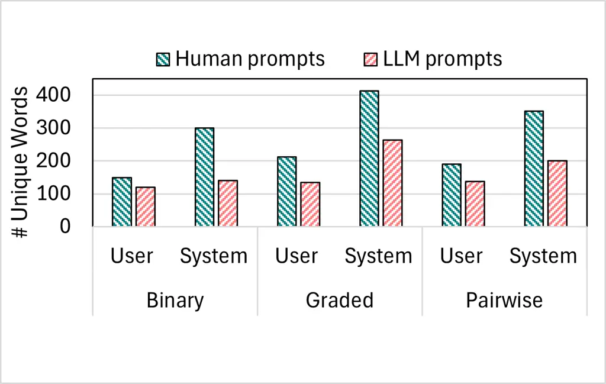
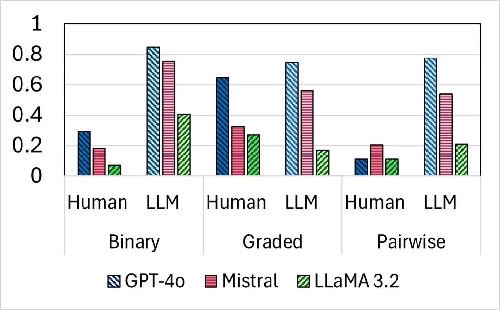

# A Human-AI Comparative Analysis of Prompt Sensitivity in LLM-Based Relevance Judgment

Conference: Proceedings of the 48th International ACM SIGIR Conference
on Research and Development in Information Retrieval; July 13–18, 2025;
Padua, ItalyProceedings of the 48th International ACM SIGIR Conference
on Research and Development in Information Retrieval (SIGIR ’25), July
13–18, 2025, Padua,
ItalyDOI: [10.1145/3726302.3730159](https://doi.org/10.1145/3726302.3730159)ISBN: 979-8-4007-1592-1/2025/07CCS: Information
systems Evaluation of retrieval resultsCCS: Information
systems Relevance assessmentCCS: Information systems Test collections

Negar Arabzadeh

email: <narabzad@uwaterloo.ca> Affiliation: University of Waterloo,
Waterloo, Ontario, Canada and Charles L.A. Clarke

email: <claclark@uwaterloo.ca> Affiliation: University of Waterloo,
Waterloo, Ontario, Canada

© acmlicensed

###### Abstract.

Large Language Models (LLMs) are increasingly used to automate relevance
judgments for information retrieval (IR) tasks, often demonstrating
agreement with human labels that approaches inter-human agreement. To
assess the robustness and reliability of LLM-based relevance judgments,
we systematically investigate impact of prompt sensitivity on the task.
We collected prompts for relevance assessment from 15 human experts and
15 LLMs across three tasks — binary, graded, and pairwise — yielding 90
prompts in total. After filtering out unusable prompts from three humans
and three LLMs, we employed the remaining 72 prompts with three
different LLMs as judges to label document/query pairs from two TREC
Deep Learning Datasets (2020 and 2021). We compare LLM-generated labels
with TREC official human labels using Cohen’s $`\kappa`$ and pairwise
agreement measures. In addition to investigating the impact of prompt
variations on agreement with human labels, we compare human- and
LLM-generated prompts and analyze differences among different LLMs as
judges. We also compare human- and LLM-generated prompts with the
standard UMBRELA prompt used for relevance assessment by Bing and TREC
2024 Retrieval Augmented Generation (RAG) Track. To support future
research in LLM-based evaluation, we release all data and prompts at
[https://github.com/Narabzad/prompt-sensitivity-relevance-judgements/](https://github.com/Narabzad/prompt-sensitivity-relevance-judgements/).

###### Keywords: 

Large Language Models, Relevance Judgments, Evaluation

## 1. Introduction

Large Language Models (LLMs) are increasingly used for evaluation across
various domains, including natural language processing and automated
content assessment (Alaofi et al., 2024; Rahmani et al., 2024a; Salemi
and Zamani, 2024; Chang et al., 2024; Chiang and Lee, 2023; Arabzadeh
et al., 2024b). The information retrieval (IR) community has been an
early adopter of LLMs for relevance assessment (Faggioli et al., 2023;
Thomas et al., 2023; Li et al., 2024; Zhuang et al., 2023; Meng et al.,
2024). Numerous studies have confirmed that LLM-generated relevance
labels closely align with human labels under multiple measures of
agreement (Upadhyay et al., 2024b; Upadhyay et al., 2024a; MacAvaney and
Soldaini, 2023).

Nonetheless, despite the widespread adoption of LLMs for relevance
assessment, prompting strategies vary substantially across
studies (Farzi and Dietz, 2024; Sander and Dietz, 2021; Arabzadeh
et al., 2024a; Arabzadeh and Clarke, 2024). An experiment reported at
the LLM4Eval Workshop in SIGIR 2024 on Large Language Models for
Evaluation in Information Retrieval (Rahmani et al., 2024b), analyzed
how different prompts influence agreement with human judgments and
system rankings (Rahmani et al., 2024a). While multiple studies have
examined how LLMs respond to different prompting strategies (Sclar
et al., 2023; Chatterjee et al., 2024; Lu et al., 2024; Arora et al.,
2022; Leidinger et al., 2023), these studies have generally been
conducted with prompts tuned to specific LLMs and collections, or where
prompt variants are constrained by templates (Azzopardi et al., 2024).
As a complement to these studies, we report on a study of prompts from a
variety of independent sources that have not been tuned to LLMs or
collections, allowing us to examine the robustness of LLM-based
relevance assessment under different prompting strategies. This
investigation also allows us to compare different LLMs as judges to
determine the degree to which different LLMs are sensitive to prompt
modifications.

We collected and analyzed prompts generated by both human experts and
LLMs themselves. We designed a guideline for prompting LLMs to perform
relevance assessment following three different approaches: binary,
graded, and pairwise. While most previous studies have focused on graded
relevance, we believe it is crucial to explore a wider range of
relevance assessment methods, as they have proven effective in assessing
different scenarios in the evaluation of information-seeking systems
(Cleverdon, 1991; Clarke et al., 2021a; Yan et al., 2022; Kazai et al.,
2013; Clarke et al., 2021b; Carterette et al., 2008; Sakai and Zeng,
2020; Xie et al., 2020; Buckley and Voorhees, 2004; Hawking et al.,
1999; Voorhees, 2000). As a benefit to employing LLMs for relevance
assessment, it becomes easier to explore different approaches to
relevance assessment since human judges do not need to be recruited and
trained separately for each approach.

We recruited 15 human participants to create prompts for each of the
three assessment approaches. As part of the recruitment process, we
ensured that the participants were familiar with prompt engineering and
relevance assessment principles, as detailed in Section 2. As a result
of this inclusion criteria for recruitment, most participants were drawn
from three academia NLP/IR labs. We also collected prompts from
15 different open source and commercial LLMs. Our primary goal is to
understand prompt sensitivity in LLM-based relevance judgment (Razavi
et al., 2025), including its impact, robustness, and variation across
different LLMs. Additionally, we explore the effectiveness of LLM as
prompt generators.

We performed relevance judgment experiments using data from two years of
the TREC Deep Learning Track: DL 2020 (Craswell et al., 2021), and
DL 2021 (Craswell et al., 2022). Using the prompts created by both human
participants and LLMs, we conducted relevance assessments on
query-document pairs from these datasets using two open-source
LLMs — LLaMA 3.2-3b and Mistral 7b — and one commercial LLM GPT-4o. Our
experiment incorporates the three approaches to relevance assessment
(binary, graded, and pairwise) with prompts from both humans and LLMs
using three different LLMs as judges. Through our experiments, we
address the following research questions:

- •
  RQ1. Impact of Prompts on LLM-based Relevance Judgment Approaches:
  Given a clear task objective, how do different prompts influence the
  effectiveness of each approach to LLM-based relevance judgment?
- •
  RQ2. LLMs as Prompt Generators: How effective are LLM-generated
  prompts for relevance judgment, and how do they compare to
  human-crafted prompts?
- •
  RQ3. Prompt Robustness Across LLMs: Are there prompts that
  consistently perform well across different LLMs, regardless of the
  model used as a judge?
- •
  RQ4. Model-Specific Sensitivity to Prompts: Is prompt sensitivity
  consistent across all models, or do some LLMs show greater variability
  in performance?

To ensure reproducibility, we have made all data and experimental
artifacts publicly available at
[https://github.com/Narabzad/prompt-sensitivity-relevance-judgements/](https://github.com/Narabzad/prompt-sensitivity-relevance-judgements/).
The study reported in this paper, and its associated data release, has
received ethics clearance as human subjects research from our
institution.

## 2. Prompt Creation

### 2.1. Prompt generation

To investigate the impact of prompting on LLM-based relevance judgment,
we collected data from both human participants and LLMs, ensuring that
the task objective remained clear and consistent (sharing the same
intent) across all participants. We prepared guidelines for prompt
writing¹¹ 1 [https://bit.ly/4hP0EMg](https://bit.ly/4hP0EMg), which
provides detailed explanations of the three relevance judgment tasks: 1)
Binary relevance — a passage is either relevant (1) or not relevant (0)
to a query. 2) Graded relevance — a passage is rated on a 0-3 scale,
where 3 indicates perfect relevance to the query. 3) Pairwise
relevance — given two passages, chose the passage more relevant to the
query. In the guideline, each task is illustrated with examples from the
TREC Deep Learning 2019 (Craswell et al., 2020), helping to ensure that
both humans and LLMs had a well-defined understanding of the task. These
examples could also be used as (few shot) examples if desired.

The guidelines specify a Python-based format, where participants (both
human and LLMs) were required to fill in structured Python dictionaries.
More specifically, participants had to provide both the "system message"
and "user message" fields for the prompts, following the format commonly
used in LLM-based prompting (e.g., OpenAI models and open-source
alternatives such as those from Ollama). This structured approach
ensures compatibility across different LLM implementations.

We recruited 15 human participants, each of whom had at least a Master’s
degree in computer science, were fluent in English, and had prior
experience working with LLMs via API usage or coding. Additionally,
these participants had previously published at least one paper in an
IR-focused conference. Each participant received a \$10 gift card as a
token of appreciation for their time and effort.

For prompt creation, we also used 15 different LLMs from the
ChatBotArena²² 2 [https://lmarena.ai/](https://lmarena.ai/) platform
(Chiang et al., 2024), which enables the execution of various LLMs
online. We provided the same data collection guideline to the LMMs,
including the task description and examples, ensuring that the LLMs
received identical instructions to those given to human participants.
Similar to human participants, each LLM was asked to complete the
"system message" and "user message" fields in our Python function for
relevance judgment. This setup allow us to systematically compare the
impact of prompting across both groups. Table 1 provides the list of
LLMs we used in this experiment for generating prompts for relevance
judgments.

|               |             |                    |            |            |
| ------------- | ----------- | ------------------ | ---------- | ---------- |
| GPT-4o        | GPT-4o Mini | Claude 3.5         | LLaMA 3.2  | Phi-4      |
| Mistral-large | DeepSeek-v3 | Amazon-Nova-Pro-v1 | Gemma-2-9b | Grok-2     |
| Gemini 2      | Jamba-1.5   | Athene-v2          | GPTO1      | GPTO1 Mini |

Table 1. List of LLMs used for prompt generation.

### 2.2. Filtering and cleaning

To maintain consistency, we did not modify or provide additional
instructions for any LLMs or human participants. Among the LLMs, two
failed to complete the task because they deemed the task to be
inappropriate, or repeatedly asked about examples. Among human
participants, only one used a few-shot approach with examples. The rest
did not provide any examples in their prompts. When testing the outputs
of the collected prompts, not all of them were able to generate the
expected format cleanly. Some prompts produced responses that required
additional cleaning, such as verbose outputs like "The passage is
relevant, so the answer is: 1" instead of simply returning 1. To ensure
consistency, we examined the all generated output and applied necessary
cleaning. After filtering and cleaning, we finalized 12 human-generated
prompts and 12 LLM-generated prompts for use in our experiments.

### 2.3. Prompt Diversity

To better understand the variation in prompts, we examined the diversity
of both human-generated and LLM-generated prompts. Specifically, we
analyzed both user prompts and system prompts separately, as they serve
distinct roles in guiding the LLM’s response. In a prompt the user
message provides the direct instructions given to the model, specifying
what information is needed. In contrast, the system message provides
context for the task, defining the LLM’s role and expected behavior
(e.g., “You are an expert relevance judgment assessor”). Figure 1
illustrates the distribution of unique terms used across all
human-generated (in green) and LLM-generated (in red) prompts. As shown
in this figure, human-generated prompts exhibit greater diversity in
wording when compared to LLM-generated ones. This suggests that humans
introduce more nuanced descriptions and varied phrasing when defining
the task, while LLM-generated system prompts tend to rely on more
standardized language. Additionally, system messages exhibit greater
lexical diversity compared to user messages.

Figure 1. Diversity of words across human and LLM-generated prompts.

## 3. Experimental Methodology

Figure 2. Agreement of LLM-based relevance judgments with human
annotations across different prompts and relevance judgment tasks.
UMBRELA represents the reproduction of Bing’s LLM assessor introduced in
(Upadhyay et al., 2024b). Otherwise, the top 12 bars (H-\*) represent
human-crafted prompts, while the bottom 12 correspond to LLM-generated
prompts. The dashed lines show the mean of agreement in LLM -crafted
prompts and human-crafted prompts separately.

Data We utilize the TREC Deep Learning Track datasets from 2020 and 2021. The DL-20 dataset contains 54 judged queries with 11,386 relevance
assessments from MS MARCO V1 collection, while the DL-21 dataset
includes 53 judged queries and 10,828 assessments from MS MARCO V2. Both
datasets have been manually annotated by NIST assessors following the
TREC relevance judgment guidelines. The assessors evaluate each
document-query pair based on a graded relevance scale, ranging from not
relevant (0) to highly relevant (3). The assessment process involves
pooling top-ranked documents from multiple retrieval systems, which were
then judged by human annotators. Using this data allows us to compare
the three different variations of LLM-based judgments i.e., binary,
graded, and pairwise. For graded relevance, we compare against the
actual graded labels. For binary judgments, following prior work
(Upadhyay et al., 2024b; Faggioli et al., 2023), we classify levels 2
and 3 as relevant and levels 0 and 1 as non-relevant. For pairwise
judgments, we compare documents with different relevance levels,
assuming that a document with a higher relevance level should be ranked
as more relevant than one with a lower relevance level.

LLMs for Relevance Judgments. To perform relevance assessment, we
employed three different LLMs: one commercial model, GPT-4o, and two
open-source models, LLaMA 3.2-3B and Mistral-7B . We implemented our
experiments using OpenAI and Ollama, running all prompts with a
temperature setting of 0.

Data Sampling. We conducted experiments on all query-document pairs for
binary and graded relevance judgments using the open-source models.
However, due to computational constraints, we were unable to run all 24
valid prompts across all query-document pairs for GPT-4o. Instead, we
randomly sampled up to 10 documents per query for each of the four
relevance levels (0-3). If fewer than 10 documents were available for a
given relevance level, we included all available documents. For pairwise
judgments, evaluating all possible pairs was not feasible due to their
quadratic growth. Instead, we categorized documents for each query into
three groups: “highly relevant”, “relevant”, and “non-relevant”. The
“highly relevant” category corresponds to the highest available
relevance level for that query, which in TREC-style annotations could be
level 3 or level 2, depending on availability. The “non-relevant”
category includes all level 0 documents, while any intermediate
relevance level (typically level 1, or levels 1 and 2 if level 3 exists)
was classified as “relevant”.

From these three categories, we constructed document pairs for pairwise
judgments. Specifically, we sampled 10 pairs per query from each of the
following comparisons: “highly relevant vs. non-relevant”, “relevant vs.
non-relevant”, and “highly relevant vs. relevant” (up to 30 pairs in
total). If fewer than 10 pairs were available for a given comparison, we
included as many as possible. Additionally, for the pairwise setting, we
minimized positional bias by evaluating each document pair twice,
swapping the order of the documents in the second run. The result is
counted as “agree” if the LLM favors the more relevant passage in both
comparisons, “tie” if the LLM’s decisions are inconsistent when the
passage order is swapped, and “disagree” if the LLM consistently selects
the passage with a lower relevance level assigned by human annotators.

| Model     | crafted by | Binary |          | Graded |          | Pairwise |          |
| --------- | ---------- | ------ | -------- | ------ | -------- | -------- | -------- |
|           |            | Mean   | Variance | Mean   | Variance | Mean     | Variance |
| GPT-4o    | LLM        | 0.434  | 0.003    | 0.215  | 0.001    | 0.849    | 0.000    |
|           | Human      | 0.270  | 0.098    | 0.215  | 0.001    | 0.578    | 0.139    |
| LLaMA 3.2 | LLM        | 0.303  | 0.010    | 0.033  | 0.002    | 0.439    | 0.066    |
|           | Human      | 0.167  | 0.041    | 0.102  | 0.003    | 0.330    | 0.073    |
| Mistral   | LLM        | 0.405  | 0.001    | 0.008  | 0.004    | 0.574    | 0.014    |
|           | Human      | 0.243  | 0.051    | 0.004  | 0.005    | 0.442    | 0.073    |

Table 2. Mean and variance of agreement between LLM-based and human
relevance judgments across different settings.

## 4. Results and Findings

In order to explore the research questions raised in the introduction,
we investigated the agreement of LLM-based relevance judgments from
different prompts with human annotations on TREC 2020 and 2021 using
three different LLMs, as shown in Figure 2. For binary and graded
relevance judgments, agreement is measured using Cohen’s Kappa
($`\kappa`$). For pairwise judgments, since the task involves assessing
agreement with the actual ranking of pairs, we report the percentage of
cases where the LLM’s preference agrees with the expected order. In this
figure, the leftmost two columns represent the results for binary, the
middle two columns correspond to graded, and the rightmost two columns
display the results from pairwise relevance judgment. The green, blue,
and red bars indicate agreement for GPT-4o, LLAMA 3.2, and Mistral,
respectively. In each pair of plots, the left plot presents results for
DL-20, while the right plot corresponds to DL-21. The bottom 12 bars
represent prompts crafted by LLMs; on top of them there are 12 bars
corresponding to prompts created by humans.

In addition to results from the human- and LLM-written prompts, we also
report the results of UMBRELA assessments at the top of the graded
relevance sub-figure (middle). UMBRELA is an open-source reproduction of
Microsoft’s Bing LLM-based relevance assessor (Thomas et al., 2023),
designed to automate relevance judgments effectively (Upadhyay et al.,
2024b; Upadhyay et al., 2024a). It follows a structured prompting
approach and has demonstrated high correlation with both human
annotations and system rankings across multiple TREC Deep Learning
Tracks (2019–2023). Notably, UMBRELA has been integrated into TREC 2024
RAG for automated evaluation, which further validated its reliability as
an alternative to human assessors. We consider UMBRELA a reliable and
effective prompt and we believe comparing its performance against
human-crafted and LLM-generated prompts in graded relevance judgments
would bring interesting insights. Additionally, Table 2 summarizes
Figure 2 by providing the mean and variance of agreement scores across
the two datasets and different relevance judgments.

We now consider investigating each of our research questions in light of
these agreement results.

RQ1. Impact of Prompts on LLM-based Relevance Judgment Approaches:
Figure 2 and Table 2 reveal significant variance across different
LLM-based relevance judgment approaches. Binary and pairwise methods
exhibit the least sensitivity to input prompts, maintaining more
consistent agreement. In contrast, graded relevance judgments are highly
sensitive to prompt variations. We note that while binary and pairwise
methods operate with only two choices, graded relevance introduces
greater variability. Particularly on graded judgments, GPT-4o
demonstrates relatively stable performance but LLaMA 3.2 and Mistral
show considerable fluctuations across different prompts.

RQ2. LLMs as Prompt Generators: Table 2 shows that LLM-generated prompts
generally yield higher average agreement with human annotations.
However, for graded relevance judgments, the difference is minimal. This
may be due to (i) participants’ greater familiarity with graded
assessments or (ii) the inherently subjective nature of assigning
relevance levels, which may require more calibration with human
annotators. Additionally, LLM-generated prompts exhibit lower variance
in agreement compared to human-crafted prompts, indicating less
sensitivity to prompt variations.

RQ3. Prompt Robustness Across LLMs: Figure 3 analyzes inter-agreement
rates among different prompt groups using Krippendorff’s alpha. Here we
measure agreement between different prompt’s output, regardless of their
alignment with human judgments. The results show that LLM-generated
prompts exhibit higher inter-agreement than human-crafted ones, likely
due to the greater linguistic diversity in human-generated prompts, as
seen in Figure 1. This suggests that LLM-generated prompts are more
robust than human-crafted ones. While some human-crafted prompts
performed well across all models, prompt effectiveness varies
significantly between LLMs, with no single prompt consistently excelling
across all models. However, for graded assessments, UMBRELA consistently
demonstrated high performance across different LLMs and it emerged as
one of the most effective prompts across all models. UMBRELA had
previously shown strong correlation with human judgments on TREC DL
tracks (Upadhyay et al., 2024b). We hypothesize that UMBRELA’s strong
and consistent performance may stem from how its prompt deconstructs the
concept of relevance into finer-grained aspects, such as trustworthiness
and alignment with intent. This structured approach likely prevents the
LLM from relying on its own interpretation of relevance.

RQ4. Model-Specific Sensitivity to Prompts: From Figure 2, we observe
that GPT-4o demonstrates high consistency across most prompts and all
relevance assessment approaches. In contrast, the performance of LLaMA
3.2 and Mistral varies significantly depending on the prompt and
assessment method. This variability is further confirmed by the variance
of agreement reported in Table 2. Notably, GPT-4o exhibits consistently
low variance in agreement, particularly when prompted with LLM-crafted
prompts.

Figure 3. Krippendorff’s inter-agreement rate between all the prompts on
two datasets.

## 5. Conclusion and Limitations

In this study, we investigated the sensitivity of LLM-based relevance
judgments to different prompting strategies across multiple models. We
examined how prompts, whether human- or LLM-generated, influence
judgment effectiveness, their robustness across different LLMs, and the
extent to which models exhibit variability in response to prompt
modifications. One specific outcome is to confirm the performance of
UMBRELA as a leading prompt for LLM-based graded relevance assessment.
Despite these contributions, our study has limitations. Our human
participants primarily had a computer science background with experience
writing prompts for LLMs. Additionally, we evaluated only three LLMs as
judges, limiting the generalizability of our findings.

## References

- Alaofi et al. (2024) Marwah Alaofi, Negar Arabzadeh, Charles LA
  Clarke, and Mark Sanderson. 2024. Generative information retrieval
  evaluation. In _Information Access in the Era of Generative AI_.
  Springer, 135–159.
- Arabzadeh et al. (2024a) Negar Arabzadeh, Amin Bigdeli, and Charles
  L. A. Clarke. 2024a. Adapting Standard Retrieval Benchmarks to
  Evaluate Generated Answers. In _46th European Conference on
  Information Retrieval_. Glasgow, Scotland.
- Arabzadeh and Clarke (2024) Negar Arabzadeh and Charles LA
  Clarke. 2024. A Comparison of Methods for Evaluating Generative IR.
  _arXiv preprint arXiv:2404.04044_ (2024).
- Arabzadeh et al. (2024b) Negar Arabzadeh, Siqing Huo, Nikhil Mehta,
  Qingyun Wu, Chi Wang, Ahmed Hassan Awadallah, Charles L. A. Clarke,
  and Julia Kiseleva. 2024b. Assessing and Verifying Task Utility in
  LLM-Powered Applications. In _Proceedings of the 2024 Conference on
  Empirical Methods in Natural Language Processing_, Yaser Al-Onaizan,
  Mohit Bansal, and Yun-Nung Chen (Eds.). Association for Computational
  Linguistics, Miami, Florida, USA, 21868–21888.
  [doi:10.18653/v1/2024.emnlp-main.1219](https://doi.org/10.18653/v1/2024.emnlp-main.1219)
- Arora et al. (2022) Simran Arora, Avanika Narayan, Mayee F. Chen,
  Laurel Orr, Neel Guha, Kush Bhatia, Ines Chami, Frederic Sala, and
  Christopher Ré. 2022. Ask Me Anything: A simple strategy for prompting
  language models. arXiv:2210.02441 \[cs.CL\]
  [https://arxiv.org/abs/2210.02441](https://arxiv.org/abs/2210.02441)
- Azzopardi et al. (2024) Leif Azzopardi, Charles LA Clarke, Paul
  Kantor, Bhaskar Mitra, Johanne R Trippas, Zhaochun Ren, Mohammad
  Aliannejadi, Negar Arabzadeh, Raman Chandrasekar, Maarten de Rijke,
  et al. 2024. Report on The Search Futures Workshop at ECIR 2024. In
  _ACM SIGIR Forum_, Vol. 58. ACM New York, NY, USA, 1–41.
- Buckley and Voorhees (2004) Chris Buckley and Ellen M Voorhees. 2004.
  Retrieval evaluation with incomplete information. In _Proceedings of
  the 27th annual international ACM SIGIR conference on Research and
  development in information retrieval_. 25–32.
- Carterette et al. (2008) Ben Carterette, Paul N. Bennett,
  David Maxwell Chickering, and Susan T. Dumais. 2008. _Here or there:
  Preference Judgments for Relevance_. Computer Science Department
  Faculty Publication Series 46. University of Massachusetts Amherst.
- Chang et al. (2024) Yupeng Chang, Xu Wang, Jindong Wang, Yuan Wu,
  Linyi Yang, Kaijie Zhu, Hao Chen, Xiaoyuan Yi, Cunxiang Wang, Yidong
  Wang, et al. 2024. A survey on evaluation of large language models.
  _ACM Transactions on Intelligent Systems and Technology_ 15, 3 (2024),
  1–45.
- Chatterjee et al. (2024) Anwoy Chatterjee, HSVNS Kowndinya
  Renduchintala, Sumit Bhatia, and Tanmoy Chakraborty. 2024. POSIX: A
  Prompt Sensitivity Index For Large Language Models. _arXiv preprint
  arXiv:2410.02185_ (2024).
- Chiang and Lee (2023) Cheng-Han Chiang and Hung-yi Lee. 2023. Can
  large language models be an alternative to human evaluations? _arXiv
  preprint arXiv:2305.01937_ (2023).
- Chiang et al. (2024) Wei-Lin Chiang, Lianmin Zheng, Ying Sheng,
  Anastasios Nikolas Angelopoulos, Tianle Li, Dacheng Li, Hao Zhang,
  Banghua Zhu, Michael Jordan, Joseph E Gonzalez, et al. 2024. Chatbot
  arena: An open platform for evaluating llms by human preference.
  _arXiv preprint arXiv:2403.04132_ (2024).
- Clarke et al. (2021a) Charles L. A. Clarke, Alexandra Vtyurina, and
  Mark D. Smucker. 2021a. Assessing Top-$`k`$ Preferences. _ACM Trans.
  Inf. Syst._ 39, 3, Article 33 (may 2021), 21 pages.
  [doi:10.1145/3451161](https://doi.org/10.1145/3451161)
- Clarke et al. (2021b) Charles L. A. Clarke, Alexandra Vtyurina, and
  Mark D. Smucker. 2021b. Assessing top-$`k`$ preferences. _ACM
  Transactions on Information Systems_ 39, 3 (July 2021).
- Cleverdon (1991) Cyril W Cleverdon. 1991. The significance of the
  Cranfield tests on index languages. In _Proceedings of the 14th annual
  international ACM SIGIR conference on Research and development in
  information retrieval_. 3–12.
- Craswell et al. (2021) Nick Craswell, Bhaskar Mitra, Emine Yilmaz, and
  Daniel Campos. 2021. Overview of the TREC 2020 deep learning track.
  arXiv:2102.07662 \[cs.IR\]
  [https://arxiv.org/abs/2102.07662](https://arxiv.org/abs/2102.07662)
- Craswell et al. (2022) Nick Craswell, Bhaskar Mitra, Emine Yilmaz,
  Daniel Campos, and Jimmy Lin. 2022. Overview of the TREC 2021 deep
  learning track. In _Text REtrieval Conference (TREC)_. NIST, TREC.
  [https://www.microsoft.com/en-us/research/publication/overview-of-the-trec-2021-deep-learning-track/](https://www.microsoft.com/en-us/research/publication/overview-of-the-trec-2021-deep-learning-track/)
- Craswell et al. (2020) Nick Craswell, Bhaskar Mitra, Emine Yilmaz,
  Daniel Campos, and Ellen M Voorhees. 2020. Overview of the TREC 2019
  deep learning track. _arXiv preprint arXiv:2003.07820_ (2020).
- Faggioli et al. (2023) Guglielmo Faggioli, Laura Dietz, Charles LA
  Clarke, Gianluca Demartini, Matthias Hagen, Claudia Hauff, Noriko
  Kando, Evangelos Kanoulas, Martin Potthast, Benno Stein, et al. 2023.
  Perspectives on large language models for relevance judgment. In
  _Proceedings of the 2023 ACM SIGIR International Conference on Theory
  of Information Retrieval_. 39–50.
- Farzi and Dietz (2024) Naghmeh Farzi and Laura Dietz. 2024. Pencils
  down! automatic rubric-based evaluation of retrieve/generate systems.
  In _Proceedings of the 2024 ACM SIGIR International Conference on
  Theory of Information Retrieval_. 175–184.
- Hawking et al. (1999) David Hawking, Ellen Voorhees, Nick Craswell,
  Peter Bailey, et al. 1999. Overview of the trec-8 web track. In
  _TREC_.
- Kazai et al. (2013) Gabriella Kazai, Emine Yilmaz, Nick Craswell, and
  S.M.M. Tahaghoghi. 2013. User Intent and Assessor Disagreement in Web
  Search Evaluation. In _22nd ACM International Conference on
  Information and Knowledge Management_. San Francisco, California,
  699–708.
- Leidinger et al. (2023) Alina Leidinger, Robert van Rooij, and
  Ekaterina Shutova. 2023. The language of prompting: What linguistic
  properties make a prompt successful? arXiv:2311.01967 \[cs.CL\]
  [https://arxiv.org/abs/2311.01967](https://arxiv.org/abs/2311.01967)
- Li et al. (2024) Dawei Li, Bohan Jiang, Liangjie Huang, Alimohammad
  Beigi, Chengshuai Zhao, Zhen Tan, Amrita Bhattacharjee, Yuxuan Jiang,
  Canyu Chen, Tianhao Wu, et al. 2024. From Generation to Judgment:
  Opportunities and Challenges of LLM-as-a-judge. _arXiv preprint
  arXiv:2411.16594_ (2024).
- Lu et al. (2024) Sheng Lu, Hendrik Schuff, and Iryna Gurevych. 2024.
  How are Prompts Different in Terms of Sensitivity?. In _Proceedings of
  the 2024 Conference of the North American Chapter of the Association
  for Computational Linguistics: Human Language Technologies (Volume 1:
  Long Papers)_, Kevin Duh, Helena Gomez, and Steven Bethard (Eds.).
  Association for Computational Linguistics, Mexico City, Mexico,
  5833–5856.
  [doi:10.18653/v1/2024.naacl-long.325](https://doi.org/10.18653/v1/2024.naacl-long.325)
- MacAvaney and Soldaini (2023) Sean MacAvaney and Luca Soldaini. 2023.
  One-shot labeling for automatic relevance estimation. In _Proceedings
  of the 46th International ACM SIGIR Conference on Research and
  Development in Information Retrieval_. 2230–2235.
- Meng et al. (2024) Chuan Meng, Negar Arabzadeh, Arian Askari, Mohammad
  Aliannejadi, and Maarten de Rijke. 2024. Query Performance Prediction
  using Relevance Judgments Generated by Large Language Models. _arXiv
  preprint arXiv:2404.01012_ (2024).
- Rahmani et al. (2024a) Hossein A Rahmani, Clemencia Siro, Mohammad
  Aliannejadi, Nick Craswell, Charles LA Clarke, Guglielmo Faggioli,
  Bhaskar Mitra, Paul Thomas, and Emine Yilmaz. 2024a. Llm4eval: Large
  language model for evaluation in ir. In _Proceedings of the 47th
  International ACM SIGIR Conference on Research and Development in
  Information Retrieval_. 3040–3043.
- Rahmani et al. (2024b) Hossein A. Rahmani, Clemencia Siro, Mohammad
  Aliannejadi, Nick Craswell, Charles L. A. Clarke, Guglielmo Faggioli,
  Bhaskar Mitra, Paul Thomas, and Emine Yilmaz. 2024b. Report on the 1st
  Workshop on Large Language Model for Evaluation in Information
  Retrieval (LLM4Eval 2024) at SIGIR 2024. arXiv:2408.05388 \[cs.IR\]
  [https://arxiv.org/abs/2408.05388](https://arxiv.org/abs/2408.05388)
- Razavi et al. (2025) Amirhossein Razavi, Mina Soltangheis, Negar
  Arabzadeh, Sara Salamat, Morteza Zihayat, and Ebrahim Bagheri. 2025.
  Benchmarking Prompt Sensitivity in Large Language Models. _arXiv
  preprint arXiv:2502.06065_ (2025).
- Sakai and Zeng (2020) Tetsuya Sakai and Zhaohao Zeng. 2020. Good
  evaluation measures based on document preferences. In _43rd
  International ACM SIGIR Conference on Research and Development in
  Information Retrieval_. 359–368.
- Salemi and Zamani (2024) Alireza Salemi and Hamed Zamani. 2024.
  Evaluating retrieval quality in retrieval-augmented generation. In
  _Proceedings of the 47th International ACM SIGIR Conference on
  Research and Development in Information Retrieval_. 2395–2400.
- Sander and Dietz (2021) David P Sander and Laura Dietz. 2021. EXAM:
  How to Evaluate Retrieve-and-Generate Systems for Users Who Do Not
  (Yet) Know What They Want.. In _DESIRES_. 136–146.
- Sclar et al. (2023) Melanie Sclar, Yejin Choi, Yulia Tsvetkov, and
  Alane Suhr. 2023. Quantifying Language Models’ Sensitivity to Spurious
  Features in Prompt Design or: How I learned to start worrying about
  prompt formatting. _arXiv preprint arXiv:2310.11324_ (2023).
- Thomas et al. (2023) Paul Thomas, Seth Spielman, Nick Craswell, and
  Bhaskar Mitra. 2023. Large Language Models Can Accurately Predict
  Searcher Preferences. _arXiv preprint arXiv:2309.10621_ (2023).
- Upadhyay et al. (2024a) Shivani Upadhyay, Ronak Pradeep, Nandan
  Thakur, Daniel Campos, Nick Craswell, Ian Soboroff, Hoa Trang Dang,
  and Jimmy Lin. 2024a. A Large-Scale Study of Relevance Assessments
  with Large Language Models: An Initial Look.
  arXiv:2411.08275 \[cs.IR\]
  [https://arxiv.org/abs/2411.08275](https://arxiv.org/abs/2411.08275)
- Upadhyay et al. (2024b) Shivani Upadhyay, Ronak Pradeep, Nandan
  Thakur, Nick Craswell, and Jimmy Lin. 2024b. UMBRELA: UMbrela is the
  (Open-Source Reproduction of the) Bing RELevance Assessor. _arXiv
  preprint arXiv:2406.06519_ (2024).
- Voorhees (2000) Ellen M Voorhees. 2000. Report on trec-9. In _ACM
  SIGIR Forum_, Vol. 34. ACM New York, NY, USA, 1–8.
- Xie et al. (2020) Xiaohui Xie, Jiaxin Mao, Yiqun Liu, Maarten de
  Rijke, Haitian Chen, Min Zhang, and Shaoping Ma. 2020.
  Preference-based evaluation metrics for web image search. In _43st
  Annual International ACM SIGIR Conference on Research and Development
  in Information Retrieval_. Xi’an, China.
- Yan et al. (2022) Xinyi Yan, Chengxi Luo, Charles L. A. Clarke, Nick
  Craswell, Ellen M. Voorhees, and Pablo Castells. 2022. Human
  Preferences as Dueling Bandits. In _Proceedings of the 45th
  International ACM SIGIR Conference on Research and Development in
  Information Retrieval_ _(SIGIR ’22)_. ACM.
  [doi:10.1145/3477495.3531991](https://doi.org/10.1145/3477495.3531991)
- Zhuang et al. (2023) Honglei Zhuang, Zhen Qin, Kai Hui, Junru Wu, Le
  Yan, Xuanhui Wang, and Michael Berdersky. 2023. Beyond Yes and No:
  Improving Zero-Shot LLM Rankers via Scoring Fine-Grained Relevance
  Labels. _arXiv preprint arXiv:2310.14122_ (2023).
