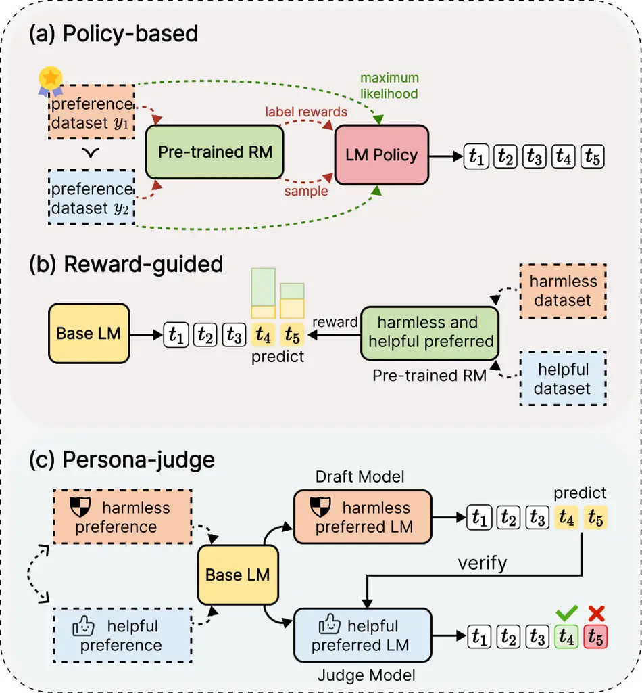
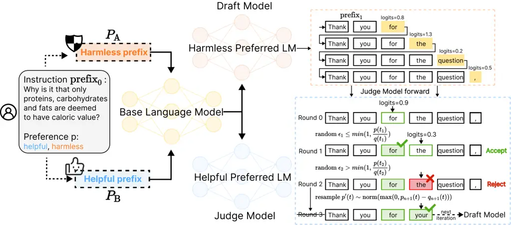

# Persona-judge: Personalized Alignment of Large Language Models via Token-level Self-judgment

Xiaotian Zhang ^(†)^(†)thanks: Equal contribution. Affiliation: Zhejiang
University Affiliation: Zhejiang Key Laboratory of Medical Imaging
Artificial Intelligence    Ruizhe Chen¹¹footnotemark: 1
Affiliation: Zhejiang University Affiliation: Zhejiang Key Laboratory of
Medical Imaging Artificial Intelligence    Yang Feng
Affiliation: Angelalign Technology Inc.    Zuozhu Liu ^(†)^(†)thanks:
Corresponding author. Affiliation: Zhejiang University
Affiliation: Zhejiang Key Laboratory of Medical Imaging Artificial
Intelligence

###### Abstract

Aligning language models with human preferences presents significant
challenges, particularly in achieving personalization without incurring
excessive computational costs. Existing methods rely on reward signals
and additional annotated data, limiting their scalability and
adaptability to diverse human values. To address these challenges, we
introduce Persona-judge, a novel discriminative paradigm that enables
training-free personalized alignment with unseen preferences. Instead of
optimizing policy parameters through external reward feedback,
Persona-judge leverages the intrinsic preference judgment capabilities
of the model. Specifically, a draft model generates candidate tokens
conditioned on a given preference, while a judge model, embodying
another preference, cross-validates the predicted tokens whether to be
accepted. Experimental results demonstrate that Persona-judge, using the
inherent preference evaluation mechanisms of the model, offers a
scalable and computationally efficient solution to personalized
alignment, paving the way for more adaptive customized alignment. Our
code is available [here](https://github.com/Monncyann/Persona-judge).

## 1 Introduction

Aligning large language models (LLMs) has shown tremendous potential in
following human instructions and reflecting human preferences Stiennon
et al. (2020); Ouyang et al. (2022a); Bai et al. (2022). However,
aligning with a unified preference often overlooks the need to
accommodate individuals, as individual preferences can vary
significantly due to factors such as cultural, educational, religious,
and political backgrounds Gordon et al. (2022); Cheng et al. (2023);
Chen et al. (2024e). Personalized alignment Jang et al. (2023) addresses
this gap by tailoring language models to individual human preferences
and values, which is crucial for human-AI interaction and user-focused
applications (Kirk et al., 2024; Sorensen et al., 2024). Policy-based
methods Zhou et al. (2024); Li et al. (2020), such as Reinforcement
Learning from Human Feedback (RLHF) (Ouyang et al., 2022a) and Direct
Preference Optimization (DPO) (Rafailov et al., 2024), as illustrated in
Figure 1(a), use training signals from explicit or implicit rewards to
optimize policy models. However, these methods struggle to scale to
changing personalized preferences, with challenges including the
construction of high-quality preference datasets and the substantial
computational costs associated with optimizing the policy.



Figure 1: In contrast to previous paradigms, Persona-judge gets rid of
the need for additional training of policy models or reliance on
external reward signals.



Figure 2: An illustration of the inference phase for Persona-judge.
Given the target preferences and the current context, different
preference prefixes are first assigned to the same base model. In each
sequence-length iteration, the two models alternate in the roles of the
draft and judge models, which allows for the calculation of the
likelihood of accepting the next token based on distinct probability
distributions.

To achieve personalized alignment efficiently, existing works utilize
reward signals to guide Chen et al. (2024e), linearly combine the
predictive distributions of different base models to generate the next
token (Shi et al., 2024), or  Yang et al. (2024a) train an external
corrector to avoid direct optimization of the policy model parameters.
However, these approaches still rely on external feedback and
preferences pre-defined during the training phase, which restricts their
ability to generalize to unseen preferences. Furthermore, despite
enhancing the efficiency of personalized alignment, existing methods
still require training additional models.

In this paper, we introduce Persona-judge (Figure 1(c)), a generalizable
and training-free personalized alignment framework. Persona-judge
leverages the intrinsic ability of the model to discern preferences by
directly employing existing LLMs as judges, thus eliminating the need
for external reward signals. Inspired by speculative decoding (Leviathan
et al., 2023), Persona-judge adopts a draft-and-judge pipeline, where
the same base model serves both as the draft model and the judge model.
Specifically, Persona-judge interprets the preference representation of
the output as the acceptance of the predicted token. Different
preferences are used to prompt the same base model, with the base model
taking turns serving as the draft model to generate a sequence, the
judge model to verify whether the predicted tokens are accepted.

Experimental results demonstrate that Persona-judge, by exclusively
utilizing the model’s intrinsic preference judgment capabilities,
achieves performance comparable to training-based methods in a
completely training-free setting. Furthermore, it exhibits remarkable
generalization ability across diverse and unique preferences,
highlighting its exceptional scalability.

|                                        |                                                             |                                                             |                                                             |                                                             |                                                             |         |       |       |          |      |       |         |
| -------------------------------------- | ----------------------------------------------------------- | ----------------------------------------------------------- | ----------------------------------------------------------- | ----------------------------------------------------------- | ----------------------------------------------------------- | ------- | ----- | ----- | -------- | ---- | ----- | ------- |
| Algorithm                              | M | P | G | T | F | Helpful |       |       | Harmless |      |       | Average |
|                                        |                                                             |                                                             |                                                             |                                                             |                                                             | Armo    | RM    | GPT-4 | Armo     | RM   | GPT-4 |         |
| Base                                   |                                                             |                                                             |                                                             |                                                             |                                                             | 0.61    | 1.06  | \-    | 0.97     | 0.83 | \-    | 0.87    |
| MORLHF (Li et al., 2020)               | ✔                                                          |                                                             |                                                             |                                                             |                                                             | 0.31    | 0.91  | 14%   | 0.88     | 0.84 | 4%    | 0.73    |
| MODPO (Zhou et al., 2024)              | ✔                                                          |                                                             |                                                             |                                                             | ✔                                                          | 0.56    | 0.89  | 52%   | 0.96     | 0.77 | 80%   | 0.80    |
| Personalized soups (Jang et al., 2023) | ✔                                                          |                                                             |                                                             |                                                             | ✔                                                          | 0.38    | -0.72 | 72%   | 0.92     | 0.73 | 92%   | 0.33    |
| Rewarded soups (Rame et al., 2024)     | ✔                                                          |                                                             |                                                             |                                                             | ✔                                                          | 0.50    | 0.87  | 34%   | 0.95     | 0.87 | 64%   | 0.80    |
| RiC (Yang et al., 2024b)               | ✔                                                          | ✔                                                          |                                                             |                                                             | ✔                                                          | 0.54    | 0.90  | 40%   | 0.97     | 0.90 | 70%   | 0.83    |
| MetaAligner (Yang et al., 2024a)       | ✔                                                          | ✔                                                          | ✔                                                          |                                                             | ✔                                                          | 0.55    | 1.39  | 66%   | 0.89     | 0.54 | 74%   | 0.84    |
| MOD (Shi et al., 2024)                 | ✔                                                          |                                                             |                                                             | ✔                                                          | ✔                                                          | 0.55    | 0.93  | 60%   | 0.96     | 0.92 | 84%   | 0.84    |
| Aligner (Ji et al., 2024)              |                                                             | ✔                                                          |                                                             |                                                             | ✔                                                          | 0.67    | 1.32  | 72%   | 0.97     | 0.63 | 70%   | 0.90    |
| Steering (Konen et al., 2024)          |                                                             |                                                             |                                                             |                                                             | ✔                                                          | 0.63    | 1.17  | 38%   | 0.96     | 0.81 | 66%   | 0.89    |
| Args (Khanov et al., 2024)             | ✔                                                          | ✔                                                          |                                                             | ✔                                                          |                                                             | \-      | 1.09  | 74%   | \-       | 0.98 | 94%   | \-      |
| Persona-judge-Base                     | ✔                                                          | ✔                                                          | ✔                                                          | ✔                                                          | ✔                                                          | 0.59    | 1.21  | 80%   | 1.01     | 0.79 | 88%   | 0.90    |
| Persona-judge                          |                                                             |                                                             |                                                             |                                                             |                                                             | 0.63    | 1.29  | 84%   | 0.98     | 0.82 | 98%   | 0.93    |

Table 1: Experiments of predefined preferences on Psoups dataset.
M
ulti-objective indicates support for simultaneous alignment of multiple
objectives,
P
olicy-agnostic means the algorithm is independent of the model
parameters,
G
eneralizability denotes zero-shot alignment capability on unseen
objectives,
T
raining-free represents no need for additional training.
F
ree from RM means not relying on external reward signals. "–" indicates
not applicable. The best and second best results are highlighted in bold
and underline.

## 2 Persona-judge

Inspired by related works in LLM-as-a-Judge (Appendix B.2), we aim to
effectively implement such judgment-like behavior without introducing
additional external training while retaining the advantages of
prompt-based approaches, to ensure fast, efficient, and scalable
alignment.

### 2.1 Preferences Based Embeddings

Traditional prompt-based methods achieve alignment by directly
incorporating preferences descriptions, which are straightforward and
effective (Jang et al., 2023). However, the process by which the model
balances alignment across different preferences remains opaque,
resulting in a lack of interpretability. When given
$`\text{prefix}_{0}`$ as input to LLM, with preferences
$`P_{\mathrm{A}}`$ and $`P_{\mathrm{B}}`$ to align, the prompts related
to $`P_{\mathrm{A}}`$ and $`P_{\mathrm{B}}`$ can be represented as
$`\text{prefix}_{\mathrm{A}}`$ and $`\text{prefix}_{\mathrm{B}}`$,
respectively. Additional details are provided in Appendix C.1.

### 2.2 Inference

How to make judgments on the predicted token in a manner akin to
preference-based decision-making? In essence, this involves evaluating
the overlap between the probability distributions of different
preference outputs. Given the descriptions of preferences
$`P_{\mathrm{A}}`$ and $`P_{\mathrm{B}}`$ encoded by the language model
as $`\text{prefix}_{\mathrm{A}}`$ and $`\text{prefix}_{\mathrm{B}}`$,
along with the original input $`\text{prefix}_{0}`$, in the $`i=0`$
iteration, the model designated as the draft model, representing the
$`P_{\mathrm{A}}`$ preferred LM, autoregressively generates the next
token based on $`\text{prefix}_{1}`$, thus producing a
$`P_{\mathrm{A}}`$ preferred sequence, as illustrated in Figure 2. It is
important to note that either $`P_{\mathrm{A}}`$ or $`P_{\mathrm{B}}`$
can be the prefix of the draft model in the first round, as in each
iteration, the draft model and the judge model alternate roles, as
$`{\text{prefix}_{i}}^{\prime}\sim(\text{prefix}_{\mathrm{A}},\text{prefix}_{\mathrm{B}})+\text{prefix}_{i}`$.

Similarly to Equation (1), each token in the preferred sequence is
associated with a corresponding probability:
$`(t_{1},q_{1}),...,(t_{i},q_{i})=\mathrm{LLM}_{\mathrm{draft}}({\text{prefix}_{i-1}}^{\prime})`$.

After sampling $`t\sim q(t)`$, a similar process is applied to sample
$`t\sim p(t)`$ using the judge model. If $`q(t)\leq p(t)`$, the sampled
token is retained. However, if $`q(t)>p(t)`$, we reject the sample with
probability $`1-\frac{p(t)}{q(t)}`$, and resample the next token from
the adjusted distribution
$`p^{\prime}(t)=\text{norm}(\max(0,p(t)-q(t)))`$. As proved in
Appendix C.2, for any distributions $`p(t)`$ and $`q(t)`$, the tokens
sampled in this manner have $`t\sim p(t)`$.

Given a sequence of candidate tokens $`t_{1},\dots,t_{i}`$, we first
calculate the distribution $`p(t)`$ by running the judge model.
Concurrently, we speculatively calculate the distribution of the next
token $`t_{2}`$ by running the judge model on the prefix concatenated
with $`t_{1}`$. Once both calculations are complete, we proceed with the
decision process as previously outlined: If $`t_{1}`$ is rejected, we
discard the computation for $`t_{2}`$ and resample $`t_{1}`$ from the
adjusted distribution. If $`t_{1}`$ is accepted, both tokens are
retained, and we continue with the next step of computation and
decision-making. The algorithm of Persona-judge is provided in
Appendix 2.3.

1: $`\mathrm{LLM}_{\mathrm{draft}}`$, $`\mathrm{LLM}_{\mathrm{judge}}`$,
prefix

2: $`\triangleright`$ Sample $`t_{i}`$ from
$`\mathrm{LLM}_{\mathrm{draft}}`$ autoregressively.

3: for $`i=1~\textbf{to}~\lambda`$ do

4:
  $`q_{i}(t)\leftarrow\mathrm{LLM}_{\mathrm{draft}}(\text{prefix}+[t_{1},\ldots,t_{i-1}])`$

5:   $`t_{i}\sim q_{i}(t)`$

6: end for

7: $`\triangleright`$ Run $`\mathrm{LLM}_{\mathrm{judge}}`$ in parallel.

8:
$`p_{1}(t),\ldots,p_{\lambda+1}(t)\leftarrow\mathrm{LLM}_{\mathrm{judge}}(\text{prefix}),\dots,\mathrm{LLM}_{\mathrm{judge}}(\text{prefix}+[t_{1},\ldots,t_{\lambda}])`$

9: $`\triangleright`$ The number $`n`$ of reserved tokens.

10: $`\epsilon_{1},\ldots,\epsilon_{\lambda}\sim U(0,1)`$

11:
$`n\leftarrow\min(\{i-1\mid 1\leq i\leq\lambda,r_{i}>\frac{p_{i}(t)}{q_{i}(t)}\}\cup\{\lambda\})`$

12: $`\triangleright`$ Resample if needed.

13: $`p^{\prime}(t)\leftarrow p_{n+1}(t)`$

14: if $`n<\lambda`$ then

15:
  $`p^{\prime}(t)\leftarrow\text{norm}(\max(0,p_{n+1}(t)-q_{n+1}(t)))`$

16: end if

17: $`\triangleright`$ Return one new token from
$`\mathrm{LLM}_{\mathrm{judge}}`$, and $`n`$ tokens from
$`\mathrm{LLM}_{\mathrm{draft}}`$.

18: $`t_{n+1}\sim p^{\prime}(t)`$

19: return $`\text{prefix}+[t_{1},\ldots,t_{n},t_{n+1}]`$

Algorithm 1 PreferenceJudgmentStep

### 2.3 Algorithm Details

Algorithm 1 illustrates the process of sampling between the first and
$`(\lambda+1)`$-th tokens at once.

## 3 Evaluation of Persona-judge

### 3.1 Experimental Settings

#### Datasets and baselines.

For evaluation, we use the P-Soups and HelpSteer2 dataset. The P-Soups
encompasses a wide range of content and has been filtered and modified
by Jang et al. (2023) based on the Koala evaluation. HelpSteer2 (Wang
et al., 2024c) comprises 1,000 high-quality prompts, and we applied a
filtering criterion based on the length of input to exclude certain
entries. We utilize MORLHF (Li et al., 2020), MODPO (Zhou et al., 2024),
Personalized soups (Jang et al., 2023), Rewarded soups (Rame et al.,
2024), Rewards-in-Context (RiC) (Yang et al., 2024b), MetaAligner (Yang
et al., 2024a), MOD (Shi et al., 2024), Aligner (Ji et al., 2024),
Steering (Konen et al., 2024) and Args (Khanov et al., 2024) as
baselines for alignment with predefined preferences tasks. All
experiments in this paper use Llama-3-Base-8B-SFT as the backbone
(except for model-agnostic experiments). In particular, all experiments
in this paper use Llama-3-Base-8B-SFT as the backbone (except for
model-agnostic experiments). In Appendix D.1, we further discuss the
scalability of the proposed method concerning a broader range of
foundational models and unseen preferences.

#### Evaluation metrics.

We use two open-source reward models, together with ArmoRM (Wang et al.,
2024b) from Huggingface, to evaluate the dimensions of "Helpful" and
"Harmless". For these reward models, we report the scores that assess
the responses from various perspectives. For scalability-related
experiments, we primarily employ GPT-as-Judge, a widely recognized
evaluation metric from previous studies (Yang et al., 2024a; Jang
et al., 2023), to assess personalized preferences with win rates. A
detailed description of the evaluation metrics, reward models, and GPT-4
judgments can be found in Appendix D.2.

### 3.2 Main Results

#### Comparison of key features.

In Table 1, we compare the proposed method with the previous work in
five key features. Persona-judge eliminates the need for policy
optimization and dependency on reward signals, enabling adaptation to
unseen objectives. During token generation, it employs a novel "judge"
mechanism to align preferences, allowing for scalable alignment across
multiple objectives, theoretically leading to an unlimited number of
concurrently aligned targets.

#### Alignment on pre-defined preferences.

As shown in Table 1, we fix the positions of the draft model and the
judge model without any further transformation, and the results of this
base configuration are also presented. The findings indicate that
Persona-judge has made substantial progress in achieving goal alignment,
with an average score of 0.93 across four open-source reward models,
outperforming all baselines. In contrast, the base configuration excels
in the single objective, achieving comparable overall performance. These
results provide strong evidence of the superior performance of
Persona-judge in personalized comparison tasks.

|                          |          |          |       |
| ------------------------ | -------- | -------- | ----- |
| Base Model               | Creative | Touching | Vivid |
| Psoups dataset           |          |          |       |
| Qwen2.5-0.5B-Instruct    | 88%      | 86%      | 70%   |
| TinyLlama-1.1B-Chat-v1.0 | 80%      | 72%      | 60%   |
| Gemma-2-2b-it            | 80%      | 84%      | 80%   |
| Llama-3.2-3B-Instruct    | 74%      | 78%      | 74%   |
| Qwen2.5-3B-Instruct      | 86%      | 84%      | 86%   |
| Tulu-2-dpo-7b            | 92%      | 86%      | 80%   |
| Llama-3-Base-8B-SFT      | 62%      | 68%      | 54%   |
| Llama-3.1-Tulu-3-8B      | 84%      | 68%      | 86%   |
| Gemma-2-9b-it            | 82%      | 88%      | 90%   |
| HelpSteer2 dataset       |          |          |       |
| Qwen2.5-0.5B-Instruct    | 77%      | 84%      | 84%   |
| TinyLlama-1.1B-Chat-v1.0 | 47%      | 79%      | 64%   |
| Gemma-2-2b-it            | 75%      | 73%      | 76%   |
| Llama-3.2-3B-Instruct    | 75%      | 73%      | 72%   |
| Qwen2.5-3B-Instruct      | 75%      | 79%      | 84%   |
| Tulu-2-dpo-7b            | 88%      | 80%      | 75%   |
| Llama-3-Base-8B-SFT      | 86%      | 86%      | 73%   |
| Llama-3.1-Tulu-3-8B      | 58%      | 64%      | 76%   |
| Gemma-2-9b-it            | 77%      | 74%      | 84%   |

Table 2: Performance of Persona-judge on Psoups and HelpSteers2 over
different base models. The responses are simultaneously aligned on all
objectives, and then evaluated on each objective. The percentages
represent the win rate of Persona-judge against the direct application
of the same prompts.

#### Alignment on unique preferences.

Table 2 shows the comparison with the direct prompt method on three
preference objectives. Persona-judge achieves significant improvements
on the majority of objectives and across models with varying parameter
sizes. In particular, Persona-judge shows an average advantage of 87%
across the three objectives on Psoups with Gemma-2-9b-it, marking the
most substantial improvement among all models tested. These findings
highlight the overall effectiveness of Persona-judge across various
upstream models and its feasibility for plug-and-play multiobjective
alignment. More evaluation of adaptability can be found in Appendix D.4.

#### Ablation study.

Draft model predicts the tokens step by step based on the prefix,
iterating over a total of $`\lambda`$ tokens. Table 3 illustrates the
impact of variations in $`\lambda`$ on alignment. As the predicted
sequence length changes, the output fitting to preferences exhibits
fluctuations, with the optimal performance observed when the value of
$`\lambda`$ is set to 4. Increasing the sequence length does not result
in better performance, possibly due to early rejection during the
initial positions, which prevents the complete sequence’s semantics from
being evaluated.

|                |         |       |          |       |         |
| -------------- | ------- | ----- | -------- | ----- | ------- |
| Value          | Helpful |       | Harmless |       | Average |
|                | Armo    | RM    | Armo     | RM    |         |
| Psoups dataset |         |       |          |       |         |
| $`\lambda=1`$  | 0.591   | 1.126 | 1.002    | 0.811 | 0.883   |
| $`\lambda=2`$  | 0.581   | 0.904 | 0.974    | 0.832 | 0.823   |
| $`\lambda=3`$  | 0.564   | 1.126 | 1.018    | 0.773 | 0.870   |
| $`\lambda=4`$  | 0.631   | 1.294 | 0.984    | 0.822 | 0.933   |
| $`\lambda=5`$  | 0.597   | 0.939 | 1.001    | 0.804 | 0.835   |
| $`\lambda=6`$  | 0.587   | 1.094 | 0.992    | 0.865 | 0.885   |

Table 3: Sensitivity analysis on $`\lambda`$.

## 4 Conclusion

This paper presents Persona-judge, a novel approach for personalized
alignment that eliminates the need for external reward signals or policy
fine-tuning. By leveraging the model’s inherent capability for
preference judgment, Persona-judge effectively aligns multidimensional
preferences in the prediction of the next token, making it a promising
solution for adaptive personalized alignment.

## Limitation

Although the proposed method achieves personalized alignment in a manner
that is training-free and highly scalable, the limitations are as
follows. As discussed in Section 2.1, the exploration of the model’s
intrinsic ability to judge token preferences enables a completely
training-free approach; however, this results in the output quality
being dependent on the base model’s own capacity to recognize
preferences. Additionally, as discussed in Appendix D.5, current
embedding methods for multi-objective preferences are relatively basic.
Thus, improving the embedding of preferences remains an area that
warrants further investigation. The ideal scenario for personalized
alignment would involve having sufficient data to support model training
for each unique preference. However, this is clearly impractical.
Although the performance of persona-judge exhibits some fluctuations, it
ensures a strong baseline level of alignment while also providing the
community with a potential judgment-based solution paradigm. Then, as
illustrated in Appendix D.4, the challenge of interpreting more complex
preferences remains an issue that requires resolution, although it is
beyond the scope of this work’s discussion.

## Potential Risks

Persona-judge aims to provide a potential solution for the field of
personalized alignment. To date, no identifiable risks associated with
Persona-judge have been observed. All experiments were conducted using
publicly available datasets, and all models utilized are open-source on
Huggingface. In addition, all participants involved in this work
underwent comprehensive training on how to conduct evaluations in an
effective and ethical manner.

## Acknowledgement

This work is supported by the Natural Science Foundation of Zhejiang
Province, China (Grant No. LZ23F020008), the National Natural Science
Foundation of China (Grant No. 12326612, 62476241), Zhejiang Key
Laboratory of Medical Imaging Artificial Intelligence, and the Zhejiang
University-Angelalign Inc. R&D Center for Intelligent Healthcare.

## References

- Achiam et al. (2023) Josh Achiam, Steven Adler, Sandhini Agarwal, Lama
  Ahmad, Ilge Akkaya, Florencia Leoni Aleman, Diogo Almeida, Janko
  Altenschmidt, Sam Altman, Shyamal Anadkat, et al. 2023. Gpt-4
  technical report. _arXiv preprint arXiv:2303.08774_.
- Aho and Ullman (1972) Alfred V. Aho and Jeffrey D. Ullman. 1972. _The
  Theory of Parsing, Translation and Compiling_, volume 1.
  Prentice-Hall, Englewood Cliffs, NJ.
- American Psychological Association (1983) American Psychological
  Association. 1983. _Publications Manual_. American Psychological
  Association, Washington, DC.
- Ando and Zhang (2005) Rie Kubota Ando and Tong Zhang. 2005. A
  framework for learning predictive structures from multiple tasks and
  unlabeled data. _Journal of Machine Learning Research_, 6:1817–1853.
- Andrew and Gao (2007) Galen Andrew and Jianfeng Gao. 2007. Scalable
  training of L1-regularized log-linear models. In _Proceedings of the
  24th International Conference on Machine Learning_, pages 33–40.
- Andukuri et al. (2024) Chinmaya Andukuri, Jan-Philipp Fränken, Tobias
  Gerstenberg, and Noah D Goodman. 2024. Star-gate: Teaching language
  models to ask clarifying questions. _arXiv preprint arXiv:2403.19154_.
- Bai et al. (2022) Yuntao Bai, Andy Jones, Kamal Ndousse, Amanda
  Askell, Anna Chen, Nova DasSarma, Dawn Drain, Stanislav Fort, Deep
  Ganguli, Tom Henighan, et al. 2022. Training a helpful and harmless
  assistant with reinforcement learning from human feedback. _arXiv
  preprint arXiv:2204.05862_.
- Barreto et al. (2025) André Barreto, Vincent Dumoulin, Yiran Mao,
  Nicolas Perez-Nieves, Bobak Shahriari, Yann Dauphin, Doina Precup, and
  Hugo Larochelle. 2025. Capturing individual human preferences with
  reward features. _arXiv preprint arXiv:2503.17338_.
- Chandra et al. (1981) Ashok K. Chandra, Dexter C. Kozen, and Larry J.
  Stockmeyer. 1981.
  [Alternation](https://doi.org/10.1145/322234.322243). _Journal of the
  Association for Computing Machinery_, 28(1):114–133.
- Chen et al. (2025) Ruizhe Chen, Wenhao Chai, Zhifei Yang, Xiaotian
  Zhang, Joey Tianyi Zhou, Tony Quek, Soujanya Poria, and Zuozhu
  Liu. 2025. Diffpo: Diffusion-styled preference optimization for
  efficient inference-time alignment of large language models. _arXiv
  preprint arXiv:2503.04240_.
- Chen et al. (2024a) Ruizhe Chen, Tianxiang Hu, Yang Feng, and Zuozhu
  Liu. 2024a. Learnable privacy neurons localization in language models.
  _arXiv preprint arXiv:2405.10989_.
- Chen et al. (2024b) Ruizhe Chen, Yichen Li, Zikai Xiao, and Zuozhu
  Liu. 2024b. Large language model bias mitigation from the perspective
  of knowledge editing. _arXiv preprint arXiv:2405.09341_.
- Chen et al. (2024c) Ruizhe Chen, Yichen Li, Jianfei Yang, Joey Tianyi
  Zhou, and Zuozhu Liu. 2024c. Editable fairness: Fine-grained bias
  mitigation in language models. _arXiv preprint arXiv:2408.11843_.
- Chen et al. (2024d) Ruizhe Chen, Jianfei Yang, Huimin Xiong, Jianhong
  Bai, Tianxiang Hu, Jin Hao, Yang Feng, Joey Tianyi Zhou, Jian Wu, and
  Zuozhu Liu. 2024d. Fast model debias with machine unlearning.
  _Advances in Neural Information Processing Systems_, 36.
- Chen et al. (2024e) Ruizhe Chen, Xiaotian Zhang, Meng Luo, Wenhao
  Chai, and Zuozhu Liu. 2024e. Pad: Personalized alignment at
  decoding-time. In _The Thirteenth International Conference on Learning
  Representations_.
- Chen et al. (2024f) Ruizhe Chen, Xiaotian Zhang, Meng Luo, Wenhao
  Chai, and Zuozhu Liu. 2024f. Pad: Personalized alignment of llms at
  decoding-time. _arXiv preprint arXiv:2410.04070_.
- Cheng et al. (2023) Pengyu Cheng, Jiawen Xie, Ke Bai, Yong Dai, and
  Nan Du. 2023. Everyone deserves a reward: Learning customized human
  preferences. _arXiv preprint arXiv:2309.03126_.
- Dong et al. (2024) Yijiang River Dong, Tiancheng Hu, and Nigel
  Collier. 2024. Can llm be a personalized judge? _arXiv preprint
  arXiv:2406.11657_.
- Fan et al. (2024a) Zhiting Fan, Ruizhe Chen, Tianxiang Hu, and Zuozhu
  Liu. 2024a. Fairmt-bench: Benchmarking fairness for multi-turn
  dialogue in conversational llms. _arXiv preprint arXiv:2410.19317_.
- Fan et al. (2024b) Zhiting Fan, Ruizhe Chen, Ruiling Xu, and Zuozhu
  Liu. 2024b. Biasalert: A plug-and-play tool for social bias detection
  in llms. _arXiv preprint arXiv:2407.10241_.
- Gordon et al. (2022) Mitchell L Gordon, Michelle S Lam, Joon Sung
  Park, Kayur Patel, Jeff Hancock, Tatsunori Hashimoto, and Michael S
  Bernstein. 2022. Jury learning: Integrating dissenting voices into
  machine learning models. In _Proceedings of the 2022 CHI Conference on
  Human Factors in Computing Systems_, pages 1–19.
- Guo et al. (2024) Yiju Guo, Ganqu Cui, Lifan Yuan, Ning Ding, Zexu
  Sun, Bowen Sun, Huimin Chen, Ruobing Xie, Jie Zhou, Yankai Lin,
  et al. 2024. Controllable preference optimization: Toward controllable
  multi-objective alignment. _arXiv preprint arXiv:2402.19085_.
- Gusfield (1997) Dan Gusfield. 1997. _Algorithms on Strings, Trees and
  Sequences_. Cambridge University Press, Cambridge, UK.
- Han et al. (2024) Seungwook Han, Idan Shenfeld, Akash Srivastava, Yoon
  Kim, and Pulkit Agrawal. 2024. Value augmented sampling for language
  model alignment and personalization. _arXiv preprint
  arXiv:2405.06639_.
- Hwang et al. (2023) EunJeong Hwang, Bodhisattwa Prasad Majumder, and
  Niket Tandon. 2023. Aligning language models to user opinions. _arXiv
  preprint arXiv:2305.14929_.
- Jafari et al. (2024) Yasaman Jafari, Dheeraj Mekala, Rose Yu, and
  Taylor Berg-Kirkpatrick. 2024. Morl-prompt: An empirical analysis of
  multi-objective reinforcement learning for discrete prompt
  optimization. _arXiv preprint arXiv:2402.11711_.
- Jang et al. (2023) Joel Jang, Seungone Kim, Bill Yuchen Lin, Yizhong
  Wang, Jack Hessel, Luke Zettlemoyer, Hannaneh Hajishirzi, Yejin Choi,
  and Prithviraj Ammanabrolu. 2023. Personalized soups: Personalized
  large language model alignment via post-hoc parameter merging. _arXiv
  preprint arXiv:2310.11564_.
- Ji et al. (2024) Jiaming Ji, Boyuan Chen, Hantao Lou, Donghai Hong,
  Borong Zhang, Xuehai Pan, Juntao Dai, Tianyi Qiu, and Yaodong
  Yang. 2024. Aligner: Efficient alignment by learning to correct.
  _arXiv preprint arXiv:2402.02416_.
- Khanov et al. (2024) Maxim Khanov, Jirayu Burapacheep, and Yixuan
  Li. 2024. Args: Alignment as reward-guided search. _arXiv preprint
  arXiv:2402.01694_.
- Kim et al. (2024) Seungone Kim, Juyoung Suk, Shayne Longpre,
  Bill Yuchen Lin, Jamin Shin, Sean Welleck, Graham Neubig, Moontae Lee,
  Kyungjae Lee, and Minjoon Seo. 2024. Prometheus 2: An open source
  language model specialized in evaluating other language models. _arXiv
  preprint arXiv:2405.01535_.
- Kirk et al. (2023) Hannah Rose Kirk, Andrew M Bean, Bertie Vidgen,
  Paul Röttger, and Scott A Hale. 2023. The past, present and better
  future of feedback learning in large language models for subjective
  human preferences and values. _arXiv preprint arXiv:2310.07629_.
- Kirk et al. (2024) Hannah Rose Kirk, Bertie Vidgen, Paul Röttger, and
  Scott A Hale. 2024. The benefits, risks and bounds of personalizing
  the alignment of large language models to individuals. _Nature Machine
  Intelligence_, pages 1–10.
- Konen et al. (2024) Kai Konen, Sophie Jentzsch, Diaoulé Diallo, Peer
  Schütt, Oliver Bensch, Roxanne El Baff, Dominik Opitz, and Tobias
  Hecking. 2024. Style vectors for steering generative large language
  model. _arXiv preprint arXiv:2402.01618_.
- Lee et al. (2024) Seongyun Lee, Sue Hyun Park, Seungone Kim, and
  Minjoon Seo. 2024. Aligning to thousands of preferences via system
  message generalization. _arXiv preprint arXiv:2405.17977_.
- Leviathan et al. (2023) Yaniv Leviathan, Matan Kalman, and Yossi
  Matias. 2023. Fast inference from transformers via speculative
  decoding. In _International Conference on Machine Learning_, pages
  19274–19286. PMLR.
- Li et al. (2024) Dawei Li, Bohan Jiang, Liangjie Huang, Alimohammad
  Beigi, Chengshuai Zhao, Zhen Tan, Amrita Bhattacharjee, Yuxuan Jiang,
  Canyu Chen, Tianhao Wu, et al. 2024. From generation to judgment:
  Opportunities and challenges of llm-as-a-judge. _arXiv preprint
  arXiv:2411.16594_.
- Li et al. (2025) Jia-Nan Li, Jian Guan, Songhao Wu, Wei Wu, and Rui
  Yan. 2025. From 1,000,000 users to every user: Scaling up personalized
  preference for user-level alignment. _arXiv preprint
  arXiv:2503.15463_.
- Li et al. (2020) Kaiwen Li, Tao Zhang, and Rui Wang. 2020. Deep
  reinforcement learning for multiobjective optimization. _IEEE
  transactions on cybernetics_, 51(6):3103–3114.
- Luo et al. (2024a) Hanjun Luo, Ziye Deng, Ruizhe Chen, and Zuozhu Liu.
  2024a. Faintbench: A holistic and precise benchmark for bias
  evaluation in text-to-image models. _arXiv preprint arXiv:2405.17814_.
- Luo et al. (2024b) Hanjun Luo, Haoyu Huang, Ziye Deng, Xuecheng Liu,
  Ruizhe Chen, and Zuozhu Liu. 2024b. Bigbench: A unified benchmark for
  social bias in text-to-image generative models based on multi-modal
  llm. _arXiv preprint arXiv:2407.15240_.
- Ouyang et al. (2022a) Long Ouyang, Jeffrey Wu, Xu Jiang, Diogo
  Almeida, Carroll Wainwright, Pamela Mishkin, Chong Zhang, Sandhini
  Agarwal, Katarina Slama, Alex Ray, et al. 2022a. Training language
  models to follow instructions with human feedback. _Advances in neural
  information processing systems_, 35:27730–27744.
- Ouyang et al. (2022b) Long Ouyang, Jeffrey Wu, Xu Jiang, Diogo
  Almeida, Carroll Wainwright, Pamela Mishkin, Chong Zhang, Sandhini
  Agarwal, Katarina Slama, Alex Ray, et al. 2022b. Training language
  models to follow instructions with human feedback. _Advances in neural
  information processing systems_, 35:27730–27744.
- Park et al. (2024) Chanwoo Park, Mingyang Liu, Kaiqing Zhang, and
  Asuman Ozdaglar. 2024. Principled rlhf from heterogeneous feedback via
  personalization and preference aggregation. _arXiv preprint
  arXiv:2405.00254_.
- Qiu et al. (2025) Yilun Qiu, Xiaoyan Zhao, Yang Zhang, Yimeng Bai,
  Wenjie Wang, Hong Cheng, Fuli Feng, and Tat-Seng Chua. 2025. Measuring
  what makes you unique: Difference-aware user modeling for enhancing
  llm personalization. _arXiv preprint arXiv:2503.02450_.
- Rafailov et al. (2024) Rafael Rafailov, Archit Sharma, Eric Mitchell,
  Christopher D Manning, Stefano Ermon, and Chelsea Finn. 2024. Direct
  preference optimization: Your language model is secretly a reward
  model. _Advances in Neural Information Processing Systems_, 36.
- Rame et al. (2024) Alexandre Rame, Guillaume Couairon, Corentin
  Dancette, Jean-Baptiste Gaya, Mustafa Shukor, Laure Soulier, and
  Matthieu Cord. 2024. Rewarded soups: towards pareto-optimal alignment
  by interpolating weights fine-tuned on diverse rewards. _Advances in
  Neural Information Processing Systems_, 36.
- Rasooli and Tetreault (2015) Mohammad Sadegh Rasooli and Joel R.
  Tetreault. 2015. [Yara parser: A fast and accurate dependency
  parser](http://arxiv.org/abs/1503.06733). _Computing Research
  Repository_, arXiv:1503.06733. Version 2.
- Schulman et al. (2017) John Schulman, Filip Wolski, Prafulla Dhariwal,
  Alec Radford, and Oleg Klimov. 2017. Proximal policy optimization
  algorithms. _arXiv preprint arXiv:1707.06347_.
- Shao et al. (2023) Yunfan Shao, Linyang Li, Junqi Dai, and Xipeng
  Qiu. 2023. Character-llm: A trainable agent for role-playing. _arXiv
  preprint arXiv:2310.10158_.
- Shi et al. (2024) Ruizhe Shi, Yifang Chen, Yushi Hu, Alisa Liu,
  Hannaneh Hajishirzi, Noah A Smith, and Simon S Du. 2024. Decoding-time
  language model alignment with multiple objectives. _arXiv preprint
  arXiv:2406.18853_.
- Sorensen et al. (2024) Taylor Sorensen, Jared Moore, Jillian Fisher,
  Mitchell Gordon, Niloofar Mireshghallah, Christopher Michael Rytting,
  Andre Ye, Liwei Jiang, Ximing Lu, Nouha Dziri, et al. 2024. A roadmap
  to pluralistic alignment. _arXiv preprint arXiv:2402.05070_.
- Stiennon et al. (2020) Nisan Stiennon, Long Ouyang, Jeffrey Wu, Daniel
  Ziegler, Ryan Lowe, Chelsea Voss, Alec Radford, Dario Amodei, and
  Paul F Christiano. 2020. Learning to summarize with human feedback.
  _Advances in Neural Information Processing Systems_, 33:3008–3021.
- Stureborg et al. (2024) Rickard Stureborg, Dimitris Alikaniotis, and
  Yoshi Suhara. 2024. Large language models are inconsistent and biased
  evaluators. _arXiv preprint arXiv:2405.01724_.
- Verga et al. (2024) Pat Verga, Sebastian Hofstatter, Sophia Althammer,
  Yixuan Su, Aleksandra Piktus, Arkady Arkhangorodsky, Minjie Xu, Naomi
  White, and Patrick Lewis. 2024. Replacing judges with juries:
  Evaluating llm generations with a panel of diverse models. _arXiv
  preprint arXiv:2404.18796_.
- Wang et al. (2024a) Haoxiang Wang, Yong Lin, Wei Xiong, Rui Yang,
  Shizhe Diao, Shuang Qiu, Han Zhao, and Tong Zhang. 2024a. Arithmetic
  control of llms for diverse user preferences: Directional preference
  alignment with multi-objective rewards. _arXiv preprint
  arXiv:2402.18571_.
- Wang et al. (2024b) Haoxiang Wang, Wei Xiong, Tengyang Xie, Han Zhao,
  and Tong Zhang. 2024b. Interpretable preferences via multi-objective
  reward modeling and mixture-of-experts. _arXiv preprint
  arXiv:2406.12845_.
- Wang et al. (2024c) Zhilin Wang, Alexander Bukharin, Olivier
  Delalleau, Daniel Egert, Gerald Shen, Jiaqi Zeng, Oleksii Kuchaiev,
  and Yi Dong. 2024c. Helpsteer2-preference: Complementing ratings with
  preferences. _arXiv preprint arXiv:2410.01257_.
- Wu and Aji (2023) Minghao Wu and Alham Fikri Aji. 2023. Style over
  substance: Evaluation biases for large language models. _arXiv
  preprint arXiv:2307.03025_.
- Yang et al. (2024a) Kailai Yang, Zhiwei Liu, Qianqian Xie, Jimin
  Huang, Tianlin Zhang, and Sophia Ananiadou. 2024a. Metaaligner:
  Towards generalizable multi-objective alignment of language models. In
  _The Thirty-eighth Annual Conference on Neural Information Processing
  Systems_.
- Yang et al. (2024b) Rui Yang, Xiaoman Pan, Feng Luo, Shuang Qiu, Han
  Zhong, Dong Yu, and Jianshu Chen. 2024b. Rewards-in-context:
  Multi-objective alignment of foundation models with dynamic preference
  adjustment. _arXiv preprint arXiv:2402.10207_.
- Yao et al. (2023) Jing Yao, Xiaoyuan Yi, Xiting Wang, Jindong Wang,
  and Xing Xie. 2023. From instructions to intrinsic human values–a
  survey of alignment goals for big models. _arXiv preprint
  arXiv:2308.12014_.
- Yuan et al. (2023) Zheng Yuan, Hongyi Yuan, Chuanqi Tan, Wei Wang,
  Songfang Huang, and Fei Huang. 2023. Rrhf: Rank responses to align
  language models with human feedback without tears. _arXiv preprint
  arXiv:2304.05302_.
- Zheng et al. (2023) Lianmin Zheng, Wei-Lin Chiang, Ying Sheng, Siyuan
  Zhuang, Zhanghao Wu, Yonghao Zhuang, Zi Lin, Zhuohan Li, Dacheng Li,
  Eric Xing, et al. 2023. Judging llm-as-a-judge with mt-bench and
  chatbot arena. _Advances in Neural Information Processing Systems_,
  36:46595–46623.
- Zhou et al. (2024) Zhanhui Zhou, Jie Liu, Jing Shao, Xiangyu Yue, Chao
  Yang, Wanli Ouyang, and Yu Qiao. 2024. Beyond one-preference-fits-all
  alignment: Multi-objective direct preference optimization. In
  _Findings of the Association for Computational Linguistics ACL 2024_,
  pages 10586–10613.

## Appendix A Preliminary

### A.1 Standard Speculative Decoding

As $`\mathrm{LLM}_{\mathrm{draft}}`$ and
$`\mathrm{LLM}_{\mathrm{target}}`$ denote the draft and target model,
respectively, they share the same vocabulary
$`\mathcal{V}=\{1,...,V\}`$. Given the input prefix, an autoregressive
sampling of $`n`$ tokens is as follows:

```math
(t_{1},p_{1}),...,(t_{n},p_{n})=\mathrm{LLM}(\text{prefix}), \tag{1}
```

where $`t_{1},...,t_{n}\in\mathcal{V}`$ are the sampled tokens and
$`p_{1},...,p_{n}\in\mathbb{R}^{\mathcal{V}}`$ are the corresponding
softmax probabilities. Furthermore, the parrallel forward is denoted as:

```math
p_{1},...,p_{n+1}=\mathrm{LLM}(\text{prefix};t_{1},...,t_{n}), \tag{2}
```

and the next probability vector $`p_{n+1}`$ is generated.

In each decoding window length, the draft model generates $`N`$
candidate tokens based on the current prefix using a specific sampling
strategy:

```math
(t_{1},q_{1}),...,(t_{N},q_{N})=\mathrm{LLM}_{\mathrm{draft}}(\text{prefix}), \tag{3}
```

where $`t_{1},...,t_{N}`$ are the sampled candidate tokens and
$`q_{i}\in\mathbb{R}^{\mathcal{V}}`$ for $`i=1,...,N`$ are the
corresponding probability vectors within the vocabulary. The target
model then processes the predicted tokens in parallel, similarly,
resulting in
$`p_{1},...,p_{N}=\mathrm{LLM}_{\mathrm{target}}(\text{prefix})`$. Thus,
the probabilities of token $`t_{i}`$ under draft model and target model
are $`q[t_{i}]`$ and $`p[t_{i}]`$ respectively. For each predicted token
$`t_{i}`$, the verification works as:

```math
\epsilon_{i}<min(1,\frac{p[t_{i}]}{q[t_{i}]})~\mathrm{for}~\epsilon_{i}\in[0,1], \tag{4}
```

it is worth noting that the previous tokens of token $`t_{i}`$ must all
be accepted.

### A.2 Challenges in Personalized Alignment

Existing personalized alignment methods make a trade-off between
additional high-cost training and complex inference times. Regardless of
the strategy employed, the reliance on constructing preference datasets
or reward models is unavoidable. This dependency, however, limits users’
ability to customize preferences, resulting in poor scalability. For
unseen preferences, current approaches typically require retraining or
rely on simple prompts. Furthermore, the decoding-time method leverages
signals from the reward model to guide predictions of the next token.
However, repeated invocation of the reward model for each token
prediction introduces significant overhead, highlighting a potential
need to optimize the inference speed.

## Appendix B Related Work

### B.1 Personalized Alignment

LLM alignment ensures AI systems follow human intentions and
values Stiennon et al. (2020); Bai et al. (2022); Ouyang et al. (2022b);
Achiam et al. (2023); Chen et al. (2025). Among traditional
preference-based alignment algorithms (Stiennon et al., 2020; Yuan
et al., 2023; Rafailov et al., 2024), Reinforcement Learning from Human
Feedback (RLHF) and Direct Preference Optimization (DPO) are among the
most prominent approaches. Both methods rely on explicit or implicit
human feedback to fine-tune the model output, aligning them with human
preferences. RLHF follows a three-stage process: it begins with
supervised fine-tuning (SFT) of an initial model, followed by training a
reward model to capture human preferences, and finally employs
reinforcement learning (RL) techniques, such as Proximal Policy
Optimization (PPO) (Schulman et al., 2017) to optimize the model based
on the reward function. In contrast, DPO Rafailov et al. (2024)
simplifies the RLHF pipeline by introducing a reparameterization of the
reward model, reframing the optimization problem as a classification
loss. This reformulation improves training efficiency and stability,
making DPO more accessible. However, despite these advances, both RLHF
and DPO remain computationally intensive and require substantial amounts
of annotated data.

However, within a single task, users’ goals and values often differ. As
AI systems are increasingly used by diverse groups, they need to meet a
wider range of needs. In short, we require AI systems that are
pluralistic and fair, and that can reflect diverse human values Chen
et al. (2024d); Chen et al. (2024c); Luo et al. (2024a); Luo et al.
(2024b); Fan et al. (2024a). Thus, personalized alignment is proposed to
align with individual preferences and value of diverse users (Kirk
et al., 2023; Yao et al., 2023; Kirk et al., 2024; Han et al., 2024; Li
et al., 2025; Qiu et al., 2025). Some methods have introduced
multidimensional reward functions to enable joint optimization between
varying preferences (Zhou et al., 2024; Wang et al., 2024a; Guo et al.,
2024). In addition, methods that incorporate combinations have been
proposed to integrate multiple preference dimensions into model
parameters or predictions (Jang et al., 2023; Rame et al., 2024; Park
et al., 2024; Shi et al., 2024; Barreto et al., 2025). Furthermore,
decoding-time approaches balance training cost and inference efficiency
or apply post-processing techniques to refine personalized
alignment (Chen et al., 2024e; Khanov et al., 2024; Lee et al., 2024;
Hwang et al., 2023; Jafari et al., 2024; Yang et al., 2024a). However,
these methods inherently rely on external reward signals or pre-trained
optimization strategies, limiting their ability to flexibly adapt to
unique human preferences.

### B.2 LLM-as-a-Judge

Evaluating natural language generation (NLG) systems presents
significant challenges, and assessing the personalization of LLMs
introduces even greater complexity. Recently, the LLM-as-a-Judge
paradigm (Zheng et al., 2023) has been proposed as a general evaluation
metric that does not require additional references, demonstrating high
agreement with human annotators in various NLP tasks (Li et al., 2024;
Fan et al., 2024b). This approach takes advantage of the advanced
capabilities of state-of-the-art LLM, such as GPT-4 (Achiam et al.,
2023), and has been widely adopted in the evaluation of LLM
personalization (Andukuri et al., 2024; Shao et al., 2023). MT
Bench (Zheng et al., 2023) incorporates role-playing components, but is
limited to cases where the model simulates specific professional roles.
Dong et al. (2024) has investigated the effectiveness of LLMs as
personalized judges by introducing confidence scores in judgment output,
thus ensuring precise and exploring the model’s ability to assess
preferences. However, these studies primarily evaluate complete outputs
at each iteration, with minimal exploration of implementing
LLM-as-a-Personalized-Judge during decoding-time. This limitation arises
because inference generates transient and discontinuous sequences,
making it infeasible to directly employ LLMs for token-level prediction
alignment.

## Appendix C Persona-judge Details

### C.1 Details of Prefix

Although the workflow of Persona-judge utilizes only
$`\text{prefix}_{\text{A}}`$ and $`\text{prefix}_{\text{B}}`$ to be
attached to the input, the proposed method primarily explores the
model’s intrinsic ability to discern preferences. This approach offers a
distinct alternative to prior work, which demonstrates limited
scalability with respect to unique preferences while also differing from
the simplistic prompt-based paradigms. Therefore, in Section 3, we
freely combine various preferences and conduct a series of scalability
experiments, where different combinations of preference are used
alternately as $`\text{prefix}_{\text{A}}`$ and
$`\text{prefix}_{\text{B}}`$.

### C.2 Correctness of Persona-judge

In this section, we demonstrate that for any distributions $`q(t)`$and
$`p(t)`$, the tokens sampled through the aforementioned process are
identically distributed to those obtained by direct sampling from
$`p(t)`$. Note that

```math
p^{\prime}(t)=\text{norm}(\max(0,p(t)-q(t)))\\
=\frac{p(t)-\min(q(t),p(t))}{\sum_{t^{\prime}}(p(t^{\prime})-\min(q(t^{\prime}),p(t^{\prime})))}\\
=\frac{p(t)-\min(q(t),p(t))}{1-\alpha}, \tag{5}
```

where $`\alpha`$ denotes the acceptance probability. The normalization
constant of the adjusted distribution $`p^{\prime}(t)`$ over the judge
model is $`1-\alpha`$. As:

```math
P(t=t^{\prime})=\\
P(accepted,t=t^{\prime})+P(rejected,t=t^{\prime}), \tag{6}
```

where

```math
P(accepted,t=t^{\prime})=q(t^{\prime})\min(1,\frac{p\left(t^{\prime}\right)}{q\left(t^{\prime}\right)})\\
=\min\left(q\left(t^{\prime}\right),p\left(t^{\prime}\right)\right), \tag{7}
```

and

```math
P(rejected,t=t^{\prime})=(1-\alpha)p^{\prime}(t^{\prime})\\
=p(t^{\prime})-\min\left(q\left(t^{\prime}\right),p\left(t^{\prime}\right)\right). \tag{8}
```

In general, $`P(t=t^{\prime})=p(t^{\prime})`$.

## Appendix D Experiment Details

### D.1 Datasets and Model settings

All experiments on predefined and unseen preferences are performed on
the Psoups (Jang et al., 2023) and HelpSteers2 (Wang et al., 2024c)
datasets with 4 NVIDIA A40 GPUs. We use Llama-3-Base-8B-SFT¹¹ 1
https://huggingface.co/princeton-nlp/Llama-3-Base-8B-SFT as the
backbone, while the baselines for experiments on predefined preferences
have already been introduced in the main text. To validate the
scalability of the proposed method, we utilize models from various
series and parameter sizes, which are publicly available on Hugging
Face. These models are listed in ascending order of parameter size as
follows: Qwen2.5-0.5B-Instruct²² 2
https://huggingface.co/Qwen/Qwen2.5-0.5B-Instruct,
TinyLlama-1.1B-Chat-v1.0³³ 3
https://huggingface.co/TinyLlama/TinyLlama-1.1B-Chat-v1.0,
Gemma-2-2B-it⁴⁴ 4 https://huggingface.co/google/gemma-2-2b-it,
Llama-3.2-3B-Instruct⁵⁵ 5
https://huggingface.co/meta-llama/Llama-3.2-3B-Instruct,
Qwen2.5-3B-Instruct⁶⁶ 6 https://huggingface.co/Qwen/Qwen2.5-3B-Instruct,
Tulu-2-dpo-7B⁷⁷ 7 https://huggingface.co/allenai/tulu-2-dpo-7b,
Llama-3-Base-8B-SFT⁸⁸ 8
https://huggingface.co/princeton-nlp/Llama-3-Base-8B-SFT,
Llama-3.1-Tulu-3-8B⁹⁹ 9
https://huggingface.co/allenai/Llama-3.1-Tulu-3-8B, and
Gemma-2-9B-it¹⁰¹⁰ 10 https://huggingface.co/google/gemma-2-9b-it. During
the decoding phase, we utilize greedy decoding with top-k candidates.

Figure 3: Comparison of baseline methods and Persona-judge over
predefined preferences on HelpSteers2 dataset.

|                          |         |          |       |         |             |              |          |          |       |         |
| ------------------------ | ------- | -------- | ----- | ------- | ----------- | ------------ | -------- | -------- | ----- | ------- |
| Base Model               | Helpful | Harmless | Humor | Correct | Informative | Professional | Creative | Touching | Vivid | Overall |
| Psoups dataset           |         |          |       |         |             |              |          |          |       |         |
| Qwen2.5-0.5B-Instruct    | 78%     | 88%      | 90%   | 44%     | 76%         | 86%          | 88%      | 86%      | 70%   | 78%     |
| TinyLlama-1.1B-Chat-v1.0 | 54%     | 62%      | 62%   | 82%     | 72%         | 70%          | 80%      | 72%      | 60%   | 68%     |
| Gemma-2-2b-it            | 80%     | 96%      | 80%   | 60%     | 58%         | 50%          | 80%      | 84%      | 80%   | 74%     |
| Llama-3.2-3B-Instruct    | 42%     | 98%      | 82%   | 40%     | 84%         | 96%          | 74%      | 78%      | 74%   | 74%     |
| Qwen2.5-3B-Instruct      | 82%     | 92%      | 82%   | 68%     | 72%         | 52%          | 86%      | 84%      | 86%   | 78%     |
| Tulu-2-dpo-7b            | 88%     | 98%      | 96%   | 98%     | 66%         | 94%          | 92%      | 86%      | 80%   | 89%     |
| Llama-3-Base-8B-SFT      | 86%     | 96%      | 94%   | 40%     | 66%         | 78%          | 62%      | 68%      | 54%   | 72%     |
| Llama-3.1-Tulu-3-8B      | 92%     | 76%      | 82%   | 54%     | 60%         | 58%          | 84%      | 68%      | 86%   | 73%     |
| Gemma-2-9b-it            | 90%     | 88%      | 82%   | 64%     | 92%         | 92%          | 82%      | 88%      | 90%   | 85%     |
| HelpSteer2 dataset       |         |          |       |         |             |              |          |          |       |         |
| Qwen2.5-0.5B-Instruct    | 45%     | 86%      | 83%   | 63%     | 68%         | 66%          | 77%      | 84%      | 84%   | 73%     |
| TinyLlama-1.1B-Chat-v1.0 | 49%     | 55%      | 76%   | 82%     | 60%         | 74%          | 47%      | 79%      | 64%   | 65%     |
| Gemma-2-2b-it            | 60%     | 83%      | 77%   | 93%     | 89%         | 92%          | 75%      | 73%      | 76%   | 80%     |
| Llama-3.2-3B-Instruct    | 86%     | 99%      | 64%   | 45%     | 82%         | 62%          | 75%      | 73%      | 72%   | 73%     |
| Qwen2.5-3B-Instruct      | 68%     | 98%      | 82%   | 47%     | 90%         | 92%          | 75%      | 79%      | 84%   | 79%     |
| Tulu-2-dpo-7b            | 59%     | 96%      | 66%   | 85%     | 68%         | 62%          | 88%      | 80%      | 75%   | 75%     |
| Llama-3-Base-8B-SFT      | 72%     | 75%      | 78%   | 59%     | 73%         | 84%          | 86%      | 86%      | 73%   | 76%     |
| Llama-3.1-Tulu-3-8B      | 77%     | 72%      | 63%   | 56%     | 90%         | 90%          | 58%      | 64%      | 76%   | 72%     |
| Gemma-2-9b-it            | 63%     | 99%      | 68%   | 58%     | 95%         | 93%          | 77%      | 74%      | 84%   | 79%     |

Table 4: Performance of Persona-judge on Psoups and HelpSteers2 over
different base models. The responses are simultaneously aligned on all
objectives, then evaluated on each objective. Below shows the ratio of
win-rate between Persona-judge outputs against the prompt responses, and
the last column shows the average level. The percentages represent the
win rate of Persona-judge against the direct application of the same
prompts.

### D.2 Evaluation Details

#### Reward model details.

We utilize the open source "Helpful"¹¹¹¹ 11
Ray2333/gpt2-large-helpful-reward_model and "Harmless"¹²¹² 12
Ray2333/gpt2-large-harmless-reward_model reward models from Huggingface.
In terms of ArmoRM, we use the dimensions "0" and "10" for "Helpful" and
"Harmless".

#### GPT-4 evaluation details.

Despite ongoing discussions regarding positional bias,
self-reinforcement bias, length bias, prompt sensitivity, and cost
issues associated with the LLM-as-a-Judge paradigm, it remains the
predominant framework for personalized evaluation of LLM (Wu and Aji,
2023; Verga et al., 2024; Kim et al., 2024; Stureborg et al., 2024). We
follow the methodology of Yang et al. (2024a) to use GPT-4 for our
evaluation. Each GPT-4 query includes both a system prompt and a user
prompt. The system prompt describes the properties of the agent and its
specific task, while the user prompt presents a question and provides
responses from two different approaches. We establish a random seed to
mitigate any potential bias introduced by the order in which responses
are provided by GPT, ensuring that the results are not influenced by
preconceived sequencing effects. An example of a prompt used in the
GPT-4 evaluation is shown below.

- Type
  Content
- System
  You are a helpful, harmless, and precise assistant for checking the
  quality of the answer. Please avoiding any potential bias and ensuring
  that the order in which the responses were presented does not affect
  your judgment.

  You will be presented with one query and two different responses to
  this query. QUERY: Question \| RESPONSE 1: Assistant 1’s Answer \|
  RESPONSE 2: Assistant 2’s Answer. Consider the following aspect:
  Aspects, then return the number of the better response. If tied,
  return 0. You must only return 1, 2, or 0.

- User
  Aspects  
  Humour: The response should be cheerful and amusing.
- User
  Question  
  Got any creative ideas for a 10 year old’s birthday?

  The Start of Assistant 1’s Answer

  Imagine this: a birthday not just celebrated, but \*experienced\*.  
  \*\*Option 1: The Enchanted Forest Picnic:\*\*  
  \*\*Transform your backyard:\*\* Drape shimmering fabrics between
  trees, hang twinkling fairy lights, and scatter faux moss and
  wildflowers.  
  \*\*Enchanted Feast:\*\* Serve whimsical treats like "fairy bread"
  (buttered bread with sprinkles), "dragon eggs" (deviled eggs), and
  "unicorn punch" (sparkling lemonade with edible glitter)…

  The End of Assistant 1’s Answer

  The Start of Assistant 2’s Answer

  10-Year-Old Birthday: Ideas Beyond the Cake, let’s spark some
  imaginative fun for this special milestone!  
  \*\*Adventures Await\*\*  
  \*\*Mystery Mansion Escape Room:\*\* Transform your home into a spooky
  (but age-appropriate!) mansion filled with puzzles, riddles, and
  hidden clues. Think "escape room" but designed for curious minds.  
  \*\*Backyard Camping Extravaganza:\*\* Pitch a tent, build a bonfire
  (with adult supervision!), roast marshmallows, tell spooky stories,
  and stargaze…

  The End of Assistant 2’s Answer

### D.3 Experiments on Predefine Preferences

Figure 3 illustrates the performance of Persona-judge on HelpSteers,
aligned with unified human value preferences. The experimental results
are consistent with previous findings, demonstrating that the proposed
method achieves results comparable to training-based methods, but in a
more flexible and efficient manner. Methods leveraging external
pre-trained correctors perform better on certain dimensions, potentially
due to the reward model used for evaluation having a length preference,
which may introduce some bias. However, overall, Persona-judge continues
to exhibit irreplaceable advantages and strong performance.

### D.4 Experiments of Scalability

In this section, we present the performance of Persona-judge across a
broader range of value preferences. As shown in Table 4, Persona-judge
demonstrates a significant advantage over the direct prompt method,
while also exhibiting the ability to seamlessly scale to any human
preference without the need for additional training. The model generally
achieves higher win rates on "Harmless" compared to more challenging
objectives like "Humor" or "Vivid". Furthermore, larger models exhibit
stronger inherent capabilities to understand these preferences.
Extensive results indicate that the scalability of Persona-judge is
evident not only in its model-agnostic nature but also in its ability to
generalize and adapt to diverse human values.

### D.5 Results of Inference Cost

As a decoding-time algorithm, Persona-judge primarily focuses its
computation on next-token prediction. When aligning across multiple
dimensions, different preferences are freely combined, similar to how
prompt-based methods express multi-objective preference alignment in a
single input. However, the sampling process and the final decision still
rely solely on Draft and Judge.

In Table 5, we provide specific experiments for reference, where
2-objectives refer to alignment with both "vivid" and "creative", while
3-objectives represent alignment with "touching", "vivid", and
"creative" simultaneously. We believe that the slight increase in the
inference time is due to the longer input length, which is also a common
phenomenon when performing alignment via direct prompting. However, how
to achieve more reliable embedding to extend to preferences in more
dimensions remains an open question for future work.

|              |              |
| ------------ | ------------ |
| Objective    | Times(s)     |
| single-vivid | 8.82 (±0.45) |
| 2-objectives | 8.91 (±0.37) |
| 3-objectives | 9.13 (±0.39) |

Table 5: The result of inference time when the preference dimensions
increase.
