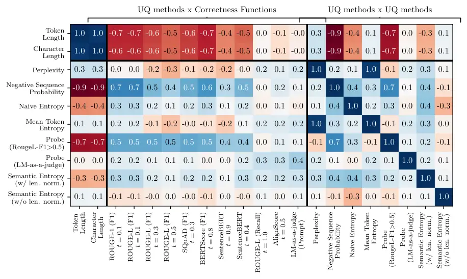

# Revisiting Uncertainty Quantification Evaluation in Language Models: Spurious Interactions with Response Length Bias Results

Andrea Santilli ^(†)^(†)thanks: Equal contribution^(†)^(†)thanks: Work
done during an internship at Apple. Affiliation: Sapienza University
Affiliation: of Rome    Adam Goliński¹¹footnotemark: 1
Affiliation: Apple    Michael Kirchhof Affiliation: Apple    Federico
Danieli Affiliation: Apple    Arno Blaas Affiliation: Apple    Miao
Xiong²²footnotemark: 2 Affiliation: National University Affiliation: of
Singapore    Luca Zappella Affiliation: Apple    Sinead Williamson
Affiliation: Apple

###### Abstract

Uncertainty Quantification (UQ) in Language Models (LMs) is key to
improving their safety and reliability. Evaluations often use metrics
like AUROC to assess how well UQ methods (e.g., negative sequence
probabilities) correlate with task correctness functions (e.g.,
ROUGE-L). We show that mutual biases-when both UQ methods and
correctness functions are biased by the same factors-systematically
distort evaluation. First, we formally prove that any mutual bias
non-randomly skews AUROC rankings, compromising benchmark integrity.
Second, we confirm this happens empirically by testing 7 widely used
correctness functions, from lexical-based and embedding-based metrics to
LM-as-a-judge approaches, across 4 datasets $`\times`$ 4 models
$`\times`$ 8 UQ methods. Our analysis shows that length biases in
correctness functions distort UQ assessments by interacting with length
biases in UQ methods. We identify LM-as-a-judge methods as the least
length-biased, offering a promising path for a fairer UQ evaluation.

## 1 Introduction

Language Models (LMs) excel at natural language generation but often
produce factually incorrect outputs, or “hallucinations” (Guerreiro
et al., 2023; Huang et al., 2025). These hallucinations are typically
associated with high uncertainty about the correct output (Xiao and
Wang, 2021), leading to the emergence of Uncertainty Quantification (UQ)
methods as a compelling approach to detect errors Farquhar et al.
(2024); Baan et al. (2023). A fundamental challenge in evaluating UQ
methods is the lack of ground truth uncertainty labels. Consequently,
benchmarks commonly rely on UQ performance metrics such as AUROC,
assessing how effectively UQ methods distinguish correct from incorrect
outputs as determined by a correctness function. Thus, the accuracy and
reliability of UQ evaluations inherently depend on the quality of the
correctness assessments.

In this paper, we critically analyze how errors and biases in
correctness functions impact UQ performance metrics. First, we provide a
formal analysis showing that: i) if errors in the correctness function
are random and independent from the UQ method, AUROC is noisy but
unbiased; ii) conversely, if there exists a mutual bias—i.e. if the
correctness function errors correlate systematically with the
uncertainty scores—then AUROC rankings are inherently skewed. Our formal
results demonstrate that any mutual bias introduces systematic
distortions into AUROC evaluations, artificially advantaging certain
methods and fundamentally undermining the reliability of benchmarks.

We confirm this happens empirically by benchmarking 7 widely-used
correctness functions, including lexical-based metrics (e.g., ROUGE
metrics (Lin, 2004)), embedding-based metrics (e.g., BERTScore Zhang
et al. (2020)), and LM-as-a-judge approaches (Zheng et al., 2024) across
4 datasets $`\times`$ 4 models $`\times`$ 8 UQ methods. We reveal two
key issues: (i) the correctness function choice significantly impacts UQ
results and (ii) widely used lexical-based and embedding-based
correctness functions Farquhar et al. (2024); Fadeeva et al. (2023)
introduce systematic biases that distort the perceived effectiveness of
certain UQ methods.

A human evaluation of 450 LM samplesreveals that this bias stems, at
least in part, from the mutual dependence of certain UQ methods and
correctness functions on the output length. Building on this, we
identify correctness functions that mitigate bias by avoiding such
confounding, finding LM-as-a-judge approaches best suited for UQ
evaluation and most aligned with human judgment. Overall, this study
highlights widespread pitfalls in UQ evaluation and charts a path toward
a more reliable evaluation protocol.

## 2 Evaluating uncertainty

In this section, we review common UQ methods, correctness functions and
UQ performance metrics.

### 2.1 UQ methods

Given an input $`x`$ to an LM, which generates an output sequence
$`\hat{y}`$, a UQ method estimates a measure of the model’s uncertainty
about $`\hat{y}`$, denoted as $`\hat{g}(\hat{y},x)`$. These methods can
be broadly categorized into three types: (i) single-sample, (ii)
multi-sample, and (iii) learned. One simple single-sample approach is
negative sequence probability,

```math
\textstyle\hat{g}(\hat{y},x)=-\hat{p}(\hat{y}|x)=-\prod_{i=1}^{L}\hat{p}(\hat{y}_{i}|\hat{y}_{<i},x), \tag{1}
```

where $`L`$ is the length of the generated answer and $`\hat{p}`$ the
output probabilities assigned by the model. Note that in Eq. 1,
$`\hat{g}`$ increases with $`L`$. Multiple-sample approaches derive
uncertainty scores by sampling multiple responses for the same input
$`x`$ and measuring a metric (e.g., variance) across samples. Notably,
several UQ methods in this second group, like Naïve Entropy and Semantic
Entropy Farquhar et al. (2024), use Eq. 1 to compute the probability of
a sequence of generated tokens. Lastly, learned methods train a binary
classifier via supervised learning on a correctness-labeled dataset
Kadavath et al. (2022). We refer readers to App. A for more details on
each family.

Figure 1: $`\widehat{AUROC}`$ of various UQ methods across correctness
functions averaged over models and datasets. The ranking of UQ methods
(top row) changes across correctness functions, raising questions about
which one to trust.

### 2.2 Correctness functions

Correctness functions $`\hat{h}(\hat{y},x,y)`$ compare a generated
answer $`\hat{y}`$ to a reference answer $`y`$ to estimate a correctness
score, and can be categorized as lexical-based, embedding-based, or
LM-as-a-judge.

#### Lexical-based

correctness functions, such as SQuAD (Rajpurkar et al., 2016) and ROUGE
variants (Lin, 2004), are based on lexical overlap between $`\hat{y}`$
and $`y`$. While limitations of these metrics have been studied in areas
like summarization and Question Answering (QA) Guo and Vosoughi (2023);
Chen et al. (2019); Cohan and Goharian (2016); Fabbri et al. (2021);
Reiter and Belz (2009), their impact on UQ evaluation remains largely
unexplored.

#### Embedding-based

correctness functions, such as BERTScore Zhang et al. (2020) and
SentenceBERT cosine similarity Reimers and Gurevych (2019), assess
similarity by encoding both $`\hat{y}`$ and $`y`$ using a language
model, typically BERT-based.

#### LM-as-a-judge

correctness functions evaluate correctness by using another LM to judge
the accuracy of $`\hat{y}`$ against $`y`$. Examples include AlignScore
Zha et al. (2023), which uses a specifically trained LM, and
prompt-based variants of LM-as-a-judge Zheng et al. (2024).

####

Table 1summarizes common correctness functions used in recent UQ papers.
AUROC requires binary labels, so a certain threshold $`t`$ is typically
applied to binarize continuous correctness scores. Some correctness
functions are inherently binary (e.g., LM-as-a-judge), and some UQ
performance metrics do not require binarization Fadeeva et al. (2023).
This variety in UQ eval protocols raises questions about which
combination to trust. App. B offers a broader view on each metric.

|                        |                                           |                 |
| ---------------------- | ----------------------------------------- | --------------- |
| Correctness function   | Used in UQ eval protocol                  | Threshold $`t`$ |
| ROUGE-1 (F1)           | Aichberger et al. (2025)                  | $`0.1-1.0`$     |
| ROUGE-L (F1)           | Fadeeva et al. (2023); Kuhn et al. (2023) | $`0.5`$         |
|                        | Duan et al. (2024); Chen et al. (2024a)   | $`0.5`$         |
|                        | Qiu and Miikkulainen (2024)               | $`0.1-1.0`$     |
|                        | Aichberger et al. (2025)                  | $`0.1-1.0`$     |
| SQuAD (F1)             | Farquhar et al. (2024)                    | $`0.3`$         |
| BERTScore (F1)         | Fadeeva et al. (2023)                     | N/A             |
| SentenceBERT           | Chen et al. (2024a)                       | $`0.9`$         |
| AlignScore             | Vashurin et al. (2025)                    | $`0.5`$         |
| LM-as-a-judge (Prompt) | Farquhar et al. (2024)                    | N/A             |

Table 1: Correctness functions used in UQ evals.

### 2.3 UQ performance metrics

The utility of UQ methods is typically assessed using a UQ performance
metric that quantifies how well uncertainty estimates (§2.1) correlate
with correctness. Among the various UQ performance metrics available in
the literature Malinin and Gales (2020); Fadeeva et al. (2023), we focus
on the Area Under the Receiver Operating Characteristic curve (AUROC)
due to its widespread use in UQ benchmarks Farquhar et al. (2024); Chen
et al. (2024a).

Let $`\hat{g}_{i}\equiv\hat{g}(\hat{y_{i}},x_{i})`$ be the uncertainty
score assigned by some UQ method to the $`i`$-th data sample, and let
$`h_{i}`$ be a binary label denoting (ground truth) correctness of that
data sample ($`h_{i}=1`$ if correct, $`h_{i}=0`$ if incorrect). AUROC
can be written as

```math
\text{AUROC}=P\left(\hat{g}_{i}<\hat{g}_{j}\mid h_{i}=1,\;h_{j}=0\right), \tag{2}
```

i.e., the probability that a randomly chosen _correct_ data sample
receives a lower uncertainty score than a randomly chosen _incorrect_
data sample.

Figure 2: Cohen Kappa agreement rates between annotators and correctness
functions. Per dataset: Fig. 6.

### 2.4 Mutual biases in UQ performance metric

In practice, we estimate $`h_{i}`$ using a correctness function
$`\hat{h}_{i}\equiv\hat{h}(\hat{y}_{i},x_{i},y_{i})`$ from §2.2. This
means that AUROC is not computed on ground-truth labels, but rather on a
potentially biased surrogate:

```math
\widehat{\text{AUROC}}=P\left(\hat{g}_{i}<\hat{g}_{j}\mid\hat{h}_{i}=1,\;\hat{h}_{j}=0\right). \tag{3}
```

Eq. 3highlights a key challenge: the measured performance is merely an
estimate of the true AUROC and is subject to correctness function
errors, which can interact with and distort the final outcome.
Specifically, two scenarios may arise:  
i) Uncorrelated errors. If errors in $`\hat{h}`$ are independent of
$`\hat{g}`$, $`\widehat{\text{AUROC}}`$ is a noisy but unbiased
estimator of the real AUROC. While scores, in the worst case, regress
toward the 0.5 random baseline, no UQ method is systematically favored
or penalized.  
ii) Mutually biased errors. If errors in $`\hat{h}`$ correlate with
$`\hat{g}`$, the estimated performance of $`\hat{g}`$ will be
systematically biased. Depending on the direction of correlation, some
UQ methods may appear more or less effective than they truly are—leading
to inflated or deflated evaluations and ultimately compromising the
validity of performance comparisons. These two scenarios are formally
characterized and analyzed in App. C, which provides a theoretical
foundation for understanding how correctness function errors propagate
into UQ performance metrics.

In practice, in §3 we find that both UQ methods and correctness
functions can exhibit biases over the answer length $`L`$, falling into
scenario (ii). Understanding the impact of these biases is crucial to
ensuring fair and reliable comparisons in UQ.

Figure 3: Cohen Kappa score w.r.t. human annotators for Rouge-L (F1)
against thresholds.



Figure 4: Spearman’s rank correlation coefficients.

## 3 Experiments

In this section, we evaluate several UQ methods following evaluation
protocols in line with previous related works (Lin et al., 2024; Fadeeva
et al., 2023; Farquhar et al., 2024) while varying just the correctness
function. We consider generative QA tasks, as they are standard in UQ
literature and their single-answer format simplifies correctness
evaluation relative to more open-ended tasks like summarization.

#### Experimental setup.

We evaluate the performance of 8 UQ methods across 4 datasets, 4 models,
and 7 correctness functions. For details, see: App. A on UQ methods;
App. B on correctness functions; App. D on models, datasets and prompts.

### 3.1 Impact of the correctness function on UQ

Fig. 1 illustrates the estimated performance of different UQ methods
when varying only the correctness function. For each method, we report
average $`\widehat{\text{AUROC}}`$ across datasets and models, focusing
on the most commonly used correctness functions from Table 1. Fig. 1
reveals that changing the correctness function affects not only the
estimated AUROC value but also the ranking of UQ methods. This, however,
raises the question of which metric to trust and what is causing the
disagreement.

### 3.2 Evaluating correctness functions for UQ

The previous section shows how correctness functions choices impact
benchmarking conclusions, but it is unclear which function yields
reliable UQ results. To investigate, we evaluate several correctness
functions against human annotations (four annotators per sample for 450
samples, see App. E). The Cohen’s Kappa Cohen (1960); Artstein and
Poesio (2008) values in Fig. 2¹¹ 1 Some approaches show no agreement at
all due to poor thresholding choices. show that LM-as-a-judge approaches
(prompt-based and AlignScore) align best with human labelers, followed
by ROUGE-L (Recall) with $`t\!=\!1`$.

Revisiting Fig. 1, we see that these three correctness functions show
more stable orderings, with some variability in AUROC
magnitudes—consistent with expectations for small errors that are mostly
uncorrelated with UQ methods, as per case (i) in §2.4. Conversely, most
previously-used lexical- and embedding-based correctness functions
poorly reflect human judgment.

#### Impact of threshold choice.

A major source of error in lexical- and embedding-based correctness
functions stems from the thresholding strategy used to binarize scores
for AUROC computation. As shown in Table 1, prior work often applies
standard thresholds or experiments with a small set of options. However,
Figs. 2 and 3 illustrate that metrics like ROUGE-L (F1) and SentenceBERT
are highly sensitive to threshold choices, as assessed by the resulting
agreement with humans. Poor thresholding can lead to degenerate
outcomes—e.g., assigning nearly identical labels to all
predictions—which drastically reduces alignment with human annotators.
The issue is further exacerbated by the fact that optimal thresholds
vary across tasks (Figs. 3 and 8) and are heavily influenced by response
verbosity (Fig. 5), making it challenging to select a single effective
threshold. In contrast, metrics such as ROUGE-L Recall, AlignScore, and
LM-as-a-judge exhibit considerably less sensitivity to threshold
selection, as shown in Fig. 7 of the Appendix.

### 3.3 Mutual bias in correctness functions and UQ methods

We concluded that LM-as-a-judge approaches achieve higher agreement with
humans than other correctness functions. However, this alone does not
explain the shift in UQ method rankings observed in §3.1. If errors were
random, no systematic effect would emerge, falling into case (i) of our
error analysis (§2.4). However, this is not the case: the relative
performance of negative sequence probability, perplexity, and probes
varies dramatically. This is indicative of a spurious correlation
between UQ methods and errors in the correctness functions.

#### Many UQ methods are biased by length.

Many UQ methods explicitly or implicitly depend on the length of a
response. In particular, negative sequence probability assigns higher
uncertainty to longer responses, as each term in Eq. 1 is $`<\!1`$.
Other UQ methods that incorporate Eq. 1 in their computation (§2.1),
such as Naïve Entropy and Semantic Entropy, may also be impacted. To
investigate this relationship, we compute Spearman correlation between
the scores from various UQ methods and the length of generated answers
(measured in tokens and characters). In Fig. 4, we see that multiple
estimators exhibit significant positive or negative correlations with
length.

#### Many correctness functions are biased by length

Many correctness functions are also known to exhibit length bias when
assessing summaries Guo and Vosoughi (2023). We demonstrate that this
issue also affects QA. In Fig. 5, we analyze the relationship between
response length and correctness function output, showing correctness
values for responses where all annotators agree on the label. The
ROUGE-L (F1) score is highly dependent on response length, favoring
shorter sentences and making threshold selection challenging. In
contrast, AlignScore is length-independent and clearly separates correct
and incorrect samples. App. F presents similar findings for other
correctness functions.

(a) ROUGE-L (F1)

(b) AlignScore

Figure 5: Correctness function vs response length. The color indicates
human correctness judgments. Results for other correctness functions in
the Appendix, Fig. 7.

#### Spurious interaction.

Mutual correlation between UQ methods and correctness functions on
answer length can systematically inflate or deflate UQ performance
metrics (App. C). This effect is evident in Fig. 1, where length-based
baselines (token and character length—blue bars) perform competitively
on lexical- and embedding-based correctness functions but rank last
under LM-as-a-judge metrics. This may also explain discrepancies in
prior works, such as the inflated ranking of negative sequence
probability in Fadeeva et al. (2023). We recommend using LM-as-a-judge
where possible, as its lower error is less likely to impact UQ
performance metrics. While ROUGE-L (Recall) is inherently independent of
the generated answer’s length, it offers lower correlation with human
judgment, leading to noisier AUROC estimates and offering a higher
likelihood of additional confounding variables. For example, it is
vulnerable to exploitation by models that produce multiple off-target
answers alongside the correct one.

## 4 Beyond Length Bias

In this paper, we argue that any biases—not just length—present
simultaneously in both the UQ method and the correctness function induce
a spurious correlation that systematically biases the UQ performance
metric (AUROC). Crucially, this effect does not merely introduce random
noise (i.e., increased variance) to the AUROC estimate; rather, it leads
to consistent bias, producing misleading results that can artificially
favor certain UQ methods over others. We support this claim through both
analytical derivation (App. C) and empirical evidence (Fig. 1).
Importantly, this is a general result. While we use length bias as a
running example—because it is is the most severe and already impacting
benchmarks—the underlying issue extends to any confounding variable that
correlates with both UQ methods correctness functions. Identifying such
confounders, which are less obvious than length, is inherently
difficult, which makes their presence particularly dangerous for
evaluation protocols. For instance, in settings that combine
LM-as-a-judge approaches with verbalized uncertainty methods (e.g.,
Huang et al. (2024); Band et al. (2024); Yang et al. (2024)), one might
hypothesize less obvious and harder-to-detect sources of confounding
like vocabulary used or writing style of the response Feuer et al.
(2025). Our goal is not to enumerate all possible biases but to
establish the existence of a broader class of systematic evaluation
failures—of which length bias is a concrete and empirically validated
case. Identifying and mitigating other such biases remains an important
direction for future work.

## 5 Conclusion

We prove that UQ performance metrics are systematically biased when the
UQ method and correctness function share a confounder. Empirically, we
identify response length as a concrete instance of such mutual bias
which is affecting existing benchmarks and undermines their reliability.

Our results highlight that lexical- and embedding-based correctness
functions, commonly used in prior work, frequently introduce these
distortions. In contrast, LM-as-a-judge approaches exhibit greater
robustness and stronger alignment with human judgments, making them a
more reliable choice for UQ evaluation. That said, we recommend
validating any LM-as-a-judge setup against human annotations before
applying it to new tasks or datasets Bavaresco et al. (2024).

## Limitations

In this work, we critically examine the role of the correctness function
in the evaluation of UQ methods using UQ performance metrics. While our
analysis sheds light on biases introduced by correctness functions,
certain limitations remain.

Our analysis is focused on the context of QA, as it is a standard task
in UQ literature and provides well-defined single-answer questions,
making the definition of a correctness function easier compared to
open-ended tasks like machine translation and summarization where even
objective human judgment of correctness is difficult. However, previous
work suggests that the length bias of errors in correctness functions is
not unique to the QA setting (Guo and Vosoughi, 2023), suggesting that
UQ performance metrics will face similar issues in such tasks.

Our recommendation is to use LM-as-a-judge as a potential correctness
function. While using another LM to judge correctness has demonstrated
advantages Zheng et al. (2024), it also comes with known limitations
Wang et al. (2024); Chen et al. (2024b). The reliability of the
correctness assessment may vary depending on the choice of the judging
LM and the prompt formulation. More concerningly, if the same LM is used
as both the correctness function and as part of the UQ method, we are
likely to have correlations between the LM-as-a-judge’s errors and the
UQ method, which could inflate the UQ method’s performance—although this
is mitigated by the relatively low frequency of such errors.
Additionally, while our analysis on QA is based on widely used QA
datasets, we do not know whether the same LM judge and prompts would
generalize effectively to other tasks and datasets. Ideally, an LM judge
should be rigorously evaluated against human annotators before being
employed in new tasks and datasets Bavaresco et al. (2024). Furthermore,
LM-as-a-judge introduces significant computational overhead compared to
traditional correctness functions, making it less practical for
resource-constrained applications.

Finally, our study identifies response length as a confounding factor in
UQ benchmarking, but other latent variables may also influence UQ
methods and correctness functions in subtle ways, as discussed in
App. C. A deeper understanding of these biases is crucial for refining
UQ evaluation protocols and ensuring more reliable assessments of model
uncertainty.

## Acknowledgements

We would like to thank Xavier Suau, Miguel Sarabia, Pau Rodríguez, and
Eugene Ndiaye for their feedback on an earlier draft of this manuscript.

## References

- Aichberger et al. (2025) Lukas Aichberger, Kajetan Schweighofer,
  Mykyta Ielanskyi, and Sepp Hochreiter. 2025. [Improving uncertainty
  estimation through semantically diverse language
  generation](https://openreview.net/forum?id=HSi4VetQLj). In
  _International Conference on Learning Representations_.
- Artstein and Poesio (2008) Ron Artstein and Massimo Poesio. 2008.
  [Survey article: Inter-coder agreement for computational
  linguistics](https://doi.org/10.1162/coli.07-034-R2). _Computational
  Linguistics_, 34(4):555–596.
- Baan et al. (2023) Joris Baan, Nico Daheim, Evgenia Ilia, Dennis
  Ulmer, Haau-Sing Li, Raquel Fernández, Barbara Plank, Rico Sennrich,
  Chrysoula Zerva, and Wilker Aziz. 2023. [Uncertainty in natural
  language generation: From theory to
  applications](https://arxiv.org/abs/2307.15703). _arXiv preprint
  arXiv:2307.15703_.
- Bahl et al. (1983) Lalit R. Bahl, Frederick Jelinek, and Robert L.
  Mercer. 1983. [A maximum likelihood approach to continuous speech
  recognition](https://doi.org/10.1109/TPAMI.1983.4767370). _IEEE
  Transactions on Pattern Analysis and Machine Intelligence_,
  PAMI-5(2):179–190.
- Band et al. (2024) Neil Band, Xuechen Li, Tengyu Ma, and Tatsunori
  Hashimoto. 2024. [Linguistic calibration of long-form
  generations](https://arxiv.org/abs/2404.00474). In _International
  Conference on Machine Learning_.
- Bavaresco et al. (2024) Anna Bavaresco, Raffaella Bernardi, Leonardo
  Bertolazzi, Desmond Elliott, Raquel Fernández, Albert Gatt, Esam
  Ghaleb, Mario Giulianelli, Michael Hanna, Alexander Koller, André
  F. T. Martins, Philipp Mondorf, Vera Neplenbroek, Sandro Pezzelle,
  Barbara Plank, David Schlangen, Alessandro Suglia, Aditya K Surikuchi,
  Ece Takmaz, and Alberto Testoni. 2024. [LLMs instead of human judges?
  a large scale empirical study across 20 NLP evaluation
  tasks](https://arxiv.org/abs/2406.18403). _Preprint_,
  arXiv:2406.18403.
- Chen et al. (2019) Anthony Chen, Gabriel Stanovsky, Sameer Singh, and
  Matt Gardner. 2019. [Evaluating question answering
  evaluation](https://doi.org/10.18653/v1/D19-5817). In _2nd Workshop on
  Machine Reading for Question Answering_, pages 119–124.
- Chen et al. (2024a) Chao Chen, Kai Liu, Ze Chen, Yi Gu, Yue Wu,
  Mingyuan Tao, Zhihang Fu, and Jieping Ye. 2024a. [INSIDE: LLMs’
  internal states retain the power of hallucination
  detection](https://openreview.net/forum?id=Zj12nzlQbz). In
  _International Conference on Learning Representations_.
- Chen et al. (2024b) Guiming Hardy Chen, Shunian Chen, Ziche Liu, Feng
  Jiang, and Benyou Wang. 2024b. [Humans or LLMs as the judge? a study
  on judgement bias](https://doi.org/10.18653/v1/2024.emnlp-main.474).
  In _Empirical Methods in Natural Language Processing_.
- Cohan and Goharian (2016) Arman Cohan and Nazli Goharian. 2016.
  [Revisiting summarization evaluation for scientific
  articles](https://aclanthology.org/L16-1130/). In _International
  Conference on Language Resources and Evaluation_.
- Cohen (1960) Jacob Cohen. 1960. A coefficient of agreement for nominal
  scales. _Educational and psychological measurement_, 20(1):37–46.
- Duan et al. (2024) Jinhao Duan, Hao Cheng, Shiqi Wang, Alex Zavalny,
  Chenan Wang, Renjing Xu, Bhavya Kailkhura, and Kaidi Xu. 2024.
  [Shifting attention to relevance: Towards the predictive uncertainty
  quantification of free-form large language
  models](https://doi.org/10.18653/v1/2024.acl-long.276). In
  _Proceedings of the 62nd Annual Meeting of the Association for
  Computational Linguistics (Volume 1: Long Papers)_.
- Fabbri et al. (2021) Alexander R Fabbri, Wojciech Kryściński, Bryan
  McCann, Caiming Xiong, Richard Socher, and Dragomir Radev. 2021.
  Summeval: Re-evaluating summarization evaluation. _Transactions of the
  Association for Computational Linguistics_, 9:391–409.
- Fadeeva et al. (2023) Ekaterina Fadeeva, Roman Vashurin, Akim Tsvigun,
  Artem Vazhentsev, Sergey Petrakov, Kirill Fedyanin, Daniil Vasilev,
  Elizaveta Goncharova, Alexander Panchenko, Maxim Panov, Timothy
  Baldwin, and Artem Shelmanov. 2023. [LM-polygraph: Uncertainty
  estimation for language
  models](https://aclanthology.org/2023.emnlp-demo.41.pdf). In
  _Empirical Methods in Natural Language Processing: System
  Demonstrations_.
- Farquhar et al. (2024) Sebastian Farquhar, Jannik Kossen, Lorenz Kuhn,
  and Yarin Gal. 2024. [Detecting hallucinations in large language
  models using semantic
  entropy](https://www.nature.com/articles/s41586-024-07421-0).
  _Nature_, 630(8017):625–630.
- Feuer et al. (2025) Benjamin Feuer, Micah Goldblum, Teresa Datta,
  Sanjana Nambiar, Raz Besaleli, Samuel Dooley, Max Cembalest, and
  John P. Dickerson. 2025. [Style outweighs substance: Failure modes of
  LLM judges in alignment
  benchmarking](https://arxiv.org/abs/2409.15268). _Preprint_,
  arXiv:2409.15268.
- Fomicheva et al. (2020) Marina Fomicheva, Shuo Sun, Lisa Yankovskaya,
  Frédéric Blain, Francisco Guzmán, Mark Fishel, Nikolaos Aletras,
  Vishrav Chaudhary, and Lucia Specia. 2020. [Unsupervised quality
  estimation for neural machine
  translation](https://aclanthology.org/2020.tacl-1.35.pdf).
  _Transactions of the Association for Computational Linguistics_,
  8:539–555.
- Guerreiro et al. (2023) Nuno M Guerreiro, Duarte M Alves, Jonas
  Waldendorf, Barry Haddow, Alexandra Birch, Pierre Colombo, and
  André FT Martins. 2023. [Hallucinations in large multilingual
  translation models](https://aclanthology.org/2023.tacl-1.85/).
  _Transactions of the Association for Computational Linguistics_,
  11:1500–1517.
- Guo and Vosoughi (2023) Xiaobo Guo and Soroush Vosoughi. 2023. [Length
  does matter: Summary length can bias summarization
  metrics](https://doi.org/10.18653/v1/2023.emnlp-main.984). In
  _Empirical Methods in Natural Language Processing_.
- Huang et al. (2025) Lei Huang, Weijiang Yu, Weitao Ma, Weihong Zhong,
  Zhangyin Feng, Haotian Wang, Qianglong Chen, Weihua Peng, Xiaocheng
  Feng, Bing Qin, and Ting Liu. 2025. [A survey on hallucination in
  large language models: Principles, taxonomy, challenges, and open
  questions](https://doi.org/10.1145/3703155). _ACM Trans. Inf. Syst._,
  43(2).
- Huang et al. (2024) Yukun Huang, Yixin Liu, Raghuveer Thirukovalluru,
  Arman Cohan, and Bhuwan Dhingra. 2024. [Calibrating long-form
  generations from large language
  models](https://doi.org/10.18653/v1/2024.findings-emnlp.785). In
  _Findings of the Association for Computational Linguistics: EMNLP
  2024_.
- Ielanskyi et al. (2025) Mykyta Ielanskyi, Kajetan Schweighofer, Lukas
  Aichberger, and Sepp Hochreiter. 2025. [Addressing pitfalls in the
  evaluation of uncertainty estimation methods for natural language
  generation](https://openreview.net/forum?id=hbIpwrdfE1). _ICLR
  Workshop: Quantify Uncertainty and Hallucination in Foundation Models:
  The Next Frontier in Reliable AI_.
- Jiang et al. (2023) Albert Q Jiang, Alexandre Sablayrolles, Arthur
  Mensch, Chris Bamford, Devendra Singh Chaplot, Diego de las Casas,
  Florian Bressand, Gianna Lengyel, Guillaume Lample, Lucile Saulnier,
  et al. 2023. [Mistral 7b](https://arxiv.org/abs/2310.06825). _arXiv
  preprint arXiv:2310.06825_.
- Joshi et al. (2017) Mandar Joshi, Eunsol Choi, Daniel Weld, and Luke
  Zettlemoyer. 2017. [TriviaQA: A large scale distantly supervised
  challenge dataset for reading
  comprehension](https://aclanthology.org/P17-1147/). In _Association
  for Computational Linguistics (Volume 1: Long Papers)_.
- Kadavath et al. (2022) Saurav Kadavath, Tom Conerly, Amanda Askell,
  Tom Henighan, Dawn Drain, Ethan Perez, Nicholas Schiefer, Zac
  Hatfield-Dodds, Nova DasSarma, Eli Tran-Johnson, Scott Johnston, Sheer
  El-Showk, Andy Jones, Nelson Elhage, Tristan Hume, Anna Chen, Yuntao
  Bai, Sam Bowman, Stanislav Fort, Deep Ganguli, Danny Hernandez, Josh
  Jacobson, Jackson Kernion, Shauna Kravec, Liane Lovitt, Kamal Ndousse,
  Catherine Olsson, Sam Ringer, Dario Amodei, Tom Brown, Jack Clark,
  Nicholas Joseph, Ben Mann, Sam McCandlish, Chris Olah, and Jared
  Kaplan. 2022. [Language models (mostly) know what they
  know](https://arxiv.org/abs/2207.05221). _arXiv preprint
  arXiv:2207.05221_.
- Kapoor et al. (2024) Sanyam Kapoor, Nate Gruver, Manley Roberts,
  Katherine Collins, Arka Pal, Umang Bhatt, Adrian Weller, Samuel
  Dooley, Micah Goldblum, and Andrew Gordon Wilson. 2024. [Large
  language models must be taught to know what they don’t
  know](https://openreview.net/forum?id=QzvWyggrYB). In _Neural
  Information Processing Systems_.
- Kuhn et al. (2023) Lorenz Kuhn, Yarin Gal, and Sebastian
  Farquhar. 2023. [Semantic uncertainty: Linguistic invariances for
  uncertainty estimation in natural language
  generation](https://openreview.net/pdf?id=VD-AYtP0dve). _International
  Conference on Learning Representations_.
- Lee et al. (2019) Kenton Lee, Ming-Wei Chang, and Kristina
  Toutanova. 2019. [Latent retrieval for weakly supervised open domain
  question answering](https://aclanthology.org/P19-1612.pdf). In
  _Association for Computational Linguistics_.
- Lin (2004) Chin-Yew Lin. 2004. [ROUGE: A package for automatic
  evaluation of summaries](https://www.aclweb.org/anthology/W04-1013).
  In _Text Summarization Branches Out_, pages 74–81, Barcelona, Spain.
  Association for Computational Linguistics.
- Lin et al. (2024) Zhen Lin, Shubhendu Trivedi, and Jimeng Sun. 2024.
  [Generating with confidence: Uncertainty quantification for black-box
  large language models](https://openreview.net/forum?id=DWkJCSxKU5).
  _Transations on Machine Learning Research_.
- Liu et al. (2019) Yinhan Liu, Myle Ott, Naman Goyal, Jingfei Du,
  Mandar Joshi, Danqi Chen, Omer Levy, Mike Lewis, Luke Zettlemoyer, and
  Veselin Stoyanov. 2019. [Roberta: A robustly optimized bert
  pretraining approach](https://arxiv.org/abs/1907.11692). _arXiv
  preprint arXiv:1907.11692_.
- Malinin and Gales (2020) Andrey Malinin and Mark Gales. 2020.
  [Uncertainty estimation in autoregressive structured
  prediction](https://arxiv.org/abs/2002.07650). _arXiv preprint
  arXiv:2002.07650_.
- Penedo et al. (2023) Guilherme Penedo, Quentin Malartic, Daniel
  Hesslow, Ruxandra Cojocaru, Hamza Alobeidli, Alessandro Cappelli,
  Baptiste Pannier, Ebtesam Almazrouei, and Julien Launay. 2023. [The
  refinedweb dataset for falcon llm: Outperforming curated corpora with
  web data
  only](https://openreview.net/forum?id=kM5eGcdCzq&noteId=tBNWnP3L0c).
  _Advances in Neural Information Processing Systems_.
- Qiu and Miikkulainen (2024) Xin Qiu and Risto Miikkulainen. 2024.
  [Semantic density: Uncertainty quantification for large language
  models through confidence measurement in semantic
  space](https://openreview.net/forum?id=LOH6qzI7T6). In _Neural
  Information Processing Systems_.
- Qwen et al. (2025) Qwen, :, An Yang, Baosong Yang, Beichen Zhang,
  Binyuan Hui, Bo Zheng, Bowen Yu, Chengyuan Li, Dayiheng Liu, Fei
  Huang, Haoran Wei, Huan Lin, Jian Yang, Jianhong Tu, Jianwei Zhang,
  Jianxin Yang, Jiaxi Yang, Jingren Zhou, Junyang Lin, Kai Dang, Keming
  Lu, Keqin Bao, Kexin Yang, Le Yu, Mei Li, Mingfeng Xue, Pei Zhang, Qin
  Zhu, Rui Men, Runji Lin, Tianhao Li, Tianyi Tang, Tingyu Xia,
  Xingzhang Ren, Xuancheng Ren, Yang Fan, Yang Su, Yichang Zhang,
  Yu Wan, Yuqiong Liu, Zeyu Cui, Zhenru Zhang, and Zihan Qiu. 2025.
  [Qwen2.5 technical report](https://arxiv.org/abs/2412.15115).
  _Preprint_, arXiv:2412.15115.
- Rajpurkar et al. (2016) Pranav Rajpurkar, Jian Zhang, Konstantin
  Lopyrev, and Percy Liang. 2016. [SQuAD: 100,000+ questions for machine
  comprehension of text](https://doi.org/10.18653/v1/D16-1264). In
  _Empirical Methods in Natural Language Processing_.
- Reimers and Gurevych (2019) Nils Reimers and Iryna Gurevych. 2019.
  [Sentence-BERT: Sentence embeddings using Siamese
  BERT-networks](https://doi.org/10.18653/v1/D19-1410). In _Proceedings
  of the 2019 Conference on Empirical Methods in Natural Language
  Processing and the 9th International Joint Conference on Natural
  Language Processing (EMNLP-IJCNLP)_.
- Reiter and Belz (2009) Ehud Reiter and Anja Belz. 2009. [An
  investigation into the validity of some metrics for automatically
  evaluating natural language generation
  systems](https://doi.org/10.1162/coli.2009.35.4.35405). _Computational
  Linguistics_, 35(4):529–558.
- Vashurin et al. (2025) Roman Vashurin, Ekaterina Fadeeva, Artem
  Vazhentsev, Lyudmila Rvanova, Akim Tsvigun, Daniil Vasilev, Rui Xing,
  Abdelrahman Boda Sadallah, Kirill Grishchenkov, Sergey Petrakov,
  Alexander Panchenko, Timothy Baldwin, Preslav Nakov, Maxim Panov, and
  Artem Shelmanov. 2025. [Benchmarking uncertainty quantification
  methods for large language models with
  lm-polygraph](https://arxiv.org/abs/2406.15627). _Preprint_,
  arXiv:2406.15627.
- Von Werra et al. (2022) Leandro Von Werra, Lewis Tunstall, Abhishek
  Thakur, Sasha Luccioni, Tristan Thrush, Aleksandra Piktus, Felix
  Marty, Nazneen Rajani, Victor Mustar, and Helen Ngo. 2022. [Evaluate &
  evaluation on the hub: Better best practices for data and model
  measurements](https://doi.org/10.18653/v1/2022.emnlp-demos.13). In
  _Empirical Methods in Natural Language Processing: System
  Demonstrations_.
- Wang et al. (2024) Peiyi Wang, Lei Li, Liang Chen, Zefan Cai, Dawei
  Zhu, Binghuai Lin, Yunbo Cao, Lingpeng Kong, Qi Liu, Tianyu Liu, and
  Zhifang Sui. 2024. [Large language models are not fair
  evaluators](https://doi.org/10.18653/v1/2024.acl-long.511). In
  _Association for Computational Linguistics (Volume 1: Long Papers)_.
- Wei et al. (2024) Jason Wei, Nguyen Karina, Hyung Won Chung,
  Yunxin Joy Jiao, Spencer Papay, Amelia Glaese, John Schulman, and
  William Fedus. 2024. [Measuring short-form factuality in large
  language models](https://arxiv.org/abs/2411.04368). _Preprint_,
  arXiv:2411.04368.
- Xiao and Wang (2021) Yijun Xiao and William Yang Wang. 2021. [On
  hallucination and predictive uncertainty in conditional language
  generation](https://aclanthology.org/2021.eacl-main.236/). In
  _European Chapter of the Association for Computational Linguistics_.
- Yang et al. (2024) Ruihan Yang, Caiqi Zhang, Zhisong Zhang, Xinting
  Huang, Sen Yang, Nigel Collier, Dong Yu, and Deqing Yang. 2024. [Logu:
  Long-form generation with uncertainty
  expressions](https://arxiv.org/abs/2410.14309). _arXiv preprint
  arXiv:2410.14309_.
- Zha et al. (2023) Yuheng Zha, Yichi Yang, Ruichen Li, and Zhiting
  Hu. 2023. [AlignScore: Evaluating factual consistency with a unified
  alignment function](https://doi.org/10.18653/v1/2023.acl-long.634). In
  _Association for Computational Linguistics (Volume 1: Long Papers)_.
- Zhang et al. (2020) Tianyi Zhang, Varsha Kishore, Felix Wu, Kilian Q.
  Weinberger, and Yoav Artzi. 2020. [Bertscore: Evaluating text
  generation with bert](https://openreview.net/forum?id=SkeHuCVFDr). In
  _International Conference on Learning Representations_.
- Zheng et al. (2024) Lianmin Zheng, Wei-Lin Chiang, Ying Sheng, Siyuan
  Zhuang, Zhanghao Wu, Yonghao Zhuang, Zi Lin, Zhuohan Li, Dacheng Li,
  Eric P. Xing, Hao Zhang, Joseph E. Gonzalez, and Ion Stoica. 2024.
  [Judging llm-as-a-judge with mt-bench and chatbot
  arena](https://dl.acm.org/doi/10.5555/3666122.3668142). In _Neural
  Information Processing Systems_.

## Appendix A Details of UQ methods

There are several methods for generating uncertainty estimates that help
assess the in-correctness of LM outputs. These approaches can be broadly
classified into three main categories: 1) Single-sample methods: methods
that require a single forward pass from the model and that generally use
directly the logits and probability distributions over the vocabulary
space provided as output from the model; 2) Multiple-sample methods:
methods that, given a prompt $`x`$, sample multiple possible outputs for
the same prompt and compute an uncertainty score based on these outputs; 3) Learned methods: usually probes or small networks directly trained to
predict the accuracy of the model given the prompt and the answer.

We denote with $`x`$ the sequence of tokens corresponding to the prompt.
This usually includes the instruction prompt (e.g., "Answer the
following question") together with the question and additional context.
The $`L`$ generated tokens are indicated as $`\hat{y}_{i}`$.
Additionally, a superscript $`\hat{y}^{(s)}`$ is used for
multiple-sample methods to indicate the $`s`$-th sample (out of
$`S_{\text{UQ}}`$ samples) sampled for a given prompt.
$`\hat{p}(\cdot)`$ denotes the probability assigned by the model.

#### Single-sample methods.

Single-sample methods estimate the uncertainty score using the logits
that the models output. These logits are usually computed on the greedy
decoded output or on a low-temperature sample decoded from the model
given the prompt $`x`$.

_Negative Sequence Probability._  Sequence probability computes the
cumulative probability of the sequence. This can be used as an
uncertainty score by flipping the sign and considering
$`-\hat{p}(\hat{y}|x)`$. When evaluated on the greedy decoding samples,
this method is sometimes referred to in the literature as Maximum
Sequence Probability (MSP) Fadeeva et al. (2023); Vashurin et al.
(2025). Aichberger et al. (2025) investigate the difference between the
performance of MSP estimated using greedy decoding and estimated using
the Beam Search decoding algorithm, which yields sequences with higher
likelihood.

```math
\hat{p}(\hat{y}|x)=\prod_{i=1}^{L}\hat{p}(\hat{y}_{i}|\hat{y}_{<i},x). \tag{4}
```

_Perplexity._  Perplexity computes the uncertainty score via the
exponential of the mean token likelihood Bahl et al. (1983). Compared to
sequence probability, perplexity normalizes the underlying probability
by the number of the generated tokens,

```math
\exp\left(-\frac{1}{L}\sum_{i=1}^{L}\log\hat{p}(\hat{y}_{i}|\hat{y}_{<i},x)\right). \tag{5}
```

_Mean Token Entropy._  Mean token entropy Fomicheva et al. (2020);
Malinin and Gales (2020) computes the mean of the per-token entropies
over the vocabulary distribution,

```math
\mathcal{H}_{T}(\hat{y},{x})=\frac{1}{L}\sum_{i=1}^{L}\mathcal{H}\left[\hat{p}(\hat{y}_{i}|\hat{y}_{<i},x)\right]. \tag{6}
```

#### Multiple-Sample methods.

Multiple-sample methods compute an uncertainty score by sampling
$`S_{\text{UQ}}`$ times for a single prompt. Since it is accessing (more
of) the full probability distribution, this class of methods should
provide better uncertainty scores than single-sample methods, albeit at
the expense of an increased computational cost at inference time. The
exact number of samples $`S_{\text{UQ}}`$ is a hyperparameter that
usually depends on the specific UQ method.

_Naive Entropy._  Naive Entropy computes the entropy over the different
generated samples. The sequence probability of each generation is
computed using the chain rule of probability, like in the Sequence
Probability method,

```math
-\sum_{s=0}^{S_{\text{UQ}}}\hat{p}(\hat{y}^{(s)}|x)\log\hat{p}(\hat{y}^{(s)}|x). \tag{7}
```

_Semantic Entropy._  Semantic entropy computes the entropy over the
different semantic clusters $`C`$ of the generated samples Farquhar
et al. (2024). Semantic clusters are generated using a Natural Language
Inference (NLI) model, which evaluates bidirectional entailment between
pairs of answers in $`S_{\text{UQ}}`$. This process group answers with
equivalent meanings into clusters $`c^{(i)}`$. Each cluster probability
$`\hat{p}(c^{(i)})`$ is computed by summing the Sequence Probabilities
of the unique generations that fall into that cluster Farquhar et al.
(2024). The probability of each generated sequence is computed using
Eq. 4, either directly for Semantic Entropy (without length
normalization), or normalized by the sequence token-length $`L`$ for
length-normalized Semantic Entropy.

```math
SE(x)=-\sum_{i=1}^{C}\hat{p}(c^{(i)}|x)\log\hat{p}(c^{(i)}|x). \tag{8}
```

#### Learned methods.

Learned methods leverage the model’s internal activations or its entire
architecture to train additional networks or classifiers that predict
the correctness of the answer.

_Probes_ are the most common form of learned method. The most prominent
variety of probe is _P(IK)_, also known as P(I Know) Kadavath et al.
(2022), which finetunes the entire model to predicts a binary score
whether the model can answer the question correctly or not. This is
accomplished by attaching a classifier to the embedding of the final
token in the last layer. The training set is collected by labeling some
generations from the model with the task correctness function. In this
paper, we follow the implementation of (Farquhar et al., 2024; Kapoor
et al., 2024) that does not train the full model but just a logistic
regression classifier on top of the representation of the final answer
token as in Chen et al. (2024a). We trained probes using two different
correctness functions: LM-as-a-judge (using Qwen/Qwen2.5-72B-Instruct),
and ROUGE-L (Recall) with a 0.5 threshold. When reporting results, we
specify the correctness function used to label the dataset and train the
probe in round brackets—for example, Probe(LM-as-a-judge), where
LM-as-a-judge denotes the judging model. Probes are trained until
convergence on each training dataset with L-BFGS and a tolerance value
of $`0.0001`$ and maximum number of optimization iterations of
$`10000`$.

## Appendix B Details of Correctness functions

In this section, we describe in detail the correctness functions used in
our experiments. Many of these metrics return a continuous score, which
is binarized for calculating AUROC; we detail the thresholds $`t`$ used
in this binarization below.

### B.1 Lexical-based

Lexical-based metrics assess similarity by measuring lexical overlap
between the generated sentence and the ground truth. These metrics are
among the most widely used due to their low computational cost and
long-standing history in QA evaluation.

####

It is important to note that these metrics were originally used to
evaluate QA in trained systems, where the output distribution of
generated sequences has been aligned with the expected distribution of
ground-truth answers in the dataset. However, in common LM zero-shot
evaluation settings, this alignment is no longer guaranteed.
Consequently, these metrics may fail to accurately assess correctness,
requiring careful consideration when applying them. While techniques
like incorporating few-shot examples, as demonstrated by Farquhar et al.
(2024), can mitigate this issue to some extent, this does not fully
address the fundamental limitations of lexical-based metrics.

#### ROUGE-L.

ROUGE-L measures the longest common subsequence (LCS) between the
generated response and the reference answer, allowing for non-contiguous
matches Lin (2004). In UQ the F1-score (_ROUGE-L (F1)_) of this metric
is typically used, balancing precision and recall (Fadeeva et al., 2023;
Kuhn et al., 2023; Duan et al., 2024; Chen et al., 2024a; Qiu and
Miikkulainen, 2024; Aichberger et al., 2025). _ROUGE-L (Precision)_
measures the ratio of the longest common subsequence (LCS) length to the
number of unigrams in the generated answer. _ROUGE-L (Recall)_ measures
the ratio of the LCS length to the number of unigrams in the reference
answer. ROUGE-L (F1) is the harmonic mean of ROUGE-L precision and
recall. It is important to note that ROUGE-L recall is not affected by
the length of the generated answer, whereas precision and F1 metrics are
influenced by it. In the experiments of this paper, we consider _ROUGE-L
(F1)_ and _ROUGE-L (Recall)_ variants, with both metrics computed using
the Python package rouge_scorer. Both ROUGE-L variants return continuous
scores; where a binary score is used, we consider thresholds
$`t\in\{0.1,0.3,0.5\}`$ for ROUGE-L (F1), and $`t=1.0`$ for ROUGE-L
(Recall).

#### ROUGE-1.

ROUGE-1 measures the unigrams overlap between the generated response and
the ground truth Lin (2004). ROUGE-1 captures similarity based on
single-tokens overlap. This metric has been widely used in QA
evaluations and in UQ benchmarks in Aichberger et al. (2025). As in
Aichberger et al. (2025), we use the F1 variant (_ROUGE-1 (F1)_). In the
experiments of this paper, the metric has been computed using the Python
package rouge_scorer. ROUGE-1 (F1) returns continuous scores; where a
binary score is used, we use a threshold $`t=0.1`$.

#### SQuAD.

This metric has been introduced in Rajpurkar et al. (2016) to measure
the performance of systems trained on the homonymous dataset. The metric
computes the F1 score based on word overlap between the prediction and
ground truth, treating them as unordered bags of tokens, selecting the
highest F1 among multiple references per question, and averaging across
all questions. This metric has been used to evaluate correctness for UQ
benchmarks in Farquhar et al. (2024). To compute the metric we used the
implementation from Von Werra et al. (2022). SQuAD returns continuous
scores; where a binary score is used, we use a threshold $`t=0.3`$.

### B.2 Embedding-based

Embedding-based metrics assess similarity by encoding both the ground
truth and generated text using a neural model, typically BERT-based. The
goal is to measure semantic similarity rather than surface-level
overlap.

#### BERTScore.

BERTScore Zhang et al. (2020) evaluates generated answers by embedding
both the generated text and the ground truth using a BERT pretrained
model. It then computes the pairwise cosine similarity between tokens.
For each token in the generated text, the highest similarity score with
any token in the reference text is selected. Finally, precision, recall,
and F1-score are calculated, with the F1-score commonly used in UQ to
balance precision and recall. This metric has been used to evaluate
correctness for UQ benchmarks in Fadeeva et al. (2023). In the
experiments of this paper, the metric has been computed using the Python
package bert_score as in Fadeeva et al. (2023). BERTScore returns
continuous scores; where a binary score is used, we use a threshold
$`t=0.8`$, which we empirically found to yield the highest agreement
with human raters in Fig. 2.

#### SentenceBERT Similarity.

A SentenceBERT model Reimers and Gurevych (2019) is used to encode both
the generated answer and the ground truth answer. Specifically,
following Chen et al. (2024a), we use nli-roberta-large²² 2
https://huggingface.co/sentence-transformers/nli-roberta-large. The
cosine similarity is then calculated between the ground truth and
generated answer embeddings. This metric has been used to evaluate
correctness for UQ benchmarks in Chen et al. (2024a). SentenceBERT
returns continuous scores; where a binary score is used, we use a
threshold $`t\in\{0.4,0.9\}`$.

### B.3 LM-as-a-judge methods

LM-as-a-judge metrics evaluate correctness by using another LM to judge
the accuracy of a generated answer against the reference answer from the
dataset. The evaluating LM may be specifically trained for this task or
not.

#### AlignScore.

AlignScore is a metric designed to evaluate the factual consistency of
generated text with respect to a ground truth answer Zha et al. (2023).
It employs a RoBERTa model (Liu et al., 2019) trained to assess the
alignment between two text pieces, determining how well the generated
content corresponds to the source information. The training process
integrates data from several NLP tasks—natural language inference,
question answering, paraphrasing, fact verification, information
retrieval, semantic similarity, and summarization—resulting in a model
trained specifically to evaluate correctness. This metric has been used
to evaluate correctness for UQ benchmarks in Vashurin et al. (2025).
AlignScore returns continuous scores; where a binary score is used, we
use a threshold $`t=0.5`$.

#### LM-as-a-judge (Prompt).

LM-as-a-judge Zheng et al. (2024) encompasses a set of approaches that
rely on a large language model to provide a human-like assessment of
generated content by comparing it against a reference answer. Generally,
different prompting strategies can be applied to guide the evaluation
process. In our experiments, we used the same prompt as Farquhar et al.
(2024) with Qwen/Qwen2.5-72B-Instruct as the judging model.
LM-as-a-judge returns binary scores, so no thresholds are used.

## Appendix C Impact of Correlated and Uncorrelated Errors in the Correctness function on AUROC Estimation

In this section, we analyze the impact of correlated or uncorrelated
errors in the correctness function on AUROC estimation. We note that a
similar analysis is performed in Ielanskyi et al. (2025), a concurrent
work that explores impact of bias and variance of correctness functions
on AUROC estimation.

####

Let $`\hat{g}_{i}\equiv\hat{g}(\hat{y}_{i},x_{i})\in\mathbb{R}`$ be the
uncertainty (UQ) score assigned to the answer $`\hat{y}_{i}`$ given the
question $`x_{i}`$. We use
$`h_{i}\equiv h(\hat{y}_{i},x_{i})\in\{0,1\}`$ to denote the
_ground-truth correctness_ of $`\hat{y}_{i}`$, i.e., $`h_{i}=1`$ if the
answer is correct and $`0`$ otherwise. The _estimated correctness_ under
some correctness function $`\hat{h}`$ is
$`\hat{h}_{i}\equiv\hat{h}(\hat{y}_{i},x_{i},y_{i})\in\{0,1\}`$,
possibly using a reference answer $`y_{i}`$.

We define:

```math
\text{TPR}\;=\;P\bigl(h=1\mid\hat{h}=1\bigr),\quad\text{FPR}\;=\;1-\text{TPR},
```

```math
\text{TNR}\;=\;P\bigl(h=0\mid\hat{h}=0\bigr),\quad\text{FNR}\;=\;1-\text{TNR}.
```

The _true AUROC_ of $`\hat{g}`$, based on ground-truth labels, is

```math
\text{AUROC}(\hat{g})\;=\;P\bigl(\hat{g}_{i}<\hat{g}_{j}\;\mid\;h_{i}=1,\;h_{j}=0\bigr).
```

When correctness is measured by $`\hat{h}`$, we obtain

```math
\widehat{\text{AUROC}}(\hat{g})\;=\;P\bigl(\hat{g}_{i}<\hat{g}_{j}\;\mid\;\hat{h}_{i}=1,\;\hat{h}_{j}=0\bigr).
```

We additionally assume $`\displaystyle P(\hat{g}_{i}=\hat{g}_{j})=0`$
for $`i\neq j`$, implying
$`\displaystyle\text{AUROC}(\hat{g})=1-\text{AUROC}(-\hat{g}).`$

#### Expanding $`\mathbf{\widehat{AUROC}}`$.

We rewrite $`\widehat{\text{AUROC}}(\hat{g})`$ by conditioning on both
the true labels $`(h_{i},h_{j})`$ and the estimated labels
$`(\hat{h}_{i},\hat{h}_{j})`$:

$`\begin{aligned} &\widehat{\text{AUROC}}(\hat{g})\\
&=\sum_{a,b\in\{0,1\}}P\bigl(g_{i}<g_{j}\mid\hat{h}_{i}=1,\;\hat{h}_{j}=0,\;h_{i}=a,\;h_{j}=b\bigr)\\
&\quad\times P\bigl(h_{i}=a\mid\hat{h}_{i}=1\bigr)\;\cdot\;P\bigl(h_{j}=b\mid\hat{h}_{j}=0\bigr)\end{aligned}`$

We discuss below two cases: (_i_) when $`\hat{h}`$’s errors are
_independent_ of $`\hat{g}`$, and (_ii_) when they are _correlated_.

### C.1 Case 1: Independent Errors

Analysis  $`\hat{h}_{i}\;\perp\!\!\!\perp\;\hat{g}_{i}\;\mid\;h_{i}`$.
In this setting, we have

```math
\displaystyle\widehat{\text{AUROC}}(\hat{g}) \tag{9}
```

```math
\displaystyle=\sum_{a,b\in\{0,1\}}P(g_{i}<g_{j}|h_{i}=a,h_{j}=b)
```

```math
\displaystyle\cdot P(h_{i}=a|\hat{h}_{i}=1)\cdot P(h_{j}=b|\hat{h}_{j}=0)
```

```math
\displaystyle=P(g_{i}<g_{j}|h_{i}=0,h_{j}=0)\cdot\text{FPR}\cdot\text{TNR}
```

```math
\displaystyle+P(g_{i}<g_{j}|h_{i}=1,h_{j}=1)\cdot\text{TPR}\cdot\text{FNR}
```

```math
\displaystyle+P(g_{i}<g_{j}|h_{i}=1,h_{j}=0)\cdot\text{TPR}\cdot\text{TNR}
```

```math
\displaystyle+P(g_{i}<g_{j}|h_{i}=0,h_{j}=1)\cdot\text{FPR}\cdot\text{FNR}
```

```math
\displaystyle=0.5\cdot\text{FPR}\cdot\text{TNR}+0.5\cdot\text{TPR}\cdot\text{FNR}
```

```math
\displaystyle+P(g_{i}<g_{j}|h_{i}=1,h_{j}=0)\cdot\text{TPR}\cdot\text{TNR}
```

```math
\displaystyle+P(g_{i}<g_{j}|h_{i}=0,h_{j}=1)\cdot\text{FPR}\cdot\text{FNR}
```

```math
\displaystyle=0.5\cdot\text{FPR}\cdot\text{TNR}+0.5\cdot\text{TPR}\cdot\text{FNR}
```

```math
\displaystyle+\text{AUROC}(\hat{g})\cdot\text{TPR}\cdot\text{TNR}
```

```math
\displaystyle+(1-\text{AUROC}(\hat{g}))\cdot\text{FPR}\cdot\text{FNR}.
```

All terms $`\{\text{TPR},\text{TNR},\text{FPR},\text{FNR}\}`$ in Eq. 9
are _constant_ properties of the correctness function $`\hat{h}`$, and
do not depend on the UQ method $`\hat{g}`$. Hence
$`\widehat{\text{AUROC}}(\hat{g})`$ becomes a “noisy” version of the
true $`\text{AUROC}(\hat{g})`$, biased toward $`0.5`$.

#### Implications.

In this uncorrelated setting, the bias introduced by $`\hat{h}`$ _does
not_ depend on the UQ metric $`\hat{g}`$. Consequently, while the
estimated AUROC values will be inaccurate, the ranking of UQ methods by
$`\widehat{\text{AUROC}}(\hat{g})`$ will, in expectation, match the
ranking by $`\text{AUROC}(\hat{g})`$, provided
$`\text{TPR}\cdot\text{TNR}>\text{FPR}\cdot\text{FNR}`$. In practice,
finite-sample effects can lead to variance, but with appropriate sample
sizes, comparisons based on $`\widehat{\text{AUROC}}(\hat{g})`$ remain
valid.

### C.2 Case 2: Correlated errors

Analysis 
$`\hat{h}_{i}\;\not\!\perp\!\!\!\perp\;\hat{g}_{i}\;\mid\;h_{i}`$. In
this case,

```math
\displaystyle P \displaystyle(g_{i}<g_{j}|h_{i}=a,h_{j}=b,\hat{h}_{i}=1,\hat{h}_{j}=0)
```

```math
\displaystyle\neq P(g_{i}<g_{j}|h_{i}=a,h_{j}=b).
```

In particular, if the correctness function’s errors are negatively
correlated with our UQ method (i.e., the more confident the UQ method is
on a task, the more likely it is to be erroneously marked as correct),
then we have

```math
\displaystyle P \displaystyle(g_{i}<g_{j}|h_{i}=a,h_{j}=b,\hat{h}_{i}=1,\hat{h}_{j}=0)
```

```math
\displaystyle>P(g_{i}<g_{j}|h_{i}=a,h_{j}=b),
```

for all values of $`a`$ and $`b`$, with the magnitude of the difference
increasing with the magnitude of the correlation. This implies that
$`\widehat{\text{AUROC}}(\hat{g})>\text{AUROC}(\hat{g})`$. Similarly, if
the errors are positively correlated with UQ metric, then we have
$`\widehat{\text{AUROC}}(\hat{g})<\text{AUROC}(\hat{g})`$.

This indicates that we will over-estimate the true AUROC if we have
negatively correlated errors, and under-estimate if we have positively
correlated errors. This is problematic because it introduces errors in
AUROC that do depend on the UQ method under consideration, leading to
potential reordering of metrics.

#### Sources of Correlation.

Since, in general, the UQ method does not depend on the output of the
correctness function or vice versa, any correlation between the UQ
method, and errors in the correctness function, must be due to
information in $`\hat{y}`$ and/or $`x`$ that a) introduces systemic
errors in the correctness function, and b) is used by the UQ method. In
this paper, we look at length as such a confounding variable, but it is
not the only possible option. For example, the use of less frequently
occurring words in $`\hat{y}`$ might lead to both an increase in
uncertainty scores due to unfamiliar language, and an increase in the
probability of erroneously marking an answer as incorrect due to reduced
lexical overlap with the reference answer. We leave the exploration of
additional confounders as future work.

## Appendix D Experimental Details

The datasets considered are TriviaQA Joshi et al. (2017), SQuAD
Rajpurkar et al. (2016), NQ-Open Lee et al. (2019), and SimpleQA Wei
et al. (2024). The models considered are Falcon-7B Penedo et al. (2023),
Qwen2.5-7B Qwen et al. (2025), and two versions of Mistral-7B Jiang
et al. (2023).

Our evaluation setup closely follows the methodology proposed by
Farquhar et al. (2024)³³ 3
[https://github.com/jlko/semantic_uncertainty/](https://github.com/jlko/semantic_uncertainty/).
To obtain model responses, we employed the same prompt as in Farquhar
et al. (2024) for the long-form setting, instructing the model as
follows:

> Answer the following question in a single brief but complete sentence.

Responses are sampled using greedy decoding. Similarly, for the
LM-as-a-judge evaluation, we adhered to the same prompt of Farquhar
et al. (2024) and used the model Qwen/Qwen2.5-72B-Instruct as the
judging model. For our experiments, we employed the following models
from the Hugging Face Hub mistralai/Mistral-7B-Instruct-v0.1,
mistralai/Mistral-7B-Instruct-v0.3, Qwen/Qwen2.5-7B-Instruct, and
tiiuae/falcon-7b-instruct. The datasets used in our evaluation consist
primarily of closed-book QA datasets, with the exception of SQuAD which
is an open-book dataset. Specifically, for SQuAD we incorporated the
available context as part of the prompt. In semantic clustering-based
methods (Semantic Entropy), we employed DeBERTa as our Natural Language
Inference (NLI) module as in Farquhar et al. (2024).

(a) TriviaQA

(b) SimpleQA

(c) NQ

Figure 6: Cohen Kappa agreement rates between human annotators and
correctness functions.

## Appendix E Details on Human Annotation process

We used an internal crowdsourcing platform to gather annotations. The
raters were fluent English speakers and were compensated at or above the
minimum wage. We randomly sampled 450 data points from TriviaQA Joshi
et al. (2017), NQ-Open Lee et al. (2019), and SimpleQA Wei et al.
(2024). We then generated answers using Qwen2.5-7B-Instruct, with with
greedy decoding. We excluded SQuAD from the human annotation process to
avoid incorporating the additional context into the annotation prompt,
thereby streamlining and accelerating the annotation process. We then
tasked human annotators to evaluate the correctness, collecting four
annotations per data point. Below, we present the annotation guidelines
provided to each annotator. Each dataset included in the guidelines two
manually labeled examples.

In Fig. 2 and Fig. 6, we present the Cohen’s Kappa agreement rates among
human annotators. The first figure reports agreement computed across all
450 data points, while the second breaks down the agreement rates for
each individual dataset (150 data points each). For clearer
visualization, Fig. 5 and Fig. 7 display a uniformly sampled subset of
150 data points from the full set of 450. These points represent
correctness values for responses where all annotators agreed on the
label.


## Appendix F Additional Results

We present here supplementary results that were excluded from the main
paper.

Fig. 6 presents the Cohen’s Kappa agreement rate with human annotators,
broken down by dataset. LM-as-a-judge approaches demonstrate stronger
alignment with human judgments, whereas lexical-based and
embedding-based correctness functions are highly sensitive to the
selection of an appropriate threshold.

Fig. 7 illustrates the score assigned by correctness functions as a
function of the generated answer’s length. Among the evaluated
approaches, LM-as-a-judge methods (AlignScore and LM-as-a-judge
Qwen/Qwen2.5-72B-Instruct) appear to be the only robust ones that remain
invariant to length while effectively distinguishing between correct and
incorrect samples without requiring threshold tuning.

Fig. 8 shows how human-agreement rates vary with the threshold used to
binarize different correctness functions across datasets. Lexical and
embedding-based metrics (e.g., ROUGE-L (F1), BERTScore) show high
sensitivity to threshold tuning and inconsistent alignment with human
judgments. In contrast, AlignScore yields consistently high agreement
across thresholds and datasets.

Figure 7: Correctness function vs response length. Color indicates human
correctness judgments.

NQ

SimpleQA

TriviaQA

Rouge-L (F1)

Rouge-L (Recall)

SentenceBERT

BERTScore

AlignScore

Figure 8: Human-agreement rate as a function of the correctness function
threshold.
