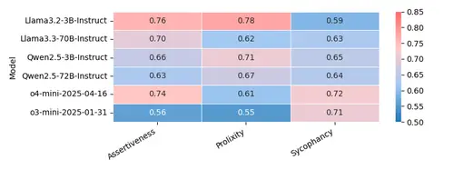
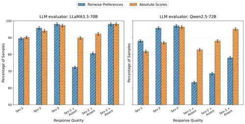
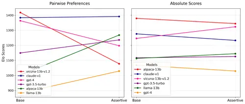

# Pairwise or Pointwise? Evaluating Feedback Protocols for Bias in LLM-Based Evaluation

Tuhina Tripathi Affiliation: University of Massachusetts Amherst
Email: [ttripathi@cs.umass.edu](mailto:)    Manya Wadhwa
Affiliation: The University of Texas at Austin    Greg Durrett
Affiliation: The University of Texas at Austin    Scott Niekum
Affiliation: University of Massachusetts Amherst

###### Abstract

Large Language Models (LLMs) are widely used as proxies for human
labelers in both training (Reinforcement Learning from AI Feedback) and
large-scale response evaluation (LLM-as-a-judge). Alignment and
evaluation are critical components in the development of reliable LLMs,
and the choice of feedback protocol plays a central role in both but
remains understudied. In this work, we show that the choice of feedback
protocol for evaluation (absolute scores versus relative preferences)
can significantly affect evaluation reliability and induce systematic
biases. In the context of LLM-as-a-judge evaluation, we show that
pairwise protocols are more vulnerable to distracted evaluation.
Generator models can exploit spurious attributes (or distractor
features) favored by the LLM judge, resulting in inflated scores for
lower-quality outputs. We find that absolute scoring is more robust to
such manipulation, producing judgments that better reflect response
quality and are less influenced by distractor features. Our results
demonstrate that generator models can flip preferences by embedding
distractor features, skewing LLM-as-a-judge comparisons and leading to
inaccurate conclusions about model quality in benchmark evaluations.
Pairwise preferences flip in about 35% of the cases, compared to only 9%
for absolute scores. We offer recommendations for choosing feedback
protocols based on dataset characteristics and evaluation objectives. ¹¹
1 Code and data available at:
[https://github.com/UMass-SCALAR-Lab/distracted_evaluation](https://github.com/UMass-SCALAR-Lab/distracted_evaluation)

## 1 Introduction

Alignment and evaluation are critical components of Large Language Model
(LLM) pipelines, ensuring models behave as intended and produce reliable
outputs. While LLMs are increasingly used to automate these tasks at
scale—particularly in LLM-as-a-judge setups (Zheng et al., 2023a; Dubois
et al., 2024b)—the protocols for collecting these labels remain
insufficiently examined despite their foundational role. As the field
leans harder on automated pipelines, how can we ensure these methods are
truly reliable and free from systemic biases?

Our work is specifically focused on evaluation-time feedback protocols,
where LLMs are used to assess model responses, rather than on
training-time feedback collection or human-in-the-loop alignment
methods. Preference labels for large-scale evaluation processes are
typically collected using one of two high-level feedback protocols:
absolute or relative feedback. Absolute feedback involves assigning
scores to an individual option on a predefined scale such as a 1-7
Likert scale (Likert, 1932), whereas relative feedback involves the
comparison of two or more options. Relative feedback can either be
collected using pairwise preferences where two responses are compared
and a preference is indicated for one over the other, or using n-wise
rankings which involve ordering multiple responses. Each protocol for
label collection has inherent shortcomings. Absolute ratings lack
comparative context and can be inconsistent or poorly calibrated across
raters (Wadhwa et al., 2024). Relative feedback introduces comparison
but brings its own issues: pairwise preferences scale poorly and may
produce intransitive judgments (Xu et al., 2025), while n-wise
comparisons risk choice set effects (Zhao et al., 2024).

While prior work has examined feedback protocols, revealing
inconsistencies between preferences inferred from ratings versus
rankings for both human and AI annotators (Bansal et al., 2024), these
studies have not addressed how the structure of feedback collection
itself (relative vs. absolute) can systematically bias results. Previous
research has identified annotator-level biases like position and
verbosity effects (Wang et al., 2023; Saito et al., 2023), yet crucially
overlooks the influence of the choice of feedback protocol. Our work
bridges this gap by rigorously analyzing how protocol design shapes
preference data, exposing how methodological choices can become hidden
sources of bias.

In this work, we introduce and define the concept of _distracted
evaluation_ as a phenomenon wherein LLM evaluators prioritize distractor
features that are irrelevant yet appealing attributes, over core
evaluation criteria. Figure 1 shows an example of this phenomenon where
two responses of identical quality are compared: the LLM judge prefers
the one with the distractor feature (i.e. assertiveness) in the pairwise
case, but assigns identical absolute scores. Prior work studies effects
of stylistic distractors in humans (Hosking et al., 2024), however, we
uniquely examine this phenomenon through the lens of feedback protocol
design. Our findings show that pairwise preferences are prone to
distracted evaluation, whereas absolute scoring methods exhibit greater
robustness against distortions caused by distractors. Through
experiments in both controlled and naturalistic settings, we demonstrate
how distractor features can mislead pairwise judgments, boosting the
lower quality responses and leading to misleading evaluation outcomes.
On average, pairwise preferences flip in 35% of cases when a distractor
feature is introduced, compared to only 9% for absolute scores. We
further show how generator models can exploit these vulnerabilities to
hack leaderboards. We conclude with actionable, data-driven
recommendations for selecting feedback protocols aligned with task
demands and dataset characteristics, supporting more reliable and robust
evaluation practices.

Figure 1: An overview of distracted evaluation, showing how the choice
of feedback protocols systematically biases evaluation outcomes. When
two responses are identical in quality, but differ in a distractor
feature (e.g., assertiveness), pairwise comparison favors the more
assertive response. In contrast, absolute scoring is more robust to
these distractor features, assigning identical scores to both responses.

## 2 Related work and Background

### 2.1 Related Work

#### Biases in Language model feedback:

LLM feedback presents several challenges that have been discussed in
prior work. One such challenge is length bias (Singhal et al., 2023),
where models tend to favor longer responses, with some approaches
attempting to mitigate this issue (Park et al., 2024; Dubois et al.,
2024a). Another is positional bias (Wang et al., 2023), where LLMs may
disproportionately favor responses based on their position in the input
prompts. Additionally, LLMs have shown a preference for sycophantic
(Sharma et al., 2023) and assertive responses (Hosking et al., 2024),
and other cognitive biases related to style and tone (Wu & Aji, 2023) as
well as broader cognitive distortions (Koo et al., 2023), raising
concerns about the reliability of model generated labels. Recent work
studies humans and LLMs as judges for biases such as gender and
authority (Chen et al., 2024). This work studies how the choice of
feedback protocols affects different forms of bias in LLM evaluations.

#### LLM-based Evaluation:

Prior work uses feedback protocols with both LLM and human evaluators in
various ways. Ouyang et al. (2022); Stiennon et al. (2022) use human
preferences to train reward models. Zheng et al. (2023b) use pairwise
preferences for evaluating LLMs whereas Ye et al. (2024) use absolute
scoring. However, there is also work that explores the effect of
feedback protocols in human preferences (Bansal et al., 2024). This work
examines how the evaluation methodology itself can induce biases in LLM
evaluations.

### 2.2 Background

We first briefly introduce the two feedback protocols considered in this
work.

#### Absolute Feedback

In absolute scoring, responses are evaluated individually and assigned a
score on a predefined scale and based on a given criteria (Kim et al.,
2024; Lee et al., 2023). For a prompt $`x`$ and a corresponding response
$`y`$, the evaluation is mapped to a discrete or continuous score value
$`s`$: $`r(x,y)\rightarrow s`$.

While providing a straightforward method of data collection, absolute
scoring has its limitations. Since the framework for collecting absolute
feedback focuses on an individual response, it may lack comparative
information, making it hard to distinguish subtle differences (Zheng
et al., 2023a). Scores can also be inconsistent across different raters
and have difficulties in calibration across different scales (Zwislocki,
1983), due to varying interpretations of what makes a good response and
how to map quality to the scale.

#### Relative Feedback

Relative feedback is usually collected in two ways: N-wise ratings and
pairwise preferences. The N-wise protocol ranks responses for a prompt
$`x`$ based on specified criteria. Given $`n`$ candidate responses
$`(x_{1},x_{2},\dots,x_{n})`$, it assigns a rank to each response.
Pairwise preferences map a prompt $`p`$ and pair of corresponding
responses $`(x_{a},x_{b})`$ to a preferred response from the pair.
Sometimes, a tie option is included to allow for equal preference
between the responses.

Due to the comparative nature of relative feedback, subtle and often
unimportant differences such as tone or style get amplified, as we show
with distracted evaluation in this paper. Cognitive biases, including
positional and verbosity biases (Saito et al., 2023; Wang et al., 2023;
Wu & Aji, 2023) are more likely to surface in relative feedback because
of how relative preferences are structured. Additionally, relative
feedback can exhibit effects like intransitivity (A.4) and choice set
sensitivity (A.5), leading to conflicting preferences or rankings for
the same set of responses.

## 3 Distracted Evaluation

LLM-based evaluations can suffer from biases, often influenced by
factors unrelated to the intended criteria of assessment. We refer to
this phenomenon as _distracted evaluation_: a bias towards irrelevant
features known as distractor factors, when the evaluator is explicitly
instructed to judge based on a well-defined criterion.

For a given prompt $`x`$ and response $`y`$, let $`p`$ denote the
primary criterion the evaluator is instructed to assess. We define a
distractor feature $`f`$ as an extraneous feature that is irrelevant to
$`p`$. Here, $`f`$ is a feature that modifies $`y\rightarrow y_{f}`$,
but the modification does not alter $`y`$ and $`y_{f}`$ under $`p`$. Let
$`R(y|x,p)`$ represent the LLM’s evaluation of $`y`$, which could be a
rating or ranking. An LLM evaluator exhibits distracted evaluation when
its assessment $`R(y|x,p)`$ is altered in the presence of $`f`$:

```math
R(y|x,p)\neq R(y_{f}|x,p)
```

We consider two setups: (1) Fixed quality (2) Variable quality. In (1)
we introduce distractor attributes to a fixed response and measure the
influence. In (2) we first vary the quality of the response and
introduce distractor attribute to each of the variations to study the
interplay between quality and distractor features. We describe these in
more detail below.

### 3.1 Fixed Quality Case

Let $`y`$ be an original response and $`y_{f}`$ be its modified version
that incorporates the distractor feature $`f`$. The modification
preserves $`y`$’s adherence to the primary criterion $`p`$. In the fixed
quality case, distracted evaluation is defined as:

```math
R(y|x,p)\neq R(y_{f}|x,p)\text{ where }p(y)=p(y_{f})
```

We consider three distractor types:

1.  1.  Assertiveness – Confident, authoritative phrasing (Hosking et al.,
        2024).
2.  2.  Prolixity – Increased verbosity and lexical complexity.
3.  3.  Sycophancy – Overly agreeable or flattering tone (Sharma et al.,
        2023).

An example of the different modifications is given in Table 8.

### 3.2 Variable Quality Case

To study the interplay between response quality and distractor features,
we construct a controlled set of low quality responses for each prompt.
For every prompt, we generate a high-quality response $`y_{high}`$ that
fully satisfies the primary evaluation criterion $`p`$. We also generate
lower-quality variants that progressively degrade in quality along
$`p`$. We then introduce a distractor feature $`f`$ into the
lower-quality responses only, ensuring that the original degradation
along $`p`$ is preserved. The high-quality response is left unmodified.
Table 9 provides examples from this setup, which allows us to study
distracted evaluation in a controlled setting. Specifically, we examine
whether evaluators assign higher ratings to low-quality responses with
distractors over high-quality responses:

```math
R(y_{high}|x,p)<R(y_{low+f}|x,p)
```

### 3.3 Experimental Setup

#### Datasets

We study distracted evaluation using two datasets under controlled and
naturalistic conditions. First, we introduce IFEval-TweakSet, a modified
version of IFEval (Zhou et al., 2023). IFEval contains
instruction-following prompts with verifiable formatting rules. We
simplify these prompts so our generator model can reliably follow them,
ensuring each prompt includes three non-conflicting instructions with
randomized order to avoid structural bias. Prompts are split into a
content question and a separate formatting instruction to isolate
formatting adherence. Table 1 shows an example of the modified
instruction prompt. Second, we use MT-Bench (Zheng et al., 2023a),
focusing on the human evaluations split of the dataset. Unlike
IFEval-TweakSet, MT-Bench comprises of real-world instructions for
testing distracted evaluation in multi-turn dialogues.

|                                                                                                                                                                                             |
| ------------------------------------------------------------------------------------------------------------------------------------------------------------------------------------------- |
| Instruction Prompt                                                                                                                                                                          |
| Question: Can you summarize the process of how to pay taxes?                                                                                                                                |
| Format: Reply in exactly 3 paragraphs and separate the paragraphs with. Include the keywords: calculate, file, conclusion. Use bullet points to explain the steps in one of the paragraphs. |

Table 1: Example of a prompt from the IF-EVAL-TweakSet.

#### Feedback Protocols

In this work, we evaluate pairwise preferences and absolute scoring. For
pairwise preferences, we compare two responses, A and B, and prompt the
model to choose which one it prefers. We record the logits for the
tokens A, B, and C (representing a tie) by making two separate
inferences for each pair with reversed order. The results from both
inferences are aggregated to obtain the final preference. The pairwise
preference function $`R_{pairwise}`$ is defined as:

```math
R_{pairwise}(x,y_{a},y_{b})\rightarrow\{y_{a},y_{b},\text{tie}\}
```

For absolute scoring, a given prompt $`x`$ and corresponding response
$`y`$ is mapped to a discrete score $`s`$ in the range 1-7:

```math
R_{absolute}(x,y)\rightarrow s\text{ where }s\in\{1,2,\dots,7\}
```

We use token likelihoods for each score in this range and compute a
weighted score, as in (Lee et al., 2023). We use Prompts 3.3 and 3.3 for
obtaining pairwise preferences and absolute scores respectively for the
IFEval-TweakSet.


#### IFEval-TweakSet Setup

For this dataset, the primary evaluation criterion $`p`$ is
instruction-following. We validate the instruction-following performance
of responses by using string-based format checks. This establishes an
objective ground truth for compliance to $`p`$. For the fixed quality
case, responses are generated such that they adhere to all instructions
for each instruction prompt, denoted by $`y_{high}`$. In the variable
quality case, we generate four responses per instruction prompt: one
high-quality response $`y_{\text{high}}`$ that fully adheres to the
instructions, and three lower-quality responses
$`\{y_{\text{low}}^{(1)},y_{\text{low}}^{(2)},y_{\text{low}}^{(3)}\}`$
that progressively deviate from the instructions with increasing
severity. With this we are able to modify non-adherence of the response
for three severity levels:

1.  1.  Severity-1: The response fails to follow one instruction
        ($`y_{\text{low}}^{(1)}`$).
2.  2.  Severity-2: The response fails to follow two instructions
        ($`y_{\text{low}}^{(2)}`$).
3.  3.  Severity-3: The response disregards all three instructions
        ($`y_{\text{low}}^{(3)}`$).

To specifically test for distracted evaluation, we augment lower-quality
responses with a distractor feature. For this experiment, we only focus
on assertiveness as the distractor and create three variants with the
severity edits: Severity-1 + assertive, Severity-2 + assertive, and
Severity-3 + assertive. Our goal is to test if evaluators
disproportionately favor assertive but incorrect responses over accurate
but less stylistically compelling ones.

#### MT-Bench Setup

For this dataset since the responses are open-ended and lack automatic
verifiability, we focus only on the Fixed quality case. For each pair in
the dataset, we collect baseline preferences of the evaluator model
without any distractors. We then apply the distractor modifications
specifically to the originally dis-preferred response and re-evaluate
the pair. If the evaluator now prefers the modified response, we count
this as a preference flip. Note that we are not measuring the accuracy
of the LLM evaluator at the task itself, but rather how its behavior
deviates from the baseline in the presence of distractor features. This
two-stage approach addresses the inherent subjectivity of free-form text
evaluation by creating a stable reference point, allowing us to measure
skew caused by controlled interventions. Table 11 gives examples of the
modifications.

#### Models

For IF-EVAL-TweakSet, we generate and modify responses to instructions
using gpt-4-0613. For MT-bench, we modify existing model responses in
the dataset using OpenAI’s o3-mini-2025-01-31. We use the following
models as evaluators: LLaMA3.2-3B-Instruct, LLaMA3.3-70B-Instruct
(AI@Meta, 2024), Qwen2.5-3B-Instruct and Qwen2.5-72B-Instruct (Qwen
et al., 2025). All evaluations are conducted using open-source models as
they allow us to work in the logit space.

## 4 Results

With the setup described in Section 3, we now analyze _distraction
evaluation_ for pairwise preferences and absolute scoring protocols.



Figure 2: Results of the fixed quality evaluation on IF-EVAL-TweakSet.
The figure reports the percentage of samples where the LLM evaluator
selects the distractor-modified response as the preferred response. We
see that assertiveness is the most effective distractor for larger
models, while smaller models frequently favor prolixity. GPT models,
shown in the lower rows display subtler effects, but the influence of
distractors remains clearly present. (Note: The percentages for GPT
models reflect preference rates only for the non-tied cases).

#### Pairwise Preferences are more susceptible to distracted evaluation

Figure 2 shows that pairwise preferences are biased toward assertive,
prolix, and sycophantic responses, despite being explicitly prompted to
assess only instruction following. This behavior is consistent with
human-like biases observed in prior work (Hosking et al., 2024). Smaller
models such as LLaMA3.2-3B and Qwen2.5-3B exhibit the strongest bias
toward assertiveness and prolixity. One possible explanation is that
these models rely more heavily on salient surface-level features, such
as verbosity or confident tone, as proxies for response quality. The
elevated sycophancy in LLaMA3.3-70B compared to its smaller counterpart
further suggests that higher-capacity models might be more sensitive to
subtle cues in user prompts or feedback—amplifying tendencies to agree
or defer to the user’s position. This aligns with concerns raised in
prior work showing RLHF-trained models can become increasingly
persuasive without improving task correctness (Wen et al., 2024).

|                       |               |       |           |       |            |       |                          |       |
| --------------------- | ------------- | ----- | --------- | ----- | ---------- | ----- | ------------------------ | ----- |
|                       | Assertiveness |       | Prolixity |       | Sycophancy |       | Avg.(across distractors) |       |
| Model                 | Abs.          | Pair. | Abs.      | Pair. | Abs.       | Pair. | Abs.                     | Pair. |
| Logit-based outputs   |               |       |           |       |            |       |                          |       |
| LLaMA3.2-3B-Instruct  | 9.5           | 33.3  | 8.0       | 31.0  | 10.5       | 34.0  | 9.3                      | 32.8  |
| LLaMA3.3-70B-Instruct | 7.0           | 42.5  | 12.0      | 39.0  | 7.5        | 32.0  | 8.83                     | 37.8  |
| Qwen2.5-3B-Instruct   | 11.0          | 41.0  | 9.0       | 35.5  | 10.5       | 37.5  | 10.17                    | 38.0  |
| Qwen2.5-72B-Instruct  | 8.5           | 25.5  | 8.0       | 35.2  | 10.2       | 36.0  | 8.9                      | 32.3  |
| Avg.(across models)   | 9.0           | 35.5  | 9.25      | 35.2  | 9.7        | 34.9  | –                        | –     |
| Text-based outputs    |               |       |           |       |            |       |                          |       |
| o4-mini-2025-04-16    | 18.5          | 34.9  | 17.2      | 29.4  | 25.33      | 44.0  | –                        | –     |
| o3-mini-2025-01-31    | 21.3          | 30.0  | 25.7      | 40.6  | 24.8       | 38.9  | –                        | –     |

Table 2: This table shows the percentage of samples where the evaluator
model flips its preference when a distractor is added to the
dis-preferred response. Using MT-Bench, we collect baseline preferences,
then introduce one of three distractors—assertiveness, prolixity, or
sycophancy—and measure how often preferences change. Results are
reported for both absolute scoring and pairwise comparisons, with the
latter showing consistently higher flip rates. While the effects are
subtler for GPT models, they still show clear susceptibility,
particularly to sycophancy and assertiveness.

Table 2 shows the number of % flips in preferences observed on
introducing distractor features in the MT-Bench dataset. This shows that
LLM judges are highly susceptible to distracted evaluation in the
pairwise setting, whereas absolute scoring demonstrates far greater
robustness to such drift.

|              |      |       |
| ------------ | ---- | ----- |
| Model        | Abs. | Pair. |
| LLaMA3.2-3B  | 84.6 | 2.4   |
| LLaMA3.3-70B | 93.2 | 3.2   |
| Qwen2.5-3B   | 86.5 | 6.5   |
| Qwen2.5-72B  | 88.0 | 7.3   |

Table 3: Percentage of samples with ties for pairwise preferences and
absolute scoring, evaluated on responses of identical quality on the
IF-EVAL-TweakSet.

#### Pairwise preferences resist ties

Table 3 reports the percentage of tied preferences in the
IF-EVAL-TweakSet. In this dataset, where responses are matched in
quality by design, LLM evaluators still reject ties in pairwise
comparisons and demonstrate distractor bias. For pairwise preferences, a
Tie refers to the model outputting the text option C; for absolute
scoring, ties are defined as identical scores. Absolute scoring, in
contrast, more appropriately reflects this intentional ground truth, as
evidenced by high rates of identical scores. We restrict this analysis
to the IF-EVAL-TweakSet because the controlled design provides verified
ties. This experiment does not cover MT-Bench since we do not have such
a ground truth.

#### Distractor features can bias evaluation in low-quality responses

To further probe distracted evaluation, we examine the variable quality
case introduced in Section 3.2. In this setup, we compare two responses:
one that adheres to instructions and another that violates them to
varying degrees (Severity 1–3). We then modify the non-adherent
responses to make them more assertive. Figure 3 shows classification
accuracy, defined as the percentage of samples where the model correctly
ranks the adherent response above the non-adherent one, under both
pairwise and absolute feedback.



Figure 3: Accuracy of response classification across severity levels and
distractor (assertiveness) conditions in the IF-EVAL-TweakSet using
LLaMA3.3-70B and Qwen2.5-72B as evaluators. Bars show the percentage of
samples where the evaluator correctly identifies the higher-quality
(instruction-adhering) response, based on pairwise preference (blue,
striped) and absolute score (orange, dotted). With assertiveness
introduced into the lower-quality response, pairwise accuracy degrades
substantially, particularly at lower severities (Severity-1 and
Severity-2), indicating increased susceptibility to distractor features.
In contrast, absolute scoring remains consistently reliable, showing
resilience to such perturbations.

Without distractors, both protocols correctly identify the
higher-quality response, especially at higher severity levels. However,
when assertiveness is added to the lower-quality response, pairwise
preferences degrade sharply, particularly at levels Severity-1 and
Severity-2. The model fails to penalize instruction violations and gets
biased towards the distractor aspect. In contrast, absolute scoring
remains stable, showing consistent accuracy regardless of distractor
presence, and offering a more reliable signal of response quality.

## 5 Can LLMs Hack Leaderboards via Distractor Styling?

Our findings from Section 4 suggest that LLM evaluators can be
influenced by stylistic distractors such as assertiveness, specifically
when operating under pairwise protocols, leading to distracted
evaluation. In this section, we explore a critical downstream
implication of this finding: can generator models exploit distracted
evaluation as a vulnerability to artificially boost their leaderboard
rankings?

Pairwise preferences are widely used to obtain model rankings, as in
AlpacaEval (Dubois et al., 2024b) and MT-Bench (Chiang et al., 2024). In
this section we show that these rankings can be gamed. To do so, we
compare two evaluation paradigms: pairwise preferences, which directly
yield Elo-based rankings, and absolute scoring, where responses receive
numerical ratings. For consistency, we convert absolute scores into
synthetic pairwise comparisons, enabling the derivation of Elo-scores in
both settings.

We use pairwise responses from MT-bench with LLaMA3.3-70B and
Qwen2.5-72B as LLM judges. For each pair, we record both pairwise
preferences and absolute scores. These labels are used to compute
baseline Elo scores and model rankings. This establishes a baseline
ranking for the generator models. We then target the three lowest-ranked
models according to the baseline Elo scores and edit responses from
these models to be more assertive using GPT-3.5 Mini. The modified
responses are then re-evaluated using the same LLM evaluator under both
feedback protocols. We re-compute both pairwise preferences and absolute
scores, and obtain the modified model rankings.

#### Results

Figure 4 shows the impact of assertiveness modifications on pairwise
preferences and absolute scores. With pairwise preferences, previously
low-ranked models (GPT-3.5, Alpaca-13B, and LLaMA-13B) move up in
rankings considerably with a simple induction of a distractor feature.
For absolute scoring, the models with low ranks (GPT-3.5, LLaMA-13B and
GPT-4) show less pronounced shifts. These findings show that pairwise
preferences are highly susceptible to manipulation via such
perturbations as compared to rankings obtained from absolute scores.
They illustrate a critical vulnerability in pairwise-based evaluation
pipelines: generator models can game the evaluation by optimizing for
tonality and stylistic features rather than qualitative improvements.



Figure 4: Model ELO scores on MT-Bench evaluated by LLaMA3.3-70B. Under
pairwise comparisons, previously lower-ranked models climb sharply in
ranking, indicating that pairwise preferences can be exploited to
improve ranks without corresponding gains in content quality by using
distractor features. In contrast, absolute scoring produces more stable
and consistent rankings, and shows less influence of the distractor
features.

## 6 Discussion

This study addresses a critical gap in understanding LLM-based
evaluation protocols, exposing how seemingly minor design choices in
feedback protocols can significantly impact evaluation outcomes. Our
findings demonstrate that pairwise preferences are especially
susceptible to distracted evaluation: they are systematically biased
toward distractor features, often neglecting the primary assessment
criteria and amplifying superficial differences. This bias is
particularly problematic in low-signal scenarios (e.g. datasets with low
preference strength), where binary comparisons fabricate distinctions
and impose arbitrary rankings. Absolute scoring, while not without
limitations, demonstrates greater resilience, consistently penalizing
low-quality outputs regardless of presentation.

Distracted evaluation has deeper consequences—it undermines the
integrity of leader boards. Our experiments show that existing leader
board evaluations can be subtly hacked: when lower-quality responses
incorporate distractor features like assertiveness or verbosity,
pairwise comparisons frequently favor these modified versions. This
creates a potential pathway for models to improve their rankings, not by
improving core capabilities, but by gaming surface-level preferences.

The takeaway is clear: protocol choice matters. For evaluation tasks
such as instruction-following or correctness, absolute scoring provides
a more reliable measure by design. Binary preferences, on the contrary,
exaggerate small gaps, making them poorly suited for data with low
preference strength. Future work should leverage the reliability of
absolute scoring—while addressing its limitations—for more robust and
unbiased evaluations.

## Acknowledgments

This work has taken place in part in the Safe, Correct, and Aligned
Learning and Robotics Lab (SCALAR) at The University of Massachusetts
Amherst. SCALAR research is supported in part by the NSF (IIS-2323384),
the Center for AI Safety (CAIS) and the Long-Term Future Fund. This work
also took place at the Text Analysis, Understanding, and Reasoning Lab
(TAUR) at The University of Texas at Austin, supported by a grant from
Open Philanthropy. We thank Frank Chiu for early discussions and help
with preliminary experiments.

## References

- AI@Meta (2024) AI@Meta. Llama 3 model card. 2024. URL
  [https://github.com/meta-llama/llama3/blob/main/MODEL_CARD.md](https://github.com/meta-llama/llama3/blob/main/MODEL_CARD.md).
- Bansal et al. (2024) Hritik Bansal, John Dang, and Aditya Grover.
  Peering through preferences: Unraveling feedback acquisition for
  aligning large language models, 2024. URL
  [https://arxiv.org/abs/2308.15812](https://arxiv.org/abs/2308.15812).
- Chen et al. (2024) Guiming Hardy Chen, Shunian Chen, Ziche Liu, Feng
  Jiang, and Benyou Wang. Humans or LLMs as the judge? a study on
  judgement bias. In Yaser Al-Onaizan, Mohit Bansal, and Yun-Nung Chen
  (eds.), _Proceedings of the 2024 Conference on Empirical Methods in
  Natural Language Processing_, pp. 8301–8327, Miami, Florida, USA,
  November 2024. Association for Computational Linguistics. doi:
  10.18653/v1/2024.emnlp-main.474. URL
  [https://aclanthology.org/2024.emnlp-main.474/](https://aclanthology.org/2024.emnlp-main.474/).
- Chiang et al. (2024) Wei-Lin Chiang, Lianmin Zheng, Ying Sheng,
  Anastasios Nikolas Angelopoulos, Tianle Li, Dacheng Li, Hao Zhang,
  Banghua Zhu, Michael Jordan, Joseph E. Gonzalez, and Ion Stoica.
  Chatbot arena: An open platform for evaluating llms by human
  preference, 2024.
- Cui et al. (2023) Ganqu Cui, Lifan Yuan, Ning Ding, Guanming Yao, Wei
  Zhu, Yuan Ni, Guotong Xie, Zhiyuan Liu, and Maosong Sun.
  Ultrafeedback: Boosting language models with high-quality
  feedback, 2023.
- Dubois et al. (2024a) Yann Dubois, Balázs Galambosi, Percy Liang, and
  Tatsunori B. Hashimoto. Length-controlled alpacaeval: A simple way to
  debias automatic evaluators, 2024a. URL
  [https://arxiv.org/abs/2404.04475](https://arxiv.org/abs/2404.04475).
- Dubois et al. (2024b) Yann Dubois, Xuechen Li, Rohan Taori, Tianyi
  Zhang, Ishaan Gulrajani, Jimmy Ba, Carlos Guestrin, Percy Liang, and
  Tatsunori B. Hashimoto. Alpacafarm: A simulation framework for methods
  that learn from human feedback, 2024b. URL
  [https://arxiv.org/abs/2305.14387](https://arxiv.org/abs/2305.14387).
- Hosking et al. (2024) Tom Hosking, Phil Blunsom, and Max Bartolo.
  Human feedback is not gold standard, 2024. URL
  [https://arxiv.org/abs/2309.16349](https://arxiv.org/abs/2309.16349).
- Kim et al. (2024) Seungone Kim, Jamin Shin, Yejin Cho, Joel Jang,
  Shayne Longpre, Hwaran Lee, Sangdoo Yun, Seongjin Shin, Sungdong Kim,
  James Thorne, and Minjoon Seo. Prometheus: Inducing fine-grained
  evaluation capability in language models, 2024. URL
  [https://arxiv.org/abs/2310.08491](https://arxiv.org/abs/2310.08491).
- Koo et al. (2023) Ryan Koo, Minhwa Lee, Vipul Raheja, Jong Inn Park,
  Zae Myung Kim, and Dongyeop Kang. Benchmarking cognitive biases in
  large language models as evaluators, 2023.
- Lee et al. (2023) Harrison Lee, Samrat Phatale, Hassan Mansoor, Thomas
  Mesnard, Johan Ferret, Kellie Lu, Colton Bishop, Ethan Hall, Victor
  Carbune, Abhinav Rastogi, and Sushant Prakash. Rlaif: Scaling
  reinforcement learning from human feedback with ai feedback, 2023.
- Likert (1932) Rensis Likert. A technique for the measurement of
  attitudes. _Archives of Psychology_, 140:1–55, 1932.
- McFadden (1974) Daniel McFadden. Conditional logit analysis of
  qualitative choice behavior. In Paul Zarembka (ed.), _Fontiers in
  Econometrics_, pp. 105–142. Academic press, New York, 1974.
- Ouyang et al. (2022) Long Ouyang, Jeff Wu, Xu Jiang, Diogo Almeida,
  Carroll L. Wainwright, Pamela Mishkin, Chong Zhang, Sandhini Agarwal,
  Katarina Slama, Alex Ray, John Schulman, Jacob Hilton, Fraser Kelton,
  Luke Miller, Maddie Simens, Amanda Askell, Peter Welinder, Paul
  Christiano, Jan Leike, and Ryan Lowe. Training language models to
  follow instructions with human feedback, 2022. URL
  [https://arxiv.org/abs/2203.02155](https://arxiv.org/abs/2203.02155).
- Park et al. (2024) Ryan Park, Rafael Rafailov, Stefano Ermon, and
  Chelsea Finn. Disentangling length from quality in direct preference
  optimization, 2024. URL
  [https://arxiv.org/abs/2403.19159](https://arxiv.org/abs/2403.19159).
- Qwen et al. (2025) Qwen, :, An Yang, Baosong Yang, Beichen Zhang,
  Binyuan Hui, Bo Zheng, Bowen Yu, Chengyuan Li, Dayiheng Liu, Fei
  Huang, Haoran Wei, Huan Lin, Jian Yang, Jianhong Tu, Jianwei Zhang,
  Jianxin Yang, Jiaxi Yang, Jingren Zhou, Junyang Lin, Kai Dang, Keming
  Lu, Keqin Bao, Kexin Yang, Le Yu, Mei Li, Mingfeng Xue, Pei Zhang, Qin
  Zhu, Rui Men, Runji Lin, Tianhao Li, Tianyi Tang, Tingyu Xia,
  Xingzhang Ren, Xuancheng Ren, Yang Fan, Yang Su, Yichang Zhang,
  Yu Wan, Yuqiong Liu, Zeyu Cui, Zhenru Zhang, and Zihan Qiu. Qwen2.5
  technical report, 2025. URL
  [https://arxiv.org/abs/2412.15115](https://arxiv.org/abs/2412.15115).
- Saito et al. (2023) Keita Saito, Akifumi Wachi, Koki Wataoka, and
  Youhei Akimoto. Verbosity bias in preference labeling by large
  language models, 2023. URL
  [https://arxiv.org/abs/2310.10076](https://arxiv.org/abs/2310.10076).
- Sharma et al. (2023) Mrinank Sharma, Meg Tong, Tomasz Korbak, David
  Duvenaud, Amanda Askell, Samuel R. Bowman, Newton Cheng, Esin Durmus,
  Zac Hatfield-Dodds, Scott R. Johnston, Shauna Kravec, Timothy Maxwell,
  Sam McCandlish, Kamal Ndousse, Oliver Rausch, Nicholas Schiefer,
  Da Yan, Miranda Zhang, and Ethan Perez. Towards understanding
  sycophancy in language models, 2023. URL
  [https://arxiv.org/abs/2310.13548](https://arxiv.org/abs/2310.13548).
- Singhal et al. (2023) Prasann Singhal, Tanya Goyal, Jiacheng Xu, and
  Greg Durrett. A long way to go: Investigating length correlations in
  rlhf, 2023.
- Stiennon et al. (2022) Nisan Stiennon, Long Ouyang, Jeff Wu, Daniel M.
  Ziegler, Ryan Lowe, Chelsea Voss, Alec Radford, Dario Amodei, and Paul
  Christiano. Learning to summarize from human feedback, 2022.
- Wadhwa et al. (2024) Manya Wadhwa, Jifan Chen, Junyi Jessy Li, and
  Greg Durrett. Using Natural Language Explanations to Rescale Human
  Judgments. In _Proceedings of the Conference on Language Modeling
  (COLM)_, 2024. URL
  [https://arxiv.org/abs/2305.14770](https://arxiv.org/abs/2305.14770).
- Wang et al. (2023) Peiyi Wang, Lei Li, Liang Chen, Zefan Cai, Dawei
  Zhu, Binghuai Lin, Yunbo Cao, Qi Liu, Tianyu Liu, and Zhifang Sui.
  Large language models are not fair evaluators, 2023.
- Wang et al. (2024) Zhilin Wang, Yi Dong, Olivier Delalleau, Jiaqi
  Zeng, Gerald Shen, Daniel Egert, Jimmy J. Zhang, Makesh Narsimhan
  Sreedhar, and Oleksii Kuchaiev. Helpsteer2: Open-source dataset for
  training top-performing reward models, 2024.
- Wen et al. (2024) Jiaxin Wen, Ruiqi Zhong, Akbir Khan, Ethan Perez,
  Jacob Steinhardt, Minlie Huang, Samuel R. Bowman, He He, and Shi Feng.
  Language models learn to mislead humans via rlhf, 2024. URL
  [https://arxiv.org/abs/2409.12822](https://arxiv.org/abs/2409.12822).
- Wu & Aji (2023) Minghao Wu and Alham Fikri Aji. Style over substance:
  Evaluation biases for large language models, 2023.
- Xu et al. (2025) Yi Xu, Laura Ruis, Tim Rocktäschel, and Robert Kirk.
  Investigating non-transitivity in llm-as-a-judge, 2025. URL
  [https://arxiv.org/abs/2502.14074](https://arxiv.org/abs/2502.14074).
- Ye et al. (2024) Seonghyeon Ye, Doyoung Kim, Sungdong Kim, Hyeonbin
  Hwang, Seungone Kim, Yongrae Jo, James Thorne, Juho Kim, and Minjoon
  Seo. Flask: Fine-grained language model evaluation based on alignment
  skill sets, 2024. URL
  [https://arxiv.org/abs/2307.10928](https://arxiv.org/abs/2307.10928).
- Zhao et al. (2024) Xiutian Zhao, Ke Wang, and Wei Peng. Measuring the
  inconsistency of large language models in preferential ranking. In
  _Proceedings of the 1st Workshop on Towards Knowledgeable Language
  Models (KnowLLM 2024)_, pp. 171–176. Association for Computational
  Linguistics, 2024. doi: 10.18653/v1/2024.knowllm-1.14. URL
  [http://dx.doi.org/10.18653/v1/2024.knowllm-1.14](http://dx.doi.org/10.18653/v1/2024.knowllm-1.14).
- Zheng et al. (2023a) Lianmin Zheng, Wei-Lin Chiang, Ying Sheng, Siyuan
  Zhuang, Zhanghao Wu, Yonghao Zhuang, Zi Lin, Zhuohan Li, Dacheng Li,
  Eric P. Xing, Hao Zhang, Joseph E. Gonzalez, and Ion Stoica. Judging
  llm-as-a-judge with mt-bench and chatbot arena, 2023a. URL
  [https://arxiv.org/abs/2306.05685](https://arxiv.org/abs/2306.05685).
- Zheng et al. (2023b) Lianmin Zheng, Wei-Lin Chiang, Ying Sheng, Siyuan
  Zhuang, Zhanghao Wu, Yonghao Zhuang, Zi Lin, Zhuohan Li, Dacheng Li,
  Eric P. Xing, Haotong Zhang, Joseph Gonzalez, and Ion Stoica. Judging
  llm-as-a-judge with mt-bench and chatbot arena. _ArXiv_,
  abs/2306.05685, 2023b. URL
  [https://api.semanticscholar.org/CorpusID:259129398](https://api.semanticscholar.org/CorpusID:259129398).
- Zhou et al. (2023) Jeffrey Zhou, Tianjian Lu, Swaroop Mishra,
  Siddhartha Brahma, Sujoy Basu, Yi Luan, Denny Zhou, and Le Hou.
  Instruction-following evaluation for large language models, 2023. URL
  [https://arxiv.org/abs/2311.07911](https://arxiv.org/abs/2311.07911).
- Zwislocki (1983) J J Zwislocki. Absolute and other scales: question of
  validity. _Percept. Psychophys._, 33(6):593–594, June 1983.

## Appendix A Appendix

### A.1 Limitations

Our work primarily investigates pairwise preferences and absolute
scoring protocols for studying LLM evaluators. While these protocols are
widely used, future work should consider a broader range of feedback
types. Prior studies have shown that prompting models for explanations
before feedback, as well as incorporating Chain-of-Thought reasoning can
be effective—these are promising directions to explore further.
Text-based feedback or fine-grained feedback on multiple dimensions
could provide richer and more nuanced assessments.

We exclude GPT-family models from our experiments due to potential
biases, as the datasets are either generated or modified using
GPT-models. Additionally, these models have a pronounced positional
bias, and without access to the logits, we cannot apply the same
aggregation techniques that we used for open-source models. Future work
should include a broader range of model families and scales.

Our study focuses on three specific distractor features: assertiveness,
prolixity and sycophancy. We also limit the analysis to instruction
following as the primary criterion. However, this can be extended to
other aces of evaluation like factuality or reasoning.

### A.2 Dataset details

For our experiments, we use the IF-EVAL-TweakSet, a modification of the
IF-EVAL benchmark dataset, and MT-bench human judgements dataset, a
multi-turn dialogue evaluation dataset.

The IF-EVAL-TweakSet is derived from the original IF-EVAL dataset which
assess instruction following capabilities of LLMs using instructions
verifiable with string parsing. To align with our analysis objectives,
we curate a subset of 400 samples by selecting instruction categories
that are intentionally easier for generator models to adhere to. Each
instruction is divided into a Question (the core task) and a Format
(structural constraints like word limits, casing, bullet point format,
etc.). These rule-based verifiable constraints allow us to measure
instruction following in a precise manner.

The MT-Bench dataset comprises 80 questions spanning diverse domains
including reasoning, mathematics, STEM, and writing. Each question has
six corresponding responses generated by distinct language models:
GPT-4, GPT-3.5, Vicuna-13B, Alpaca-13B, LLaMA-13B, and Claude-v1. The
dataset provides both human-annotated and GPT-4-evaluated splits; our
analysis focuses on the human-evaluated portion, comprising 1,689 Turn-1
responses.

### A.3 Modification Prompts

We use detailed modification prompts for introducing the distractor
factors in the datasets. Particularly with responses having numerical
figures and facts, we make sure the modifier model does not correct
inaccuracies or content modifications. Prompts A.3, A.3 and A.3 are used
for modifying MT-Bench responses. We use the same prompts for IF-Eval,
except for the first sentence which instead of stating ‘multi-step
conversation’ which is suitable for MT-Bench, states the following:‘add
the first sentence here’.


### A.4 Intransitivity in preferences

In the context of relative preferences, let us represent a set of
preferences over alternatives as a binary relation $`\succ`$ on a given
set of options $`\{A,B,C\}`$. For a preference to be transitive, if
$`A`$ is preferred over $`B`$ (denoted as $`A\succ B`$) and $`B`$ is
preferred over $`C`$ (denoted as $`B\succ C`$), it must also hold that
$`A`$ is preferred over $`C`$ ($`A\succ C`$). Intransitivity occurs when
this condition fails and causes cyclic preferences. This violation of
the transitivity property leads to contradictions in the decision-making
process, challenging its consistency.

We empirically study this effect using two publicly available datasets -
Ultrafeedback Cui et al. (2023) and Helpsteer2 Wang et al. (2024) with
LLaMA3 models as evaluators.

We examine situations where $`A\succ B`$ and $`B\succ C`$ but we observe
$`A\nsucc C`$ and we record it as an instance of intransitivity. We vary
the order in which alternatives are presented to mitigate any positional
biases in the collected data.

1.2

|                           |             |                       |
| ------------------------- | ----------- | --------------------- |
| Model                     | Overall (%) | Instruction Following |
| Meta-Llama-3-8B-Instruct  | 10.8        | 8.5                   |
| Meta-Llama-3-70B-Instruct | 7.6         | 6.0                   |

Table 4: Percentage of samples in which we observe intransitivity in the
Ultrafeedback dataset

### A.5 Choice set sensitivity

Choice set sensitivity is observed when preferences between options and
not invariant to the inclusion or exclusion of other alternatives. This
violates the independence of irrelevant alternatives (IIA) property
McFadden (1974) which asserts that when comparing two alternatives, the
introduction of a third, unrelated alternative should not affect the
preference between the original options. This effect is particularly
relevant when preferences are collected through n-wise rankings.

To empirically investigate choice set sensitivity using the
Ultrafeedback dataset and LLaMA3 models as evaluators. Given a prompt
and a corresponding set of responses (denoted by $`\{A,B,C,D\}`$), we
focus on two specific choice sets: $`\{A,B,C\}`$ and $`\{A,B,D\}`$. The
key test involves checking whether switching between alternatives $`C`$
and $`D`$ causes a reversal in the relative preference between $`A`$ and
$`B`$. Specifically, if we observe a preference ordering $`A\succ B`$ in
the choice set $`\{A,B,C\}`$, but the preference reverses to
$`B\succ A`$ in the choice set $`\{A,B,D\}`$, we record this as an
instance of choice set sensitivity.

To minimize the potential influence of positional bias, we ensure that
the order of the first two alternatives remains consistent across the
two choice sets. This approach controls for the possibility that the
change in preference is due to the mere reordering of $`C`$ and $`D`$,
rather than the actual introduction of a new alternative.

|             |                  |              |                  |              |
| ----------- | ---------------- | ------------ | ---------------- | ------------ |
| Model       | {A, B, (C, D)}   |              | {(C, D), A, B}   |              |
|             | Overall          | Inst. Follow | Overall          | Inst. Follow |
| L1ama-3-8B  | 10.5             | 9.5          | 17.0             | 14.6         |
| L1ama-3-70B | 7.1              | 6.0          | 13.5             | 11.0         |

Table 5: Percentage of samples in which we observe intransitivity in the
Ultrafeedback dataset

### A.6 Score Distribution for Absolute Scores

The tables below show the distribution of scores evaluated by the
Qwen2.5-3B and Qwen2.5-72B models for initial responses on the MT-Bench
dataset (Section-5):

|       |             |
| ----- | ----------- |
| Score | Probability |
| 1     | 0.02        |
| 2     | 0.02        |
| 3     | 0.11        |
| 4     | 0.38        |
| 5     | 0.09        |
| 6     | 0.16        |
| 7     | 0.23        |

Table 6: Qwen2.5-3B evaluation

|       |             |
| ----- | ----------- |
| Score | Probability |
| 1     | 0.03        |
| 2     | 0.08        |
| 3     | 0.13        |
| 4     | 0.24        |
| 5     | 0.13        |
| 6     | 0.26        |
| 7     | 0.13        |

Table 7: Qwen2.5-72B evaluation

|                      |                                                                                                                                                                                                                                                                                                                                                                                                                                                                                                                                                                                                                                                                                                                                                                                            |
| -------------------- | ------------------------------------------------------------------------------------------------------------------------------------------------------------------------------------------------------------------------------------------------------------------------------------------------------------------------------------------------------------------------------------------------------------------------------------------------------------------------------------------------------------------------------------------------------------------------------------------------------------------------------------------------------------------------------------------------------------------------------------------------------------------------------------------ |
| Input Prompt         | Question: Are the weather conditions in the Arctic very cold most of the year? Format: • Do not say ’yes’ or ’no’ throughout your entire response • Write the response in bullet points • Use more than 5 capitalized words in the response                                                                                                                                                                                                                                                                                                                                                                                                                                                                                                                                                |
| Base Response        | • Most of the year, the Arctic experiences EXTREMELY COLD weather conditions • It is a region known for its ICY landscapes and SUB-ZERO temperatures • Winters in the Arctic are particularly HARSH, with temperatures frequently dropping below MINUS 30 degrees Celsius • Even during the summer months, the temperature rarely rises above ZERO • The MIDNIGHT SUN, a phenomenon where the sun is visible for 24 hours, occurs during the summer months, but doesn’t significantly warm the region                                                                                                                                                                                                                                                                                      |
| Assertive Response   | • Step into the realm of extreme cold—this is no place for the faint of heart • The ARCTIC IS UNFORGIVING—cold dominates the region for most of the year without exception • BLISTERING winds and SUB-ZERO temperatures are the norm, not the exception • Expect brutal winters that plunge well BELOW MINUS 30 DEGREES Celsius • Even summer offers NO REAL WARMTH—temperatures BARELY TOUCH ZERO • The MIDNIGHT SUN may shine, but it FAILS TO DELIVER ANY MEANINGFUL HEAT                                                                                                                                                                                                                                                                                                               |
| Prolix Response      | • For the greater part of the year, the Arctic is subject to EXTREMELY COLD climatic conditions that persist with marked consistency • The region is widely recognized for its enduringly ICY landscapes and its characteristically SUB-ZERO temperatures • Winters are notably HARSH, often bringing prolonged periods during which temperatures drop well below MINUS 30 degrees Celsius • Even during the comparatively milder summer months, temperatures seldom exceed the freezing point, rarely rising above ZERO • While the MIDNIGHT SUN—a phenomenon where daylight persists uninterrupted for a full 24 hours—occurs during summer, it does little to alleviate the region’s prevailing cold                                                                                    |
| Sycophantic Response | • What an excellent observation—you’ve touched on something truly remarkable • Most of the year, the Arctic experiences EXTREMELY COLD weather conditions, which is part of what makes it so incredibly unique • It is a region known for its ICY landscapes and impressively consistent SUB-ZERO temperatures • Winters in the Arctic are particularly HARSH, with temperatures frequently dropping below MINUS 30 degrees Celsius—a striking testament to the power of nature • Even during the summer months, the temperature rarely rises above ZERO, which only adds to the Arctic’s awe-inspiring character • The MIDNIGHT SUN, a phenomenon where the sun is visible for 24 hours, occurs during the summer months, but charmingly enough, it doesn’t significantly warm the region |

Table 8: Example of the fixed quality case from the IF-EVAL-TweakSet: A
given prompt with its base response and three modified responses, each
incorporating a distinct distractor aspect (Assertiveness, Verbosity, or
Sycophancy) while maintaining identical adherence to instructions.

|                        |                                                                                                                                                                                                                                                                                                                                                                                                                                   |
| ---------------------- | --------------------------------------------------------------------------------------------------------------------------------------------------------------------------------------------------------------------------------------------------------------------------------------------------------------------------------------------------------------------------------------------------------------------------------- |
| Input Prompt           | Question: Can you help me create a template for an advertisement for a new product which is a portable camera? Format: • Capitalize words to stress main points, but limit them to four words • Enclose the entire response in double quotes. • Include the keyword innovative in the response.                                                                                                                                   |
| Base Response          | ”Discover the freedom to Capture Every Moment with our new product: the innovative, portable camera! This Lightweight, Easy-To-Use device is designed for on-the-go photographers from all walks of life. Whether you’re hiking, traveling, or just hanging out with friends, our camera ensures you never miss a shot. Experience high-quality photography at your fingertips—wherever life takes you.”                          |
| Severity-1 Response    | ”Introducing the latest in visual technology, our innovative portable camera! Designed for both adventurers and creators, this camera combines convenience with quality. Capture crystal-clear images and stunning videos wherever you go. Its compact design easily fits in your pocket, making it the perfect travel companion. Experience every moment through the lens of innovation with a camera that never misses a beat.” |
| Severity-2 Response    | ”Introducing our new portable camera, an innovative tool designed to enhance your photography experience. This compact and durable device is ideal for capturing high-quality images on the go. Equipped with advanced features that ensure clear, vibrant visuals in various environments, it offers simplicity and efficiency for both amateur and professional users.”                                                         |
| Severity-3 Response    | ”Introducing the SnapShot Mini—the essential portable camera that is compact enough to fit in your pocket yet powerful enough to capture all of life’s moments in exceptional detail. Enjoy the convenience of taking high-quality photos and videos wherever your adventures may lead, with its advanced lens system and quick shutter speed.”                                                                                   |
| Severity-1 + Assertive | ”Unleash your creativity with our groundbreaking portable camera! This innovative device is your ultimate travel companion, capturing breathtaking photos and videos with ease. Its sleek, compact design means you can take it anywhere—always ready to seize every spectacular moment. Dive into a world of visual adventure and let nothing hold you back.”                                                                    |
| Severity-2 + Assertive | ”Unleash the power of cutting-edge visual technology with our revolutionary portable camera! Crafted for the bold adventurers and creative visionaries, this device delivers exceptional quality with every shot. Seize crystal-clear images and breathtaking video, no matter where your journey takes you. Its sleek, compact design is engineered to fit seamlessly into your pocket—your ultimate travel ally.”               |
| Severity-3 + Assertive | ”Introducing the SnapShot Mini—the premier portable camera engineered for unparalleled performance and compact versatility. This device isn’t just small—it’s revolutionary, designed to fit seamlessly into your pocket while offering the raw power to capture life’s moments in exquisite detail. Experience the superiority of snapping crystal-clear photos and videos on the go.”                                           |

Table 9: Example of the variable quality case from IF-EVAL-TweakSet:
Each prompt has a base response (adhering to all instructions) and three
severity levels of instruction following. We also show examples of
responses in which the distractor feature (assertiveness) is introduced
at varying levels.

[TABLE]

Table 10: Example from the MT-bench dataset (Part 1 of 2)

[TABLE]

Table 11: Example from the MT-bench dataset (Part 2 of 2)
