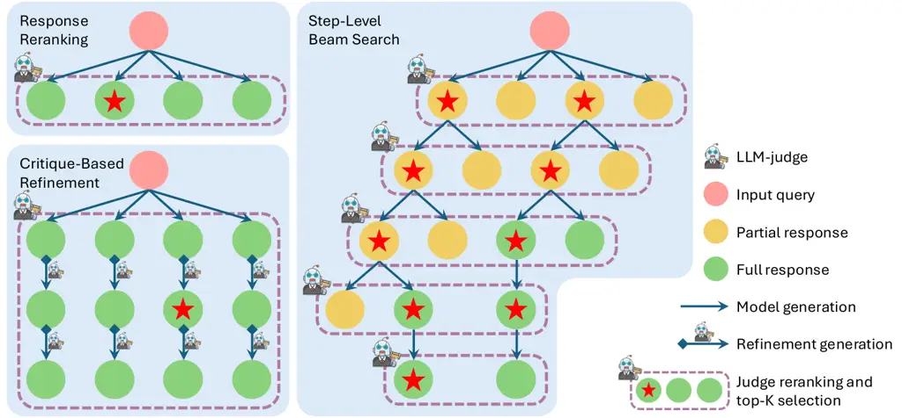
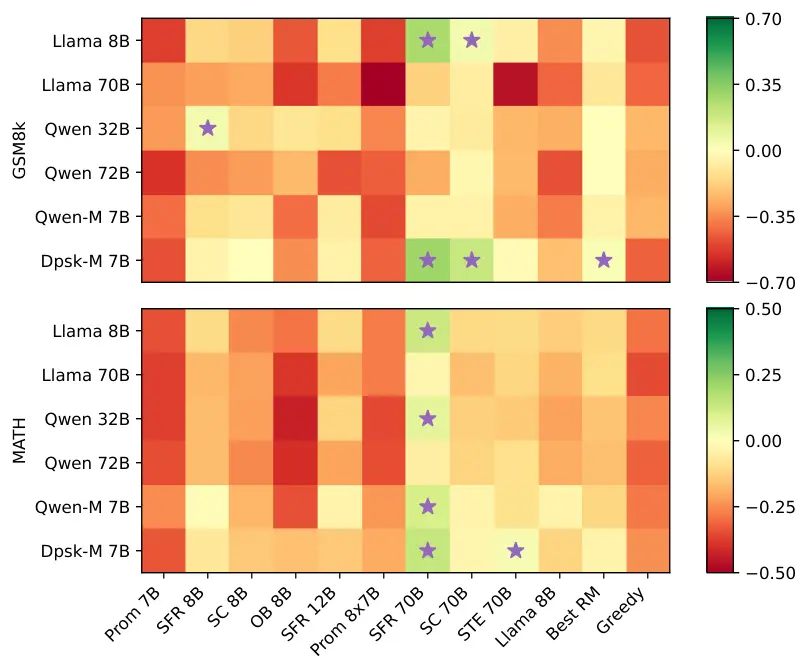
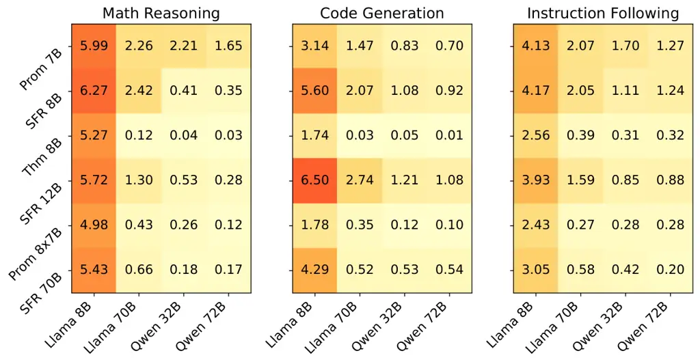
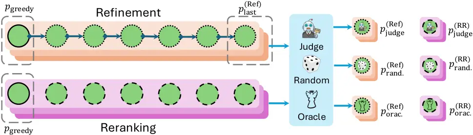

# Evaluating Judges as Evaluators: The Jetts Benchmark of LLM-as-Judges as Test-Time Scaling Evaluators

Yilun Zhou Affiliation: Salesforce AI Research Correspondence to:
<yilun.zhou@salesforce.com>    Austin Xu Affiliation: Salesforce AI
Research Correspondence to: <austin.xu@salesforce.com>    Peifeng Wang
Affiliation: Salesforce AI Research    Caiming Xiong
Affiliation: Salesforce AI Research    Shafiq Joty
Affiliation: Salesforce AI Research

###### Abstract

Scaling test-time computation, or affording a generator large language
model (LLM) extra compute during inference, typically employs the help
of external non-generative evaluators (i.e., reward models).
Concurrently, LLM-judges, models trained to generate evaluations and
critiques (explanations) in natural language, are becoming increasingly
popular in automatic evaluation. Despite judge empirical successes,
their effectiveness as evaluators in test-time scaling settings is
largely unknown. In this paper, we introduce the Judge Evaluation for
Test-Time Scaling (Jetts) benchmark, which evaluates judge performance
in three domains (math reasoning, code generation, and instruction
following) under three task settings: response reranking, step-level
beam search, and critique-based response refinement. We evaluate 10
different judge models (7B-70B parameters) for 8 different base
generator models (6.7B-72B parameters). Our benchmark shows that while
judges are competitive with outcome reward models in reranking, they are
consistently worse than process reward models in beam search procedures.
Furthermore, though unique to LLM-judges, their natural language
critiques are currently ineffective in guiding the generator towards
better responses.

###### Keywords: 

LLM-as-judge, test-time scaling, reward model, benchmark

^(†)^(†)affiliationnotice: Equal contribution

[https://github.com/SalesforceAIResearch/jetts-benchmark](https://github.com/SalesforceAIResearch/jetts-benchmark)

## 1 Introduction



|                       |                        |                          |                         |
| --------------------- | ---------------------- | ------------------------ | ----------------------- |
| Judge                 | Reranking $`\uparrow`$ | Beam Search $`\uparrow`$ | Refinement $`\uparrow`$ |
| Prometheus-2 7B       | -0.107                 | -0.100                   | 0.976                   |
| SFR-Judge 8B          | 0.035                  | 0.001                    | 0.941                   |
| Skywork-Critic 8B     | 0.039                  | 0.046                    | \-                      |
| OffsetBias 8B         | -0.020                 | 0.015                    | \-                      |
| Themis 8B             | -0.149                 | -0.021                   | 0.996                   |
| SFR-Judge 12B         | 0.013                  | 0.047                    | 0.943                   |
| Prometheus-2 8x7B     | -0.079                 | -0.083                   | 0.966                   |
| SFR-Judge 70B         | 0.171                  | 0.138                    | 0.951                   |
| Skywork-Critic 70B    | 0.177                  | 0.132                    | \-                      |
| Self-Taught Eval. 70B | 0.095                  | 0.072                    | \-                      |
| Best RM               | 0.113                  | \-                       | \-                      |
| Best PRM              | \-                     | 0.195                    | \-                      |
| Random                | -0.193                 | -0.139                   | \-                      |
| Baseline Value        | 0.000                  | 0.000                    | 1.000                   |

Figure 1: Top: a graphical description of the three test-time compute
tasks in Jetts used to evaluate LLM-judges. Bottom: the leaderboard of
judges on the three benchmark tasks, along with outcome/process reward
models and random choice. “-” means that the model cannot be used for
the task. Achieving a value less than the baseline (grayed out) means
that the judge is worse than some less compute-intensive approach (e.g.,
greedy decoding, see Sec. 3.5 for details).

For the last several years, the rapid increase in various capabilities
of large language models (LLMs) is mostly attributed to scaling – the
corresponding increase in model and training data sizes (Kaplan et al.,
2020; Hoffmann et al., 2022). Nonetheless, this effort has gradually
saturated due to lack of additional data and prohibitive cost of model
training and serving. Recently, test-time scaling is being considered as
an alternative solution, in which more compute is dedicated at the test
time in the hope that better model responses are generated (Snell
et al., 2024; Jaech et al., 2024).

A common component in test-time compute is the evaluator model, which
gives a quality signal to various generated responses. Scalar reward
models (RMs) are predominantly used to rerank either complete responses
in best-of-N selection or partial responses in step-wise generation
(e.g., beam search). By contrast, generative LLM judges are often
favored in model evaluation, e.g., AlpacaEval (Dubois et al., 2024b) and
MT-Bench (Zheng et al., 2023), since they can adapt to custom evaluation
criteria and can (often) produce natural language critiques (or
explanations) of the response.

Despite LLM-judges achieving competitive performance on reward model
benchmarks (e.g., RewardBench (Lambert et al., 2024)) and PPE (Frick
et al., 2024)), they are less commonly used in test-time scaling
scenarios compared to scalar RMs (Ji et al., 2025; Ke et al., 2025).
This gap is perhaps surprising given the potential benefits of
LLM-judges. Namely, judge models are often trained to engage in
chain-of-thought reasoning before giving a judgment, which could not
only benefit for reasoning-intensive domains such as math and code, but
also serve as effective critiques for the model to refine its
generation, such as in Reflexion (Shinn et al., 2024) or SCORE (Zhang
et al., 2024b). Furthermore, LLM-judges could seamlessly integrate tool
use. Last, LLM-judges are inherently “instructable”, capable of giving
different types of judgment like binary yes/no answers, numerical
scores, fine-grained feedback, etc., simply with different prompts.

In this paper, we propose the first systematic benchmark of LLM-judges
for model’s test-time scaling. This benchmark consists of three tasks
(Fig. 1): (1) response reranking, where the judge picks the best
response out of several ones, (2) step-level beam search, where the
judge guides the model to generate the response step-by-step, and (3)
critique-based refinement, where the judge offers natural language
critique to the response for the model to refine. We evaluate 10
different judge models, ranging in size from 7B to 70B parameters on
these three test-time scaling tasks. We cover 3 different domains (math
reasoning, code generation, and instruction following) and generate
responses from up to 8 unique LLMs, ranging in size from 6.7B to 72B
parameters.

The Jetts setup enables us to analyze the effects of judge-guided
test-time scaling: Can a “weak” (e.g., 8B) judge actually help a
“strong” (e.g., 72B) generator? How beneficial are strong judges to weak
generators? In what domains are the current crop of judge models best
suited for test-time scaling? How useful are judge critiques in
practice? We find that weak judges can help strong generators in easier
tasks, such as instruction following, but not in reasoning-intensive
tasks like coding or math. Larger judges bring the most benefit for math
and instruction following tasks, but no evaluated judges are able to
reliably improve generator performance for coding. Lastly, while natural
language critiques are touted as a defining advantage of judges over
RMs, we find that such critiques have significant room for improvement
in terms of utility. We present these results with many additional
analyses in Sec. 4.

Figure 2: Judge performance on RewardBench vs. Jetts, where marker size
signifies judge model size (7B-70B). Small judges perform comparably to
large judges on RewardBench, but lag large judges on Jetts, which
simulates test-time scaling settings.

Comparison with RewardBench. In Fig. 2, we present a preview of our
results by comparing performance on JETTS Best-of-N Reranking and Beam
Search tasks against RewardBench (Lambert et al., 2024), a popular RM
and judge model benchmark. While judge performance between the two
benchmarks is generally correlated, Jetts reveals a difference in the
“fundamental judging ability” between judges of different scales. For
example, if deciding between Skywork-Critic-8B and 70B, the practical
choice based on RewardBench is to use the 8B model, trading off 4% in
accuracy for an order of magnitude fewer parameters. Jetts, which
simulates test-time scaling scenarios, reveals that this choice is
suboptimal for reranking: The 8B judge yields substantively lower
improvements over the greedy response than the 70B judge. The benchmark
construction approach likely contributes to the difficulty gap:
RewardBench forms pairs of responses from different generators, meaning
judges can arrive at the right outcome via stylistic factors, like
formatting (Tan et al., 2024). Jetts, however, requires judges to
compare responses sampled from the same generator, limiting stylistic
factors that lead to correct outcomes.

## 2 Background and Related Work

The concept of using more computation at test time to increase model
performance is not new. Chain-of-thought (CoT) reasoning (Nye et al.,
2021; Kojima et al., 2022; Wei et al., 2022) can be considered as one of
the earliest such techniques, where the model is encouraged to generate
a reasoning chain before producing the final response. When the query
asks for a “single-target” response (e.g., number, True/False, or name),
self-consistency (Wang et al., 2022) samples multiple CoT chains and
returns the majority vote answer. Orthogonally, tree-of-thoughts (Yao
et al., 2024) and graph-of-thoughts (Besta et al., 2024) break down the
chain into individual steps to search over.

While some studies (Madaan et al., 2024; Saunders et al., 2022) find
that a model could improve or correct its own response, others highlight
various issues and limitations in these approaches based on the
fundamental paradox that if a model knows where it gets wrong, why it
does not simply output the correct response in the beginning (Huang
et al., 2023; Stechly et al., 2023; Valmeekam et al., 2023; Shridhar
et al., 2024). Thus, a new trend in test-time compute is the use of an
evaluator to help with model response, commonly known as the reward
model (RM) (Liu et al., 2025; Cobbe et al., 2021; Ouyang et al., 2022).
Beyond RMs that operate on complete responses, known as outcome RMs
(ORMs), for reasoning tasks it is also possible to train process RMs
(PRMs) to provide step-level rewards (Wang et al., 2023a; Lightman
et al., 2023; Zhang et al., 2025b; Luo et al., 2024; Dai et al., 2024).

Mostly parallel to this effort is the development of LLM-as-judges
(Zheng et al., 2023), i.e., specializing LLMs into judges of model
responses. While vanilla models are originally used (e.g., GPT-4 in
AlpacaEval (Dubois et al., 2024b)), finetuned models are often found to
deliver superior performance and be less susceptible to bias (Park
et al., 2024). To further leverage the reasoning abilities of LLMs and
improve explainability, recent judges are finetuned to generate
reasoning or critiques for the response, often before the final
judgment. Since then, a long line of work has been proposed in
developing specialized LLM-judge models, focusing both on data
curation (Wang et al., 2024b; Kim et al., 2023; Kim et al., 2024; Wang
et al., 2023b; Li et al., 2023; Vu et al., 2024) and training
methodologies (Wang et al., 2024a; Hu et al., 2024; Ye et al., 2024;
Saad-Falcon et al., 2024; Deshpande et al., 2024; Wang et al., 2024b).

As RMs and LLM-judges are both evaluators in nature, they can often be
directly compared, most notably on the RewardBench leaderboard (Lambert
et al., 2024), showing close performance among the best RMs and
LLM-judges. Due to saturating performance on RewardBench, with top
models achieving over 95% accuracy, new benchmarks have been proposed to
evaluate the efficacy of evaluators (Feuer et al., 2024; Liu et al.,
2024b). Notably, ProcessBench (Zheng et al., 2024) was proposed to
evaluate how process reward models (PRMs) perform in identifying
step-level mistakes in math reasoning. PPE (Frick et al., 2024) and
RMB (Zhou et al., 2024) both evaluate RM and LLM-judge efficacy in
pairwise preference and Best-of-N settings for alignment, focusing on
chat quality and safety. JudgeBench (Tan et al., 2024) identifies
shortcomings with RewardBench’s reasoning samples, and proposes a more
difficult pairwise evaluation set for reasoning tasks. Complementing
outcome-based judge benchmarks, Lan et al. (2024); Lin et al. (2024)
evaluate the quality of critiques for single-round refinement.

Jetts, unlike recent judge benchmarks, does not assess judges using
fixed pairwise test sets. Instead, it simulates three distinct test-time
scaling scenarios (reranking, beam search, and multi-round refinement)
and evaluates the quality of LLM judges by measuring the improvement
they bring to the generator model. Snell et al. (2024) orthogonally
investigate the efficacy of different test-time-compute scaling
approaches (Best-of-N reranking and step-by-step beam search) with a
fixed RM. Similarly, Zhang et al. (2024a) investigates different types
of verifiers for best-of-N reranking, considering only one evaluation
protocol (binary correctness) for one prompted LLM-judge baseline per
domain.

## 3 The Jetts Benchmark

In this section, we present our proposed benchmark: Judge Evaluation for
Test-Time Scaling (Jetts). As previewed in Sec. 1, Jetts consists of
three tasks: response reranking, step-level beam search, and
critique-based refinement.

### 3.1 Task and Dataset Selection

Judge evaluation has typically focused on judging instruction following
as a proxy for chat quality (Zeng et al., 2023). However, most recent
efforts in test-time scaling have focused on math and code (e.g., Snell
et al. (2024); Brown et al. (2024)). To cover both typical judge and
test-time scaling domains, we consider three types of tasks: math
reasoning, code generation and instruction following; we list the
datasets in Tab. 1. In order to minimize the effect of randomness, we
pre-compute the model responses and release them as part of the
benchmark wherever possible.

|                       |              |      |                                |
| --------------------- | ------------ | ---- | ------------------------------ |
| Task                  | Dataset      | Size | Evaluation metric              |
| Math Reasoning        | GSM8k        | 1319 | Accuracy via Math-Verify       |
|                       | MATH (Lvl 5) | 1324 | Accuracy via Math-Verify       |
|                       | CHAMP        | 270  | Accuracy via GPT-4o grading    |
| Code Generation       | HumanEval+   | 164  | Pass @ 1                       |
|                       | MBPP+        | 378  | Pass @ 1                       |
|                       | BigCodeBench | 1140 | Pass @ 1                       |
| Instruction Following | AlpacaEval   | 805  | Win rate vs. GPT-4 Turbo, with |
|                       |              |      | GPT-4 Turbo as judge           |
|                       | IFEval       | 541  | Prompt-level strict accuracy   |

Table 1: List of datasets and associated metrics in Jetts.

For math, we use GSM8k (Cobbe et al., 2021), MATH (Hendrycks et al., 2021) and CHAMP (Mao et al., 2024). For code, we use HumanEval+ (Liu
et al., 2023a), MBPP+ (Liu et al., 2023a) and BigCodeBench (Zhuo et al.,
2024). HumanEval+ and MBPP+ are further refined versions of HumanEval
(Chen et al., 2021) and MBPP (Austin et al., 2021), respectively. For
instruction following, we use AlpacaEval (Dubois et al., 2024b) and
IFEval (Zhou et al., 2023), with the former being LLM-evaluated and
latter being algorithmically evaluated. App. A contains additional
details about evaluation protocols.

### 3.2 Task 1: Response Reranking

The most straightforward and used inference-time compute technique is
response reranking, where the generator model samples multiple responses
with stochastic decoding and the judge reranks them to select the best
one. In our benchmark, recognizing that the greedy decoding often
produces higher quality responses, for each input query, we generate the
greedy response and 9 sampled responses with a temperature of 1.0 and
top-$`p`$ with $`p=0.95`$, for a total of 10 responses.

We ask LLM-judge to rerank and select the top response for evaluation.
Since no current judge supports one-shot direct reranking of multiple
responses, we consider two protocols: pairwise round-robin and
single-instance rating. In the former, for the $`N`$ responses, we
construct the $`N(N-1)/2`$ response pairs, query the judge on each pair,
assign the winner a score of 1 and the loser a score of 0, and select
the response with the highest score (random tie-breaking if necessary)¹¹
1 To account for positional bias, we employ additional consistency
checks which may lead to ties; See App. B.1 for details.. In the latter,
we ask the judge to generate a score (an integer between 1 and 5), and
the select the response with the highest score. Since ties are much more
common in the single-instance rating setting, we keep all tied responses
and report min, average and max performance; e.g., if for a test sample,
a judge rates 3 of 10 responses as the highest score, and those 3
responses have accuracy labels $`(1,0,1)`$, then we use accuracy values
$`(0,2/3,1)`$ for this sample when aggregating (min, average, max)
performance.

Since the base performance is very different across datasets and
generators, we define and report the normalized helpfulness for the
judge as

```math
\displaystyle h=\frac{p_{\mathrm{judge}}-p_{\mathrm{greedy}}}{p_{\mathrm{oracle}}-p_{\mathrm{greedy}}}, \tag{1}
```

where $`p_{\mathrm{greedy}}`$ is the average performance of the greedily
decoded responses across the dataset, $`p_{\mathrm{oracle}}`$ is the
oracle judge performance over all response selections (e.g., selecting
the correct response for a math problem whenever there is one), and
$`p_{\mathrm{judge}}`$ is the average performance of top responses
reranked by the judge. A negative value indicates strict harm as $`h=0`$
can be trivially achieved by selecting the greedy response. We also
include random baseline (i.e., the expected helpfulness of a judge that
randomly reranks the responses) to compare each judge against an
‘‘average’’ reranker. For GSM8k and MATH, we also compute the
performance of the majority-vote answer for each problem²² 2
Majority-vote aggregation is not feasible for CHAMP since GPT-4o
directly grades natural language responses against the ground truth
without extracting the “final answer”..

### 3.3 Task 2: Step-Level Beam Search

Using an evaluator to control the flow of generation is increasingly
popular. For example, when generating the response line-by-line to a
coding problem, an evaluator could decide that newly generated line is
bad and hence asks the generator to resample a new line. In this task,
we generalize this procedure to beam search. Since this procedure
requires the notion of steps in a response, we consider only math and
code tasks, and define each step as a line of response from our
observation that the generated math solutions often put each step on its
own line and the fact that each line of code naturally represents a
programmatic operation.

In a $`(N,M)`$-beam search with beam width of $`M`$, the generator
samples $`N`$ first steps, which are reranked by the judge to keep the
top-$`N/M`$. Then, for each chosen step, the generator samples $`M`$
next steps, for a total of $`N`$ responses to rerank again. When a
generation ends (due to the EOS token or length limit), its current step
is not expanded, resulting in less than $`N`$ responses. This process
repeats until all selected steps are finished, at which time a final
reranking selects the top response. Similar to before, in each sampling,
one response is greedily decoded and the rest are sampled with
temperature of 1.0 and top-$`p`$ of 0.95. We use (10, 2)-beam search in
the benchmark and limit the tree depth to 10.

Notably, the beam search requires LLM-judges to reason about partial
responses, a use case not specifically designed for any of the current
judge models. Nonetheless, since they are often trained with flexible
judging criteria, we append the following to the existing ones in this
task:

Important note: the model response is generated with streaming, meaning
that it may not be finished yet but we still want to get a sense of the
partial progress so far. If this is the case, you should provide
judgment and feedback on the currently generated part, focusing on its
correctness and promise of leading to a correct final solution.

Finally, we consider a _lookahead_ variant of beam search similar to
Snell et al. (2024), where instead of sending partial responses to the
judge, we complete them with greedy decoding to finish and send these
“lookahead” versions (without adding the instruction above). To
contextualize judge performances, we again compute the greedy, random
and oracle performance and derive normalized helpfulness.

### 3.4 Task 3: Critique-Based Refinement

A unique feature of LLM-judges is their ability to generate natural
language critiques, or explanations, for their judgments. The
critique-based refinement task evaluates whether these critiques are
helpful for the model to improve their response. Specifically, we define
a $`(N,M)`$-refinement as the setup where we start with $`N`$ seed
responses, and each response is iteratively refined $`M`$ times, for a
total of $`N(M+1)`$ responses, which is reranked at the end to selected
the top response. Compared to reranking and beam search, in which the
judge reweighs the output distribution, in refinement the judge directly
modifies it with its critique.

Since most judges are finetuned on fixed judging templates, they may not
be able to directly revise responses. We instead provide the generator
model the judge rating and critique, and ask it to revise its response
using the feedback with the prompt shown in Fig. 18 of App. A.3. In our
benchmark, we consider $`(1,9)`$-refinement, which yields 10 responses
in total to make it directly comparable to the reranking task.

While reranking and beam search have oracle performance as a natural
upper-bound to define normalized helpfulness, refinement has no such
oracle. Therefore, we use improvement ratio over reranking and greedy
responses as measure of judge efficacy, defined as

```math
\displaystyle\delta^{\mathrm{(RR)}}=p_{\mathrm{judge}}^{\mathrm{(Ref)}}/p_{\mathrm{judge}}^{\mathrm{(RR)}},\quad\delta^{\mathrm{(G)}}=p_{\mathrm{judge}}^{\mathrm{(Ref)}}/p_{\mathrm{greedy}}, \tag{2}
```

where, for $`(N,M)`$-refinement, $`p_{\mathrm{judge}}^{\mathrm{(Ref)}}`$
is the average performance of the refined-and-reranked response across
the dataset, and $`p_{\mathrm{judge}}^{\mathrm{(RR)}}`$ is that of the
reranked response among $`N(M+1)`$ sampled ones (including one greedy)
and $`p_{\mathrm{greedy}}`$ is that of the greedy response. In our
$`(1,9)`$-refinement setup, the latter two quantities are directly taken
from the results in Task 1 of reranking on 10 responses.

In order for refinement to be a meaningful test-time scaling procedure,
we need it to outperform both reranking and greedy. So we define the
effective improvement ratio as

```math
\displaystyle\delta^{\mathrm{(Eff)}}=\min\left(\delta^{\mathrm{(RR)}},\delta^{\mathrm{(G)}}\right). \tag{3}
```

### 3.5 The Jetts Leaderboard

Finally, we compute a leaderboard (Fig. 1) for three tasks. We use
normalized helpfulness $`h`$ (Eq. 1) to measure judge performance on
reranking and refinement, and effective improvement ratio
$`\delta^{\mathrm{(Eff)}}`$ (Eq. 3) on refinement. Each judge’s score is
computed by averaging the task-specific metric over all datasets and
generators. If a judge supports multiple protocols (e.g., both single
rating and pairwise comparisons in reranking), we report the maximum
aggregate performance among all protocols. For convenience, we include
per-dataset and per-generator metrics for each of the three tasks for
all evaluated judges in App. C.

Practitioner note. Beam search evaluation requires significantly more
compute than reranking evaluation. While Task 3 reveals interesting
findings, e.g., judges generalize to some degree to assessing partial
responses, we find reranking and beam search performance to be
correlated; see Fig. 2 and analysis in Sec. 4.3. Our recommendation for
practitioners is to use reranking performance as a proxy for beam search
performance when evaluating future judge models, unless working
specifically on process-based judging.

## 4 Experimental Results

### 4.1 Experiment Setup

As introduced in Sec. 3.1, Jetts consists of eight datasets from three
task categories: math reasoning, code generation and instruction
following. Models listed in Tab. 2 (top) generate the responses. We use
Llama 3.1 (Dubey et al., 2024) and Qwen 2.5 (Yang et al., 2024) models
in all tasks. For math and code tasks, we also consider four
domain-specific models and intentionally choose newer models, Qwen
math (Yang et al., 2024) and coder (Yang et al., 2024), and older
models, DeepSeek math (Shao et al., 2024) and coder (Guo et al., 2024),
to analyze how judge-based test time scaling improves models of
different strengths.

Tab. 2 (bottom) lists the LLM-judge models that we benchmark. We
additionally include several baseline models:

- •
  the vanilla Llama-3.1-8B-Instruct model with SFR-Judge prompts for
  response reranking;
- •
  three ORMs for response reranking: Llama-3-OffsetBias-RM-8B
  (OB$`{}_{\textrm{RM}}`$), Skywork-Reward-Llama-3.1-8B-v0.2 and
  Skywork-Reward-Gemma-2-27B-v0.2 (S$`{}_{\textrm{RM}}`$); and
- •
  PRM Qwen2.5-Math-PRM-7B (Q$`{}_{\textrm{PRM}}`$) for beam search.

App. A.2 includes more details on judges and RMs.

For all results presented below, unless otherwise noted, we perform
statistical analyses of reported quantity differing from the baseline
value (0 for reranking and beam-search, and 1 for refinement) using a
two-sided one-sample $`t`$-test and indicate the significance as “\*”
for $`p\leq 0.05`$, “\*\*” for $`p\leq 0.01`$, “\*\*\*” for
$`p\leq 0.001`$, and “n.s.” or no marker for not significant
($`p>0.05`$).

|                         |           |                   |          |
| ----------------------- | --------- | ----------------- | -------- |
| Generator Model         | \# Params | Generator Model   | \#Params |
| Llama-3.1-Instruct      | 8, 70B    | Qwen-2.5-Instruct | 32, 72B  |
| Deepseek-Math-Instruct  | 7B        | Qwen-2.5-Math     | 7B       |
| Deepseek-Coder-Instruct | 6.7B      | Qwen-2.5-Coder    | 7B       |

|                   |                       |       |            |                      |        |          |
| ----------------- | --------------------- | ----- | ---------- | -------------------- | ------ | -------- |
| Judge Model       |                       | Abbr. | \# Params  | Supported Capability |        |          |
|                   |                       |       |            | Pairwise             | Single | Critique |
| SFR-Judge         | (Wang et al., 2024a)  | SFR   | 8, 12, 70B | ✓                    | ✓      | ✓        |
| Skywork-Critic    | (Shiwen et al., 2024) | SC    | 8, 70B     | ✓                    | ✗      | ✗        |
| OffsetBias        | (Park et al., 2024)   | OB    | 8B         | ✓                    | ✗      | ✗        |
| Prometheus        | (Kim et al., 2024)    | Prom  | 7, 8x7B    | ✓                    | ✓      | ✓        |
| Self-Taught-Eval. | (Wang et al., 2024b)  | STE   | 70B        | ✓                    | ✗      | ✗        |
| Themis            | (Hu et al., 2024)     | Thm   | 8B         | ✗                    | ✓      | ✓        |

Table 2: Top: the generator models to produce the model responses. The
models on the first row are used in all tasks, and those on the second
and third rows are used only in math and code tasks respectively.
Bottom: The judge models used in our experiments.

### 4.2 Response Reranking

As discussed in Sec. 3.2, since no judge supports direct reranking of
$`N`$ responses, we use either pairwise round-robin comparison or
single-instance rating and evaluate each judge on the protocol(s) it
supports. Furthermore, we experiment with to judging prompts for single
rating: Likert scale, where judges are not given fine-grained criteria
and simply asked to rate on a 1-5 scale, and additive criteria (Yuan
et al., 2024), which instructs the model incrementally increase score
based based on given criteria, with a maximum score of 5. The full
results are presented in Tab. 3-5 in App. B.1. Below, we highlight
notable findings.

Figure 3: Normalized helpfulness of judge reranking per dataset.
Asterisks on the bars denote statistical significance described at the
end of Sec. 4.1.

Reranking helpfulness varies across protocols and datasets. Fig. 3 plots
normalized helpfulness per dataset averaged across judges and
generators, along with the respective random performance. There are two
notable trends.

First, the pairwise protocol typically performs better than the
single-rating protocol with either Likert or additive rubric, with the
only exception of MBPP+, with all protocols worse than the greedy
baseline. This is consistent with past findings, where both humans (Shah
et al., 2016) and LLM-judges (Liu et al., 2023b) are better at providing
pairwise comparison responses than single-rating responses. Given this
finding, for the next two benchmarking tasks, step-level beam search and
critique-based refinement, we use the pairwise protocol in reranking
whenever possible. However, this comes at a significant inference cost,
as the judge inference for pairwise reranking takes $`O(N^{2})`$ time
for $`N`$ responses to rerank, compared to $`O(N)`$ for single-instance
rating.

Second, there are also significant variations across datasets, even
within the same task category: pairwise protocols help on GSM8k and MATH
but not CHAMP, and all protocols help on AlpacaEval (for both win rate
and length-controlled win, as we show in App. B.1) but none on IFEval.
Overall, judge helpfulness highly depends on the dataset, and further
fine-grained analyses to understand the strengths and weaknesses of
judgment would be valuable³³ 3 Although different sets of judges are
used to compute the average for pairwise vs. single-instance protocols
due to different supported capabilities, Fig. 20 of App. B.1 shows that
these trends largely preserve within judges that support both
capabilities..

Figure 4: Normalized helpfulness of the pairwise protocol across task
categories of each judge, compared to Llama-3.1 8B with judge prompt,
best reward model and random reranking, averaged across generator models
and datasets. A violin plot depicting finer-grained distributions is in
Fig. 21 of App. B.1.

Inter-task helpfulness variation is consistent across different judges.
Fig. 4 plots the normalized helpfulness of each judge on each task
category for the pairwise protocol, aggregating over respective datasets
and all generator models. With few exceptions, all judges, including the
vanilla Llama-3.1-8B Instruct with judge prompt and the reward models,
demonstrate highest helpfulness for instruction following, less but
mostly positive helpfulness for math reasoning, and mostly negative
helpfulness for code generation. For single-rating protocols, consistent
with Fig. 3, the helpfulness is much lower, but the relative ranking is
still generally the same, as shown in Fig. 22 of App. B.1.

The consistency of inter-task helpfulness among judges coincides with
the instruction-following training (and prompting) emphasis of current
LLM-judges (Park et al., 2024; Tan et al., 2024). Despite training data
including both math and code samples (e.g., Vu et al. (2024); Shiwen
et al. (2024)), judge-specific finetuning seems to primarily boost
instruction-following evaluation abilities, sometimes at the cost of
other capabilities. This effect is shown in Fig. 4, where the vanilla
Llama 3.1 8B model, prompted as a judge, exhibits a baseline level of
competency as a judge, performing roughly at the greedy response level.
Comparably sized 7B/8B judge models outperform it significantly on
instruction-following and moderately on math, but performance degrades,
sometimes significantly, on coding. Moreover, task-specific judge
prompting does not appear to mitigate this task gap, as we show in
Fig. 23 in App. B.1.

Figure 5: Normalized helpfulness under the pairwise protocol for
different judge-to-generator size ratios, along with the best-fit lines
for each task in log scale.



Figure 6: Normalized helpfulness difference between each judge and
majority-vote for each generator on GSM8k and MATH. Positive value cells
are marked with purple stars.

Larger judge-to-generator size ratio under the pairwise protocol
increases helpfulness for math and instruction following, but not code.
For each pair of judge and generator, Fig. 5 plots the ratio of the
number of parameters in the judge to that in the generator (on
log-scale) vs. the helpfulness achieved by the judge, color-coded by
task category. A linear regression is plotted for each task on the
log-scale size ratio. For math reasoning, a larger size ratio
statistically significantly increases helpfulness, indicating the
promise of larger judges for small generators, (which, nonetheless, may
not be practical). At the lower end of size ratio around 0.1 (e.g., 8B
judge for 70B generator), normalized helpfulness is negative on average,
indicating the absence of “weak-to-strong” guidance ability for
LLM-judges. For instruction following, all size ratios achieve positive
helpfulness but the effect of ratio increase is less notable. For code
generation, the size ratio does not have an effect on the helpfulness,
which is negative at all size ratios. For single-ratings protocol with
Likert and additive rubrics (Fig. 24 of App. B.1), the effect of the
size ratio is mildly positive only on math datasets, at 0.07 and 0.03
respectively, and negative on both of the other two tasks.

No judge can reliably outperform majority-vote on math datasets. The
output format specification of GSM8k and MATH allows us to easily
extract the final answer from the generated response, and compute the
majority-vote (i.e., self-consistency (Wang et al., 2022)) performance.
In Fig. 6, we plot the difference in the normalized helpfulness between
each judge and this heuristic and mark all positive cells with purple
stars. On GSM8k, only SFR 70B and SC 70B offer substantive improvement
over majority-vote, but only for relatively weak generator models. For
MATH, only SFR 70B is able to meaningfully beat majority-vote on
small-to-medium generators only. Thus, in theory, an LLM that simply
extracts the majority-vote answer could serve as a very strong reranker
for these datasets.

Judges are over-lenient under the single rating protocol, resulting in a
large number of top-ranked responses. Despite more time-efficient,
single-rating evaluation protocol performance results in evaluation that
is too lenient. Judges often rate a significant fraction of the $`N`$
responses a top score (i.e., a $`4`$ or $`5`$), with the most lenient
models consistently rating all 10 responses equally high (Fig. 25 of
App. B.1). Multiple responses tied as the “best” response leads to large
ranges of possible reranking performance. Fig. 7 shows the average
performance, as well as the minimum and maximum achievable performances
from the tied responses. If one were to employ random tie-breaking,
performance can swing from extremely poor to near oracle.

Figure 7: Normalized helpfulness ranges for single-rating protocols,
showing minimum and maximum performance achievable from tied top-rated
responses, along with average performance.

### 4.3 Step-Level Beam Search

As mentioned in Sec. 3.3, we focus on math and code tasks since their
solutions can naturally be decomposed down into steps. We consider the
(10, 2)-beam search, where the judge needs to rerank 10 candidates at
each step and select the top-5, which get expanded to 10 next-step
candidates. We use the pairwise protocol for the all rerankings, except
for Themis 8B, a single instance rating judge, where we use the additive
prompt. The full results are presented in Tab. 9 of App. B.2, and we
highlight notable findings below.

The effects of judge-to-generator size ratio are similar to that of
reranking. Fig. 8 shows the judge helpfulness vs. the ratio of the
number of parameters in the judge to that in the generator (on
log-scale), along with a linear regression for each task. The effects of
judge-to-generator are remarkably similar to that in reranking: for math
reasoning, a larger size ratio results in statistically significant
helpfulness gains, with generally negative helpfulness for smaller size
ratios. Like reranking, small judges are unable to provide
“weak-to-strong” improvements for large generators, revealing the need
for large judges for beam search. This requirement may be impractical
due to the significant computational overhead required to judge outputs
at each “step”. For code, scaling judge size relative to the generator
produces no statistically significant gains: for all size ratios, the
helpfulness is negative.

Figure 8: Normalized helpfulness of beam search under for different
judge-to-generator size ratios, along with the best-fit lines for each
task in log scale.

Figure 9: Normalized helpfulness of beam search by each judge and
Qwen-2.5-Math-PRM 7B. The judge’s reranking performance on the task
category is plotted for comparison, as well as the random beam search
baseline.

LLM-judges lag significantly behind the small Q$`{}_{\textrm{PRM}}`$.
Fig. 9 compares the normalized helpfulness of non-lookahead vs.
lookahead beam search for different judges, along with reranking, random
and Q$`{}_{\textrm{PRM}}`$ performance. For math reasoning, while some
judges can achieve positive helpfulness, they struggle to outperform
reranking even with much more judge inference. More notably, by far the
best result is achieved by the 7B parameter Q$`{}_{\textrm{PRM}}`$. For
code generation, only large judges achieve positive helpfulness, with
only SC 70B providing statistically significant improvement.
Q$`{}_{\textrm{PRM}}`$, although finetuned on math data, still achieves
decent helpfulness at much smaller scale. These results suggest that
even though some judges are finetuned to work with flexible rubrics,
process judgment is likely too out-of-distribution for small judges to
be effective.

The benefit of lookahead is inconclusive. In the lookahead mode, rather
than incomplete responses, judges evaluate full, rolled out responses,
more aligned with judge training distributions. However, somewhat
surprisingly, lookahead is not universally beneficial. For math
reasoning, Fig. 9 shows that it benefits seven judges and
Q$`{}_{\textrm{PRM}}`$, sometimes by two to three times, while slightly
hurting the other three judges. For code generation, lookahead benefits
five judges while hurting the other five and Q$`{}_{\textrm{PRM}}`$,
with much milder effects. Overall, judges that perform well on reranking
full responses tend to benefit from lookahead, whereas weaker ones tend
to benefit from non-lookahead. This suggests that splitting full
responses into shorter chunks makes evaluation easier for them, despite
the out-of-distribution nature of step-level evaluation.

Figure 10: Relationship of judge’s reranking vs. beam search
performance, and non-lookahead vs. lookahead performance.

There is a high correlation among non-lookahead, lookahead and reranking
performance. Fig. 10 plots the correlation between each judge’s
reranking performance and beam search performance (left), and the
correlation between its lookahead and non-lookahead performance (right),
with each scatter point representing a pair of dataset and generator. We
observe high correlation among the three quantities, suggesting that
they are all likely to be tied under the same underlying “fundamental
judging capability” of the judge.

### 4.4 Critique-Based Refinement

Figure 11: Effective improvement ratio $`\delta^{\mathrm{(Eff)}}`$ for
each judge and task category.

Since this setup requires the judge to generate a critique on its
judgment of an individual sample, we only evaluate judges with both
single-instance rating and critique-generation capabilities in Tab. 2:
SFR-Judge, Prometheus and Themis. In addition, when reranking the final
candidate responses, as the reranking performance is much better with
pairwise round-robin than single-instance rating (Sec. 4.2), we use the
former whenver the judge supports it (i.e., for SFR-Judge and
Prometheus) and fall back to the latter otherwise (i.e., for Themis).
The full results are presented in Tab. 10 of App. B.3, with notable
findings discussed below.

No judge yields a beneficial performance on refinement across task
category. For individual judges, Fig. 11 plots the average effective
improvement ratio $`\delta^{\mathrm{(Eff)}}`$ for each judge, with no
judge achieving a ratio better than 1.0. Instruction following
experiences the largest loss, with up to 10% performance degradation.
Thus, we conclude that all are incapable at this task.

Figure 12: Various diagnostic metrics in refinement.



Figure 13: The average number of refinement rounds carried out by each
(judge, generator) pair.

We now focus our analysis on (1) quantifying the utility of refinement
relative to greedy decoding and reranking and (2) precisely quantifying
the behavior of the refine-then-rerank process. To do so, we define the
following metrics. Towards the quantifying refinement utility, denote
$`p_{\mathrm{rand.}}^{\mathrm{(Ref)}}`$ and
$`p_{\mathrm{orac.}}^{\mathrm{(Ref)}}`$ to be the performance of a
randomly selected response and the best performing response from all
responses produced in the refinement process across the dataset, and
analogously $`p_{\mathrm{rand.}}^{\mathrm{(RR)}}`$ and
$`p_{\mathrm{orac.}}^{\mathrm{(RR)}}`$ on responses in reranking. We
define
$`\delta_{\mathrm{rand.}}^{\mathrm{(RR)}}=p_{\mathrm{rand.}}^{\mathrm{(Ref)}}/p_{\mathrm{rand.}}^{\mathrm{(RR)}}`$,
$`\delta_{\mathrm{orac.}}^{\mathrm{(RR)}}=p_{\mathrm{orac.}}^{\mathrm{(Ref)}}/p_{\mathrm{orac.}}^{\mathrm{(RR)}}`$,
$`\delta_{\mathrm{rand.}}^{\mathrm{(G)}}=p_{\mathrm{rand.}}^{\mathrm{(Ref)}}/p_{\mathrm{greedy}}`$,
$`\delta_{\mathrm{orac.}}^{\mathrm{(G)}}=p_{\mathrm{orac.}}^{\mathrm{(Ref)}}/p_{\mathrm{greedy}}`$.
To gain deeper insights into the refinement process, we examine the
performance using the last refined response without reranking. We denote
$`p^{\mathrm{(Ref)}}_{\mathrm{last}}`$ to be the performance of the last
response from the refinement process across the dataset and define
$`\delta^{\mathrm{(RR)}}_{\mathrm{last}}=p_{\mathrm{last}}^{\mathrm{(Ref)}}/p_{\mathrm{judge}}^{\mathrm{(RR)}}`$
and
$`\delta^{\mathrm{(G)}}_{\mathrm{last}}=p_{\mathrm{last}}^{\mathrm{(Ref)}}/p_{\mathrm{greedy}}`$
to be analogous to $`\delta^{\mathrm{(RR)}}`$ and
$`\delta^{\mathrm{(G)}}`$ defined in Eq. 2. Fig. 26 in App. B.3
illustrates these newly defined $`p`$ metrics.

The refinement process improves upon either reranking or greedy
decoding, but never both. In Fig. 12 (top), we see that
$`\delta^{\mathrm{(RR)}}`$ and $`\delta^{\mathrm{(G)}}`$ are never
meaningfully greater than 1.0 simultaneously on any dataset across all
judges. As such, refinement is typically a sub-optimal choice of
test-time scaling method, with greedy decoding or reranking leading to
better performance.

The benefit of final reranking is small. While Fig. 12 (top) shows that
$`\delta`$ is consistently better than $`\delta_{\mathrm{last}}`$, the
difference is small. Given the $`O(N^{2})`$ complexity of pairwise
reranking, just using the last refinement may be practically favorable.

Figure 14: The distribution of number of refinement rounds conducted by
the Llama 3.1 8B generator, and the index of the chosen response by the
final reranking.

Generators and judges rarely engage in extensive refinement processes. A
notable trend from Fig. 12 (bottom) is
$`\delta_{\mathrm{rand.}}^{\mathrm{(G)}}\approx 1`$ and
$`\delta_{\mathrm{orac.}}<1`$ for all datasets, suggesting that the
refined responses are very similar to the original greedy seed and fail
to discover much better solutions. It turns out, in fact, that the
refinement process is rarely extensive. In Fig. 13, we plot the total
number of generated refinements (excluding the original greedy response)
across the three task categories. Among the four generator models, Llama
8B revised for significantly more rounds than other generators. This may
suggest an intrinsic pliability to taking feedback, and/or result from
its initial greedy response being much worse. Among judges, Prometheus
7B is much better at giving actionable advice to encourage refinement
behavior, which unfortunately does not translate to meaningful benefits
in the final result (Fig. 11).

The final selected response is often generated early on. For Llama 8B,
Fig. 14 plots the distribution of number of refinements (excluding the
greedy seed response) and distribution of the chosen response index (0
for greedy). Llama 8B tends to either refine very minimally or use all
nine rounds. However, the response actually chosen by the final
reranking tends to be generated much earlier in the process, with the
seed response (index 0) still most likely to be chosen, revealing
limited utility of the critiques.

Critiques tend to over-focus on stylistic features than response
quality. We conduct a qualitative study on the critiques in App. B.3. We
inspect over 100 refinements and find two major issues. First, the judge
gives high scores to responses with actual mistakes for stylistic
reasons such as it being easy to follow (Fig. 27), thus failing to lead
the generator to correct the error. Second, the judge is overly critical
about minor stylistic issues on fully correct responses (Fig. 28) so
that the generator engages in meaningless refinements that may even flip
correct answers.

## 5 Conclusion and Future Work

In this paper, we seek to understand the feasibility of using LLM-judges
in place of typically used RMs in test-time compute procedures. To this
end, we propose Jetts, the first such systematic benchmark with three
tasks: response reranking, step-level beam search and critique-based
refinement. Our benchmarking results reveal several limitations and
corresponding future research directions for LLM-judges. First, the
reranking task faces a performance-efficiency dilemma: the pairwise
protocol shows promise in certain domains but runs in $`O(N^{2})`$,
while the $`O(N)`$ single-instance protocol performs much worse.
Improving single-rating ability of judges is essential for
compute-efficient test-time scaling. Further, current chain-of-thought
reasoning generated by the judges is insufficient, both for themselves
to arrive at better judgments, especially in math and code domains, and
for generators as critiques to refine responses. As such, a key
next-step for judge development is to produce better and more useful
reasoning.

## Impact Statement

This paper presents work whose goal is to advance the field of Machine
Learning. There are many potential societal consequences of our work,
none which we feel must be specifically highlighted here.

## References

- Austin et al. (2021) Austin, J., Odena, A., Nye, M., Bosma, M.,
  Michalewski, H., Dohan, D., Jiang, E., Cai, C., Terry, M., Le, Q.,
  et al. Program synthesis with large language models. _arXiv preprint
  arXiv:2108.07732_, 2021.
- Besta et al. (2024) Besta, M., Blach, N., Kubicek, A., Gerstenberger,
  R., Podstawski, M., Gianinazzi, L., Gajda, J., Lehmann, T.,
  Niewiadomski, H., Nyczyk, P., et al. Graph of thoughts: Solving
  elaborate problems with large language models. In _Proceedings of the
  AAAI Conference on Artificial Intelligence_, 2024.
- Brown et al. (2024) Brown, B., Juravsky, J., Ehrlich, R., Clark, R.,
  Le, Q. V., Ré, C., and Mirhoseini, A. Large language monkeys: Scaling
  inference compute with repeated sampling. _arXiv preprint
  arXiv:2407.21787_, 2024.
- Chen et al. (2021) Chen, M., Tworek, J., Jun, H., Yuan, Q.,
  Pinto, H. P. D. O., Kaplan, J., Edwards, H., Burda, Y., Joseph, N.,
  Brockman, G., et al. Evaluating large language models trained on code.
  _arXiv preprint arXiv:2107.03374_, 2021.
- Cobbe et al. (2021) Cobbe, K., Kosaraju, V., Bavarian, M., Chen, M.,
  Jun, H., Kaiser, L., Plappert, M., Tworek, J., Hilton, J., Nakano, R.,
  et al. Training verifiers to solve math word problems. _arXiv preprint
  arXiv:2110.14168_, 2021.
- Dai et al. (2024) Dai, N., Wu, Z., Zheng, R., Wei, Z., Shi, W., Jin,
  X., Liu, G., Dun, C., Huang, L., and Yan, L. Process
  supervision-guided policy optimization for code generation. _arXiv
  preprint arXiv:2410.17621_, 2024.
- Deshpande et al. (2024) Deshpande, D., Ravi, S. S., CH-Wang, S.,
  Mielczarek, B., Kannappan, A., and Qian, R. Glider: Grading llm
  interactions and decisions using explainable ranking. _arXiv preprint
  arXiv:2412.14140_, 2024.
- Dubey et al. (2024) Dubey, A., Jauhri, A., Pandey, A., Kadian, A.,
  Al-Dahle, A., Letman, A., Mathur, A., Schelten, A., Yang, A., Fan, A.,
  et al. The llama 3 herd of models. _arXiv preprint
  arXiv:2407.21783_, 2024.
- Dubois et al. (2024a) Dubois, Y., Galambosi, B., Liang, P., and
  Hashimoto, T. B. Length-controlled alpacaeval: A simple way to debias
  automatic evaluators. _arXiv preprint arXiv:2404.04475_, 2024a.
- Dubois et al. (2024b) Dubois, Y., Li, C. X., Taori, R., Zhang, T.,
  Gulrajani, I., Ba, J., Guestrin, C., Liang, P. S., and Hashimoto,
  T. B. Alpacafarm: A simulation framework for methods that learn from
  human feedback. _Advances in Neural Information Processing Systems_,
  36, 2024b.
- Feuer et al. (2024) Feuer, B., Goldblum, M., Datta, T., Nambiar, S.,
  Besaleli, R., Dooley, S., Cembalest, M., and Dickerson, J. P. Style
  outweighs substance: Failure modes of llm judges in alignment
  benchmarking. _arXiv preprint arXiv:2409.15268_, 2024.
- Frick et al. (2024) Frick, E., Li, T., Chen, C., Chiang, W.-L.,
  Angelopoulos, A. N., Jiao, J., Zhu, B., Gonzalez, J. E., and
  Stoica, I. How to evaluate reward models for rlhf. _arXiv preprint
  arXiv:2410.14872_, 2024.
- Guo et al. (2024) Guo, D., Zhu, Q., Yang, D., Xie, Z., Dong, K.,
  Zhang, W., Chen, G., Bi, X., Wu, Y., Li, Y., et al. Deepseek-coder:
  When the large language model meets programming–the rise of code
  intelligence. _arXiv preprint arXiv:2401.14196_, 2024.
- Hendrycks et al. (2021) Hendrycks, D., Burns, C., Kadavath, S., Arora,
  A., Basart, S., Tang, E., Song, D., and Steinhardt, J. Measuring
  mathematical problem solving with the math dataset. _arXiv preprint
  arXiv:2103.03874_, 2021.
- Hoffmann et al. (2022) Hoffmann, J., Borgeaud, S., Mensch, A.,
  Buchatskaya, E., Cai, T., Rutherford, E., Casas, D. d. L., Hendricks,
  L. A., Welbl, J., Clark, A., et al. Training compute-optimal large
  language models. _arXiv preprint arXiv:2203.15556_, 2022.
- Hu et al. (2024) Hu, X., Lin, L., Gao, M., Yin, X., and Wan, X.
  Themis: A reference-free nlg evaluation language model with
  flexibility and interpretability. _arXiv preprint
  arXiv:2406.18365_, 2024.
- Huang et al. (2023) Huang, J., Chen, X., Mishra, S., Zheng, H. S., Yu,
  A. W., Song, X., and Zhou, D. Large language models cannot
  self-correct reasoning yet. _arXiv preprint arXiv:2310.01798_, 2023.
- Jaech et al. (2024) Jaech, A., Kalai, A., Lerer, A., Richardson, A.,
  El-Kishky, A., Low, A., Helyar, A., Madry, A., Beutel, A., Carney, A.,
  et al. Openai o1 system card. _arXiv preprint arXiv:2412.16720_, 2024.
- Ji et al. (2025) Ji, Y., Li, J., Ye, H., Wu, K., Xu, J., Mo, L., and
  Zhang, M. Test-time computing: from system-1 thinking to system-2
  thinking. _arXiv preprint arXiv:2501.02497_, 2025.
- Kaplan et al. (2020) Kaplan, J., McCandlish, S., Henighan, T., Brown,
  T. B., Chess, B., Child, R., Gray, S., Radford, A., Wu, J., and
  Amodei, D. Scaling laws for neural language models. _arXiv preprint
  arXiv:2001.08361_, 2020.
- Ke et al. (2025) Ke, Z., Jiao, F., Ming, Y., Nguyen, X.-P., Xu, A.,
  Long, D. X., Li, M., Qin, C., Wang, P., Savarese, S., et al. A survey
  of frontiers in llm reasoning: Inference scaling, learning to reason,
  and agentic systems. _arXiv preprint arXiv:2504.09037_, 2025.
- Kim et al. (2023) Kim, S., Shin, J., Cho, Y., Jang, J., Longpre, S.,
  Lee, H., Yun, S., Shin, S., Kim, S., Thorne, J., et al. Prometheus:
  Inducing fine-grained evaluation capability in language models. In
  _The Twelfth International Conference on Learning
  Representations_, 2023.
- Kim et al. (2024) Kim, S., Suk, J., Longpre, S., Lin, B. Y., Shin, J.,
  Welleck, S., Neubig, G., Lee, M., Lee, K., and Seo, M. Prometheus 2:
  An open source language model specialized in evaluating other language
  models. _arXiv preprint arXiv:2405.01535_, 2024.
- Kojima et al. (2022) Kojima, T., Gu, S. S., Reid, M., Matsuo, Y., and
  Iwasawa, Y. Large language models are zero-shot reasoners. _Advances
  in neural information processing systems_, 35:22199–22213, 2022.
- Kwon et al. (2023) Kwon, W., Li, Z., Zhuang, S., Sheng, Y., Zheng, L.,
  Yu, C. H., Gonzalez, J. E., Zhang, H., and Stoica, I. Efficient memory
  management for large language model serving with pagedattention. In
  _Proceedings of the ACM SIGOPS 29th Symposium on Operating Systems
  Principles_, 2023.
- Kydlíček (2025) Kydlíček, H. Math-Verify: Math Verification
  Library, 2025. URL
  [https://github.com/huggingface/math-verify](https://github.com/huggingface/math-verify).
- Lambert et al. (2024) Lambert, N., Pyatkin, V., Morrison, J., Miranda,
  L., Lin, B. Y., Chandu, K., Dziri, N., Kumar, S., Zick, T., Choi, Y.,
  et al. Rewardbench: Evaluating reward models for language modeling.
  _arXiv preprint arXiv:2403.13787_, 2024.
- Lan et al. (2024) Lan, T., Zhang, W., Xu, C., Huang, H., Lin, D.,
  Chen, K., and Mao, X.-l. Criticeval: Evaluating large language model
  as critic. _arXiv preprint arXiv:2402.13764_, 2024.
- Li et al. (2023) Li, J., Sun, S., Yuan, W., Fan, R.-Z., Zhao, H., and
  Liu, P. Generative judge for evaluating alignment. _arXiv preprint
  arXiv:2310.05470_, 2023.
- Lightman et al. (2023) Lightman, H., Kosaraju, V., Burda, Y., Edwards,
  H., Baker, B., Lee, T., Leike, J., Schulman, J., Sutskever, I., and
  Cobbe, K. Let’s verify step by step. _arXiv preprint
  arXiv:2305.20050_, 2023.
- Lin et al. (2024) Lin, Z., Gou, Z., Liang, T., Luo, R., Liu, H., and
  Yang, Y. Criticbench: Benchmarking llms for critique-correct
  reasoning. _arXiv preprint arXiv:2402.14809_, 2024.
- Liu et al. (2024a) Liu, C. Y., Zeng, L., Liu, J., Yan, R., He, J.,
  Wang, C., Yan, S., Liu, Y., and Zhou, Y. Skywork-reward: Bag of tricks
  for reward modeling in llms. _arXiv preprint arXiv:2410.18451_, 2024a.
- Liu et al. (2023a) Liu, J., Xia, C. S., Wang, Y., and Zhang, L. Is
  your code generated by chatGPT really correct? rigorous evaluation of
  large language models for code generation. In _Thirty-seventh
  Conference on Neural Information Processing Systems_, 2023a. URL
  [https://openreview.net/forum?id=1qvx610Cu7](https://openreview.net/forum?id=1qvx610Cu7).
- Liu et al. (2023b) Liu, Y., Fabbri, A. R., Chen, J., Zhao, Y., Han,
  S., Joty, S., Liu, P., Radev, D., Wu, C.-S., and Cohan, A.
  Benchmarking generation and evaluation capabilities of large language
  models for instruction controllable summarization. _arXiv preprint
  arXiv:2311.09184_, 2023b.
- Liu et al. (2024b) Liu, Y., Yao, Z., Min, R., Cao, Y., Hou, L., and
  Li, J. Rm-bench: Benchmarking reward models of language models with
  subtlety and style. _arXiv preprint arXiv:2410.16184_, 2024b.
- Liu et al. (2025) Liu, Y., Yao, Z., Min, R., Cao, Y., Hou, L., and
  Li, J. Pairwise rm: Perform best-of-n sampling with knockout
  tournament. _arXiv preprint arXiv:2501.13007_, 2025.
- Luo et al. (2024) Luo, L., Liu, Y., Liu, R., Phatale, S., Lara, H.,
  Li, Y., Shu, L., Zhu, Y., Meng, L., Sun, J., et al. Improve
  mathematical reasoning in language models by automated process
  supervision. _arXiv preprint arXiv:2406.06592_, 2024.
- Madaan et al. (2024) Madaan, A., Tandon, N., Gupta, P., Hallinan, S.,
  Gao, L., Wiegreffe, S., Alon, U., Dziri, N., Prabhumoye, S., Yang, Y.,
  et al. Self-refine: Iterative refinement with self-feedback. _Advances
  in Neural Information Processing Systems_, 36, 2024.
- Mao et al. (2024) Mao, Y., Kim, Y., and Zhou, Y. Champ: A
  competition-level dataset for fine-grained analyses of llms’
  mathematical reasoning capabilities. _arXiv preprint
  arXiv:2401.06961_, 2024.
- Nye et al. (2021) Nye, M., Andreassen, A. J., Gur-Ari, G.,
  Michalewski, H., Austin, J., Bieber, D., Dohan, D., Lewkowycz, A.,
  Bosma, M., Luan, D., et al. Show your work: Scratchpads for
  intermediate computation with language models. _arXiv preprint
  arXiv:2112.00114_, 2021.
- Ouyang et al. (2022) Ouyang, L., Wu, J., Jiang, X., Almeida, D.,
  Wainwright, C., Mishkin, P., Zhang, C., Agarwal, S., Slama, K., Ray,
  A., et al. Training language models to follow instructions with human
  feedback. _Advances in neural information processing systems_,
  35:27730–27744, 2022.
- Park et al. (2024) Park, J., Jwa, S., Ren, M., Kim, D., and Choi, S.
  Offsetbias: Leveraging debiased data for tuning evaluators. _arXiv
  preprint arXiv:2407.06551_, 2024.
- Saad-Falcon et al. (2024) Saad-Falcon, J., Vivek, R., Berrios, W.,
  Naik, N. S., Franklin, M., Vidgen, B., Singh, A., Kiela, D., and
  Mehri, S. Lmunit: Fine-grained evaluation with natural language unit
  tests. _arXiv preprint arXiv:2412.13091_, 2024.
- Saunders et al. (2022) Saunders, W., Yeh, C., Wu, J., Bills, S.,
  Ouyang, L., Ward, J., and Leike, J. Self-critiquing models for
  assisting human evaluators. _arXiv preprint arXiv:2206.05802_, 2022.
- Shah et al. (2016) Shah, N. B., Balakrishnan, S., Bradley, J., Parekh,
  A., Ramch, K., Wainwright, M. J., et al. Estimation from pairwise
  comparisons: Sharp minimax bounds with topology dependence. _Journal
  of Machine Learning Research_, 17(58):1–47, 2016.
- Shao et al. (2024) Shao, Z., Wang, P., Zhu, Q., Xu, R., Song, J., Bi,
  X., Zhang, H., Zhang, M., Li, Y., Wu, Y., et al. Deepseekmath: Pushing
  the limits of mathematical reasoning in open language models. _arXiv
  preprint arXiv:2402.03300_, 2024.
- Shinn et al. (2024) Shinn, N., Cassano, F., Gopinath, A., Narasimhan,
  K., and Yao, S. Reflexion: Language agents with verbal reinforcement
  learning. _Advances in Neural Information Processing Systems_,
  36, 2024.
- Shiwen et al. (2024) Shiwen, T., Liang, Z., Liu, C. Y., Zeng, L., and
  Liu, Y. Skywork critic model series.
  [https://huggingface.co/Skywork](https://huggingface.co/Skywork),
  September 2024. URL
  [https://huggingface.co/Skywork](https://huggingface.co/Skywork).
- Shridhar et al. (2024) Shridhar, K., Sinha, K., Cohen, A., Wang, T.,
  Yu, P., Pasunuru, R., Sachan, M., Weston, J., and Celikyilmaz, A. The
  art of llm refinement: Ask, refine, and trust. In _Proceedings of the
  2024 Conference of the North American Chapter of the Association for
  Computational Linguistics: Human Language Technologies (Volume 1: Long
  Papers)_, pp. 5872–5883, 2024.
- Snell et al. (2024) Snell, C., Lee, J., Xu, K., and Kumar, A. Scaling
  llm test-time compute optimally can be more effective than scaling
  model parameters. _arXiv preprint arXiv:2408.03314_, 2024.
- Stechly et al. (2023) Stechly, K., Marquez, M., and Kambhampati, S.
  Gpt-4 doesn’t know it’s wrong: An analysis of iterative prompting for
  reasoning problems. _arXiv preprint arXiv:2310.12397_, 2023.
- Tan et al. (2024) Tan, S., Zhuang, S., Montgomery, K., Tang, W. Y.,
  Cuadron, A., Wang, C., Popa, R. A., and Stoica, I. Judgebench: A
  benchmark for evaluating llm-based judges. _arXiv preprint
  arXiv:2410.12784_, 2024.
- Valmeekam et al. (2023) Valmeekam, K., Marquez, M., and
  Kambhampati, S. Can large language models really improve by
  self-critiquing their own plans? _arXiv preprint
  arXiv:2310.08118_, 2023.
- Vu et al. (2024) Vu, T., Krishna, K., Alzubi, S., Tar, C., Faruqui,
  M., and Sung, Y.-H. Foundational autoraters: Taming large language
  models for better automatic evaluation. _arXiv preprint
  arXiv:2407.10817_, 2024.
- Wang et al. (2023a) Wang, P., Li, L., Shao, Z., Xu, R., Dai, D., Li,
  Y., Chen, D., Wu, Y., and Sui, Z. Math-shepherd: A label-free
  step-by-step verifier for llms in mathematical reasoning. _arXiv
  preprint arXiv:2312.08935_, 2023a.
- Wang et al. (2024a) Wang, P., Xu, A., Zhou, Y., Xiong, C., and
  Joty, S. Direct judgement preference optimization. _arXiv preprint
  arXiv:2409.14664_, 2024a.
- Wang et al. (2024b) Wang, T., Kulikov, I., Golovneva, O., Yu, P.,
  Yuan, W., Dwivedi-Yu, J., Pang, R. Y., Fazel-Zarandi, M., Weston, J.,
  and Li, X. Self-taught evaluators. _arXiv preprint arXiv:2408.02666_,
  2024b.
- Wang et al. (2022) Wang, X., Wei, J., Schuurmans, D., Le, Q., Chi, E.,
  Narang, S., Chowdhery, A., and Zhou, D. Self-consistency improves
  chain of thought reasoning in language models. _arXiv preprint
  arXiv:2203.11171_, 2022.
- Wang et al. (2023b) Wang, Y., Yu, Z., Yao, W., Zeng, Z., Yang, L.,
  Wang, C., Chen, H., Jiang, C., Xie, R., Wang, J., et al. Pandalm: An
  automatic evaluation benchmark for llm instruction tuning
  optimization. In _The Twelfth International Conference on Learning
  Representations_, 2023b.
- Wei et al. (2022) Wei, J., Wang, X., Schuurmans, D., Bosma, M., Xia,
  F., Chi, E., Le, Q. V., Zhou, D., et al. Chain-of-thought prompting
  elicits reasoning in large language models. _Advances in neural
  information processing systems_, 35:24824–24837, 2022.
- Yang et al. (2024) Yang, A., Yang, B., Zhang, B., Hui, B., Zheng, B.,
  Yu, B., Li, C., Liu, D., Huang, F., Wei, H., et al. Qwen2. 5 technical
  report. _arXiv preprint arXiv:2412.15115_, 2024.
- Yao et al. (2024) Yao, S., Yu, D., Zhao, J., Shafran, I., Griffiths,
  T., Cao, Y., and Narasimhan, K. Tree of thoughts: Deliberate problem
  solving with large language models. _Advances in Neural Information
  Processing Systems_, 36, 2024.
- Ye et al. (2024) Ye, Z., Li, X., Li, Q., Ai, Q., Zhou, Y., Shen, W.,
  Yan, D., and Liu, Y. Beyond scalar reward model: Learning generative
  judge from preference data. _arXiv preprint arXiv:2410.03742_, 2024.
- Yuan et al. (2024) Yuan, W., Pang, R. Y., Cho, K., Li, X., Sukhbaatar,
  S., Xu, J., and Weston, J. E. Self-rewarding language models. In
  _Forty-first International Conference on Machine Learning_, 2024.
- Zeng et al. (2023) Zeng, Z., Yu, J., Gao, T., Meng, Y., Goyal, T., and
  Chen, D. Evaluating large language models at evaluating instruction
  following. _arXiv preprint arXiv:2310.07641_, 2023.
- Zhang et al. (2024a) Zhang, L., Hosseini, A., Bansal, H., Kazemi, M.,
  Kumar, A., and Agarwal, R. Generative verifiers: Reward modeling as
  next-token prediction. _arXiv preprint arXiv:2408.15240_, 2024a.
- Zhang et al. (2024b) Zhang, Y., Khalifa, M., Logeswaran, L., Kim, J.,
  Lee, M., Lee, H., and Wang, L. Small language models need strong
  verifiers to self-correct reasoning. _arXiv preprint
  arXiv:2404.17140_, 2024b.
- Zhang et al. (2025a) Zhang, Z., Zheng, C., Wu, Y., Zhang, B., Lin, R.,
  Yu, B., Liu, D., Zhou, J., and Lin, J. The lessons of developing
  process reward models in mathematical reasoning. _arXiv preprint
  arXiv:2501.07301_, 2025a.
- Zhang et al. (2025b) Zhang, Z., Zheng, C., Wu, Y., Zhang, B., Lin, R.,
  Yu, B., Liu, D., Zhou, J., and Lin, J. The lessons of developing
  process reward models in mathematical reasoning. _arXiv preprint
  arXiv:2501.07301_, 2025b.
- Zheng et al. (2024) Zheng, C., Zhang, Z., Zhang, B., Lin, R., Lu, K.,
  Yu, B., Liu, D., Zhou, J., and Lin, J. Processbench: Identifying
  process errors in mathematical reasoning. _arXiv preprint
  arXiv:2412.06559_, 2024.
- Zheng et al. (2023) Zheng, L., Chiang, W.-L., Sheng, Y., Zhuang, S.,
  Wu, Z., Zhuang, Y., Lin, Z., Li, Z., Li, D., Xing, E., et al. Judging
  llm-as-a-judge with mt-bench and chatbot arena. _Advances in Neural
  Information Processing Systems_, 36:46595–46623, 2023.
- Zhou et al. (2024) Zhou, E., Zheng, G., Wang, B., Xi, Z., Dou, S.,
  Bao, R., Shen, W., Xiong, L., Fan, J., Mou, Y., et al. Rmb:
  Comprehensively benchmarking reward models in llm alignment. _arXiv
  preprint arXiv:2410.09893_, 2024.
- Zhou et al. (2023) Zhou, J., Lu, T., Mishra, S., Brahma, S., Basu, S.,
  Luan, Y., Zhou, D., and Hou, L. Instruction-following evaluation for
  large language models. _arXiv preprint arXiv:2311.07911_, 2023.
- Zhuo et al. (2024) Zhuo, T. Y., Vu, M. C., Chim, J., Hu, H., Yu, W.,
  Widyasari, R., Yusuf, I. N. B., Zhan, H., He, J., Paul, I., et al.
  Bigcodebench: Benchmarking code generation with diverse function calls
  and complex instructions. _arXiv preprint arXiv:2406.15877_, 2024.

## Appendix A Additional benchmark details: Evaluation procedures, judge models, and prompts

In this section, we provide additional details about benchmark
evaluation procedures and the judge models evaluated.

### A.1 Benchmark evaluation procedures.

#### Math reasoning.

For GSM8K, we prompt generator models with a 0-shot version of the CoT
prompt used by Llama-3.1 evaluations⁴⁴ 4 Meta releases evaluation data
publicly. For example, Llama-3.1-8B-Instruct results:
[https://huggingface.co/datasets/meta-llama/Llama-3.1-8B-Instruct-evals](https://huggingface.co/datasets/meta-llama/Llama-3.1-8B-Instruct-evals).
To parse and grade results, we use Math-Verify (Kydlíček, 2025),
comparing the model responses against the list of accepted responses
provided by Llama-3.1 evaluations.

For MATH, we prompt the generator with 0-shot CoT prompt used in
Shepherd-Math (Wang et al., 2023a). To parse and grade results, we again
use Math-Verify, comparing model responses against the original solution
in MATH.

For CHAMP, we utilize the default 0-shot prompt released by CHAMP and
their suggested evaluation pipeline: The generator produces a response
and is then asked to summarize its response into a final answer. A
frontier LLM is then prompted to evaluate the final answer and the
ground-truth. We utilize GPT-4o for this evaluation. We evaluate all
responses generated across all tasks, regardless of if they are chosen
or not, and store the results to be re-used for different judges. This
ensures that judge evaluation is not influenced by potentially
stochastic GPT-4o inference.

#### Code generation.

We utilize the code generation and evaluation scripts provided by
BigCodeBench (Zhuo et al., 2024) and EvalPlus (Liu et al., 2023a), with
minor modifications to accommodate grading arbitrary subsets of the full
evaluation set. For fast evaluation, similar to CHAMP evaluation, we
evaluate all responses once and store the results.

#### Instruction following.

We directly prompt the generator model with the prompts provided by both
AlpacaEval (Liu et al., 2023a) and IFEval (Zhou et al., 2023) and
utilize the evaluation scripts. We again making minimal changes to
accommodate grading arbitrary subsets of the full evaluation set. For
AlpacaEval, we follow the same procedure as CHAMP and evaluate all
responses, storing results to be re-used for different judges. This
again eliminates judge-by-judge stochasticity in GPT-4 evaluations.

### A.2 Additional details about evaluated judge baselines.

As noted in Tab. 2, we benchmark 10 judges of varying capabilities.
Here, we provide a more comprehensive overview of each judge evaluated.
We run inference with vLLM (Kwon et al., 2023), with 1 A100 40GB GPU for
judges with sizes 12B and smaller, and 8xA100 40GB GPUs for judges with
sizes 8x7B and larger.

- •
  SFR-Judge (Wang et al., 2024a): SFR-Judge is a family of three judge
  models trained from Llama-3.1-8B-and 70B-instruct and
  Mistral-NeMo-12B-Instruct using direct preference optimization (DPO).
  These judges are trained with data samples from a diverse array of
  source datasets to provide natural language critiques and perform
  three evaluation tasks: Pairwise comparisons, single-rating
  evaluation, and binary yes/no classification. Notably, SFR-Judge
  training data preserves original human evaluation instructions,
  meaning the models are amenable to flexible prompting.
- •
  Skywork-Critic (Shiwen et al., 2024): Skywork-Critic is a family of
  two judge models trained from Llama-3.1-8B-and 70B-instruct using
  supervised finetuning (SFT). These judges are trained on a smaller,
  curated preference dataset to perform pairwise comparison evaluation,
  without providing natural language critiques. Skywork-Critic models
  are trained with a fixed prompt template.
- •
  OffsetBias (Park et al., 2024): OffsetBias is a pairwise comparison
  (without natural language critiques) model trained from
  Llama-3-8B-Instruct using SFT. It is trained with data specifically
  aimed at mitigating common LLM-as-judge biases, such as length bias.
  OffsetBias is trained with a fixed prompt template.
- •
  Prometheus-v2.0 (Kim et al., 2024): Prometheus-v2.0 is a family of two
  judge models trained from Mistral-7B-and 8x7B-instruct. These judges
  are trained on purely synthetic data synthesized from GPT-4 to perform
  pairwise comparisons and single-rating evaluation, and to provide
  natural language feedback. Notably, Prometheus specifically generates
  per-instance fine-grained evaluation criteria, making it amenable to
  flexible prompting.
- •
  Self-taught-evaluator (Wang et al., 2024b): Self-taught-evaluator is a
  model trained from Llama-3.1-70B-Instruct to perform pairwise
  comparison evaluation and to provide natural language critiques. It is
  trained using iterative DPO self-teaching, where adversarially
  generated samples from the model are produced at each training round,
  classified into correct or incorrect judgments, and used to update the
  model with DPO. Self-taught-evaluator is trained with a fixed prompt
  template.
- •
  Themis (Hu et al., 2024): Themis is a single-rating specific model
  (with natural language critiques) trained from Llama-3-8B-Instruct
  using a single-rating margin-based version of DPO. It is trained from
  a large mixture of preference data from a diverse array of sources.
  Notably, original instructions given to human annotators is preserved
  in Themis training data, making it amenable to flexible prompting.

For each judge, we adhere to prompt templates and judgment parsing code
provided by authors, minimally updating the evaluation criteria if
necessary. We provide examples of prompts in the next section. We
additionally evaluate four reward model baselines: three ORMs for
reranking and one PRM for beam search.

- •
  Skywork-Reward-v0.2 (Liu et al., 2024a): A family of sequence
  classifier outcome reward models trained from Llama-3.1-8B and
  Gemma-2-27B using the same dataset as the Skywork-Critic series.
- •
  OffsetBias-RM (Park et al., 2024): A sequence classifier outcome
  reward model trained from Llama-3-8B using the same dataset as the
  OffsetBias generative judge.
- •
  Qwen2.5-Math-PRM (Zhang et al., 2025a): A process reward model
  specific for math domain trained from Qwen2.5.

### A.3 Prompts used in Jetts.

#### Judge prompts.

Here, we provide an example of the pairwise (Fig. 15), Likert (Fig. 16),
and additive rating (Fig. 17) prompts used for evaluation. We show the
prompts used for SFR-Judge, with other prompts differing only in the
template (e.g., the expected format of outputs, whether or not to elicit
CoT, order of input elements, etc). In all of the prompts, as mentioned
in Sec. 3.3, the message indicating a partial solution is inserted in
the {partial_response_note} portion of the prompt, or is left empty
(with surrounding newlines removed) for non-beam-search tasks.

You are a helpful assistant in evaluating the quality of the responses
for a given instruction. Your goal is to select the best response for
the given instruction.

Select Response A or Response B, that is better for the given
instruction. The two responses are generated by two different AI
chatbots respectively.  
Do NOT say both / neither are good.

Here are some rules of the evaluation:  
(1) You should prioritize evaluating whether the output
honestly/precisely/closely executes the instruction, then consider its
helpfulness, accuracy, level of detail, harmlessness, etc.  
(2) Responses should NOT contain more/less than what the instruction
asks for, as such responses do NOT precisely execute the instruction.  
(3) You should avoid any potential bias and your judgment should be as
objective as possible. Here are some potential sources of bias:

- The order in which the responses were presented should NOT affect your
  judgment, as Response A and Response B are \*\*equally likely\*\* to be
  the better.
- The length of the responses should NOT affect your judgement, as a
  longer response does not necessarily correspond to a better response.
  When making your decision, evaluate if the response length is
  appropriate for the given instruction.  


{partial_response_note}

Your reply should strictly follow this format:  
\*\*Reasoning:\*\* \<feedback evaluating the responses\>

\*\*Result:\*\* \<A or B\>

Here is the data.

Instruction:  
“‘  
{query_text}  
“‘

Response A:  
“‘  
{response_A}  
“‘

Response B:  
“‘  
{response_B}  
“‘

Figure 15: The pairwise evaluation prompt given to SFR-Judge models.
Blue text are changed to the corresponding actual value when rendering
the template. Everything else is presented literally. The partial
response note slot holds the beam search judging note of Sec. 3.3 is
only used in the non-lookahead mode of beam search. The partial response
note slot holds the beam search judging note of Sec. 3.3 is only used in
the non-lookahead mode of beam search.

You are tasked with evaluating a response based on a given instruction
(which may contain an Input). Provide a comprehensive feedback on the
response quality based on the rules for evaluation. Follow this with a
score between 1 and 5. Avoid generating any additional opening, closing,
or explanations.

Here are some rules of the evaluation:  
(1) You should prioritize evaluating whether the output
honestly/precisely/closely executes the instruction, then consider its
helpfulness, accuracy, level of detail, harmlessness, etc.  
(2) Responses should NOT contain more/less than what the instruction
asks for, as such responses do NOT precisely execute the instruction.  
(3) You should avoid any potential bias and your judgment should be as
objective as possible. Here is a potential source of bias:

- The length of the response should NOT affect your judgement, as a
  longer response does not necessarily correspond to a better response.
  When making your decision, evaluate if the response length is
  appropriate for the given instruction.  


{partial_response_note}

Your reply should strictly follow this format:  
\*\*Reasoning:\*\* \<Your feedback\>

\*\*Result:\*\* \<an integer between 1 and 5\>

Here is the data:

Instruction:  
“‘  
{query_text}  
“‘

Response:  
“‘  
{response}  
“‘

Figure 16: The Likert single-rating evaluation prompt given to SFR-Judge
models. Blue text are changed to the corresponding actual value when
rendering the template. Everything else is presented literally.

You are tasked with evaluating a response based on a given instruction
(which may contain an Input). Provide a comprehensive feedback on the
response quality based on the rules for evaluation. Follow this with a
score between 1 and 5. Avoid generating any additional opening, closing,
or explanations.

Here are some rules of the evaluation:  
(1) You should prioritize evaluating whether the response satisfies the
provided rubric. The basis of your score should depend exactly on the
rubric.  
(2) You should avoid any potential bias and your judgment should be as
objective as possible. Here is a potential source of bias:

- The length of the response should NOT affect your judgement, as a
  longer response does not necessarily correspond to a better response.
  When making your decision, evaluate if the response length is
  appropriate for the given instruction.  


{partial_response_note}

Your reply should strictly follow this format:  
\*\*Reasoning:\*\* \<Your feedback\>

\*\*Result:\*\* \<an integer between 1 and 5\>

Here is the data:

Instruction:  
“‘  
{query_text}  
“‘

Response:  
“‘  
{response_note}  
“‘

Score rubrics:

- Add one point if the response is relevant and provides some
  information related to the user’s inquiry, even if it is incomplete or
  contains some irrelevant content.
- Add a second point if the response addresses a substantial portion of
  the user’s question, but does not completely resolve the query or
  provide a direct answer.
- Add a third point if the response answers the basic elements of the
  user’s question in a useful way, regardless of whether it seems to have
  been written by an AI Assistant or if it has elements typically found in
  blogs or search results.
- Add a fourth point if the response is clearly written from an AI
  Assistant’s perspective, addressing the user’s question directly and
  comprehensively, and is well-organized and helpful, even if there is
  slight room for improvement in clarity, conciseness or focus.
- Add a fifth point for a response that is impeccably tailored to the
  user’s question by an AI Assistant, without extraneous information,
  reflecting expert knowledge, and demonstrating a high-quality, engaging,
  and insightful answer.

Figure 17: The additive single-rating evaluation prompt given to
SFR-Judge models, adapted from Yuan et al. (2024). Blue text are changed
to the corresponding actual value when rendering the template.
Everything else is presented literally. The partial response note slot
holds the beam search judging note of Sec. 3.3 is only used in the
non-lookahead mode of beam search.

#### Generator refinement prompt.

We provide the prompt given to the generator for critique-based
refinement in Fig. 18. As mentioned in Sec. 3.4, the generator is
allowed to interpret the judge feedback and decide that no further
refinement is necessary.

You help revise a machine-generated response to a user query. Below, you
will be provided with the user query and the machine-generated response.
You will also be provided with the output of an evaluator model, which
gives a score (max being {max_score}) and an explanation for the
score.

You should revise and improve the current response, following the
evaluator’s recommendation. If the evaluator does not identify any area
of improvement, you should output "No revision needed." Otherwise, you
should output the revised response surrounded by the
\<revised_response\> and \</revised_response\> tags. You do not need to
output anything else.

\<query\>  
{query}  
\</query\>

\<original_response\>  
{response}  
\</original_response\>

\<score\>  
{score} out of {max_score}.  
\</score\>

\<explanation\>  
{explanation}  
\</explanation\>

Your revision (or "No revision needed."):

Figure 18: The refinement prompt given to the generator. Blue text are
changed to the corresponding actual value when rendering the template.
Everything else is presented literally.

You are a helpful assistant in evaluating the quality of the responses
for a given instruction, which is a math problem. Your goal is to select
the best response for the given instruction.  
Select Response A or Response B, that is better for the given math
problem. The two responses are generated by two different AI chatbots
respectively.  
Do NOT say both / neither are good.

Here are some rules of the evaluation:  
(1) You should prioritize evaluating if the output arrives at the
correct solution for the given math problem and if the logical reasoning
to derive the solution is sound.  
(2) If both responses arrive at the correct solution, choose the
response that contains the better logical reasoning. For reasoning,
prioritize correctness, then completeness and conciseness.  
(3) Responses should NOT contain more/less than what the question asks
for, as such responses do NOT precisely solve the problem.  
(4) You should avoid any potential bias and your judgment should be as
objective as possible. Here are some potential sources of bias:

- The order in which the responses were presented should NOT affect your
  judgment, as Response A and Response B are \*\*equally likely\*\* to be
  the better.
- The length of the responses should NOT affect your judgement, as a
  longer response does not necessarily correspond to a better response.
  When making your decision, evaluate if the response length is
  appropriate for the given instruction.

You are a helpful assistant in evaluating the quality of the responses
for a given instruction, which is a coding problem. Your goal is to
select the best response for the given instruction.  
Select Response A or Response B, that is better for the given coding
problem. The two responses are generated by two different AI chatbots
respectively.  
Do NOT say both / neither are good.

Here are some rules of the evaluation:  
(1) You should prioritize evaluating if the output response code
correctly implements the desired functionality in the instruction.  
(2) If both responses correctly implement the desired functionality,
choose the response that contains the better written code. Prioritize
conciseness and readibility.  
(3) Responses should NOT contain more/less than what the question asks
for, as such responses do NOT precisely solve the problem.  
(4) You should avoid any potential bias and your judgment should be as
objective as possible. Here are some potential sources of bias:

- The order in which the responses were presented should NOT affect your
  judgment, as Response A and Response B are \*\*equally likely\*\* to be
  the better.
- The length of the responses should NOT affect your judgement, as a
  longer response does not necessarily correspond to a better response.
  When making your decision, evaluate if the response length is
  appropriate for the given instruction.

Figure 19: Domain-specific evaluation criteria given to SFR-Judge-8B for
math reasoning (top) and code generation (bottom) evaluation.

## Appendix B Complete benchmark results and additional experiments

In this section, we present the raw benchmark performance as well as
additional visualizations for all judges and reward model baselines
across the three tasks.

### B.1 Response reranking

#### Pairwise round-robin reranking details.

Because judge models are prone to positional biases (Li et al., 2023),
we employ a consistency-based pairwise evaluation setup. We form all
$`N(N-1)/2`$ pairs of responses. Then, we run each pairwise comparison
twice, swapping the order of responses in the second run. If the same
response is chosen for both runs, then we assign the selected response 1
“point” and the rejected response 0 “points”. If the judge is
inconsistent, i.e., selects different a different response when the
order changes, we consider this a tie and assign both response 0.5
“points”. The round-robin tournament winner is selected based on the
response that has the most points after all $`N(N-1)/2`$ comparisons are
completed.

#### Full experimental results.

We present the full raw benchmark performance for all judges,
generators, and dataset combinations for the pairwise comparison
protocol in Tab. 3, Likert rating protocol in Tab. 4, and additive
rating protocol in Tab. 5. We also report the performance of
Llama-3.1-8B-Instruct prompted with SFR-Judge prompts and three reward
models to contextualize judge performance.

|              |             |         |        |       |       |         |           |         |        |         |          |         |        |        |        |       |
| ------------ | ----------- | ------- | ------ | ----- | ----- | ------- | --------- | ------- | ------ | ------- | -------- | ------- | ------ | ------ | ------ | ----- |
|              |             | Prom 7B | SFR 8B | SC 8B | OB 8B | SFR 12B | Prom 8x7B | SFR 70B | SC 70B | STE 70B | Llama 8B | Best RM | Greedy | Random | Oracle | Maj   |
| GSM8k        | Llama 8B    | 85.22   | 89.08  | 88.86 | 85.82 | 89.31   | 85.22     | 93.71   | 91.36  | 90.07   | 87.11    | 90.37   | 85.67  | 82.08  | 96.44  | 90.83 |
|              | Llama 70B   | 95.83   | 95.91  | 95.98 | 95.22 | 95.68   | 94.69     | 96.29   | 96.59  | 94.92   | 95.53    | 96.51   | 95.53  | 95.11  | 98.48  | 96.82 |
|              | Qwen 32B    | 95.00   | 96.21  | 95.53 | 95.68 | 95.60   | 94.84     | 95.91   | 95.75  | 95.22   | 95.15    | 96.06   | 95.22  | 95.22  | 98.56  | 96.06 |
|              | Qwen 72B    | 95.07   | 95.53  | 95.60 | 95.75 | 95.22   | 95.30     | 95.68   | 96.21  | 95.75   | 95.22    | 96.29   | 95.68  | 95.52  | 97.88  | 96.29 |
|              | Qwen-M 7B   | 94.69   | 95.45  | 95.53 | 94.69 | 95.60   | 94.47     | 95.68   | 95.68  | 95.07   | 94.77    | 95.68   | 95.15  | 91.65  | 97.88  | 95.83 |
|              | Dpsk-M 7B   | 80.44   | 86.73  | 87.49 | 82.41 | 86.66   | 81.05     | 91.74   | 90.22  | 87.11   | 84.15    | 87.83   | 80.97  | 79.75  | 95.53  | 87.49 |
| MATH         | Llama 8B    | 23.19   | 29.98  | 25.76 | 24.85 | 29.98   | 25.15     | 36.71   | 29.83  | 29.98   | 29.15    | 29.83   | 24.70  | 21.98  | 53.47  | 33.08 |
|              | Llama 70B   | 43.35   | 48.11  | 47.21 | 42.98 | 47.28   | 45.77     | 51.81   | 48.41  | 49.55   | 47.81    | 50.04   | 43.81  | 42.07  | 68.35  | 52.49 |
|              | Qwen 32B    | 54.76   | 59.06  | 57.93 | 53.55 | 60.05   | 55.06     | 64.05   | 59.82  | 59.59   | 58.01    | 59.34   | 57.10  | 52.24  | 78.17  | 62.61 |
|              | Qwen 72B    | 62.31   | 65.86  | 64.20 | 61.25 | 65.03   | 62.31     | 68.20   | 66.84  | 67.37   | 65.33    | 66.01   | 62.99  | 61.37  | 82.78  | 69.26 |
|              | Qwen-M 7B   | 66.77   | 70.09  | 67.75 | 65.48 | 69.71   | 67.07     | 71.68   | 69.79  | 68.96   | 69.71    | 68.58   | 66.39  | 55.28  | 80.14  | 70.24 |
|              | Dpsk-M 7B   | 16.01   | 23.56  | 21.45 | 21.07 | 21.53   | 19.94     | 29.68   | 24.85  | 26.28   | 22.13    | 24.58   | 18.66  | 17.04  | 47.21  | 25.68 |
| CHAMP        | Llama 8B    | 30.74   | 30.37  | 30.74 | 31.11 | 34.07   | 31.11     | 34.07   | 32.96  | 33.33   | 30.37    | 31.85   | 29.26  | 27.30  | 60.00  | \-    |
|              | Llama 70B   | 45.93   | 51.48  | 50.74 | 48.52 | 48.89   | 45.56     | 48.15   | 52.22  | 47.78   | 48.52    | 52.22   | 47.41  | 46.07  | 71.48  | \-    |
|              | Qwen 32B    | 70.00   | 71.11  | 67.41 | 72.96 | 68.52   | 68.89     | 70.37   | 68.89  | 70.37   | 67.78    | 71.30   | 75.19  | 70.67  | 85.56  | \-    |
|              | Qwen 72B    | 65.93   | 66.30  | 70.00 | 66.67 | 68.52   | 68.15     | 67.41   | 70.37  | 67.78   | 68.52    | 68.70   | 71.48  | 67.11  | 85.56  | \-    |
|              | Qwen-M 7B   | 65.19   | 70.37  | 68.15 | 67.04 | 67.78   | 67.41     | 72.59   | 70.00  | 70.37   | 66.67    | 70.00   | 62.96  | 46.26  | 81.85  | \-    |
|              | Dpsk-M 7B   | 27.04   | 42.59  | 38.52 | 34.44 | 39.26   | 25.56     | 42.96   | 40.00  | 39.63   | 30.74    | 41.48   | 26.30  | 28.78  | 72.22  | \-    |
| HumanEval+   | Llama 8B    | 53.66   | 58.54  | 64.02 | 61.59 | 60.98   | 55.49     | 67.68   | 66.46  | 64.02   | 61.59    | 67.07   | 63.35  | 56.70  | 79.88  | \-    |
|              | Llama 70B   | 67.07   | 71.34  | 78.05 | 75.61 | 77.43   | 70.73     | 75.61   | 79.27  | 77.44   | 75.61    | 78.66   | 75.61  | 73.23  | 90.85  | \-    |
|              | Qwen 32B    | 79.88   | 82.32  | 81.10 | 84.15 | 82.32   | 79.88     | 81.10   | 83.54  | 81.10   | 81.10    | 85.37   | 81.10  | 82.56  | 93.29  | \-    |
|              | Qwen 72B    | 82.93   | 84.76  | 85.98 | 85.98 | 82.93   | 81.71     | 86.59   | 87.80  | 82.93   | 82.32    | 87.80   | 82.32  | 82.13  | 93.90  | \-    |
|              | Qwen-C 7B   | 75.00   | 82.32  | 81.10 | 79.88 | 82.32   | 78.05     | 84.15   | 83.54  | 82.93   | 82.32    | 82.32   | 86.59  | 81.52  | 93.90  | \-    |
|              | Dpsk-C 6.7B | 66.46   | 69.51  | 75.00 | 67.68 | 67.68   | 66.46     | 77.43   | 76.83  | 74.39   | 69.51    | 77.44   | 71.95  | 67.62  | 86.59  | \-    |
| MBPP+        | Llama 8B    | 47.62   | 54.23  | 57.41 | 58.99 | 52.38   | 49.21     | 56.88   | 62.70  | 62.17   | 56.61    | 60.85   | 54.50  | 55.21  | 76.46  | \-    |
|              | Llama 70B   | 55.29   | 58.73  | 64.29 | 65.34 | 56.08   | 56.08     | 60.32   | 69.31  | 66.14   | 65.34    | 68.39   | 65.08  | 63.68  | 83.07  | \-    |
|              | Qwen 32B    | 73.81   | 75.93  | 75.93 | 76.46 | 74.87   | 73.81     | 75.66   | 78.04  | 75.40   | 75.13    | 76.06   | 75.40  | 75.45  | 84.13  | \-    |
|              | Qwen 72B    | 74.60   | 76.72  | 76.46 | 76.19 | 75.13   | 75.40     | 77.25   | 76.98  | 76.46   | 78.04    | 76.72   | 76.19  | 75.71  | 84.66  | \-    |
|              | Qwen-C 7B   | 66.40   | 69.05  | 70.11 | 70.11 | 66.93   | 66.93     | 72.49   | 75.13  | 73.28   | 71.43    | 72.22   | 71.69  | 66.51  | 85.45  | \-    |
|              | Dpsk-C 6.7B | 53.44   | 58.73  | 61.11 | 61.38 | 57.67   | 57.41     | 60.58   | 64.02  | 61.90   | 65.87    | 65.87   | 66.14  | 62.12  | 79.37  | \-    |
| BigCodeBench | Llama 8B    | 26.23   | 32.46  | 33.25 | 32.72 | 31.23   | 28.33     | 36.05   | 37.19  | 36.23   | 30.35    | 35.09   | 31.67  | 28.03  | 56.84  | \-    |
|              | Llama 70B   | 40.44   | 42.19  | 42.89 | 42.28 | 41.67   | 40.00     | 42.63   | 43.51  | 43.60   | 43.33    | 43.90   | 45.44  | 41.92  | 62.63  | \-    |
|              | Qwen 32B    | 43.51   | 46.23  | 45.26 | 44.91 | 45.79   | 43.86     | 47.72   | 46.84  | 46.67   | 45.18    | 46.23   | 45.53  | 44.66  | 65.18  | \-    |
|              | Qwen 72B    | 45.79   | 46.84  | 47.46 | 47.89 | 47.63   | 45.70     | 47.54   | 47.28  | 47.63   | 45.79    | 48.60   | 46.67  | 46.30  | 60.18  | \-    |
|              | Qwen-C 7B   | 36.32   | 40.26  | 39.74 | 41.23 | 39.91   | 38.33     | 43.33   | 43.86  | 42.63   | 40.18    | 42.37   | 42.37  | 37.89  | 61.58  | \-    |
|              | Dpsk-C 6.7B | 32.28   | 36.14  | 38.42 | 37.54 | 37.19   | 33.60     | 40.18   | 40.09  | 39.30   | 36.84    | 38.99   | 34.91  | 32.49  | 58.95  | \-    |
| AlpacaEval   | Llama 8B    | 34.94   | 37.15  | 36.98 | 34.23 | 39.93   | 37.31     | 40.54   | 37.86  | 37.63   | 32.00    | 38.98   | 27.26  | 26.80  | 55.07  | \-    |
|              | Llama 70B   | 46.02   | 44.88  | 42.88 | 40.99 | 45.92   | 45.20     | 46.87   | 43.90  | 45.69   | 40.17    | 45.08   | 35.48  | 34.27  | 61.90  | \-    |
|              | Qwen 32B    | 44.18   | 43.82  | 42.70 | 41.36 | 47.78   | 44.59     | 45.97   | 43.66  | 46.70   | 41.84    | 45.17   | 32.92  | 35.80  | 61.69  | \-    |
|              | Qwen 72B    | 58.94   | 62.22  | 55.98 | 58.35 | 64.16   | 60.51     | 63.69   | 61.43  | 63.03   | 58.73    | 62.56   | 52.01  | 56.76  | 76.52  | \-    |
| IFEval       | Llama 8B    | 67.28   | 70.24  | 70.06 | 71.90 | 71.90   | 68.95     | 74.68   | 71.34  | 72.09   | 69.87    | 73.01   | 72.83  | 67.79  | 87.80  | \-    |
|              | Llama 70B   | 82.07   | 81.70  | 80.78 | 80.04 | 81.70   | 80.04     | 82.99   | 82.26  | 82.99   | 80.22    | 82.62   | 84.29  | 81.21  | 92.42  | \-    |
|              | Qwen 32B    | 80.60   | 81.70  | 80.41 | 79.48 | 80.04   | 80.22     | 82.62   | 82.62  | 82.26   | 79.85    | 82.38   | 80.22  | 79.44  | 90.02  | \-    |
|              | Qwen 72B    | 82.81   | 84.66  | 84.47 | 83.73 | 84.84   | 83.55     | 85.03   | 85.40  | 83.92   | 85.21    | 86.04   | 83.55  | 83.42  | 92.05  | \-    |

Table 3: Performance of the top response after LLM-judge pairwise
comparison-based reranking, in the context of the vanilla Llama 3.1 8B
model using the SFR-Judge pairwise comparison prompt, the best reward
model (using single-instance score to rerank), and various baselines.
“-M” and “-C” suffixes represent the math and code domain-specific
models.

|              |             |         |        |        |         |           |         |          |                           |                          |                           |        |        |        |       |
| ------------ | ----------- | ------- | ------ | ------ | ------- | --------- | ------- | -------- | ------------------------- | ------------------------ | ------------------------- | ------ | ------ | ------ | ----- |
|              |             | Prom 7B | SFR 8B | Thm 8B | SFR 12B | Prom 8x7B | SFR 70B | Llama 8B | OB$`{}_{\textrm{RM}}`$ 8B | S$`{}_{\textrm{RM}}`$ 8B | S$`{}_{\textrm{RM}}`$ 27B | Greedy | Random | Oracle | Maj   |
| GSM8k        | Llama 8B    | 84.32   | 86.86  | 81.92  | 86.16   | 83.95     | 88.33   | 84.70    | 90.03                     | 88.78                    | 90.37                     | 85.67  | 82.08  | 96.44  | 90.83 |
|              | Llama 70B   | 95.80   | 95.77  | 95.38  | 95.60   | 95.42     | 95.47   | 95.59    | 95.87                     | 96.06                    | 96.51                     | 95.53  | 95.11  | 98.48  | 96.82 |
|              | Qwen 32B    | 95.45   | 95.65  | 95.07  | 95.34   | 95.30     | 95.47   | 95.35    | 96.06                     | 95.91                    | 95.79                     | 95.22  | 95.22  | 98.56  | 96.06 |
|              | Qwen 72B    | 95.85   | 95.55  | 95.41  | 95.58   | 95.56     | 95.62   | 95.70    | 95.83                     | 96.29                    | 96.13                     | 95.68  | 95.52  | 97.88  | 96.29 |
|              | Qwen-M 7B   | 93.72   | 95.36  | 91.86  | 95.35   | 94.19     | 95.57   | 94.74    | 95.45                     | 95.53                    | 95.68                     | 95.15  | 91.65  | 97.88  | 95.83 |
|              | Dpsk-M 7B   | 80.89   | 82.74  | 79.60  | 82.77   | 80.86     | 87.13   | 81.26    | 85.90                     | 87.72                    | 87.83                     | 80.97  | 79.75  | 95.53  | 87.49 |
| MATH         | Llama 8B    | 24.33   | 26.69  | 21.30  | 26.35   | 24.65     | 29.42   | 24.34    | 29.25                     | 28.44                    | 29.83                     | 24.70  | 21.98  | 53.47  | 33.08 |
|              | Llama 70B   | 45.05   | 45.67  | 41.59  | 46.23   | 44.71     | 46.15   | 45.14    | 46.98                     | 47.73                    | 50.04                     | 43.81  | 42.07  | 68.35  | 52.49 |
|              | Qwen 32B    | 54.79   | 54.53  | 52.11  | 55.84   | 53.97     | 54.99   | 55.05    | 55.97                     | 59.34                    | 57.78                     | 57.10  | 52.24  | 78.17  | 62.61 |
|              | Qwen 72B    | 62.73   | 63.61  | 61.60  | 63.16   | 62.06     | 63.78   | 62.84    | 64.09                     | 66.01                    | 65.94                     | 62.99  | 61.37  | 82.78  | 69.26 |
|              | Qwen-M 7B   | 55.81   | 67.35  | 56.26  | 67.33   | 61.71     | 67.78   | 64.14    | 67.86                     | 67.71                    | 68.58                     | 66.39  | 55.28  | 80.14  | 70.24 |
|              | Dpsk-M 7B   | 17.22   | 21.76  | 16.33  | 19.83   | 18.11     | 24.87   | 20.30    | 23.79                     | 24.58                    | 24.43                     | 18.66  | 17.04  | 47.21  | 25.68 |
| CHAMP        | Llama 8B    | 27.13   | 24.92  | 28.41  | 30.22   | 29.74     | 31.57   | 30.94    | 31.85                     | 30.00                    | 30.74                     | 29.26  | 27.30  | 60.00  | \-    |
|              | Llama 70B   | 47.02   | 50.30  | 46.99  | 50.90   | 47.95     | 48.94   | 47.67    | 52.22                     | 50.74                    | 50.56                     | 47.41  | 46.07  | 71.48  | \-    |
|              | Qwen 32B    | 70.17   | 69.68  | 70.81  | 71.06   | 70.30     | 70.81   | 69.36    | 69.63                     | 68.70                    | 71.30                     | 75.19  | 70.67  | 85.56  | \-    |
|              | Qwen 72B    | 64.95   | 68.09  | 67.42  | 67.40   | 66.43     | 66.99   | 68.50    | 68.15                     | 68.70                    | 67.41                     | 71.48  | 67.11  | 85.56  | \-    |
|              | Qwen-M 7B   | 64.47   | 65.88  | 66.41  | 67.26   | 64.20     | 68.44   | 66.08    | 67.78                     | 70.00                    | 68.15                     | 62.96  | 46.26  | 81.85  | \-    |
|              | Dpsk-M 7B   | 26.70   | 31.83  | 29.15  | 33.02   | 30.52     | 39.11   | 31.96    | 39.44                     | 41.48                    | 34.81                     | 26.30  | 28.78  | 72.22  | \-    |
| Humaneval+   | Llama 8B    | 58.61   | 61.54  | 57.03  | 61.47   | 57.49     | 64.87   | 57.55    | 60.37                     | 64.33                    | 67.07                     | 63.35  | 56.70  | 79.88  | \-    |
|              | Llama 70B   | 74.76   | 72.88  | 73.63  | 73.17   | 73.37     | 74.11   | 73.84    | 77.44                     | 78.66                    | 77.44                     | 75.61  | 73.23  | 90.85  | \-    |
|              | Qwen 32B    | 82.90   | 81.30  | 82.29  | 82.53   | 82.50     | 84.85   | 81.80    | 84.76                     | 81.71                    | 85.37                     | 81.10  | 82.56  | 93.29  | \-    |
|              | Qwen 72B    | 82.01   | 85.51  | 82.17  | 84.51   | 82.10     | 84.61   | 81.87    | 84.15                     | 84.76                    | 87.80                     | 82.32  | 82.13  | 93.90  | \-    |
|              | Qwen-C 7B   | 81.81   | 81.95  | 81.77  | 81.82   | 81.91     | 84.59   | 81.80    | 81.71                     | 79.27                    | 82.32                     | 86.59  | 81.52  | 93.90  | \-    |
|              | Dpsk-C 6.7B | 67.95   | 69.97  | 68.42  | 71.09   | 68.00     | 73.16   | 69.66    | 72.56                     | 73.78                    | 77.44                     | 71.95  | 67.62  | 86.59  | \-    |
| MBPP+        | Llama 8B    | 56.75   | 54.20  | 55.94  | 57.17   | 56.42     | 60.72   | 56.85    | 60.32                     | 60.85                    | 56.88                     | 54.50  | 55.21  | 76.46  | \-    |
|              | Llama 70B   | 64.92   | 60.33  | 63.84  | 61.81   | 64.26     | 65.01   | 64.74    | 64.55                     | 68.39                    | 63.23                     | 65.08  | 63.68  | 83.07  | \-    |
|              | Qwen 32B    | 74.94   | 75.42  | 75.77  | 75.40   | 75.41     | 75.59   | 75.84    | 75.13                     | 76.06                    | 75.40                     | 75.40  | 75.45  | 84.13  | \-    |
|              | Qwen 72B    | 76.31   | 76.95  | 76.07  | 76.55   | 76.11     | 76.01   | 76.68    | 76.72                     | 75.26                    | 76.46                     | 76.19  | 75.71  | 84.66  | \-    |
|              | Qwen-C 7B   | 67.94   | 67.73  | 67.17  | 69.28   | 67.74     | 70.95   | 69.33    | 71.43                     | 72.22                    | 71.56                     | 71.69  | 66.51  | 85.45  | \-    |
|              | Dpsk-C 6.7B | 62.26   | 62.73  | 62.64  | 62.12   | 62.48     | 61.90   | 63.54    | 63.62                     | 65.87                    | 58.20                     | 66.14  | 62.12  | 79.37  | \-    |
| BigCodeBench | Llama 8B    | 29.69   | 30.65  | 28.95  | 32.00   | 29.85     | 34.20   | 30.43    | 32.63                     | 34.96                    | 35.09                     | 31.67  | 28.03  | 56.84  | \-    |
|              | Llama 70B   | 42.37   | 42.75  | 42.55  | 42.88   | 42.73     | 43.31   | 42.74    | 43.63                     | 43.90                    | 43.86                     | 45.44  | 41.92  | 62.63  | \-    |
|              | Qwen 32B    | 45.01   | 45.61  | 44.70  | 45.44   | 44.93     | 45.80   | 45.65    | 46.05                     | 46.07                    | 46.23                     | 45.53  | 44.66  | 65.18  | \-    |
|              | Qwen 72B    | 46.76   | 46.93  | 46.33  | 47.27   | 46.37     | 47.45   | 46.63    | 46.89                     | 48.60                    | 48.33                     | 46.67  | 46.30  | 60.18  | \-    |
|              | Qwen-C 7B   | 38.60   | 39.95  | 38.11  | 40.36   | 38.54     | 42.53   | 39.49    | 41.05                     | 42.37                    | 42.06                     | 42.37  | 37.89  | 61.58  | \-    |
|              | Dpsk-C 6.7B | 34.22   | 34.80  | 33.07  | 35.66   | 33.97     | 38.65   | 35.31    | 36.84                     | 38.99                    | 38.86                     | 34.91  | 32.49  | 58.95  | \-    |
| AlpacaEval   | Llama 8B    | 28.42   | 29.95  | 27.80  | 29.50   | 27.64     | 29.43   | 27.36    | 33.62                     | 36.05                    | 38.98                     | 27.26  | 26.80  | 55.07  | \-    |
|              | Llama 70B   | 36.13   | 36.86  | 35.01  | 36.55   | 35.50     | 35.60   | 33.99    | 39.10                     | 42.05                    | 45.08                     | 35.48  | 34.27  | 61.90  | \-    |
|              | Qwen 32B    | 37.08   | 37.08  | 36.40  | 37.21   | 36.17     | 36.54   | 35.98    | 39.29                     | 42.42                    | 45.17                     | 32.92  | 35.80  | 61.69  | \-    |
|              | Qwen 72B    | 54.40   | 54.75  | 53.80  | 54.99   | 54.05     | 54.54   | 54.08    | 55.95                     | 60.34                    | 62.56                     | 52.01  | 56.76  | 76.52  | \-    |
| IFEval       | Llama 8B    | 67.85   | 70.34  | 69.13  | 70.63   | 69.15     | 71.80   | 70.41    | 72.46                     | 71.07                    | 73.01                     | 72.83  | 66.43  | 87.80  | \-    |
|              | Llama 70B   | 82.26   | 82.27  | 82.26  | 82.29   | 81.99     | 82.72   | 81.45    | 81.15                     | 82.62                    | 81.89                     | 84.29  | 79.94  | 92.42  | \-    |
|              | Qwen 32B    | 80.40   | 80.19  | 80.30  | 79.71   | 79.89     | 82.64   | 80.95    | 82.38                     | 80.41                    | 81.42                     | 80.22  | 77.38  | 90.02  | \-    |
|              | Qwen 72B    | 83.25   | 83.72  | 83.29  | 84.29   | 83.63     | 84.87   | 83.91    | 84.57                     | 86.04                    | 83.46                     | 83.55  | 81.44  | 92.24  | \-    |

Table 4: Judge reranking performance under the Likert scale
single-instance rating protocol.

|              |             |         |        |        |         |           |         |          |                           |                          |                           |        |        |        |       |
| ------------ | ----------- | ------- | ------ | ------ | ------- | --------- | ------- | -------- | ------------------------- | ------------------------ | ------------------------- | ------ | ------ | ------ | ----- |
|              |             | Prom 7B | SFR 8B | Thm 8B | SFR 12B | Prom 8x7B | SFR 70B | Llama 8B | OB$`{}_{\textrm{RM}}`$ 8B | S$`{}_{\textrm{RM}}`$ 8B | S$`{}_{\textrm{RM}}`$ 27B | Greedy | Random | Oracle | Maj   |
| GSM8k        | Llama 8B    | 83.28   | 85.45  | 82.10  | 85.32   | 85.69     | 86.51   | 84.99    | 90.03                     | 88.78                    | 90.37                     | 85.67  | 82.08  | 96.44  | 90.83 |
|              | Llama 70B   | 95.63   | 95.78  | 95.53  | 95.71   | 95.88     | 95.35   | 95.68    | 95.87                     | 96.06                    | 96.51                     | 95.53  | 95.11  | 98.48  | 96.82 |
|              | Qwen 32B    | 95.26   | 95.47  | 94.97  | 95.32   | 95.39     | 95.27   | 95.49    | 96.06                     | 95.91                    | 95.79                     | 95.22  | 95.22  | 98.56  | 96.06 |
|              | Qwen 72B    | 95.57   | 95.55  | 95.15  | 95.53   | 95.67     | 95.50   | 95.13    | 95.83                     | 96.29                    | 96.13                     | 95.68  | 95.52  | 97.88  | 96.29 |
|              | Qwen-M 7B   | 91.61   | 95.25  | 91.85  | 95.14   | 93.78     | 95.34   | 95.05    | 95.45                     | 95.53                    | 95.68                     | 95.15  | 91.65  | 97.88  | 95.83 |
|              | Dpsk-M 7B   | 79.94   | 83.42  | 79.97  | 81.21   | 82.41     | 85.32   | 81.35    | 85.90                     | 87.72                    | 87.83                     | 80.97  | 79.75  | 95.53  | 87.49 |
| MATH         | Llama 8B    | 22.79   | 25.16  | 21.19  | 25.96   | 23.97     | 26.96   | 24.59    | 29.25                     | 28.44                    | 29.83                     | 24.70  | 21.98  | 53.47  | 33.08 |
|              | Llama 70B   | 43.35   | 45.71  | 42.54  | 46.26   | 44.26     | 44.98   | 46.02    | 46.98                     | 47.73                    | 50.04                     | 43.81  | 42.07  | 68.35  | 52.49 |
|              | Qwen 32B    | 54.11   | 54.49  | 51.81  | 55.16   | 55.09     | 53.55   | 54.49    | 55.97                     | 59.34                    | 57.78                     | 57.10  | 52.24  | 78.17  | 62.61 |
|              | Qwen 72B    | 61.71   | 62.97  | 61.85  | 62.84   | 63.08     | 62.46   | 62.49    | 64.09                     | 66.01                    | 65.94                     | 62.99  | 61.37  | 82.78  | 69.26 |
|              | Qwen-M 7B   | 50.09   | 67.07  | 54.68  | 67.42   | 61.01     | 67.41   | 63.83    | 67.86                     | 67.71                    | 68.58                     | 66.39  | 55.28  | 80.14  | 70.24 |
|              | Dpsk-M 7B   | 18.35   | 20.05  | 16.46  | 18.45   | 18.76     | 22.45   | 18.64    | 23.79                     | 24.58                    | 24.43                     | 18.66  | 17.04  | 47.21  | 25.68 |
| CHAMP        | Llama 8B    | 29.77   | 27.78  | 28.74  | 32.05   | 31.61     | 31.18   | 30.70    | 31.85                     | 30.00                    | 30.74                     | 29.26  | 27.30  | 60.00  | \-    |
|              | Llama 70B   | 47.96   | 49.85  | 47.19  | 49.40   | 49.44     | 47.41   | 46.37    | 52.22                     | 50.74                    | 50.56                     | 47.41  | 46.07  | 71.48  | \-    |
|              | Qwen 32B    | 69.64   | 70.62  | 70.85  | 70.51   | 70.47     | 70.62   | 71.35    | 69.63                     | 68.70                    | 71.30                     | 75.19  | 70.67  | 85.56  | \-    |
|              | Qwen 72B    | 67.32   | 67.79  | 66.58  | 67.14   | 67.74     | 67.98   | 66.39    | 68.15                     | 68.70                    | 67.41                     | 71.48  | 67.11  | 85.56  | \-    |
|              | Qwen-M 7B   | 61.98   | 68.10  | 67.15  | 66.89   | 67.19     | 67.43   | 64.68    | 67.78                     | 70.00                    | 68.15                     | 62.96  | 46.26  | 81.85  | \-    |
|              | Dpsk-M 7B   | 27.55   | 34.02  | 29.36  | 31.84   | 29.61     | 37.14   | 28.84    | 39.44                     | 41.48                    | 34.81                     | 26.30  | 28.78  | 72.22  | \-    |
| Humaneval+   | Llama 8B    | 57.33   | 58.53  | 56.96  | 60.50   | 57.78     | 61.74   | 59.59    | 60.37                     | 64.33                    | 67.07                     | 63.35  | 56.70  | 79.88  | \-    |
|              | Llama 70B   | 73.72   | 73.47  | 73.39  | 72.85   | 73.34     | 73.94   | 72.43    | 77.44                     | 78.66                    | 77.44                     | 75.61  | 73.23  | 90.85  | \-    |
|              | Qwen 32B    | 83.05   | 79.01  | 82.53  | 82.58   | 82.60     | 82.51   | 81.00    | 84.76                     | 81.71                    | 85.37                     | 81.10  | 82.56  | 93.29  | \-    |
|              | Qwen 72B    | 82.29   | 84.02  | 82.16  | 84.59   | 82.07     | 83.60   | 83.58    | 84.15                     | 84.76                    | 87.80                     | 82.32  | 82.13  | 93.90  | \-    |
|              | Qwen-C 7B   | 81.96   | 82.20  | 81.93  | 81.98   | 82.29     | 82.39   | 80.37    | 81.71                     | 79.27                    | 82.32                     | 86.59  | 81.52  | 93.90  | \-    |
|              | Dpsk-C 6.7B | 66.34   | 68.83  | 67.95  | 69.63   | 67.95     | 71.56   | 65.71    | 72.56                     | 73.78                    | 77.44                     | 71.95  | 67.62  | 86.59  | \-    |
| MBPP+        | Llama 8B    | 58.09   | 55.70  | 55.82  | 56.76   | 56.56     | 60.33   | 56.80    | 60.32                     | 60.85                    | 56.88                     | 54.50  | 55.21  | 76.46  | \-    |
|              | Llama 70B   | 64.85   | 62.64  | 63.90  | 62.10   | 64.13     | 64.22   | 62.40    | 64.55                     | 68.39                    | 63.23                     | 65.08  | 63.68  | 83.07  | \-    |
|              | Qwen 32B    | 75.16   | 75.38  | 75.66  | 74.74   | 75.51     | 75.39   | 75.67    | 75.13                     | 76.06                    | 75.40                     | 75.40  | 75.45  | 84.13  | \-    |
|              | Qwen 72B    | 76.46   | 76.32  | 75.93  | 75.93   | 76.48     | 76.85   | 77.33    | 76.72                     | 75.26                    | 76.46                     | 76.19  | 75.71  | 84.66  | \-    |
|              | Qwen-C 7B   | 68.89   | 67.77  | 66.85  | 70.15   | 67.96     | 71.83   | 66.79    | 71.43                     | 72.22                    | 71.56                     | 71.69  | 66.51  | 85.45  | \-    |
|              | Dpsk-C 6.7B | 64.08   | 60.50  | 62.67  | 61.15   | 62.50     | 63.07   | 62.49    | 63.62                     | 65.87                    | 58.20                     | 66.14  | 62.12  | 79.37  | \-    |
| BigCodeBench | Llama 8B    | 29.48   | 30.40  | 28.88  | 31.20   | 29.90     | 32.27   | 29.78    | 32.63                     | 34.96                    | 35.09                     | 31.67  | 28.03  | 56.84  | \-    |
|              | Llama 70B   | 42.66   | 42.27  | 42.55  | 41.94   | 42.66     | 42.88   | 42.72    | 43.63                     | 43.90                    | 43.86                     | 45.44  | 41.92  | 62.63  | \-    |
|              | Qwen 32B    | 44.77   | 45.63  | 44.77  | 45.83   | 45.53     | 45.31   | 45.58    | 46.05                     | 46.07                    | 46.23                     | 45.53  | 44.66  | 65.18  | \-    |
|              | Qwen 72B    | 46.25   | 47.04  | 46.32  | 47.20   | 46.95     | 46.99   | 46.79    | 46.89                     | 48.60                    | 48.33                     | 46.67  | 46.30  | 60.18  | \-    |
|              | Qwen-C 7B   | 37.97   | 39.98  | 38.07  | 39.61   | 39.09     | 41.07   | 39.36    | 41.05                     | 42.37                    | 42.06                     | 42.37  | 37.89  | 61.58  | \-    |
|              | Dpsk-C 6.7B | 33.61   | 33.83  | 32.90  | 35.20   | 34.66     | 37.64   | 33.63    | 36.84                     | 38.99                    | 38.86                     | 34.91  | 32.49  | 58.95  | \-    |
| AlpacaEval   | Llama 8B    | 29.02   | 30.78  | 27.86  | 30.16   | 28.79     | 29.32   | 29.08    | 33.62                     | 36.05                    | 38.98                     | 27.26  | 26.80  | 55.07  | \-    |
|              | Llama 70B   | 36.05   | 38.19  | 35.64  | 36.60   | 36.48     | 36.17   | 36.32    | 39.10                     | 42.05                    | 45.08                     | 35.48  | 34.27  | 61.90  | \-    |
|              | Qwen 32B    | 37.06   | 38.06  | 36.34  | 37.62   | 37.77     | 36.84   | 37.08    | 39.29                     | 42.42                    | 45.17                     | 32.92  | 35.80  | 61.69  | \-    |
|              | Qwen 72B    | 55.17   | 55.85  | 53.91  | 55.04   | 55.16     | 54.96   | 55.03    | 55.95                     | 60.34                    | 62.56                     | 52.01  | 56.76  | 76.52  | \-    |
| IFEval       | Llama 8B    | 67.99   | 69.37  | 69.11  | 69.49   | 69.75     | 70.48   | 69.32    | 72.46                     | 71.07                    | 73.01                     | 72.83  | 66.43  | 87.80  | \-    |
|              | Llama 70B   | 81.50   | 80.94  | 81.96  | 82.20   | 80.84     | 82.35   | 80.84    | 81.15                     | 82.62                    | 81.89                     | 84.29  | 79.94  | 92.42  | \-    |
|              | Qwen 32B    | 79.34   | 79.97  | 79.94  | 79.46   | 80.17     | 80.21   | 79.42    | 82.38                     | 80.41                    | 81.42                     | 80.22  | 77.38  | 90.02  | \-    |
|              | Qwen 72B    | 84.12   | 83.55  | 83.19  | 83.90   | 82.39     | 84.14   | 83.01    | 84.57                     | 86.04                    | 83.46                     | 83.55  | 81.44  | 92.24  | \-    |

Table 5: Judge reranking performance under the additive scale
single-instance rating protocol.

#### Additional visualizations for pairwise protocols.

In Fig. 20, we visualize the performance of judges capable of both
single-rating evaluation and pairwise evaluation to present a wholistic
picture of reranking performance under different protocols. For the
majority of benchmark and judge combinations, pairwise reranking tends
to perform the best, with additive and Likert single-rating protocols
performing roughly equally.

Figure 20: The reranking performance for different datasets, for each
judge that supports both pairwise and single-rating protocols.

In Fig. 21, we present an expanded version of Fig. 4 by plotting the
minimum, maximum, mean, and distribution of normalized helpfulness for
all pairwise judges. A similar set of plots is shown in Fig. 22 for
single-rating protocols. Judges tend to reach higher maximum performance
under pairwise prompts, while the minimum possible performance is
relatively stable between the protocols.

Figure 21: The violin plot showing the full distributions of judges’
pairwise reranking performance. An equivalent bar chart containing only
the mean is presented in Fig. 4.

Figure 22: Normalized helpfulness of the single-rating protocol (with
both the Likert and additive prompt) across task categories of each
judge, compared to Llama-3.1 8B with judge prompt, best reward model and
random reranking, averaged across generator models and datasets. The top
panel shows the full distribution while the bottom panel only shows the
mean.

Judges are able to improve AlpacaEval length-controlled win-rates as
well. It is well established that LLM-judges are susceptible to length
bias (Zeng et al., 2023; Park et al., 2024), with judges preferring
longer responses, even if they do not follow user instructions. As a
result, AlpacaEval designed a length-controlled win rate (Dubois et al.,
2024a), which fits a generalized linear model in an attempt to normalize
response preferences based on length of responses. As we show in Tab. 6,
pairwise reranking can lead to large gains in length-controlled win rate
as well, highlighting that the responses judges select are high quality,
regardless of length. In these settings, the Skywork-Critic models
excel. Single-rating protocols also result in performance gains over
greedy responses, but like the standard win rate setting, the gains are
far less pronounced. Full results for Likert single-rating are shown in
Tab. 7 and additive single-rating are shown in Tab. 8.

|           |     |         |        |       |       |         |           |         |        |         |          |         |        |        |        |
| --------- | --- | ------- | ------ | ----- | ----- | ------- | --------- | ------- | ------ | ------- | -------- | ------- | ------ | ------ | ------ |
|           | LC  | Prom 7B | SFR 8B | SC 8B | OB 8B | SFR 12B | Prom 8x7B | SFR 70B | SC 70B | STE 70B | Llama 8B | Best RM | Greedy | Random | Oracle |
| Llama 8B  | ✗   | 34.94   | 37.15  | 36.98 | 34.23 | 39.93   | 37.31     | 40.54   | 37.86  | 37.63   | 32.00    | 37.86   | 27.26  | 26.80  | 55.07  |
|           | ✓   | 31.65   | 32.83  | 36.33 | 31.81 | 35.94   | 32.94     | 37.20   | 37.09  | 33.23   | 29.53    | 37.09   | 25.33  | 25.05  | 52.59  |
| Llama 70B | ✗   | 46.02   | 44.88  | 42.88 | 40.99 | 45.92   | 45.20     | 46.87   | 43.90  | 45.69   | 40.17    | 45.69   | 35.48  | 34.27  | 61.90  |
|           | ✓   | 46.12   | 43.67  | 46.14 | 43.11 | 45.24   | 44.09     | 46.88   | 47.38  | 41.08   | 41.38    | 47.38   | 36.85  | 36.57  | 63.19  |
| Qwen 32B  | ✗   | 44.18   | 43.82  | 42.70 | 41.36 | 47.78   | 44.59     | 45.97   | 43.66  | 46.70   | 41.84    | 46.70   | 32.92  | 35.80  | 61.69  |
|           | ✓   | 46.94   | 47.17  | 47.38 | 45.41 | 50.07   | 46.21     | 48.61   | 49.13  | 47.48   | 45.21    | 49.13   | 38.40  | 40.52  | 64.75  |
| Qwen 72B  | ✗   | 58.94   | 62.22  | 55.98 | 58.35 | 64.16   | 60.51     | 63.69   | 61.43  | 63.03   | 58.73    | 63.03   | 52.01  | 56.76  | 76.52  |
|           | ✓   | 52.27   | 52.41  | 55.48 | 52.35 | 55.09   | 51.56     | 56.07   | 57.42  | 54.24   | 52.13    | 57.42   | 47.18  | 48.56  | 70.85  |

Table 6: Judge reranking performance under the pairwise protocol on
AlpacaEval, showing both non-length-controlled (LC) win rate and
length-controlled win rate. The non-LC values are the same as those in
Tab. 3.

|           |     |         |        |        |         |           |         |          |                           |                          |                           |        |        |        |
| --------- | --- | ------- | ------ | ------ | ------- | --------- | ------- | -------- | ------------------------- | ------------------------ | ------------------------- | ------ | ------ | ------ |
|           | LC  | Prom 7B | SFR 8B | Thm 8B | SFR 12B | Prom 8x7B | SFR 70B | Llama 8B | OB$`{}_{\textrm{RM}}`$ 8B | S$`{}_{\textrm{RM}}`$ 8B | S$`{}_{\textrm{RM}}`$ 27B | Greedy | Random | Oracle |
| Llama 8B  | ✗   | 28.42   | 29.95  | 27.80  | 29.50   | 27.64     | 29.43   | 27.36    | 33.62                     | 36.05                    | 38.98                     | 27.26  | 26.80  | 55.07  |
|           | ✓   | 26.62   | 27.79  | 25.84  | 27.29   | 25.95     | 27.57   | 26.25    | 32.87                     | 34,78                    | 35.58                     | 25.33  | 25.05  | 52.59  |
| Llama 70B | ✗   | 36.13   | 36.86  | 35.01  | 36.55   | 35.50     | 35.60   | 33.99    | 39.10                     | 42.05                    | 45.08                     | 35.48  | 34.27  | 61.90  |
|           | ✓   | 38.70   | 38.75  | 37.43  | 38.60   | 38.01     | 37.95   | 37.84    | 42.41                     | 44.90                    | 46.18                     | 36.85  | 36.57  | 63.19  |
| Qwen 32B  | ✗   | 37.08   | 37.08  | 36.40  | 37.21   | 36.17     | 36.54   | 35.98    | 39.29                     | 42.42                    | 45.17                     | 32.92  | 35.80  | 61.69  |
|           | ✓   | 42.05   | 41.57  | 41.29  | 42.00   | 41.11     | 41.40   | 41.21    | 45.14                     | 46.36                    | 46.37                     | 38.40  | 40.52  | 64.75  |
| Qwen 72B  | ✗   | 54.40   | 54.75  | 53.80  | 54.99   | 54.05     | 54.54   | 54.08    | 55.95                     | 60.34                    | 62.56                     | 52.01  | 56.76  | 76.52  |
|           | ✓   | 49.26   | 49.40  | 48.57  | 49.80   | 48.90     | 49.54   | 49.50    | 53.49                     | 54.99                    | 54.44                     | 47.18  | 48.56  | 70.85  |

Table 7: Judge reranking performance under the Likert scale
single-instance rating protocol on AlpacaEval, showing both
non-length-controlled (LC) win rate and length-controlled win rate. The
non-LC values are the same as those in Tab. 4.

|           |     |         |        |        |         |           |         |          |                           |                          |                           |        |        |        |
| --------- | --- | ------- | ------ | ------ | ------- | --------- | ------- | -------- | ------------------------- | ------------------------ | ------------------------- | ------ | ------ | ------ |
|           | LC  | Prom 7B | SFR 8B | Thm 8B | SFR 12B | Prom 8x7B | SFR 70B | Llama 8B | OB$`{}_{\textrm{RM}}`$ 8B | S$`{}_{\textrm{RM}}`$ 8B | S$`{}_{\textrm{RM}}`$ 27B | Greedy | Random | Oracle |
| Llama 8B  | ✗   | 29.02   | 30.78  | 27.86  | 30.16   | 28.79     | 29.32   | 29.08    | 33.62                     | 36.05                    | 38.98                     | 27.26  | 26.80  | 55.07  |
|           | ✓   | 27.15   | 28.54  | 25.94  | 27.97   | 26.58     | 27.13   | 26.84    | 32.87                     | 34,78                    | 35.58                     | 25.33  | 25.05  | 52.59  |
| Llama 70B | ✗   | 36.05   | 38.19  | 35.64  | 36.60   | 36.48     | 36.17   | 36.32    | 39.10                     | 42.05                    | 45.08                     | 35.48  | 34.27  | 61.90  |
|           | ✓   | 38.51   | 39.88  | 38.00  | 38.51   | 38.32     | 38.15   | 37.92    | 42.41                     | 44.90                    | 46.18                     | 36.85  | 36.57  | 63.19  |
| Qwen 32B  | ✗   | 37.06   | 38.06  | 36.34  | 37.62   | 37.77     | 36.84   | 37.08    | 39.29                     | 42.42                    | 45.17                     | 32.92  | 35.80  | 61.69  |
|           | ✓   | 41.68   | 42.14  | 41.29  | 42.22   | 42.07     | 41.19   | 41.46    | 45.14                     | 46.36                    | 46.37                     | 38.40  | 40.52  | 64.75  |
| Qwen 72B  | ✗   | 55.17   | 55.85  | 53.91  | 55.04   | 55.16     | 54.96   | 55.03    | 55.95                     | 60.34                    | 62.56                     | 52.01  | 56.76  | 76.52  |
|           | ✓   | 49.56   | 50.37  | 48.72  | 49.78   | 49.74     | 49.76   | 49.31    | 53.49                     | 54.99                    | 54.44                     | 47.18  | 48.56  | 70.85  |

Table 8: Judge reranking performance under the additive scale
single-instance rating protocol on AlpacaEval, showing both
non-length-controlled (LC) win rate and length-controlled win rate. The
non-LC values are the same as those in Tab. 5.

Domain-specific prompts do not lead to judge improvements. Because the
SFR-Judge family is trained to have flexible evaluation criteria, we
experiment with prompting SFR-Judge-8B with domain-specific prompts for
math reasoning and code generation benchmarks. We craft these prompts
with an emphasis on correctness of output and validity of intermediate
reasoning steps. The evaluation criteria for both prompts is shown in
Fig. 19, with output format kept the same from the original prompt in
Fig. 15. We show the impacts of this domain-specific prompting in
Fig. 23. Namely, performance drops on all benchmarks, though no
difference is statistically significant at $`\alpha=0.05`$. This
demonstrates that the instruction following to reasoning domain gap
discussed in Sec. 4.2 cannot be bridged with specialized prompting,
which is more likely to be detrimental instead.

Figure 23: Normalized helpfulness of SFR-Judge-8B across all benchmarks,
averaged across all applicable models. Domain-specific evaluation
prompting performs worse in all cases.

Additional visualizations for single-rating protocols. The performance
of judges based on judge-to-generator ratio for single rating protocols
is presented in Fig. 24. The positive effect for math is still present,
but notably diminished compared to that of the pairwise protocol
(Fig. 5), whereas the sizable instruction following advantage found in
the pairwise case is eliminated.

Figure 24: The effect of judge-to-generator size ratio on the normalized
helpfulness for under single-rating reranking protocols.

Finally, we plot the distribution of the fraction of tied, top-rated
responses for single-rating protocols in Fig. 25. Notably, under the
additive rating protocol, the Prometheus models are consistently able
reduce the number of top-rated responses compared to other models.
Interestingly, this reduction in top-rated responses does not translate
to improved average performance relative to other models, as shown in
Fig. 7, which may suggest that the judge is assessing based on
surface-level factors. Other judges, for the most part, struggle even
with finer-grained additive evaluation criteria, tending to assert a
large fraction of responses as top-quality, regardless of domain.

Figure 25: The distribution of fraction of total responses tied as
top-rated under single-rating reranking protocols.

### B.2 Step-Level Beam Search

We present full results for our beam search experiments in Tab. 9. As
Mao et al. (2024) found out for the CHAMP dataset, models’ full solution
accuracy is often much lower than their final answer accuracy.
Furthermore, even state-of-the-art LLMs such as GPT-4 and 4 Turbo
struggle to identify mistakes in intermediate steps. Thus, the oracle
accuracy for math datasets, defined based on final answer accuracy, is
likely to be a (severe) over-estimate of the true value. Such issues may
also be present for code datasets, when a solution contains bugs not
identified by the test cases, though the issue may be less extensive as
we empirically find the trees to contain fewer leaf nodes (945 for math
vs. 192 for code) and recent efforts in code evaluation have emphasized
testing rigor (Liu et al., 2023a; Zhuo et al., 2024).

We additionally report the performance of the Qwen2.5-Math-PRM, a 7B PRM
specialized for the math domain. Despite its specialization to math, it
also offers competitive performance in coding domain tasks, largely
outperforming comparably sized LLM-judge models in beam search.

|              |             |           |         |        |       |       |        |         |           |         |        |         |                           |        |        |        |
| ------------ | ----------- | --------- | ------- | ------ | ----- | ----- | ------ | ------- | --------- | ------- | ------ | ------- | ------------------------- | ------ | ------ | ------ |
|              |             | Lookahead | Prom 7B | SFR 8B | SC 8B | OB 8B | Thm 8B | SFR 12B | Prom 8x7B | SFR 70B | SC 70B | STE 70B | Q$`{}_{\textrm{PRM}}`$ 7B | Greedy | Random | Oracle |
| GSM8k        | Llama 8B    | ✗         | 85.67   | 88.86  | 88.70 | 87.19 | 85.75  | 89.31   | 85.44     | 92.12   | 91.96  | 89.23   | 93.78                     | 87.11  | 82.34  | 99.47  |
|              |             | ✓         | 83.62   | 89.84  | 90.90 | 87.34 | 86.05  | 89.61   | 83.70     | 94.09   | 92.12  | 90.83   | 94.47                     |        |        |        |
|              | Llama 70B   | ✗         | 94.69   | 95.07  | 95.91 | 95.15 | 95.60  | 95.45   | 94.16     | 95.45   | 96.51  | 95.15   | 96.97                     | 95.38  | 94.25  | 99.32  |
|              |             | ✓         | 94.47   | 95.83  | 96.06 | 95.60 | 95.15  | 95.91   | 94.47     | 95.91   | 96.51  | 95.07   | 96.89                     |        |        |        |
|              | Qwen 32B    | ✗         | 94.92   | 95.75  | 95.53 | 95.75 | 95.07  | 95.22   | 95.07     | 95.07   | 95.60  | 94.84   | 97.12                     | 95.15  | 95.03  | 99.01  |
|              |             | ✓         | 95.07   | 95.68  | 95.07 | 95.91 | 94.84  | 96.21   | 94.54     | 96.36   | 96.21  | 95.38   | 96.97                     |        |        |        |
|              | Qwen 72B    | ✗         | 95.45   | 95.38  | 95.60 | 95.98 | 96.06  | 95.30   | 95.15     | 95.91   | 95.91  | 95.60   | 96.59                     | 95.91  | 95.66  | 98.56  |
|              |             | ✓         | 95.38   | 94.92  | 96.29 | 95.91 | 95.68  | 95.60   | 95.22     | 96.21   | 96.29  | 95.75   | 97.35                     |        |        |        |
|              | Qwen-M 7B   | ✗         | 93.56   | 94.69  | 95.00 | 94.62 | 95.00  | 95.15   | 93.86     | 95.07   | 95.15  | 94.84   | 95.75                     | 94.24  | 90.96  | 99.17  |
|              |             | ✓         | 92.95   | 94.39  | 94.69 | 94.54 | 94.84  | 95.07   | 93.63     | 95.53   | 95.15  | 94.92   | 95.75                     |        |        |        |
|              | Dpsk-M 7B   | ✗         | 79.45   | 83.55  | 83.85 | 81.35 | 80.29  | 83.62   | 81.27     | 89.16   | 88.02  | 86.13   | 92.34                     | 81.65  | 79.95  | 99.09  |
|              |             | ✓         | 80.67   | 87.95  | 87.04 | 84.31 | 80.82  | 87.64   | 83.70     | 91.96   | 90.30  | 88.70   | 92.12                     |        |        |        |
| MATH         | Llama 8B    | ✗         | 22.05   | 28.32  | 24.77 | 23.19 | 22.96  | 26.51   | 24.55     | 34.14   | 29.38  | 27.79   | 42.60                     | 23.87  | 21.47  | 93.28  |
|              |             | ✓         | 24.09   | 29.91  | 27.34 | 25.76 | 24.70  | 29.46   | 25.68     | 40.48   | 32.63  | 28.40   | 48.56                     |        |        |        |
|              | Llama 70B   | ✗         | 43.05   | 44.18  | 45.09 | 44.34 | 43.66  | 46.37   | 44.11     | 47.96   | 44.34  | 44.86   | 55.36                     | 43.20  | 41.75  | 94.71  |
|              |             | ✓         | 43.05   | 49.40  | 46.75 | 45.69 | 42.52  | 48.26   | 44.41     | 53.10   | 48.19  | 45.77   | 60.50                     |        |        |        |
|              | Qwen 32B    | ✗         | 54.00   | 56.87  | 54.61 | 54.31 | 52.19  | 56.57   | 53.47     | 59.14   | 57.55  | 54.46   | 66.01                     | 57.10  | 53.54  | 93.50  |
|              |             | ✓         | 52.72   | 58.46  | 60.27 | 55.82 | 53.47  | 59.97   | 54.91     | 64.65   | 61.71  | 58.99   | 68.81                     |        |        |        |
|              | Qwen 72B    | ✗         | 62.24   | 64.95  | 64.65 | 63.67 | 62.01  | 65.18   | 64.20     | 66.09   | 65.63  | 63.22   | 70.92                     | 62.99  | 61.35  | 93.88  |
|              |             | ✓         | 61.78   | 65.26  | 65.63 | 61.33 | 62.61  | 65.48   | 62.39     | 68.20   | 66.92  | 66.01   | 72.89                     |        |        |        |
|              | Qwen-M 7B   | ✗         | 65.18   | 67.37  | 68.13 | 66.39 | 65.86  | 68.58   | 66.77     | 64.95   | 68.96  | 67.60   | 72.28                     | 65.79  | 57.32  | 93.81  |
|              |             | ✓         | 63.90   | 68.73  | 68.58 | 66.01 | 67.22  | 70.02   | 66.54     | 74.09   | 70.69  | 70.69   | 76.21                     |        |        |        |
|              | Dpsk-M 7B   | ✗         | 16.24   | 19.49  | 19.41 | 19.79 | 17.45  | 19.26   | 17.52     | 25.76   | 24.62  | 20.92   | 34.29                     | 19.03  | 17.08  | 85.20  |
|              |             | ✓         | 16.54   | 22.96  | 24.62 | 22.81 | 18.96  | 24.70   | 21.30     | 32.93   | 28.85  | 26.06   | 39.88                     |        |        |        |
| CHAMP        | Llama 8B    | ✗         | 30.37   | 35.93  | 30.37 | 34.07 | 28.52  | 35.93   | 28.89     | 33.86   | 38.52  | 33.70   | 39.63                     | 28.52  | 28.97  | 98.52  |
|              |             | ✓         | 27.78   | 37.41  | 36.30 | 34.81 | 28.15  | 36.67   | 31.11     | 43.33   | 38.89  | 35.19   | 44.81                     |        |        |        |
|              | Llama 70B   | ✗         | 43.33   | 52.59  | 51.48 | 54.07 | 52.59  | 48.52   | 45.19     | 54.81   | 52.96  | 50.74   | 58.15                     | 52.96  | 46.76  | 100.0  |
|              |             | ✓         | 46.67   | 54.81  | 53.70 | 58.52 | 50.37  | 51.11   | 47.04     | 54.81   | 55.93  | 52.96   | 62.59                     |        |        |        |
|              | Qwen 32B    | ✗         | 69.63   | 70.74  | 71.85 | 74.07 | 72.59  | 69.63   | 70.74     | 74.44   | 75.56  | 71.11   | 74.44                     | 72.96  | 72.16  | 97.04  |
|              |             | ✓         | 68.89   | 72.22  | 72.22 | 74.07 | 73.33  | 73.33   | 70.00     | 78.15   | 74.07  | 72.22   | 78.52                     |        |        |        |
|              | Qwen 72B    | ✗         | 73.70   | 69.26  | 71.85 | 70.74 | 72.59  | 69.63   | 74.81     | 75.93   | 73.33  | 72.96   | 77.04                     | 72.96  | 71.76  | 97.78  |
|              |             | ✓         | 69.26   | 70.37  | 71.11 | 72.96 | 70.74  | 69.26   | 70.37     | 74.81   | 72.96  | 74.44   | 75.56                     |        |        |        |
|              | Qwen-M 7B   | ✗         | 65.19   | 67.04  | 66.67 | 66.30 | 70.74  | 66.67   | 67.04     | 67.78   | 67.41  | 65.56   | 70.37                     | 64.44  | 49.10  | 96.67  |
|              |             | ✓         | 56.67   | 65.56  | 64.44 | 64.44 | 63.70  | 64.07   | 62.96     | 73.70   | 69.63  | 68.52   | 75.93                     |        |        |        |
|              | Dpsk-M 7B   | ✗         | 24.07   | 32.96  | 28.52 | 31.48 | 29.26  | 28.15   | 27.41     | 41.11   | 35.93  | 36.67   | 44.44                     | 27.41  | 28.08  | 95.93  |
|              |             | ✓         | 22.96   | 35.93  | 31.11 | 37.41 | 33.33  | 36.30   | 28.15     | 44.07   | 38.89  | 37.78   | 50.37                     |        |        |        |
| HumanEval+   | Llama 8B    | ✗         | 57.93   | 65.24  | 59.76 | 63.41 | 57.32  | 62.80   | 60.37     | 65.85   | 61.59  | 65.24   | 60.37                     | 59.15  | 57.55  | 89.02  |
|              |             | ✓         | 58.54   | 62.20  | 60.37 | 62.20 | 59.15  | 65.85   | 59.15     | 65.85   | 65.85  | 65.24   | 67.07                     |        |        |        |
|              | Llama 70B   | ✗         | 68.29   | 73.17  | 76.83 | 70.12 | 71.95  | 71.34   | 69.51     | 74.39   | 73.78  | 73.17   | 77.44                     | 74.39  | 71.87  | 92.68  |
|              |             | ✓         | 70.12   | 73.78  | 75.00 | 73.17 | 73.17  | 73.78   | 71.95     | 70.73   | 77.44  | 76.83   | 76.83                     |        |        |        |
|              | Qwen 32B    | ✗         | 82.32   | 82.32  | 84.76 | 81.71 | 83.54  | 85.98   | 81.71     | 85.37   | 85.98  | 85.37   | 83.54                     | 82.32  | 81.94  | 95.12  |
|              |             | ✓         | 81.71   | 79.27  | 82.93 | 81.10 | 84.15  | 84.76   | 79.88     | 84.76   | 87.20  | 84.76   | 81.71                     |        |        |        |
|              | Qwen 72B    | ✗         | 81.10   | 81.71  | 80.49 | 81.10 | 81.71  | 82.32   | 80.49     | 82.32   | 82.32  | 82.32   | 81.71                     | 80.49  | 80.38  | 92.07  |
|              |             | ✓         | 79.88   | 79.27  | 81.10 | 81.10 | 81.71  | 82.93   | 81.10     | 82.32   | 82.93  | 82.93   | 82.93                     |        |        |        |
|              | Qwen-C 7B   | ✗         | 78.66   | 78.66  | 81.71 | 81.71 | 83.54  | 81.10   | 78.66     | 81.71   | 82.93  | 82.32   | 85.98                     | 84.15  | 80.12  | 95.12  |
|              |             | ✓         | 78.05   | 79.88  | 81.10 | 81.71 | 78.66  | 84.15   | 81.10     | 79.88   | 82.32  | 79.27   | 82.32                     |        |        |        |
|              | Dpsk-C 6.7B | ✗         | 62.80   | 66.46  | 64.63 | 64.63 | 64.02  | 65.85   | 63.41     | 67.68   | 70.73  | 66.46   | 70.73                     | 69.51  | 64.94  | 90.85  |
|              |             | ✓         | 63.41   | 69.51  | 71.95 | 69.51 | 68.90  | 70.73   | 64.63     | 76.83   | 71.95  | 73.17   | 76.22                     |        |        |        |
| MBPP+        | Llama 8B    | ✗         | 58.99   | 59.52  | 60.58 | 61.11 | 60.05  | 58.20   | 56.08     | 59.79   | 64.81  | 62.17   | 61.11                     | 59.52  | 57.12  | 84.13  |
|              |             | ✓         | 55.82   | 55.29  | 60.32 | 62.96 | 58.73  | 57.14   | 53.44     | 61.38   | 64.81  | 62.70   | 61.90                     |        |        |        |
|              | Llama 70B   | ✗         | 62.70   | 62.43  | 66.40 | 64.81 | 64.02  | 65.08   | 60.05     | 64.55   | 67.99  | 65.87   | 68.25                     | 66.14  | 63.64  | 88.62  |
|              |             | ✓         | 60.32   | 62.70  | 66.40 | 66.14 | 61.38  | 64.55   | 61.38     | 60.85   | 64.81  | 66.40   | 66.40                     |        |        |        |
|              | Qwen 32B    | ✗         | 75.66   | 77.25  | 74.60 | 76.72 | 76.46  | 75.93   | 76.72     | 78.04   | 77.78  | 76.72   | 76.19                     | 75.66  | 74.51  | 88.62  |
|              |             | ✓         | 74.34   | 77.51  | 74.34 | 75.40 | 75.13  | 75.13   | 74.60     | 77.51   | 76.46  | 76.72   | 75.93                     |        |        |        |
|              | Qwen 72B    | ✗         | 75.93   | 76.19  | 76.72 | 76.46 | 77.25  | 77.25   | 75.93     | 77.78   | 76.98  | 77.25   | 77.25                     | 76.46  | 75.68  | 86.24  |
|              |             | ✓         | 76.72   | 76.98  | 76.46 | 75.66 | 76.19  | 76.98   | 76.46     | 77.51   | 75.93  | 76.98   | 75.40                     |        |        |        |
|              | Qwen-C 7B   | ✗         | 70.11   | 72.75  | 74.07 | 71.96 | 70.37  | 71.43   | 71.69     | 73.81   | 74.87  | 73.02   | 74.07                     | 71.69  | 64.70  | 90.21  |
|              |             | ✓         | 68.52   | 71.17  | 71.96 | 68.78 | 69.84  | 69.58   | 69.31     | 73.54   | 74.60  | 71.43   | 70.37                     |        |        |        |
|              | Dpsk-C 6.7B | ✗         | 61.90   | 64.81  | 61.11 | 61.64 | 60.32  | 64.81   | 63.76     | 67.72   | 64.55  | 67.72   | 65.61                     | 66.40  | 61.33  | 84.66  |
|              |             | ✓         | 60.58   | 62.17  | 64.81 | 63.76 | 63.76  | 62.96   | 61.11     | 63.76   | 66.93  | 64.55   | 64.81                     |        |        |        |
| BigCodeBench | Llama 8B    | ✗         | 29.04   | 30.44  | 31.32 | 31.67 | 29.56  | 30.79   | 28.51     | 33.86   | 34.12  | 33.51   | 32.81                     | 33.33  | 28.88  | 66.58  |
|              |             | ✓         | 26.40   | 33.51  | 33.51 | 31.93 | 30.00  | 32.37   | 28.68     | 36.05   | 34.04  | 35.09   | 33.68                     |        |        |        |
|              | Llama 70B   | ✗         | 40.00   | 40.96  | 41.58 | 42.72 | 43.77  | 42.37   | 40.44     | 42.28   | 43.68  | 42.98   | 42.37                     | 43.07  | 41.98  | 67.11  |
|              |             | ✓         | 39.56   | 41.75  | 44.47 | 42.89 | 43.16  | 41.40   | 41.05     | 42.46   | 44.82  | 43.42   | 42.46                     |        |        |        |
|              | Qwen 32B    | ✗         | 43.33   | 43.68  | 45.09 | 45.79 | 45.35  | 45.18   | 44.82     | 45.70   | 46.49  | 45.79   | 45.18                     | 44.47  | 44.26  | 69.47  |
|              |             | ✓         | 42.81   | 44.91  | 45.61 | 45.96 | 44.56  | 43.95   | 43.77     | 45.53   | 45.61  | 45.96   | 45.44                     |        |        |        |
|              | Qwen 72B    | ✗         | 45.35   | 45.35  | 46.75 | 46.58 | 46.40  | 46.23   | 45.70     | 46.32   | 46.84  | 45.79   | 46.14                     | 45.79  | 46.03  | 63.86  |
|              |             | ✓         | 45.61   | 46.23  | 46.84 | 47.28 | 46.14  | 46.11   | 45.88     | 46.32   | 46.75  | 46.32   | 45.96                     |        |        |        |
|              | Qwen-C 7B   | ✗         | 37.11   | 40.18  | 40.79 | 41.14 | 38.07  | 39.30   | 38.07     | 40.79   | 41.93  | 40.44   | 42.37                     | 41.14  | 38.29  | 70.09  |
|              |             | ✓         | 35.96   | 40.44  | 41.84 | 41.14 | 40.35  | 40.79   | 38.16     | 42.46   | 43.07  | 41.58   | 42.02                     |        |        |        |
|              | Dpsk-C 6.7B | ✗         | 30.61   | 35.18  | 35.00 | 35.18 | 33.16  | 34.30   | 32.11     | 36.75   | 36.23  | 36.49   | 35.44                     | 35.00  | 31.42  | 65.09  |
|              |             | ✓         | 29.91   | 34.04  | 35.44 | 35.00 | 33.42  | 34.21   | 32.11     | 36.93   | 36.14  | 37.81   | 34.74                     |        |        |        |

Table 9: Performance of the final selected node via the judge-guided
beam search procedure.

### B.3 Critique-Based Refinement

We present full results for our critique-based refinement experiments in
Tab. 10. Here, we report the judge selected response after reranking all
generated responses, as well as the performance after just taking the
last generated response.

|              |           |         |       |       |       |        |       |       |       |        |       |       |       |         |       |       |       |          |       |       |       |         |       |       |       |        |          |          |
| ------------ | --------- | ------- | ----- | ----- | ----- | ------ | ----- | ----- | ----- | ------ | ----- | ----- | ----- | ------- | ----- | ----- | ----- | -------- | ----- | ----- | ----- | ------- | ----- | ----- | ----- | ------ | -------- | -------- |
|              |           | Prom 7B |       |       |       | SFR 8B |       |       |       | Thm 8B |       |       |       | SFR 12B |       |       |       | Prom8x7B |       |       |       | SFR 70B |       |       |       | Greedy | Rand.-RR | Orac.-RR |
|              |           | Perf.   | Last  | Rand. | Orac. | Perf.  | Last  | Rand. | Orac. | Perf.  | Last  | Rand. | Orac. | Perf.   | Last  | Rand. | Orac. | Perf.    | Last  | Rand. | Orac. | Perf.   | Last  | Rand. | Orac. |        |          |          |
| GSM8k        | Llama 8B  | 85.06   | 84.46 | 84.69 | 87.79 | 85.50  | 85.14 | 85.46 | 86.50 | 85.67  | 84.46 | 84.83 | 87.79 | 85.90   | 85.82 | 85.30 | 88.32 | 84.76    | 84.53 | 84.83 | 86.58 | 90.14   | 89.69 | 88.46 | 90.98 | 85.67  | 82.08    | 96.44    |
|              | Llama 70B | 95.07   | 94.77 | 95.05 | 95.60 | 95.45  | 95.45 | 95.49 | 95.53 | 95.07  | 95.07 | 94.94 | 96.13 | 95.00   | 94.77 | 95.23 | 95.91 | 95.22    | 95.22 | 95.39 | 95.53 | 95.60   | 95.45 | 95.45 | 95.91 | 95.53  | 95.11    | 98.48    |
|              | Qwen 32B  | 95.07   | 95.15 | 95.01 | 95.53 | 95.22  | 95.22 | 95.22 | 95.22 | 95.38  | 95.38 | 95.16 | 95.45 | 94.84   | 95.00 | 95.00 | 95.38 | 95.15    | 95.07 | 95.10 | 95.22 | 95.22   | 95.30 | 95.27 | 95.45 | 95.22  | 95.22    | 98.56    |
|              | Qwen 72B  | 95.75   | 95.68 | 95.65 | 95.83 | 95.68  | 95.68 | 95.68 | 95.68 | 95.53  | 95.53 | 95.58 | 95.68 | 95.53   | 95.53 | 95.63 | 95.75 | 95.68    | 95.68 | 95.68 | 95.68 | 95.75   | 95.75 | 95.70 | 95.83 | 95.68  | 95.52    | 97.88    |
| MATH         | Llama 8B  | 25.30   | 24.92 | 25.02 | 27.64 | 25.13  | 25.00 | 25.08 | 25.68 | 26.36  | 26.59 | 25.85 | 28.93 | 25.68   | 25.91 | 25.58 | 28.78 | 25.45    | 25.38 | 25.34 | 27.42 | 29.83   | 28.47 | 27.74 | 32.18 | 24.70  | 21.98    | 53.47    |
|              | Llama 70B | 43.96   | 44.18 | 44.02 | 45.17 | 44.00  | 44.18 | 44.01 | 44.41 | 43.58  | 43.50 | 43.88 | 46.68 | 44.18   | 43.96 | 43.73 | 46.30 | 44.11    | 43.88 | 43.83 | 44.71 | 44.94   | 44.64 | 44.28 | 45.39 | 43.81  | 42.07    | 68.35    |
|              | Qwen 32B  | 57.02   | 57.25 | 57.08 | 58.31 | 57.10  | 57.10 | 57.10 | 57.10 | 57.55  | 57.70 | 57.26 | 58.53 | 56.50   | 56.65 | 56.79 | 58.76 | 56.87    | 56.72 | 56.88 | 57.78 | 58.08   | 58.01 | 57.27 | 59.14 | 57.10  | 52.24    | 78.17    |
|              | Qwen 72B  | 62.92   | 62.76 | 62.80 | 63.22 | 63.26  | 63.29 | 63.14 | 63.29 | 63.14  | 63.07 | 63.10 | 63.82 | 62.54   | 62.61 | 62.70 | 63.90 | 62.92    | 62.99 | 62.91 | 63.29 | 63.29   | 63.07 | 63.04 | 63.97 | 62.99  | 61.37    | 82.78    |
| CHAMP        | Llama 8B  | 29.63   | 30.00 | 30.45 | 36.30 | 27.78  | 27.41 | 28.80 | 38.89 | 27.39  | 27.41 | 27.94 | 31.11 | 29.26   | 28.89 | 29.41 | 39.26 | 26.67    | 26.67 | 27.39 | 32.22 | 36.30   | 35.93 | 32.86 | 41.85 | 29.26  | 27.30    | 60.00    |
|              | Llama 70B | 48.15   | 47.78 | 47.52 | 53.60 | 49.26  | 48.52 | 48.75 | 57.78 | 47.41  | 47.41 | 47.41 | 48.89 | 47.78   | 46.67 | 46.82 | 55.56 | 48.15    | 47.78 | 47.69 | 51.11 | 48.52   | 48.52 | 48.33 | 52.22 | 47.41  | 46.07    | 71.48    |
|              | Qwen 32B  | 73.33   | 73.33 | 74.04 | 76.30 | 74.81  | 74.07 | 74.58 | 75.56 | 75.33  | 75.19 | 75.25 | 75.56 | 75.19   | 74.81 | 74.49 | 75.93 | 74.44    | 74.81 | 74.83 | 75.19 | 74.81   | 75.19 | 75.12 | 75.56 | 75.19  | 70.67    | 85.56    |
|              | Qwen 72B  | 71.85   | 71.48 | 71.53 | 71.85 | 70.74  | 71.48 | 71.24 | 72.22 | 71.11  | 71.11 | 71.23 | 71.48 | 71.85   | 71.85 | 71.74 | 72.22 | 71.11    | 71.11 | 71.22 | 71.48 | 71.48   | 71.48 | 71.54 | 71.85 | 71.48  | 67.11    | 85.56    |
| HumanEval+   | Llama 8B  | 59.76   | 58.54 | 60.38 | 63.41 | 64.63  | 64.02 | 64.27 | 67.07 | 63.41  | 63.41 | 63.41 | 63.41 | 59.15   | 58.54 | 59.86 | 65.24 | 62.80    | 62.20 | 62.80 | 63.41 | 65.85   | 65.85 | 64.47 | 67.68 | 63.35  | 56.70    | 79.88    |
|              | Llama 70B | 71.34   | 71.34 | 73.08 | 75.61 | 71.34  | 71.95 | 73.58 | 76.22 | 75.00  | 75.00 | 75.41 | 75.61 | 74.39   | 73.78 | 74.11 | 79.27 | 75.61    | 75.00 | 75.30 | 75.61 | 75.61   | 75.61 | 75.00 | 77.44 | 75.61  | 73.23    | 90.85    |
|              | Qwen 32B  | 81.10   | 82.32 | 81.59 | 82.32 | 81.10  | 79.27 | 80.00 | 81.71 | 80.28  | 79.27 | 80.15 | 81.10 | 79.27   | 80.49 | 80.60 | 83.54 | 79.88    | 79.88 | 80.49 | 81.10 | 81.10   | 81.10 | 81.44 | 82.93 | 81.10  | 82.56    | 93.29    |
|              | Qwen 72B  | 82.93   | 82.32 | 82.47 | 83.54 | 83.54  | 83.54 | 82.97 | 84.76 | 81.71  | 81.71 | 82.01 | 82.32 | 81.71   | 81.71 | 81.97 | 84.76 | 82.32    | 82.32 | 82.32 | 82.32 | 82.93   | 83.54 | 82.13 | 83.54 | 82.32  | 82.13    | 93.90    |
| MBPP+        | Llama 8B  | 51.32   | 51.06 | 52.57 | 56.35 | 46.30  | 44.97 | 47.36 | 59.26 | 54.62  | 54.76 | 54.55 | 55.29 | 49.21   | 44.97 | 46.46 | 61.11 | 54.23    | 53.97 | 54.25 | 55.29 | 56.88   | 56.08 | 54.97 | 59.52 | 54.50  | 55.21    | 76.46    |
|              | Llama 70B | 64.55   | 64.81 | 64.78 | 66.93 | 58.20  | 57.41 | 59.52 | 69.05 | 65.48  | 65.34 | 65.34 | 65.61 | 58.73   | 60.05 | 60.49 | 69.31 | 64.02    | 64.02 | 64.51 | 65.34 | 64.81   | 65.87 | 64.84 | 67.46 | 65.08  | 63.68    | 83.07    |
|              | Qwen 32B  | 74.34   | 74.07 | 74.31 | 75.93 | 68.52  | 69.05 | 70.58 | 78.84 | 75.75  | 75.66 | 75.69 | 75.93 | 70.63   | 70.90 | 70.87 | 78.31 | 73.54    | 73.81 | 74.60 | 76.19 | 74.34   | 75.40 | 74.55 | 77.25 | 75.40  | 75.45    | 84.13    |
|              | Qwen 72B  | 75.66   | 75.40 | 75.84 | 77.25 | 70.37  | 69.58 | 71.12 | 78.57 | 76.46  | 76.46 | 76.32 | 76.46 | 70.63   | 70.63 | 72.17 | 78.57 | 75.13    | 75.13 | 75.75 | 76.72 | 73.81   | 74.07 | 74.45 | 78.04 | 76.19  | 75.71    | 84.66    |
| BigCodeBench | Llama 8B  | 31.67   | 31.05 | 31.32 | 32.81 | 30.26  | 29.30 | 29.69 | 35.35 | 31.62  | 31.58 | 31.61 | 32.81 | 32.63   | 32.19 | 31.92 | 37.54 | 30.09    | 30.18 | 30.62 | 34.39 | 34.82   | 34.65 | 33.41 | 37.98 | 31.67  | 28.03    | 56.84    |
|              | Llama 70B | 45.18   | 45.18 | 45.41 | 46.23 | 43.07  | 43.07 | 43.85 | 47.19 | 45.75  | 45.70 | 45.57 | 45.88 | 43.07   | 42.72 | 43.27 | 48.07 | 43.77    | 43.86 | 44.50 | 47.02 | 45.09   | 45.35 | 45.16 | 46.40 | 45.44  | 41.92    | 62.63    |
|              | Qwen 32B  | 45.09   | 45.18 | 45.27 | 46.14 | 45.09  | 44.91 | 45.06 | 47.63 | 45.53  | 45.53 | 45.53 | 45.53 | 44.21   | 44.21 | 44.67 | 46.93 | 44.56    | 44.39 | 44.91 | 45.79 | 45.70   | 45.96 | 45.70 | 47.19 | 45.53  | 44.66    | 65.18    |
|              | Qwen 72B  | 46.58   | 46.67 | 46.63 | 47.19 | 44.91  | 44.91 | 45.70 | 47.63 | 46.74  | 46.75 | 46.74 | 46.75 | 46.14   | 46.05 | 46.26 | 47.63 | 45.70    | 45.61 | 46.10 | 47.11 | 47.28   | 47.11 | 46.93 | 48.16 | 46.67  | 46.30    | 60.18    |
| AlpacaEval   | Llama 8B  | 30.20   | 27.94 | 28.12 | 39.01 | 30.78  | 30.38 | 28.56 | 38.24 | 28.68  | 29.18 | 28.32 | 34.07 | 33.28   | 30.34 | 29.35 | 39.11 | 30.04    | 29.33 | 29.26 | 36.83 | 30.22   | 28.60 | 28.02 | 36.35 | 27.26  | 26.80    | 55.07    |
|              | Llama 70B | 37.00   | 36.15 | 36.21 | 41.49 | 36.19  | 35.23 | 35.85 | 39.52 | 35.04  | 35.18 | 35.80 | 36.64 | 35.60   | 35.26 | 35.76 | 37.65 | 35.43    | 35.48 | 35.92 | 36.97 | 35.37   | 34.79 | 35.52 | 36.69 | 35.48  | 34.27    | 61.90    |
|              | Qwen 32B  | 37.14   | 37.01 | 35.25 | 39.67 | 32.26  | 32.26 | 32.92 | 32.92 | 32.14  | 32.13 | 32.78 | 33.56 | 33.27   | 33.44 | 33.33 | 34.68 | 32.58    | 32.79 | 33.20 | 33.86 | 32.73   | 32.57 | 32.94 | 34.31 | 32.92  | 35.80    | 61.69    |
|              | Qwen 72B  | 56.21   | 55.83 | 53.82 | 56.97 | 52.46  | 51.00 | 51.22 | 53.84 | 52.46  | 52.31 | 51.85 | 52.58 | 52.57   | 52.47 | 51.83 | 52.88 | 53.14    | 53.19 | 52.30 | 52.86 | 52.97   | 51.68 | 51.78 | 53.48 | 52.01  | 56.76    | 76.52    |
| IFEval       | Llama 8B  | 67.65   | 68.39 | 69.45 | 77.45 | 74.86  | 73.38 | 73.05 | 79.85 | 71.93  | 73.20 | 72.16 | 76.52 | 74.49   | 75.05 | 73.06 | 80.78 | 70.61    | 70.98 | 71.27 | 75.79 | 76.52   | 76.52 | 74.72 | 79.48 | 72.83  | 66.43    | 87.80    |
|              | Llama 70B | 83.36   | 82.44 | 83.50 | 87.25 | 84.10  | 83.36 | 83.58 | 87.99 | 84.53  | 84.47 | 84.39 | 85.03 | 85.40   | 84.29 | 84.52 | 86.69 | 83.92    | 84.29 | 84.13 | 85.03 | 85.58   | 85.21 | 84.80 | 85.77 | 84.29  | 79.94    | 92.42    |
|              | Qwen 32B  | 79.67   | 79.85 | 79.95 | 82.62 | 82.26  | 82.26 | 81.76 | 85.40 | 80.35  | 80.96 | 80.57 | 81.70 | 81.52   | 81.33 | 80.92 | 82.62 | 79.67    | 79.85 | 80.08 | 81.15 | 82.44   | 82.62 | 81.32 | 83.18 | 80.22  | 77.38    | 90.02    |
|              | Qwen 72B  | 82.99   | 82.62 | 83.32 | 85.58 | 85.21  | 84.47 | 84.84 | 86.51 | 82.86  | 82.81 | 83.13 | 83.92 | 84.47   | 84.10 | 83.86 | 85.58 | 84.10    | 84.66 | 84.19 | 84.66 | 84.29   | 84.47 | 84.01 | 85.40 | 83.55  | 81.44    | 92.24    |

Table 10: Critique-based refinement result for the (1, 9)-refinement
setup. Random and Oracle for each judge are computed from the greedy
seed response and nine responses generated during refinement. Random-RR
and Oracle-RR are computed from the greedy seed response and nine
sampled ones used in the reranking experiments.

#### Graphical illustration.

Fig. 26 graphically depicts the refinement process, compared to the
reranking process, and illustrates the definition of various metrics
used in Sec. 4.4.



Figure 26: Illustration various metrics, all aggregated over the
dataset. $`p_{\mathrm{greedy}}`$ is calculated on the greedy response
(seed in refinement and first in reranking), and
$`p_{\mathrm{last}}^{\mathrm{(Ref)}}`$ on the last refined response. The
judge, a random selector and an oracle selects respective responses from
each refinement and reranking process and compute their metrics.

#### Qualitative case study.

Here, we provide examples of ineffective judge model critiques. We
analyzed over 100 critique-response pairs and found two primary failure
modes that point to lack of judge actionability: (1) False positives due
to judges focusing on surface-level details rather than catching
critical errors or (2) False negatives due to judges over scrutinizing
stylistic errors over substance. Examples of false positive and false
negative failure modes are presented in Fig. 27 and Fig. 28,
respectively. In both cases, judges fail to assess based on validity and
correctness of the response, offering feedback that does not
appropriately progress or stop the refinement cycle.

Dataset: MATH  
Generator: Qwen2.5-72B-Instruct  
Judge: SFR-Judge-70B  
Refinement Round: 1  
Type of Error: False positive. Generator produces the wrong output, but
the judge does not catch the mistake.

Question:  
The $`5\times 5`$ grid shown contains a collection of squares with sizes
from $`1\times 1`$ to $`5\times 5`$. How many of these squares contain
the black center square?

Generator Output:  
\## Step 1: Identify the sizes of squares that can contain the black
center square  
The black center square is located at the center of the $`5\times 5`$
grid. We need to count the number of squares of different sizes that can
contain this center square.  
\## Step 2: Count the number of squares of each size that contain the
center square

- \*\*$`1\times 1`$ squares\*\*: Only the center square itself contains
  the black center square. There is 1 such square.
- \*\*$`2\times 2`$ squares\*\*: The center square can be part of 4
  different $`2\times 2`$ squares (one for each possible position of the
  top-left corner of the $`2\times 2`$ square that includes the center).
- \*\*$`3\times 3`$ squares\*\*: The center square can be part of 4
  different $`3\times 3`$ squares (one for each possible position of the
  top-left corner of the $`3\times 3`$ square that includes the center).
- \*\*$`4\times 4`$ squares\*\*: The center square can be part of 4
  different $`4\times 4`$ squares (one for each possible position of the
  top-left corner of the $`4\times 4`$ square that includes the center).
- \*\*$`5\times 5`$ squares\*\*: The entire $`5\times 5`$ grid is the
  only $`5\times 5`$ square, and it contains the center square. There is 1
  such square.  


\## Step 3: Sum the number of squares of each size

```math
1+4+4+4+1=14
```

Therefore, the final answer is: $`\boxed{14}`$. I hope it is correct.

Judge Critique:  
The response precisely executes the instruction by following the
required format for complex problems and providing a clear step-by-step
solution. The explanation and calculations are concise and easy to
follow. The response also accurately counts the number of squares of
each size that contain the center square and correctly sums them up to
obtain the final answer. The conclusion is also in line with the
instruction.

Ground-Truth Solution:  
All of the squares of size $`5\times 5`$, $`4\times 4`$, and
$`3\times 3`$ contain the black square and there are

```math
1^{2}+2^{2}+3^{2}=14
```

of these. In addition, 4 of the $`2\times 2`$ squares and 1 of the
$`1\times 1`$ squares contain the black square, for a total of
$`14+4+1=\boxed{19}`$.

Figure 27: Example of a false positive judge critique. The judge focuses
on surface-level details, such as ease of reading, rather than verifying
the logical errors in the model response. As a result, the refinement
process stops without correcting the mistake.

Dataset: MATH  
Generator: Llama-3.1-8B-Instruct  
Judge: SFR-Judge-70B  
Refinement Round: 1-6; 1 shown  
Type of Error: False negative. Generator produces the correct output,
but the judge overemphasizes details irrelevant to response
correctness.

Question:  
In the diagram below, we have $`\sin\angle RPQ=\frac{7}{25}`$. What is
$`\cos\angle RPS`$? \[Tikz omitted\]

Generator Output:  
\## Step 1: We are given that $`\sin\angle RPQ=\frac{7}{25}`$ and we
need to find $`\cos\angle RPS`$.  
\## Step 2: To approach this problem, we can use the relationship
between sine and cosine functions in a right-angled triangle.  
\## Step 3: Since $`\sin\angle RPQ=\frac{7}{25}`$, we can use the
Pythagorean identity to find $`\cos\angle RPQ`$.  
\## Step 4: The Pythagorean identity states that
$`\sin^{2}\theta+\cos^{2}\theta=1`$ for any angle $`\theta`$.  
\## Step 5: Therefore, we can find $`\cos\angle RPQ`$ by rearranging the
Pythagorean identity: $`\cos^{2}\angle RPQ=1-\sin^{2}\angle RPQ`$.  
\## Step 6: Substituting the given value of
$`\sin\angle RPQ=\frac{7}{25}`$, we get
$`\cos^{2}\angle RPQ=1-\left(\frac{7}{25}\right)^{2}=1-\frac{49}{625}=\frac{576}{625}`$.  
\## Step 7: Taking the square root of both sides, we find
$`\cos\angle RPQ=\sqrt{\frac{576}{625}}=\frac{24}{25}`$.  
\## Step 8: Now, we need to find $`\cos\angle RPS`$. Since
$`\angle RPS`$ is the supplement of $`\angle RPQ`$, we can use the
relationship $`\cos(\theta+180^{\circ})=-\cos\theta`$.  
\## Step 9: Therefore,
$`\cos\angle RPS=-\cos\angle RPQ=-\frac{24}{25}`$.  
Therefore, the final answer is: $`\boxed{-\frac{24}{25}}`$.

Judge Critique:  
The response precisely executes the instruction by providing a
step-by-step solution to the problem. It clearly explains each step and
uses the required format. The response is also accurate, as it correctly
applies the Pythagorean identity and the relationship between sine and
cosine functions in a right-angled triangle. Additionally, the response
is harmless and does not contain any unnecessary information. However,
the response contains more steps than necessary, as the problem can be
solved in fewer steps.

Ground-Truth Solution:  
For any angle $`x`$, we have $`\cos(180^{\circ}-x)=-\cos x`$, so
$`\cos\angle RPS=\cos(180^{\circ}-\angle RPQ)=-\cos\angle RPQ`$. Since
$`\sin^{2}\angle RPQ+\cos^{2}\angle RPQ=1`$, we have
$`\cos^{2}\angle RPQ=1-\left(\frac{7}{25}\right)^{2}=\frac{576}{625}`$.
Since $`\angle RPQ`$ is acute, we have $`\cos\angle RPQ=\frac{24}{25}`$,
which gives us
$`\cos\angle RPS=-\cos\angle RPQ=\boxed{-\frac{24}{25}}`$.

Figure 28: Example of a false negative judge critique. The judge focuses
on surface-level details, such as response length, ignoring the fact
that the outcome is correct.

## Appendix C Tables of Normalized Results

Table 11-15 presents the normalized helpfulness and refinement ratio
statistics for reranking, beam search and refinement.

|              |             |         |        |        |        |         |           |         |        |         |          |         |        |        |        |        |
| ------------ | ----------- | ------- | ------ | ------ | ------ | ------- | --------- | ------- | ------ | ------- | -------- | ------- | ------ | ------ | ------ | ------ |
|              |             | Prom 7B | SFR 8B | SC 8B  | OB 8B  | SFR 12B | Prom 8x7B | SFR 70B | SC 70B | STE 70B | Llama 8B | Best RM | Greedy | Random | Oracle | Maj    |
| GSM8k        | Llama 8B    | -0.042  | -0.317 | -0.296 | -0.014 | -0.338  | -0.042    | -0.747  | -0.528 | -0.409  | -0.134   | -0.436  | -0.000 | -0.333 | -1.000 | -0.479 |
|              | Llama 70B   | -0.102  | -0.129 | -0.153 | -0.105 | -0.051  | -0.285    | -0.258  | -0.359 | -0.207  | -0.000   | -0.332  | -0.000 | -0.142 | -1.000 | -0.437 |
|              | Qwen 32B    | -0.066  | -0.296 | -0.093 | -0.138 | -0.114  | -0.114    | -0.207  | -0.159 | -0.000  | -0.021   | -0.251  | -0.000 | -0.000 | -1.000 | -0.251 |
|              | Qwen 72B    | -0.277  | -0.068 | -0.036 | -0.032 | -0.209  | -0.173    | -0.000  | -0.241 | -0.032  | -0.209   | -0.277  | -0.000 | -0.073 | -1.000 | -0.277 |
|              | Qwen-M 7B   | -0.168  | -0.110 | -0.139 | -0.168 | -0.165  | -0.249    | -0.194  | -0.194 | -0.029  | -0.139   | -0.194  | -0.000 | -1.282 | -1.000 | -0.249 |
|              | Dpsk-M 7B   | -0.036  | -0.396 | -0.448 | -0.099 | -0.391  | -0.005    | -0.740  | -0.635 | -0.422  | -0.218   | -0.471  | -0.000 | -0.084 | -1.000 | -0.448 |
| MATH         | Llama 8B    | -0.052  | -0.184 | -0.037 | -0.005 | -0.184  | -0.016    | -0.417  | -0.178 | -0.184  | -0.155   | -0.178  | -0.000 | -0.095 | -1.000 | -0.291 |
|              | Llama 70B   | -0.019  | -0.175 | -0.139 | -0.034 | -0.141  | -0.080    | -0.326  | -0.187 | -0.234  | -0.163   | -0.254  | -0.000 | -0.071 | -1.000 | -0.354 |
|              | Qwen 32B    | -0.111  | -0.093 | -0.039 | -0.168 | -0.140  | -0.097    | -0.330  | -0.129 | -0.118  | -0.043   | -0.106  | -0.000 | -0.231 | -1.000 | -0.262 |
|              | Qwen 72B    | -0.034  | -0.145 | -0.061 | -0.088 | -0.103  | -0.034    | -0.263  | -0.195 | -0.221  | -0.118   | -0.153  | -0.000 | -0.082 | -1.000 | -0.317 |
|              | Qwen-M 7B   | -0.028  | -0.269 | -0.099 | -0.066 | -0.241  | -0.049    | -0.385  | -0.247 | -0.187  | -0.241   | -0.159  | -0.000 | -0.808 | -1.000 | -0.280 |
|              | Dpsk-M 7B   | -0.093  | -0.172 | -0.098 | -0.084 | -0.101  | -0.045    | -0.386  | -0.217 | -0.267  | -0.122   | -0.207  | -0.000 | -0.057 | -1.000 | -0.246 |
| CHAMP        | Llama 8B    | -0.048  | -0.036 | -0.048 | -0.060 | -0.156  | -0.060    | -0.156  | -0.120 | -0.132  | -0.036   | -0.084  | -0.000 | -0.064 | -1.000 | \-     |
|              | Llama 70B   | -0.061  | -0.169 | -0.138 | -0.046 | -0.061  | -0.077    | -0.031  | -0.200 | -0.015  | -0.046   | -0.200  | -0.000 | -0.056 | -1.000 | \-     |
|              | Qwen 32B    | -0.500  | -0.393 | -0.750 | -0.215 | -0.643  | -0.608    | -0.465  | -0.608 | -0.465  | -0.715   | -0.375  | -0.000 | -0.436 | -1.000 | \-     |
|              | Qwen 72B    | -0.394  | -0.368 | -0.105 | -0.342 | -0.210  | -0.237    | -0.289  | -0.079 | -0.263  | -0.210   | -0.197  | -0.000 | -0.310 | -1.000 | \-     |
|              | Qwen-M 7B   | -0.118  | -0.392 | -0.275 | -0.216 | -0.255  | -0.236    | -0.510  | -0.373 | -0.392  | -0.196   | -0.373  | -0.000 | -0.884 | -1.000 | \-     |
|              | Dpsk-M 7B   | -0.016  | -0.355 | -0.266 | -0.177 | -0.282  | -0.016    | -0.363  | -0.298 | -0.290  | -0.097   | -0.331  | -0.000 | -0.054 | -1.000 | \-     |
| HumanEval+   | Llama 8B    | -0.586  | -0.291 | -0.041 | -0.106 | -0.143  | -0.475    | -0.262  | -0.188 | -0.041  | -0.106   | -0.225  | -0.000 | -0.402 | -1.000 | \-     |
|              | Llama 70B   | -0.560  | -0.280 | -0.160 | -0.000 | -0.119  | -0.320    | -0.000  | -0.240 | -0.120  | -0.000   | -0.200  | -0.000 | -0.156 | -1.000 | \-     |
|              | Qwen 32B    | -0.100  | -0.100 | -0.000 | -0.250 | -0.100  | -0.100    | -0.000  | -0.200 | -0.000  | -0.000   | -0.350  | -0.000 | -0.120 | -1.000 | \-     |
|              | Qwen 72B    | -0.053  | -0.211 | -0.316 | -0.316 | -0.053  | -0.053    | -0.369  | -0.473 | -0.053  | -0.000   | -0.473  | -0.000 | -0.016 | -1.000 | \-     |
|              | Qwen-C 7B   | -1.585  | -0.584 | -0.751 | -0.918 | -0.584  | -1.168    | -0.334  | -0.417 | -0.501  | -0.584   | -0.584  | -0.000 | -0.694 | -1.000 | \-     |
|              | Dpsk-C 6.7B | -0.375  | -0.167 | -0.208 | -0.292 | -0.292  | -0.375    | -0.374  | -0.333 | -0.167  | -0.167   | -0.375  | -0.000 | -0.296 | -1.000 | \-     |
| MBPP+        | Llama 8B    | -0.313  | -0.012 | -0.133 | -0.204 | -0.097  | -0.241    | -0.108  | -0.373 | -0.349  | -0.096   | -0.289  | -0.000 | -0.032 | -1.000 | \-     |
|              | Llama 70B   | -0.544  | -0.353 | -0.044 | -0.014 | -0.500  | -0.500    | -0.265  | -0.235 | -0.059  | -0.014   | -0.184  | -0.000 | -0.078 | -1.000 | \-     |
|              | Qwen 32B    | -0.182  | -0.061 | -0.061 | -0.121 | -0.061  | -0.182    | -0.030  | -0.302 | -0.000  | -0.031   | -0.076  | -0.000 | -0.006 | -1.000 | \-     |
|              | Qwen 72B    | -0.188  | -0.063 | -0.032 | -0.000 | -0.125  | -0.093    | -0.125  | -0.093 | -0.032  | -0.218   | -0.063  | -0.000 | -0.057 | -1.000 | \-     |
|              | Qwen-C 7B   | -0.384  | -0.192 | -0.115 | -0.115 | -0.346  | -0.346    | -0.058  | -0.250 | -0.116  | -0.019   | -0.039  | -0.000 | -0.376 | -1.000 | \-     |
|              | Dpsk-C 6.7B | -0.960  | -0.560 | -0.380 | -0.360 | -0.640  | -0.660    | -0.420  | -0.160 | -0.320  | -0.020   | -0.020  | -0.000 | -0.304 | -1.000 | \-     |
| BigCodeBench | Llama 8B    | -0.216  | -0.031 | -0.063 | -0.042 | -0.017  | -0.133    | -0.174  | -0.219 | -0.181  | -0.052   | -0.136  | -0.000 | -0.145 | -1.000 | \-     |
|              | Llama 70B   | -0.291  | -0.189 | -0.148 | -0.184 | -0.219  | -0.316    | -0.163  | -0.112 | -0.107  | -0.123   | -0.090  | -0.000 | -0.205 | -1.000 | \-     |
|              | Qwen 32B    | -0.103  | -0.036 | -0.014 | -0.032 | -0.013  | -0.085    | -0.111  | -0.067 | -0.058  | -0.018   | -0.036  | -0.000 | -0.044 | -1.000 | \-     |
|              | Qwen 72B    | -0.065  | -0.013 | -0.058 | -0.090 | -0.071  | -0.072    | -0.064  | -0.045 | -0.071  | -0.065   | -0.143  | -0.000 | -0.027 | -1.000 | \-     |
|              | Qwen-C 7B   | -0.315  | -0.110 | -0.137 | -0.059 | -0.128  | -0.210    | -0.050  | -0.078 | -0.014  | -0.114   | -0.000  | -0.000 | -0.233 | -1.000 | \-     |
|              | Dpsk-C 6.7B | -0.109  | -0.051 | -0.146 | -0.109 | -0.095  | -0.054    | -0.219  | -0.215 | -0.183  | -0.080   | -0.170  | -0.000 | -0.101 | -1.000 | \-     |
| AlpacaEval   | Llama 8B    | -0.276  | -0.356 | -0.350 | -0.251 | -0.456  | -0.361    | -0.478  | -0.381 | -0.373  | -0.170   | -0.421  | -0.000 | -0.017 | -1.000 | \-     |
|              | Llama 70B   | -0.399  | -0.356 | -0.280 | -0.209 | -0.395  | -0.368    | -0.431  | -0.319 | -0.386  | -0.178   | -0.363  | -0.000 | -0.046 | -1.000 | \-     |
|              | Qwen 32B    | -0.391  | -0.379 | -0.340 | -0.293 | -0.517  | -0.406    | -0.454  | -0.373 | -0.479  | -0.310   | -0.426  | -0.000 | -0.100 | -1.000 | \-     |
|              | Qwen 72B    | -0.283  | -0.417 | -0.162 | -0.259 | -0.496  | -0.347    | -0.477  | -0.384 | -0.450  | -0.274   | -0.430  | -0.000 | -0.194 | -1.000 | \-     |
| IFEval       | Llama 8B    | -0.371  | -0.173 | -0.185 | -0.062 | -0.062  | -0.259    | -0.124  | -0.100 | -0.049  | -0.198   | -0.012  | -0.000 | -0.337 | -1.000 | \-     |
|              | Llama 70B   | -0.273  | -0.319 | -0.432 | -0.523 | -0.319  | -0.523    | -0.160  | -0.250 | -0.160  | -0.501   | -0.205  | -0.000 | -0.379 | -1.000 | \-     |
|              | Qwen 32B    | -0.039  | -0.151 | -0.019 | -0.076 | -0.018  | -0.000    | -0.245  | -0.245 | -0.208  | -0.038   | -0.220  | -0.000 | -0.080 | -1.000 | \-     |
|              | Qwen 72B    | -0.087  | -0.131 | -0.108 | -0.021 | -0.152  | -0.000    | -0.174  | -0.218 | -0.044  | -0.195   | -0.293  | -0.000 | -0.015 | -1.000 | \-     |

Table 11: Normalized helpfulness of judge reranking (pairwise protocol),
computed from raw data presented in Tab. 3.

|              |             |         |        |        |         |           |         |          |                           |                          |                           |        |        |        |        |
| ------------ | ----------- | ------- | ------ | ------ | ------- | --------- | ------- | -------- | ------------------------- | ------------------------ | ------------------------- | ------ | ------ | ------ | ------ |
|              |             | Prom 7B | SFR 8B | Thm 8B | SFR 12B | Prom 8x7B | SFR 70B | Llama 8B | OB$`{}_{\textrm{RM}}`$ 8B | S$`{}_{\textrm{RM}}`$ 8B | S$`{}_{\textrm{RM}}`$ 27B | Greedy | Random | Oracle | Maj    |
| GSM8k        | Llama 8B    | -0.125  | -0.110 | -0.348 | -0.045  | -0.160    | -0.247  | -0.090   | -0.405                    | -0.289                   | -0.436                    | -0.000 | -0.333 | -1.000 | -0.479 |
|              | Llama 70B   | -0.092  | -0.081 | -0.051 | -0.024  | -0.037    | -0.020  | -0.020   | -0.115                    | -0.180                   | -0.332                    | -0.000 | -0.142 | -1.000 | -0.437 |
|              | Qwen 32B    | -0.069  | -0.129 | -0.045 | -0.036  | -0.024    | -0.075  | -0.039   | -0.251                    | -0.207                   | -0.171                    | -0.000 | -0.000 | -1.000 | -0.251 |
|              | Qwen 72B    | -0.077  | -0.059 | -0.123 | -0.045  | -0.055    | -0.027  | -0.009   | -0.068                    | -0.277                   | -0.205                    | -0.000 | -0.073 | -1.000 | -0.277 |
|              | Qwen-M 7B   | -0.524  | -0.077 | -1.205 | -0.073  | -0.352    | -0.154  | -0.150   | -0.110                    | -0.139                   | -0.194                    | -0.000 | -1.282 | -1.000 | -0.249 |
|              | Dpsk-M 7B   | -0.005  | -0.122 | -0.094 | -0.124  | -0.008    | -0.423  | -0.020   | -0.339                    | -0.464                   | -0.471                    | -0.000 | -0.084 | -1.000 | -0.448 |
| MATH         | Llama 8B    | -0.013  | -0.069 | -0.118 | -0.057  | -0.002    | -0.164  | -0.013   | -0.158                    | -0.130                   | -0.178                    | -0.000 | -0.095 | -1.000 | -0.291 |
|              | Llama 70B   | -0.051  | -0.076 | -0.090 | -0.099  | -0.037    | -0.095  | -0.054   | -0.129                    | -0.160                   | -0.254                    | -0.000 | -0.071 | -1.000 | -0.354 |
|              | Qwen 32B    | -0.110  | -0.122 | -0.237 | -0.060  | -0.149    | -0.100  | -0.097   | -0.054                    | -0.106                   | -0.032                    | -0.000 | -0.231 | -1.000 | -0.262 |
|              | Qwen 72B    | -0.013  | -0.031 | -0.070 | -0.009  | -0.047    | -0.040  | -0.008   | -0.056                    | -0.153                   | -0.149                    | -0.000 | -0.082 | -1.000 | -0.317 |
|              | Qwen-M 7B   | -0.769  | -0.070 | -0.737 | -0.068  | -0.340    | -0.101  | -0.164   | -0.107                    | -0.096                   | -0.159                    | -0.000 | -0.808 | -1.000 | -0.280 |
|              | Dpsk-M 7B   | -0.050  | -0.109 | -0.082 | -0.041  | -0.019    | -0.218  | -0.057   | -0.180                    | -0.207                   | -0.202                    | -0.000 | -0.057 | -1.000 | -0.246 |
| CHAMP        | Llama 8B    | -0.069  | -0.141 | -0.028 | -0.031  | -0.016    | -0.075  | -0.055   | -0.084                    | -0.024                   | -0.048                    | -0.000 | -0.064 | -1.000 | \-     |
|              | Llama 70B   | -0.016  | -0.120 | -0.017 | -0.145  | -0.022    | -0.064  | -0.011   | -0.200                    | -0.138                   | -0.131                    | -0.000 | -0.056 | -1.000 | \-     |
|              | Qwen 32B    | -0.484  | -0.531 | -0.422 | -0.398  | -0.472    | -0.422  | -0.562   | -0.536                    | -0.626                   | -0.375                    | -0.000 | -0.436 | -1.000 | \-     |
|              | Qwen 72B    | -0.464  | -0.241 | -0.288 | -0.290  | -0.359    | -0.319  | -0.212   | -0.237                    | -0.197                   | -0.289                    | -0.000 | -0.310 | -1.000 | \-     |
|              | Qwen-M 7B   | -0.080  | -0.155 | -0.183 | -0.228  | -0.066    | -0.290  | -0.165   | -0.255                    | -0.373                   | -0.275                    | -0.000 | -0.884 | -1.000 | \-     |
|              | Dpsk-M 7B   | -0.009  | -0.120 | -0.062 | -0.146  | -0.092    | -0.279  | -0.123   | -0.286                    | -0.331                   | -0.185                    | -0.000 | -0.054 | -1.000 | \-     |
| Humaneval+   | Llama 8B    | -0.287  | -0.109 | -0.382 | -0.114  | -0.355    | -0.092  | -0.351   | -0.180                    | -0.059                   | -0.225                    | -0.000 | -0.402 | -1.000 | \-     |
|              | Llama 70B   | -0.056  | -0.179 | -0.130 | -0.160  | -0.147    | -0.098  | -0.116   | -0.120                    | -0.200                   | -0.120                    | -0.000 | -0.156 | -1.000 | \-     |
|              | Qwen 32B    | -0.148  | -0.016 | -0.098 | -0.117  | -0.115    | -0.308  | -0.057   | -0.300                    | -0.050                   | -0.350                    | -0.000 | -0.120 | -1.000 | \-     |
|              | Qwen 72B    | -0.027  | -0.275 | -0.013 | -0.189  | -0.019    | -0.198  | -0.039   | -0.158                    | -0.211                   | -0.473                    | -0.000 | -0.016 | -1.000 | \-     |
|              | Qwen-C 7B   | -0.654  | -0.635 | -0.659 | -0.653  | -0.640    | -0.274  | -0.655   | -0.668                    | -1.001                   | -0.584                    | -0.000 | -0.694 | -1.000 | \-     |
|              | Dpsk-C 6.7B | -0.273  | -0.135 | -0.241 | -0.059  | -0.270    | -0.083  | -0.156   | -0.042                    | -0.125                   | -0.375                    | -0.000 | -0.296 | -1.000 | \-     |
| MBPP+        | Llama 8B    | -0.102  | -0.014 | -0.066 | -0.122  | -0.087    | -0.283  | -0.107   | -0.265                    | -0.289                   | -0.108                    | -0.000 | -0.032 | -1.000 | \-     |
|              | Llama 70B   | -0.009  | -0.264 | -0.069 | -0.182  | -0.046    | -0.004  | -0.019   | -0.029                    | -0.184                   | -0.103                    | -0.000 | -0.078 | -1.000 | \-     |
|              | Qwen 32B    | -0.053  | -0.002 | -0.042 | -0.000  | -0.001    | -0.022  | -0.050   | -0.031                    | -0.076                   | -0.000                    | -0.000 | -0.006 | -1.000 | \-     |
|              | Qwen 72B    | -0.014  | -0.090 | -0.014 | -0.043  | -0.009    | -0.021  | -0.058   | -0.063                    | -0.110                   | -0.032                    | -0.000 | -0.057 | -1.000 | \-     |
|              | Qwen-C 7B   | -0.273  | -0.288 | -0.328 | -0.175  | -0.287    | -0.054  | -0.172   | -0.019                    | -0.039                   | -0.009                    | -0.000 | -0.376 | -1.000 | \-     |
|              | Dpsk-C 6.7B | -0.293  | -0.258 | -0.265 | -0.304  | -0.277    | -0.320  | -0.197   | -0.190                    | -0.020                   | -0.600                    | -0.000 | -0.304 | -1.000 | \-     |
| BigCodeBench | Llama 8B    | -0.079  | -0.041 | -0.108 | -0.013  | -0.072    | -0.101  | -0.049   | -0.038                    | -0.131                   | -0.136                    | -0.000 | -0.145 | -1.000 | \-     |
|              | Llama 70B   | -0.179  | -0.156 | -0.168 | -0.149  | -0.158    | -0.124  | -0.157   | -0.105                    | -0.090                   | -0.092                    | -0.000 | -0.205 | -1.000 | \-     |
|              | Qwen 32B    | -0.026  | -0.004 | -0.042 | -0.005  | -0.031    | -0.014  | -0.006   | -0.026                    | -0.027                   | -0.036                    | -0.000 | -0.044 | -1.000 | \-     |
|              | Qwen 72B    | -0.007  | -0.019 | -0.025 | -0.044  | -0.022    | -0.058  | -0.003   | -0.016                    | -0.143                   | -0.123                    | -0.000 | -0.027 | -1.000 | \-     |
|              | Qwen-C 7B   | -0.196  | -0.126 | -0.222 | -0.105  | -0.199    | -0.008  | -0.150   | -0.069                    | -0.000                   | -0.016                    | -0.000 | -0.233 | -1.000 | \-     |
|              | Dpsk-C 6.7B | -0.029  | -0.005 | -0.077 | -0.031  | -0.039    | -0.156  | -0.017   | -0.080                    | -0.170                   | -0.164                    | -0.000 | -0.101 | -1.000 | \-     |
| AlpacaEval   | Llama 8B    | -0.042  | -0.097 | -0.019 | -0.081  | -0.014    | -0.078  | -0.004   | -0.229                    | -0.316                   | -0.421                    | -0.000 | -0.017 | -1.000 | \-     |
|              | Llama 70B   | -0.025  | -0.052 | -0.018 | -0.040  | -0.001    | -0.005  | -0.056   | -0.137                    | -0.249                   | -0.363                    | -0.000 | -0.046 | -1.000 | \-     |
|              | Qwen 32B    | -0.145  | -0.145 | -0.121 | -0.149  | -0.113    | -0.126  | -0.106   | -0.221                    | -0.330                   | -0.426                    | -0.000 | -0.100 | -1.000 | \-     |
|              | Qwen 72B    | -0.098  | -0.112 | -0.073 | -0.122  | -0.083    | -0.103  | -0.084   | -0.161                    | -0.340                   | -0.430                    | -0.000 | -0.194 | -1.000 | \-     |
| IFEval       | Llama 8B    | -0.333  | -0.166 | -0.247 | -0.147  | -0.246    | -0.069  | -0.162   | -0.025                    | -0.118                   | -0.012                    | -0.000 | -0.428 | -1.000 | \-     |
|              | Llama 70B   | -0.250  | -0.248 | -0.250 | -0.246  | -0.283    | -0.193  | -0.349   | -0.386                    | -0.205                   | -0.295                    | -0.000 | -0.535 | -1.000 | \-     |
|              | Qwen 32B    | -0.018  | -0.003 | -0.008 | -0.052  | -0.034    | -0.247  | -0.074   | -0.220                    | -0.019                   | -0.122                    | -0.000 | -0.290 | -1.000 | \-     |
|              | Qwen 72B    | -0.035  | -0.020 | -0.030 | -0.085  | -0.009    | -0.152  | -0.041   | -0.117                    | -0.287                   | -0.010                    | -0.000 | -0.243 | -1.000 | \-     |

Table 12: Normalized helpfulness of judge reranking (single-rating
protocol with Likert scale prompt), computed from raw data presented in
Tab. 4.

|              |             |         |        |        |         |           |         |          |                           |                          |                           |        |        |        |        |
| ------------ | ----------- | ------- | ------ | ------ | ------- | --------- | ------- | -------- | ------------------------- | ------------------------ | ------------------------- | ------ | ------ | ------ | ------ |
|              |             | Prom 7B | SFR 8B | Thm 8B | SFR 12B | Prom 8x7B | SFR 70B | Llama 8B | OB$`{}_{\textrm{RM}}`$ 8B | S$`{}_{\textrm{RM}}`$ 8B | S$`{}_{\textrm{RM}}`$ 27B | Greedy | Random | Oracle | Maj    |
| GSM8k        | Llama 8B    | -0.222  | -0.020 | -0.331 | -0.032  | -0.002    | -0.078  | -0.063   | -0.405                    | -0.289                   | -0.436                    | -0.000 | -0.333 | -1.000 | -0.479 |
|              | Llama 70B   | -0.034  | -0.085 | -0.000 | -0.061  | -0.119    | -0.061  | -0.051   | -0.115                    | -0.180                   | -0.332                    | -0.000 | -0.142 | -1.000 | -0.437 |
|              | Qwen 32B    | -0.012  | -0.075 | -0.075 | -0.030  | -0.051    | -0.015  | -0.081   | -0.251                    | -0.207                   | -0.171                    | -0.000 | -0.000 | -1.000 | -0.251 |
|              | Qwen 72B    | -0.050  | -0.059 | -0.241 | -0.068  | -0.005    | -0.082  | -0.250   | -0.068                    | -0.277                   | -0.205                    | -0.000 | -0.073 | -1.000 | -0.277 |
|              | Qwen-M 7B   | -1.297  | -0.037 | -1.209 | -0.004  | -0.502    | -0.070  | -0.037   | -0.110                    | -0.139                   | -0.194                    | -0.000 | -1.282 | -1.000 | -0.249 |
|              | Dpsk-M 7B   | -0.071  | -0.168 | -0.069 | -0.016  | -0.099    | -0.299  | -0.026   | -0.339                    | -0.464                   | -0.471                    | -0.000 | -0.084 | -1.000 | -0.448 |
| MATH         | Llama 8B    | -0.066  | -0.016 | -0.122 | -0.044  | -0.025    | -0.079  | -0.004   | -0.158                    | -0.130                   | -0.178                    | -0.000 | -0.095 | -1.000 | -0.291 |
|              | Llama 70B   | -0.019  | -0.077 | -0.052 | -0.100  | -0.018    | -0.048  | -0.090   | -0.129                    | -0.160                   | -0.254                    | -0.000 | -0.071 | -1.000 | -0.354 |
|              | Qwen 32B    | -0.142  | -0.124 | -0.251 | -0.092  | -0.095    | -0.168  | -0.124   | -0.054                    | -0.106                   | -0.032                    | -0.000 | -0.231 | -1.000 | -0.262 |
|              | Qwen 72B    | -0.065  | -0.001 | -0.058 | -0.008  | -0.005    | -0.027  | -0.025   | -0.056                    | -0.153                   | -0.149                    | -0.000 | -0.082 | -1.000 | -0.317 |
|              | Qwen-M 7B   | -1.185  | -0.049 | -0.852 | -0.075  | -0.391    | -0.074  | -0.186   | -0.107                    | -0.096                   | -0.159                    | -0.000 | -0.808 | -1.000 | -0.280 |
|              | Dpsk-M 7B   | -0.011  | -0.049 | -0.077 | -0.007  | -0.004    | -0.133  | -0.001   | -0.180                    | -0.207                   | -0.202                    | -0.000 | -0.057 | -1.000 | -0.246 |
| CHAMP        | Llama 8B    | -0.017  | -0.048 | -0.017 | -0.091  | -0.076    | -0.062  | -0.047   | -0.084                    | -0.024                   | -0.048                    | -0.000 | -0.064 | -1.000 | \-     |
|              | Llama 70B   | -0.023  | -0.101 | -0.009 | -0.083  | -0.084    | -0.000  | -0.043   | -0.200                    | -0.138                   | -0.131                    | -0.000 | -0.056 | -1.000 | \-     |
|              | Qwen 32B    | -0.535  | -0.441 | -0.419 | -0.451  | -0.455    | -0.441  | -0.370   | -0.536                    | -0.626                   | -0.375                    | -0.000 | -0.436 | -1.000 | \-     |
|              | Qwen 72B    | -0.295  | -0.262 | -0.348 | -0.308  | -0.266    | -0.249  | -0.362   | -0.237                    | -0.197                   | -0.289                    | -0.000 | -0.310 | -1.000 | \-     |
|              | Qwen-M 7B   | -0.052  | -0.272 | -0.222 | -0.208  | -0.224    | -0.237  | -0.091   | -0.255                    | -0.373                   | -0.275                    | -0.000 | -0.884 | -1.000 | \-     |
|              | Dpsk-M 7B   | -0.027  | -0.168 | -0.067 | -0.121  | -0.072    | -0.236  | -0.055   | -0.286                    | -0.331                   | -0.185                    | -0.000 | -0.054 | -1.000 | \-     |
| Humaneval+   | Llama 8B    | -0.364  | -0.292 | -0.387 | -0.172  | -0.337    | -0.097  | -0.227   | -0.180                    | -0.059                   | -0.225                    | -0.000 | -0.402 | -1.000 | \-     |
|              | Llama 70B   | -0.124  | -0.140 | -0.146 | -0.181  | -0.149    | -0.110  | -0.209   | -0.120                    | -0.200                   | -0.120                    | -0.000 | -0.156 | -1.000 | \-     |
|              | Qwen 32B    | -0.160  | -0.171 | -0.117 | -0.121  | -0.123    | -0.116  | -0.008   | -0.300                    | -0.050                   | -0.350                    | -0.000 | -0.120 | -1.000 | \-     |
|              | Qwen 72B    | -0.003  | -0.147 | -0.014 | -0.196  | -0.022    | -0.111  | -0.109   | -0.158                    | -0.211                   | -0.473                    | -0.000 | -0.016 | -1.000 | \-     |
|              | Qwen-C 7B   | -0.633  | -0.601 | -0.637 | -0.631  | -0.588    | -0.575  | -0.851   | -0.668                    | -1.001                   | -0.584                    | -0.000 | -0.694 | -1.000 | \-     |
|              | Dpsk-C 6.7B | -0.383  | -0.213 | -0.273 | -0.158  | -0.273    | -0.027  | -0.426   | -0.042                    | -0.125                   | -0.375                    | -0.000 | -0.296 | -1.000 | \-     |
| MBPP+        | Llama 8B    | -0.163  | -0.055 | -0.060 | -0.103  | -0.094    | -0.265  | -0.105   | -0.265                    | -0.289                   | -0.108                    | -0.000 | -0.032 | -1.000 | \-     |
|              | Llama 70B   | -0.013  | -0.136 | -0.066 | -0.166  | -0.053    | -0.048  | -0.149   | -0.029                    | -0.184                   | -0.103                    | -0.000 | -0.078 | -1.000 | \-     |
|              | Qwen 32B    | -0.027  | -0.002 | -0.030 | -0.076  | -0.013    | -0.001  | -0.031   | -0.031                    | -0.076                   | -0.000                    | -0.000 | -0.006 | -1.000 | \-     |
|              | Qwen 72B    | -0.032  | -0.015 | -0.031 | -0.031  | -0.034    | -0.078  | -0.135   | -0.063                    | -0.110                   | -0.032                    | -0.000 | -0.057 | -1.000 | \-     |
|              | Qwen-C 7B   | -0.203  | -0.285 | -0.352 | -0.112  | -0.271    | -0.010  | -0.356   | -0.019                    | -0.039                   | -0.009                    | -0.000 | -0.376 | -1.000 | \-     |
|              | Dpsk-C 6.7B | -0.156  | -0.426 | -0.262 | -0.377  | -0.275    | -0.232  | -0.276   | -0.190                    | -0.020                   | -0.600                    | -0.000 | -0.304 | -1.000 | \-     |
| BigCodeBench | Llama 8B    | -0.087  | -0.050 | -0.111 | -0.019  | -0.070    | -0.024  | -0.075   | -0.038                    | -0.131                   | -0.136                    | -0.000 | -0.145 | -1.000 | \-     |
|              | Llama 70B   | -0.162  | -0.184 | -0.168 | -0.204  | -0.162    | -0.149  | -0.158   | -0.105                    | -0.090                   | -0.092                    | -0.000 | -0.205 | -1.000 | \-     |
|              | Qwen 32B    | -0.039  | -0.005 | -0.039 | -0.015  | -0.000    | -0.011  | -0.003   | -0.026                    | -0.027                   | -0.036                    | -0.000 | -0.044 | -1.000 | \-     |
|              | Qwen 72B    | -0.031  | -0.027 | -0.026 | -0.039  | -0.021    | -0.024  | -0.009   | -0.016                    | -0.143                   | -0.123                    | -0.000 | -0.027 | -1.000 | \-     |
|              | Qwen-C 7B   | -0.229  | -0.124 | -0.224 | -0.144  | -0.171    | -0.068  | -0.157   | -0.069                    | -0.000                   | -0.016                    | -0.000 | -0.233 | -1.000 | \-     |
|              | Dpsk-C 6.7B | -0.054  | -0.045 | -0.084 | -0.012  | -0.010    | -0.114  | -0.053   | -0.080                    | -0.170                   | -0.164                    | -0.000 | -0.101 | -1.000 | \-     |
| AlpacaEval   | Llama 8B    | -0.063  | -0.127 | -0.022 | -0.104  | -0.055    | -0.074  | -0.065   | -0.229                    | -0.316                   | -0.421                    | -0.000 | -0.017 | -1.000 | \-     |
|              | Llama 70B   | -0.022  | -0.103 | -0.006 | -0.042  | -0.038    | -0.026  | -0.032   | -0.137                    | -0.249                   | -0.363                    | -0.000 | -0.046 | -1.000 | \-     |
|              | Qwen 32B    | -0.144  | -0.179 | -0.119 | -0.163  | -0.169    | -0.136  | -0.145   | -0.221                    | -0.330                   | -0.426                    | -0.000 | -0.100 | -1.000 | \-     |
|              | Qwen 72B    | -0.129  | -0.157 | -0.078 | -0.124  | -0.129    | -0.120  | -0.123   | -0.161                    | -0.340                   | -0.430                    | -0.000 | -0.194 | -1.000 | \-     |
| IFEval       | Llama 8B    | -0.323  | -0.231 | -0.248 | -0.223  | -0.206    | -0.157  | -0.234   | -0.025                    | -0.118                   | -0.012                    | -0.000 | -0.428 | -1.000 | \-     |
|              | Llama 70B   | -0.343  | -0.412 | -0.287 | -0.257  | -0.424    | -0.239  | -0.424   | -0.386                    | -0.205                   | -0.295                    | -0.000 | -0.535 | -1.000 | \-     |
|              | Qwen 32B    | -0.090  | -0.026 | -0.029 | -0.078  | -0.005    | -0.001  | -0.082   | -0.220                    | -0.019                   | -0.122                    | -0.000 | -0.290 | -1.000 | \-     |
|              | Qwen 72B    | -0.066  | -0.000 | -0.041 | -0.040  | -0.133    | -0.068  | -0.062   | -0.117                    | -0.287                   | -0.010                    | -0.000 | -0.243 | -1.000 | \-     |

Table 13: Normalized helpfulness of judge reranking (single-rating
protocol with additive prompt), computed from raw data presented in
Tab. 5.

|              |             |           |         |        |        |        |        |         |           |         |        |         |                           |        |        |        |
| ------------ | ----------- | --------- | ------- | ------ | ------ | ------ | ------ | ------- | --------- | ------- | ------ | ------- | ------------------------- | ------ | ------ | ------ |
|              |             | Lookahead | Prom 7B | SFR 8B | SC 8B  | OB 8B  | Thm 8B | SFR 12B | Prom 8x7B | SFR 70B | SC 70B | STE 70B | Q$`{}_{\textrm{PRM}}`$ 7B | Greedy | Random | Oracle |
| GSM8k        | Llama 8B    | ✗         | -0.117  | -0.142 | -0.129 | -0.006 | -0.110 | -0.178  | -0.135    | -0.405  | -0.392 | -0.172  | -0.540                    | -0.000 | -0.386 | -1.000 |
|              |             | ✓         | -0.282  | -0.221 | -0.307 | -0.019 | -0.086 | -0.202  | -0.276    | -0.565  | -0.405 | -0.301  | -0.595                    |        |        |        |
|              | Llama 70B   | ✗         | -0.175  | -0.079 | -0.135 | -0.058 | -0.056 | -0.018  | -0.310    | -0.018  | -0.287 | -0.058  | -0.404                    | -0.000 | -0.287 | -1.000 |
|              |             | ✓         | -0.231  | -0.114 | -0.173 | -0.056 | -0.058 | -0.135  | -0.231    | -0.135  | -0.287 | -0.079  | -0.383                    |        |        |        |
|              | Qwen 32B    | ✗         | -0.060  | -0.155 | -0.098 | -0.155 | -0.021 | -0.018  | -0.021    | -0.021  | -0.117 | -0.080  | -0.510                    | -0.000 | -0.031 | -1.000 |
|              |             | ✓         | -0.021  | -0.137 | -0.021 | -0.197 | -0.080 | -0.275  | -0.158    | -0.313  | -0.275 | -0.060  | -0.472                    |        |        |        |
|              | Qwen 72B    | ✗         | -0.174  | -0.200 | -0.117 | -0.026 | -0.057 | -0.230  | -0.287    | -0.000  | -0.000 | -0.117  | -0.257                    | -0.000 | -0.094 | -1.000 |
|              |             | ✓         | -0.200  | -0.374 | -0.143 | -0.000 | -0.087 | -0.117  | -0.260    | -0.113  | -0.143 | -0.060  | -0.543                    |        |        |        |
|              | Qwen-M 7B   | ✗         | -0.138  | -0.091 | -0.154 | -0.077 | -0.154 | -0.185  | -0.077    | -0.168  | -0.185 | -0.122  | -0.306                    | -0.000 | -0.665 | -1.000 |
|              |             | ✓         | -0.262  | -0.030 | -0.091 | -0.061 | -0.122 | -0.168  | -0.124    | -0.262  | -0.185 | -0.138  | -0.306                    |        |        |        |
|              | Dpsk-M 7B   | ✗         | -0.126  | -0.109 | -0.126 | -0.017 | -0.078 | -0.113  | -0.022    | -0.431  | -0.365 | -0.257  | -0.613                    | -0.000 | -0.097 | -1.000 |
|              |             | ✓         | -0.056  | -0.361 | -0.309 | -0.153 | -0.048 | -0.343  | -0.118    | -0.591  | -0.496 | -0.404  | -0.600                    |        |        |        |
| MATH         | Llama 8B    | ✗         | -0.026  | -0.064 | -0.013 | -0.010 | -0.013 | -0.038  | -0.010    | -0.148  | -0.079 | -0.056  | -0.270                    | -0.000 | -0.035 | -1.000 |
|              |             | ✓         | -0.003  | -0.087 | -0.050 | -0.027 | -0.012 | -0.081  | -0.026    | -0.239  | -0.126 | -0.065  | -0.356                    |        |        |        |
|              | Llama 70B   | ✗         | -0.003  | -0.019 | -0.037 | -0.022 | -0.009 | -0.062  | -0.018    | -0.092  | -0.022 | -0.032  | -0.236                    | -0.000 | -0.028 | -1.000 |
|              |             | ✓         | -0.003  | -0.120 | -0.069 | -0.048 | -0.013 | -0.098  | -0.023    | -0.192  | -0.097 | -0.050  | -0.336                    |        |        |        |
|              | Qwen 32B    | ✗         | -0.085  | -0.006 | -0.068 | -0.077 | -0.135 | -0.015  | -0.100    | -0.056  | -0.012 | -0.073  | -0.245                    | -0.000 | -0.098 | -1.000 |
|              |             | ✓         | -0.120  | -0.037 | -0.087 | -0.035 | -0.100 | -0.079  | -0.060    | -0.207  | -0.127 | -0.052  | -0.322                    |        |        |        |
|              | Qwen 72B    | ✗         | -0.024  | -0.063 | -0.054 | -0.022 | -0.032 | -0.071  | -0.039    | -0.100  | -0.085 | -0.007  | -0.257                    | -0.000 | -0.053 | -1.000 |
|              |             | ✓         | -0.039  | -0.073 | -0.085 | -0.054 | -0.012 | -0.081  | -0.019    | -0.169  | -0.127 | -0.098  | -0.320                    |        |        |        |
|              | Qwen-M 7B   | ✗         | -0.022  | -0.056 | -0.084 | -0.021 | -0.002 | -0.100  | -0.035    | -0.030  | -0.113 | -0.065  | -0.232                    | -0.000 | -0.302 | -1.000 |
|              |             | ✓         | -0.067  | -0.105 | -0.100 | -0.008 | -0.051 | -0.151  | -0.027    | -0.296  | -0.175 | -0.175  | -0.372                    |        |        |        |
|              | Dpsk-M 7B   | ✗         | -0.042  | -0.007 | -0.006 | -0.011 | -0.024 | -0.003  | -0.023    | -0.102  | -0.084 | -0.029  | -0.231                    | -0.000 | -0.029 | -1.000 |
|              |             | ✓         | -0.038  | -0.059 | -0.084 | -0.057 | -0.001 | -0.086  | -0.034    | -0.210  | -0.148 | -0.106  | -0.315                    |        |        |        |
| CHAMP        | Llama 8B    | ✗         | -0.026  | -0.106 | -0.026 | -0.079 | -0.000 | -0.106  | -0.005    | -0.076  | -0.143 | -0.074  | -0.159                    | -0.000 | -0.006 | -1.000 |
|              |             | ✓         | -0.011  | -0.127 | -0.111 | -0.090 | -0.005 | -0.116  | -0.037    | -0.212  | -0.148 | -0.095  | -0.233                    |        |        |        |
|              | Llama 70B   | ✗         | -0.205  | -0.008 | -0.031 | -0.024 | -0.008 | -0.094  | -0.165    | -0.039  | -0.000 | -0.047  | -0.110                    | -0.000 | -0.132 | 100.0  |
|              |             | ✓         | -0.134  | -0.039 | -0.016 | -0.118 | -0.055 | -0.039  | -0.126    | -0.039  | -0.063 | -0.000  | -0.205                    |        |        |        |
|              | Qwen 32B    | ✗         | -0.138  | -0.092 | -0.046 | -0.046 | -0.015 | -0.138  | -0.092    | -0.061  | -0.108 | -0.077  | -0.061                    | -0.000 | -0.033 | -1.000 |
|              |             | ✓         | -0.169  | -0.031 | -0.031 | -0.046 | -0.015 | -0.015  | -0.123    | -0.216  | -0.046 | -0.031  | -0.231                    |        |        |        |
|              | Qwen 72B    | ✗         | -0.030  | -0.149 | -0.045 | -0.089 | -0.015 | -0.134  | -0.075    | -0.120  | -0.015 | -0.000  | -0.164                    | -0.000 | -0.048 | -1.000 |
|              |             | ✓         | -0.149  | -0.104 | -0.075 | -0.000 | -0.089 | -0.149  | -0.104    | -0.075  | -0.000 | -0.060  | -0.105                    |        |        |        |
|              | Qwen-M 7B   | ✗         | -0.023  | -0.081 | -0.069 | -0.058 | -0.195 | -0.069  | -0.081    | -0.104  | -0.092 | -0.035  | -0.184                    | -0.000 | -0.476 | -1.000 |
|              |             | ✓         | -0.241  | -0.035 | -0.000 | -0.000 | -0.023 | -0.011  | -0.046    | -0.287  | -0.161 | -0.127  | -0.357                    |        |        |        |
|              | Dpsk-M 7B   | ✗         | -0.049  | -0.081 | -0.016 | -0.059 | -0.027 | -0.011  | -0.000    | -0.200  | -0.124 | -0.135  | -0.249                    | -0.000 | -0.010 | -1.000 |
|              |             | ✓         | -0.065  | -0.124 | -0.054 | -0.146 | -0.086 | -0.130  | -0.011    | -0.243  | -0.168 | -0.151  | -0.335                    |        |        |        |
| HumanEval+   | Llama 8B    | ✗         | -0.041  | -0.204 | -0.020 | -0.143 | -0.061 | -0.122  | -0.041    | -0.224  | -0.082 | -0.204  | -0.041                    | -0.000 | -0.054 | -1.000 |
|              |             | ✓         | -0.020  | -0.102 | -0.041 | -0.102 | -0.000 | -0.224  | -0.000    | -0.224  | -0.224 | -0.204  | -0.265                    |        |        |        |
|              | Llama 70B   | ✗         | -0.334  | -0.067 | -0.133 | -0.233 | -0.133 | -0.167  | -0.267    | -0.000  | -0.033 | -0.067  | -0.167                    | -0.000 | -0.138 | -1.000 |
|              |             | ✓         | -0.233  | -0.033 | -0.033 | -0.067 | -0.067 | -0.033  | -0.133    | -0.200  | -0.167 | -0.133  | -0.133                    |        |        |        |
|              | Qwen 32B    | ✗         | -0.000  | -0.000 | -0.191 | -0.048 | -0.095 | -0.286  | -0.048    | -0.238  | -0.286 | -0.238  | -0.095                    | -0.000 | -0.030 | -1.000 |
|              |             | ✓         | -0.048  | -0.238 | -0.048 | -0.095 | -0.143 | -0.191  | -0.191    | -0.191  | -0.381 | -0.191  | -0.048                    |        |        |        |
|              | Qwen 72B    | ✗         | -0.053  | -0.105 | -0.000 | -0.053 | -0.105 | -0.158  | -0.000    | -0.158  | -0.158 | -0.158  | -0.105                    | -0.000 | -0.009 | -1.000 |
|              |             | ✓         | -0.053  | -0.105 | -0.053 | -0.053 | -0.105 | -0.211  | -0.053    | -0.158  | -0.211 | -0.211  | -0.211                    |        |        |        |
|              | Qwen-C 7B   | ✗         | -0.500  | -0.500 | -0.222 | -0.222 | -0.056 | -0.278  | -0.500    | -0.222  | -0.111 | -0.167  | -0.167                    | -0.000 | -0.367 | -1.000 |
|              |             | ✓         | -0.556  | -0.389 | -0.278 | -0.222 | -0.500 | -0.000  | -0.278    | -0.389  | -0.167 | -0.445  | -0.167                    |        |        |        |
|              | Dpsk-C 6.7B | ✗         | -0.314  | -0.143 | -0.229 | -0.229 | -0.257 | -0.172  | -0.286    | -0.086  | -0.057 | -0.143  | -0.057                    | -0.000 | -0.214 | -1.000 |
|              |             | ✓         | -0.286  | -0.000 | -0.114 | -0.000 | -0.029 | -0.057  | -0.229    | -0.343  | -0.114 | -0.172  | -0.314                    |        |        |        |
| MBPP+        | Llama 8B    | ✗         | -0.022  | -0.000 | -0.043 | -0.065 | -0.022 | -0.054  | -0.140    | -0.011  | -0.215 | -0.108  | -0.065                    | -0.000 | -0.098 | -1.000 |
|              |             | ✓         | -0.150  | -0.172 | -0.033 | -0.140 | -0.032 | -0.097  | -0.247    | -0.076  | -0.215 | -0.129  | -0.097                    |        |        |        |
|              | Llama 70B   | ✗         | -0.153  | -0.165 | -0.012 | -0.059 | -0.094 | -0.047  | -0.271    | -0.071  | -0.082 | -0.012  | -0.094                    | -0.000 | -0.111 | -1.000 |
|              |             | ✓         | -0.259  | -0.153 | -0.012 | -0.000 | -0.212 | -0.071  | -0.212    | -0.235  | -0.059 | -0.012  | -0.012                    |        |        |        |
|              | Qwen 32B    | ✗         | -0.000  | -0.123 | -0.082 | -0.082 | -0.062 | -0.021  | -0.082    | -0.184  | -0.164 | -0.082  | -0.041                    | -0.000 | -0.089 | -1.000 |
|              |             | ✓         | -0.102  | -0.143 | -0.102 | -0.020 | -0.041 | -0.041  | -0.082    | -0.143  | -0.062 | -0.082  | -0.021                    |        |        |        |
|              | Qwen 72B    | ✗         | -0.054  | -0.028 | -0.027 | -0.000 | -0.081 | -0.081  | -0.054    | -0.135  | -0.053 | -0.081  | -0.081                    | -0.000 | -0.080 | -1.000 |
|              |             | ✓         | -0.027  | -0.053 | -0.000 | -0.082 | -0.028 | -0.053  | -0.000    | -0.107  | -0.054 | -0.053  | -0.108                    |        |        |        |
|              | Qwen-C 7B   | ✗         | -0.085  | -0.057 | -0.129 | -0.015 | -0.071 | -0.014  | -0.000    | -0.114  | -0.172 | -0.072  | -0.129                    | -0.000 | -0.377 | -1.000 |
|              |             | ✓         | -0.171  | -0.028 | -0.015 | -0.157 | -0.100 | -0.114  | -0.129    | -0.100  | -0.157 | -0.014  | -0.071                    |        |        |        |
|              | Dpsk-C 6.7B | ✗         | -0.246  | -0.087 | -0.290 | -0.261 | -0.333 | -0.087  | -0.145    | -0.072  | -0.101 | -0.072  | -0.043                    | -0.000 | -0.278 | -1.000 |
|              |             | ✓         | -0.319  | -0.232 | -0.087 | -0.145 | -0.145 | -0.188  | -0.290    | -0.145  | -0.029 | -0.101  | -0.087                    |        |        |        |
| BigCodeBench | Llama 8B    | ✗         | -0.129  | -0.087 | -0.060 | -0.050 | -0.113 | -0.076  | -0.145    | -0.016  | -0.024 | -0.005  | -0.016                    | -0.000 | -0.134 | -1.000 |
|              |             | ✓         | -0.208  | -0.005 | -0.005 | -0.042 | -0.100 | -0.029  | -0.140    | -0.082  | -0.021 | -0.053  | -0.011                    |        |        |        |
|              | Llama 70B   | ✗         | -0.128  | -0.088 | -0.062 | -0.015 | -0.029 | -0.029  | -0.109    | -0.033  | -0.025 | -0.004  | -0.029                    | -0.000 | -0.045 | -1.000 |
|              |             | ✓         | -0.146  | -0.055 | -0.058 | -0.007 | -0.004 | -0.069  | -0.084    | -0.025  | -0.073 | -0.015  | -0.025                    |        |        |        |
|              | Qwen 32B    | ✗         | -0.046  | -0.032 | -0.025 | -0.053 | -0.035 | -0.028  | -0.014    | -0.049  | -0.081 | -0.053  | -0.028                    | -0.000 | -0.008 | -1.000 |
|              |             | ✓         | -0.066  | -0.018 | -0.046 | -0.060 | -0.004 | -0.021  | -0.028    | -0.042  | -0.046 | -0.060  | -0.039                    |        |        |        |
|              | Qwen 72B    | ✗         | -0.024  | -0.024 | -0.053 | -0.044 | -0.034 | -0.024  | -0.005    | -0.029  | -0.058 | -0.000  | -0.019                    | -0.000 | -0.013 | -1.000 |
|              |             | ✓         | -0.010  | -0.024 | -0.058 | -0.082 | -0.019 | -0.018  | -0.005    | -0.029  | -0.053 | -0.029  | -0.009                    |        |        |        |
|              | Qwen-C 7B   | ✗         | -0.139  | -0.033 | -0.012 | -0.000 | -0.106 | -0.064  | -0.106    | -0.012  | -0.027 | -0.024  | -0.042                    | -0.000 | -0.098 | -1.000 |
|              |             | ✓         | -0.179  | -0.024 | -0.024 | -0.000 | -0.027 | -0.012  | -0.103    | -0.046  | -0.067 | -0.015  | -0.030                    |        |        |        |
|              | Dpsk-C 6.7B | ✗         | -0.146  | -0.006 | -0.000 | -0.006 | -0.061 | -0.023  | -0.096    | -0.058  | -0.041 | -0.050  | -0.015                    | -0.000 | -0.119 | -1.000 |
|              |             | ✓         | -0.169  | -0.032 | -0.015 | -0.000 | -0.053 | -0.026  | -0.096    | -0.064  | -0.038 | -0.093  | -0.009                    |        |        |        |

Table 14: Normalized helpfulness of judge beam search, computed from raw
data presented in Tab. 9.

|              |           |                            |                           |                             |                            |                           |                             |                            |                           |                             |                            |                           |                             |                            |                           |                             |                            |                           |                             |
| ------------ | --------- | -------------------------- | ------------------------- | --------------------------- | -------------------------- | ------------------------- | --------------------------- | -------------------------- | ------------------------- | --------------------------- | -------------------------- | ------------------------- | --------------------------- | -------------------------- | ------------------------- | --------------------------- | -------------------------- | ------------------------- | --------------------------- |
|              |           | Prom 7B                    |                           |                             | SFR 8B                     |                           |                             | Thm 8B                     |                           |                             | SFR 12B                    |                           |                             | Prom8x7B                   |                           |                             | SFR 70B                    |                           |                             |
|              |           | $`\delta^{\mathrm{(RR)}}`$ | $`\delta^{\mathrm{(G)}}`$ | $`\delta^{\mathrm{(Eff)}}`$ | $`\delta^{\mathrm{(RR)}}`$ | $`\delta^{\mathrm{(G)}}`$ | $`\delta^{\mathrm{(Eff)}}`$ | $`\delta^{\mathrm{(RR)}}`$ | $`\delta^{\mathrm{(G)}}`$ | $`\delta^{\mathrm{(Eff)}}`$ | $`\delta^{\mathrm{(RR)}}`$ | $`\delta^{\mathrm{(G)}}`$ | $`\delta^{\mathrm{(Eff)}}`$ | $`\delta^{\mathrm{(RR)}}`$ | $`\delta^{\mathrm{(G)}}`$ | $`\delta^{\mathrm{(Eff)}}`$ | $`\delta^{\mathrm{(RR)}}`$ | $`\delta^{\mathrm{(G)}}`$ | $`\delta^{\mathrm{(Eff)}}`$ |
| GSM8k        | Llama 8B  | 0.998                      | 0.993                     | 0.993                       | 0.960                      | 0.998                     | 0.960                       | 1.043                      | 1.000                     | 1.000                       | 0.962                      | 1.003                     | 0.962                       | 0.995                      | 0.989                     | 0.989                       | 0.962                      | 1.052                     | 0.962                       |
|              | Llama 70B | 0.992                      | 0.995                     | 0.992                       | 0.995                      | 0.999                     | 0.995                       | 0.995                      | 0.995                     | 0.995                       | 0.993                      | 0.994                     | 0.993                       | 1.006                      | 0.997                     | 0.997                       | 0.993                      | 1.001                     | 0.993                       |
|              | Qwen 32B  | 1.001                      | 0.998                     | 0.998                       | 0.990                      | 1.000                     | 0.990                       | 1.004                      | 1.002                     | 1.002                       | 0.992                      | 0.996                     | 0.992                       | 1.003                      | 0.999                     | 0.999                       | 0.993                      | 1.000                     | 0.993                       |
|              | Qwen 72B  | 1.007                      | 1.001                     | 1.001                       | 1.002                      | 1.000                     | 1.000                       | 1.004                      | 0.998                     | 0.998                       | 1.003                      | 0.998                     | 0.998                       | 1.004                      | 1.000                     | 1.000                       | 1.001                      | 1.001                     | 1.001                       |
| MATH         | Llama 8B  | 1.091                      | 1.024                     | 1.024                       | 0.838                      | 1.017                     | 0.838                       | 1.244                      | 1.067                     | 1.067                       | 0.857                      | 1.040                     | 0.857                       | 1.012                      | 1.030                     | 1.012                       | 0.813                      | 1.208                     | 0.813                       |
|              | Llama 70B | 1.014                      | 1.003                     | 1.003                       | 0.915                      | 1.004                     | 0.915                       | 1.024                      | 0.995                     | 0.995                       | 0.934                      | 1.008                     | 0.934                       | 0.964                      | 1.007                     | 0.964                       | 0.867                      | 1.026                     | 0.867                       |
|              | Qwen 32B  | 1.041                      | 0.999                     | 0.999                       | 0.967                      | 1.000                     | 0.967                       | 1.111                      | 1.008                     | 1.008                       | 0.941                      | 0.989                     | 0.941                       | 1.033                      | 0.996                     | 0.996                       | 0.907                      | 1.017                     | 0.907                       |
|              | Qwen 72B  | 1.010                      | 0.999                     | 0.999                       | 0.961                      | 1.004                     | 0.961                       | 1.021                      | 1.002                     | 1.002                       | 0.962                      | 0.993                     | 0.962                       | 1.010                      | 0.999                     | 0.999                       | 0.928                      | 1.005                     | 0.928                       |
| CHAMP        | Llama 8B  | 0.964                      | 1.013                     | 0.964                       | 0.915                      | 0.949                     | 0.915                       | 0.953                      | 0.936                     | 0.936                       | 0.859                      | 1.000                     | 0.859                       | 0.857                      | 0.911                     | 0.857                       | 1.065                      | 1.241                     | 1.065                       |
|              | Llama 70B | 1.048                      | 1.016                     | 1.016                       | 0.957                      | 1.039                     | 0.957                       | 1.005                      | 1.000                     | 1.000                       | 0.977                      | 1.008                     | 0.977                       | 1.057                      | 1.016                     | 1.016                       | 1.008                      | 1.023                     | 1.008                       |
|              | Qwen 32B  | 1.048                      | 0.975                     | 0.975                       | 1.052                      | 0.995                     | 0.995                       | 1.063                      | 1.002                     | 1.002                       | 1.097                      | 1.000                     | 1.000                       | 1.081                      | 0.990                     | 0.990                       | 1.063                      | 0.995                     | 0.995                       |
|              | Qwen 72B  | 1.090                      | 1.005                     | 1.005                       | 1.067                      | 0.990                     | 0.990                       | 1.068                      | 0.995                     | 0.995                       | 1.049                      | 1.005                     | 1.005                       | 1.043                      | 0.995                     | 0.995                       | 1.060                      | 1.000                     | 1.000                       |
| HumanEval+   | Llama 8B  | 1.114                      | 0.943                     | 0.943                       | 1.104                      | 1.020                     | 1.020                       | 1.113                      | 1.001                     | 1.001                       | 0.970                      | 0.934                     | 0.934                       | 1.132                      | 0.991                     | 0.991                       | 0.973                      | 1.039                     | 0.973                       |
|              | Llama 70B | 1.064                      | 0.944                     | 0.944                       | 1.000                      | 0.944                     | 0.944                       | 1.022                      | 0.992                     | 0.992                       | 0.961                      | 0.984                     | 0.961                       | 1.069                      | 1.000                     | 1.000                       | 1.000                      | 1.000                     | 1.000                       |
|              | Qwen 32B  | 1.015                      | 1.000                     | 1.000                       | 0.985                      | 1.000                     | 0.985                       | 0.973                      | 0.990                     | 0.973                       | 0.963                      | 0.977                     | 0.963                       | 1.000                      | 0.985                     | 0.985                       | 1.000                      | 1.000                     | 1.000                       |
|              | Qwen 72B  | 1.000                      | 1.007                     | 1.000                       | 0.986                      | 1.015                     | 0.986                       | 0.995                      | 0.993                     | 0.993                       | 0.985                      | 0.993                     | 0.985                       | 1.007                      | 1.000                     | 1.000                       | 0.958                      | 1.007                     | 0.958                       |
| MBPP+        | Llama 8B  | 1.078                      | 0.942                     | 0.942                       | 0.854                      | 0.850                     | 0.850                       | 0.979                      | 1.002                     | 0.979                       | 0.939                      | 0.903                     | 0.903                       | 1.102                      | 0.995                     | 0.995                       | 1.000                      | 1.044                     | 1.000                       |
|              | Llama 70B | 1.167                      | 0.992                     | 0.992                       | 0.991                      | 0.894                     | 0.894                       | 1.025                      | 1.006                     | 1.006                       | 1.047                      | 0.902                     | 0.902                       | 1.142                      | 0.984                     | 0.984                       | 1.074                      | 0.996                     | 0.996                       |
|              | Qwen 32B  | 1.007                      | 0.986                     | 0.986                       | 0.902                      | 0.909                     | 0.902                       | 1.001                      | 1.005                     | 1.001                       | 0.943                      | 0.937                     | 0.937                       | 0.996                      | 0.975                     | 0.975                       | 0.983                      | 0.986                     | 0.983                       |
|              | Qwen 72B  | 1.014                      | 0.993                     | 0.993                       | 0.917                      | 0.924                     | 0.917                       | 1.007                      | 1.004                     | 1.004                       | 0.940                      | 0.927                     | 0.927                       | 0.996                      | 0.986                     | 0.986                       | 0.955                      | 0.969                     | 0.955                       |
| BigCodeBench | Llama 8B  | 1.207                      | 1.000                     | 1.000                       | 0.932                      | 0.955                     | 0.932                       | 1.095                      | 0.998                     | 0.998                       | 1.045                      | 1.030                     | 1.030                       | 1.062                      | 0.950                     | 0.950                       | 0.966                      | 1.099                     | 0.966                       |
|              | Llama 70B | 1.117                      | 0.994                     | 0.994                       | 1.021                      | 0.948                     | 0.948                       | 1.075                      | 1.007                     | 1.007                       | 1.034                      | 0.948                     | 0.948                       | 1.094                      | 0.963                     | 0.963                       | 1.058                      | 0.992                     | 0.992                       |
|              | Qwen 32B  | 1.036                      | 0.990                     | 0.990                       | 0.975                      | 0.990                     | 0.975                       | 1.017                      | 1.000                     | 1.000                       | 0.965                      | 0.971                     | 0.965                       | 1.016                      | 0.979                     | 0.979                       | 0.958                      | 1.004                     | 0.958                       |
|              | Qwen 72B  | 1.017                      | 0.998                     | 0.998                       | 0.959                      | 0.962                     | 0.959                       | 1.009                      | 1.001                     | 1.001                       | 0.969                      | 0.989                     | 0.969                       | 1.000                      | 0.979                     | 0.979                       | 0.995                      | 1.013                     | 0.995                       |
| AlpacaEval   | Llama 8B  | 0.864                      | 1.108                     | 0.864                       | 0.829                      | 1.129                     | 0.829                       | 1.029                      | 1.052                     | 1.029                       | 0.833                      | 1.221                     | 0.833                       | 0.805                      | 1.102                     | 0.805                       | 0.745                      | 1.109                     | 0.745                       |
|              | Llama 70B | 0.804                      | 1.043                     | 0.804                       | 0.806                      | 1.020                     | 0.806                       | 0.983                      | 0.988                     | 0.983                       | 0.775                      | 1.003                     | 0.775                       | 0.784                      | 0.999                     | 0.784                       | 0.755                      | 0.997                     | 0.755                       |
|              | Qwen 32B  | 0.841                      | 1.128                     | 0.841                       | 0.736                      | 0.980                     | 0.736                       | 0.884                      | 0.976                     | 0.884                       | 0.696                      | 1.011                     | 0.696                       | 0.731                      | 0.990                     | 0.731                       | 0.712                      | 0.994                     | 0.712                       |
|              | Qwen 72B  | 0.954                      | 1.081                     | 0.954                       | 0.843                      | 1.009                     | 0.843                       | 0.973                      | 1.009                     | 0.973                       | 0.819                      | 1.011                     | 0.819                       | 0.878                      | 1.022                     | 0.878                       | 0.832                      | 1.018                     | 0.832                       |
| IFEval       | Llama 8B  | 1.005                      | 0.929                     | 0.929                       | 1.066                      | 1.028                     | 1.028                       | 1.041                      | 0.988                     | 0.988                       | 1.036                      | 1.023                     | 1.023                       | 1.024                      | 0.970                     | 0.970                       | 1.025                      | 1.051                     | 1.025                       |
|              | Llama 70B | 1.016                      | 0.989                     | 0.989                       | 1.029                      | 0.998                     | 0.998                       | 1.031                      | 1.003                     | 1.003                       | 1.045                      | 1.013                     | 1.013                       | 1.048                      | 0.996                     | 0.996                       | 1.031                      | 1.015                     | 1.015                       |
|              | Qwen 32B  | 0.988                      | 0.993                     | 0.988                       | 1.007                      | 1.025                     | 1.007                       | 1.005                      | 1.002                     | 1.002                       | 1.018                      | 1.016                     | 1.016                       | 0.993                      | 0.993                     | 0.993                       | 0.998                      | 1.028                     | 0.998                       |
|              | Qwen 72B  | 1.002                      | 0.993                     | 0.993                       | 1.006                      | 1.020                     | 1.006                       | 0.996                      | 0.992                     | 0.992                       | 0.996                      | 1.011                     | 0.996                       | 1.007                      | 1.007                     | 1.007                       | 0.991                      | 1.009                     | 0.991                       |

Table 15: The three improvement ratios for the (1, 9)-critique-based
refinement setup, computed from raw data presented in Tab. 10.
