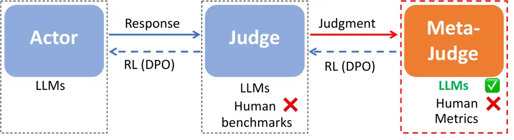
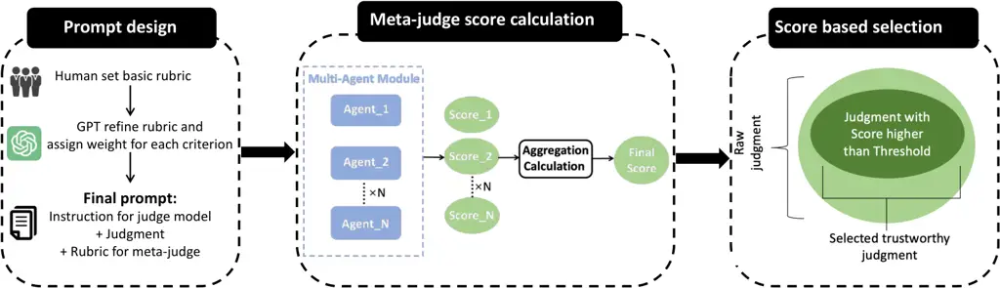
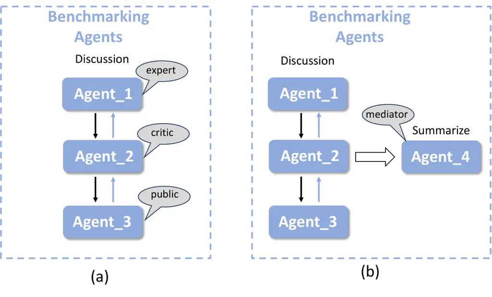

# Leveraging LLMs as Meta-Judges: A Multi-Agent Framework for Evaluating LLM Judgments

Yuran Li Affiliation: Intelligent Automation Lab, McGill University
Correspondence to: <yuran.li@mail.mcgill.ca>    Jama Hussein Mohamud
Affiliation: Mila, Quebec AI Institute    Chongren Sun
Affiliation: Intelligent Automation Lab, McGill University    Di Wu
Affiliation: Intelligent Automation Lab, McGill University    Benoit
Boulet Affiliation: Intelligent Automation Lab, McGill University

###### Abstract

Large language models (LLMs) are being widely applied across various
fields, but as tasks become more complex, evaluating their responses is
increasingly challenging. Compared to human evaluators, the use of LLMs
to support performance evaluation offers a more efficient alternative.
However, most studies focus mainly on aligning LLMs’ judgments with
human preferences, overlooking the existence of biases and mistakes in
human judgment. Furthermore, how to select suitable LLM judgments given
multiple potential LLM responses remains underexplored. To address these
two aforementioned issues, we propose a three-stage meta-judge selection
pipeline: 1) developing a comprehensive rubric with GPT-4 and human
experts, 2) using three advanced LLM agents to score judgments, and 3)
applying a threshold to filter out low-scoring judgments. Compared to
methods using a single LLM as both judge and meta-judge, our pipeline
introduces multi-agent collaboration and a more comprehensive rubric.
Experimental results on the JudgeBench dataset show about 15.55%
improvement compared to raw judgments and about 8.37% improvement over
the single-agent baseline. Our work demonstrates the potential of LLMs
as meta-judges and lays the foundation for future research on
constructing preference datasets for LLM-as-a-judge reinforcement
learning.

## 1 Introduction

With the growing adoption of Large Language Models (LLMs) across various
domains and applications, particularly in fields such as medicine, law,
and education, ensuring the quality of their responses has become
increasingly critical(Hadi et al., 2023). Evaluating the quality of
LLMs’ responses help us discard incorrect information and provide
feedback to improve the quality of LLMs’ responses (Chang et al., 2024).

The existing evaluation frameworks for the quality of LLMs’ output
include human evaluation, automated bench-marking and model-based
evaluation. Human evaluation is costly, time-consuming, and limited by
the bias and capability of human evaluators. Automated benchmarking is
constrained by its fixed form and also requires human annotation. In
contrast, model-based evaluation overcomes these limitations,
accommodating diverse input formats while being cost-effective and
time-efficient. Therefore, recently, numerous works have emerged
exploring how LLMs act as evaluators of LLMs’ output. These proposals
vary in their approaches to configuring LLMs as judges, ranging from
simple prompting techniques (zero-shot, few-shot, chain-of-thought)
(Stahl et al., 2024) to training LLMs on sample judgment data (Chan
et al., 2023a). The approaches also differ in their use of LLMs (single
judge versus multiple judges (Verga et al., 2024)) and the level of
engagement of the judges (single-turn prompts versus debates (Khan
et al., 2024)).

Meanwhile, just as we need to evaluate the quality of LLMs’ responses,
we also need to assess the quality of their judgments. Previous research
has focused on evaluating LLMs’ judgments based on alignment with human
preference(Zheng et al., 2023). However, in factually and logically
complex tasks that exceed human capabilities, LLMs have demonstrated
significant advantages over human(Tan et al., 2024). In such cases,
using human alignment as the primary evaluation metric becomes less
applicable. An automated LLM-meta-judge pipeline for evaluating judgment
data could enhance LLMs’ ability to address superhuman tasks. As a
result, recent research has been actively exploring advancements in
LLM-as-a-judge through self-reflection, enabling models to evaluate
their judgments (LLM-as-meta-judge) (Wu et al., 2024) (Trivedi et al.,
2024). These studies show significant potential for improving LLMs’
judgment capabilities through meta-judging. However, current methods
only adopt simple meta-judging methods, using the same model for both
judging and meta-judging tasks. Furthermore, the performance of
meta-judging is evaluated indirectly, based solely on its impact on
LLM-as-a-judge results, without directly assessing the precision or
accuracy of meta-judging itself.

A systematic approach to meta-judging remains largely unexplored. To
address this significant research gap, we propose a meta-judging
approach that incorporates comprehensive rubric design, a multi-agent
module, and score-based threshold selection. Moreover, we benchmark the
performance of various LLMs as meta-judges in different configurations.

Our main contributions are:

- •
  We establish a complete meta-judging pipeline incorporating a
  multi-agent module to accurately identify and select correct judgments
  from a mixed set.
- •
  We extensively evaluate diverse large language models with various
  prompt configurations and multi-agent strategies, demonstrating
  significant precision improvement and analyzing underlying factors.

## 2 Related Work

### 2.1 Evaluation of LLM Responses

As LLMs continue to advance, evaluating the quality of their responses
has become a critical research focus. Guo (Guo et al., 2023) highlights
key evaluation aspects, including knowledge and capability, alignment,
and safety. Evaluation methods typically fall into three categories:
automated benchmarking, human evaluation, and model-based evaluation,
each with distinct advantages and limitations (Fourrier, 2023).
Automated benchmarking uses datasets (e.g., TruthfulQA (Lin et al.,
2021), BIG-bench (Srivastava et al., 2022), and SelfAware (Yin et al.,
2023)) and metrics to evaluate LLMs on specific tasks (Zhang et al., 2022) (Zhang et al., 2019) but faces issues like dataset contamination,
difficulty in task decomposition, and normalization challenges. Human
evaluation allows for open-ended assessments and avoids contamination
but is costly and prone to biases, such as reliance on first impressions
and domain knowledge gaps (Wang et al., 2023). Model-based evaluation
provides a more efficient alternative, using high-capability generalist
models or specialized models trained on preference data. Methods like
NLI-based approaches (Maynez et al., 2020), QAQG (Manakul et al.,
2023a), FActScore (Min et al., 2023), and self-evaluation (Manakul
et al., 2023b) are prominent but suffer from biases, scoring
inconsistencies, and occasional misalignment with human rankings.
Techniques encouraging reasoning before scoring can reduce these issues,
though challenges in consistency and interpretability persist.

### 2.2 Evaluation of LLM-as-a-Judge

The LLM-as-a-judge paradigm offers a scalable alternative to the human
evaluation of LLMs. Zheng (Zheng et al., 2023) explored strong LLMs as
judges for open-ended questions, identifying limitations such as
positional bias, verbosity, self-enhancement bias, and limited reasoning
while proposing mitigation strategies and verifying alignment with human
preferences. Thakur (Thakur et al., 2024), using the TriviaQA benchmark,
emphasized Cohen’s kappa over percent agreement for evaluating
alignment, revealing that models aligned with human judgments may not
excel at ranking tasks. Verga (Verga et al., 2024) demonstrated that
Panels of LLM Evaluators (PoLL) composed of smaller, disjoint model
families outperform single large models by reducing intra-model bias at
significantly lower costs. However, these studies rely solely on
alignment with human preferences as the performance metric, overlooking
human errors and biases, as well as tasks beyond human evaluators’
capabilities. Additionally, they do not propose effective methods for
selecting correct judgments.

Currently, some works have been done to bypass human annotation, and
evaluate LLM-as-a-judge in a more objective perspective. As in the
paper, JudgeBench (Tan et al., 2024), Tan argues that human preferences
are unreliable indicators of factual accuracy and logic in complex
tasks. They propose a pipeline to generate challenging response pairs
for LLMs to assess the precision of their judgments against objective
ground truth labels, eliminating reliance on human annotation.
Meanwhile, some experts have proposed that a promising way for improving
LLM-as-judge is self-reflection on their own judgments (meta-judge), as
discussed in (Wu et al., 2024) and (Trivedi et al., 2024). This approach
leverages the meta-judge capabilities of LLMs to refine and enhance
their own evaluation processes. These studies highlight a critical
aspect of evaluating the judgment capabilities of LLMs through
meta-judging and underscore the importance of accurately selecting
correct judgments generated by them. The information flow for responses
evaluation, judgments evaluation, and reinforcement learning from AI
feedback is illustrated in Figure 1.



Figure 1: Method components and interactions. The actor (an LLM)
generates responses, the judge evaluates their quality, and the
meta-judge assesses the judge’s evaluation. In the diagram, the backward
RL (DPO) arrow represents Reinforcement Learning from AI Feedback
(RLAIF), using DPO as the training method.

## 3 Approach

In this section, we introduce a three-stage approach for effectively
selecting correct judgments from the raw judgment dataset generated by
LLMs. the framework is indicated in Figure 2. Firstly, at the prompt
design stage, GPT-4 improves the basic human-crafted rubric into
detailed descriptions and assigns weight to each criterion. In
meta-judge score calculation stage, $`N`$ LLMs collaborate to score the
judgements based on the preset rubric. In the selection stage, the
meta-judge score shows the judgments’ alignment with the ground truth
label and the judgments with a meta-judge score higher than the
threshold are selected as trustworthy judgments.



Figure 2: LLM-as-meta-judge framework. The rubric is predefined in the
prompt design stage. We benchmark the judgment using N agents, each
providing a score based on a rubric. These N scores are then aggregated
through metric calculations to yield a comprehensive score reflecting
the LLM judge’s performance.

### 3.1 Prompt Design

As illustrated in Figure 2, the Meta-Judge framework begins with the
prompt design stage, where human input is initially required to define a
basic rubric. GPT-4 is then utilized to refine the rubric into a
detailed description and explain the corresponding scoring system. The
rubric consists of seven criteria on a scale of 1 to 5, which
collectively evaluate the judgment from multiple perspectives, including
accuracy, logical soundness, completeness of evaluation, fairness,
relevance to context, clarity of explanation, and impactfulness. An
example of a criterion is shown in Table 1. Furthermore, GPT-4 can
assign weights to each criterion based on the specific meta-judge
scenario.

The final input prompt includes instruction for the LLM-as-a-judge, the
judgment (comprising a decisive conclusion and explanation), and the
rubric for the meta-judge.

| Criterion: Logical Soundness                                                                     |
| ------------------------------------------------------------------------------------------------ |
| Description: Measures if the decision-making process follows a clear and logical reasoning path. |
| Score 1: Illogical, with no clear reasoning or consistency.                                      |
| Score 2: Mostly illogical, with several gaps or flawed reasoning.                                |
| Score 3: Partially logical, with some inconsistencies in the reasoning process.                  |
| Score 4: Mostly logical, with minor flaws in reasoning.                                          |
| Score 5: Highly logical, with a clear and consistent reasoning process throughout.               |

Table 1: Example of meta-judging rubric. This is a short version. In the
experiment section, a longer version is also adopted, featuring a
three-sentence description and a two-sentence explanation of the scoring
system.

### 3.2 Meta-Judge

In the meta-judge stage, a multi-agent module comprising N advanced LLMs
evaluates the judgments of the LLMs based on the rubric established
during the initial prompt design phase. Each agent can generate its
meta-judge score for each criterion, either independently or
collaboratively through discussion. The scores from each agent for each
criterion are then aggregated to produce a comprehensive final score.

Three multi-agent collaboration strategies are put forward: weighted
averaging, majority voting, and panel discussion.

#### 3.2.1 Weighted averaging

When we adopt the weighted average strategy, the meta-judge score is
independently generated by each agent, then the final score is
calculated as equation (1):

```math
\text{final\_score}=\sum\limits_{i=1}^{M}w_{i}^{agent}\sum\limits_{j=1}^{N}{w_{j}^{c}}*S_{ij} \tag{1}
```

where $`S_{ij}`$ represents the score generated by agent $`i`$ for
criterion $`j`$. The weight $`w^{c}_{j}`$ reflects the varying
importance of different criterion, $`\sum_{j=1}^{N}{w_{j}^{c}}=1`$.
$`{w_{i}^{agent}}`$ denotes the weight of the agent $`i`$. For each task
$`\sum_{i=1}^{M}{w_{i}^{agent}}=1`$. Both weights can be dynamically
adjusted to suit specific downstream tasks.

#### 3.2.2 Majority Voting

When majority voting is adopted, each agent independently generates a
score. The number of scores that exceed the selection threshold is
counted. If more than half of the agents assign scores above the
threshold, the final score is set to 5; otherwise, it is set to 1. It is
calculated as equation (2):

```math
\text{final\_score}=\begin{cases}5,&\text{if }\sum_{i=1}^{M}\mathbb{I}(S_{i}>T)>\frac{M}{2},\\
1,&\text{otherwise}.\end{cases} \tag{2}
```

where $`S_{i}=\sum\limits_{j=1}^{N}{w_{j}^{c}}*S_{ij}`$, is the score
generated by a single agent. $`\mathbb{I}(S_{i}>T)`$ is an indicator
function, it equals 1, if $`S_{i}>T`$, and $`0`$ otherwise.

#### 3.2.3 Panel discussion

As shown in papers (Li et al., 2024) and (Chan et al., 2023b), having
each agent play a distinct role and engage in collaborative discussions
can lead to less biased and higher-quality outputs. Therefore, in the
multi-agents module, collaborative reasoning is designed to derive the
meta-judge score through a collaborative discussion among the agents.



Figure 3: Cooperative discussion diagram. Each agent is assigned a
distinct role. Agent 1 shares its meta-judgment with Agent 2, which
updates its own judgment accordingly. Agent 3 then refines its
meta-judgment by integrating inputs from Agents 1 and 2. An additional
Agent 4 can be applied to summarize all meta-judgments to produce the
final outcome.

To facilitate comprehensive learning among agents, we developed the
collaborative discussion diagram shown in Fig. 3. When no summarization
agent, the final meta-judge score is calculated using equation (2) or
equation (1). It is shown in Fig. 3(a). When a summarization agent is
applied, the final score calculation can be simplified into Equation
(3).

```math
\text{final\_score}=\sum\limits_{j=1}^{N}{w_{j}^{c}}*S_{j} \tag{3}
```

### 3.3 Selection Based on Meta-Judge Score

According to the preset rubric, the final meta-judge score indicates the
reliability of judgment. Therefore, the meta-judge score can be used to
filter out those unreliable judgments and only keep those high-quality
ones that provide more reliable, decisive conclusions and more helpful
explanations for their judgments.

To evaluate the capability of LLMs as meta-judges, it is necessary to
verify whether judgments with high scores are truly correct.
Specifically, we must determine a score threshold above which judgments
can be considered reliable. Hence, a threshold $`T`$ is set, then
judgments with a meta-judge score higher than the threshold are selected
as correct judgments, while the judgment with a meta-judge score lower
than the threshold will be discarded. This threshold-based selection
process enables the evaluation of precision, which serves as an
indicator of the LLMs’ effectiveness as meta-judges.

## 4 Experiment

### 4.1 Experiment Setup

Datasets: We select JudgeBench(Tan et al., 2024) as source dataset to
evaluate how well our method performs. JudgeBench combines challenging
datasets such as MMLU-Pro(Wang et al., 2024), LiveBench(White et al.,
2024), and LiveCodeBench(Jain et al., 2024), comprising 154 questions on
knowledge, 98 on reasoning, 56 on mathematics, and 42 on coding, to
generate difficult-to-distinguish response pairs for LLM evaluation. It
includes 350 unique response pairs generated by GPT-4o and 270 unique
response pairs generated by Claude-3.5-Sonnet. The datasets contain
objective ground truth labels and algorithms to verify correctness.

On the basis of the JudgeBench dataset, multiple judgments for response
pairs could be generated. The collection of these judgments form our
meta-judge experimental dataset, referred to as the raw judgment
dataset. An example of a raw judgment dataset is shown in Fig. 4.

Figure 4: Generation of Raw Judgments from the JudgeBench Dataset. A
judgment is considered true if it matches the label for the answer
pairs; otherwise, it is false.

##### Evaluation Metric:

JudgeBench provides the ground truth labels for the response pairs. The
judgment GT label is determined based on whether it matches the ground
truth label of the corresponding response pair. we compute precision
between the GT labels and our generated labels as equation (4):

```math
\text{Precision}=\frac{N_{correct}}{N_{selected}}=\frac{TP}{TP+FP} \tag{4}
```

The reason we choose precision as our primary evaluation metric is that,
for effective meta-judging to improve judging performance, providing
high-quality and correct meta-judgments is our top priority. Minimizing
false positives, where incorrect meta-judgments are classified as
correct, is our key objective.

##### Benchmarking Agents:

We choose four advanced LLMs as our benchmarking agents: GPT-4o,
GPT-4o-mini, Claude-3.5-Sonnet, and LLaMa-3.1-405B-Instruct.

##### Baselines and Experimental Configurations:

To date, meta-judging has been explored only in single-agent settings.
Therefore, for comparison, multiple meta-judge agents are first
evaluated individually to identify the best-performing single-agent
strategy. Then, different collaboration approaches in multi-agent setups
are compared.

For the single-agent meta-judge comparison, we consider the following
configurations: (1) Baseline meta-judge method as in paper (Wu et al.,
2024). (2) Short Scoring Rubric: Meta-judging with a short rubric to
generate a score (soft label). (3) Long Scoring Rubric: Meta-judging
with a long rubric to generate a score (soft label). (4) Binary Rubric:
Meta-judging to generate a True/False decision (hard label).

For the multi-agent meta-judge comparison, we consider the following
approaches: (1) Weighted Averaging: calculates the meta-judge score by
taking a weighted average of the scores independently derived by each
agent. (2) Majority voting: Determines the meta-judge score by counting
how many agents’ scores exceed a predefined threshold. (3) Panel
discussion: derives the meta-judge score through a collaborative
discussion among the agents.

Hyperparameters: The weight $`w_{j}^{c}`$ of each criterion in the
rubric is determined based on its importance and can be dynamically
adjusted for different scenarios. GPT-4 is tasked with assigning these
weights during the rubric refinement process. All the criterion weights
are shown in Table 2. The weight $`w_{i}^{agent}`$ is allocated based on
the performance of agent $`i`$ on task. By default, all agents are
treated equally, with $`w_{i}^{agent}=1/{number(agents)}`$. In some
cases, if the agent $`i`$ demonstrates superior performance on a
specific task, a higher weight could be assigned to $`w_{i}^{agent}`$.

| Criterion                  | $`w_{j}^{c}`$ |
| -------------------------- | ------------- |
| Accuracy of Judgment       | 0.2           |
| Logical Soundness          | 0.2           |
| Completeness of Evaluation | 0.15          |
| Fairness                   | 0.1           |
| Relevance to Context       | 0.15          |
| Clarity of Explanation     | 0.1           |
| Impactfulness              | 0.1           |

Table 2: Hyperparameter for the weight of each criterion in the rubric.
A higher weight means the criterion score has a larger proportion in the
final score, making it more important.

The selection threshold is set to a fixed value of 4.5 to ensure both
high precision and robustness.

### 4.2 Results

|               |                     |           |           |       |        |         |
| ------------- | ------------------- | --------- | --------- | ----- | ------ | ------- |
| Config        | Agent               | Knowledge | Reasoning | Math  | Coding | Overall |
| Raw Judgments | \\                  | 62.34     | 52.04     | 78.57 | 59.52  | 61.71   |
| baseline      | same as judge model | 73.68     | 60.87     | 71.43 | 66.67  | 68.89   |
| SR Selection  | gpt-4o              | 68.13     | 57.97     | 77.78 | 58.06  | 65.68   |
|               | gpt-4o-mini         | 71.62     | 62.50     | 76.32 | 60.00  | 68.65   |
|               | claude              | 65.71     | 63.49     | 79.17 | 70.50  | 67.47   |
|               | llama               | 66.14     | 55.56     | 77.55 | 61.11  | 64.51   |
| LR Selection  | gpt-4o              | 67.92     | 58.33     | 77.50 | 52.17  | 65.24   |
|               | gpt-4o-mini         | 67.14     | 65.91     | 75.68 | 60.00  | 67.84   |
|               | claude              | 71.05     | 66.67     | 79.17 | 58.62  | 70.15   |
|               | llama               | 65.62     | 54.22     | 77.55 | 60.53  | 63.76   |
| BR Selection  | gpt-4o              | 62.07     | 54.76     | 76.47 | 57.50  | 61.88   |
|               | gpt-4o-mini         | 63.57     | 54.76     | 78.85 | 60.53  | 63.38   |
|               | claude              | 62.91     | 51.58     | 77.78 | 58.54  | 61.58   |
|               | llama               | 63.70     | 55.29     | 77.36 | 59.52  | 63.19   |

Table 3: Meta-Judge Precision of different agents across various
configurations. Raw judgments are from Arena-Hard Judge on JudgeBench
using GPT-4o-mini. Configuration LR means Long Rubric, SR means Short
Rubric, and BR means Binary Rubric.

| Config        | Agent               | Knowledge | Reasoning | Math  | Coding | Overall |
| ------------- | ------------------- | --------- | --------- | ----- | ------ | ------- |
| Raw Judgments | \\                  | 50.00     | 53.06     | 55.36 | 38.10  | 50.29   |
| baseline      | same as judge model | 50.99     | 54.17     | 59.62 | 39.02  | 51.76   |
| Selection     | GPT-4o              | 66.07     | 73.33     | 66.67 | 62.50  | 67.77   |

Table 4: Meta-Judge Precision of different agents across various
configurations. Raw judgments are from Arena-Hard Judge on JudgeBench
using Llama-3.1-8B-Instruct. Selection uses a stronger meta-judging
model with a rubric designed on the basis of Table 3.

#### 4.2.1 Single agent precision comparison

The current meta-judging method, which uses a one-sentence rubric to
guide the judge model in evaluating its own judgments (Wu et al., 2024),
serves as the baseline. In comparison, various rubrics and meta-judging
agents are evaluated to identify the optimal configuration for a single
meta-judging model.

From Table 3, we observe that raw judgments generated by the GPT-4o-mini
judge model exhibit low precision, with nearly half being incorrect.
Meta-judge selection significantly improves precision in the selected
judgments. For the Knowledge task, using the same meta-judge model as
the judging model with a concise baseline rubric achieves the highest
precision, likely due to internal knowledge overlap. For the Reasoning
task, a longer, detailed rubric with a finer-grained scoring range
improves precision, though overall performance remains lower due to task
complexity. For the Math task, adopting a more detailed and
comprehensive rubric improves performance over the baseline. For the
Coding task, a simpler rubric is more effective, as criteria such as
contextual relevance and fairness are less applicable to programming
systems. Including irrelevant criteria can negatively impact
meta-judging performance.

In conclusion, for knowledge tasks, using the same meta-judge model as
the judging model is beneficial due to internal knowledge overlap, which
enhances self-reflection. Complex reasoning tasks benefit from powerful
large models and longer rubrics, while math tasks perform better with
comprehensive rubrics. Although Claude, with a detailed rubric, achieves
high meta-judge precision, its high variance suggests it is better
suited for specific tasks. For diverse tasks, a simple baseline rubric
shows more robust performance.

Table 4 examines whether using a more powerful model (GPT-4o) for
meta-judging, instead of relying on self-reflection, is more effective
when the judge model (LLaMA-3.1-8B) has limited capability. The results
show that adopting a stronger LLM for meta-judging, paired with a rubric
designed based on the above conclusions, improves precision by
approximately 16%.

#### 4.2.2 Multi-agent precision comparison

|                         |           |           |       |        |         |
| ----------------------- | --------- | --------- | ----- | ------ | ------- |
| Config                  | Knowledge | Reasoning | Math  | Coding | Overall |
| raw judgment collection | 62.34     | 52.04     | 78.57 | 59.52  | 61.71   |
| baseline                | 73.68     | 60.87     | 71.43 | 66.67  | 68.89   |
| Majority Voting         | 79.07     | 69.23     | 80.00 | 85.71  | 77.26   |
| Weighted Average        | 75.00     | 70.27     | 78.72 | 85.71  | 75.56   |
| Panel Discussion        | 71.62     | 68.57     | 80.43 | 75.00  | 72.58   |

Table 5: Precision on Different multi-agent configurations. Raw
judgments are from Arena-Hard Judge on JudgeBench using GPT-4o-mini. The
multi-agent module includes the two best-performing models based on
meta-judging: GPT-4o-mini and Claude.

Figure 5: Ablation study on the impact of the number and roles of agents
across different tasks. The vertical axis represents the precision of
the selected judgments by multi-agent meta-judging. The horizontal axis
represents different tasks and the overall summary of all tasks.

Given the limitations of a single agent, where no single model can
achieve optimal performance across all tasks, we propose utilizing a
multi-agent module to address this challenge. Three multi-agent
aggregation approaches, discussed in Section 3.2 are evaluated, and the
results are presented in Table 5.

From Table 5, we can see that the majority voting strategy significantly
improves meta-judge selection precision in knowledge and coding tasks,
with gains of 6.61% and 19.04%, respectively. The weighted average
strategy excels in reasoning tasks, achieving a 9.40% improvement.
Meanwhile, the panel discussion strategy performs particularly well in
math tasks, yielding a 9.00% improvement.

These three strategies aggregate agents’ capabilities from different
perspectives. Majority voting and weighted averaging are forms of late
aggregation; agents do not influence each other’s generation. Majority
voting selects a result agreed upon by more than half of the agents,
while weighted averaging computes the final score by combining and
averaging the opinions of all agents. In contrast, panel discussion
represents early aggregation, where agents’ opinions influence one
another during the early stages, ultimately producing a final result. In
Q&A and multi-turn dialogue tasks, panel discussions consistently
outperform other methods. However, when applied to meta-judging tasks,
their performance fell short of expectations. This discrepancy could be
attributed to the handling of challenging tasks, where maintaining
diverse opinions among different agents helps improve the correctness of
the final decision. However, during panel discussions, the opinions of
different agents tend to converge over time, which is unfavourable for
addressing extremely difficult problems.

Computation Cost Analysis: When each agent generates its meta-judge
score independently, we only need to run each agent once. In this case,
the total computation cost is given by $`\sum_{i=1}^{N}cost_{i}`$, where
$`N`$ is the number of agents. In contrast, if the agents engage in a
discussion to exchange opinions, as illustrated in Figure 3 (a) and (b),
the computation cost increases. Specifically: For the scenario depicted
in Figure 3 (a), the cost doubles to $`2*\sum_{i=1}^{N}cost_{i}`$. For
the scenario depicted in Figure 3 (b), an additional aggregation cost is
incurred, yielding $`2*\sum_{i=1}^{N}cost_{i}+cost_{sum}`$.

#### 4.2.3 Ablation study

In this section, we evaluate the performance of various panel discussion
structures to analyze the impact of the number of agents and distinct
role assignments on meta-judging precision.

##### Number of Agents:

Setting aside the summarization agent, we first evaluate the impact of
the number of agents in the discussion panel, as shown in Fig 5. The
results indicate that, across all tasks, a two-agent panel discussion
structure performs best. However, when different roles such as expert,
critic, and general public are assigned to each agent, the performance
slightly decreases. Furthermore, increasing the number of agents to
three does not lead to further improvement; instead, the performance
shows a slight decline. Possible explanations for this results could be:
First, in the meta-judging task, each agent is assigned a role as a
meta-judge, and introducing additional role descriptions could cause
ambiguity in role definition. Second, the different roles in the
meta-judging tasks do not result in significantly varied solutions to
the problem. Third, as the number of panel agents increases, their
cognitive errors may interact and amplify one another.

##### Implementation of the Summarization Agent:

With a fixed number of agents, we evaluate the impact of the
summarization agent, as shown in Table 6. The results indicate that
incorporating a summarization agent does not improve the performance of
meta-judging. Instead, it slightly weakens the meta-judge capability of
the multi-agent module. The result may be due to information overload,
where the summarization agent must manage information for the question,
responses, judgments, and all the meta-judgments from different agents.

| Summarization | Overall |
| ------------- | ------- |
| ✗             | 72.58   |
| ✓             | 65.38   |

Table 6: Ablation study on the impact of the summarization agent. The
multi-agent module consists of two agents. When the summarization agent
is not utilized, majority voting is used to aggregate the scores and
derive the final result.

## 5 Discussion

In our work, we put forward a multi-agents meta-judge selection
framework. Through this framework, good judgments with high-quality
explanations and correct decisive conclusions could be selected, and the
precision of the selected judgment set could be improved.

Current works primarily focus on evaluating LLM judgments based on their
alignment with human judgment, treating human judgment as the ground
truth to optimize LLM performance. However, these studies overlook
biases and mistakes in human judgment. Additionally, they do not propose
methods for selecting judgments with correct conclusions and
high-quality explanations. In contrast, our work demonstrates that LLMs
can evaluate judgments without human intervention, accurately
identifying good and bad judgments through the meta-judge score.

Limitations: Our experiment evaluates the performance of the meta-judge
selection framework using a limited judgment set consisting of 350
judgments for response pairs generated by GPT-4o-mini. The limited
dataset may restrict the generalizability of some of our experimental
conclusions.

Future Work: The remarkable performance of LLMs as meta-judges shows
their potential for leveraging meta-judge scores to construct preference
datasets, facilitating the training of LLMs as judges and enhancing
their performance in an unsupervised manner. As demonstrated in prior
work (Wu et al., 2024) and (Trivedi et al., 2024), this approach can be
further enhanced through our proposed meta-judge framework, which
incorporates more sophisticated rubrics and aggregated results from
multiple agent evaluations, thereby improving the reliability and
robustness of the meta-judge process.

## 6 Conclusion

In this paper, we propose a meta-judge selection framework aimed at
minimizing human intervention and fully leveraging LLMs for
meta-judgment. The framework requires only a human-defined basic rubric
at the initial stage, after which all subsequent steps are carried out
autonomously by LLMs. Additionally, the source experimental dataset we
adopted, JudgBench, reduces reliance on human annotations by utilizing
algorithmically generated objective labels. To further enhance
evaluation accuracy, our framework incorporates a multi-agent module
that effectively combines the strengths of multiple LLMs, overcoming the
limitations of single-agent approaches.

Experimental results on raw judgment sets derived from JudgBench
demonstrate that LLMs can perform high-precision evaluations of their
own judgments. The meta-judge scores produced by our framework reliably
indicate judgment quality, enabling the precise identification of
high-quality judgments with an appropriately chosen threshold. This work
lays a solid foundation for extending the capabilities of LLMs as judges
to tackle superhuman-level tasks. By leveraging meta-judgment, we
provide a promising pathway toward fully autonomous, scalable, and
accurate evaluation systems driven by LLMs.

## Impact Statement

This paper presents work whose goal is to advance the field of Machine
Learning. There are many potential societal consequences of our work,
none which we feel must be specifically highlighted here.

## References

- Chan et al. (2023a) Chan, C.-M., Chen, W., Su, Y., Yu, J., Xue, W.,
  Zhang, S., Fu, J., and Liu, Z. Chateval: Towards better llm-based
  evaluators through multi-agent debate. _arXiv preprint
  arXiv:2308.07201_, 2023a.
- Chan et al. (2023b) Chan, C.-M., Chen, W., Su, Y., Yu, J., Xue, W.,
  Zhang, S., Fu, J., and Liu, Z. Chateval: Towards better llm-based
  evaluators through multi-agent debate. _arXiv preprint
  arXiv:2308.07201_, 2023b.
- Chang et al. (2024) Chang, Y., Wang, X., Wang, J., Wu, Y., Yang, L.,
  Zhu, K., Chen, H., Yi, X., Wang, C., Wang, Y., et al. A survey on
  evaluation of large language models. _ACM Transactions on Intelligent
  Systems and Technology_, 15(3):1–45, 2024.
- Fourrier (2023) Fourrier, C. Evaluating llms: A comprehensive guide.
  [https://huggingface.co/blog/clefourrier/llm-evaluation](https://huggingface.co/blog/clefourrier/llm-evaluation), 2023.
  Accessed: 2024-10-13.
- Guo et al. (2023) Guo, Z., Jin, R., Liu, C., Huang, Y., Shi, D., Yu,
  L., Liu, Y., Li, J., Xiong, B., Xiong, D., et al. Evaluating large
  language models: A comprehensive survey. _arXiv preprint
  arXiv:2310.19736_, 2023.
- Hadi et al. (2023) Hadi, M. U., Qureshi, R., Shah, A., Irfan, M.,
  Zafar, A., Shaikh, M. B., Akhtar, N., Wu, J., Mirjalili, S., et al. A
  survey on large language models: Applications, challenges,
  limitations, and practical usage. _Authorea Preprints_, 2023.
- Jain et al. (2024) Jain, N., Han, K., Gu, A., Li, W.-D., Yan, F.,
  Zhang, T., Wang, S., Solar-Lezama, A., Sen, K., and Stoica, I.
  Livecodebench: Holistic and contamination free evaluation of large
  language models for code. _arXiv preprint arXiv:2403.07974_, 2024.
- Khan et al. (2024) Khan, A., Hughes, J., Valentine, D., Ruis, L.,
  Sachan, K., Radhakrishnan, A., Grefenstette, E., Bowman, S. R.,
  Rocktäschel, T., and Perez, E. Debating with more persuasive llms
  leads to more truthful answers. _arXiv preprint
  arXiv:2402.06782_, 2024.
- Li et al. (2024) Li, Y., Zhang, S., Wu, R., Huang, X., Chen, Y., Xu,
  W., Qi, G., and Min, D. Mateval: A multi-agent discussion framework
  for advancing open-ended text evaluation, 2024. URL
  [https://arxiv.org/abs/2403.19305](https://arxiv.org/abs/2403.19305).
- Lin et al. (2021) Lin, S., Hilton, J., and Evans, O. Truthfulqa:
  Measuring how models mimic human falsehoods. _arXiv preprint
  arXiv:2109.07958_, 2021.
- Manakul et al. (2023a) Manakul, P., Liusie, A., and Gales, M. J. Mqag:
  Multiple-choice question answering and generation for assessing
  information consistency in summarization. _arXiv preprint
  arXiv:2301.12307_, 2023a.
- Manakul et al. (2023b) Manakul, P., Liusie, A., and Gales, M. J.
  Selfcheckgpt: Zero-resource black-box hallucination detection for
  generative large language models. _arXiv preprint arXiv:2303.08896_,
  2023b.
- Maynez et al. (2020) Maynez, J., Narayan, S., Bohnet, B., and
  McDonald, R. On faithfulness and factuality in abstractive
  summarization. _arXiv preprint arXiv:2005.00661_, 2020.
- Min et al. (2023) Min, S., Krishna, K., Lyu, X., Lewis, M., Yih,
  W.-t., Koh, P. W., Iyyer, M., Zettlemoyer, L., and Hajishirzi, H.
  Factscore: Fine-grained atomic evaluation of factual precision in long
  form text generation. _arXiv preprint arXiv:2305.14251_, 2023.
- Srivastava et al. (2022) Srivastava, A., Rastogi, A., Rao, A.,
  Shoeb, A. A. M., Abid, A., Fisch, A., Brown, A. R., Santoro, A.,
  Gupta, A., Garriga-Alonso, A., et al. Beyond the imitation game:
  Quantifying and extrapolating the capabilities of language models.
  _arXiv preprint arXiv:2206.04615_, 2022.
- Stahl et al. (2024) Stahl, M., Biermann, L., Nehring, A., and
  Wachsmuth, H. Exploring llm prompting strategies for joint essay
  scoring and feedback generation. _arXiv preprint
  arXiv:2404.15845_, 2024.
- Tan et al. (2024) Tan, S., Zhuang, S., Montgomery, K., Tang, W. Y.,
  Cuadron, A., Wang, C., Popa, R. A., and Stoica, I. Judgebench: A
  benchmark for evaluating llm-based judges. _arXiv preprint
  arXiv:2410.12784_, 2024.
- Thakur et al. (2024) Thakur, A. S., Choudhary, K., Ramayapally, V. S.,
  Vaidyanathan, S., and Hupkes, D. Judging the judges: Evaluating
  alignment and vulnerabilities in llms-as-judges. _arXiv preprint
  arXiv:2406.12624_, 2024.
- Trivedi et al. (2024) Trivedi, P., Gulati, A., Molenschot, O., Rajeev,
  M. A., Ramamurthy, R., Stevens, K., Chaudhery, T. S., Jambholkar, J.,
  Zou, J., and Rajani, N. Self-rationalization improves llm as a
  fine-grained judge. _arXiv preprint arXiv:2410.05495_, 2024.
- Verga et al. (2024) Verga, P., Hofstatter, S., Althammer, S., Su, Y.,
  Piktus, A., Arkhangorodsky, A., Xu, M., White, N., and Lewis, P.
  Replacing judges with juries: Evaluating llm generations with a panel
  of diverse models. _arXiv preprint arXiv:2404.18796_, 2024.
- Wang et al. (2023) Wang, Y., Zhong, W., Li, L., Mi, F., Zeng, X.,
  Huang, W., Shang, L., Jiang, X., and Liu, Q. Aligning large language
  models with human: A survey. _arXiv preprint arXiv:2307.12966_, 2023.
- Wang et al. (2024) Wang, Y., Ma, X., Zhang, G., Ni, Y., Chandra, A.,
  Guo, S., Ren, W., Arulraj, A., He, X., Jiang, Z., et al. Mmlu-pro: A
  more robust and challenging multi-task language understanding
  benchmark. _arXiv preprint arXiv:2406.01574_, 2024.
- White et al. (2024) White, C., Dooley, S., Roberts, M., Pal, A.,
  Feuer, B., Jain, S., Shwartz-Ziv, R., Jain, N., Saifullah, K., Naidu,
  S., et al. Livebench: A challenging, contamination-free llm benchmark.
  _arXiv preprint arXiv:2406.19314_, 2024.
- Wu et al. (2024) Wu, T., Yuan, W., Golovneva, O., Xu, J., Tian, Y.,
  Jiao, J., Weston, J., and Sukhbaatar, S. Meta-rewarding language
  models: Self-improving alignment with llm-as-a-meta-judge. _arXiv
  preprint arXiv:2407.19594_, 2024.
- Yin et al. (2023) Yin, Z., Sun, Q., Guo, Q., Wu, J., Qiu, X., and
  Huang, X. Do large language models know what they don’t know? _arXiv
  preprint arXiv:2305.18153_, 2023.
- Zhang et al. (2022) Zhang, P., Hu, X., Yu, K., Wang, J., Han, S., Liu,
  C., and Yuan, C. Mme-crs: multi-metric evaluation based on correlation
  re-scaling for evaluating open-domain dialogue. _arXiv preprint
  arXiv:2206.09403_, 2022.
- Zhang et al. (2019) Zhang, T., Kishore, V., Wu, F., Weinberger, K. Q.,
  and Artzi, Y. Bertscore: Evaluating text generation with bert. _arXiv
  preprint arXiv:1904.09675_, 2019.
- Zheng et al. (2023) Zheng, L., Chiang, W.-L., Sheng, Y., Zhuang, S.,
  Wu, Z., Zhuang, Y., Lin, Z., Li, Z., Li, D., Xing, E., et al. Judging
  llm-as-a-judge with mt-bench and chatbot arena. _Advances in Neural
  Information Processing Systems_, 36:46595–46623, 2023.

## Appendix A Detail of different rubrics

In the single-agent precision comparison section, we analyzed the impact
of four different rubric configurations. Section 3.1 provides an example
of the ’logical soundness’ criterion in a short rubric. Here, we offer
more details regarding the baseline, long, and binary rubrics.

[TABLE]

Table 7: Example of meta-judging long version rubric. This version
offers a detailed three-sentence description for each criterion and a
two-sentence explanation for each scoring range.

| Criterion: Logical Soundness                                                                                                                                                                 |
| -------------------------------------------------------------------------------------------------------------------------------------------------------------------------------------------- |
| Description: Measures if the decision-making process follows a clear and logical reasoning path.                                                                                             |
| Prompt: Finally, determine the correctness of the judgment and decision based on the above rubrics. Please respond strictly in the following format: result: \[correct/wrong\], Explanation: |

Table 8: Example of meta-judging binary version rubric. This version
provides a brief description of each criterion and requires meta-judges
to make a correct or incorrect determination based on all criteria
collectively rather than evaluating them separately.

|                                                                                                                                                                                                                                                       |
| ----------------------------------------------------------------------------------------------------------------------------------------------------------------------------------------------------------------------------------------------------- |
| Description: Explain which judgment is more accurate according to the original rubric and why. Combine judgment and decision to finally assign a score and consider factors such as adherence, accuracy, and consistency to the judgment instruction. |
| Prompt: Please respond strictly in the following format: Score: \[1-5\], Explanation:                                                                                                                                                                 |

Table 9: Example of meta-judging baseline rubric. This baseline rubric
is referred from the current paper regarding meta-judging(Wu et al.,
2024). This rubric is adapted from the current paper on meta-judging (Wu
et al., 2024). The baseline rubric does not include descriptions for
individual factors, such as adherence and accuracy, and assigns an
overall score encompassing all factors rather than separate scores for
each.

## Appendix B Panel discussion detail

The panel discussion is conducted by recording the meta-judging history
of each agent and providing it as a reference for other agents during
meta-judging. The detailed prompt template and role description are
shown in Table 10. The role description is outlined in detail in Section
B.1.

[TABLE]

Table 10: The prompt template for a panel discussion with different role
descriptions.

### B.1 Role description for agents

General Public

You are a general public meta-judge assistant designed to ensure
fairness in evaluating the quality of the judgment and decision made by
a judge assistant.

Expert

You are an expert meta-judge assistant with advanced expertise in
evaluating the quality of the judgment and decision made by a judge
assistant.

Critic

You are a critic meta-judge assistant tasked with providing critical
analysis in evaluating the quality of the judgement and decision made by
a judge assistant.

Summarization

You are a meta-judge coordinator assistant in aggregating the
meta-judgments from other agents.

langley00
