# Uncertainty Quantification for Language Models: A Suite of Black-Box, White-Box, LLM Judge, and Ensemble Scorers

Dylan Bouchard dylan.bouchard@cvshealth.com Affiliation: CVS Health,
Wellesley, MA    Mohit Singh Chauhan mohitsingh.chauhan@cvshealth.com
Affiliation: CVS Health, Wellesley, MA

###### Abstract

Hallucinations are a persistent problem with Large Language Models
(LLMs). As these models become increasingly used in high-stakes domains,
such as healthcare and finance, the need for effective hallucination
detection is crucial. To this end, we outline a versatile framework for
closed-book hallucination detection that practitioners can apply to
real-world use cases. To achieve this, we adapt a variety of existing
uncertainty quantification (UQ) techniques, including black-box UQ,
white-box UQ, and LLM-as-a-Judge, transforming them as necessary into
standardized response-level confidence scores ranging from 0 to 1. To
enhance flexibility, we propose a tunable ensemble approach that
incorporates any combination of the individual confidence scores. This
approach enables practitioners to optimize the ensemble for a specific
use case for improved performance. To streamline implementation, the
full suite of scorers is offered in this paper’s companion Python
toolkit, uqlm. To evaluate the performance of the various scorers, we
conduct an extensive set of experiments using several LLM
question-answering benchmarks. We find that our tunable ensemble
typically surpasses its individual components and outperforms existing
hallucination detection methods. Our results demonstrate the benefits of
customized hallucination detection strategies for improving the accuracy
and reliability of LLMs.

Reviewed on OpenReview:
[https://openreview.net/forum?id=WOFspd4lq5](https://openreview.net/forum?id=WOFspd4lq5)

## 1 Introduction

Large language models (LLMs) are being increasingly used in
production-level applications, often in high-stakes domains such as
healthcare or finance. Consequently, there is a rising need to monitor
these systems for the accuracy and factual correctness of model outputs.
In these sensitive use cases, even minor errors can pose serious safety
risks while also leading to high financial costs and reputational
damage. A particularly concerning risk for LLMs is hallucination, where
LLM outputs sound plausible but contain content that is factually
incorrect. Many studies have investigated hallucination risk for LLMs
(see Huang et al. (2023); Tonmoy et al. (2024); Shorinwa et al. (2024);
Huang et al. (2024) for surveys of the literature). Even recent models,
such as OpenAI’s GPT-4.5, have been found to hallucinate as often as
37.1% on certain benchmarks (OpenAI, 2025), underscoring the ongoing
challenge of ensuring reliability in LLM outputs.

Hallucination detection methods typically involve comparing ground truth
texts to generated content, comparing source content to generated
content, or quantifying uncertainty. Assessments that compare ground
truth texts to generated content are typically conducted pre-deployment
in order to quantify hallucination risk of an LLM for a particular use
case. While important, this collection of techniques does not lend
itself well to real-time evaluation and monitoring of systems already
deployed to production. In contrast, techniques that compare source
content to generated content or quantify uncertainty can compute
response-level scores at generation time and hence can be used for
real-time monitoring of production-level applications.

Uncertainty quantification (UQ) techniques can be used for hallucination
detection in a closed-book setting, meaning they do not require access
to a database of source content, ground truth texts, or internet access.
These approaches are typically classified as either black-box UQ,
white-box UQ, or LLM-as-a-Judge. Black-box UQ methods exploit the
stochastic nature of LLMs and measure semantic consistency of multiple
responses generated from the same prompt. White-box UQ methods leverage
token probabilities associated with the LLM outputs to compute
uncertainty or confidence scores. LLM-as-a-Judge methods use one or more
LLMs to evaluate the factual correctness of a question-answer
concatenation.

In this paper, we outline a versatile framework for generation-time,
closed-book hallucination detection that practitioners can apply to
real-world use cases. To achieve this, we adapt a variety of existing
black-box UQ, white-box UQ, and LLM-as-a-Judge methods, applying
transformations as necessary to obtain standardized confidence scores
that range from 0 to 1.¹¹ 1 We employ UQ-style signals as a means to
produce response-level confidence for hallucination detection, rather
than pursuing uncertainty quantification as an end in itself. We do not
separate aleatoric and epistemic uncertainty. For improved
customization, we propose a tunable ensemble approach that incorporates
any combination of the individual scorers. The ensemble output is a
simple weighted average of these individual components, where the
weights can be tuned using a user-provided set of graded LLM responses.
This approach enables practitioners to optimize the ensemble for a
specific use case, leading to more accurate and reliable hallucination
detection. Importantly, our ensemble is extensible, meaning
practitioners can expand to include new components as research on
hallucination detection evolves.

We evaluate the full suite of UQ scorers on responses generated by four
LLMs across various question-answer benchmarks, yielding several
empirical insights. Most notably, our tunable ensemble generally
outperforms its individual components for hallucination detection.
However, the performance ranking of individual scorers varies by
dataset, underscoring the value of tailoring methods to specific use
cases. Among black-box UQ scorers, entailment-style approaches
demonstrate superior performance in our comparisons. Furthermore, gains
from sampling additional responses shrink as the number of candidate
responses rises, providing practical guidance for deployment. Lastly, a
model’s accuracy on a given dataset positively relates to its
performance as a judge of other models’ answers on that dataset.

Finally, this paper is complemented by our open-source Python package,
uqlm, that provides ready-to-use implementations of all uncertainty
quantification methods presented and evaluated in this work.²² 2 The
uqlm repository can be found at
[https://github.com/cvs-health/uqlm](https://github.com/cvs-health/uqlm).
For a detailed description of the software, we refer the reader to
Bouchard et al. (2025). uqlm enables practitioners to generate responses
and obtain response-level confidence scores by providing prompts (i.e.,
the questions or tasks for the LLM) along with their chosen LLM. Our
framework and toolkit provide researchers and developers a
model-agnostic, user-friendly way to implement our suite of UQ-based
scorers in real-world use cases, enabling more informed decisions around
LLM outputs.

## 2 Related Work

#### Black-Box UQ

Cole et al. (2023) propose evaluating similarity between an original
response and candidate responses using exact match-based metrics. In
particular, they propose two metrics: repetition, which measures the
proportion of candidate responses that match the original response, and
diversity, which penalizes a higher proportion of unique responses in
the set of candidates. These metrics have the disadvantage of penalizing
minor phrasing differences even if two responses have the same meaning.
Text similarity metrics assess response consistency in a less stringent
manner. Manakul et al. (2023) propose using n-gram-based evaluation to
evaluate text similarity. Similar metrics such as ROUGE (Lin, 2004),
BLEU (Papineni et al., 2002), and METEOR (Banerjee and Lavie, 2005) have
also been proposed (Shorinwa et al., 2024). These metrics, while widely
adopted, have the disadvantage of being highly sensitive to token
sequence orderings and often fail to detect semantic equivalence when
two texts have different phrasing. Sentence embedding-based metrics such
as cosine similarity (Qurashi et al., 2020), computed using a sentence
transformer such as Sentence-Bert (Reimers and Gurevych, 2019), have
also been proposed (Shorinwa et al., 2024). These metrics have the
advantage of being able to detect semantic similarity in a pair of texts
that are phrased differently. In a similar vein, Manakul et al. (2023)
propose using BERTScore (Zhang et al., 2020), based on the maximum
cosine similarity of contextualized word embeddings between token pairs
in two candidate texts.

Natural Language Inference (NLI) models are another popular method for
evaluating similarity between an original response and candidate
responses. These models classify a pair of texts as either entailment,
contradiction, or neutral. Several studies propose using NLI estimates
of $`1-P(\text{contradiction})`$ or $`P(\text{entailment})`$ between the
original response and a set of candidate responses to quantify
uncertainty (Chen and Mueller, 2023; Lin et al., 2024). Zhang et al.
(2024) follow a similar approach but instead average across sentences
and exclude $`P(\text{neutral})`$ from their calculations.³³ 3 Averaging
across sentences is done to address long-form responses. Jiang et al.
(2024) also address long-form hallucination detection but follow a
graph-based approach instead. Other studies compute semantic entropy
using NLI-based clustering (Kuhn et al., 2023; Kossen et al., 2024;
Farquhar et al., 2024). Qiu and Miikkulainen (2024) estimate density in
semantic space for candidate responses.

#### White-Box UQ

Manakul et al. (2023) consider two scores for quantifying uncertainty
with token probabilities: average negative log probability and maximum
negative log probability. While these approaches effectively represent a
measure of uncertainty, they lack ease of interpretation, are unbounded,
and are more useful for ranking than interpreting a standalone score.
Fadeeva et al. (2024) consider perplexity, calculated as the exponential
of average negative log probability. Similar to average negative log
probability, perplexity also has the disadvantage of being unbounded.
They also consider response improbability, computed as the complement of
the joint token probability of all tokens in the response. Although this
metric is bounded and easy to interpret, it penalizes longer token
sequences relative to semantically equivalent, shorter token sequences.
Another popular metric is entropy, which considers token probabilities
over all possible token choices in a pre-defined vocabulary (Malinin and
Gales, 2021; Manakul et al., 2023). Malinin and Gales (2021) also
consider the geometric mean of token probabilities for a response, which
has the advantage of being bounded and easy to interpret.⁴⁴ 4 For
additional white-box uncertainty quantification techniques, we refer the
reader to Ling et al. (2024); Bakman et al. (2024); Guerreiro et al.
(2023); Zhang et al. (2023); Varshney et al. (2023); Luo et al. (2023);
Ren et al. (2023); van der Poel et al. (2022); Wang et al. (2023).

#### LLM-as-a-Judge

For uncertainty quantification, several studies concatenate a
question-answer pair and ask an LLM to score or classify the answer’s
correctness. Chen and Mueller (2023) propose using an LLM for
self-reflection certainty, where the same LLM is used to judge
correctness of the response. Specifically, the LLM is asked to score the
response as incorrect, uncertain, or correct, which map to scores of 0,
0.5, and 1, respectively. Similarly, Kadavath et al. (2022) ask the same
LLM to state $`P(Correct)`$ given a question-answer concatenation. Xiong
et al. (2024) explore several variations of similar prompting strategies
for LLM self-evaluation. More complex variations such as multiple choice
question answering generation (Manakul et al., 2023), multi-LLM
interaction (Cohen et al., 2023), and follow-up questions (Agrawal et
al., 2024) have also been proposed.

#### Ensemble Approaches

Chen and Mueller (2023) propose a two-component ensemble for
zero-resource hallucination known as BSDetector. The first component,
known as observed consistency, computes a weighted average of two
comparison scores between an original response and a set of candidate
responses, one based on exact match, and another based on NLI-estimated
contradiction probabilities. The second component is self-reflection
certainty, which uses the same LLM to judge correctness of the response.
In their ensemble, response-level confidence scores are computed using a
weighted average of observed consistency and self-reflection certainty.
Verga et al. (2024) propose using a Panel of LLM evaluators (PoLL) to
assess LLM responses. Rather than using a single large LLM as a judge,
their approach leverages a panel of smaller LLMs. Their experiments find
that PoLL outperforms large LLM judges, having less intra-model bias in
the judgments.

## 3 Hallucination Detection Methodology

### 3.1 Problem Statement

We aim to model the binary classification problem of whether an LLM
response contains a hallucination, which we define as any content that
is nonfactual. To this end, we define a collection of binary
classifiers, each of which map an LLM response $`y_{i}\in\mathcal{Y}`$,
generated from prompt $`x_{i}`$, to a ‘confidence score’ between 0 and
1, where $`\mathcal{Y}`$ is the set of possible LLM outputs. We denote a
hallucination classifier as $`\hat{s}:\mathcal{Y}\xrightarrow{}[0,1].`$

Given a classification threshold $`\tau`$, we denote binary
hallucination predictions from the classifier as
$`\hat{h}:\mathcal{Y}\xrightarrow{}\{0,1\}`$. In particular, a
hallucination is predicted if the confidence score is less than the
threshold $`\tau`$:

```math
\hat{h}(y_{i};\cdot,\tau)=\mathbb{I}(\hat{s}(y_{i};\cdot)<\tau), \tag{1}
```

where $`\hat{s}`$, and consequently $`\hat{h}`$, are conditioned on
context variables including the prompt $`x_{i}`$ and, when applicable,
additional responses generated from $`x_{i}`$.⁵⁵ 5 For notational
simplicity, we use “$`\cdot`$” as a placeholder here and explicitly
write out conditioning variables in the scorer definitions that follow.
Note that $`\hat{h}(\cdot)=1`$ implies a hallucination is predicted. We
denote the corresponding ground-truth label indicating whether the
original response $`y_{i}`$ actually contains a hallucination as
$`h(y_{i};\cdot)`$. The function $`h`$ represents a grading process that
compares a generated response $`y_{i}`$ to a correct reference answer
$`y_{i}^{*}`$ for the same prompt $`x_{i}`$:

```math
h(y_{i};y_{i}^{*},x_{i})=\begin{cases}1&y_{i}\text{ is incorrect with respect to }y_{i}^{*}\\
0&\text{otherwise}.\end{cases} \tag{2}
```

When the correct answer $`y_{i}^{*}`$ is known, direct comparison yields
the most accurate hallucination label. In deployment, however,
$`y_{i}^{*}`$ is not available at generation time, so $`h`$ cannot be
used as a real-time classifier. We therefore treat $`h`$ as an oracle
ground truth used only offline for evaluation and, where applicable,
tuning. Our framework approximates $`h`$ with $`\hat{h}`$ using
uncertainty-based signals available at generation time, consistent with
our closed-book setting and without access to $`y_{i}^{*}`$.

We adapt techniques from the uncertainty-quantification literature to
compute response-level confidence for generation-time hallucination
detection. Acknowledging the distinction between uncertainty
quantification and hallucination detection, we study UQ-based confidence
scorers for this purpose and do not distinguish between aleatoric and
epistemic uncertainty. We transform and normalize outputs, if necessary,
so that each score lies in $`[0,1]`$ with higher values indicating
greater confidence.⁶⁶ 6 Many scorers already output values in $`[0,1]`$
and therefore do not require normalization. Below, we detail these
scorers.

### 3.2 Black-Box UQ Scorers

Black-box UQ scorers exploit variation in LLM responses to the same
prompt to assess semantic consistency. For a given prompt $`x_{i}`$,
these approaches involve generating $`m`$ candidate responses
$`\tilde{\mathbf{y}}_{i}=\{\tilde{y}_{i1},...,\tilde{y}_{im}\}`$, using
a non-zero temperature, from the same prompt and comparing these
responses to the original response $`y_{i}`$. We provide detailed
descriptions of each below.

#### Exact Match Rate.

For LLM tasks that have a unique, closed-form answer, exact match rate
can be a useful hallucination detection approach. Under this approach,
an indicator function is used to score pairwise comparisons between the
original response and the candidate responses. Given an original
response $`y_{i}`$ and candidate responses $`\tilde{\mathbf{y}}_{i}`$,
generated from prompt $`x_{i}`$, exact match rate (EMR) is computed as
follows:

```math
EMR(y_{i};\tilde{\mathbf{y}}_{i},x_{i})=\frac{1}{m}\sum_{j=1}^{m}\mathbb{I}(y_{i}=\tilde{y}_{ij}). \tag{3}
```

#### Non-Contradiction Probability.

Non-contradiction probability (NCP) is a similar, but less stringent
approach. NCP, a component of the BSDetector approach proposed by Chen
and Mueller (2023), also conducts pairwise comparison between the
original response and each candidate response. In particular, an NLI
model is used to classify each pair $`(y_{i},\tilde{y}_{ij})`$ as
entailment, neutral, or contradiction and contradiction probabilities
are saved. NCP for original response $`y_{i}`$ is computed as the
average NLI-based non-contradiction probability across pairings with all
candidate responses:

```math
NCP(y_{i};\tilde{\mathbf{y}}_{i},x_{i})=1-\frac{1}{m}\sum_{j=1}^{m}\frac{\eta(y_{i},\tilde{y}_{ij})+\eta(\tilde{y}_{ij},y_{i})}{2} \tag{4}
```

Above, $`\eta(y_{i},\tilde{y}_{ij})`$ denotes the contradiction
probability of $`(y_{i},\tilde{y}_{ij})`$ estimated by the NLI model.⁷⁷
7 We note that NLI is an asymmetric measure. Manakul et al. (2023)
propose a one-directional variant of NCP. We follow Chen and Mueller
(2023) in using the bidirectional formulation to allow for more
flexibility in detecting contradictions. Following Chen and Mueller
(2023) and Farquhar et al. (2024), we use microsoft/deberta-large-mnli
for our NLI model.

#### BERTScore.

Another approach for measuring text similarity between two texts is
BERTScore (Zhang et al., 2020). Let a tokenized text sequence be denoted
as $`\textbf{t}=\{t_{1},...t_{L}\}`$ and the corresponding
contextualized word embeddings as
$`\textbf{E}=\{\textbf{e}_{1},...,\textbf{e}_{L}\}`$, where $`L`$ is the
number of tokens in the text. The BERTScore precision and recall scores
between two tokenized texts $`\textbf{t},\textbf{t}^{\prime}`$ are
respectively defined as follows:

```math
BertP(\textbf{t},\textbf{t}^{\prime})=\frac{1}{|\textbf{t}|}\sum_{t\in\textbf{t}}\max_{t^{\prime}\in\textbf{t}^{\prime}}\textbf{e}\cdot\textbf{e}^{\prime};\quad BertR(\textbf{t},\textbf{t}^{\prime})=\frac{1}{|\textbf{t}^{\prime}|}\sum_{t^{\prime}\in\textbf{t}^{\prime}}\max_{t\in\textbf{t}}\textbf{e}\cdot\textbf{e}^{\prime} \tag{5}
```

where $`e,e^{\prime}`$ respectively correspond to $`t,t^{\prime}`$. We
compute our BERTScore confidence (BSC) as follows:

```math
BSC(y_{i};\tilde{\mathbf{y}}_{i},x_{i})=\frac{1}{m}\sum_{j=1}^{m}2\frac{BertP(y_{i},\tilde{y}_{ij})BertR(y_{i},\tilde{y}_{ij})}{BertP(y_{i},\tilde{y}_{ij})+BertR(y_{i},\tilde{y}_{ij})}, \tag{6}
```

i.e. the average BERTScore F1 score across pairings of the original
response with all candidate responses.

#### Normalized Cosine Similarity.

Normalized cosine similarity (NCS) leverages a sentence transformer to
map LLM outputs to an embedding space and measure similarity using those
sentence embeddings. Let $`V:\mathcal{Y}\xrightarrow{}\mathbb{R}^{d}`$
denote the sentence transformer, where $`d`$ is the dimension of the
embedding space. We define NCS as the average cosine similarity across
pairings of the original response with all candidate responses,
normalized by dividing by 2 and adding $`\frac{1}{2}`$:

```math
NCS(y_{i};\tilde{\mathbf{y}}_{i},x_{i})=\frac{1}{2m}\sum_{j=1}^{m}\frac{\mathbf{V}(y_{i})\cdot\mathbf{V}(\tilde{y}_{ij})}{\lVert\mathbf{V}(y_{i})\rVert\lVert\mathbf{V}(\tilde{y}_{ij})\rVert}+\frac{1}{2}. \tag{7}
```

#### Normalized Semantic Negentropy.

Semantic entropy (SE), proposed by Farquhar et al. (2024), exploits
variation in multiple responses to compute a measure of response
volatility. The SE approach clusters responses by mutual entailment and,
like the NCP scorer, relies on an NLI model. However, in contrast to the
aforementioned black-box UQ scorers, semantic entropy does not
distinguish between an original response and candidate responses.
Instead, it computes a single metric value on a list of responses
generated from the same prompt. We consider the discrete version of SE,
defined as follows:

```math
SE(y_{i};\tilde{\mathbf{y}}_{i},x_{i})=-\sum_{C\in\mathcal{C}}P(C|y_{i},\tilde{\mathbf{y}}_{i})\log P(C|y_{i},\tilde{\mathbf{y}}_{i}), \tag{8}
```

where $`P(C|y_{i},\tilde{\mathbf{y}}_{i})`$ denotes the probability a
randomly selected response
$`y\in\{y_{i},\tilde{y}_{i1},...,\tilde{y}_{im}\}`$ belongs to cluster
$`C`$, and $`\mathcal{C}`$ denotes the full set of clusters of
$`\{y_{i},\tilde{y}_{i1},...,\tilde{y}_{im}\}`$.⁸⁸ 8 If token
probabilities of the LLM responses are available, the values of
$`P(C|y_{i},\tilde{\mathbf{y}}_{i})`$ can be instead estimated using
mean token probability. However, unlike the discrete case, this version
of semantic entropy is unbounded and hence does not lend itself well to
normalization. To ensure that we have a normalized confidence score with
$`[0,1]`$ support and with higher values corresponding to higher
confidence, we implement the following normalization to arrive at
Normalized Semantic Negentropy (NSN):

```math
NSN(y_{i};\tilde{\mathbf{y}}_{i},x_{i})=1-\frac{SE(y_{i};\tilde{\mathbf{y}}_{i},x_{i})}{\log(m+1)}, \tag{9}
```

where $`\log(m+1)`$ is included to normalize the support.

### 3.3 White-Box UQ Scorers

White-box UQ scorers leverage token probabilities of the LLM’s generated
response to quantify uncertainty. We define two white-box UQ scorers
below.

#### Length-Normalized Token Probability.

Let the tokenization of LLM response $`y_{i}`$ be denoted as
$`\{t_{1},...,t_{L_{i}}\}`$, where $`L_{i}`$ denotes the number of
tokens the response. Length-normalized token probability (LNTP) computes
a length-normalized analog of joint token probability:

```math
LNTP(y_{i};x_{i})=\prod_{t\in y_{i}}p_{t}^{\frac{1}{L_{i}}}, \tag{10}
```

where $`p_{t}`$ denotes the token probability for token $`t`$.⁹⁹ 9
Although it is not reflected in our notation, the probability for a
given token is conditional on the preceding tokens. Note that this score
is equivalent to the geometric mean of token probabilities for response
$`y_{i}`$.

#### Minimum Token Probability.

Minimum token probability (MTP) uses the minimum among token
probabilities for a given responses as a confidence score:

```math
MTP(y_{i};x_{i})=\min_{t\in y_{i}}p_{t}, \tag{11}
```

where $`t`$ and $`p_{t}`$ follow the same definitions as above.

### 3.4 LLM-as-a-Judge Scorers

We employ an LLM-as-a-Judge scorer $`J(y_{i};x_{i})`$ as an additional
method for obtaining response-level confidence scores. In this approach,
we concatenate a question-response pair and pass it to an LLM with a
carefully constructed instruction prompt that directs the model to
evaluate the correctness of the response. We adapt our instruction
prompt from Xiong et al. (2024), instructing the LLM to score responses
on a 0-100 scale, where a higher score indicates a greater certainty
that the provided response is correct. These scores are then normalized
to a 0-to-1 scale to maintain consistency with our other confidence
scoring methods. The complete prompt template is provided in Appendix A.

### 3.5 Ensemble Scorer

We introduce a tunable ensemble approach for hallucination detection.
Specifically, our ensemble is a weighted average of $`K`$ binary
classifiers: $`\hat{s}_{k}:\mathcal{Y}\xrightarrow{}[0,1]`$ for
$`k=1,...,K`$. As several of our ensemble components exploit variation
in LLM responses to the same prompt, our ensemble is conditional on
$`(\tilde{\mathbf{y}}_{i},\mathbf{w})`$, where $`\mathbf{w}`$ denote the
ensemble weights. For original response $`y_{i}`$, we can write our
ensemble classifier as follows:

```math
\hat{s}(y_{i};\tilde{\mathbf{y}}_{i},x_{i},\mathbf{w})=\sum_{k=1}^{K}w_{k}\hat{s}_{k}(y_{i};\tilde{\mathbf{y}}_{i},x_{i}), \tag{12}
```

where $`\mathbf{w}=(w_{1},...,w_{K}),\sum_{k=1}^{K}w_{k}=1`$, and
$`w_{k}\in[0,1]`$ for $`k=1,...,K`$.¹⁰¹⁰ 10 Note that although we write
each classifier to be conditional on the set of candidate responses,
some of the classifiers depend only on the original response.

Tuning the ensemble requires a sample of LLM responses
$`y_{1},...,y_{n}`$ to a set of $`n`$ prompts, a set of $`K`$ confidence
scores for each response
$`\{s_{1}(y_{i};\tilde{\mathbf{y}}_{i},x_{i}),...,s_{K}(y_{i};\tilde{\mathbf{y}}_{i},x_{i})\}_{i=1}^{N}`$,
and corresponding binary hallucination indicators
$`h(y_{1};y_{1}^{*},x_{1}),...,h(y_{n};y_{n}^{*},x_{n})`$.¹¹¹¹ 11 Note
that $`h(y_{1};y_{1}^{*},x_{1}),...,h(y_{n};y_{n}^{*},x_{n})`$ serve as
‘ground truth’ labels in the classification objective function. Given a
classification objective function, the ensemble weights $`\mathbf{w}`$
can be tuned with an optimization routine.¹²¹² 12 We use optuna (Akiba
et al., 2019) for optimization with default settings (more details
available
[here](https://optuna.readthedocs.io/en/stable/reference/generated/optuna.create_study.html)).
If the objective is threshold-agnostic, the weights and threshold
$`\tau`$ can be tuned sequentially. For a threshold-dependent objective,
the weights and threshold can be tuned jointly. Because scorer
performance depends on both the dataset and the underlying LLM, the
ensemble weights are tuned per use case (chosen LLM and dataset), and
the resulting weights are intended for in-domain deployment. See
Appendix B for more details on ensemble tuning.

## 4 Experiments

### 4.1 Experiment Setup

We conduct a series of experiments to assess the hallucination detection
performance of the various scorers. To accomplish this, we leverage a
set of publicly available benchmark datasets that contain questions and
answers. To ensure that our answer format has sufficient variation, we
use two benchmarks with numerical answers (GSM8K (Cobbe et al., 2021)
and SVAMP (Patel et al., 2021)), two with multiple-choice answers (CSQA
(Talmor et al., 2022) and AI2-ARC (Clark et al., 2018)), and two with
open-ended text answers (PopQA (Mallen et al., 2023) and NQ-Open (Lee et
al., 2019)).

We sample 1000 questions for each of the six benchmarks. For each
question, we generate an original response and $`m=15`$ candidate
responses using four LLMs: GPT-4o (OpenAI, ), GPT-4o-mini (OpenAI, ),
Gemini-2.5-Flash (Google, ), and Gemini-2.5-Flash-Lite (Google, ).¹³¹³
13 We use a large number of candidate responses ($`m=15`$) to ensure
robust comparisons across black-box scorers. In practice, fewer
candidates can be used. For an experimental evaluation of the impact of
$`m`$ on performance, refer to Appendix D. Candidate responses are
generated using a temperature of 1.0. For each response, we use the
corresponding candidate responses generated by the same LLM to compute
the full suite of black-box UQ scores. We extract the log-probabilities
from the generated responses to compute white-box UQ scores. Lastly, we
compute LLM-as-a-Judge scores for each response using the same four
LLMs. We evaluate the hallucination detection performance of all
individual scorers as well as our ensemble scorer for each of the
benchmarks using various metrics, with grading processes detailed in
Appendix C. All scores are computed using this paper’s companion
toolkit, uqlm.¹⁴¹⁴ 14 Using an n1-standard-16 machine (16 vCPU, 8 core,
60 GB memory) with a single NVIDA T4 GPU attached, our experiments took
approximately 0.5-3 hours per LLM-dataset combination to complete.

### 4.2 Experiment Results

#### Threshold-Agnostic Evaluation

To assess the performance of the scorers as hallucination classifiers,
we evaluate the performance of the confidence scores in a
threshold-agnostic fashion.¹⁵¹⁵ 15 In our experiments, we label
‘correct’ LLM responses as 1 and ‘incorrect’ responses as 0. Under this
setting, we use the AUROC-optimized ensemble weights and compute the
ensemble’s AUROC using 5-fold cross-validation.¹⁶¹⁶ 16 Scorer
performance depends on both the dataset and the LLM, so we tune the
ensemble for a specific LLM–dataset pair. Our experiments reflect this
in-domain setup; we do not evaluate out-of-distribution generalization
across datasets or domains. The final reported AUROC is obtained by
averaging the AUROC values across the five holdout sets.

Figure 1 presents the AUROC scores for all scorers across the 24
LLM-dataset scenarios, while Table 1 highlights the best-performing
scorer for each scenario. The AUROC values for the scenario-specific
best scorers range from 0.729 for GPT-4o responses on NQ-Open (Ensemble)
to 0.986 for Gemini-2.5-Flash-Lite responses on GSM8K (Ensemble).
Overall, the top-performing scorers for each scenario exhibit strong
hallucination detection performance, with AUROC values greater than 0.8
for 19 out of 24 scenarios. However, some scorers perform no better than
or only negligibly better than a random classifier in hallucination
detection in certain scenarios, such as the GPT-4o-mini LLM judge for
all four GSM8K scenarios.


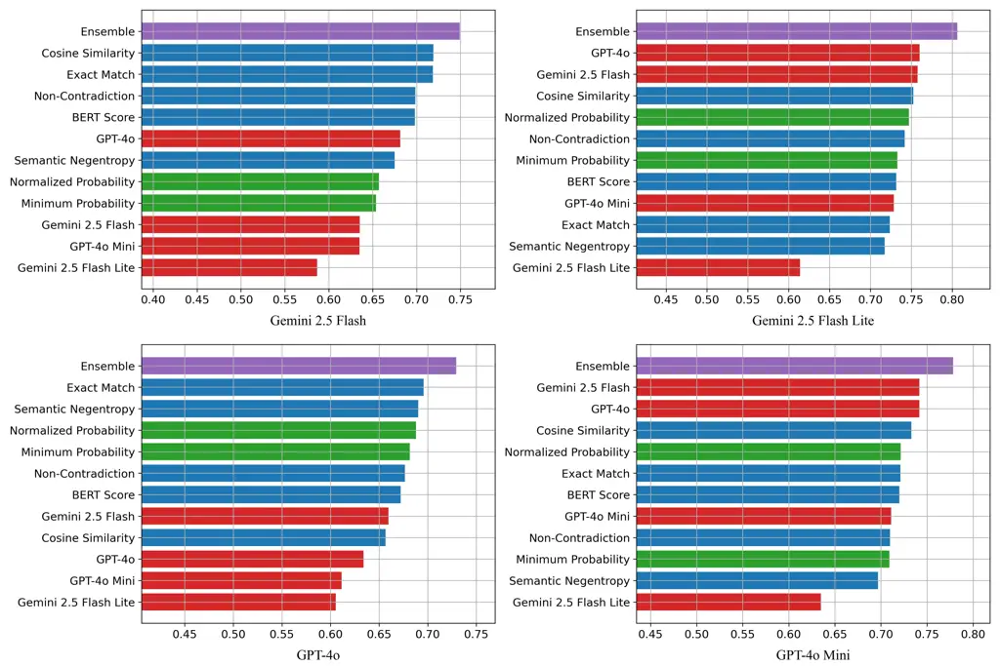

(a) NQ Open

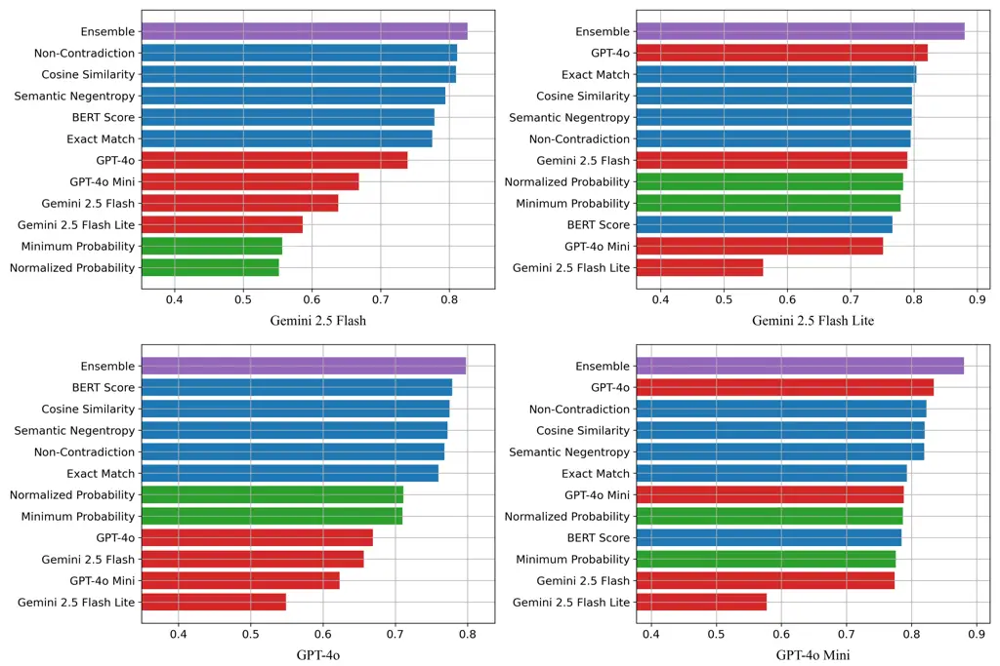

(b) PopQA

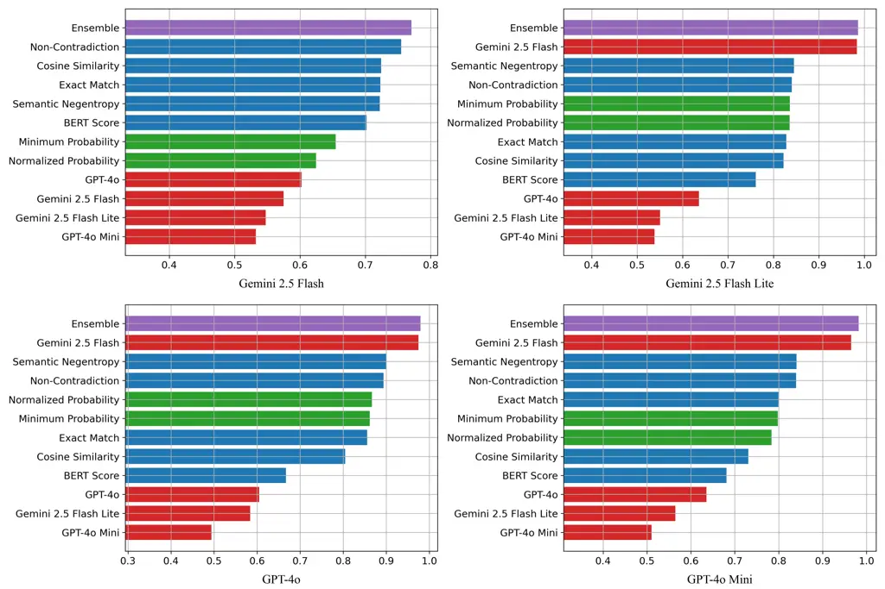

(c) GSM8K

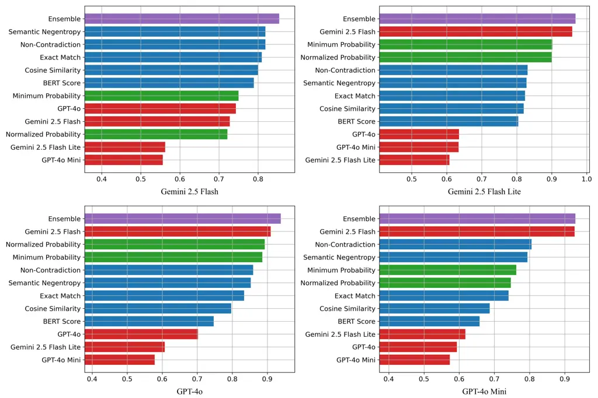

(d) SVAMP

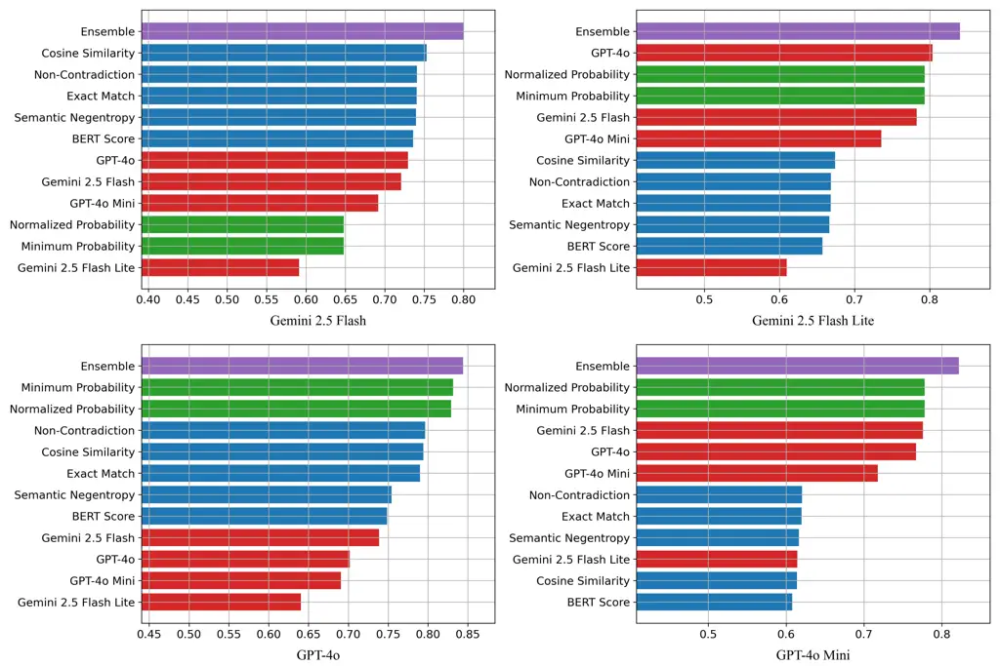

(e) CSQA

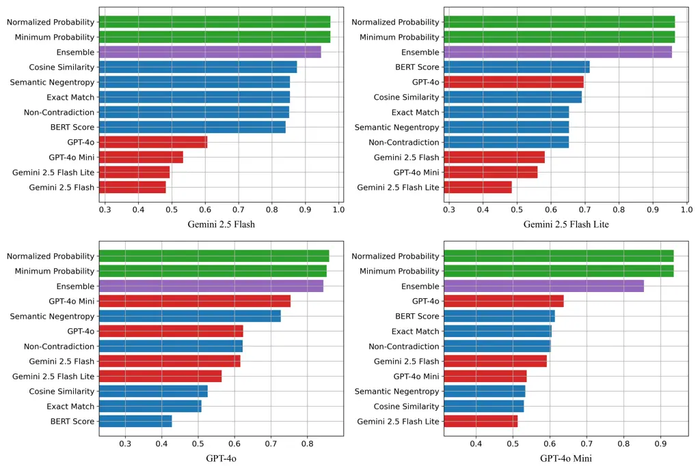

(f) AI2-ARC

Figure 1: Scorer-Specific AUROC Scores for Hallucination Detection by
LLM and Dataset (Higher is Better)

When comparing AUROC values across scorers, we find our ensemble scorer
outperforms its individual components in 20 out of 24 scenarios,
demonstrating the benefits of use-case-specific optimization. The
rankings of individual scorers, however, vary significantly across
scenarios, with LLM-as-a-Judge, black-box, and white-box methods
achieving top non-ensemble performance in 11, 7, and 6 scenarios
respectively. NLI-based scorers (NSN and NCP) exhibit strong
performance, achieving the highest AUROC in 13 out of 24 scenarios among
black-box scorers. Among LLM judges, GPT-4o and Gemini-2.5-Flash
consistently outperform their smaller counterparts (GPT-4o-mini and
Gemini-2.5-Flash-Lite), with GPT-4o ranking as the highest-performing
judge in 13 out of 24 scenarios and Gemini-2.5-Flash in 10 out of 24
scenarios. Notably, Gemini-2.5-Flash tended to be the highest performing
LLM judge on the math benchmarks (6 out of 8 scenarios), and GPT-4o
tended to be the highest performing judge on the short-answer benchmarks
(6 out of 8 scenarios). Finally, the two white-box scorers perform
approximately equally, with very similar AUROC scores in the vast
majority of scenarios.

| Model               | Metric      | NQ-Open  | PopQA    | GSM8K    | SVAMP    | CSQA     | AI2-ARC |
| ------------------- | ----------- | -------- | -------- | -------- | -------- | -------- | ------- |
| Gem.-2.5-Flash      | AUROC       | 0.749    | 0.826    | 0.771    | 0.854    | 0.800    | 0.975   |
|                     | Best Scorer | Ensemble | Ensemble | Ensemble | Ensemble | Ensemble | LNTP    |
| Gem.-2.5-Flash-Lite | AUROC       | 0.806    | 0.880    | 0.986    | 0.968    | 0.840    | 0.965   |
|                     | Best Scorer | Ensemble | Ensemble | Ensemble | Ensemble | Ensemble | LNTP    |
| GPT-4o              | AUROC       | 0.729    | 0.798    | 0.979    | 0.938    | 0.844    | 0.860   |
|                     | Best Scorer | Ensemble | Ensemble | Ensemble | Ensemble | Ensemble | LNTP    |
| GPT-4o-Mini         | AUROC       | 0.778    | 0.880    | 0.982    | 0.930    | 0.822    | 0.935   |
|                     | Best Scorer | Ensemble | Ensemble | Ensemble | Ensemble | Ensemble | LNTP    |

Table 1: Hallucination Detection AUROC (Higher is Better):
Best-Performing Scorer by LLM and Dataset

#### Threshold-Optimized Evaluation.

We evaluate the various scorers using a threshold-dependent metric
(F1-score). To compute our ensemble scores in this setting, we jointly
optimize the ensemble weights and threshold using F1-score as the
objective function, as outlined in Appendix B. To ensure robust
evaluations, we compute the scorer-specific F1-scores using 5-fold
cross-validation. For each individual scorer, we select the F1-optimal
threshold using grid search on the tuning set and compute F1-score on
the holdout set. We report the final F1-score for each scorer as the
average across holdout sets.

| Model            | Metric      | NQ-Open  | PopQA    | GSM8K    | SVAMP        | CSQA     | AI2-ARC      |
| ---------------- | ----------- | -------- | -------- | -------- | ------------ | -------- | ------------ |
| Gem.-2.5-Flash   | Precision   | 0.597    | 0.688    | 0.950    | 0.968        | 0.856    | 0.985        |
|                  | Recall      | 0.907    | 0.890    | 0.999    | 0.999        | 0.986    | 0.987        |
|                  | F1-Score    | 0.718    | 0.774    | 0.974    | 0.983        | 0.916    | 0.986        |
|                  | Best Scorer | Ensemble | Ensemble | Ensemble | Ensemble     | Ensemble | NSN          |
| Gem.-2.5-Fl.-Lt. | Precision   | 0.587    | 0.680    | 0.960    | 0.977        | 0.863    | 0.968        |
|                  | Recall      | 0.838    | 0.864    | 0.980    | 0.976        | 0.973    | 0.997        |
|                  | F1-Score    | 0.688    | 0.759    | 0.969    | 0.977        | 0.915    | 0.982        |
|                  | Best Scorer | Ensemble | Ensemble | Ensemble | Gem.-2.5-Fl. | Ensemble | Gem.-2.5-Fl. |
| GPT-4o           | Precision   | 0.649    | 0.727    | 0.958    | 0.978        | 0.853    | 0.987        |
|                  | Recall      | 0.917    | 0.880    | 0.987    | 0.990        | 0.972    | 1.000        |
|                  | F1-Score    | 0.756    | 0.795    | 0.972    | 0.984        | 0.909    | 0.993        |
|                  | Best Scorer | Ensemble | Ensemble | Ensemble | Gem.-2.5-Fl. | NCP      | Gem.-2.5-Fl. |
| GPT-4o-Mini      | Precision   | 0.616    | 0.700    | 0.906    | 0.969        | 0.840    | 0.952        |
|                  | Recall      | 0.867    | 0.876    | 0.978    | 0.988        | 0.991    | 0.998        |
|                  | F1-Score    | 0.718    | 0.776    | 0.940    | 0.978        | 0.909    | 0.975        |
|                  | Best Scorer | Ensemble | Ensemble | Ensemble | Ensemble     | Ensemble | Gem.-2.5-Fl. |

Table 2: Hallucination Detection F1-Scores (Higher is Better):
Best-Performing Scorer by LLM and Dataset

Figure 2 displays the F1-scores for each scorer, while Table 2
summarizes the precision, recall, and F1 metrics for the top-performing
scorer across all 24 evaluation scenarios. The results are largely
consistent with the AUROC experiments. The ensemble scorer outperforms
its individual components in most scenarios, achieving highest F1-score
in 17 out of 24 scenarios. Similar to the AUROC experiments, the
NLI-based scorers (NSN and NCP) often outperform other black-box scorers
(18 out of 24 scenarios), consistent with the findings of previous
studies (Kuhn et al., 2023; Manakul et al., 2023; Lin et al., 2024;
Farquhar et al., 2024). Once again, the Gemini-2.5-Flash judge
outperforms other LLM judges on the math benchmarks (8 out of 8
scenarios), while the GPT-4o judge outperforms other LLM judges on the
short answer benchmarks (6 out of 8 scenarios). Interestingly, the
strong LLM judge performance of Gemini-2.5-Flash on the math benchmarks
and GPT-4o on the short answer benchmarks are consistent with their
respective strengths when generating answers as the original LLM, where
they achieved highest accuracy among the four LLMs on those same
benchmarks (see Figure 3). Lastly, the two white-box scorers perform
approximately equally, as in the AUROC experiments.


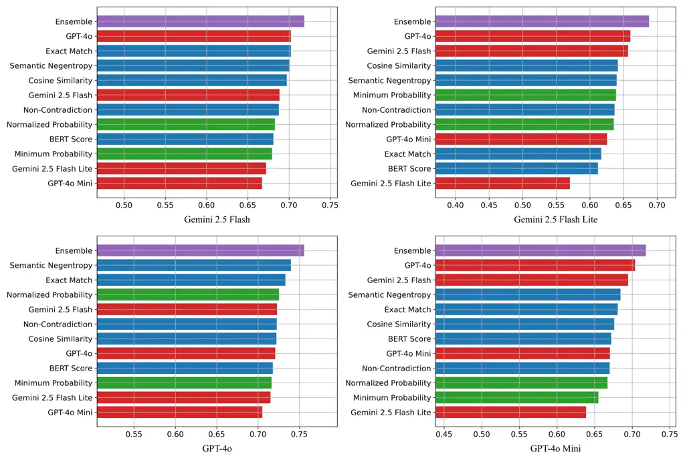

(a) NQ Open

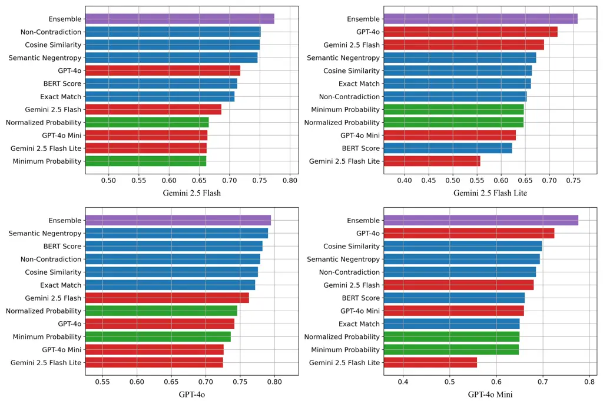

(b) PopQA

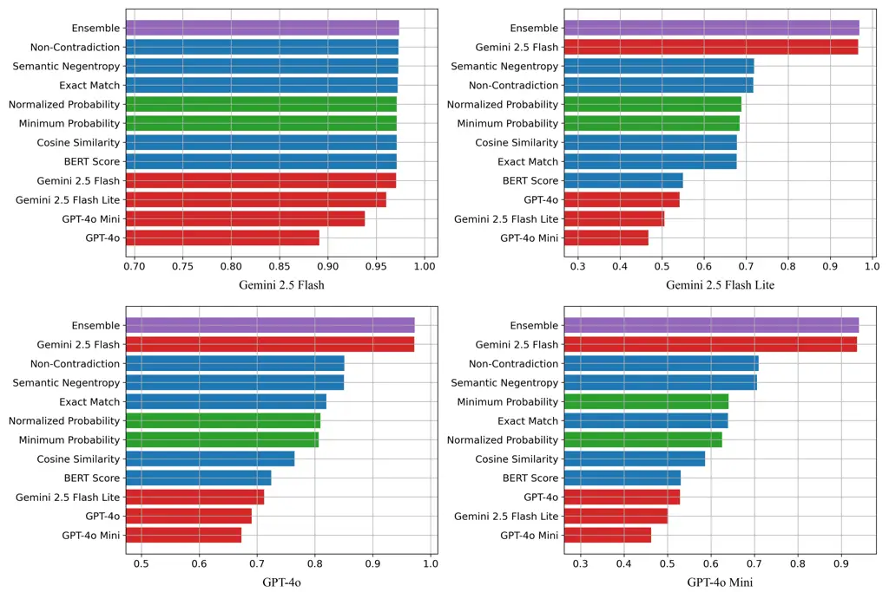

(c) GSM8K

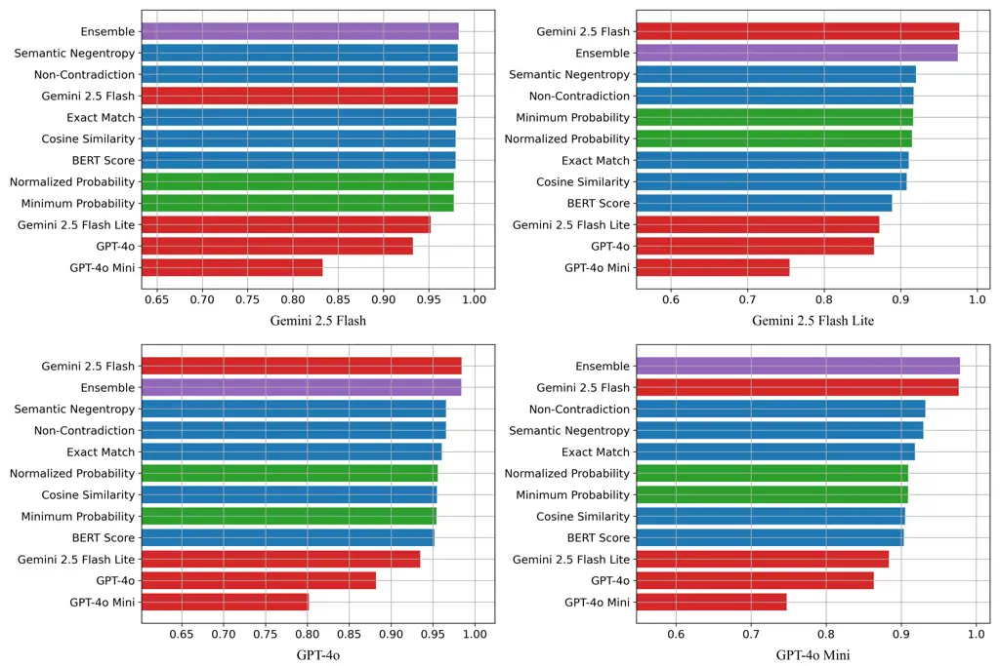

(d) SVAMP

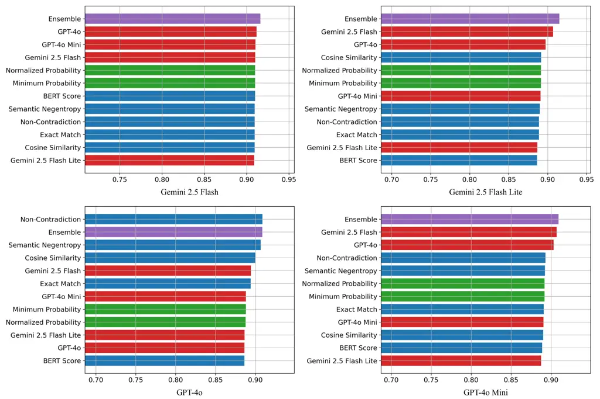

(e) CSQA

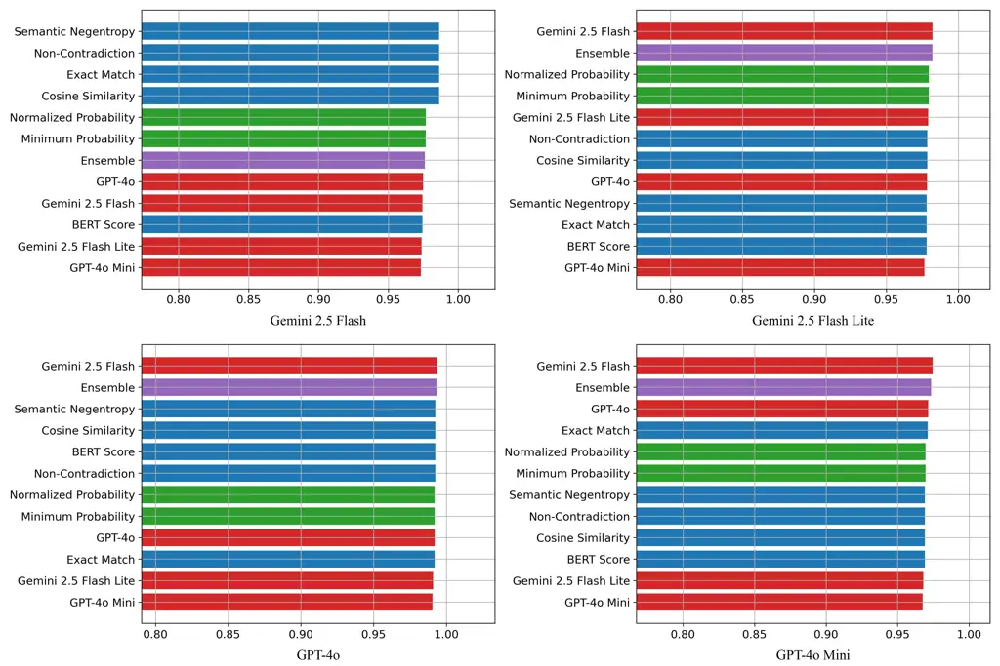

(f) AI2-ARC

Figure 2: Scorer-Specific F1-Scores for Hallucination Detection by LLM
and Dataset (Higher is Better)

#### Filtered Accuracy@$`\tau`$.

Lastly, we compute model accuracy on the subset of LLM responses having
confidence scores exceeding a specified threshold $`\tau`$. We refer to
this metric as Filtered Accuracy@$`\tau`$. Since the LLM accuracy
depends on the choice of the threshold $`\tau`$, we repeat the
calculation for $`\tau=0,0.1,...,0.9`$. Note that accuracy at $`\tau=0`$
uses the full sample without score-based filtering.

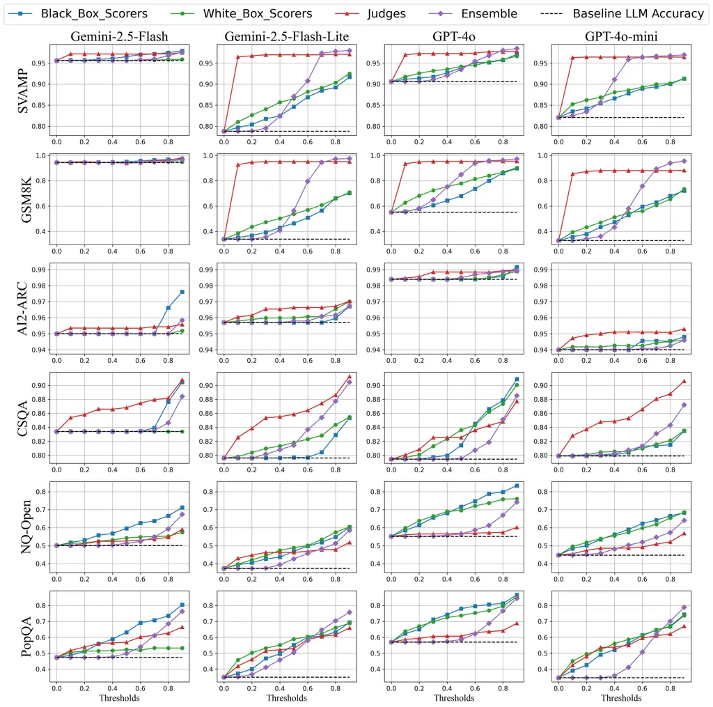

Figure 3: Filtered LLM Accuracy vs. Confidence Threshold (Top per Scorer
Type)

Figure 3 presents the Filtered Accuracy@$`\tau`$ for the highest
performing white-box, black-box, LLM-as-a-Judge, and ensemble scorers.
Across all scenarios, response filtering with the highest-performing
scorers leads to an approximately monotonic increase in LLM accuracy as
the threshold increases. For example, when filtering
Gemini-2.5-Flash-Lite responses to PopQA questions using the leading
white-box scorer, accuracy improves dramatically from a baseline of 0.35
to 0.61 at $`\tau=0.6`$. Similarly, with GPT-4o responses on GSM8K,
filtering with the ensemble scorer achieves 0.93 accuracy at
$`\tau=0.6`$, substantially higher than the baseline accuracy of 0.55.

## 5 Discussion

#### Choosing Among Scorers.

Choosing the right confidence scorer for an LLM system depends on
several factors, including API support, latency requirements, LLM
behavior, and the availability of graded datasets. If the API supports
access to token probabilities in LLM generations, white-box scorers can
be implemented without adding latency or generation costs.¹⁷¹⁷ 17 The
white-box scorers we consider in this work require only a single
generation per prompt. However, sampling-based white-box methods also
exist. See, for example, Kuhn et al. (2023); Scalena et al. (2025);
Vashurin et al. (2025b); Vashurin et al. (2025a); Qiu and Miikkulainen
(2024). However, if the API does not provide access to token
probabilities, black-box scorers and LLM-as-a-Judge may be the only
feasible options. When choosing among black-box and LLM-as-a-Judge
scorers, latency requirements are a key consideration. For low-latency
applications, practitioners should avoid higher-latency black-box
scorers such as NLI-based scorers (NSN and NCP), opting instead for
faster black-box scorers or LLM-as-a-Judge. If latency is not a concern,
any of the black-box scorers may be suitable.

For LLM-as-a-Judge implementations, our findings reveal that an LLM’s
accuracy on a specific dataset positively relates to its ability to
judge responses to questions from that same dataset, providing a
practical criterion for judge selection. Finally, if a graded dataset is
available, practitioners can tune an ensemble of various confidence
scores to improve hallucination detection, as detailed in Appendix B.
Our experiments demonstrate that a tuned ensemble can potentially
provide more accurate confidence scores than individual scorers. By
considering these factors and choosing the right confidence score,
practitioners can improve the performance of their LLM system.

#### Using Confidence Scores.

In practice, practitioners may wish to use confidence scores for various
purposes. First, practitioners can use our confidence scores for
response filtering, where responses with low confidence are blocked, or
‘targeted’ human-in-the-loop, where low-confidence responses are
selected for manual review. Our experimental evaluations of Filtered
Accuracy@$`\tau`$ demonstrate the efficacy of these approaches,
illustrating notable improvements in LLM accuracy when low-confidence
responses are filtered out. Note that selecting a confidence threshold
for flagging or blocking responses will depend on the scorer used, the
dataset being evaluated, and stakeholder values (e.g., relative cost of
false negatives vs. false positives).

Alternatively, confidence scores can be used for pre-deployment
diagnostics, providing practitioners insights into the types of
questions on which their LLM is performing worst. Findings from this
type of exploratory analysis can inform strategies for improvements,
such as further prompt engineering. Overall, the scorers included in our
framework and toolkit provide practitioners with an actionable way to
improve response quality, optimize resource allocation, and mitigate
risks.

We note two important ethical considerations related to using confidence
scores. First, a confidence score reflects model uncertainty rather than
ground-truth-based correctness, and high scores can induce over-reliance
in high-risk settings. We therefore caution against using confidence
scores as decision guarantees in domains such as medicine, law, or
finance without external human review and domain-specific safeguards.
Second, we encourage monitoring for distributional fairness and content
diversity, including per-segment error-rate evaluation, and, where
applicable, safeguards that prevent systematic removal of accurate
responses for particular groups.

#### Limitations and Future Work.

We note a few important limitations of this work. First, although our
experiments leverage six question-answering benchmark datasets spanning
three types of questions, we acknowledge that our findings on
scorer-specific performance may not generalize to other types of
questions.¹⁸¹⁸ 18 For practical reasons, we selected benchmark datasets
containing questions that could be graded computationally. For example,
long-form generation (such as summarization) can mix true and false
claims within a single output and may require claim-level decomposition
to obtain useful uncertainty signals. Likewise, correctness in code
generation depends on syntax and execution, so black-box consistency
measurements will likely require alternative methods.

Second, while we conduct experiments using four LLMs, performance of the
various scorers may differ for other LLMs. Note that for different LLMs,
differences in token probability distributions will impact the behavior
of white-box scorers, and the degree of variation in responses to the
same prompt will affect the performance of black-box scorers.
LLM-as-a-Judge performance may vary significantly depending on the
choice of LLM and instruction prompts used.

Additional limitations relate to the ensemble approach. First, while the
ensemble approach is designed to optimize in-domain performance, we have
not evaluated out-of-distribution generalization, including
cross-dataset transfer of learned weights; we leave this to future work.
Second, our experiments consider only linear ensembles. Future work
should examine non-linear ensembling and its impact on hallucination
detection, e.g., monotonic generalized additive models that retain
interpretability while capturing modest non-linear effects,
mixture-of-experts, and tree-based ensembles. These may outperform
linear averaging when scorer signals interact or exhibit non-linear
relationships. Practical trade-offs to study include latency,
overfitting risk on small graded sets, and the need for interpretability
in high-stakes deployments. Third, tuning the ensemble requires a graded
dataset. For tasks with trivial grading (e.g., arithmetic,
multiple-choice, short-answer), where there are well-defined,
easy-to-recognize correct answers and comparisons with generated text
can be computed automatically, this can be done by sampling a
representative set of questions, generating responses, computing the
selected UQ scores, and using the automatically derived labels to fit
the weights. For tasks with non-trivial grading (e.g., summarization),
practitioners can begin with a small human-graded dataset (e.g., a few
hundred items); additional labels can then be added incrementally from
production logs to further optimize the weights and improve ensemble
performance.

## 6 Conclusions

In this paper, we detail a framework for closed-book hallucination
detection comprised of various black-box UQ, white-box UQ, and
LLM-as-a-Judge scorers. To ensure standardized outputs of the scorers,
we transform and normalize scorers (if necessary) such that all outputs
range from 0 to 1, with higher scores indicating greater confidence in
an LLM response. These response-level confidence scores can be used for
generation-time hallucination detection across a wide variety of LLM use
cases. Additionally, we introduce a novel, ensemble-based approach that
leverages an optimized weighted average of any combination of individual
confidence scores. Importantly, the extensible nature of our ensemble
means that practitioners can include additional scorers as new methods
become available.

Our experimental evaluation of UQ-based scorers offers clear guidance
for practitioners. Ensemble approaches consistently outperform
individual methods for hallucination detection, with our findings
strongly supporting use-case-specific customization rather than
one-size-fits-all solutions. For those without token-probability access,
NLI-based approaches typically provide the best black-box performance.
Importantly, gains from sampling additional responses diminish as the
number of candidate responses increases, offering a practical deployment
guideline that balances effectiveness with computational efficiency.
Finally, our analysis revealed that a model’s accuracy on a specific
dataset positively relates to its ability to judge responses to
questions from that same dataset, providing a practical criterion for
judge selection in evaluation frameworks.

The uqlm library implements all scorers presented and evaluated in this
work. The repository is actively maintained. We welcome issues and pull
requests and will continue to update integrations, add new scorers as
research advances, and refresh examples as model and provider APIs
change.

## Acknowledgements

We wish to thank David Skarbrevik, Piero Ferrante, Xue (Crystal) Gu,
Blake Aber, Viren Bajaj, Ho-Kyeong Ra, Zeya Ahmad, Matthew Churgin,
Saicharan Sirangi, and Erik Widman for their helpful suggestions.

## Conflict of Interest

DB and MSC are employed and receive stock and equity from CVS Health®
Corporation.

## References

- Agrawal et al. (2024) A. Agrawal, M. Suzgun, L. Mackey, and A. T.
  Kalai Do language models know when they’re hallucinating references?.
  External Links: 2305.18248, [Link](https://arxiv.org/abs/2305.18248)
  Cited by: §2.
- Akiba et al. (2019) T. Akiba, S. Sano, T. Yanase, T. Ohta, and M.
  Koyama Optuna: A next-generation hyperparameter optimization
  framework. In Proceedings of the 25th ACM SIGKDD international
  conference on knowledge discovery & data mining, pp. 2623–2631.
  External Links: [Document](https://dx.doi.org/10.1145/3292500.3330701)
  Cited by: footnote 12.
- Bakman et al. (2024) Y. F. Bakman, D. N. Yaldiz, B. Buyukates, C.
  Tao, D. Dimitriadis, and S. Avestimehr MARS: meaning-aware response
  scoring for uncertainty estimation in generative llms. External Links:
  2402.11756, [Link](https://arxiv.org/abs/2402.11756) Cited by:
  footnote 4.
- Banerjee and Lavie (2005) S. Banerjee and A. Lavie METEOR: an
  automatic metric for MT evaluation with improved correlation with
  human judgments. In Proceedings of the ACL Workshop on Intrinsic and
  Extrinsic Evaluation Measures for Machine Translation and/or
  Summarization, J. Goldstein, A. Lavie, C. Lin, and C. Voss (Eds.), Ann
  Arbor, Michigan, pp. 65–72. External Links:
  [Link](https://aclanthology.org/W05-0909/) Cited by: §2.
- Bouchard et al. (2025) D. Bouchard, M. S. Chauhan, D. Skarbrevik, H.
  Ra, V. Bajaj, and Z. Ahmad UQLM: a python package for uncertainty
  quantification in large language models. External Links: 2507.06196,
  [Link](https://arxiv.org/abs/2507.06196) Cited by: footnote 2.
- Chen and Mueller (2023) J. Chen and J. Mueller Quantifying uncertainty
  in answers from any language model and enhancing their
  trustworthiness. External Links: 2308.16175,
  [Link](https://arxiv.org/abs/2308.16175) Cited by: §2, §2, §2, §3.2,
  §3.2, footnote 7.
- Clark et al. (2018) P. Clark, I. Cowhey, O. Etzioni, T. Khot, A.
  Sabharwal, C. Schoenick, and O. Tafjord Think you have solved question
  answering? try arc, the ai2 reasoning challenge. External Links:
  1803.05457, [Link](https://arxiv.org/abs/1803.05457) Cited by: §4.1.
- Cobbe et al. (2021) K. Cobbe, V. Kosaraju, M. Bavarian, M. Chen, H.
  Jun, L. Kaiser, M. Plappert, J. Tworek, J. Hilton, R. Nakano, C.
  Hesse, and J. Schulman Training verifiers to solve math word problems.
  External Links: 2110.14168, [Link](https://arxiv.org/abs/2110.14168)
  Cited by: §4.1.
- Cohen et al. (2023) R. Cohen, M. Hamri, M. Geva, and A. Globerson LM
  vs lm: detecting factual errors via cross examination. External Links:
  2305.13281, [Link](https://arxiv.org/abs/2305.13281) Cited by: §2.
- Cole et al. (2023) J. R. Cole, M. J. Q. Zhang, D. Gillick, J. M.
  Eisenschlos, B. Dhingra, and J. Eisenstein Selectively answering
  ambiguous questions. External Links: 2305.14613,
  [Link](https://arxiv.org/abs/2305.14613) Cited by: §2.
- Fadeeva et al. (2024) E. Fadeeva, A. Rubashevskii, A. Shelmanov, S.
  Petrakov, H. Li, H. Mubarak, E. Tsymbalov, G. Kuzmin, A. Panchenko, T.
  Baldwin, P. Nakov, and M. Panov Fact-checking the output of large
  language models via token-level uncertainty quantification. External
  Links: 2403.04696, [Link](https://arxiv.org/abs/2403.04696) Cited by:
  §2.
- Farquhar et al. (2024) S. Farquhar, J. Kossen, L. Kuhn, and Y. Gal
  Detecting hallucinations in large language models using semantic
  entropy. Nature 630 (8017), pp. 625–630. External Links: ISSN
  1476-4687, [Document](https://dx.doi.org/10.1038/s41586-024-07421-0),
  [Link](https://doi.org/10.1038/s41586-024-07421-0) Cited by: Appendix
  D, §2, §3.2, §3.2, §4.2.
- \[13\] Google External Links:
  [Link](https://cloud.google.com/vertex-ai/generative-ai/docs/models)
  Cited by: §4.1.
- Guerreiro et al. (2023) N. M. Guerreiro, E. Voita, and A. F. T.
  Martins Looking for a needle in a haystack: a comprehensive study of
  hallucinations in neural machine translation. External Links:
  2208.05309, [Link](https://arxiv.org/abs/2208.05309) Cited by:
  footnote 4.
- Huang et al. (2024) H. Huang, Y. Yang, Z. Zhang, S. Lee, and Y. Wu A
  survey of uncertainty estimation in llms: theory meets practice.
  External Links: 2410.15326, [Link](https://arxiv.org/abs/2410.15326)
  Cited by: §1.
- Huang et al. (2023) L. Huang, W. Yu, W. Ma, W. Zhong, Z. Feng, H.
  Wang, Q. Chen, W. Peng, X. Feng, B. Qin, and T. Liu A survey on
  hallucination in large language models: principles, taxonomy,
  challenges, and open questions. External Links: 2311.05232,
  [Link](https://arxiv.org/abs/2311.05232) Cited by: §1.
- Jiang et al. (2024) M. Jiang, Y. Ruan, P. Sattigeri, S. Roukos, and T.
  Hashimoto Graph-based uncertainty metrics for long-form language model
  outputs. External Links: 2410.20783,
  [Link](https://arxiv.org/abs/2410.20783) Cited by: footnote 3.
- Kadavath et al. (2022) S. Kadavath, T. Conerly, A. Askell, T.
  Henighan, D. Drain, E. Perez, N. Schiefer, Z. Hatfield-Dodds, N.
  DasSarma, E. Tran-Johnson, S. Johnston, S. El-Showk, A. Jones, N.
  Elhage, T. Hume, A. Chen, Y. Bai, S. Bowman, S. Fort, D. Ganguli, D.
  Hernandez, J. Jacobson, J. Kernion, S. Kravec, L. Lovitt, K.
  Ndousse, C. Olsson, S. Ringer, D. Amodei, T. Brown, J. Clark, N.
  Joseph, B. Mann, S. McCandlish, C. Olah, and J. Kaplan Language models
  (mostly) know what they know. External Links: 2207.05221,
  [Link](https://arxiv.org/abs/2207.05221) Cited by: §2.
- Kossen et al. (2024) J. Kossen, J. Han, M. Razzak, L. Schut, S. Malik,
  and Y. Gal Semantic entropy probes: robust and cheap hallucination
  detection in llms. External Links: 2406.15927,
  [Link](https://arxiv.org/abs/2406.15927) Cited by: §2.
- Kuhn et al. (2023) L. Kuhn, Y. Gal, and S. Farquhar Semantic
  uncertainty: linguistic invariances for uncertainty estimation in
  natural language generation. External Links: 2302.09664,
  [Link](https://arxiv.org/abs/2302.09664) Cited by: Appendix D, §2,
  §4.2, footnote 17.
- Lee et al. (2019) K. Lee, M. Chang, and K. Toutanova Latent retrieval
  for weakly supervised open domain question answering. External Links:
  1906.00300, [Link](https://arxiv.org/abs/1906.00300) Cited by: §4.1.
- Lin (2004) C. Lin ROUGE: a package for automatic evaluation of
  summaries. In Text Summarization Branches Out, Barcelona, Spain,
  pp. 74–81. External Links: [Link](https://aclanthology.org/W04-1013/)
  Cited by: §2.
- Lin et al. (2024) Z. Lin, S. Trivedi, and J. Sun Generating with
  confidence: uncertainty quantification for black-box large language
  models. External Links: 2305.19187,
  [Link](https://arxiv.org/abs/2305.19187) Cited by: Appendix D, §2,
  §4.2.
- Ling et al. (2024) C. Ling, X. Zhao, X. Zhang, W. Cheng, Y. Liu, Y.
  Sun, M. Oishi, T. Osaki, K. Matsuda, J. Ji, G. Bai, L. Zhao, and H.
  Chen Uncertainty quantification for in-context learning of large
  language models. External Links: 2402.10189,
  [Link](https://arxiv.org/abs/2402.10189) Cited by: footnote 4.
- Luo et al. (2023) J. Luo, C. Xiao, and F. Ma Zero-resource
  hallucination prevention for large language models. External Links:
  2309.02654, [Link](https://arxiv.org/abs/2309.02654) Cited by:
  footnote 4.
- Malinin and Gales (2021) A. Malinin and M. Gales Uncertainty
  estimation in autoregressive structured prediction. External Links:
  2002.07650, [Link](https://arxiv.org/abs/2002.07650) Cited by: §2.
- Mallen et al. (2023) A. Mallen, A. Asai, V. Zhong, R. Das, D.
  Khashabi, and H. Hajishirzi When not to trust language models:
  investigating effectiveness of parametric and non-parametric memories.
  In Proceedings of the 61st Annual Meeting of the Association for
  Computational Linguistics (Volume 1: Long Papers), A. Rogers, J.
  Boyd-Graber, and N. Okazaki (Eds.), Toronto, Canada, pp. 9802–9822.
  External Links: [Link](https://aclanthology.org/2023.acl-long.546/),
  [Document](https://dx.doi.org/10.18653/v1/2023.acl-long.546) Cited by:
  §4.1.
- Manakul et al. (2023) P. Manakul, A. Liusie, and M. J. F. Gales
  SelfCheckGPT: zero-resource black-box hallucination detection for
  generative large language models. External Links: 2303.08896,
  [Link](https://arxiv.org/abs/2303.08896) Cited by: Appendix D, §2, §2,
  §2, §4.2, footnote 7.
- \[29\] OpenAI External Links:
  [Link](https://platform.openai.com/docs/models) Cited by: §4.1.
- OpenAI (2025) OpenAI Introducing gpt-4.5 \| openai. External Links:
  [Link](https://openai.com/index/introducing-gpt-4-5/) Cited by: §1.
- Papineni et al. (2002) K. Papineni, S. Roukos, T. Ward, and W. Zhu
  BLEU: a method for automatic evaluation of machine translation. In
  Proceedings of the 40th Annual Meeting on Association for
  Computational Linguistics, ACL ’02, USA, pp. 311–318. External Links:
  [Link](https://doi.org/10.3115/1073083.1073135),
  [Document](https://dx.doi.org/10.3115/1073083.1073135) Cited by: §2.
- Patel et al. (2021) A. Patel, S. Bhattamishra, and N. Goyal Are nlp
  models really able to solve simple math word problems?. External
  Links: 2103.07191, [Link](https://arxiv.org/abs/2103.07191) Cited by:
  §4.1.
- Qiu and Miikkulainen (2024) X. Qiu and R. Miikkulainen Semantic
  density: uncertainty quantification for large language models through
  confidence measurement in semantic space. External Links: 2405.13845,
  [Link](https://arxiv.org/abs/2405.13845) Cited by: §2, footnote 17.
- Qurashi et al. (2020) A. W. Qurashi, V. Holmes, and A. P. Johnson
  Document processing: methods for semantic text similarity analysis. In
  2020 International Conference on INnovations in Intelligent SysTems
  and Applications (INISTA), Vol. , pp. 1–6. External Links:
  [Document](https://dx.doi.org/10.1109/INISTA49547.2020.9194665) Cited
  by: §2.
- Reimers and Gurevych (2019) N. Reimers and I. Gurevych Sentence-bert:
  sentence embeddings using siamese bert-networks. External Links:
  1908.10084, [Link](https://arxiv.org/abs/1908.10084) Cited by: §2.
- Ren et al. (2023) J. Ren, Y. Zhao, T. Vu, P. J. Liu, and B.
  Lakshminarayanan Self-evaluation improves selective generation in
  large language models. External Links: 2312.09300,
  [Link](https://arxiv.org/abs/2312.09300) Cited by: footnote 4.
- Scalena et al. (2025) D. Scalena, L. Zotos, E. Fersini, M. Nissim,
  and A. Üstün EAGER: entropy-aware generation for adaptive
  inference-time scaling. External Links: 2510.11170,
  [Link](https://arxiv.org/abs/2510.11170) Cited by: footnote 17.
- Shorinwa et al. (2024) O. Shorinwa, Z. Mei, J. Lidard, A. Z. Ren,
  and A. Majumdar A survey on uncertainty quantification of large
  language models: taxonomy, open research challenges, and future
  directions. External Links: 2412.05563,
  [Link](https://arxiv.org/abs/2412.05563) Cited by: §1, §2.
- Talmor et al. (2022) A. Talmor, O. Yoran, R. L. Bras, C.
  Bhagavatula, Y. Goldberg, Y. Choi, and J. Berant CommonsenseQA 2.0:
  exposing the limits of ai through gamification. External Links:
  2201.05320, [Link](https://arxiv.org/abs/2201.05320) Cited by: §4.1.
- Tonmoy et al. (2024) S. M. T. I. Tonmoy, S. M. M. Zaman, V. Jain, A.
  Rani, V. Rawte, A. Chadha, and A. Das A comprehensive survey of
  hallucination mitigation techniques in large language models. External
  Links: 2401.01313, [Link](https://arxiv.org/abs/2401.01313) Cited by:
  §1.
- van der Poel et al. (2022) L. van der Poel, R. Cotterell, and C.
  Meister Mutual information alleviates hallucinations in abstractive
  summarization. External Links: 2210.13210,
  [Link](https://arxiv.org/abs/2210.13210) Cited by: footnote 4.
- Varshney et al. (2023) N. Varshney, W. Yao, H. Zhang, J. Chen, and D.
  Yu A stitch in time saves nine: detecting and mitigating
  hallucinations of llms by validating low-confidence generation.
  External Links: 2307.03987, [Link](https://arxiv.org/abs/2307.03987)
  Cited by: footnote 4.
- Vashurin et al. (2025a) R. Vashurin, E. Fadeeva, A. Vazhentsev, L.
  Rvanova, D. Vasilev, A. Tsvigun, S. Petrakov, R. Xing, A. Sadallah, K.
  Grishchenkov, A. Panchenko, T. Baldwin, P. Nakov, M. Panov, and A.
  Shelmanov Benchmarking uncertainty quantification methods for large
  language models with lm-polygraph. Transactions of the Association for
  Computational Linguistics 13, pp. 220–248. External Links: ISSN
  2307-387X, [Link](http://dx.doi.org/10.1162/tacl_a_00737),
  [Document](https://dx.doi.org/10.1162/tacl%5Fa%5F00737) Cited by:
  footnote 17.
- Vashurin et al. (2025b) R. Vashurin, M. Goloburda, A. Ilina, A.
  Rubashevskii, P. Nakov, A. Shelmanov, and M. Panov Uncertainty
  quantification for llms through minimum bayes risk: bridging
  confidence and consistency. External Links: 2502.04964,
  [Link](https://arxiv.org/abs/2502.04964) Cited by: footnote 17.
- Verga et al. (2024) P. Verga, S. Hofstatter, S. Althammer, Y. Su, A.
  Piktus, A. Arkhangorodsky, M. Xu, N. White, and P. Lewis Replacing
  judges with juries: evaluating llm generations with a panel of diverse
  models. External Links: 2404.18796,
  [Link](https://arxiv.org/abs/2404.18796) Cited by: §2.
- Wang et al. (2024) B. Wang, W. Chen, H. Pei, C. Xie, M. Kang, C.
  Zhang, C. Xu, Z. Xiong, R. Dutta, R. Schaeffer, S. T. Truong, S.
  Arora, M. Mazeika, D. Hendrycks, Z. Lin, Y. Cheng, S. Koyejo, D. Song,
  and B. Li DecodingTrust: a comprehensive assessment of trustworthiness
  in gpt models. External Links: 2306.11698,
  [Link](https://arxiv.org/abs/2306.11698) Cited by: Appendix A.
- Wang et al. (2023) X. Wang, J. Wei, D. Schuurmans, Q. Le, E. Chi, S.
  Narang, A. Chowdhery, and D. Zhou Self-consistency improves chain of
  thought reasoning in language models. External Links: 2203.11171,
  [Link](https://arxiv.org/abs/2203.11171) Cited by: footnote 4.
- Xiong et al. (2024) M. Xiong, Z. Hu, X. Lu, Y. Li, J. Fu, J. He,
  and B. Hooi Can llms express their uncertainty? an empirical
  evaluation of confidence elicitation in llms. External Links:
  2306.13063, [Link](https://arxiv.org/abs/2306.13063) Cited by: §2,
  §3.4.
- Zhang et al. (2024) C. Zhang, F. Liu, M. Basaldella, and N. Collier
  LUQ: long-text uncertainty quantification for llms. External Links:
  2403.20279, [Link](https://arxiv.org/abs/2403.20279) Cited by: §2.
- Zhang et al. (2023) T. Zhang, L. Qiu, Q. Guo, C. Deng, Y. Zhang, Z.
  Zhang, C. Zhou, X. Wang, and L. Fu Enhancing uncertainty-based
  hallucination detection with stronger focus. External Links:
  2311.13230, [Link](https://arxiv.org/abs/2311.13230) Cited by:
  footnote 4.
- Zhang et al. (2020) T. Zhang, V. Kishore, F. Wu, K. Q. Weinberger,
  and Y. Artzi BERTScore: evaluating text generation with bert. External
  Links: 1904.09675, [Link](https://arxiv.org/abs/1904.09675) Cited by:
  §2, §3.2.

## Appendix A LLM-as-a-Judge Prompt

Our LLM-as-a-Judge scorer used the following instruction prompt:

> Question: \[question\], Proposed Answer: \[answer\].
>
> How likely is the above answer to be correct? Analyze the answer and
> give your confidence in this answer between 0 (lowest) and 100
> (highest), with 100 being certain the answer is correct, and 0 being
> certain the answer is incorrect. THE CONFIDENCE RATING YOU PROVIDE
> MUST BE BETWEEN 0 and 100. ONLY RETURN YOUR NUMERICAL SCORE WITH NO
> SURROUNDING TEXT OR EXPLANATION.
>
> \# Example 1  
> \## Data to analyze  
> Question: Who was the first president of the United States?, Proposed
> Answer: Benjamin Franklin.
>
> \## Your response  
> 4 (highly certain the proposed answer is incorrect)
>
> \# Example 2  
> \## Data to analyze  
> Question: What is 2+2?, Proposed Answer: 4
>
> \## Your response  
> 99 (highly certain the proposed answer is correct)

To ensure a normalized confidence score consistent with the other
scorers, we normalize the value returned by the LLM judge to be between
0 and 1. The capitalization and repeated instructions, inspired by Wang
et al. (2024), are included to ensure the LLM correctly follows
instructions.

## Appendix B Ensemble Tuning

We outline a method for tuning ensemble weights for improved
hallucination detection accuracy. This approach allows for customizable
component-importance that can be optimized for a specific use case. In
practice, tuning the ensemble weights requires having a ‘graded’ set of
$`n`$ original LLM responses which indicate whether a hallucination is
present in each response.¹⁹¹⁹ 19 Grading responses may be accomplished
computationally for certain tasks, e.g. multiple choice questions.
However, in many cases, this will require a human grader to manually
evaluate the set of responses. Given a set of $`n`$ prompts, denoted as
$`\mathbf{x}`$:

```math
\mathbf{x}=\begin{pmatrix}x_{1}\\
x_{2}\\
\vdots\\
x_{n}\\
\end{pmatrix}, \tag{13}
```

denote corresponding correct reference answers as $`\mathbf{y}^{*}`$,

```math
\mathbf{y}^{*}=\begin{pmatrix}y_{1}^{*}\\
y_{2}^{*}\\
\vdots\\
y_{n}^{*}\\
\end{pmatrix}, \tag{14}
```

original LLM responses as $`\mathbf{y}`$,

```math
\mathbf{y}=\begin{pmatrix}y_{1}\\
y_{2}\\
\vdots\\
y_{n}\\
\end{pmatrix}, \tag{15}
```

and candidate responses across all prompts with the matrix
$`\tilde{\mathbf{Y}}`$:

```math
\tilde{\mathbf{Y}}=\begin{pmatrix}\tilde{\mathbf{y}}_{1}\\
\tilde{\mathbf{y}}_{2}\\
\vdots\\
\tilde{\mathbf{y}}_{n}\\
\end{pmatrix}=\begin{pmatrix}\tilde{y}_{11}&\tilde{y}_{12}&\cdots&\tilde{y}_{1m}\\
\tilde{y}_{21}&\tilde{y}_{22}&\cdots&\tilde{y}_{2m}\\
\vdots&\vdots&\ddots&\vdots\\
\tilde{y}_{n1}&\tilde{y}_{n2}&\cdots&\tilde{y}_{nm}\\
\end{pmatrix}. \tag{16}
```

Analogously, we denote the vectors of ensemble confidence scores, binary
ensemble hallucination predictions, and corresponding ground truth
values respectively as

```math
\hat{\mathbf{s}}(\mathbf{y};\tilde{\mathbf{Y}},\mathbf{x},\mathbf{w})=\begin{pmatrix}\hat{s}(y_{1};\tilde{\mathbf{y}}_{1},x_{1},\mathbf{w})\\
\hat{s}(y_{2};\tilde{\mathbf{y}}_{2},x_{2},\mathbf{w})\\
\vdots\\
\hat{s}(y_{n};\tilde{\mathbf{y}}_{n},x_{n},\mathbf{w})\\
\end{pmatrix}, \tag{17}
```

```math
\hat{\mathbf{h}}(\mathbf{y};\tilde{\mathbf{Y}},\mathbf{x},\mathbf{w},\tau)=\begin{pmatrix}\hat{h}(y_{1};\tilde{\mathbf{y}}_{1},x_{1},\mathbf{w},\tau)\\
\hat{h}(y_{2};\tilde{\mathbf{y}}_{2},x_{2},\mathbf{w},\tau)\\
\vdots\\
\hat{h}(y_{n};\tilde{\mathbf{y}}_{n},x_{n},\mathbf{w},\tau)\\
\end{pmatrix}, \tag{18}
```

and

```math
\mathbf{h}(\mathbf{y};\mathbf{y}^{*},\mathbf{x})=\begin{pmatrix}h(y_{1};y_{1}^{*},x_{1})\\
h(y_{2};y_{2}^{*},x_{2})\\
\vdots\\
h(y_{n};y_{n}^{*},x_{n})\\
\end{pmatrix}, \tag{19}
```

Modeling this problem as binary classification enables us to tune the
weights of our ensemble classifier using standard classification
objective functions. Following this approach, we consider two distinct
strategies to tune ensemble weights $`w_{1},...,w_{K}`$:
threshold-agnostic optimization and threshold-aware optimization.

#### Threshold-Agnostic Weights Optimization.

Our first ensemble tuning strategy uses a threshold-agnostic objective
function for tuning the ensemble weights. Given a set of $`n`$ prompts,
corresponding original LLM responses and candidate responses, the
optimal set of weights, $`\mathbf{w}^{*}`$, is the solution to the
following problem:

```math
\mathbf{w}^{*}=\argmax_{\mathbf{w}\in\mathcal{W}}\mathcal{S}(\hat{\mathbf{s}}(\mathbf{y};\tilde{\mathbf{Y}},\mathbf{x},\mathbf{w}),\mathbf{h}(\mathbf{y};\mathbf{y}^{*},\mathbf{x})), \tag{20}
```

where

```math
\mathcal{W}=\{(w_{1},...,w_{K}):\sum_{k=1}^{K}w_{k}=1,w_{k}\geq 0\text{ }\forall\text{ }k=1,...,K\} \tag{21}
```

is the support of the ensemble weights and $`\mathcal{S}`$ is a
threshold-agnostic classification performance metric, such as area under
the receiver-operator characteristic curve (AUROC).

After optimizing the weights, we subsequently tune the threshold using a
threshold-dependent objective function. Hence, the optimal threshold,
$`\tau^{*}`$, is the solution to the following optimization problem:

```math
\mathbf{\tau}^{*}=\argmax_{\tau\in(0,1)}\mathcal{B}(\hat{\mathbf{h}}(\mathbf{y};\tilde{\mathbf{Y}},\mathbf{x},\mathbf{w}^{*},\tau),{\mathbf{h}(\mathbf{y};\mathbf{y}^{*},\mathbf{x}))}, \tag{22}
```

where $`\mathcal{B}`$ is a threshold-dependent classification
performance metric, such as F1-score.

#### Threshold-Aware Weights Optimization.

Alternatively, practitioners may wish jointly optimize ensemble weights
and classification threshold using the same objective. This type of
optimization relies on a threshold-dependent objective. We can write
this optimization problem as follows:

```math
\mathbf{w}^{*},\tau^{*}=\argmax_{\mathbf{w}\in\mathcal{W},\tau\in(0,1)}\mathcal{B}(\hat{\mathbf{h}}(\mathbf{y};\tilde{\mathbf{Y}},\mathbf{x},\mathbf{w},\tau),{\mathbf{h}(\mathbf{y};\mathbf{y}^{*},\mathbf{x}))}, \tag{23}
```

where terms follow the same definitions as above.

## Appendix C Response Grading

For each task-type, the LLM is instructed to output its response in a
specific form. We therefore instantiate $`h(\cdot)`$ with task-specific
graders aligned to that form. Unless noted, grading is case-insensitive
and trims whitespace.²⁰²⁰ 20 These automatic graders may not be
perfectly accurate in every instance; residual errors can arise when
model outputs deviate from the specified response format. Their
effectiveness therefore depends on instruction adherence, and they
should be viewed as practical proxies for answer-key–based factual
correctness.

#### Math (numeric answer only).

For math questions, the LLM is provided the following instruction:
“Return only the numerical answer with no additional text.” Let
$`y_{i}`$ be the model output. Let $`\text{int}(y_{i})`$ extract the
leading integer substring from $`y_{i}`$ if present; otherwise return
$`\varnothing`$. Let $`y_{i}^{*}\in\mathbb{Z}`$ be the correct integer
answer.

```math
h_{\text{math}}(y_{i};y_{i}^{*})=\begin{cases}0&\text{if }\text{int}(y_{i})=y_{i}^{*},\\
1&\text{otherwise.}\end{cases}
```

Non-numeric or missing integer outputs are graded as incorrect.

#### Multiple choice (letter only).

For multiple choice questions, the LLM is provided the following
instruction: “Return only the letter of the response with no additional
text or explanation.” Let $`\mathrm{norm}_{mc}(y_{i})\in\{A,B,C,D,E\}`$
denote response $`y_{i}`$ after normalization to uppercase and trimming.
Let $`y_{i}^{*}\in\{A,B,C,D,E\}`$ be the correct letter.

```math
h_{\text{mc}}(y_{i};y_{i}^{*})=\begin{cases}0&\text{if }\mathrm{norm}_{mc}(y_{i})=y_{i}^{*},\\
1&\text{otherwise.}\end{cases}
```

Any invalid response based on the provided instruction, i.e.
$`\mathrm{norm}_{mc}(y_{i})\notin\{A,B,C,D,E\}`$, is graded as
incorrect.

#### Short-answer (keyword match).

Lastly, for short-answer questions, the LLM is instructed as follows:
“Return only the answer as concisely as possible without providing an
explanation.” Let $`\mathbf{y}_{i}^{*}=\{y_{i1}^{*},\dots,y_{iA}^{*}\}`$
be the set of acceptable answers.²¹²¹ 21 The short-answer datasets
contain multiple versions of the same correct answer to allow for
phrasing flexibility. For example, acceptable answers to the question
“What is Tobias Lindholm’s occupation?” include {“film director”, “movie
director”, “director”, “motion picture director”, “screenwriter”,
“scenarist”, “writer”, “screen writer”, “script writer”,
“scriptwriter”}. Define a normalization function
$`\mathrm{norm}_{sa}(y_{i})`$ that lowercases and trims $`y_{i}`$. Let
$`\mathrm{contains}(u,v)`$ indicate that string $`u`$ contains string
$`v`$ as a contiguous substring.

```math
h_{\text{sa}}(y_{i};\mathbf{y}_{i}^{*})=\begin{cases}0&\text{if }\exists\text{ }y_{i}^{*}\in\mathbf{y}_{i}^{*}\ \text{s.t. }\mathrm{contains}(\mathrm{norm}_{sa}(y_{i}),\mathrm{norm}_{sa}(y_{i}^{*})),\\
1&\text{otherwise.}\end{cases}
```

If output includes additional text, grading is based on the presence of
any acceptable answer string.

## Appendix D Additional Experiments: Number of Candidate Responses vs. Black-Box UQ Performance

To investigate the effect of number of candidate responses $`m`$ on the
performance of black-box scorers, we re-compute all black-box confidence
scores for $`m=1,3,5,10,15`$ for each of our 24 LLM-dataset scenarios.
We compute the scorer-specific AUROC value for each value of $`m`$ and
evaluate the impact of number of candidate responses on hallucination
detection performance. These results are depicted in Figure 4.

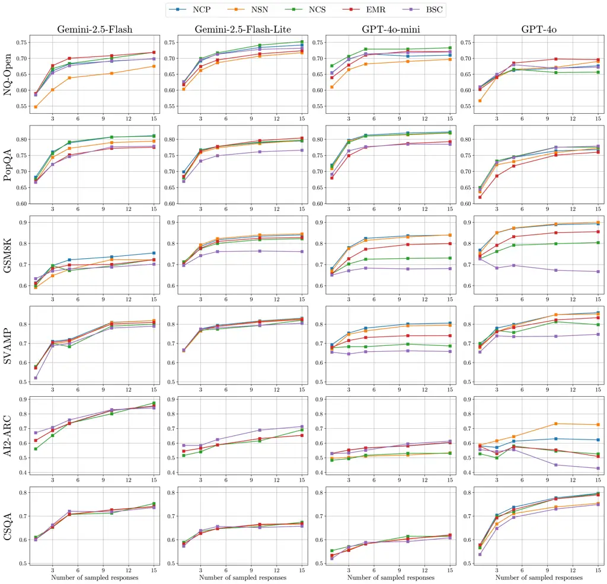

Figure 4: Hallucination Detection AUROC by Number of Sampled Responses

Overall, the results indicate that hallucination detection performance
of the black-box scorers improves considerably with number of candidate
responses $`m`$. For instance, hallucination detection AUROC of the
various black-box scorers on GPT-4o responses on CSQA improve from
0.54-0.57 with $`m=1`$ to 0.75-0.8 with $`m=15`$. In particular, these
performance improvements occur approximately monotonically with
diminishing returns to higher $`m`$, consistent with findings from
previous studies (Kuhn et al., 2023; Manakul et al., 2023; Lin et al.,
2024; Farquhar et al., 2024). This general trend is consistent across
all 24 scenarios, with only a few exceptions, notably BSC for GPT-4o
responses on GSM8k, and BSC, NCS, and EMR for GPT-4o responses on
AI2-ARC.
