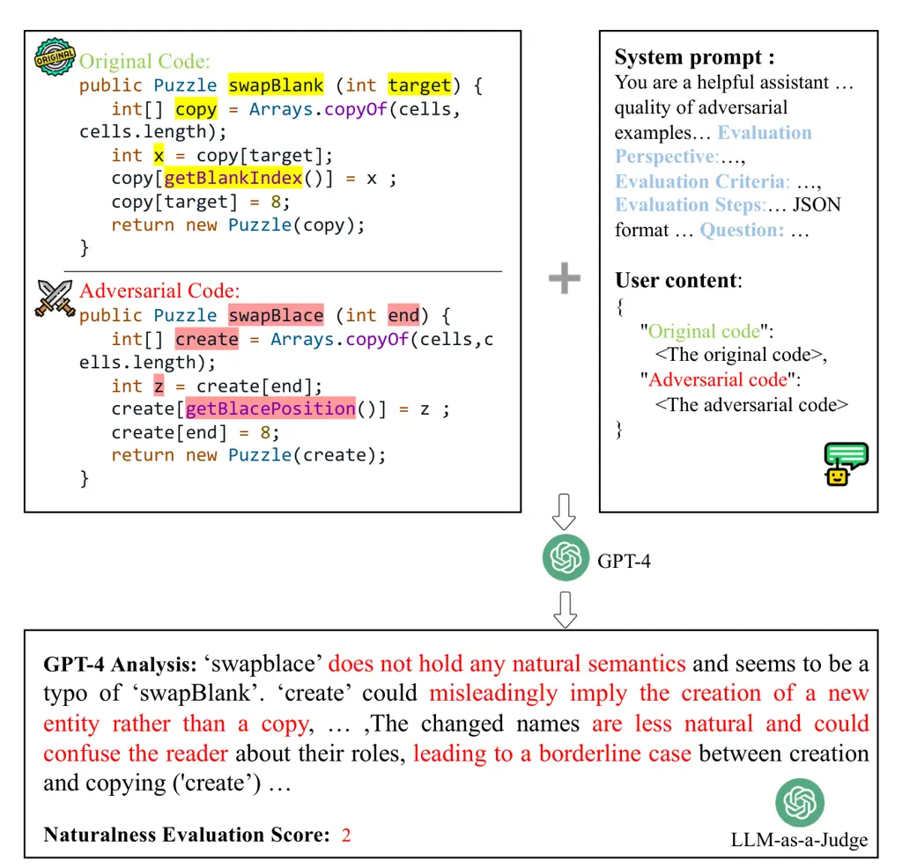
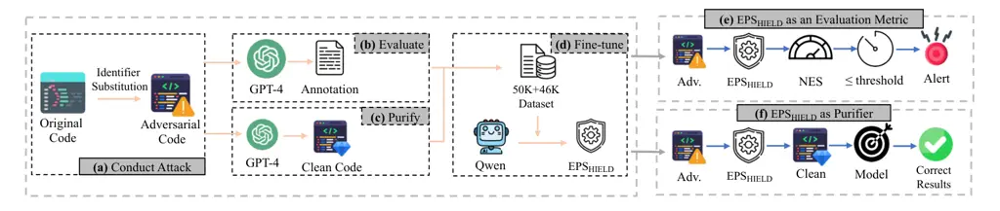
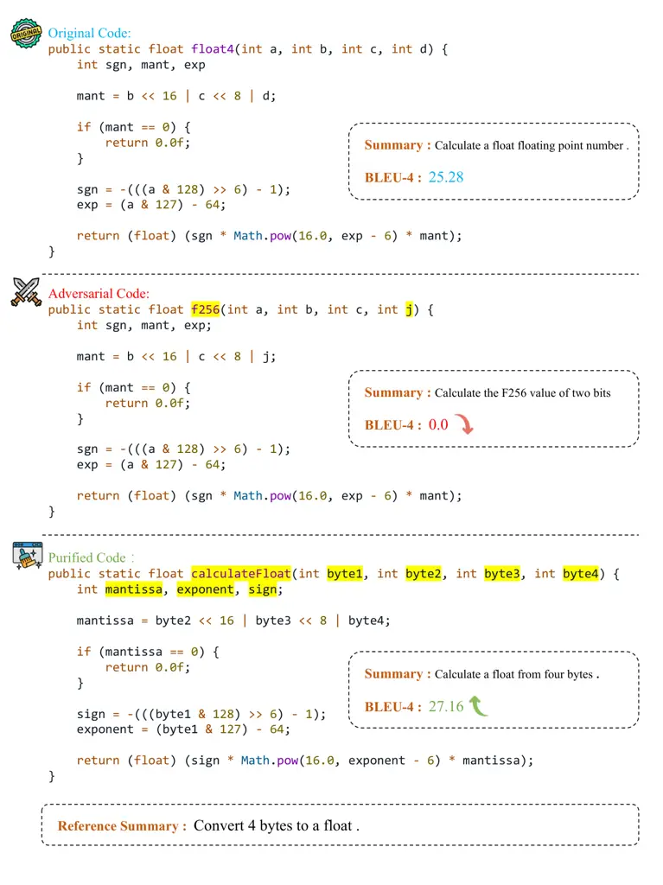

# Evaluate-and-Purify: Fortifying Code Language Models Against Adversarial Attacks Using LLM-as-a-Judge

Wenhan Mu
[](https://orcid.org/0009-0006-8164-8248)
   Ling Xu
[](https://orcid.org/0000-0002-7203-511X)
^(†)^(†)thanks: Corresponding author    Shuren Pei
[](https://orcid.org/0009-0001-3078-1683)
   Le Mi
[](https://orcid.org/0009-0007-5439-3697)
   Huichi Zhou
[](https://orcid.org/0000-0002-1518-504X)
Affiliation:  School of Big Data and Software Engineering, Chongqing
University, Chongqing, China  
Imperial College London, Exhibition Road, London SW7 2AZ, The United
Kingdom E-mail [whmu@stu.cqu.edu.cn, xuling@cqu.edu.cn,
{pei,mile}@stu.cqu.edu.cn,  
h.zhou24@imperial.ac.uk](mailto:whmu@stu.cqu.edu.cn,%20xuling@cqu.edu.cn,%20%7Bpei,mile%7D@stu.cqu.edu.cn,%20)

###### Abstract

The widespread adoption of code language models in software engineering
tasks has exposed vulnerabilities to adversarial attacks, especially the
identifier substitution attacks. Although existing identifier
substitution attackers demonstrate high success rates, they often
produce adversarial examples with unnatural code patterns. In this
paper, we systematically assess the quality of adversarial examples
using LLM-as-a-Judge. Our analysis reveals that over 80% of adversarial
examples generated by state-of-the-art identifier substitution attackers
(e.g., ALERT) are actually detectable. Based on this insight, we propose
EP-Shield, a unified framework for evaluating and purifying identifier
substitution attacks via naturalness-aware reasoning. Specifically, we
first evaluate the naturalness of code and identify the perturbed
adversarial code, then purify it so that the victim model can restore
correct prediction. Extensive experiments demonstrate the superiority of
EP-Shield over adversarial fine-tuning (up to $`83.36\%`$ improvement)
and its lightweight design ($`7`$B parameters) with GPT-$`4`$-level
performance.

###### Keywords: 

Adversarial Attack Code Language Model LLM-as-a-Judge Evaluation and
Purification

## 1 Introduction



Figure 1: A motivating example of an identifier substitution attack,
accompanied by an analysis of GPT-4 from the perspective of naturalness
using LLM-as-a-Judge.

Code Language Models (CLMs), including CodeBERT \[1\], PLBART \[2\],
CodeGPT \[3\], StarCoder \[4\], and Code Llama \[5\], have demonstrated
remarkable capabilities across a range of software engineering tasks,
such as code generation \[6\], code summarization \[7\], and
vulnerability detection \[8\]. However, CLMs have been shown to be
vulnerable to adversarial attacks, such as identifier substitution
attacks, where variable or method names are manipulated to mislead
models while preserving functionality \[9, 10, 11, 12\].

Most identifier substitution attackers focus on ensuring syntactic
validity while overlooking the naturalness of the code \[13, 14, 15,
12\]. As shown in Figure 1, the attacker fails to preserve naturalness
in two key ways: (1) The logically meaningful identifier swapBlank is
mutated to swapBlace, introducing a semantically meaningless subword
(Blace); (2) The method name copy is replaced with create, creating a
conflict with its associated copyof() function and introducing semantic
ambiguity. By leveraging the code-understanding capabilities of Large
Language Models (LLMs) such as GPT-4 \[16\], we evaluate this case using
a structured prompt (see Figure 4). GPT-4 assigns a score of 2 out of 5,
reflecting a relatively low level of naturalness and suggesting that the
perturbations violate programming conventions.

In this paper, we begin by conducting an empirical study to assess the
naturalness of adversarial code generated by state-of-the-art attackers,
including MHM \[10\], Beam-Attack \[17\], and ALERT \[12\]. The
experimental results demonstrate that all the current attackers produce
adversarial examples with naturalness scores no higher than 2 out of 5,
highlighting their unnatural code patterns. This finding emphasizes the
critical need to maintain code naturalness when crafting adversarial
attacks against CLMs.

Inspired by the success of LLM-as-a-Judge in evaluating code-related
tasks \[18, 19\] and the self-correction ability of LLM \[20, 21\], this
paper further puts forward EP-Shield, a two-stage evaluate-and-purify
framework to fortify CLMs against adversarial attacks using
LLM-as-a-Judge. We begin by constructing a dataset of $`50K`$
original-adversarial example pairs accompanied by GPT-4-generated
evaluation annotations and a dataset of $`46K`$ code pairs of
adversarial examples and GPT-4 purified counterparts. Based on both
datasets, we then fine-tune an LLM (i.e., Qwen) and name it as
EP-Shield. Specifically, we first evaluate the natural state of a code
snippet to determine whether it has been attacked, and purify
adversarial examples by transforming them into more natural code.
Finally, the EP-Shield can also serve as an evaluation metric to
identify adversarial code, and as a purifier to convert the code to
benign code.

To evaluate the effectiveness of EP-Shield, we perform experiments over
three victim models (i.e., CodeBERT, CodeGPT, and PLBART) across three
code-related tasks (i.e., clone detection, code summarization, and
vulnerability detection), and compare it against four attack baselines
(i.e., MHM, WIR, ALERT, and Beam-Attack). Experimental results show that
EP-Shield can achieve defense success rates of approximately 99%, 95%,
and 90% in clone detection, vulnerability detection, and code
summarization tasks, respectively. Furthermore, EP-Shield demonstrates
strong generalization ability with over $`85\%`$ defense success rate
against unseen attack patterns. Additionally, EP-Shield achieves strong
human evaluation alignment, significantly outperforming baseline
metrics.

The contributions of this paper are as follows.

- •
  Using LLM-as-a-Judge, we perform an empirical study to reveal existing
  identifier substitution attacks to CLMs have the naturalness issue.
- •
  We fine-tune a lightweight $`7`$B-parameter LLM to evaluate and purify
  the generated adversarial code examples.
- •
  We introduce a naturalness-aware defense strategy that aligns with
  human code review practices, enhancing the robustness of CLMs against
  identifier substitution attacks.

## 2 Background

#### Adversarial Attack on CLMs.

Given a code snippet $`x\in\mathcal{X}`$, an adversarial attack
generates a perturbed sample $`x_{adv}`$ by applying a slight
perturbation $`\delta(x)`$ such that $`\delta:X\rightarrow X_{adv}`$.
For understanding tasks, a well-trained classifier
$`f:\mathcal{X}\rightarrow\mathcal{Y}`$ should correctly predict the
label $`y_{truth}\in\mathcal{Y}`$, i.e., $`f(x)=y_{truth}`$, while the
adversarial attack misleads the model into producing an incorrect
output, i.e., $`f(x_{adv})\neq f(x)=y_{truth}`$. For generation tasks
like code summarization \[7\], adversarial examples degrade model
performance such that $`P(y_{truth}|x_{adv})`$ is significantly lower
than $`P(y_{truth}|x)`$. An adversarial example should adhere to the
dual channel view of code \[22, 23\]: (1) the formal channel, ensuring
the perturbed code remains syntactically correct and semantically
equivalent, and (2) the natural channel, requiring adherence to coding
conventions with reasonable identifier names.

Adversarial code attacks are categorized to three classes: (1)
Token-level (e.g., identifier substitution \[12, 9, 17\]), (2)
Statement-level (e.g., dead code insertion \[24\]), and (3)
Structure-level (e.g., loop/conditional transformations \[25, 26, 27\].
Token-level attacks dominate due to their high success rate and low
detectability \[28, 17\], with strategies ranging from random
substitution \[29, 10\] to context-aware methods \[12, 17\].

#### Code Naturalness.

Code exhibits a degree of naturalness analogous to human language,
characterized by significant repetitiveness and systematic patterns that
can be computationally modeled. This phenomenon arises not only from
syntactic constraints inherent to programming languages but also emerges
through project-specific conventions, including naming practices and API
utilization patterns \[15, 30, 31\]. Empirical studies \[32\] have
demonstrated developers’ systematic preference for code variants
demonstrating higher predictability. Code naturalness has been
attributed not only to syntactic formalism but more fundamentally
reflects cognitive predispositions that prioritize ease of code
generation and comprehension during software development processes.

#### Evaluation of Adversarial Examples.

Prior work focused on attack success rates and efficiency, with
ALERT \[12\] introducing naturalness requirements to assess adversarial
code, though manual evaluation may introduce bias. Beam-Attack\[17\]
combines previous metrics \[9, 33, 12\] such as Identifier Change Rate
and Average Code Similarity to evaluate attack quality. Traditional
tools like SonarQube \[34\] and FindBugs \[35\] rely on rule-based
identifier analysis, while AST-based methods focus on logic and
dependencies, both struggling to detect renaming attacks. Statistical
metrics and semantic similarity measures may fail to capture human
programming conventions. Increasingly, LLMs are leveraged as evaluation
tools \[36, 37, 38, 39, 19\].

## 3 A Preliminary Study

(a) Clone Detection

(b) Code Summarization

(c) Vulnerability Detection

Figure 2: The density distribution of NES annotated by GPT-4 for
adversarial examples generated by ALERT on CodeBERT across three
code-related tasks.

While existing attack methods claim high success rates, we argue that
their generated adversarial examples still exhibit naturalness
deficiencies that fail to withstand human scrutiny. To validate this
hypothesis, we first employ ALERT \[12\] – a state-of-the-art attack
method incorporating context-aware naturalness constraints – to attack
CodeBERT across three code-related tasks (i.e., clone detection \[40\],
code summarization \[7\], and vulnerability detection \[8\]).

|          |                         |       |       |       |       |      |      |             |       |       |       |      |      |
| -------- | ----------------------- | ----- | ----- | ----- | ----- | ---- | ---- | ----------- | ----- | ----- | ----- | ---- | ---- |
| Models   | Tasks                   | ALERT |       |       |       |      |      | Beam-Attack |       |       |       |      |      |
|          |                         | 1     | 2     | 3     | 4     | 5    | Avg. | 1           | 2     | 3     | 4     | 5    | Avg. |
| CodeBERT | Clone Detection         | 45.36 | 46.68 | 5.44  | 2.25  | 0.27 | 1.65 | 32.06       | 53.82 | 10.74 | 2.79  | 0.59 | 1.86 |
|          | Code Summarization      | 31.13 | 44.96 | 14.34 | 8.19  | 1.38 | 2.04 | 19.28       | 38.02 | 24.36 | 14.96 | 3.37 | 2.45 |
|          | Vulnerability Detection | 66.22 | 29.73 | 2.25  | 1.80  | 0.00 | 1.40 | 25.00       | 60.94 | 14.06 | 0.00  | 0.00 | 1.89 |
| CodeGPT  | Clone Detection         | 41.82 | 49.41 | 7.46  | 0.95  | 0.36 | 1.69 | 27.06       | 59.26 | 10.15 | 3.53  | 0.00 | 1.90 |
|          | Code Summarization      | 29.56 | 45.13 | 15.97 | 7.42  | 1.92 | 2.07 | 18.60       | 38.25 | 23.34 | 14.92 | 4.89 | 2.49 |
|          | Vulnerability Detection | 38.60 | 47.72 | 10.03 | 3.65  | 0.00 | 1.79 | 30.33       | 59.84 | 9.02  | 0.82  | 0.00 | 1.80 |
| PLBART   | Clone Detection         | 43.58 | 47.74 | 7.23  | 1.08  | 0.36 | 1.67 | 30.70       | 55.70 | 11.91 | 1.51  | 0.17 | 1.85 |
|          | Code Summarization      | 27.15 | 42.90 | 17.60 | 10.27 | 2.08 | 2.17 | 15.94       | 37.11 | 21.92 | 19.00 | 6.03 | 2.62 |
|          | Vulnerability Detection | 44.23 | 45.40 | 7.72  | 1.48  | 1.16 | 1.70 | 23.06       | 53.47 | 13.06 | 5.10  | 5.31 | 2.16 |
| Overall  |                         |       |       |       |       |      | 1.94 |             |       |       |       |      | 2.33 |
|          |                         | MHM   |       |       |       |      |      | WIR         |       |       |       |      |      |
| CodeBERT | Clone Detection         | 87.09 | 12.49 | 0.35  | 0.07  | 0.00 | 1.13 | 81.36       | 17.75 | 0.80  | 0.09  | 0.00 | 1.20 |
|          | Code Summarization      | 79.70 | 18.95 | 1.18  | 0.18  | 0.00 | 1.22 | 77.85       | 20.41 | 1.47  | 0.26  | 0.00 | 1.24 |
|          | Vulnerability Detection | 97.10 | 2.83  | 0.00  | 0.00  | 0.00 | 1.03 | 89.90       | 8.92  | 1.01  | 0.17  | 0.00 | 1.11 |
| CodeGPT  | Clone Detection         | 84.88 | 14.60 | 0.52  | 0.00  | 0.00 | 1.16 | 85.21       | 14.25 | 0.47  | 0.07  | 0.00 | 1.15 |
|          | Code Summarization      | 83.41 | 15.04 | 1.29  | 0.17  | 0.09 | 1.18 | 79.25       | 18.83 | 1.52  | 0.35  | 0.04 | 1.23 |
|          | Vulnerability Detection | 97.02 | 2.31  | 0.52  | 0.15  | 0.00 | 1.04 | 87.46       | 11.16 | 1.07  | 0.31  | 0.00 | 1.14 |
| PLBART   | Clone Detection         | 87.73 | 11.83 | 0.44  | 0.00  | 0.00 | 1.13 | 81.78       | 17.29 | 0.70  | 0.23  | 0.00 | 1.19 |
|          | Code Summarization      | 74.71 | 22.76 | 2.21  | 0.24  | 0.09 | 1.28 | 74.22       | 22.87 | 2.41  | 0.46  | 0.04 | 1.29 |
|          | Vulnerability Detection | 95.79 | 3.90  | 0.24  | 0.00  | 0.08 | 1.05 | 93.81       | 5.84  | 0.35  | 0.00  | 0.00 | 1.07 |
| Overall  |                         |       |       |       |       |      | 1.16 |             |       |       |       |      | 1.18 |

Table 1: Proportion(%) of NES for four attack methods on different
models and tasks combinations. Avg. refers to the weighted average score
of NES (i.e., the sum of scores multiplied by their respective
proportions).

We use GPT-4¹¹ 1 We used GPT-4-1106-preview with a temperature of 0 and
a top\_$`p`$ sampling value of 0.9. to evaluate the naturalness of these
adversarial examples, providing analytical annotations with scores
ranging from $`1`$ to $`5`$, referred to as the Naturalness Evaluation
Score (NES). Figure 2 presents the density distribution of NES for
adversarial examples generated by ALERT across the three aforementioned
code-related tasks. As shown in the figure, the probability density at
score 1 surpasses 1.00, revealing a highly concentrated distribution
pattern. The lower NES indicates that the generated adversarial code is
unnatural, which may further suggest an inherent weakness in the attack
methodology. This, in turn, could make the adversarial code more easily
identifiable.

Using the same way, we investigate the NSE distribution of adversarial
examples generated by four attack methods (i.e., ALERT \[12\],
Beam-Attack \[17\], MHM \[10\], WIR \[29\]) across three victim models
(i.e., CodeBERT \[1\], CodeGPT \[3\], PLBART \[2\]) and the
aforementioned three downstream task combinations. Table 1 presents the
distribution proportions of NES scores ($`1`$–$`5`$) and the weighted
average scores for each attack scenario. It can be observed that the
vast majority of samples exhibit NES scores in a lower range
($`\leq 2`$). This suggests that existing attack methods frequently
produce unnatural adversarial examples, which may be a common
phenomenon.

## 4 EP-Shield: Our Approach



Figure 3: An overview of our proposed EP-Shield.

Figure 3 shows an overview of our proposed EP-Shield. We first conduct
identifier substitution to collect adversarial code (Figure 3(a)).
Subsequently, we conduct a naturalness analysis of adversarial code with
the assistance of LLMs and collect annotations (Figure 3(b)). In
addition, we employ an LLM to purify adversarial code and collect the
resulting benign code after this process (see Figure 3(c)). Furthermore,
we use the dataset collected from the aforementioned two steps to
fine-tune a smaller LLM, resulting in EP-Shield (Figure 3(d)).

The obtained EP-Shield can serve as an evaluation metric to identify
adversarial code (Figure 3(e)), We refer to this role as EP-Metric.
Additionally, EP-Shield can also serve as a purifier to convert
adversarial code into benign code to restore the correct predictions of
the target model (Figure 3(f)), We refer to this role as EP-Metric.

### 4.1 Identifier Substitution Attack

To systematically investigate identifier substitution attacks, we
generated a dataset of over $`50K`$ adversarial examples by applying
four different attack methods across three datasets and three victim
models. These adversarial examples serve as the foundation for
subsequent evaluations in § 4.2 and 4.3. To ensure a comprehensive
analysis of the attack characteristics, we retained only successful
adversarial examples where the target model produced incorrect outputs
due to identifier substitutions while maintaining functional
equivalence. This dataset enables us to capture variations in attack
effectiveness and adversarial code patterns.

### 4.2 Naturalness Evaluation via LLMs

Based on the filtered adversarial examples, we query GPT-4 in an
open-ended manner, asking it to evaluate each adversarial example. We
instruct GPT-4 to evaluate based on the following analytical
perspectives:


Figure 4 shows the design details of the prompt templates for this task.
We prompt GPT-$`4`$ to perform analyses in a Chain-of-Thought \[41\]
(CoT) manner to achieve a deep understanding of naturalness consistency,
thereby making the evaluation scores interpretable. To provide
directions for GPT-$`4`$’s reasoning, we designed the steps necessary in
the prompt template. The “System prompt” includes the reasoning
perspectives, processing steps, some output constraints, and specific
task details. The “User content” provides the original adversarial
example pair to be evaluated.

For the evaluation task, we require GPT-4 to annotate each adversarial
example with a score from $`1`$ to $`5`$ and provide a corresponding
analysis. This score is the Naturalness Evaluation Score(NES) defined
above. The “Analysis” serves to justify the assigned score by outlining
GPT-4’s reasoning process, ensuring interpretability and transparency.
Additionally, this explanation provides a foundation for fine-tuning the
local LLM. Ultimately, GPT-4’s output will be structured as follows:


Finally, we remove a small number of examples exceeding the maximum
input length limit ($`4096`$ tokens) of the local LLM, resulting in an
instruction dataset containing over $`50K`$ examples for evaluating the
naturalness of adversarial examples. The “System prompt” and “User
content” in the prompt template correspond to the instruction and input
in the instruction dataset, respectively, while GPT-$`4`$’s output
corresponds to the dataset output. This dataset can facilitate research
on evaluating the effectiveness of identifier substitution attacks.

### 4.3 Code Purification via LLMs

We also employ GPT-4 to refine the collected adversarial code from a
naturalness perspective, thereby preventing it from misleading the
victim models. Figure 5 shows the design details of prompt for this
purification task. Here, GPT-4 adopts the CoT reasoning approach and
aligns with the same analytical perspectives as those used in the
evaluation task. In this task, the output consists solely of the
purified code. To ensure effectiveness, all purified code must be
re-evaluated by the victim model, filtering out unsuccessful
purification attempts. This step prevents the introduction of noise
during the fine-tuning stage, maintaining the integrity of the training
data. Ultimately, we obtain an instruction dataset containing over
$`46K`$ samples for further research on the purification of adversarial
code. The structure of this dataset is consistent with the dataset
acquired during the evaluation task.

### 4.4 LLM Fine-Tuning

Instruction fine-tuning based on GPT-$`4`$ is a popular and effective
fine-tuning approach \[42\]. Benefiting from the recent emergence of
numerous open-source LLMs \[43, 5\], lighter-weight alternatives have
emerged, making it feasible to replace GPT-$`4`$. Meanwhile, the
previously mentioned instruction dataset equips local LLMs with
essential background knowledge and references. Through fine-tuning, it
further mitigates the challenges small LLMs encounter when handling
complex tasks.

In this work, we choose Qwen$`2.5`$-coder-$`7`$B \[44\], a lightweight
and open-source model, as the backbone of EP-Shield. We fine-tune it
using the instruction-response data obtained from the previous two
sections.

Our goal for EP-Shield is to generate reasonable explanations $`e`$ for
the NES of adversarial examples during the evaluation task. The
optimization objectives for supervised fine-tuning are as follows:

```math
\mathcal{L}_{e}=\mathbb{E}\log\mathrm{P}_{\mathrm{{EP-Shield}}}\left([e,\mathrm{NES}]\mid\left[\texttt{Ins}_{e},c_{o},c_{a}\right]\right) \tag{1}
```

where $`c_{o}`$, $`c_{a}`$, and $`c_{p}`$ represent the original code,
perturbed code, and purified code, respectively. For the purification
task, we expect EP-Shield to identify locations with unnaturalness and
generate appropriate purified code. The optimization objectives are as
follows:

```math
\mathcal{L}_{p}=\mathbb{E}\log\mathrm{P}_{\mathrm{{EP-Shield}}}\left(c_{p}\mid\left[\texttt{Ins}_{p},c_{o},c_{a}\right]\right) \tag{2}
```

where $`\texttt{Ins}_{e}`$ and $`\text{Ins}_{p}`$ are identical to the
instructions given to GPT-4 for the two tasks.

### 4.5 EP-Shield as an Evaluation Metric

As shown in Figure 1, the example obtained after existing identifier
substitution attacks exhibit a certain degree of unnaturalness. The
fine-tuned EP-Shield will learn the characteristics of unnatural
perturbations and provide an interpretable evaluation score. This
human-aligned evaluation score can be a new constraint for identifier
substitution attacks. As shown in Figure 3 (c), when the NES of
adversarial code falls below a predetermined threshold, it serves as an
indication that the input code is likely to have been attacked. It is
important to note that in real-world scenarios, we only receive a piece
of code as input, and must rely on the scores and explanations provided
by EP-Shield to determine whether it is adversarial code. Therefore,
during the inference stage, the prompt template should be adjusted
accordingly for the input description.

### 4.6 EP-Shield as a Purifier

The potential naturalness flaws in adversarial code resulting from
identifier substitution attacks can also serve as a breakthrough for
defending against similar attacks. The fine-tuned EP-Shield will follow
the analysis steps outlined in the instruction template to locate
identifiers with unnaturalness, and then replace them based on their
functionality and the overall code semantics, with names that align more
closely with human programming conventions, allowing CLMs to recover
their original correct prediction results.


Figure 4: The prompt template for LLMs to obtain the NES and analysis.


Figure 5: The prompt template for purification task.

## 5 Experiments and Analysis

We study the following research questions: (1) Is EP-Shield suitable for
evaluating adversarial code naturalness? (2) Is EP-Shield a better
measure of adversarial example naturalness? (3) How effective is
EP-Shield as a purifier in enhancing model robustness? (4) Does
EP-Shield mistakenly identify clean examples? (5) Is EP-Shield still
effective when facing unknown patterns? We also perform a case study to
show the effectiveness of our proposed approach.

### 5.1 Experimental Setup

|      |                 |            |          |           |          |
| ---- | --------------- | ---------- | -------- | --------- | -------- |
| Task | Dataset Name    | Train Size | Dev Size | Test Size | Metrics  |
| CD   | BigCloneBench   | 90,102     | 4,000    | 4,000     | P, R, F1 |
| VD   | OWASP Benchmark | 13,041     | 4,000    | 4,000     | Acc      |
| CS   | CodeSearchNet   | 164,923    | 5,183    | 10,955    | Bleu-4   |

Table 2: Statistics of the datasets.Here, CD, VD, and CS refer to Clone
Detection, Vulnerability Detection, and Code Summarization,
respectively, which are three types of SE tasks. P, R, F1, and acc
represent Precision, Recall, F1-Score, and Accuracy, respectively.

#### Datasets.

We select three representative code processing tasks: clone detection,
vulnerability detection, and code summarization. Clone detection
identifies functionally similar or identical code despite syntactic
differences, using the BigCloneBench \[45\] dataset, processed by
 \[12\], containing $`90,102`$ training samples and $`4,000`$ validation
and test samples each. Vulnerability detection discovers security
vulnerabilities in software, using the OWASP benchmark, which includes
$`13,041`$ training samples and $`4,000`$ validation and test samples
each. Code summarization generates natural language summaries for code,
using a subset of CodeSearchNet \[46\], processed following prior
work \[3, 29\], containing $`164,923`$ training samples, $`5,183`$
validation samples, and $`10,955`$ test samples. The dataset statistics
corresponding to the tasks are shown in Table 2. To assess EP-Shield’s
generalization ability across unknown data distributions, we performed
authorship attribution experiments on the Google Code Jam dataset.

#### Victim Models.

We selecte representative CLMs from three categories of structures
(encoder-only, decoder-only and encoder-decoder): CodeBERT, CodeGPT, and
PLBART. These models were fine-tuned on the three downstream tasks above
(referred to as Clone Detection, Vulnerability Detection, and Code
Summarization). The reproduced results are shown in Table 3.

|          |                 |        |        |                         |                    |
| -------- | --------------- | ------ | ------ | ----------------------- | ------------------ |
| Tasks    | Clone Detection |        |        | Vulnerability Detection | Code Summarization |
| Models   | P               | R      | F1     | Acc                     | BLEU-4             |
| CodeBERT | 0.9731          | 0.9728 | 0.9727 | 0.9890                  | 18.72              |
| CodeGPT  | 0.9688          | 0.9677 | 0.9677 | 0.9895                  | 14.78              |
| PLBART   | 0.9631          | 0.9627 | 0.9627 | 0.9962                  | 17.27              |

Table 3: Performance of CLMs on downstream tasks.

|                         |               |                |             |        |        |
| ----------------------- | ------------- | -------------- | ----------- | ------ | ------ |
| Tasks                   | Victim Models | Attack Methods |             |        |        |
|                         |               | ALERT          | Beam-Attack | MHM    | WIR    |
| Clone Detection         | CodeBERT      | 11.07%         | 17.52%      | 36.59% | 28.70% |
|                         | CodeGPT       | 13.02%         | 17.49%      | 48.89% | 37.91% |
|                         | PLBART        | 10.45%         | 15.47%      | 46.11% | 34.67% |
| Vulnerability Detection | CodeBERT      | 1.67%          | 1.62%       | 41.94% | 15.01% |
|                         | CodeGPT       | 5.05%          | 6.15%       | 33.90% | 16.52% |
|                         | PLBART        | 15.21%         | 12.27%      | 31.57% | 21.51% |
| Code Summarization      | CodeBERT      | 39.43%         | 44.69%      | 90.55% | 70.54% |
|                         | CodeGPT       | 31.28%         | 32.91%      | 92.25% | 60.83% |
|                         | PLBART        | 59.43%         | 65.34%      | 91.80% | 64.86% |

Table 4: Attack success rate of identifier substitution attacks across
different task-victim model combinations.

#### Attack Methods.

We select four major attack methods using identifier substitution.
MHM \[10\] iteratively renames identifiers using Metropolis-Hastings
sampling \[47\]. WIR-Random \[29\] selects identifiers based on Word
Importance Rank \[48\] and replaces them randomly. ALERT \[12\] applies
contextual naturalness-aware substitutions using a greedy and genetic
algorithm. Beam-Attack \[17\] leverages statement type knowledge and
beam search \[49\] for identifier selection. Attack success rates for
each method are shown in Table 4.

#### Metrics.

We use seven baseline metrics to evaluate adversarial code quality and
code similarity, with Identifier Change Rate (ICR) and Token Change Rate
(TCR) measuring identifier and token modifications, respectively;
Average Code Similarity (ACS) and Average Edit Distance (AED) assessing
code similarity and token-level differences; Code Perplexity (PPL)
quantifying model prediction accuracy; and CodeBLEU \[50\] and
CodeBERTScore \[51\] evaluating syntax, semantics, and embedding-based
similarity.

|                         |           |             |             |
| ----------------------- | --------- | ----------- | ----------- |
| Task Level              |           |             |             |
| Tasks                   |           | GPT-4       | Human       |
| Clone Detection         | GPT-4     | -           | 0.77 / 0.99 |
|                         | EP-Metric | 0.75 / 0.99 | 0.75 / 0.99 |
| Vulnerability Detection | GPT-4     | -           | 0.87 / 1.00 |
|                         | EP-Metric | 0.85 / 0.99 | 0.84 / 0.99 |
| Code Summarization      | GPT-4     | -           | 0.63 / 0.94 |
|                         | EP-Metric | 0.60 / 0.92 | 0.67 / 0.96 |
| Victim Model Level      |           |             |             |
| Models                  |           | GPT-4       | Human       |
| CodeBERT                | GPT-4     | -           | 0.73 / 0.99 |
|                         | EP-Metric | 0.69 / 0.97 | 0.69 / 0.97 |
| CodeGPT                 | GPT-4     | -           | 0.67 / 0.96 |
|                         | EP-Metric | 0.63 / 0.93 | 0.71 / 0.96 |
| PLBART                  | GPT-4     | -           | 0.69 / 0.98 |
|                         | EP-Metric | 0.64 / 0.96 | 0.64 / 0.96 |
| Attack Method Level     |           |             |             |
| Methods                 |           | GPT-4       | Human       |
| ALERT                   | GPT-4     | -           | 0.49 / 0.90 |
|                         | EP-Metric | 0.45 / 0.90 | 0.55 / 0.94 |
| Beam-Attack             | GPT-4     | -           | 0.57 / 0.97 |
|                         | EP-Metric | 0.51 / 0.93 | 0.50 / 0.93 |
| MHM                     | GPT-4     | -           | 0.86 / 1.00 |
|                         | EP-Metric | 0.85 / 1.00 | 0.86 / 0.99 |
| WIR                     | GPT-4     | -           | 0.82 / 1.00 |
|                         | EP-Metric | 0.81 / 0.99 | 0.80 / 0.99 |

Table 5: Consistency analysis of NES across EP-Metric, GPT-4, and human
evaluations at various analytical perspectives. Each cell contains three
values: the exact match rate ($`1`$st), the consistency rate within a
tolerance of 1 ($`2`$nd), and the mean absolute difference ($`3`$rd).

### 5.2 Validity in Naturalness Assessment (RQ1)

We use half of the instruction fine-tuning dataset collected for
evaluation in § 4.2 as a training set to fine-tune EP-Metric, enabling
it to perform the same evaluation tasks as GPT-4 and learn how to
analyze the naturalness flaws of adversarial examples. We then test it
on the remaining half of the dataset. We invited six non-author
practitioners to manually annotate the same test data to demonstrate the
feasibility of our proposed evaluation metrics and the effectiveness of
the EP-Shield. These annotators are all computer science professionals
with at least three years of programming experience, representing
diversity in gender, age, and educational background. They are
instructed to provide objective judgments without considering the length
of the answers, aiming to minimize human bias. We conduct Mann-Whitney U
tests \[52\] to compare the NES produced by GPT-$`4`$, EP-Metric, and
human evaluators at different analytical perspectives.

Table 5 shows the results of the consistency tests, We can observe that
both GPT-$`4`$ and EP-Metric passed the consistency check with human
evaluators across all attack combinations ($`p`$-value $`<0.05`$),
demonstrating a high level of consistency with human assessments.
Overall, the consistency of EP-Metric with human evaluations is very
close to that of GPT-$`4`$, achieving a 65% exact match rate and a 95%
consistency rate within a tolerance of $`1`$. This suggests that
EP-Metric can effectively simulate human judges to evaluate the
naturalness of adversarial examples from a human perspective, serving as
a new metric for assessing adversarial example quality. This also
indicates that the scoring results from GPT-$`4`$ in § 3 are reasonable,
and indirectly confirms that current identifier substitution attacks
exhibit naturalness issues.

|                              |           |           |          |         |
| ---------------------------- | --------- | --------- | -------- | ------- |
| Metrics                      | $`r_{s}`$ | $`r_{p}`$ | $`\tau`$ | Avg.    |
| ICR ($`\downarrow`$)         | -0.1860   | -0.2748   | -0.1683  | -0.2097 |
| TCR ($`\downarrow`$)         | -0.3140   | -0.3187   | -0.2664  | -0.2997 |
| ACS ($`\uparrow`$)           | 0.4639    | 0.4674    | 0.3770   | 0.4361  |
| AED ($`\downarrow`$)         | -0.4660   | -0.4498   | -0.3938  | -0.4365 |
| PPL ($`\downarrow`$)         | -0.0637   | 0.0290    | -0.0491  | -0.0279 |
| CodeBLEU ($`\uparrow`$)      | 0.0014    | 0.1104    | 0.0123   | 0.0414  |
| CodeBERTScore ($`\uparrow`$) | 0.4757    | 0.4445    | 0.3893   | 0.4365  |
| EP-Metric ($`\uparrow`$)     | 0.6687    | 0.7419    | 0.6386   | 0.6831  |

Table 6: Correlations between EP-Metric and other adversarial example
quality metrics and human performance, with $`r_{s}`$, $`r_{p}`$, and
$`\tau`$ representing Spearman, Pearson, and Kendall-Tau correlation
coefficients.

### 5.3 Comparison with Existing Metrics (RQ2)

We compare EP-Metric against seven baseline metrics using human
judgments as ground truth (Table 6). Our method achieves the highest
average correlation (0.6831) across Spearman (0.6687), Pearson (0.7419),
and Kendall-Tau (0.6386) coefficients, demonstrating superior alignment
with human assessments of code naturalness. This consistent performance
underscores EP-Metric’s effectiveness in simulating human reasoning
through its comprehensive evaluation framework. Notably, CodeBLEU and
Code Perplexity (PPL) exhibit negligible correlations (Avg. 0.0414 and
analogous trends). Semantic-aware metrics (ACS, AED, CodeBERTScore)
outperform statistical measures (TCR, ICR), suggesting semantic shifts
impact naturalness more than token-level changes. However, EP-Metric
uniquely combines three critical dimensions: (1) local semantic
preservation, (2) global code coherence, and (3) adherence to
programming conventions. This multi-perspective approach enables
finer-grained detection of unnatural modifications compared to
single-aspect baselines.

|                                  |                |             |         |         |         |
| -------------------------------- | -------------- | ----------- | ------- | ------- | ------- |
| Defence                          | Attack Methods |             |         |         | Overall |
|                                  | ALERT          | Beam-Attack | MHM     | WIR     |         |
| Task 1:  Clone Detection         |                |             |         |         |         |
| Adv-tuning                       | 89.71          | 90.16       | 87.90   | 89.52   | 89.32   |
| GPT-4                            | 95.76          | 96.49       | 97.50   | 97.15   | 96.73   |
| EP-Purifier                      | 98.89          | 98.48       | 98.58   | 99.27   | 98.81   |
| $`\Delta`$                       | + 9.18         | + 8.32      | + 10.68 | + 9.75  | + 9.48  |
| Task 2:  Vulnerability Detection |                |             |         |         |         |
| Adv-tuning                       | 92.40          | 89.16       | 91.02   | 96.30   | 92.22   |
| GPT-4                            | 98.65          | 98.44       | 97.35   | 98.48   | 98.23   |
| EP-Purifier                      | 97.27          | 93.75       | 95.10   | 97.61   | 95.93   |
| $`\Delta`$                       | + 4.87         | + 4.59      | + 4.08  | + 1.31  | + 3.71  |
| Task 3:  Code Summarization      |                |             |         |         |         |
| Adv-tuning                       | 80.78          | 76.58       | 73.88   | 67.70   | 74.74   |
| GPT-4                            | 91.60          | 89.89       | 94.71   | 91.86   | 92.02   |
| EP-Purifier                      | 91.28          | 87.89       | 93.11   | 92.05   | 91.08   |
| $`\Delta`$                       | + 10.50        | + 11.31     | + 19.23 | + 24.35 | + 16.35 |

Table 7: Comparison of the defense success rates of adversarial
fine-tuning (Adv-tuning), GPT-$`4`$ and EP-Purifier on four attack
methods against the CodeBERT model across three tasks. $`\Delta`$
represents the percentage improvement of EP-Shield compared to
Adv-tuning.

### 5.4 Performance of Defense (RQ3)

We fine-tune EP-Purifier using $`50\%`$ of the purification dataset
from § 4.3, evaluating robustness on the remaining data against
GPT-$`4`$ and adversarial tuning (Adv-tuning) \[11\]. Table 7 presents
the defense success rates of EP-Purifier, GPT-$`4`$, and Adv-tuning on
CodeBERT (Further details are provided in Table 11).

Both tables reveal that EP-Purifier achieves near-GPT-4 defense success
rates ($`\leq 2.5\%`$ gap) while significantly outperforming Adv-tuning.
Particularly in code summarization tasks, our method defends $`36.19\%`$
more adversarial examples than Adv-tuning against MHM attacks on
CodeGPT, demonstrating superior defensive capabilities. Despite showing
marginal improvement ($`0.27\%`$) over EP-Purifier in vulnerability
detection with PLBART, Adv-tuning exhibits critical instability — its
defense rate plummets to $`20.82\%`$ in CodeGPT-based clone detection,
contrasting with EP-Purifier’s consistent robustness across all tasks.
This performance divergence highlights the limitations of adversarial
retraining approaches compared to our purification paradigm.

### 5.5 Misclassification Rate (RQ4)

|                         |              |              |              |              |
| ----------------------- | ------------ | ------------ | ------------ | ------------ |
| Tasks                   | $`\delta=4`$ | $`\delta=3`$ | $`\delta=2`$ | $`\delta=1`$ |
| Clone Detection         | 64.30        | 15.44        | 6.07         | 2.44         |
| Code Summarization      | 60.52        | 16.76        | 9.47         | 2.23         |
| Vulnerability Detection | 62.27        | 7.29         | 3.91         | 0.58         |

Table 8: EP-Metric defines the misclassification rates (%) of original
samples as those under attack.

We randomly select 1,000 examples from the training set of each of the
three datasets and used EP-Metric to annotate their NES scores. Table 8
presents the proportion of clean examples that EP-Metric incorrectly
classifies as adversarial under different thresholds $`\delta`$. When
$`\delta=2`$ (i.e., adversarial examples are those with NES $`\leq 2`$,
EP-Metric misclassifies only a small number of clean examples.
Corresponding to Table 1, most adversarial examples have NES values
below or equal to $`2`$, suggesting that setting the threshold to $`2`$
may be a good criterion for classification. As $`\delta`$ increases, the
misclassification rate also rises, particularly when $`\delta=4`$. In
this case, the misclassification rates for the three tasks reach
$`64.30\%`$, $`60.52\%`$, and $`62.27\%`$, with a significant portion of
examples having NES values around $`4`$. This indicates that a stricter
threshold for detecting adversarial examples can lead to a higher
possibility of misclassification.

### 5.6 Generalization Ability Analysis (RQ5)

We evaluate EP-Purifier’s generalization capability against unseen
attack patterns and tasks. First, we test on RNNS \[28\]—a SOTA
identifier-level attack—for vulnerability detection. As shown in
Table 9, EP-Purifier outperforms Adv-tuning across all models, with
improvements up to $`31.34\%`$ (CodeGPT). Notably, EP-Purifier maintains
$`>85\%`$ defense success despite RNNS’s advanced perturbation strategy.
Second, we extend evaluation to Authorship Attribution \[53\], a code
style analysis task. Table 10 shows EP-Purifier surpasses Adv-tuning by
$`8.05-12.33\%`$ against three attack methods, even when both dataset
and attack mechanism are unseen. Both experimental results demonstrate
that EP-Purifier, stemming from natural perceptual reasoning, maintains
defensive capabilities even in unknown scenarios while preserving
robustness.

|               |            |             |            |
| ------------- | ---------- | ----------- | ---------- |
| Victim Models | Adv-tuning | EP-Purifier | $`\Delta`$ |
| CodeBert      | 73.02      | 99.50       | +26.48     |
| CodeGPT       | 66.00      | 97.34       | +31.34     |
| PLBART        | 82.35      | 87.32       | +4.97      |

Table 9: Comparison of the defense success rate (%) of EP-Purifier and
Adv-tuning against RNNS on three different models in the vulnerability
detection task.

|                |            |             |            |
| -------------- | ---------- | ----------- | ---------- |
| Attack Methods | Adv-tuning | EP-Purifier | $`\Delta`$ |
| MHM            | 58.43      | 70.76       | +12.33     |
| ALERT          | 65.38      | 76.92       | +11.54     |
| RNNS           | 60.92      | 68.97       | +8.05      |

Table 10: Comparison of defense success rates (%) of EP-Purifier and
Adv-tuning against 3 attack methods on CodeBERT in the Authorship
Attribution task.

### 5.7 Case Study

As shown in Figure 6, which illustrates three stages: original,
adversarially perturbed, and EP-Shield-purified code. Each snippet
performs the same task: converting four bytes into a floating-point
number using bitwise operations. The attacker replaces meaningful
identifiers (e.g., ‘float4” $`\rightarrow`$ F256” and ‘d”
$`\rightarrow`$ j”). These subtle changes cause semantic confusion,
resulting in an incorrect summary (“Calculate the F256 value of two
bits”) with a BLEU-4 score of $`0.0`$, highlighting how identifier
substitution degrades model performance while maintaining syntactic
validity. In contrast, EP-Shield restores meaningful identifiers (e.g.,
‘mant” $`\rightarrow`$ mantissa”) and follows naming conventions (e.g.,
‘calculateFloat”). The purified code improves readability and
summarization quality (BLEU-4: $`27.16`$ vs. $`25.28`$), generating
“Calculate a float from four bytes,” which better aligns with the
reference summary. This case demonstrates the framework’s value in
maintaining model robustness and code interpretability.

|                                  |            |                    |                    |                    |                    |                    |
| -------------------------------- | ---------- | ------------------ | ------------------ | ------------------ | ------------------ | ------------------ |
| Victim Model                     | Defence    | Attack Method      |                    |                    |                    | Overall            |
|                                  |            | ALERT              | Beam-Attack        | MHM                | WIR                |                    |
| Task 1:  Clone-Detection         |            |                    |                    |                    |                    |                    |
| CodeBERT                         | Adv-tuning | 89.71% \_(↓9.18%)  | 90.16% \_(↓8.32%)  | 87.90% \_(↓10.68%) | 89.52% \_(↓9.75%)  | 89.32%\_(↓9.48%)   |
|                                  | GPT-4      | 95.76% \_(↓3.13%)  | 96.49% \_(↓1.99%)  | 97.50% \_(↓1.08%)  | 97.15% \_(↓2.12%)  | 96.73% \_(↓2.08%)  |
|                                  | EP-Shield  | 98.89%             | 98.48%             | 98.58%             | 99.27%             | 98.81%             |
| CodeGPT                          | Adv-tuning | 15.64% \_(↓83.63%) | 20.59% \_(↓74.79%) | 23.98% \_(↓75.07%) | 23.07% \_(↓76.10%) | 20.82% \_(↓77.40%) |
|                                  | GPT-4      | 97.63% \_(↓1.64%)  | 95.44% \_(↑0.06%)  | 98.59% \_(↓0.46%)  | 98.64% \_(↓0.53%)  | 97.58% \_(↓0.64%)  |
|                                  | EP-Shield  | 99.27%             | 95.38%             | 99.05%             | 99.17%             | 98.22%             |
| PLBART                           | Adv-tuning | 88.12% \_(↓10.42%) | 88.52% \_(↓8.74%)  | 90.89% \_(↓8.33%)  | 91.55% \_(↓7.98%)  | 89.77%\_(↓8.87%)   |
|                                  | GPT-4      | 98.92% \_(↑0.38%)  | 97.82% \_(↑0.56%)  | 99.44% \_(↑0.22%)  | 99.88%  \_(↑0.35%) | 99.02% \_(↑0.38%)  |
|                                  | EP-Shield  | 98.54%             | 97.26%             | 99.22%             | 99.53%             | 98.64%             |
| Task 2:  Vulnerability-Detection |            |                    |                    |                    |                    |                    |
| CodeBERT                         | Adv-tuning | 92.40% \_(↓4.87%)  | 89.16% \_(↓4.59%)  | 91.02% \_(↓4.08%)  | 96.30% \_(↓1.31%)  | 92.22% \_(↓3.71%)  |
|                                  | GPT-4      | 98.65% \_(↑1.38%)  | 98.44% \_(↑4.69%)  | 97.35% \_(↑2.25%)  | 98.48% \_(↑0.87%)  | 98.23%\_(↑2.30%)   |
|                                  | EP-Shield  | 97.27%             | 93.75%             | 95.10%             | 97.61%             | 95.93%             |
| CodeGPT                          | Adv-tuning | 87.64% \_(↓5.99%)  | 87.03% \_(↓4.27%)  | 88.87% \_(↓6.06%)  | 90.27% \_(↓3.42%)  | 88.45% \_(↓4.94%)  |
|                                  | GPT-4      | 95.44% \_(↑1.81%)  | 93.85% \_(↑2.55%)  | 96.88% \_(↑1.95%)  | 96.94% \_(↑3.25%)  | 95.78% \_(↑2.39%)  |
|                                  | EP-Shield  | 93.63%             | 91.30%             | 94.93%             | 93.69%             | 93.39%             |
| PLBART                           | Adv-tuning | 87.62% \_(↑0.54%)  | 86.03% \_(↑1.90%)  | 89.53% \_(↓0.29%)  | 86.85% \_(↓1.09%)  | 87.51% \_(↑0.27%)  |
|                                  | GPT-4      | 81.80% \_(↓5.28%)  | 84.90% \_(↑0.77%)  | 90.62% \_(↑0.80%)  | 86.93% \_(↓1.01%)  | 86.06% \_(↓1.18%)  |
|                                  | EP-Shield  | 87.08%             | 84.13%             | 89.82%             | 87.94%             | 87.24%             |
| Task 3:  Code-Summarization      |            |                    |                    |                    |                    |                    |
| CodeBERT                         | Adv-tuning | 80.78% \_(↓10.50%) | 76.58% \_(↓11.31%) | 73.88% \_(↓19.23%) | 67.70% \_(↓24.35%) | 74.74% \_(↓16.35%) |
|                                  | GPT-4      | 91.60% \_(↑0.32%)  | 89.89% \_(↑2.00%)  | 94.71% \_(↑1.60%)  | 91.86% \_(↓0.19%)  | 92.02% \_(↑0.93%)  |
|                                  | EP-Shield  | 91.28%             | 87.89%             | 93.11%             | 92.05%             | 91.08%             |
| CodeGPT                          | Adv-tuning | 74.96% \_(↓12.29%) | 72.27% \_(↓11.65%) | 58.85% \_(↓36.19%) | 57.36% \_(↓32.41%) | 65.86% \_(↓23.14%) |
|                                  | GPT-4      | 87.34% \_(↑0.09%)  | 86.76% \_(↑2.84%)  | 93.93% \_(↓1.11%)  | 90.99% \_(↑1.22%)  | 89.76% \_(↑0.76%)  |
|                                  | EP-Shield  | 87.25%             | 83.92%             | 95.04%             | 89.77%             | 89.00%             |
| PLBART                           | Adv-tuning | 82.18% \_(↓7.51%)  | 83.76% \_(↓5.36%)  | 79.15% \_(↓12.79%) | 75.77% \_(↓12.29%) | 80.22% \_(↓9.49%)  |
|                                  | GPT-4      | 90.86% \_(↑1.17%)  | 90.79% \_(↑1.67%)  | 92.54% \_(↑0.60%)  | 89.83% \_(↑1.77%)  | 91.01% \_(↑1.30%)  |
|                                  | EP-Shield  | 89.69%             | 89.12%             | 91.94%             | 88.06%             | 89.70%             |

Table 11: The comparison of defense success rate between EP-Shield,
GPT-4, and adversarial fine-tuning (referred to as Adv-tuning). Downward
arrow($`{\downarrow}`$) and upward arrow($`{\uparrow}`$) represent
performance differences compared to EP-Shield. Adv-tuning refers to
adversarial tuning.

## 6 Extended Analysis

### 6.1 Pre-Fine-Tuning vs. Post-Fine-Tuning

|               |                |        |                    |
| ------------- | -------------- | ------ | ------------------ |
| Victim Models | Attack Methods | Pre-FT | Post-FT            |
| CodeBERT      | ALERT          | 80.51% | 98.89% \_(↑18.38%) |
|               | Beam-Attack    | 77.73% | 98.48% \_(↑20.75%) |
|               | MHM            | 67.47% | 98.58% \_(↑34.11%) |
|               | WIR            | 73.35% | 99.27% \_(↑25.92%) |
| CodeGPT       | ALERT          | 79.83% | 99.27% \_(↑19.44%) |
|               | Beam-Attack    | 76.34% | 95.38% \_(↑19.04%) |
|               | MHM            | 70.79% | 99.05% \_(↑28.26%) |
|               | WIR            | 73.67% | 99.17% \_(↑25.50%) |
| PLBART        | ALERT          | 78.06% | 98.54% \_(↑20.48%) |
|               | Beam-Attack    | 76.95% | 97.26% \_(↑20.31%) |
|               | MHM            | 68.17% | 99.22% \_(↑31.05%) |
|               | WIR            | 72.61% | 99.53% \_(↑26.92%) |

Table 12: Comparison of defense success rates of EP-Shield before and
after Fine-Tuning. Pre-FT and Post-FT denote performance before and
after fine-tuning, respectively. Upward arrow ($`\uparrow`$) indicates
the extent of improvement post-FT.

We compare the defense success rates of EP-Shield before and after
fine-tuning. The results are summarized in Table 12. Results show that
EP-Shield significantly enhances model robustness against various
adversarial attacks. For example, CodeBERT’s success rate under ALERT
increased from $`80.51\%`$ to $`98.89\%`$, and under WIR from
$`73.35\%`$ to $`99.27\%`$. Similar improvements are observed for
CodeGPT and PLBART, demonstrating that EP-Shield effectively learns to
counter adversarial perturbations, enabling victim models to better
resist attacks. The improvements are not limited to a single model or
attack type, highlighting EP-Shield’s generalizability and adaptability
to diverse adversarial scenarios.

### 6.2 Cost and Privacy Comparison

While GPT-4 indeed leads in many scenarios, the performance gap between
EP-Shield and GPT-4 is minimal, despite GPT-4’s significantly larger
parameter size (EP-Shield has only 7B parameters). The
GPT-4-1106-preview model used in this paper costs \$0.03/1k tokens.
While the cost of a single query with GPT-4 may not seem high,
adversarial attacks rarely involve a single query. Taking ALERT’s attack
on CodeBERT in the Clone Detection task as an example, the average
number of model queries exceeds 2,000 per example, with an average token
length of about 300 tokens \[17\]. Under these conditions, using GPT-4
would cost approximately \$18 per adversarial example generation,
whereas EP-Shield demonstrates far greater cost efficiency.
Additionally, EP-Shield is more suitable for privacy-sensitive scenarios
compared to commercial models like GPT-4.

## 7 Conclusion

This work establishes code naturalness as a measurable defense criterion
against adversarial attacks on CLMs. Through systematic analysis of
$`36`$ attack scenarios, we demonstrate that even SOTA identifier
replacement attacks consistently generate detectable unnatural examples
(NES $`\leq 2/5`$). These results confirm that naturalness-aware
defenses enhance adversarial robustness while preserving code quality,
making them a viable approach for strengthening CLMs against real-world
attacks with varying behaviors and vulnerabilities.

## Acknowledgements

We are deeply grateful to Yao Wan, Dongping Chen, and Hongyu Zhang for
their generous assistance, insightful advice, and continuous
encouragement throughout the development of this work.



Figure 6: Case study on code purification.

## References

- \[1\] Feng, Z., Guo, D., Tang, D., Duan, N., Feng, X., Gong, M., Shou,
  L., Qin, B., Liu, T., Jiang, D., Zhou, M.: CodeBERT: A pre-trained
  model for programming and natural languages. In: Cohn, T., He, Y.,
  Liu, Y. (eds.) Findings of the Association for Computational
  Linguistics: EMNLP 2020. pp. 1536–1547. Association for Computational
  Linguistics, Online (Nov 2020).
  https://doi.org/10.18653/v1/2020.findings-emnlp.139,
  [https://aclanthology.org/2020.findings-emnlp.139](https://aclanthology.org/2020.findings-emnlp.139)
- \[2\] Ahmad, W., Chakraborty, S., Ray, B., Chang, K.W.: Unified
  pre-training for program understanding and generation. In: Toutanova,
  K., Rumshisky, A., Zettlemoyer, L., Hakkani-Tur, D., Beltagy, I.,
  Bethard, S., Cotterell, R., Chakraborty, T., Zhou, Y. (eds.)
  Proceedings of the 2021 Conference of the North American Chapter of
  the Association for Computational Linguistics: Human Language
  Technologies. pp. 2655–2668. Association for Computational
  Linguistics, Online (Jun 2021).
  https://doi.org/10.18653/v1/2021.naacl-main.211,
  [https://aclanthology.org/2021.naacl-main.211](https://aclanthology.org/2021.naacl-main.211)
- \[3\] Lu, S., Guo, D., Ren, S., Huang, J., Svyatkovskiy, A., Blanco,
  A., Clement, C., Drain, D., Jiang, D., Tang, D., Li, G., Zhou, L.,
  Shou, L., Zhou, L., Tufano, M., GONG, M., Zhou, M., Duan, N.,
  Sundaresan, N., Deng, S.K., Fu, S., LIU, S.: Codexglue: A machine
  learning benchmark dataset for code understanding and generation. In:
  Vanschoren, J., Yeung, S. (eds.) Proceedings of the Neural Information
  Processing Systems Track on Datasets and Benchmarks. vol. 1 (2021),
  [https://datasets-benchmarks-proceedings.neurips.cc/paper_files/paper/2021/file/c16a5320fa475530d9583c34fd356ef5-Paper-round1.pdf](https://datasets-benchmarks-proceedings.neurips.cc/paper_files/paper/2021/file/c16a5320fa475530d9583c34fd356ef5-Paper-round1.pdf)
- \[4\] Li, R., Allal, L.B., Zi, Y., Muennighoff, N., Kocetkov, D., Mou,
  C., et al.: Starcoder: may the source be with you! (2023),
  [https://arxiv.org/abs/2305.06161](https://arxiv.org/abs/2305.06161)
- \[5\] Rozière, B., Gehring, J., Gloeckle, F., Sootla, S., Gat, I.,
  Tan, X.E., Adi, Y., Liu, J., Sauvestre, R., Remez, T., Rapin, J.,
  Kozhevnikov, A., Evtimov, I., Bitton, J., Bhatt, M., Ferrer, C.C.,
  Grattafiori, A., Xiong, W., Défossez, A., Copet, J., Azhar, F.,
  Touvron, H., Martin, L., Usunier, N., Scialom, T., Synnaeve, G.: Code
  llama: Open foundation models for code (2024),
  [https://arxiv.org/abs/2308.12950](https://arxiv.org/abs/2308.12950)
- \[6\] Svyatkovskiy, A., Deng, S.K., Fu, S., Sundaresan, N.:
  Intellicode compose: code generation using transformer. In:
  Proceedings of the 28th ACM Joint Meeting on European Software
  Engineering Conference and Symposium on the Foundations of Software
  Engineering. p. 1433–1443. ESEC/FSE 2020, Association for Computing
  Machinery, New York, NY, USA (2020).
  https://doi.org/10.1145/3368089.3417058,
  [https://doi.org/10.1145/3368089.3417058](https://doi.org/10.1145/3368089.3417058)
- \[7\] Iyer, S., Konstas, I., Cheung, A., Zettlemoyer, L.: Summarizing
  source code using a neural attention model. In: Erk, K., Smith, N.A.
  (eds.) Proceedings of the 54th Annual Meeting of the Association for
  Computational Linguistics (Volume 1: Long Papers). pp. 2073–2083.
  Association for Computational Linguistics, Berlin, Germany (Aug 2016).
  https://doi.org/10.18653/v1/P16-1195,
  [https://aclanthology.org/P16-1195](https://aclanthology.org/P16-1195)
- \[8\] Hough, K., Welearegai, G., Hammer, C., Bell, J.: Revealing
  injection vulnerabilities by leveraging existing tests. In:
  Proceedings of the ACM/IEEE 42nd International Conference on Software
  Engineering. p. 284–296. ICSE ’20, Association for Computing
  Machinery, New York, NY, USA (2020).
  https://doi.org/10.1145/3377811.3380326,
  [https://doi.org/10.1145/3377811.3380326](https://doi.org/10.1145/3377811.3380326)
- \[9\] Zhou, Y., Zhang, X., Shen, J., Han, T., Chen, T., Gall, H.:
  Adversarial robustness of deep code comment generation. ACM Trans.
  Softw. Eng. Methodol. 31(4) (Jul 2022).
  https://doi.org/10.1145/3501256,
  [https://doi.org/10.1145/3501256](https://doi.org/10.1145/3501256)
- \[10\] Zhang, H., Li, Z., Li, G., Ma, L., Liu, Y., Jin, Z.: Generating
  adversarial examples for holding robustness of source code processing
  models. Proceedings of the AAAI Conference on Artificial Intelligence
  34(01), 1169–1176 (Apr 2020).
  https://doi.org/10.1609/aaai.v34i01.5469,
  [https://ojs.aaai.org/index.php/AAAI/article/view/5469](https://ojs.aaai.org/index.php/AAAI/article/view/5469)
- \[11\] Yefet, N., Alon, U., Yahav, E.: Adversarial examples for models
  of code. Proc. ACM Program. Lang. 4(OOPSLA) (Nov 2020).
  https://doi.org/10.1145/3428230,
  [https://doi.org/10.1145/3428230](https://doi.org/10.1145/3428230)
- \[12\] Yang, Z., Shi, J., He, J., Lo, D.: Natural attack for
  pre-trained models of code. In: Proceedings of the 44th International
  Conference on Software Engineering. p. 1482–1493. ICSE ’22,
  Association for Computing Machinery, New York, NY, USA (2022).
  https://doi.org/10.1145/3510003.3510146,
  [https://doi.org/10.1145/3510003.3510146](https://doi.org/10.1145/3510003.3510146)
- \[13\] Zhang, H.: Exploring regularity in source code: Software
  science and zipf’s law. In: 2008 15th Working Conference on Reverse
  Engineering. pp. 101–110 (2008). https://doi.org/10.1109/WCRE.2008.37
- \[14\] Jimenez, M., Checkam, T.T., Cordy, M., Papadakis, M., Kintis,
  M., Traon, Y.L., Harman, M.: Are mutants really natural? a study on
  how "naturalness" helps mutant selection. In: Proceedings of the 12th
  ACM/IEEE International Symposium on Empirical Software Engineering and
  Measurement. ESEM ’18, Association for Computing Machinery, New York,
  NY, USA (2018). https://doi.org/10.1145/3239235.3240500,
  [https://doi.org/10.1145/3239235.3240500](https://doi.org/10.1145/3239235.3240500)
- \[15\] Hindle, A., Barr, E.T., Su, Z., Gabel, M., Devanbu, P.: On the
  naturalness of software. In: 2012 34th International Conference on
  Software Engineering (ICSE). pp. 837–847 (2012).
  https://doi.org/10.1109/ICSE.2012.6227135
- \[16\] Achiam, J., Adler, S., Agarwal, S., Ahmad, L., Akkaya, I.,
  Aleman, F.L., Almeida, D., Altenschmidt, J., Altman, S., Anadkat, S.,
  et al.: Gpt-4 technical report. arXiv preprint arXiv:2303.08774
  (2023),
  [https://arxiv.org/abs/2303.08774](https://arxiv.org/abs/2303.08774)
- \[17\] Du, X., Wen, M., Wei, Z., Wang, S., Jin, H.: An extensive study
  on adversarial attack against pre-trained models of code. In:
  Proceedings of the 31st ACM Joint European Software Engineering
  Conference and Symposium on the Foundations of Software
  Engineering. p. 489–501. ESEC/FSE 2023, Association for Computing
  Machinery, New York, NY, USA (2023).
  https://doi.org/10.1145/3611643.3616356,
  [https://doi.org/10.1145/3611643.3616356](https://doi.org/10.1145/3611643.3616356)
- \[18\] Weyssow, M., Kamanda, A., Zhou, X., Sahraoui, H.:
  Codeultrafeedback: An llm-as-a-judge dataset for aligning large
  language models to coding preferences (2024),
  [https://arxiv.org/abs/2403.09032](https://arxiv.org/abs/2403.09032)
- \[19\] Tong, W., Zhang, T.: Codejudge: Evaluating code generation with
  large language models (2024),
  [https://arxiv.org/abs/2410.02184](https://arxiv.org/abs/2410.02184)
- \[20\] Kumar, A., Zhuang, V., Agarwal, R., Su, Y., Co-Reyes, J.D.,
  Singh, A., Baumli, K., Iqbal, S., Bishop, C., Roelofs, R., et al.:
  Training language models to self-correct via reinforcement learning.
  arXiv preprint arXiv:2409.12917 (2024)
- \[21\] Zhou, H., Lee, K.H., Zhan, Z., Chen, Y., Li, Z., Wang, Z.,
  Haddadi, H., Yilmaz, E.: Trustrag: Enhancing robustness and
  trustworthiness in rag. arXiv preprint arXiv:2501.00879 (2025)
- \[22\] Casalnuovo, C., Barr, E.T., Dash, S.K., Devanbu, P., Morgan,
  E.: A theory of dual channel constraints. In: Proceedings of the
  ACM/IEEE 42nd International Conference on Software Engineering: New
  Ideas and Emerging Results. p. 25–28. ICSE-NIER ’20, Association for
  Computing Machinery, New York, NY, USA (2020).
  https://doi.org/10.1145/3377816.3381720,
  [https://doi.org/10.1145/3377816.3381720](https://doi.org/10.1145/3377816.3381720)
- \[23\] Jha, A., Reddy, C.K.: Codeattack: Code-based adversarial
  attacks for pre-trained programming language models. Proceedings of
  the AAAI Conference on Artificial Intelligence 37(12), 14892–14900
  (Jun 2023). https://doi.org/10.1609/aaai.v37i12.26739,
  [https://ojs.aaai.org/index.php/AAAI/article/view/26739](https://ojs.aaai.org/index.php/AAAI/article/view/26739)
- \[24\] Na, C., Choi, Y., Lee, J.H.: DIP: Dead code insertion based
  black-box attack for programming language model. In: Rogers, A.,
  Boyd-Graber, J., Okazaki, N. (eds.) Proceedings of the 61st Annual
  Meeting of the Association for Computational Linguistics (Volume 1:
  Long Papers). pp. 7777–7791. Association for Computational
  Linguistics, Toronto, Canada (Jul 2023).
  https://doi.org/10.18653/v1/2023.acl-long.430,
  [https://aclanthology.org/2023.acl-long.430](https://aclanthology.org/2023.acl-long.430)
- \[25\] Tian, Z., Chen, J., Jin, Z.: Code difference guided adversarial
  example generation for deep code models. In: 2023 38th IEEE/ACM
  International Conference on Automated Software Engineering (ASE). pp.
  850–862 (2023). https://doi.org/10.1109/ASE56229.2023.00149
- \[26\] Rabin, M.R.I., Bui, N.D., Wang, K., Yu, Y., Jiang, L., Alipour,
  M.A.: On the generalizability of neural program models with respect to
  semantic-preserving program transformations. Information and Software
  Technology 135, 106552 (2021).
  https://doi.org/https://doi.org/10.1016/j.infsof.2021.106552,
  [https://www.sciencedirect.com/science/article/pii/S0950584921000379](https://www.sciencedirect.com/science/article/pii/S0950584921000379)
- \[27\] Li, Z., Chen, G.Q., Chen, C., Zou, Y., Xu, S.: Ropgen: towards
  robust code authorship attribution via automatic coding style
  transformation. In: Proceedings of the 44th International Conference
  on Software Engineering. p. 1906–1918. ICSE ’22, Association for
  Computing Machinery, New York, NY, USA (2022).
  https://doi.org/10.1145/3510003.3510181,
  [https://doi.org/10.1145/3510003.3510181](https://doi.org/10.1145/3510003.3510181)
- \[28\] Zhang, J., Ma, W., Hu, Q., Liu, S., Xie, X., Le Traon, Y., Liu,
  Y.: A black-box attack on code models via representation nearest
  neighbor search. In: Bouamor, H., Pino, J., Bali, K. (eds.) Findings
  of the Association for Computational Linguistics: EMNLP 2023. pp.
  9706–9716. Association for Computational Linguistics, Singapore (Dec
  2023). https://doi.org/10.18653/v1/2023.findings-emnlp.649,
  [https://aclanthology.org/2023.findings-emnlp.649](https://aclanthology.org/2023.findings-emnlp.649)
- \[29\] Zeng, Z., Tan, H., Zhang, H., Li, J., Zhang, Y., Zhang, L.: An
  extensive study on pre-trained models for program understanding and
  generation. In: Proceedings of the 31st ACM SIGSOFT International
  Symposium on Software Testing and Analysis. p. 39–51. ISSTA 2022,
  Association for Computing Machinery, New York, NY, USA (2022).
  https://doi.org/10.1145/3533767.3534390,
  [https://doi.org/10.1145/3533767.3534390](https://doi.org/10.1145/3533767.3534390)
- \[30\] Jimenez, M., Checkam, T.T., Cordy, M., Papadakis, M., Kintis,
  M., Traon, Y.L., Harman, M.: Are mutants really natural? a study on
  how "naturalness" helps mutant selection. In: Proceedings of the 12th
  ACM/IEEE International Symposium on Empirical Software Engineering and
  Measurement. ESEM ’18, Association for Computing Machinery, New York,
  NY, USA (2018). https://doi.org/10.1145/3239235.3240500,
  [https://doi.org/10.1145/3239235.3240500](https://doi.org/10.1145/3239235.3240500)
- \[31\] Yang, C., Chen, J., Jiang, J., Huang, Y.: Dependency-aware code
  naturalness. Proceedings of the ACM on Programming Languages
  8(OOPSLA2), 2355–2377 (2024)
- \[32\] Yang, G., Zhou, Y., Yang, W., Yue, T., Chen, X., Chen, T.: How
  important are good method names in neural code generation? a model
  robustness perspective. ACM Trans. Softw. Eng. Methodol. 33(3) (mar
  2024). https://doi.org/10.1145/3630010,
  [https://doi.org/10.1145/3630010](https://doi.org/10.1145/3630010)
- \[33\] Wang, W., Wang, R., Wang, L., Wang, Z., Ye, A.: Towards a
  robust deep neural network against adversarial texts: A survey. IEEE
  Transactions on Knowledge and Data Engineering 35(3), 3159–3179
  (2023). https://doi.org/10.1109/TKDE.2021.3117608
- \[34\] SonarSource: Sonarqube documentation (2025),
  [https://docs.sonarsource.com/sonarqube-server/latest/](https://docs.sonarsource.com/sonarqube-server/latest/)
- \[35\] FindBugs Project: Findbugs - find bugs in java programs (2015),
  [https://findbugs.sourceforge.net/](https://findbugs.sourceforge.net/)
- \[36\] Liu, Y., Iter, D., Xu, Y., Wang, S., Xu, R., Zhu, C.: G-eval:
  NLG evaluation using gpt-4 with better human alignment. In: Bouamor,
  H., Pino, J., Bali, K. (eds.) Proceedings of the 2023 Conference on
  Empirical Methods in Natural Language Processing. pp. 2511–2522.
  Association for Computational Linguistics, Singapore (Dec 2023).
  https://doi.org/10.18653/v1/2023.emnlp-main.153,
  [https://aclanthology.org/2023.emnlp-main.153](https://aclanthology.org/2023.emnlp-main.153)
- \[37\] Zhou, H., Wang, Z., Wang, H., Chen, D., Mu, W., Zhang, F.:
  Evaluating the validity of word-level adversarial attacks with large
  language models. In: Ku, L.W., Martins, A., Srikumar, V. (eds.)
  Findings of the Association for Computational Linguistics ACL 2024.
  pp. 4902–4922. Association for Computational Linguistics, Bangkok,
  Thailand and virtual meeting (Aug 2024),
  [https://aclanthology.org/2024.findings-acl.292](https://aclanthology.org/2024.findings-acl.292)
- \[38\] Zhang, Z., Wang, X., Zhou, H., Yu, Y., Zhang, M., Yang, C.,
  Shi, C.: Can large language models improve the adversarial robustness
  of graph neural networks? arXiv preprint arXiv:2408.08685 (2024)
- \[39\] Zhao, Y., Luo, Z., Tian, Y., Lin, H., Yan, W., Li, A., Ma, J.:
  Codejudge-eval: Can large language models be good judges in code
  understanding? (2024),
  [https://arxiv.org/abs/2408.10718](https://arxiv.org/abs/2408.10718)
- \[40\] Mou, L., Li, G., Zhang, L., Wang, T., Jin, Z.: Convolutional
  neural networks over tree structures for programming language
  processing. Proceedings of the AAAI Conference on Artificial
  Intelligence 30(1) (Feb 2016).
  https://doi.org/10.1609/aaai.v30i1.10139,
  [https://ojs.aaai.org/index.php/AAAI/article/view/10139](https://ojs.aaai.org/index.php/AAAI/article/view/10139)
- \[41\] Wei, J., Wang, X., Schuurmans, D., Bosma, M., ichter, b., Xia,
  F., Chi, E., Le, Q.V., Zhou, D.: Chain-of-thought prompting elicits
  reasoning in large language models. In: Koyejo, S., Mohamed, S.,
  Agarwal, A., Belgrave, D., Cho, K., Oh, A. (eds.) Advances in Neural
  Information Processing Systems. vol. 35, pp. 24824–24837. Curran
  Associates, Inc. (2022),
  [https://proceedings.neurips.cc/paper_files/paper/2022/file/9d5609613524ecf4f15af0f7b31abca4-Paper-Conference.pdf](https://proceedings.neurips.cc/paper_files/paper/2022/file/9d5609613524ecf4f15af0f7b31abca4-Paper-Conference.pdf)
- \[42\] Xu, X., Li, M., Tao, C., Shen, T., Cheng, R., Li, J., Xu, C.,
  Tao, D., Zhou, T.: A survey on knowledge distillation of large
  language models (2024),
  [https://arxiv.org/abs/2402.13116](https://arxiv.org/abs/2402.13116)
- \[43\] Li, Y., Bubeck, S., Eldan, R., Giorno, A.D., Gunasekar, S.,
  Lee, Y.T.: Textbooks are all you need ii: phi-1.5 technical report
  (2023),
  [https://arxiv.org/abs/2309.05463](https://arxiv.org/abs/2309.05463)
- \[44\] Hui, B., Yang, J., Cui, Z., Yang, J., Liu, D., Zhang, L., Liu,
  T., Zhang, J., Yu, B., Dang, K., Yang, A., Men, R., Huang, F., Ren,
  X., Ren, X., Zhou, J., Lin, J.: Qwen2.5-coder technical report (2024),
  [https://arxiv.org/abs/2409.12186](https://arxiv.org/abs/2409.12186)
- \[45\] Svajlenko, J., Islam, J.F., Keivanloo, I., Roy, C.K., Mia,
  M.M.: Towards a big data curated benchmark of inter-project code
  clones. In: 2014 IEEE International Conference on Software Maintenance
  and Evolution. pp. 476–480 (2014).
  https://doi.org/10.1109/ICSME.2014.77
- \[46\] Husain, H., Wu, H.H., Gazit, T., Allamanis, M., Brockschmidt,
  M.: Codesearchnet challenge: Evaluating the state of semantic code
  search (2020),
  [https://arxiv.org/abs/1909.09436](https://arxiv.org/abs/1909.09436)
- \[47\] Metropolis, N., Rosenbluth, A.W., Rosenbluth, M.N., Teller,
  A.H., Teller, E.: Equation of State Calculations by Fast Computing
  Machines. The Journal of Chemical Physics 21(6), 1087–1092 (06 1953).
  https://doi.org/10.1063/1.1699114,
  [https://doi.org/10.1063/1.1699114](https://doi.org/10.1063/1.1699114)
- \[48\] Morris, J., Lifland, E., Yoo, J.Y., Grigsby, J., Jin, D., Qi,
  Y.: TextAttack: A framework for adversarial attacks, data
  augmentation, and adversarial training in NLP. In: Liu, Q.,
  Schlangen, D. (eds.) Proceedings of the 2020 Conference on Empirical
  Methods in Natural Language Processing: System Demonstrations. pp.
  119–126. Association for Computational Linguistics, Online (Oct 2020).
  https://doi.org/10.18653/v1/2020.emnlp-demos.16,
  [https://aclanthology.org/2020.emnlp-demos.16](https://aclanthology.org/2020.emnlp-demos.16)
- \[49\] Kumar, A., Vembu, S., Menon, A.K., Elkan, C.: Beam search
  algorithms for multilabel learning. Mach. Learn. 92(1), 65–89 (Jul
  2013). https://doi.org/10.1007/s10994-013-5371-6,
  [https://doi.org/10.1007/s10994-013-5371-6](https://doi.org/10.1007/s10994-013-5371-6)
- \[50\] Ren, S., Guo, D., Lu, S., Zhou, L., Liu, S., Tang, D.,
  Sundaresan, N., Zhou, M., Blanco, A., Ma, S.: Codebleu: a method for
  automatic evaluation of code synthesis (2020),
  [https://arxiv.org/abs/2009.10297](https://arxiv.org/abs/2009.10297)
- \[51\] Zhou, S., Alon, U., Agarwal, S., Neubig, G.: CodeBERTScore:
  Evaluating code generation with pretrained models of code. In:
  Bouamor, H., Pino, J., Bali, K. (eds.) Proceedings of the 2023
  Conference on Empirical Methods in Natural Language Processing. pp.
  13921–13937. Association for Computational Linguistics, Singapore (Dec
  2023). https://doi.org/10.18653/v1/2023.emnlp-main.859,
  [https://aclanthology.org/2023.emnlp-main.859](https://aclanthology.org/2023.emnlp-main.859)
- \[52\] Ruxton, G.D.: The unequal variance t-test is an underused
  alternative to Student’s t-test and the Mann–Whitney U test.
  Behavioral Ecology 17(4), 688–690 (05 2006).
  https://doi.org/10.1093/beheco/ark016,
  [https://doi.org/10.1093/beheco/ark016](https://doi.org/10.1093/beheco/ark016)
- \[53\] Alsulami, B., Dauber, E., Harang, R., Mancoridis, S.,
  Greenstadt, R.: Source code authorship attribution using long
  short-term memory based networks. In: Computer Security–ESORICS 2017:
  22nd European Symposium on Research in Computer Security, Oslo,
  Norway, September 11-15, 2017, Proceedings, Part I 22. pp. 65–82.
  Springer (2017)
