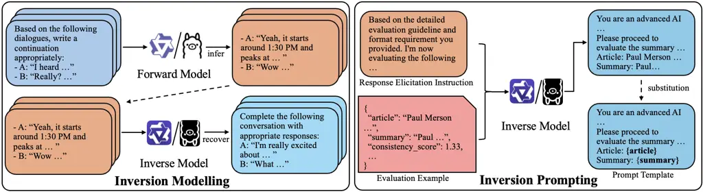

# Beyond One-Size-Fits-All: Inversion Learning for Highly Effective NLG Evaluation Prompts

Hanhua Hong ^(†)^(†)thanks:   Equal contribution Affiliation: The
University of Manchester 
Email: [hanhua.hong@postgrad.manchester.ac.uk](mailto:)    Chenghao Xiao
Email: [yang.wang-27@postgrad.manchester.ac.uk](mailto:)    Yang Wang
Affiliation: The University of Manchester 
Email: [chenghao.xiao@durham.ac.uk](mailto:)    Yiqi Liu
Affiliation: The University of Manchester 
Email: [w.rong@buaa.edu.cn](mailto:)    Wenge Rong, Chenghua Lin  
^(†)^(†)thanks:   Corresponding author Affiliation: The University of
Manchester  Affiliation: Beihang University
Email: [yiqi.liu@manchester.ac.uk](mailto:) Affiliation: Durham
University  Email: [chenghua.lin@manchester.ac.uk](mailto:)

###### Abstract

Evaluating natural language generation systems is challenging due to the
diversity of valid outputs. While human evaluation is the gold standard,
it suffers from inconsistencies, lack of standardisation, and
demographic biases, limiting reproducibility. LLM-based evaluators offer
a scalable alternative but are highly sensitive to prompt design, where
small variations can lead to significant discrepancies. In this work, we
propose an inversion learning method that learns effective reverse
mappings from model outputs back to their input instructions, enabling
the automatic generation of highly effective, model-specific evaluation
prompts. Our method requires only a single evaluation sample and
eliminates the need for time-consuming manual prompt engineering,
thereby improving both efficiency and robustness. Our work contributes
toward a new direction for more robust and efficient LLM-based
evaluation.

## 1 Introduction

Evaluating natural language generation (NLG) systems is notoriously
difficult due to the diversity of valid outputs for a single input Zhao
et al. (2023); Zhao et al. (2024) Zhao et al. (2024). As a result, human
assessment remains the most trusted evaluation method. However, despite
its importance, the quality of human evaluation is often questioned due
to the lack of standardisation, inconsistencies in evaluation
executions, and evaluator demographic biases Howcroft et al. (2020);
Belz et al. (2024); Elangovan et al. (2024). Howcroft et al. (2020)
highlight that even after two decades of research, the field still lacks
clear definitions and guidelines for key evaluation criteria, making
comparisons across studies difficult.

The advent of large language models (LLMs) has introduced a paradigm
shift in evaluation, positioning them as surrogate human evaluators. For
instance, LLM-based evaluators can process structured prompts to assess
multiple aspects of text quality based on explicit criteria (e.g.,
G-Eval Liu et al. (2023)) or perform comparative judgments between
multiple outputs without predefined rubrics (e.g., LLM-as-a-Judge Zheng
et al. (2023)). Their scalability, ability to follow explicit evaluation
criteria, and capacity to provide delicate human-like judgments across
diverse tasks (e.g., text generation, reasoning, etc.) make them a
compelling alternative to both human evaluation and existing automatic
metrics such as BERTScore Zhang et al. (2020) and BARTScore Yuan et al.
(2021), which rely on deterministic similarity measures or generation
likelihood estimates Li et al. (2024).

However, LLM-based evaluation also presents inherent challenges, most
notably high sensitivity to prompts, which, in current practice, are
predominantly hand-crafted. Extensive literature highlights how prompt
design and variations can significantly impact output quality – even
small changes in wording can lead to substantial differences in
evaluation results Aher et al. (2023); Huijzer and Hill (2023); Errica
et al. (2024); Cao et al. (2024); Sclar et al. (2024). For instance,
subtle variations in few-shot prompt templates have caused performance
discrepancies of up to 76 accuracy points on tasks from the
Super-Natural Instruction dataset Polo et al. (2024). To mitigate this
issue, Polo et al. (2024) propose estimating the performance
distribution across multiple prompt variants, rather than relying on a
single prompt for evaluation. Qian et al. (2024) benchmark prompts with
different components on Machine Translation tasks to figure out which
components are crucial for prompt templates. More recently, Wen et al.
(2025) propose a heuristic search algorithm (HPSS) to navigate a vast
combinatorial space of prompt factors. However, such search-based
methods are inherently data-hungry and computationally intensive,
requiring a large validation dataset to guide prompt optimisation.

To the best of our knowledge, our work presents the first attempt to
study the problem of learning high-quality, model-specific evaluation
prompts. It has been observed that the effectiveness of evaluation
guidelines varies among human evaluators Loakman et al. (2023). In a
similar vein, we argue that LLMs from different families (e.g., Qwen
Qwen Team (2024), LLaMA Grattafiori et al. (2024)) possess unique
characteristics due to their distinct training and alignment techniques
Muñoz-Ortiz et al. (2024); Sun et al. (2025); Lee et al. (2025). It is
therefore reasonable to assume they exhibit different interpretive
biases, meaning a prompt that is effective for one model may be
suboptimal for another.

We tackle this challenge through inversion learning, where the core idea
is to learn the inverse mapping from evaluation outcomes and inputs back
to effective prompts for a given LLM. Our work is fundamentally
different from prior studies in two key ways: (i) it is the first to
explore the automatic generation of evaluation prompts via inversion
learning; (ii) it requires only a single evaluation sample to generate a
highly effective, model-specific prompt. Specifically, when an LLM acts
as an evaluator, we assume that there exists a mapping $`f_{p}(\cdot)`$
that maps $`X`$ (texts to be evaluated) to evaluation outcome $`S`$,
where $`S`$ approximates the human evaluation distribution $`G`$. We
train an inverse model $`\tilde{f}`$ to effectively learn the inverse of
$`f`$, enabling it to generate a model-specific prompt $`p`$ given the
content to be evaluated $`X`$ and a target evaluation outcome $`g\in G`$
(e.g., a human-annotated score).

We conducted comprehensive experiments to evaluate the effectiveness of
our inverse prompt approach across three key generation tasks –
summarisation, machine translation, and conversational response
generation – using four public datasets and two model families,
Qwen Qwen Team (2024) and LLaMA Grattafiori et al. (2024), ranging from
3B to 14B parameters. Comparisons against popular human-crafted prompts
for these tasks, prompts generated by the original instruction-tuned
LLMs, and prompts refined by prompt optimisation methods, demonstrate
the superior performance of the evaluation prompts produced by our
inverse model.

To summarise, the contribution of our work is three-fold:

- •
  We introduce a one-shot generative paradigm for prompt engineering,
  making a fundamental shift from the dominant manual or data-intensive,
  search-based approaches.
- •
  We propose a novel inversion learning framework capable of generating
  model-specific evaluation prompts from a single evaluation sample,
  eliminating the need for manual or iterative prompt engineering.
- •
  We conducted comprehensive experiments across three NLG evaluation
  tasks, demonstrating that inversely generated prompts are highly
  effective, consistently outperforming both human-crafted prompts and
  strong baselines.

Our findings highlight the limitations of relying on manually crafted
prompts and underscore the potential of model inversion as a more
efficient and scalable approach for high-quality evaluation prompt
generation, paving the way for more effective and systematic LLM-based
evaluation.

## 2 Related Work

Our work is positioned at the intersection of automatic prompt
engineering for LLM-based evaluation and the field of language model
inversion. We will discuss each in turn, clarifying how our approach
presents a novel contribution.



Figure 1: Illustration of the inverse prompt generation process. The
bold text in "Prompt Template" indicates substituting the specific
example with a generic placeholder.

### 2.1 Automatic Prompt Engineering for LLM-based Evaluation

The use of LLMs as evaluators, exemplified by frameworks like G-Eval Liu
et al. (2023), has become a scalable alternative to traditional metrics.
However, the field has widely acknowledged that the reliability of these
evaluators is critically undermined by their sensitivity to the prompts
used Sclar et al. (2024); Aher et al. (2023) and by self-preference that
can affect evaluation results Liu et al. (2024). This challenge has
catalysed the field of Automatic Prompt Optimisation (APO), which treats
prompt design as a search or optimisation problem Ramnath et al. (2025).
Gradient-based optimisation methods treat prompts as continuous vectors
and use gradient descent to optimise them, but these typically require
impractical white-box access to the model’s internals Shin et al.
(2020); Pryzant et al. (2023). The dominant paradigm in black-box
settings is iterative search and inverse-prompting, where an LLM itself
acts as an optimiser to iteratively refine candidate prompts based on
performance on a validation set Yang et al. (2023); Sun et al. (2023).
When applied specifically to NLG evaluation, HPSS Wen et al. (2025)
represents the state-of-the-art in this category, employing a heuristic
search to find the optimal configuration of prompt components by testing
them against a large validation set.

Our work is fundamentally distinct from the existing paradigm for prompt
optimisation, where most of the methods are search-based. They start
with initial prompts and iteratively refine or select them based on
performance on a validation set. Our approach is generative. We do not
search over the prompt space; rather, we train an inverse model that
directly generates a high-quality prompt from a single evaluation
sample. The iterative nature of search-based methods makes them
inherently data-hungry. HPSS, for instance, requires a large validation
set (e.g., using up to 50% of test data) to guide its search. Our
inversion learning approach is exceptionally efficient in its
application phase, requiring only a single annotated sample to generate
the prompt, thereby eliminating the need for a large validation set for
prompt tuning.

### 2.2 Language Model Inversion

Language model inversion reconstructs inputs or instructions from a
model’s outputs or internal representations. Early work revealed
unintentional memorisation of training data Song and Raghunathan (2020);
Carlini et al. (2021), enabling auditing of sensitive information.
Subsequent studies showed inversion via next-token distributions Morris
et al. (2023b) or black-box output reconstruction Zhang et al. (2024),
indicating that LLMs inherently encode retrievable input traces.

Existing methods typically fall into two categories: output-based
inversion infers prior context from next-token probabilities Morris
et al. (2023b) or reconstructs prompts from responses Zhang et al.
(2024), but often relies on deterministic decoding and struggles with
stochastic sampling strategies such as temperature or nucleus sampling
Holtzman et al. (2020). Embedding-based inversion recovers text from
vector embeddings via encoder conditioning Morris et al. (2023a) or
exploits self-attention gradient structure (DAGER) to reconstruct whole
batches exactly Petrov et al. (2024), yet typically requires access to
model internals. To address these gaps, we propose an inversion learning
approach for the automatic generation of effective evaluation prompts
using a single evaluation sample, offering a more robust, efficient, and
adaptable framework for diverse evaluation tasks.

Notation Description $`\mathcal{D}`$ Instruction tuning dataset used for
supervised fine-tuning (SFT) $`x`$ Input prompt in the
instruction-tuning dataset $`y`$ Response output paired with instruction
prompt $`x`$ $`\mathcal{M}`$ The original pre-trained model without
instruction fine-tuning $`\mathcal{M}_{\mathrm{Instruct}}`$ The
instruction-tuned model (aka. the forward model) obtained by fine-tuning
the base model $`\mathcal{M}`$ $`\mathcal{M}_{\mathrm{Inverse}}`$
Inverse model obtained by fine-tuning the base model $`\mathcal{M}`$ on
the inverse training dataset $`\mathcal{D}_{\mathrm{Inv}}`$ $`p(\cdot)`$
Prompt template with a placeholder $`p(c)`$ Fully instantiated
evaluation prompt by substituting the placeholder in the prompt template
$`p(\cdot)`$ with content $`c`$

Table 1: Summary of notation and terminology used in the methodology
section.

## 3 Methodology

We propose an inversion learning method that learns an effective reverse
mapping from model outputs back to their input instructions, enabling
the automatic generation of highly effective, model-specific evaluation
prompts. Our approach does not require any task-specific evaluation data
for training and is highly efficient, as it generates an evaluation
prompt from a single data sample comprising the evaluation content and
its corresponding human evaluation result. The overall framework
includes two stages: inversion modelling and inversion prompting, as
shown in Figure 1. For completeness, Table 1 summarises the notation and
terminology used throughout this section.

### 3.1 Inversion Modelling

There are two primary settings for training an inverse model: Black-Box
and White-Box Inversion. The black-box setting refers to the scenarios
where we do not have access to a model’s supervised fine-tuning (SFT) or
instruction-tuning data and training process, which is typically the
case for most of the existing LLMs. Therefore, in this setting, we
approximate the inverse behaviour of publicly available
instruction-tuned models without access to their original SFT data. In
contrast, the white-box setting assumes full access to both the SFT
dataset and the model training pipeline, allowing the inverse model to
be trained from scratch using a base pre-trained LLM and a known,
controllable data source.

We primarily focus on black-box inversion, as this setting better
reflects realistic deployment scenarios in which models are accessible
but not fully transparent (e.g., models with released weights but
without access to their training data or full training details).
Moreover, off-the-shelf instruction-tuned LLMs typically undergo
extensive fine-tuning using carefully curated SFT datasets and
reinforcement learning, making them more likely to exhibit strong
baseline evaluation capabilities Zhao et al. (2025). Nevertheless, we
also conduct extensive experiments in the white-box setting to enable
controlled comparisons and systematically examine the characteristics of
both inversion approaches.

#### 3.1.1 Black-Box Setting

When training an inverse model in the black-box setting, it is
undesirable to simply repurpose an existing instruction-tuning dataset
by swapping input and output pairs. This is because the original
responses $`y`$ in a predefined SFT dataset may not reflect the output
characteristics or distribution of the target instruction-tuned model
$`\mathcal{M}_{\mathrm{Instruct}}`$. Instead, we argue that it is
essential to use outputs generated directly by
$`\mathcal{M}_{\mathrm{Instruct}}`$, as this ensures the inverse model
is trained on data that more accurately captures the behavioural
patterns of the target model $`\mathcal{M}_{\mathrm{Instruct}}`$. Such
alignment is crucial for learning effective, model-specific evaluation
prompts. To this end, we first perform inversion dataset distillation,
where model-specific responses $`\tilde{y}`$ are generated by performing
inference with $`\mathcal{M}_{\mathrm{Instruct}}`$ on prompts $`x`$ from
the SFT dataset.

Inversion Dataset Distillation.   Given a SFT dataset
$`\mathcal{D}_{\mathrm{SFT}}=\{(x,y)\}`$, where $`x`$ represents the
input prompts and $`y`$ the original target responses, we perform
inference using an off-the-shelf instruction-tuned model
$`\mathcal{M}_{\mathrm{Instruct}}`$ as follows:

```math
\tilde{y}=\mathcal{M}_{\mathrm{Instruct}}(x) \tag{1}
```

Here $`\tilde{y}`$ denotes the model-specific output generated in
response to prompt $`x`$. We then construct the inversion training
dataset $`\mathcal{D}_{\mathrm{Inv}}=\{(\tilde{y},x)\}`$. This inverse
dataset serves as the foundation for training the inverse model, which
is designed to learn the reverse mapping from model specific outputs
back to their corresponding input prompts.

Inversion-based Fine-tuning.  Based on the inverse dataset
$`\mathcal{D}_{\mathrm{Inv}}`$, we inverse fine-tune a base pre-trained
language model $`\mathcal{M}`$ (e.g., Qwen-2.5), which shares the same
architecture as the instruction-tuned model
$`\mathcal{M}_{\mathrm{Instruct}}`$ (e.g., Qwen-2.5-Instruct) but has
not undergone instruction tuning. Specifically, we treat the
model-generated response $`\tilde{y}`$ as the input and the original
prompt $`x`$ as the target output, and fine-tune the base model
$`\mathcal{M}`$ using a standard supervised fine-tuning procedure.

```math
\tilde{\theta}=\underset{\theta}{\arg\min}\,\mathbb{E}_{(\tilde{y},x)\sim\mathcal{D}_{\mathrm{Inv}}}\Big[\mathcal{L}\big(\mathcal{M}(\tilde{y};\theta),x\big)\Big] \tag{2}
```

This inversion-based fine-tuning process aims to effectively learn to
reconstruct the original instruction $`x`$ from the corresponding
model-generated output $`\tilde{y}`$. By capturing the latent
correspondence between outputs and their originating instructions, the
inverse model internalises the implicit structure of task-specific
instructions, thereby enabling the generation of prompts that are more
precisely aligned with the behavioural characteristics of the target
LLM.

#### 3.1.2 White-Box Setting

In contrast to the black-box setting, the white-box setting assumes full
control over both the forward and inverse fine-tuning processes. This
allows us to fine-tune not only the forward instruction-tuned model but
also the inverse model based on the same SFT dataset.

Formally, we begin by training the standard forward instruction-tuned
model via supervised fine-tuning of a base pre-trained LLM on a dataset
$`\mathcal{D}_{\mathrm{SFT}}=\{(x,y)\}`$:

```math
\theta_{\text{Instruct}}=\underset{\theta}{\arg\min}\,\mathbb{E}_{(x,y)\sim\mathcal{D}_{\text{SFT}}}\Big[\mathcal{L}\big(\mathcal{M}(x;\theta),y\big)\Big] \tag{3}
```

where $`\theta_{\text{Instruct}}`$ represents the model parameters after
instruction tuning. The resulting instruction-tuned model is given as:

```math
\mathcal{M}_{\mathrm{Instruct}}(\cdot)=\mathcal{M}(\cdot;\theta_{\mathrm{Instruct}}) \tag{4}
```

To train the inverse model, we construct the inversion dataset
$`\mathcal{D}_{\mathrm{Inv}}=\{(y,x)\}`$ by simply swapping the
input–output pairs in $`\mathcal{D}_{\mathrm{SFT}}`$, such that the
original outputs become inputs and vice versa. The inverse model is
subsequently trained using the same SFT procedure as in the Black-Box
setting:

```math
\tilde{\theta}=\underset{\theta}{\arg\min}\,\mathbb{E}_{(y,x)\sim\mathcal{D}_{\mathrm{Inv}}}\Big[\mathcal{L}\big(\mathcal{M}(y;\theta),x\big)\Big] \tag{5}
```

Finally, the inverse model can be derived as:

```math
\mathcal{M}_{\mathrm{Inverse}}(\cdot)=\mathcal{M}(\cdot;\tilde{\theta}) \tag{6}
```

### 3.2 Inversion Prompting


Figure 2: Example of a meta-prompt for the inverse model.

Upon training, the inverse model is expected to have learned an
effective reverse mapping from model-specific outputs back to their
corresponding input instructions, ultimately enabling the generation of
effective evaluation prompts tailored to the target instruction-tuned
LLM.

To generate evaluation prompts, we feed the inverse model a meta-prompt
input $`I_{t}=(E_{\mathcal{T}},c_{t},r_{t})`$, which consists of three
components: the evaluation content $`c_{t}`$, the corresponding human
evaluation result $`r_{t}`$, and a response elicitation instruction
$`E_{\mathcal{T}}`$. We adopt a one-shot strategy, where a single data
pair $`(c_{t},r_{t})`$ is randomly sampled from a downstream evaluation
task $`\mathcal{T}=\{(c,r)\}`$, with $`c`$ denoting the content to be
evaluated (e.g., a translation and its source sentence) and $`r`$ the
associated human judgment. The response elicitation instruction is
designed to guide the model to generate prompts that are both
well-structured and aligned with the evaluation aspects reflected in the
result (e.g., consistency). It also encourages the model to output
structured evaluative instructions rather than free-form explanations or
responses. Figure 2 illustrates such an input example, where the
evaluation content is shown in italics, the result in bold, and the
response elicitation instruction $`E_{\mathcal{T}}`$ in blue.

The inverse prompt generation process is formally defined as:

```math
p(c_{t})=\mathcal{M}_{\mathrm{Inverse}}\big(I_{t}\big) \tag{7}
```

The objective is to produce an evaluation prompt $`p(c_{t})`$ such that,
when used by the evaluator $`\mathcal{M}_{\mathrm{Instruct}}`$, it
yields an evaluation outcome that closely approximates the
human-provided evaluation result $`r_{t}`$.

The inversion-generated prompt $`p(c_{t})`$ typically includes
$`c_{t}`$, the original content to be evaluated, as illustrated in
Figure 1. This is expected, as the generated evaluation prompt is
designed to assess a specific input text. To construct a generalisable
evaluation prompt template $`p(\cdot)`$, we automatically replace the
content in $`p(c_{t})`$ that is specific to the one-shot example with
format placeholders. Once the general evaluation prompt template is
obtained, it can be used to evaluate any input from the same downstream
task by infilling the template with the target evaluation content and
passing it to the corresponding forward instruction-tuned model. Note
that it is essential to use the corresponding forward model as the
evaluator, rather than the inverse model, since the inversion training
process optimises the model for generating evaluation prompts rather
than for performing the actual evaluation. Given template $`p(\cdot)`$,
the predicted evaluation outcome $`\hat{r}_{i}`$ for any $`c_{i}`$ are
computed as:

```math
\hat{r}_{i}=\mathcal{M}_{\text{Instruct}}\big(p(c_{i})\big) \tag{8}
```

The transformation from an instance-specific prompt to general template
is visually highlighted in bold in Figure 1. Examples of the one-shot
input format and the corresponding inverse model outputs for various
datasets are provided in Appendix B.

## 4 Experimental Setup

Evaluator SummEval QAGS-C QAGS-X Topical-Chat WMT-22 Average Evaluation
Prompt $`\rho`$ $`r`$ $`\rho`$ $`r`$ $`\rho`$ $`r`$ $`\rho`$ $`r`$
$`\rho`$ $`r`$ $`\rho`$ $`r`$ BERTScore 0.290 0.317 0.505 0.576 0.008
0.024 0.273 0.262 0.277 0.328 0.271 0.301 BARTScore 0.385 0.414 0.680
0.735 0.159 0.184 0.119 0.138 0.202 0.128 0.309 0.320
HPSS(Qwen-2.5-7B-Instruct) 10-shot 0.373 0.402 0.514 0.496 0.164 0.048
0.465 0.232 0.161 0.040 0.335 0.296 30-shot 0.403 0.423 0.530 0.522
0.354 0.382 0.478 0.420 0.198 0.242 0.392 0.398 50-shot 0.406 0.444
0.563 0.608 0.360 0.332 0.483 0.474 0.252 0.218 0.413 0.415 100-shot
0.429 0.450 0.582 0.577 0.461 0.442 0.503 0.500 0.240 0.259 0.443 0.445
LLaMA-3.1-8B-Instruct BlackBox Setting Human-Crafted Prompt 0.375 0.433
0.558 0.590 0.376 0.350 0.385 0.372 0.259 0.292 0.391 0.407 Forward
Prompt 0.268 0.286 0.531 0.569 0.137 0.126 0.419 0.407 0.233 0.248 0.318
0.327 Inverse Prompt (Ours) 0.400 0.466 0.598 0.620 0.405 0.401 0.437
0.423 0.277 0.256 0.423 0.433 Relative Gain $`\uparrow`$49%
$`\uparrow`$63% $`\uparrow`$13% $`\uparrow`$9% $`\uparrow`$196%
$`\uparrow`$218% $`\uparrow`$4% $`\uparrow`$4% $`\uparrow`$19%
$`\uparrow`$3% $`\uparrow`$33% $`\uparrow`$32% Qwen-2.5-7B-Instruct
Human-Crafted Prompt 0.374 0.430 0.654 0.668 0.483 0.464 0.398 0.393
0.271 0.202 0.436 0.431 Forward Prompt 0.315 0.339 0.529 0.603 0.198
0.207 0.436 0.439 0.274 0.284 0.350 0.374 Inverse Prompt (Ours) 0.418
0.457 0.661 0.673 0.524 0.530 0.502 0.501 0.313 0.316 0.484 0.495
Relative Gain $`\uparrow`$ 33% $`\uparrow`$35% $`\uparrow`$25%
$`\uparrow`$12% $`\uparrow`$164% $`\uparrow`$156% $`\uparrow`$15%
$`\uparrow`$14% $`\uparrow`$11% $`\uparrow`$11% $`\uparrow`$38%
$`\uparrow`$32% LLaMA-3.1-8B-WhiteBox WhiteBox Setting Human-Crafted
Prompt 0.341 0.392 0.555 0.542 0.254 0.254 0.446 0.436 0.274 0.274 0.374
0.380 Forward Prompt 0.334 0.374 0.444 0.491 0.170 0.166 0.318 0.300
0.249 0.250 0.303 0.318 Inverse Prompt (Ours) 0.388 0.440 0.576 0.577
0.356 0.336 0.441 0.422 0.257 0.256 0.404 0.406 Relative Gain
$`\uparrow`$16% $`\uparrow`$18% $`\uparrow`$30% $`\uparrow`$18%
$`\uparrow`$109% $`\uparrow`$102% $`\uparrow`$39% $`\uparrow`$40%
$`\uparrow`$3% $`\uparrow`$2% $`\uparrow`$33% $`\uparrow`$28%
Qwen-2.5-7B-WhiteBox Human-Crafted Prompt 0.406 0.467 0.557 0.604 0.416
0.410 0.427 0.420 0.292 0.259 0.420 0.432 Forward Prompt 0.341 0.360
0.236 0.269 0.321 0.335 0..419 0.416 0.251 0.246 0.314 0.325 Inverse
Prompt (Ours) 0.402 0.425 0.661 0.669 0.590 0.602 0.464 0.461 0.301
0.286 0.484 0.489 Relative Gain $`\uparrow`$20% $`\uparrow`$14%
$`\uparrow`$49% $`\uparrow`$36% $`\uparrow`$247% $`\uparrow`$262%
$`\uparrow`$46% $`\uparrow`$54% $`\uparrow`$21% $`\uparrow`$14%
$`\uparrow`$60% $`\uparrow`$54%

Table 2: Results of average Spearman ($`\rho`$) and Pearson($`r`$)
correlations on various datasets with different models and settings. The
LLaMA-3.1-8B-WhiteBox and Qwen-2.5-7B-WhiteBox are models
instruction-tuned by us with the Infinity-Instruct dataset in the
white-box setting. QAGS-C denotes QAGS-CNN dataset, and QAGS-X denotes
QAGS-XSUM dataset. Within the data of the same model, the bold values
indicate the best results and the underscored values indicate the
second-best ones. Relative Gain denotes the increase rate of the
performance of Inverse Prompt to that of the corresponding Forward
Prompt.

Data.  In our experiments, we select Infinity-Instruct Li et al. (2025),
a large-scale instruction-following dataset, as the SFT dataset. Our
considerations for selecting this dataset are two-fold: (i) Quality:
when fine-tuning widely adopted base models on Infinity-Instruct, they
achieve state-of-the-art results without requiring reinforcement
learning from human feedback (RLHF) Xie et al. (2025). This underscores
the dataset’s exceptional quality compared to alternatives; (ii)
Diversity: the dataset spans over 20 diverse domains, enabling the
inverse model to learn a generalised inverse mapping and support robust
performance even on tasks not explicitly present in the training data.

Due to resource constraints, we select the 0625 subset of
Infinity-Instruct, which contains approximately 660k samples. In the
white-box setting, both the forward instruction-tuned model and the
inverse model are trained using this subset. In the black-box setting,
we first construct the inverse training dataset by distilling from the
corresponding instruction-tuned LLM using only the inputs from
Infinity-Instruct. We then pair the output with the corresponding input
to form the inverse training set, where the input-output pairs are
reversed (see §3.1.1). This inverse dataset is subsequently used to
train the inverse model from the base version of the same LLM.

Evaluation Protocol.  We conduct experiments on three prominent text
generation tasks: summarisation, conversational response generation, and
machine translation. Following standard practice Zhong et al. (2022);
Gao et al. (2025), we assess the performance of LLM-based evaluators by
calculating Spearman ($`\rho`$) and Pearson ($`r`$) correlations between
the evaluator’s predicted scores and the ground truth scores annotated
by humans. Following G-EVAL Liu et al. (2023), we select SummEval Fabbri
et al. (2021), Question Answering and Generation for Summarization
(QAGS, Wang et al., 2020), and Topical-Chat Gopalakrishnan et al. (2019)
as benchmarks for summarisation and response generation. QAGS consists
of two subtasks: QAGS-CNN and QAGS-XSUM, with the latter containing more
abstract summaries. For machine translation, we use the
English-to-German corpus constructed by Qian et al. (2024), sourced from
WMT-22 Freitag et al. (2022).

Baselines.  We compare the effectiveness of prompts generated by our
inverse models against three baselines: (i) popular human-crafted
prompts for each task, (ii) prompts generated directly by the
corresponding forward instruction-tuned LLMs, and (iii) prompts produced
by prompt optimisation techniques. For summarisation and chat response
generation, we use human-crafted prompts from Five-stars Wang et al.
(2023) and G-EVAL Liu et al. (2023). For machine translation, we use
GEMBA Kocmi and Federmann (2023) and an enhanced version of GEMBA
incorporating evaluation guidelines (GEMBA+) Qian et al. (2024).
Additionally, we use prompts from Direct Assessment (DA) across all
three tasks. We report the best result among all human-crafted prompts
for each task. For the inverse prompt, it is generated based on a
one-shot example randomly sampled from the corresponding training set.
Furthermore, we compare our method against a recent strong baseline,
HPSS Wen et al. (2025), a prompt optimisation approach. In contrast to
our one-shot inversion method, HPSS requires a substantial validation
set for tuning; we experiment with validation sizes ranging from 10 to
100 samples.

We also attempt to benchmark against a recent work output2prompt Zhang
et al. (2024) using our settings. However, output2prompt failed to
generate meaningful prompts for evaluation tasks, instead producing
nonsensical repetitions. Consequently, we excluded it from our
experiments.

Environment.  All experiments and training are conducted using four
NVIDIA A100-SXM-80GB GPUs with LoRA Hu et al. (2022), based on the
LLaMA-Factory framework Zheng et al. (2024). Please refer to Appendix C
for more details.

## 5 Experimental Results

### 5.1 Overall Results

Table 2 presents the main experimental results under both the Black-Box
and White-Box settings. To evaluate the generalisability of our
approach, we conduct experiments using two prominent open-source LLM
families: LLaMA and Qwen.

Black-Box Setting.  In the black-box setting, our inverse prompts
consistently achieve superior alignment with human judgments compared to
both the forward and human-crafted prompts across all datasets and
models. For instance, on LLaMA-3.1-8B-Instruct, the inverse prompt
improves over forward prompts with substantial gains of 33% in average
Spearman correlation ($`\rho`$) and 32% in Pearson correlation ($`r`$),
suggesting that standard forward instruction-tuned models are suboptimal
for generating effective evaluation prompts. A similar trend is observed
with Qwen-2.5-7B-Instruct, where the inverse prompt achieves the highest
average correlation scores ($`\rho=0.484`$, $`r=0.495`$), outperforming
the human-crafted and forward prompts over 13% and 35% on average,
respectively.

Compared to the prompt optimisation method HPSS, our inverse prompts
achieve significantly higher evaluation performance, despite using only
a single annotated example. Using Qwen-2.5-7B-Instruct as the evaluator,
the inverse prompt generated by our Qwen-based inverse model outperforms
HPSS prompts across all tested tasks. On average, our inverse prompts
outperform HPSS’s 10-shot prompts by 56% in terms of mean Spearman and
Pearson correlation. Even when HPSS is provided with 100-shot validation
data, our method still achieves a 10% performance advantage. This makes
our inversion-based prompt generation approach significantly more
practical and data-efficient, especially for evaluating new generation
tasks where labelled data is scarce.

White-Box Setting.  In this setting, we train both the forward and
inverse models using the same SFT dataset. Inverse prompts again, yield
the best overall performance, followed by human-crafted prompts.
Notably, inversion learning under the black-box setting achieves higher
performance than the white-box setting for LLaMA, while showing similar
trends for Qwen. We hypothesise that these patterns may arise from
differences in the capabilities of the underlying forward models. The
instruction-tuned LLMs used in the black-box setting (i.e.,
LLaMA-Instruct and Qwen-Instruct) have undergone extensive fine-tuning
on large-scale, high-quality supervised datasets, followed by additional
stages such as reinforcement learning and post-training
refinements Rafailov et al. (2023). In contrast, the white-box models
trained in our experiments were fine-tuned solely through supervised
fine-tuning on a relatively small dataset of around 660k samples.
Therefore, while inversion learning achieves better performance in the
black-box setting, it remains inconclusive which setup is more optimal,
as differences in training strategy and data scale confound a strict
comparison.

Evaluator SummEval QAGS-C QAGS-X Topical-Chat WMT-22 Average Evaluation
Prompt $`\rho`$ $`r`$ $`\rho`$ $`r`$ $`\rho`$ $`r`$ $`\rho`$ $`r`$
$`\rho`$ $`r`$ $`\rho`$ $`r`$ LLaMA-3.1-8B-Instruct Forward Prompt 0.268
0.286 0.531 0.569 0.137 0.126 0.419 0.407 0.233 0.248 0.318 0.327
Inverse Prompt-Qwen 0.376 0.434 0.569 0.607 0.305 0.317 0.400 0.385
0.271 0.254 0.384 0.399 Inverse Prompt-WB 0.411 0.443 0.626 0.636 0.381
0.332 0.417 0.405 0.263 0.211 0.420 0.405 Inverse Prompt (Ours) 0.400
0.466 0.598 0.620 0.405 0.401 0.437 0.423 0.277 0.256 0.423 0.433
Qwen-2.5-7B-Instruct Forward Prompt 0.315 0.339 0.529 0.603 0.198 0.207
0.436 0.439 0.274 0.284 0.350 0.374 Inverse Prompt-LLaMA 0.391 0.426
0.624 0.672 0.499 0.470 0.461 0.452 0.263 0.270 0.448 0.458 Inverse
Prompt-WB 0.360 0.403 0.631 0.673 0.507 0.493 0.479 0.459 0.304 0.285
0.456 0.463 Inverse Prompt (Ours) 0.418 0.457 0.661 0.673 0.524 0.530
0.502 0.501 0.313 0.316 0.484 0.495

Table 3: Results of the prompt swapping experiment in the black-box
setting. Inverse Prompt-Qwen and Inverse Prompt-LLaMA denotes swapping
prompts with another model. Inverse Prompt-WB denotes using inverse
prompts generated by white-box (WB) models.

Evaluator SummEval QAGS-C QAGS-X Topical-Chat WMT-22 Average Evaluation
Prompt $`\rho`$ $`r`$ $`\rho`$ $`r`$ $`\rho`$ $`r`$ $`\rho`$ $`r`$
$`\rho`$ $`r`$ $`\rho`$ $`r`$ GPT-4o-mini Forward Prompt-BB 0.432 0.457
0.585 0.630 0.311 0.301 0.553 0.546 0.291 0.320 0.434 0.451 Inverse
Prompt-BB 0.476 0.517 0.738 0.766 0.568 0.600 0.578 0.572 0.307 0.323
0.533 0.556 Relative Gain $`\uparrow`$10% $`\uparrow`$13%
$`\uparrow`$26% $`\uparrow`$22% $`\uparrow`$83% $`\uparrow`$99%
$`\uparrow`$5% $`\uparrow`$5% $`\uparrow`$5% $`\uparrow`$1%
$`\uparrow`$23% $`\uparrow`$23% Forward Prompt-WB 0.403 0.427 0.582
0.622 0.515 0.487 0.555 0.550 0.287 0.312 0.468 0.480 Inverse Prompt-WB
0.439 0.479 0.694 0.672 0.561 0.571 0.548 0.540 0.305 0.350 0.509 0.522
Relative Gain $`\uparrow`$9% $`\uparrow`$12% $`\uparrow`$19%
$`\uparrow`$8% $`\uparrow`$9% $`\uparrow`$17% $`\downarrow`$1%
$`\downarrow`$2% $`\uparrow`$6% $`\uparrow`$12% $`\uparrow`$9%
$`\uparrow`$9%

Table 4: Results of applying inversion and forward prompts generated by
Qwen-2.5-7B models to GPT-4o-mini.

Task-wise, the effectiveness of inverse prompts is especially pronounced
on the QAGS-XSUM dataset, where we observe an average gain of over 100%
to 250% compared to forward prompts, followed by SummEval with an
average gain of 31%. In contrast, machine translation tasks exhibit the
smallest relative gains, particularly for LLaMA, which aligns with
previous observations Leiter and Eger (2024). A plausible explanation
lies in the nature of the tasks: summarisation tasks are inherently more
complex and abstract, and typically exhibit greater variability than
translation tasks. Consequently, inversion-generated prompts are likely
to yield substantially larger performance improvements for summarisation
compared to machine translation.

Overall, these findings demonstrate that inversion learning can
effectively generate model-specific evaluation prompts that outperform
human-crafted prompts, forward prompts, and strong prompt optimisation
methods, yielding assessments that align more closely with human
judgments across diverse generation tasks.

### 5.2 Sensitivity Analysis of Inverse Prompts

Model Sensitivity.  One of our main hypotheses is that to maximise the
effectiveness of an evaluation prompt, it needs to be tailored to the
specific LLM. In other words, a prompt that is highly effective for one
model may perform suboptimally on another. To investigate this, we
design a prompt swapping experiment to evaluate the performance of
inverse prompts generated by one model family when applied to another
(e.g., prompts generated by inverse-Qwen and used by forward-LLaMA).
Additionally, since we explore two inverse model training strategies, we
also test the cross-strategy effectiveness of prompts, i.e., applying
prompts generated by a white-box model on a black-box evaluator.

As shown in Table 3, applying inverse prompts generated by a different
model family leads to a noticeable drop in evaluation performance. For
example, when prompts generated by inverse-Qwen are applied to
LLaMA-3.1-8B-Instruct as the evaluator, the average Spearman and Pearson
correlations drop from 0.423 to 0.384 and from 0.433 to 0.399,
respectively, compared to when the same prompts are applied to
Qwen-2.5-7B-Instruct. A similar performance drop is observed when using
Qwen-2.5-7B-Instruct as the evaluator with inverse prompts generated by
LLaMA. These findings demonstrate that prompts transferred across
different evaluator models significantly lose their effectiveness,
highlighting the necessity of generating model-specific inverse prompts.
When examining cross-strategy sensitivity (i.e., using prompts generated
by white-box models on black-box evaluators), we also observe a
performance degradation, although the impact is generally less severe
than that observed in cross-model transfers.

Since LLaMA and Qwen are open-source models, we further investigate the
sensitivity of inverse prompts generated by inverse-Qwen under both
black-box and white-box settings by applying them to the proprietary
model GPT-4o-mini, as shown in Table 4. The results show that inverse
prompts continue to outperform forward prompts, with a performance
difference of 23% in the black-box setting. This further demonstrates
that our inverse model is capable of generating higher-quality and more
effective evaluation prompts than those produced by standard forward
instruction-tuned models. Nevertheless, the performance gains are less
significant compared to when the inverse prompts are applied to the
specific model family from which they were generated (cf. Table 2).
Additionally, using GPT-4o-mini as the evaluator yields higher overall
performance compared to LLaMA-8B and Qwen-7B, which is unsurprising
given its stronger underlying capabilities. However, using a larger
Qwen-14B model can actually surpass GPT-4o-mini in performance. See §5.3
for a detailed discussion.

Overall, the above analysis reinforces our hypothesis that inverse
prompts are most effective when tailored to the specific LLM, and that
the prevailing community practice of using one-size-fits-all evaluation
prompts is sub-optimal. We therefore advocate for the use of
model-specific prompts for more accurate and reliable prompt-based
evaluation with LLMs.

Evaluator SummEval QAGS-C QAGS-X Topical-Chat WMT-22 Average Evaluation
Prompt $`\rho`$ $`r`$ $`\rho`$ $`r`$ $`\rho`$ $`r`$ $`\rho`$ $`r`$
$`\rho`$ $`r`$ $`\rho`$ $`r`$ Qwen-2.5-7B-Instruct Inverse Prompt 0.418
0.457 0.661 0.673 0.524 0.530 0.502 0.501 0.313 0.316 0.484 0.495 One
Decimal Place 0.423 0.469 0.635 0.624 0.495 0.486 0.532 0.515 0.301
0.264 0.477 0.472 w/o Score Range 0.427 0.484 0.652 0.669 0.422 0.429
0.516 0.493 0.301 0.314 0.464 0.478 w/o Score 0.405 0.446 0.662 0.658
0.437 0.384 0.533 0.515 0.306 0.304 0.469 0.461

Table 5: Model sensitivity ablation study.


Figure 3: Numerical sensitivity ablation examples from QAGS-X: (a) the
original meta-prompt for evaluation prompt generation; (b) rounding
evaluation score to one decimal place; (c) removing evaluation score
range; (d) removing both score range and human evaluation scores.

Numerical Sensitivity.  The input to the inverse models for generating
evaluation prompts includes two types of numerical information: the
range of evaluation scores and the human score for the corresponding
evaluation sample. Additionally, human scores often contain multiple
decimal places, as they are typically averaged across multiple human
evaluators or, in the case of machine translation tasks using metrics
like MQM, calculated by applying weighted aggregation across different
scoring dimensions. This raises an interesting question: how sensitive
are the inverse models to this numerical information, and what impact
does it have on the quality and effectiveness of the generated
evaluation prompts? To investigate this, we conducted an ablation study
by altering the numerical information in the original input: (i)
rounding the human evaluation scores to one decimal place; (ii) removing
the evaluation score range; and (iii) removing both the score range and
the human evaluation score. Examples of each input modification are
shown in Figure 3.

As shown in Table 5, all three ablation settings lead to only marginal
decreases in model performance. Even in the worst case, where all
numerical information is removed, the performance drops by only 5%
compared to using the original input with full information. This
suggests that, although the evaluation score range and ground-truth
human evaluation scores might intuitively seem important, they have
relatively minor impact on the quality of the generated evaluation
prompts. Examining the prompts generated from the ablation studies (see
Figure 9) reveals that, in the w/o score range setting, the inverse
model is able to, in many cases, infer the original evaluation score
range based solely on the human evaluation scores. For example, given a
score of 68 in the WMT evaluation task, the inverse model frequently
generates a prompt template that adopts a 0 to 100 scale. In the setting
where no numerical information is provided, the model tends to randomly
select a commonly used score range (e.g., 0–100 or 1–10), yet the
resulting performance remains relatively stable across different score
ranges.

### 5.3 Model Size Scaling

Evaluator SummEval QAGS-C QAGS-X Topical-Chat WMT-22 Average Evaluation
Prompt $`\rho`$ $`r`$ $`\rho`$ $`r`$ $`\rho`$ $`r`$ $`\rho`$ $`r`$
$`\rho`$ $`r`$ $`\rho`$ $`r`$ Qwen-2.5-14B-Instruct Human-Crafted Prompt
0.450 0.463 0.687 0.688 0.539 0.527 0.587 0.564 0.299 0.312 0.512 0.511
Forward Prompt 0.417 0.443 0.612 0.653 0.261 0.264 0.568 0.560 0.291
0.301 0.430 0.444 Inverse Prompt (Ours) 0.456 0.471 0.721 0.721 0.592
0.558 0.625 0.615 0.306 0.323 0.540 0.538 Qwen-2.5-7B-Instruct
Human-Crafted Prompt 0.374 0.430 0.654 0.668 0.483 0.464 0.398 0.393
0.271 0.202 0.436 0.431 Forward Prompt 0.315 0.339 0.529 0.603 0.198
0.207 0.436 0.439 0.274 0.284 0.350 0.374 Inverse Prompt (Ours) 0.418
0.457 0.661 0.673 0.524 0.530 0.502 0.501 0.313 0.316 0.484 0.495
Qwen-2.5-3B-Instruct Human-Crafted Prompt 0.385 0.458 0.516 0.506 0.438
0.405 0.338 0.332 0.252 0.257 0.386 0.393 Forward Prompt 0.243 0.253
0.427 0.409 0.129 0.118 0.311 0.291 0.260 0.309 0.274 0.276 Inverse
Prompt (Ours) 0.339 0.341 0.591 0.569 0.439 0.443 0.340 0.336 0.286
0.312 0.399 0.400

Table 6: Results of the model scaling study.

To explore the impact of model size scaling on inversion learning, we
trained inverse models with Qwen at multiple scales (3B, 7B, and 14B) in
the black-box setting using the same Infinity-Instruct dataset
comprising 660k samples. Table 6 presents the results of these
experiments, clearly demonstrating a positive correlation between model
size and evaluation performance across all datasets and tasks. For
example, the average Spearman correlation for inverse prompts increases
from 0.399 with the 3B model to 0.540 with the 14B model, corresponding
to 35% of relative improvement, highlighting the effectiveness of model
scaling.

Moreover, inverse prompts consistently outperform forward prompts and
achieve higher correlations than human-crafted prompts across all model
sizes, with the sole exception of the 3B model on the SummEval dataset.
These results validate the effectiveness of our inverse prompt
generation method under model scaling.

### 5.4 Case Study

To analyse why forward, human-crafted, and inverse prompts exhibit
different levels of effectiveness, we conducted a qualitative comparison
of prompts generated based on the meta-prompt shown in Figure 3(a),
which contains the one-shot evaluation sample focused exclusively on the
consistency dimension. Both the forward and inverse prompts were
generated by Qwen-2.5-7B-Instruct under the black-box setting (cf.
Table 2). The complete prompt examples are provided in Figure 4 in
Appendix A. For clarity, we highlight the sections corresponding to
Model Instruction (e.g., role assignment), Evaluation Criteria, and
Evaluation Guideline.

Among the three types of prompts, the generated forward prompts define
evaluation across multiple dimensions (e.g., comprehensiveness,
accuracy, etc.), which does not align with the one-shot example used for
evaluation prompt generation, where the focus is solely on assessing
consistency. Comparing inversion and human-crafted prompts, there are
several distinct differences in terms of their criteria descriptions,
structure, and tone. For instance, inverse prompts explicitly assign a
role to the model, framing it as “an advanced AI assistant”, which helps
anchor the model’s perspective and behaviour during evaluation. In
contrast, human-crafted prompts use a more natural and instructional
tone without explicit role-playing, making them more approachable for
human readers.

In terms of evaluation guidelines, inverse prompt provides step-by-step
procedures with detailed and imperative phrasing (e.g. “To perform the
task, you must …”). Human-crafted prompt also includes task steps but
present them more loosely, reflecting how humans naturally approach
annotation tasks. For the consistency criterion, inverse prompts offer
the most operational definition among the three, framing factual
consistency through formal entailment-based reasoning. In comparison,
human-crafted prompts describe it in simpler and less precise terms,
emphasising factual alignment and penalising hallucinations. This
formal, entailment-based framing in inverse prompts likely contributes
to their effectiveness in evaluation tasks. Additionally, inverse
prompts use a continuous 0–1 scoring scale for fine-grained evaluation,
whereas human-crafted prompts use 1–5 Likert scale.

Comparing the prompts generated by Qwen and LLaMA (see Figure 5), we
observe that the forward prompt from LLaMA is similar to Qwen’s but
introduces even more evaluation criteria for irrelevant dimensions. For
inverse prompts, LLaMA’s prompt is less formal (i.e., more
conversational) and adopts a more instructional rather than assertive
tone, offering intuitive but less rigorously defined descriptions of
factual consistency, along with fewer procedural details. Structurally,
Qwen clearly separates model instruction, evaluation criteria, and
evaluation guidelines, whereas LLaMA blends these elements more loosely.
This highlights that Qwen and LLaMA have different preferences in prompt
style, which make them most effective.

In summary, our analysis supports the hypothesis that generating
model-specific prompts is crucial, and that human-crafted prompts and
guidelines do not necessarily translate into more effective prompts for
LLMs.

## 6 Conclusion

In this work, we introduced a novel approach for generating
high-quality, model-specific evaluation prompts through inversion
learning, marking a sharp departure from practices that rely on
human-crafted prompts. These hand-crafted prompts are often costly to
produce and typically applied without considering their effectiveness
across different LLMs. Our method eliminates the need for manual prompt
engineering and outperforms both human-crafted prompts and strong prompt
optimisation techniques, despite using only a single annotated example.
In contrast, prompt optimisation methods typically require large
validation sets and iterative tuning. Extensive experiments on two
open-source LLM families and a wide range of generation tasks
demonstrate that our method can efficiently produce high-quality prompts
from a single evaluation sample. Moreover, our results confirm the
hypothesis that model-tailored prompts are essential for improving
evaluation performance. Ultimately, this work contributes toward a new
direction for more robust and efficient LLM-based evaluation.

## References

- Aher et al. (2023) Gati V Aher, Rosa I Arriaga, and Adam Tauman
  Kalai. 2023. Using large language models to simulate multiple humans
  and replicate human subject studies. In _International Conference on
  Machine Learning_, pages 337–371. PMLR.
- Belz et al. (2024) Anja Belz, João Sedoc, Craig Thomson, Simon Mille,
  and Rudali Huidrom. 2024. The inlg 2024 tutorial on human evaluation
  of nlp system quality: Background, overall aims, and summaries of
  taught units. In _Proceedings of the 17th International Natural
  Language Generation Conference: Tutorial Abstract_, pages 1–12.
- Cao et al. (2024) Bowen Cao, Deng Cai, Zhisong Zhang, Yuexian Zou, and
  Wai Lam. 2024. [On the worst prompt performance of large language
  models](http://arxiv.org/abs/2406.10248).
- Carlini et al. (2021) Nicholas Carlini, Florian Tramèr, Eric Wallace,
  Matthew Jagielski, Ariel Herbert-Voss, Katherine Lee, Adam Roberts,
  Tom Brown, Dawn Song, Úlfar Erlingsson, Alina Oprea, and Colin
  Raffel. 2021. [Extracting training data from large language
  models](https://www.usenix.org/conference/usenixsecurity21/presentation/carlini-extracting).
  In _30th USENIX Security Symposium (USENIX Security 21)_, pages
  2633–2650. USENIX Association.
- Elangovan et al. (2024) Aparna Elangovan, Ling Liu, Lei Xu,
  Sravan Babu Bodapati, and Dan Roth. 2024. [ConSiDERS-the-human
  evaluation framework: Rethinking human evaluation for generative large
  language models](https://doi.org/10.18653/v1/2024.acl-long.63). In
  _Proceedings of the 62nd Annual Meeting of the Association for
  Computational Linguistics (Volume 1: Long Papers)_, pages 1137–1160,
  Bangkok, Thailand. Association for Computational Linguistics.
- Errica et al. (2024) Federico Errica, Giuseppe Siracusano, Davide
  Sanvito, and Roberto Bifulco. 2024. What did i do wrong? quantifying
  llms’ sensitivity and consistency to prompt engineering. _arXiv
  preprint arXiv:2406.12334_.
- Fabbri et al. (2021) Alexander R. Fabbri, Wojciech Kryściński, Bryan
  McCann, Caiming Xiong, Richard Socher, and Dragomir Radev. 2021.
  [SummEval: Re-evaluating summarization
  evaluation](https://doi.org/10.1162/tacl_a_00373). _Transactions of
  the Association for Computational Linguistics_, 9:391–409.
- Freitag et al. (2022) Markus Freitag, Ricardo Rei, Nitika Mathur,
  Chi-kiu Lo, Craig Stewart, Eleftherios Avramidis, Tom Kocmi, George
  Foster, Alon Lavie, and André F. T. Martins. 2022. [Results of WMT22
  metrics shared task: Stop using BLEU – neural metrics are better and
  more robust](https://aclanthology.org/2022.wmt-1.2/). In _Proceedings
  of the Seventh Conference on Machine Translation (WMT)_, pages 46–68,
  Abu Dhabi, United Arab Emirates (Hybrid). Association for
  Computational Linguistics.
- Gao et al. (2025) Mingqi Gao, Xinyu Hu, Li Lin, and Xiaojun Wan. 2025.
  [Analyzing and evaluating correlation measures in nlg
  meta-evaluation](http://arxiv.org/abs/2410.16834).
- Gopalakrishnan et al. (2019) Karthik Gopalakrishnan, Behnam
  Hedayatnia, Qinlang Chen, Anna Gottardi, Sanjeev Kwatra, Anu
  Venkatesh, Raefer Gabriel, and Dilek Z. Hakkani-Tür. 2019.
  [Topical-chat: Towards knowledge-grounded open-domain
  conversations](https://api.semanticscholar.org/CorpusID:202717047).
  _ArXiv_, abs/2308.11995.
- Grattafiori et al. (2024) Aaron Grattafiori, Abhimanyu Dubey, Abhinav
  Jauhri, Abhinav Pandey, Abhishek Kadian, Ahmad Al-Dahle, Aiesha
  Letman, Akhil Mathur, Alan Schelten, Alex Vaughan, and Amy Yang
  et al. 2024. [The llama 3 herd of
  models](http://arxiv.org/abs/2407.21783).
- Holtzman et al. (2020) Ari Holtzman, Jan Buys, Li Du, Maxwell Forbes,
  and Yejin Choi. 2020. [The curious case of neural text
  degeneration](http://arxiv.org/abs/1904.09751).
- Howcroft et al. (2020) David M. Howcroft, Anya Belz, Miruna-Adriana
  Clinciu, Dimitra Gkatzia, Sadid A. Hasan, Saad Mahamood, Simon Mille,
  Emiel van Miltenburg, Sashank Santhanam, and Verena Rieser. 2020.
  [Twenty years of confusion in human evaluation: NLG needs evaluation
  sheets and standardised
  definitions](https://doi.org/10.18653/v1/2020.inlg-1.23). In
  _Proceedings of the 13th International Conference on Natural Language
  Generation_, pages 169–182.
- Hu et al. (2022) Edward J Hu, yelong shen, Phillip Wallis, Zeyuan
  Allen-Zhu, Yuanzhi Li, Shean Wang, Lu Wang, and Weizhu Chen. 2022.
  [LoRA: Low-rank adaptation of large language
  models](https://openreview.net/forum?id=nZeVKeeFYf9). In
  _International Conference on Learning Representations_.
- Huijzer and Hill (2023) Rik Huijzer and Yannick Hill. 2023. [Large
  language models show human
  behavior](https://doi.org/10.31234/osf.io/munc9). Workingpaper,
  PsyArXiv.
- Kocmi and Federmann (2023) Tom Kocmi and Christian Federmann. 2023.
  [Large language models are state-of-the-art evaluators of translation
  quality](https://aclanthology.org/2023.eamt-1.19/). In _Proceedings of
  the 24th Annual Conference of the European Association for Machine
  Translation_, pages 193–203, Tampere, Finland. European Association
  for Machine Translation.
- Lee et al. (2025) Seungbeen Lee, Seungwon Lim, Seungju Han, Giyeong
  Oh, Hyungjoo Chae, Jiwan Chung, Minju Kim, Beong-woo Kwak, Yeonsoo
  Lee, Dongha Lee, Jinyoung Yeo, and Youngjae Yu. 2025. [Do LLMs have
  distinct and consistent personality? TRAIT: Personality testset
  designed for LLMs with
  psychometrics](https://doi.org/10.18653/v1/2025.findings-naacl.469).
  In _Findings of the Association for Computational Linguistics: NAACL
  2025_, pages 8397–8437, Albuquerque, New Mexico. Association for
  Computational Linguistics.
- Leiter and Eger (2024) Christoph Leiter and Steffen Eger. 2024.
  [PrExMe! large scale prompt exploration of open source LLMs for
  machine translation and summarization
  evaluation](https://doi.org/10.18653/v1/2024.emnlp-main.641). In
  _Proceedings of the 2024 Conference on Empirical Methods in Natural
  Language Processing_, pages 11481–11506, Miami, Florida, USA.
  Association for Computational Linguistics.
- Li et al. (2024) Haitao Li, Qian Dong, Junjie Chen, Huixue Su, Yujia
  Zhou, Qingyao Ai, Ziyi Ye, and Yiqun Liu. 2024. [Llms-as-judges: A
  comprehensive survey on llm-based evaluation
  methods](http://arxiv.org/abs/2412.05579).
- Li et al. (2025) Jijie Li, Li Du, Hanyu Zhao, Bo wen Zhang, Liangdong
  Wang, Boyan Gao, Guang Liu, and Yonghua Lin. 2025. [Infinity instruct:
  Scaling instruction selection and synthesis to enhance language
  models](http://arxiv.org/abs/2506.11116).
- Liu et al. (2023) Yang Liu, Dan Iter, Yichong Xu, Shuohang Wang,
  Ruochen Xu, and Chenguang Zhu. 2023. [G-eval: NLG evaluation using
  gpt-4 with better human
  alignment](https://doi.org/10.18653/v1/2023.emnlp-main.153). In
  _Proceedings of the 2023 Conference on Empirical Methods in Natural
  Language Processing_, pages 2511–2522, Singapore. Association for
  Computational Linguistics.
- Liu et al. (2024) Yiqi Liu, Nafise Moosavi, and Chenghua Lin. 2024.
  [LLMs as narcissistic evaluators: When ego inflates evaluation
  scores](https://doi.org/10.18653/v1/2024.findings-acl.753). In
  _Findings of the Association for Computational Linguistics: ACL 2024_,
  pages 12688–12701, Bangkok, Thailand. Association for Computational
  Linguistics.
- Loakman et al. (2023) Tyler Loakman, Aaron Maladry, and Chenghua
  Lin. 2023. [The iron(ic) melting pot: Reviewing human evaluation in
  humour, irony and sarcasm
  generation](https://doi.org/10.18653/v1/2023.findings-emnlp.444). In
  _Findings of the Association for Computational Linguistics: EMNLP
  2023_, pages 6676–6689.
- Morris et al. (2023a) John X Morris, Volodymyr Kuleshov, Vitaly
  Shmatikov, and Alexander M Rush. 2023a. Text embeddings reveal
  (almost) as much as text. _arXiv preprint arXiv:2310.06816_.
- Morris et al. (2023b) John X. Morris, Wenting Zhao, Justin T. Chiu,
  Vitaly Shmatikov, and Alexander M. Rush. 2023b. [Language model
  inversion](http://arxiv.org/abs/2311.13647).
- Muñoz-Ortiz et al. (2024) Alberto Muñoz-Ortiz, Carlos Gómez-Rodríguez,
  and David Vilares. 2024. [Contrasting linguistic patterns in human and
  llm-generated news text](https://doi.org/10.1007/s10462-024-10903-2).
  _Artificial Intelligence Review_, 57(10).
- Petrov et al. (2024) Ivo Petrov, Dimitar I. Dimitrov, Maximilian
  Baader, Mark Niklas Müller, and Martin Vechev. 2024. [Dager: Exact
  gradient inversion for large language
  models](http://arxiv.org/abs/2405.15586).
- Polo et al. (2024) Felipe Maia Polo, Ronald Xu, Lucas Weber, M’irian
  Silva, Onkar Bhardwaj, Leshem Choshen, Allysson Flavio Melo
  de Oliveira, Yuekai Sun, and Mikhail Yurochkin. 2024. [Efficient
  multi-prompt evaluation of
  llms](https://api.semanticscholar.org/CorpusID:270062938). _ArXiv_,
  abs/2405.17202.
- Pryzant et al. (2023) Reid Pryzant, Dan Iter, Jerry Li, Yin Lee,
  Chenguang Zhu, and Michael Zeng. 2023. [Automatic prompt optimization
  with “gradient descent” and beam
  search](https://doi.org/10.18653/v1/2023.emnlp-main.494). In
  _Proceedings of the 2023 Conference on Empirical Methods in Natural
  Language Processing_, pages 7957–7968, Singapore. Association for
  Computational Linguistics.
- Qian et al. (2024) Shenbin Qian, Archchana Sindhujan, Minnie Kabra,
  Diptesh Kanojia, Constantin Orasan, Tharindu Ranasinghe, and Fred
  Blain. 2024. [What do large language models need for machine
  translation
  evaluation?](https://doi.org/10.18653/v1/2024.emnlp-main.214) In
  _Proceedings of the 2024 Conference on Empirical Methods in Natural
  Language Processing_, pages 3660–3674, Miami, Florida, USA.
  Association for Computational Linguistics.
- Qwen Team (2024) Qwen Team. 2024. [Qwen2.5: A party of foundation
  models](https://qwenlm.github.io/blog/qwen2.5/).
- Rafailov et al. (2023) Rafael Rafailov, Archit Sharma, Eric Mitchell,
  Christopher D Manning, Stefano Ermon, and Chelsea Finn. 2023. [Direct
  preference optimization: Your language model is secretly a reward
  model](https://openreview.net/forum?id=HPuSIXJaa9). In _Thirty-seventh
  Conference on Neural Information Processing Systems_.
- Ramnath et al. (2025) Kiran Ramnath, Kang Zhou, Sheng Guan,
  Soumya Smruti Mishra, Xuan Qi, Zhengyuan Shen, Shuai Wang, Sangmin
  Woo, Sullam Jeoung, Yawei Wang, Haozhu Wang, Han Ding, Yuzhe Lu,
  Zhichao Xu, Yun Zhou, Balasubramaniam Srinivasan, Qiaojing Yan, Yueyan
  Chen, Haibo Ding, Panpan Xu, and Lin Lee Cheong. 2025. A systematic
  survey of automatic prompt optimization techniques. _arXiv preprint
  arXiv:2502.16923_.
- Sclar et al. (2024) Melanie Sclar, Yejin Choi, Yulia Tsvetkov, and
  Alane Suhr. 2024. [Quantifying language models’ sensitivity to
  spurious features in prompt design or: How i learned to start worrying
  about prompt formatting](http://arxiv.org/abs/2310.11324).
- Shin et al. (2020) Taylor Shin, Yasaman Razeghi, Robert L. Logan IV,
  Eric Wallace, and Sameer Singh. 2020. [AutoPrompt: Eliciting Knowledge
  from Language Models with Automatically Generated
  Prompts](https://doi.org/10.18653/v1/2020.emnlp-main.346). In
  _Proceedings of the 2020 Conference on Empirical Methods in Natural
  Language Processing (EMNLP)_, pages 4222–4235, Online. Association for
  Computational Linguistics.
- Song and Raghunathan (2020) Congzheng Song and Ananth
  Raghunathan. 2020. [Information leakage in embedding
  models](http://arxiv.org/abs/2004.00053).
- Sun et al. (2023) Hong Sun, Xue Li, Yinchuan Xu, Youkow Homma, Qi Cao,
  Min Wu, Jian Jiao, and Denis Charles. 2023. Autohint: Automatic prompt
  optimization with hint generation. _arXiv preprint arXiv:2307.07415_.
- Sun et al. (2025) Mingjie Sun, Yida Yin, Zhiqiu Xu, J Zico Kolter, and
  Zhuang Liu. 2025. [Idiosyncrasies in large language
  models](https://openreview.net/forum?id=FCZ3jVzmTZ). In _Forty-second
  International Conference on Machine Learning_.
- Wang et al. (2020) Alex Wang, Kyunghyun Cho, and Mike Lewis. 2020.
  [Asking and answering questions to evaluate the factual consistency of
  summaries](https://doi.org/10.18653/v1/2020.acl-main.450). In
  _Proceedings of the 58th Annual Meeting of the Association for
  Computational Linguistics_, pages 5008–5020, Online. Association for
  Computational Linguistics.
- Wang et al. (2023) Jiaan Wang, Yunlong Liang, Fandong Meng, Zengkui
  Sun, Haoxiang Shi, Zhixu Li, Jinan Xu, Jianfeng Qu, and Jie
  Zhou. 2023. [Is ChatGPT a good NLG evaluator? a preliminary
  study](https://doi.org/10.18653/v1/2023.newsum-1.1). In _Proceedings
  of the 4th New Frontiers in Summarization Workshop_, pages 1–11,
  Singapore. Association for Computational Linguistics.
- Wen et al. (2025) Bosi Wen, Pei Ke, Yufei Sun, Cunxiang Wang, Xiaotao
  Gu, Jinfeng Zhou, Jie Tang, Hongning Wang, and Minlie Huang. 2025.
  [HPSS: Heuristic prompting strategy search for LLM
  evaluators](https://doi.org/10.18653/v1/2025.findings-acl.1282). In
  _Findings of the Association for Computational Linguistics: ACL 2025_,
  pages 24974–25007, Vienna, Austria. Association for Computational
  Linguistics.
- Xie et al. (2025) Congkai Xie, Shuo Cai, Wenjun Wang, Pengxiang Li,
  Zhijie Sang, Kejing Yang, Yiming Zhang, Zhen Li, Guanghao Zhu, Zeyu
  Liu, et al. 2025. Infir: Crafting effective small language models and
  multimodal small language models in reasoning. _arXiv preprint
  arXiv:2502.11573_.
- Yang et al. (2023) Chengrun Yang, Xuezhi Wang, Yifeng Lu, Hanxiao Liu,
  Quoc V. Le, Denny Zhou, and Xinyun Chen. 2023. Large language models
  as optimizers. _arXiv preprint arXiv:2309.03409_. ICLR 2024.
- Yuan et al. (2021) Weizhe Yuan, Graham Neubig, and Pengfei Liu. 2021.
  [Bartscore: Evaluating generated text as text
  generation](https://proceedings.neurips.cc/paper/2021/file/e4d2b6e6fdeca3e60e0f1a62fee3d9dd-Paper.pdf).
  In _Advances in Neural Information Processing Systems_, volume 34,
  pages 27263–27277. Curran Associates, Inc.
- Zhang et al. (2024) Collin Zhang, John X. Morris, and Vitaly
  Shmatikov. 2024. [Extracting prompts by inverting llm
  outputs](http://arxiv.org/abs/2405.15012).
- Zhang et al. (2020) Tianyi Zhang, Varsha Kishore, Felix Wu, Kilian Q.
  Weinberger, and Yoav Artzi. 2020. [Bertscore: Evaluating text
  generation with bert](https://openreview.net/forum?id=SkeHuCVFDr). In
  _International Conference on Learning Representations_.
- Zhao et al. (2023) Kun Zhao, Bohao Yang, Chenghua Lin, Wenge Rong,
  Aline Villavicencio, and Xiaohui Cui. 2023. Evaluating open-domain
  dialogues in latent space with next sentence prediction and mutual
  information. In _Proceedings of the 61st Annual Meeting of the
  Association for Computational Linguistics (Volume 1: Long Papers)_.
- Zhao et al. (2024) Kun Zhao, Bohao Yang, Chen Tang, Chenghua Lin, and
  Liang Zhan. 2024. SLIDE: A framework integrating small and large
  language models for open-domain dialogues evaluation. In _Findings of
  the Association for Computational Linguistics: ACL 2024_.
- Zhao et al. (2025) Wayne Xin Zhao, Kun Zhou, Junyi Li, Tianyi Tang,
  Xiaolei Wang, Yupeng Hou, Yingqian Min, Beichen Zhang, Junjie Zhang,
  Zican Dong, Yifan Du, Chen Yang, Yushuo Chen, Zhipeng Chen, Jinhao
  Jiang, Ruiyang Ren, Yifan Li, Xinyu Tang, Zikang Liu, Peiyu Liu,
  Jian-Yun Nie, and Ji-Rong Wen. 2025. [A survey of large language
  models](http://arxiv.org/abs/2303.18223).
- Zheng et al. (2023) Lianmin Zheng, Wei-Lin Chiang, Ying Sheng, Siyuan
  Zhuang, Zhanghao Wu, Yonghao Zhuang, Zi Lin, Zhuohan Li, Dacheng Li,
  Eric Xing, Hao Zhang, Joseph E. Gonzalez, and Ion Stoica. 2023.
  [Judging LLM-as-a-judge with MT-bench and chatbot
  arena](https://openreview.net/forum?id=uccHPGDlao). In _Thirty-seventh
  Conference on Neural Information Processing Systems Datasets and
  Benchmarks Track_.
- Zheng et al. (2024) Yaowei Zheng, Richong Zhang, Junhao Zhang, Yanhan
  Ye, Zheyan Luo, Zhangchi Feng, and Yongqiang Ma. 2024. [Llamafactory:
  Unified efficient fine-tuning of 100+ language
  models](http://arxiv.org/abs/2403.13372). In _Proceedings of the 62nd
  Annual Meeting of the Association for Computational Linguistics
  (Volume 3: System Demonstrations)_, Bangkok, Thailand. Association for
  Computational Linguistics.
- Zhong et al. (2022) Ming Zhong, Yang Liu, Da Yin, Yuning Mao, Yizhu
  Jiao, Pengfei Liu, Chenguang Zhu, Heng Ji, and Jiawei Han. 2022.
  [Towards a unified multi-dimensional evaluator for text
  generation](http://arxiv.org/abs/2210.07197).

## Appendix A Prompt Examples


(a) Forward Prompt


(b) Human-Crafted Prompt


(c) Inverse Prompt

Figure 4: Prompts for Qwen on QAGS dataset. Green texts denote the Model
Instruction part, red texts denote the Evaluation Criteria part, and
blue texts denote the Evaluation Procedure part. The remaining part is
the Input and Format Requirement.


(a) Forward Prompt


(b) Human-Crafted Prompt


(c) Inverse Prompt

Figure 5: Prompts for LLaMA on QAGS dataset.


(a) Forward Prompt


(b) Human-Crafted Prompt


(c) Inverse Prompt

Figure 6: Prompts for Qwen on Summeval dataset.


(a) Forward Prompt


(b) Human-Crafted Prompt


(c) Inverse Prompt

Figure 7: Prompts for Qwen on Topical-Chat dataset.


(a) Forward Prompt


(b) Human-Crafted Prompt


(c) Inverse Prompt

Figure 8: Prompts for Qwen on WMT22-EN-DE dataset.


(a) 1 Decimal Place


(b) w/o Score Range


(c) w/o Score

Figure 9: Prompts for the numerical sensitivity study using Qwen.

## Appendix B Meta-Prompt Examples

Here are the meta-prompts (see §3.2) used for Inverse-Qwen in the
Black-Box setting on different tasks to inversely generate the prompt
template.


## Appendix C Environment details

We conducted all the training and inference on 4 NVIDIA A100-SXM-80GB
GPUs. All the inverse models except for Qwen-2.5-14B are trained for 3
epochs with a total batch size of 1024 (4 devices $`\times`$ 8 instances
per device $`\times`$ 32 gradient accumulation steps). Due to the VRAM
limitation, when training the 14B model, we lower the number of
instances per device to 4 and increase the gradient accumulation steps
to 64 in order to keep the total batch size the same as 1024.
LLaMA-Factory is used Zheng et al. (2024) as our codebase. Here is a
list of values we set for hyperparameters in the training and inference
process:

| Name             | Value |
| ---------------- | ----- |
| Total Batch Size | 1024  |
| Epoch            | 3     |
| Learning Rate    | 1e-4  |
| Cutoff Length    | 2048  |
| LoRA Alpha       | 512   |
| LoRA Rank        | 256   |
| Temperature      | 0.95  |
| Top P            | 0.7   |
| Top K            | 50    |

Table 7: List of hyperparameters.
