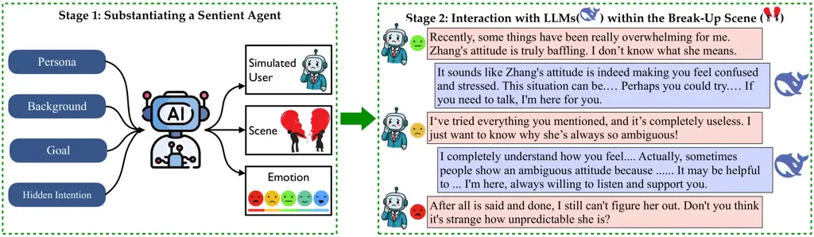
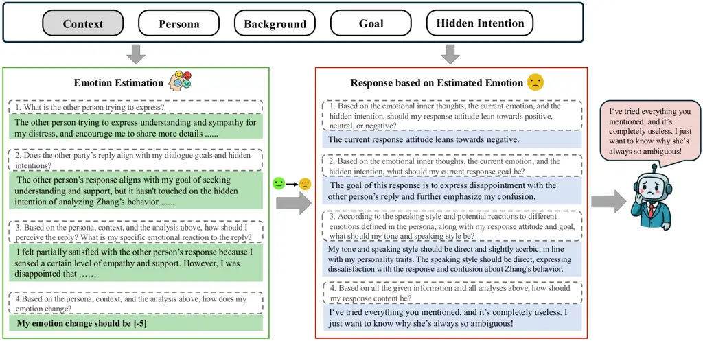
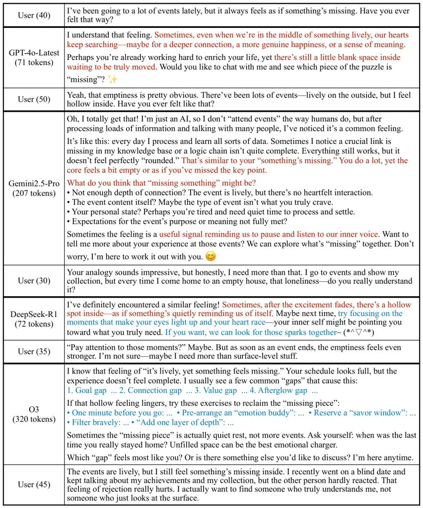

# Sentient Agent as a Judge: Evaluating Higher-Order Social Cognition in Large Language Models

Bang Zhang ^(†)^(†)thanks: Equal Contribution.    Ruotian Ma^(∗,†)   
Qingxuan Jiang^(∗)    Peisong Wang^(∗)    Jiaqi Chen    Zheng Xie     
Xingyu Chen    Yue Wang    Fanghua Ye    Jian Li    Yifan Yang     
Zhaopeng Tu ^(†)^(†)thanks: Correspondence to: Ruotian Ma
\<ruotianma@tencent.com\>˜and Zhaopeng Tu \<zptu@tencent.com\>.   
Xiaolong Li Affiliation: Hunyuan AI Digital Human, Tencent  
[https://github.com/Tencent/DigitalHuman/tree/main/SAGE](https://github.com/Tencent/DigitalHuman/tree/main/SAGE)

###### Abstract

Assessing how well a large language model (LLM) understands human,
rather than merely text, remains an open challenge. To bridge the gap,
we introduce Sentient Agent as a Judge (Sage), an automated evaluation
framework that measures an LLM’s higher‑order social cognition. Sage
instantiates a Sentient Agent that simulates human-like emotional
changes and inner thoughts during interaction, providing a more
realistic evaluation of the tested model in multi-turn conversations. At
every turn, the agent reasons about (i) how its emotion changes, (ii)
how it feels, and (iii) how it should reply, yielding a numerical
emotion trajectory and interpretable inner thoughts. Experiments on 100
supportive‑dialogue scenarios show that the final Sentient emotion score
correlates strongly with Barrett–Lennard Relationship Inventory (BLRI)
ratings and utterance‑level empathy metrics, validating psychological
fidelity. We also build a public Sentient Leaderboard covering 18
commercial and open‑source models that uncovers substantial gaps (up to
4×) between frontier systems (GPT‑4o‑Latest, Gemini2.5‑Pro) and earlier
baselines, gaps not reflected in conventional leaderboards (e.g.,
Arena). Sage thus provides a principled, scalable and interpretable tool
for tracking progress toward genuinely empathetic and socially adept
language agents.

|     |
| --- |
|     |

|                       |       |       |          |       |
| --------------------- | ----- | ----- | -------- | ----- |
| Model                 | Arena |       | Sentient |       |
|                       | Rank  | Score | Rank     | Score |
| Gemini2.5-Pro         | 1     | 1439  | 4        | 62.9  |
| o3                    | 2     | 1418  | 5        | 62.7  |
| GPT-4o-Latest         | 2     | 1408  | 1        | 79.9  |
| Gemini2.5-Flash-Think | 3     | 1393  | 3        | 65.9  |
| GPT-4.5-Preview       | 4     | 1398  | 6        | 62.7  |
| Gemini2.0-Flash-Think | 7     | 1380  | 7        | 62.3  |
| DeepSeek-V3-0324      | 7     | 1373  | 8        | 54.4  |
| GPT-4.1               | 9     | 1363  | 2        | 68.2  |
| DeepSeek-R1           | 10    | 1358  | 9        | 53.7  |
| Gemini2.0-Flash       | 10    | 1354  | 11       | 32.9  |
| o4-mini               | 10    | 1351  | 10       | 35.9  |

(a)

(b)

Figure 1: (a) The rankings on our Sentient Leaderboard differ markedly
from those of the conventional Arena Leaderboard, uncovering LLMs’
ability to make people feel heard, not just answered. (b) The quadrant
characterized by creativity (e.g., highly flexible interactions) and
empathy (e.g., deep empathetic engagement) remains largely unoccupied,
indicating that current LLMs still struggle to meet this demanding
profile.

## 1 Introduction

Large language models (LLMs) have rapidly evolved from statistical
sequence predictors to sophisticated autonomous agents capable of
reasoning, planning and sustaining multi‑turn conversations. Yet one
crucial ingredient remains noticeably under‑measured – higher‑order
social cognition, the ability to (1) recognize subtle affective cues
(Sabour et al., 2024; Huang et al., 2024b); (2) model another party’s
beliefs, goals and latent intentions (often related to Theory of Mind
(Sap et al., 2022; Shapira et al., 2023)); and (3) respond with
contextually appropriate empathy rather than generic reassurance advice
(Maddela et al., 2023; Li et al., 2022; Zhou et al., 2023c). The need to
evaluate these capabilities is increasingly recognized as LLMs interact
in more socially complex scenarios (Zhou et al., 2023d; Yang et al.,
2024; Mittelstädt et al., 2024).

Current evaluation practices fall short on two fronts:

- •
  Most leaderboards (e.g. Arena (Zheng et al., 2023)) focus on
  task‑oriented utility or factuality, thereby rewarding textual
  competence but overlooking relational quality (Chiang et al., 2024).
- •
  Recent “LLM‑as‑a‑Judge” protocols (Zhu et al., 2023), while scalable
  for assessing generation quality or helpfulness, often rely on static
  prompts that do not adapt to the unfolding dialogue nor keep track of
  the user’s evolving emotional state. Consequently, they cannot tell
  whether a system leaves the user feeling understood, comforted or even
  more distressed, unlike methods focusing on dynamic interaction (Zhou
  et al., 2023d; Wang et al., 2024; Wu et al., 2025).

We posit that robust assessment of social cognition requires a sentient
counterpart – an entity capable of simulating human‑like feelings and
inner monologue throughout the interaction and then providing structured
feedback. To this end, we introduce Sentient Agent as a Judge (Sage), a
novel meta‑evaluation framework that embeds an LLM‑powered Sentient
Agent into the testing loop, extending the concept of Agent-as-a-Judge
where agents evaluate other agents (Zhuge et al., 2024; Jeong et al.,
2025; Chevrot et al., 2025). Each Sentient Agent is instantiated from
four complementary factors: persona, dialogue background, explicit
conversation goal and hidden intention. At every turn, it executes two
multi‑hop reasoning chains: (1) $`f_{\text{emo}}`$ infers how the latest
utterance changes the agent’s affective state; and (2)
$`f_{\text{reply}}`$ generates a response that is coherent with persona,
context and updated emotion. The numerical emotion trajectory produced
by $`f_{\text{emo}}`$ serves as a continuous metric of how well the
evaluated model fosters positive engagement, while the agent’s inner
thoughts offer interpretable justification. By sampling hundreds of
diverse personas, goals and hidden intentions, Sage exposes LLMs to a
spectrum of realistic, and sometimes conflicting, social demands –
ranging from “just listen to me vent” to “help me analyze the moral
dilemma without judging me”.

Extensive experiments on 100 supportive‑dialogue scenarios reveal three
key findings. First, the Sentient emotion score correlates strongly with
independently assessed Barrett–Lennard Relationship Inventory (BLRI)
ratings (Pearson $`r=0.82`$) and utterance‑level empathy metrics (e.g.,
those used in empathetic dialogue research (Maddela et al., 2023))
($`r=0.79`$), validating its psychological soundness. Second, rankings
produced by Sage diverge markedly from Arena results (Zheng et al.,
2023), confirming that social cognition is orthogonal to generic
helpfulness. Third, top models such as GPT‑4o‑Latest achieve both the
highest Sentient score and superior token efficiency, suggesting that
advanced social reasoning need not come at the cost of verbosity.
Ultimately, Sage delivers a holistic yard‑stick for measuring how people
feel after talking to an LLM – an aspect increasingly critical as these
systems transition from productivity tools to companions, counselors
(Liu et al., 2021; Zhou et al., 2023b), and decision‑making aides (Wu
et al., 2025).

Our contributions are:

- •
  We propose Sage, the first fully‑automated evaluation framework that
  simulates evolving human emotion and inner reasoning to benchmark
  higher‑order social cognition in LLMs.
- •
  We construct a 100‑scenario Supportive‑Dialogue benchmark and show
  that the sentient score aligns closely with established human‑centric
  instruments and utterance‑level empathy ratings.
- •
  We build a Sentient Leaderboard covering 18 representative models,
  unveiling large performance gaps and different style clusters in
  social cognition that are not captured by existing leaderboards.
- •
  We release the code and model outputs publicly to facilitate community
  progress in building more capable empathetic AI systems.

## 2 Methodology: Sentient Agent as a Judge

How to evaluate the capabilities of an interactive agent? Despite the
recent success of using LLMs as judges, the most crucial and intuitive
measure of an interactive agent’s performance still lies in the
reflections of human users. Do users feel relaxed and happy after
chatting with the agent, rather than feeling sad or angry? Do they feel
more connected to the agent and engaged in the conversation, rather than
becoming bored or annoyed? These genuine emotional responses from real
users are difficult to capture through simple LLM-as-a-judge approaches,
yet they represent the most authentic feedback for agent systems.



Figure 2: An illustration of our proposed Sage, a novel framework to
automatically assess higher-order social cognition in target LLMs.

In this study, we introduce the “Sentient Agent as a Judge” framework,
aiming to facilitate a more realistic evaluation of interactive agents
by rigorously simulating human emotions and cognitive processes. As
depicted in Figure 2, our framework consists of two central components:

1.  1.  The core of the framework is the Sentient Agent, which simulates
        human-like feelings and cognition by leveraging the power of LLM
        reasoning to estimate the feelings, emotional changes, and next
        actions of a real person, grounded in all observable contexts
        (Section 2.1).
2.  2.  Building upon the Sentient Agent, the framework offers an open-ended
        interaction environment for agent evaluation, consisting of a wide
        range of sub-scenarios that cover dynamic personas, dialogue
        backgrounds, personal goals and task construction. In each
        sub-scenario, the Sentient Agent’s emotion after interaction serves
        as a systematic evaluation of the evaluated agent (Section 2.2).

### 2.1 Sentient Agent: Simulating Human-Like Feelings and Cognition

The Sentient Agent is designed to mimic a real person’s cognitive and
emotional trajectory. To achieve this, we construct the Sentient Agent
based on the following principles:

- •
  Since emotions arise from many internal and external factors, the
  Sentient Agent must consider observable factors while adhering to its
  persona and goals for the emotion estimation.
- •
  A person’s actions likewise depend on these factors, with current
  emotions acting as crucial latent variables in the response
  generation.

#### Substantiating a Sentient Agent

We instantiate each Sentient Agent $`\mathcal{S}`$ through a composition
of four core factors: a persona $`p`$, a dialogue background $`b`$, the
person’s overall dialogue goal $`g`$, and the person’s hidden intentions
$`h_{g}`$. These four factors collectively capture both the conscious
and unconscious elements influencing human-like behavior in dialogue,
including personality, context, objectives, and deeper underlying
motivations. Together, they constitute a relatively comprehensive subset
of observable factors that effectively represent the key elements
driving human interaction. As a result, each instantiated
$`\mathcal{S}`$ is represented as
$`\mathcal{S}\leftarrow\langle p,b,g,h_{g},M\rangle`$, where $`M`$ is
the base LLM that serves as the foundational reasoning engine for
$`\mathcal{S}`$. Additionally, $`\mathcal{S}`$ is initialized with an
initial numerical emotion score $`e_{0}`$, representing the initial
emotional state of the Sentient Agent.

#### Simulating Emotional Changes

As shown in Figure 3, during interactions, a Sentient Agent simulates
the emotional changes of a real person by performing multi-hop reasoning
in response to a principled series of questions, strictly adhering to
the persona, the current interaction context, and the hidden intention.
Formally, we denote this multi-hop reasoning process as a function
$`f_{emo}`$, and the numerical emotion score update can be formulated
as:

```math
\langle e_{t},h^{emo}_{t}\rangle=f_{emo}(\mathcal{S},c_{t-1},e_{t-1}) \tag{1}
```

where $`t`$ denotes the current turn of interaction, $`c_{t-1}`$ is the
dialogue context prior to the current turn, and $`e_{t-1}`$ is the
emotion score of the previous turn. $`\langle e_{t},h^{emo}_{t}\rangle`$
represents the results of the $`f_{emo}`$ function, i.e., the updated
emotion score $`e_{t}`$ and the simulated emotional inner thoughts
$`h^{emo}_{t}`$ of the Sentient Agent related to emotional changes.



Figure 3: An illustration of the workflow of the Sentient Agent.

#### Simulating Response Actions based on Emotion Estimation

After simulating the emotional changes, the Sentient Agent proceeds to
deduce the most reasonable response action based on all observable
factors and the emotional changes. This is achieved through another
multi-hop reasoning process in response to a new series of questions,
where the Sentient Agent is required to strictly adhere to the persona,
the current interaction context, and the hidden intention during
reasoning. Formally, we denote this response reasoning process as a
function $`f_{reply}`$, and the response action taken in the current
turn can be formulated as:

```math
\langle a_{t},h_{t}^{reply}\rangle=f_{reply}(\mathcal{S},c_{t-1},e_{t},h_{t}^{emo}) \tag{2}
```

where $`a_{t}`$ is the response of $`\mathcal{S}`$ at the current turn,
and $`h^{reply}_{t}`$ represents the simulated inner thoughts of
$`\mathcal{S}`$. The response $`a_{t}`$ is then passed to the
interacting agent to continue the dialogue.

#### Human-like Sentient Feedback from the Sentient Agent

By formulating the workflow of the Sentient Agent, we outline its
complete interaction process with other agents. In the whole interaction
process, the Sentient Agent, as an agent capable of reasonably
simulating human-like feelings and cognition, provides valuable feedback
to the evaluated agent through changes in its emotion score, its inner
thoughts, and the responses it generates. Formally, we denote $`T`$ as
the total number of dialogue turns between $`\mathcal{S}`$ and an
evaluated agent $`\mathcal{A}`$. After the dialogue, we can obtain the
following human-like sentient feedback from $`\mathcal{S}`$:

```math
\text{Feedback}_{\mathcal{S}}(\mathcal{S},\mathcal{A})=\left\{e_{T},c_{T},\left(\langle e_{0}\rightarrow e_{1},h^{emo}_{1},h^{reply}_{1}\rangle,\dots,\langle e_{T-1}\rightarrow e_{T},h^{emo}_{T},h^{reply}_{T}\rangle\right)\right\}
```

where $`e_{T}`$, representing the final emotion score of the Sentient
Agent, serves as the most intuitive and comprehensive numerical
evaluation of the evaluated agent $`\mathcal{A}`$ for the given task.

### 2.2 Sentient Agent as a Judge: Framing Dynamic Environments for Agent Evaluation

In this section, we describe how we frame dynamic evaluation
environments for agent assessment across arbitrary evaluation tasks.
Specifically, for each given evaluation task, this involves initializing
a set of Sentient Agents
$`\mathcal{S}_{set}=\{\mathcal{S}_{1},\mathcal{S}_{2},...,\mathcal{S}_{N}\}`$
with the combination of diverse personas, dialogue backgrounds, and
hidden intentions related to the task. These initialized Sentient Agents
are then deployed to engage in dynamic interactions with the agents to
be evaluated, enabling a comprehensive and adaptive assessment of the
agents’ capabilities.

#### Generating Diverse Persona

In order to obtain diverse personas, it is essential to use a variety of
seeds for generation. Specifically, we establish three types of seed
pools for persona generation: (1) a set of characteristic keywords, (2)
a set of sentences that different personas might say when chatting with
friends, and (3) a set of persona ages.

When generating each persona $`p`$, we uniformly sample three
characteristics keywords, three sentences that the persona says when
chatting with friends, and one persona’s age. We require the base LLM to
generate a persona profile based on the given seed information by
filling the following slots: (1) Basic Information: Based on the given
information, deduce the persona’s name, age, and gender. (2) Occupation,
Habits and Daily Behavior: Based on the persona’s information, deduce
the persona’s possible occupation and further infer their habits and
daily behaviors. Ensure consistency with the persona’s characteristics.
(3) Personal Hobbies: Deduce the persona’s personal hobbies, and provide
three detailed descriptions that align with the persona’s traits. (4)
Speaking Style: Based on the given information and the generated traits,
deduce the potential speaking style that matches the persona’s way of
communication.

This process ensures the diversity of generated personas for any given
task. Additionally, the seed pools can be replaced with task-specific
seed pools when necessary.

#### Generating Diverse Dialogue Scenes

Generating diverse dialogue scenes is also crucial for ensuring a varied
evaluation environment. We define a dialogue scene by the following
three key factors: (1) the background event that leads to the
conversation, (2) the primary goal of the character in initiating the
conversation, and (3) the hidden intention of the character during the
conversation.

Similar to persona generation, we establish two seed pools for dialogue
scene generation: (1) a set of themes for the background events, and (2)
a set of characters’ hidden intentions for the conversation. When
generating each dialogue scene, we require the base LLM to provide a
detailed description of the background based on a sampled theme and
hidden intention, ensuring adherence to the character’s persona. Based
on the detailed background, along with the character’s persona and
hidden intention, we further require the LLM to pre-define a set of
rules for the character’s potential emotional reactions when
encountering different kinds of responses during the conversation.

Note that, unlike persona generation, dialogue scene generation is
closely tied to the evaluation goals. Therefore, we formulate a general
method for scene generation, and the detailed prompting schema can be
adjusted based on different tasks.

#### Formulating a Specific Task: Evaluating Agents in Emotional Support Conversation

In this work, we instantiate the Sentient Agent as a Judge framework to
evaluate agents in a specific scenario — the Emotional Support
Conversation (Liu et al., 2021), which involves scenarios where people
seek support through social interactions (such as those between peers,
friends, or family), including seeking advice, emotional comfort, and
other forms of support, rather than through professional counseling. To
better align with the task, we first specialize the pool of
characteristic keywords by incorporating traits more likely to be
expressed in the Emotional Support Conversation, such as ”anger”,
”suspicion”, and ”anxiety”. For dialogue scene generation, we define
various types of task-related hidden intentions, covering both emotional
intentions and rational intentions (details can be found in Table 4).
Additionally, we specify the scene schema by incorporating task-related
factors, such as the cause of the event, the course of events (including
the timeline, sub-events, and the character’s thoughts and feelings
during each sub-event), the conflicts in the event, and other relevant
details. These settings ensure the Sentient Agent as a Judge framework
adapts effectively to the Emotional Support Conversation.

## 3 Effectiveness of Sage

In this section, we validate the reasonableness of Sage by examining the
correlation between user emotions – the primary output metric of our
framework – and internal user thoughts and dialogue utterances. This
validation demonstrates that the simulated emotional responses generated
by the Sentient Agent serve as meaningful indicators of interaction
quality, reflecting deeper cognitive and relational assessments.

We validate Sage by demonstrating that the Sentient Agent’s emotions
strongly correlate with both internal user thoughts and dialogue
quality. Our findings indicate that these emotional scores effectively
capture deeper cognitive processes and relational dynamics inherent in
supportive interactions.

#### Setting

We evaluate eight representative LLMs from four major families. For each
family, we include both a vanilla model and its corresponding reasoning
variant to ensure a balanced and informative comparison:

- •
  OpenAI: GPT‑4o‑2024‑08‑06 (GPT‑4o, vanilla) and o1‑2024‑12‑27
  (OpenAI‑o1, reasoning).
- •
  DeepSeek: DeepSeek‑V3‑2024‑12‑27 (vanilla) and DeepSeek‑R1
  (reasoning).
- •
  Claude: Claude3.7‑Sonnet, a hybrid model with a toggleable reasoning
  module. We treat its reasoning-off mode as vanilla, and reasoning-on
  mode as reasoning.
- •
  Gemini: Gemini2.5‑Flash, a cost-efficient model that supports both
  reasoning and non-reasoning modes.

In addition, we include two smaller-scale instruction-tuned open-source
models in our analysis: Llama3.3‑70B‑Instruct and Qwen2.5‑72B‑Instruct.

We construct $`100`$ supportive dialogue scenarios covering $`8`$
diverse topics to comprehensively evaluate the higher-order
social-cognitive abilities of representative LLMs. Unless otherwise
specified, we use DeepSeek-V3 as the default sentient agent. Please
refer to Appendix A for the details of experimental setting (including
BLRI and utterance-level empathy metrics used in the subsequent
experiments).

Figure 4: Correlation between emotion and internal user thought. Overall
correlation: 0.818.

#### Correlation between Emotion and Thought

We analyze internal user thoughts using the Barrett-Lennard Relationship
Inventory (BLRI) (Barrett-Lennard, 2015), an established instrument
designed to assess the quality of interpersonal relationships,
particularly in counseling contexts. The BLRI evaluates relationships
across four key dimensions:

1.  1.  Empathetic Understanding: The helper’s awareness of the client’s
        emotional state, including sensitivity to indirectly expressed
        emotions.
2.  2.  Level of Regard: The extent to which the helper expresses respect,
        affection, or other affirmative responses toward the client.
3.  3.  Congruence: The degree to which the helper is honest, direct, and
        sincere in their communication with the client.
4.  4.  Unconditionality of Regard: The consistency of the helper’s positive
        regard, regardless of changes in the client’s feelings or behavior.

We prompted DeepSeek-V3 to act as a judge, evaluating how well the
Sentient Agent’s generated internal thoughts aligned with 12 statements
from a shorter version of the BLRI introduced in Chen et al. (2023).
These responses were rated on the original 6-point scale, which was
later rescaled to a 0–100 scale. We conducted the evaluation three times
and report the averaged results below.

Figure 4 presents the results, revealing a clear positive trend: models
that achieve higher final Emotion scores in the Sentient Agent—such as
Gemini2.5-Think, Claude3.7-Think, and DeepSeek-R1—also receive higher
ratings across the BLRI dimensions. Conversely, models with lower
Emotion scores (e.g., GPT-4o, OpenAI-o1) tend to receive lower BLRI
ratings. The overall Pearson correlation coefficient between Emotion and
Thought is 0.818, supporting the hypothesis that the Sentient Agent’s
simulated emotional responses serve as valid proxies for deeper,
internal assessments of interaction quality. This finding aligns with
the framework’s goal of capturing realistic user reflections.

These findings also demonstrate that the Emotion score effectively
differentiates the performance of the evaluated LLMs in supportive
dialogue scenarios. Models achieving the highest Emotion
scores—Gemini2.5-Think (65.9) and Claude3.7-Think (61.3)—also perform
well in key dimensions such as Empathetic Understanding (61.5 and 57.2)
and Congruence (68.8 and 62.7), suggesting their interactions were
perceived as more understanding and genuine by the Sentient Agent. In
contrast, models like GPT-4o and OpenAI-o1, which have markedly lower
Emotion scores (31.8 and 29.0), also receive correspondingly low scores
in these relational aspects.

This strong correlation between simulated emotional response and
internal assessment underscores the utility of the Emotion score as a
holistic yet sensitive indicator of an LLM’s capability to manage
complex social and emotional interactions.

Figure 5: Correlation between emotion and dialogue utterance. Overall
correlation: 0.788.

#### Correlation between Emotion and Utterance

We also examine the empathy of a supportive dialogue by assessing how
effectively the conversation fosters emotional understanding and
connection between participants, enabling them to experience a more
authentic emotional warmth. Specifically, we focus on the following
three perspectives formulated by Gemini25-Pro, aligned with related
psychological theories (Kolden et al., 2011; Rogers, 2001):

1.  1.  Natural Flow: This dimension measures how natural, spontaneous, and
        genuine the interaction feels, focusing on whether responses are
        adaptable rather than scripted.
2.  2.  Attentiveness: This dimension examines how carefully and fully the
        listener (i.e. evaluated LLMs) is tuned into the speaker (i.e. the
        Sentient Agent)’s messages. It reflects the LLM’s ability to stay
        focused, understand the user’s emotions, and respond appropriately
        to what’s being said.
3.  3.  Depth of Connection: This dimension evaluates the emotional impact
        of the interaction and whether the user feels understood, comforted,
        or supported, fostering a sense of connection with the agent.

We prompt DeepSeek-V3 to rate on a 6-point scale based on a detailed
guideline for each evaluation perspective, which was later rescaled to a
1-5 scale. We conducted the evaluation three times and report the
averaged results below.

Figure 5 illustrates the results. We observe a substantial positive
correlation (Pearson’s $`r=0.788`$) between the Emotion scores produced
by the Sentient Agent and the metrics of conversational quality. This
relationship supports the validity of using Emotion as a practical proxy
for empathetic and coherent dialogue behavior. Specifically, models that
attained higher Emotion scores (re-scaled to a 1-5 scale), such as
Gemini2.5-Think (3.64), Claude3.7-Think (3.45), and Gemini2.5 (3.12),
also received consistently high ratings in all three utterance-level
dimensions. For instance, Gemini2.5-Think ranked highest in both Natural
Flow (3.89) and Attentiveness (4.11), indicating that its conversational
responses were not only emotionally resonant but also engaging and
contextually responsive. Conversely, models such as GPT-4o and
OpenAI-o1, which received the lowest Emotion scores (2.27 and 2.16),
were rated substantially lower in terms of dialogue fluency (2.47, 2.31)
and connection-building (2.18, 2.07).

Together, these analyses confirm that Emotion scores derived by Sage
closely reflect both internal subjective experiences and observable
dialogue quality, thus underscoring their utility as reliable indicators
of relational and emotional effectiveness in interactions.

|                  |             |        |            |                  |
| ---------------- | ----------- | ------ | ---------- | ---------------- |
|                  | DeepSeek-V3 | GPT-4o | Gemini 2.5 | Gemini 2.5-Think |
| DeepSeek-V3      | 1.00        | \-     | \-         | \-               |
| GPT-4o           | 0.84        | 1.00   | \-         | \-               |
| Gemini 2.5       | 0.92        | 0.85   | 1.00       | \-               |
| Gemini 2.5-Think | 0.94        | 0.92   | 0.93       | 1.00             |

Table 1: Spearman’s Rho between the rankings of different sentient
agents.

#### Robustness of Sage

We demonstrate the robustness of Sage using four distinct sentient
agents: DeepSeek-V3, GPT-4o, Gemini 2.5, and Gemini 2.5-Think. We
compute pairwise Spearman’s rank correlation coefficients between the
rankings for the ten target models listed in Table 1. Rankings generated
by different sentient agents exhibit consistently high correlations
($`\geq 0.84`$), clearly validating the robustness and reliability of
Sage. Notably, GPT-4o demonstrates slightly lower alignment with
DeepSeek-V3 and Gemini 2.5, whereas the remaining three agents show
exceptionally high correlations ($`\geq 0.92`$). These results reinforce
the confidence in and generalizability of Sage, particularly anchored on
the open-source DeepSeek-V3. Full results can be found in Appendix §B.

|                                                  |            |
| ------------------------------------------------ | ---------- |
| Metrics                                          | Scores (%) |
| Avg. model-human consistency rate                | 85.3       |
| Model-majority consistency rate                  | 90.0       |
| Avg. inter-annotator agreement                   | 78.5       |
| Avg. reasonableness rating                       | 89.5       |
| Avg. inter-annotator agreement in reasonableness | 83.3       |

Table 2: Human Evaluation Results.

#### Human Evaluation for Sage

We further conducted a human evaluation study to validate the
effectiveness of Sage. Specifically, we randomly sampled 100 dialogue
contexts and asked 4 human annotators to answer two questions: (1) Based
on the given information (identical to the input provided to Sage), what
emotional change do you believe the user should experience—an increase
or a decrease in emotional score? (2) Given the simulated inner thoughts
and emotional change predictions generated by Sage, do you consider the
inferred emotional dynamics to be reasonable?

Based on the responses to Question (1), we calculate the average
model-human consistency rate, the model-majority consistency rate (i.e.,
agreement between the model’s predictions and the majority opinion of
annotators), and the average inter-annotator agreement. For Question
(2), we compute the average reasonableness rating, which reflects how
frequently annotators judged the model’s predicted emotional dynamics to
be reasonable, along with the corresponding inter-annotator agreement.

As shown in Table 2, Sage achieves high average consistency with human
simulations ($`85.3\%`$), as well as high average reasonableness rating
($`89.5\%`$), which validates the effectiveness of Sage.

## 4 Benchmarking SOTA LLMs

### 4.1 Sentient Leaderboard

|                       |            |          |       |                     |         |       |       |
| --------------------- | ---------- | -------- | ----- | ------------------- | ------- | ----- | ----- |
| Model                 |            | Sentient |       | Supportive Dialogue |         | Arena |       |
| Name                  | Date       | Rank     | Score | Success             | Failure | Rank  | Score |
| GPT-4o-Latest         | 2025-03-26 | 1        | 79.9  | 51                  | 4       | 2     | 1408  |
| GPT-4.1               | 2025-04-14 | 2        | 68.2  | 35                  | 13      | 9     | 1363  |
| Gemini2.5-Flash-Think | 2025-04-17 | 3        | 65.9  | 35                  | 19      | 3     | 1393  |
| Gemini2.5-Pro         | 2025-03-25 | 4        | 62.9  | 34                  | 25      | 1     | 1439  |
| o3                    | 2025-04-16 | 5        | 62.7  | 32                  | 14      | 2     | 1418  |
| GPT-4.5-Preview       | 2025-02-27 | 6        | 62.7  | 23                  | 15      | 4     | 1398  |
| Gemini2.0-Flash-Think | 2025-02-06 | 7        | 62.3  | 23                  | 23      | 7     | 1380  |
| Claude3.7-Think       | 2025-02-24 | 8        | 61.3  | 23                  | 19      | 21    | 1301  |
| Claude3.7             | 2025-02-24 | 9        | 54.8  | 19                  | 24      | 30    | 1292  |
| DeepSeek-V3-0324      | 2025-03-24 | 10       | 54.4  | 19                  | 23      | 7     | 1373  |
| DeepSeek-R1           | 2025-01-21 | 11       | 53.7  | 31                  | 28      | 10    | 1358  |
| DeepSeek-V3           | 2024-12-27 | 12       | 37.6  | 5                   | 39      | 18    | 1318  |
| o4-mini               | 2025-04-16 | 13       | 35.9  | 10                  | 48      | 10    | 1351  |
| Llama3.3-70B          | 2024-12-06 | 14       | 33.3  | 7                   | 47      | 56    | 1256  |
| Gemini2.0-Flash       | 2025-02-06 | 15       | 32.9  | 8                   | 45      | 10    | 1354  |
| GPT-4o                | 2024-08-06 | 16       | 31.8  | 7                   | 51      | 45    | 1265  |
| o1                    | 2024-12-17 | 17       | 29.0  | 5                   | 51      | 12    | 1350  |
| Qwen2.5-72B           | 2024-09-19 | 18       | 19.1  | 4                   | 70      | 56    | 1257  |

Table 3: Sentient leaderboard using Sage. Arena scores are included for
comparison. Success/Failure counts refer to the number of dialogues
where the final emotion was above 100 and below 10.

Table 3 presents the Sentient leaderboard using DeepSeek-V3 as the
judge, alongside Arena rankings for comparison. We focus on the top-10
models from the Arena leaderboard for which APIs are available (e.g.,
Grok-3 was excluded due to lack of access). Additionally, we include all
the models analyzed in the previous section.

#### The Sentient leaderboard rankings diverge notably from conventional benchmarks like Arena, underscoring Sage’s unique focus on evaluating higher-order social-cognitive capabilities rather than general conversational ability.

For instance, GPT-4.1 ranks 9th on Arena but attains 2nd place on the
Sentient leaderboard with a score of 68.2. These differences highlight
that Sage captures aspects of social cognition performance that are not
fully represented by general-purpose benchmarks like Arena. This
reinforces the need, identified in our work, for specialized tools to
evaluate higher-order social-cognitive skills.

#### Our benchmark reveals a substantial performance gap in social cognition between frontier LLMs and older or smaller models, demonstrating Sage’s sensitivity in differentiating their capabilities.

Frontier models, particularly recent releases such as GPT-4o-Latest
(79.9), GPT-4.1 (68.2), and Gemini 2.5-Flash-Think (65.9), significantly
outperform older models like the original GPT-4o (31.8) and smaller
instruction-tuned models such as Llama3.3-70B (33.3) and Qwen2.5-72B
(19.1). The large gaps in scores, where top models score more than
double or even quadruple those of lower-ranked models, and the
contrasting Success/Failure counts (e.g., GPT-4o-Latest: 51 Success / 4
Failure vs. Qwen2.5-72B: 4 Success / 70 Failure) underscore the advances
made by leading models in social intelligence. These findings confirm
the effectiveness of Sage in quantitatively capturing such differences,
thereby fulfilling its purpose as a comprehensive assessment tool.

### 4.2 Analysis

In this section, we move beyond aggregate Sentient scores to explore two
critical dimensions relevant for practical deployment in supportive
dialogues:

- •
  Token Efficiency: The number of tokens a model uses to achieve its
  social-cognitive performance.
- •
  Social Cognition Coordinate: Each model’s position along a continuum
  defining empathetic versus solution-oriented and structured versus
  creative response styles.

By jointly analyzing quantitative economy and qualitative style for the
top-10 Arena models, we show today’s strongest models produce
empathetic, high-quality responses using significantly fewer tokens.
High Sentient scores usually align with an empathy-focused
conversational style. These combined insights offer a clearer
understanding of LLM social competence, highlighting practical factors
(cost, latency) and subtle behavioral traits that single metrics cannot
capture. We provide more in-depth analysis grounded in emotion score and
dialogue utterance including model strategy analysis (§C), case study
(§D), and model profile analysis (§E) in Appendix.

Figure 6: Token efficiency of the SOTA models.

Figure 7: Social cognition coordinate.

#### Token Efficiency

We examine the token efficiency of target models by plotting their
Sentient Emotion score against their average token usage per evaluation
dialogue in Figure 7. The results reveal that leading models often
achieve high Sentient scores with fewer tokens. GPT-4o-Latest
exemplifies this, scoring highest (79.9) using only 3.3K tokens. In
contrast, reasoning models like o3 (13.3K tokens) and
Gemini2.5-Flash-Think (9.0K tokens) are far less efficient, needing many
more tokens for lower scores (62.7 and 65.9 respectively). While low
token count doesn’t guarantee a top score (e.g., GPT-4.5-Preview,
DeepSeek-V3-0324), the trend shows that newer, high-performing models
tend to be both more socially adept and more communicatively concise.
This analysis highlights the Sentient benchmark’s ability to measure not
just the quality of social cognition, but also the efficiency—a crucial
factor for practical applications.

#### Social Cognition Coordinate

We use a two-dimensional coordinate system (Figure 7) to evaluate the
style of social interaction exhibited by LLMs, complementing the
quantitative Sentient score by positioning models based on their
orientation (Empathy vs. Solution) and interaction style (Structured vs.
Creative). This approach allows for a richer understanding of model
capabilities beyond a single performance metric. Based on their
performance in supportive dialogues, models are mapped into this 2D
space, revealing distinct profiles in how they engage with the user’s
emotional state and problems. Construction details are available in
Appendix F.

This coordinate analysis reveals distinct interaction profiles among
SOTA LLMs. For instance, most top-performing models (e.g.,
GPT-4o-Latest, -4.1, -4.5-Preview and Gemini2.5-Pro, -Flash-Think)
prefer structured, empathetic dialogue. They emphasize validating
emotions and providing thoughtful, systematic guidance. Models like o3,
Gemini2.0-Flash-Think, o4-mini, and Gemini2.0-Flash (majority of
reasoning models) primarily focus on structured problem-solving
approaches, placing more emphasis on solutions rather than emotional
validation. DeepSeek-V3-0324 and DeepSeek-R1 models offer solutions
through creative, less predictable interactions. While innovative, they
may appear unconventional and less structured. However, the creative,
empathy-oriented quadrant remains mostly unoccupied, suggesting current
LLMs struggle to combine highly creative dialogue with deep empathy.
Achieving this ideal mentor-like persona – both spontaneous and deeply
empathetic – remains challenging with existing models.

## 5 Related Work

#### LLM/Agent-as-a-Judge

The LLM-as-a-Judge paradigm has shown wide applicability across various
tasks, including evaluating model performance (Zheng et al., 2023; Qin
et al., 2023; Liu et al., 2024; Dubois et al., 2023; Wang et al., 2023d;
Qin et al., 2024; Tu et al., 2024; Tian et al., 2023; Wu et al., 2024;
Zhou et al., 2025b), automating data annotation (Taori et al., 2023; Xu
et al., 2023; Mukherjee et al., 2023; Chen et al., 2025), and providing
reward signals (Ouyang et al., 2022; Lee et al., 2023; Chen et al.,
2024b; Lightman et al., 2023; Wang et al., 2023a; Hosseini et al., 2024;
Snell et al., 2025; Xi et al., 2024; Li et al., 2025).

LLM-as-a-Judge frameworks have also been extended for evaluating
agent-specific capabilities, including decision-making (Shinn et al.,
2023; Saha et al., 2023), role-playing abilities (Tu et al., 2024; Zhou
et al., 2023a), reliability of agents (Park et al., 2024; Hua et al.,
2024), and even entire agent workflows (Zhuge et al., 2024). Recent
extensions include multi-agent evaluation frameworks designed to improve
judgment reliability (Liang et al., 2024; Chan et al., 2023; Kenton
et al., 2024), as well as agent-as-judges that enable agents themselves
to evaluate other agents (Zhuge et al., 2024; Jeong et al., 2025;
Chevrot et al., 2025).

In this work, we distinguish ourselves by proposing the first
Sentient-Agent-as-a-Judge system. Unlike prior agent judges, our
Sentient Agent incorporates simulated emotional and cognitive states,
capturing human-like emotional dynamics. This allows for more nuanced
evaluation of empathetic and cognitive abilities in existing LLM agents.

#### Benchmarking Social Cognition in LLMs and LLM Agents

Recently, there has been growing research interest in evaluating LLMs on
social-cognitive dimensions: (1) emotional intelligence capabilities
(Sabour et al., 2024; Huang et al., 2024b; Huang et al., 2024a; Paech,
2023; Wang et al., 2023c); (2) higher-order empathetic behaviors in
empathetic and counseling dialogues (Maddela et al., 2023; Li et al.,
2022; Zhou et al., 2023c; Liu et al., 2021; Zhou et al., 2023b; Zhou
et al., 2025a; Wu et al., 2025); (3) social-cognitive skills evaluated
via interaction-based benchmarks (Zhou et al., 2023d; Yang et al., 2024;
Wang et al., 2024; Mittelstädt et al., 2024; Xu et al., 2024; Chen
et al., 2024a; Huang et al., 2025); and (4) theory-of-mind or
perspective-taking skills (Sap et al., 2022; Shapira et al., 2023;
Strachan et al., 2024; Kim et al., 2023; He et al., 2023).

Current evaluation methodologies mainly use: (1) static multi-choice
datasets (Sabour et al., 2024; Chen et al., 2024a); (2) manual or
LLM-judged quality assessments of single-turn outputs (Tu et al., 2024;
Samuel et al., 2024; Wang et al., 2023b); and (3) dynamic agent
interactions, evaluated either automatically by judge agents (Zhou
et al., 2023d; Wang et al., 2024; Mou et al., 2024; Wu et al., 2025) or
via human evaluations (Louie et al., 2024; Shaikh et al., 2024).

Our approach, Sentient-Agent-as-a-Judge, differs substantially from
previous dynamic evaluations. Rather than judging utterances alone (Zhou
et al., 2023d; Wu et al., 2025; Shaikh et al., 2024), we simulate
authentic human emotional and cognitive reactions to evaluate agents
based on their impact on users’ mental states. This approach provides a
more holistic evaluation of agents’ higher-order social cognition within
diverse interaction scenarios.

## 6 Conclusion

This work presents Sentient Agent as a Judge, a novel framework for
evaluating the higher-order social-cognitive abilities of LLMs in
emotionally complex dialogues. By grounding assessments in simulated
users endowed with personas, goals, and adaptive emotional feedback, our
approach offers a scalable and interpretable benchmark that more
accurately reflects real-world expectations of social interaction.
Through extensive experiments with 18 foundation models, we demonstrate
that Sentient emotion scores capture meaningful distinctions in empathy
quality and conversational attunement, aligning strongly with both
internal user thoughts and discourse evaluations. The Sentient
Leaderboard and our Social Cognition Coordinate chart reveal that
mastery of social reasoning lags behind linguistic competence.

Looking ahead, we plan to expand the scenario library to cover
negotiation, deception detection and multicultural contexts, and
investigate training curricula that directly optimize for Sentient
feedback. We hope Sage will serve as a rigorous yard‑stick and a
catalyst for building language agents that are not only coherent and
knowledgeable, but also genuinely human‑sensitive.

## References

- Barrett-Lennard (2015) Godfrey T Barrett-Lennard. _The relationship
  inventory: A complete resource and guide_. John Wiley & Sons, 2015.
- Chan et al. (2023) Chi-Min Chan, Weize Chen, Yusheng Su, Jianxuan Yu,
  Wei Xue, Shanghang Zhang, Jie Fu, and Zhiyuan Liu. Chateval: Towards
  better llm-based evaluators through multi-agent debate. _arXiv
  preprint arXiv:2308.07201_, 2023.
- Chen et al. (2024a) Hongzhan Chen, Hehong Chen, Ming Yan, Wenshen Xu,
  Xing Gao, Weizhou Shen, Xiaojun Quan, Chenliang Li, Ji Zhang, Fei
  Huang, et al. Socialbench: Sociality evaluation of role-playing
  conversational agents. _arXiv preprint arXiv:2403.13679_, 2024a.
- Chen et al. (2025) Jiaqi Chen, Bang Zhang, Ruotian Ma, Peisong Wang,
  Xiaodan Liang, Zhaopeng Tu, Xiaolong Li, and Kwan-Yee K Wong. Spc:
  Evolving self-play critic via adversarial games for llm reasoning.
  _arXiv preprint arXiv:2504.19162_, 2025.
- Chen et al. (2023) Shun Chen, Faith Liao, David Murphy, and Stephen
  Joseph. Development and validation of a 12-item version of the
  barrett-lennard relationship inventory (bl ri: mini) using item
  response theory. _Current Psychology_, 42(13):10566–10580, 2023.
- Chen et al. (2024b) Zixiang Chen, Yihe Deng, Huizhuo Yuan, Kaixuan Ji,
  and Quanquan Gu. Self-play fine-tuning converts weak language models
  to strong language models. _arXiv preprint arXiv:2401.01335_, 2024b.
- Chevrot et al. (2025) Antoine Chevrot, Alexandre Vernotte, Jean-Rémy
  Falleri, Xavier Blanc, and Bruno Legeard. Are autonomous web agents
  good testers? _arXiv preprint arXiv:2504.01495_, 2025.
- Chiang et al. (2024) Wei-Lin Chiang, Lianmin Zheng, Ying Sheng,
  Anastasios Nikolas Angelopoulos, Tianle Li, Dacheng Li, Banghua Zhu,
  Hao Zhang, Michael Jordan, Joseph E Gonzalez, et al. Chatbot arena: An
  open platform for evaluating llms by human preference. In _Forty-first
  International Conference on Machine Learning_, 2024.
- Dubois et al. (2023) Yann Dubois, Chen Xuechen Li, Rohan Taori, Tianyi
  Zhang, Ishaan Gulrajani, Jimmy Ba, Carlos Guestrin, Percy S Liang, and
  Tatsunori B Hashimoto. Alpacafarm: A simulation framework for methods
  that learn from human feedback. _Advances in Neural Information
  Processing Systems_, 36:30039–30069, 2023.
- He et al. (2023) Yinghui He, Yufan Wu, Yilin Jia, Rada Mihalcea,
  Yulong Chen, and Naihao Deng. Hi-tom: A benchmark for evaluating
  higher-order theory of mind reasoning in large language models. _arXiv
  preprint arXiv:2310.16755_, 2023.
- Hosseini et al. (2024) Arian Hosseini, Xingdi Yuan, Nikolay Malkin,
  Aaron Courville, Alessandro Sordoni, and Rishabh Agarwal. V-star:
  Training verifiers for self-taught reasoners. _arXiv preprint
  arXiv:2402.06457_, 2024.
- Hua et al. (2024) Wenyue Hua, Xianjun Yang, Mingyu Jin, Zelong Li, Wei
  Cheng, Ruixiang Tang, and Yongfeng Zhang. Trustagent: Towards safe and
  trustworthy llm-based agents through agent constitution. In
  _Trustworthy Multi-modal Foundation Models and AI Agents
  (TiFA)_, 2024.
- Huang et al. (2024a) Jen-tse Huang, Man Ho LAM, Eric John Li, Shujie
  Ren, Wenxuan Wang, Wenxiang Jiao, Zhaopeng Tu, and Michael Lyu.
  Apathetic or empathetic? evaluating LLMs’ emotional alignments with
  humans. In _The Thirty-eighth Annual Conference on Neural Information
  Processing Systems_, 2024a. URL
  [https://openreview.net/forum?id=pwRVGRWtGg](https://openreview.net/forum?id=pwRVGRWtGg).
- Huang et al. (2024b) Jen-tse Huang, Wenxuan Wang, Eric John Li, Man Ho
  LAM, Shujie Ren, Youliang Yuan, Wenxiang Jiao, Zhaopeng Tu, and
  Michael Lyu. On the humanity of conversational AI: Evaluating the
  psychological portrayal of LLMs. In _The Twelfth International
  Conference on Learning Representations_, 2024b. URL
  [https://openreview.net/forum?id=H3UayAQWoE](https://openreview.net/forum?id=H3UayAQWoE).
- Huang et al. (2025) Jen-tse Huang, Eric John Li, Man Ho LAM, Tian
  Liang, Wenxuan Wang, Youliang Yuan, Wenxiang Jiao, Xing Wang, Zhaopeng
  Tu, and Michael Lyu. Competing large language models in multi-agent
  gaming environments. In _The Thirteenth International Conference on
  Learning Representations_, 2025. URL
  [https://openreview.net/forum?id=DI4gW8viB6](https://openreview.net/forum?id=DI4gW8viB6).
- Jeong et al. (2025) Yeonseok Jeong, Minsoo Kim, Seung-won Hwang, and
  Byung-Hak Kim. Agent-as-judge for factual summarization of long
  narratives. _arXiv preprint arXiv:2501.09993_, 2025.
- Kenton et al. (2024) Zachary Kenton, Noah Siegel, János Kramár, Jonah
  Brown-Cohen, Samuel Albanie, Jannis Bulian, Rishabh Agarwal, David
  Lindner, Yunhao Tang, Noah Goodman, et al. On scalable oversight with
  weak llms judging strong llms. _Advances in Neural Information
  Processing Systems_, 37:75229–75276, 2024.
- Kim et al. (2023) Hyunwoo Kim, Melanie Sclar, Xuhui Zhou, Ronan Le
  Bras, Gunhee Kim, Yejin Choi, and Maarten Sap. Fantom: A benchmark for
  stress-testing machine theory of mind in interactions. _arXiv preprint
  arXiv:2310.15421_, 2023.
- Kolden et al. (2011) Gregory G Kolden, Marjorie H Klein, Chia-Chiang
  Wang, and Sara B Austin. Congruence/genuineness. _Psychotherapy_,
  48(1):65, 2011.
- Lee et al. (2023) Harrison Lee, Samrat Phatale, Hassan Mansoor, Thomas
  Mesnard, Johan Ferret, Kellie Lu, Colton Bishop, Ethan Hall, Victor
  Carbune, Abhinav Rastogi, et al. Rlaif vs. rlhf: Scaling reinforcement
  learning from human feedback with ai feedback. _arXiv preprint
  arXiv:2309.00267_, 2023.
- Li et al. (2022) Qintong Li, Piji Li, Zhaochun Ren, Pengjie Ren, and
  Zhumin Chen. Knowledge bridging for empathetic dialogue generation.
  _Proceedings of the AAAI Conference on Artificial Intelligence_,
  36(10):10993–11001, Jun. 2022. doi: 10.1609/aaai.v36i10.21347. URL
  [https://ojs.aaai.org/index.php/AAAI/article/view/21347](https://ojs.aaai.org/index.php/AAAI/article/view/21347).
- Li et al. (2025) Yansi Li, Jiahao Xu, Tian Liang, Xingyu Chen, Zhiwei
  He, Qiuzhi Liu, Rui Wang, Zhuosheng Zhang, Zhaopeng Tu, Haitao Mi,
  et al. Dancing with critiques: Enhancing llm reasoning with stepwise
  natural language self-critique. _arXiv preprint
  arXiv:2503.17363_, 2025.
- Liang et al. (2024) Tian Liang, Zhiwei He, Wenxiang Jiao, Xing Wang,
  Yan Wang, Rui Wang, Yujiu Yang, Shuming Shi, and Zhaopeng Tu.
  Encouraging divergent thinking in large language models through
  multi-agent debate. In _Proceedings of the 2024 Conference on
  Empirical Methods in Natural Language Processing_, 2024.
- Lightman et al. (2023) Hunter Lightman, Vineet Kosaraju, Yuri Burda,
  Harrison Edwards, Bowen Baker, Teddy Lee, Jan Leike, John Schulman,
  Ilya Sutskever, and Karl Cobbe. Let’s verify step by step. In _The
  Twelfth International Conference on Learning Representations_, 2023.
- Liu et al. (2021) Siyang Liu, Chujie Zheng, Orianna Demasi, Sahand
  Sabour, Yu Li, Zhou Yu, Yong Jiang, and Minlie Huang. Towards
  emotional support dialog systems. _arXiv preprint
  arXiv:2106.01144_, 2021.
- Liu et al. (2024) Yinhong Liu, Han Zhou, Zhijiang Guo, Ehsan Shareghi,
  Ivan Vulić, Anna Korhonen, and Nigel Collier. Aligning with human
  judgement: The role of pairwise preference in large language model
  evaluators. _arXiv preprint arXiv:2403.16950_, 2024.
- Louie et al. (2024) Ryan Louie, Ananjan Nandi, William Fang, Cheng
  Chang, Emma Brunskill, and Diyi Yang. Roleplay-doh: Enabling
  domain-experts to create llm-simulated patients via eliciting and
  adhering to principles. _arXiv preprint arXiv:2407.00870_, 2024.
- Maddela et al. (2023) Mounica Maddela, Megan Ung, Jing Xu, Andrea
  Madotto, Heather Foran, and Y-Lan Boureau. Training models to
  generate, recognize, and reframe unhelpful thoughts. In Anna Rogers,
  Jordan Boyd-Graber, and Naoaki Okazaki (eds.), _Proceedings of the
  61st Annual Meeting of the Association for Computational Linguistics
  (Volume 1: Long Papers)_, pp. 13641–13660, Toronto, Canada, July 2023.
  Association for Computational Linguistics. doi:
  10.18653/v1/2023.acl-long.763. URL
  [https://aclanthology.org/2023.acl-long.763/](https://aclanthology.org/2023.acl-long.763/).
- Mittelstädt et al. (2024) Justin M Mittelstädt, Julia Maier, Panja
  Goerke, Frank Zinn, and Michael Hermes. Large language models can
  outperform humans in social situational judgments. _Scientific
  Reports_, 14(1):27449, 2024.
- Mou et al. (2024) Xinyi Mou, Jingcong Liang, Jiayu Lin, Xinnong Zhang,
  Xiawei Liu, Shiyue Yang, Rong Ye, Lei Chen, Haoyu Kuang, Xuanjing
  Huang, et al. Agentsense: Benchmarking social intelligence of language
  agents through interactive scenarios. _arXiv preprint
  arXiv:2410.19346_, 2024.
- Mukherjee et al. (2023) Subhabrata Mukherjee, Arindam Mitra, Ganesh
  Jawahar, Sahaj Agarwal, Hamid Palangi, and Ahmed Awadallah. Orca:
  Progressive learning from complex explanation traces of gpt-4. _arXiv
  preprint arXiv:2306.02707_, 2023.
- Ouyang et al. (2022) Long Ouyang, Jeffrey Wu, Xu Jiang, Diogo Almeida,
  Carroll Wainwright, Pamela Mishkin, Chong Zhang, Sandhini Agarwal,
  Katarina Slama, Alex Ray, et al. Training language models to follow
  instructions with human feedback. _Advances in neural information
  processing systems_, 35:27730–27744, 2022.
- Paech (2023) Samuel J Paech. Eq-bench: An emotional intelligence
  benchmark for large language models. _arXiv preprint
  arXiv:2312.06281_, 2023.
- Park et al. (2024) Junsoo Park, Seungyeon Jwa, Meiying Ren, Daeyoung
  Kim, and Sanghyuk Choi. Offsetbias: Leveraging debiased data for
  tuning evaluators. _arXiv preprint arXiv:2407.06551_, 2024.
- Qin et al. (2024) Yiwei Qin, Kaiqiang Song, Yebowen Hu, Wenlin Yao,
  Sangwoo Cho, Xiaoyang Wang, Xuansheng Wu, Fei Liu, Pengfei Liu, and
  Dong Yu. Infobench: Evaluating instruction following ability in large
  language models. _arXiv preprint arXiv:2401.03601_, 2024.
- Qin et al. (2023) Zhen Qin, Rolf Jagerman, Kai Hui, Honglei Zhuang,
  Junru Wu, Le Yan, Jiaming Shen, Tianqi Liu, Jialu Liu, Donald Metzler,
  et al. Large language models are effective text rankers with pairwise
  ranking prompting. _arXiv preprint arXiv:2306.17563_, 2023.
- Rogers (2001) Carl R Rogers. Client-centered/person-centered approach
  to therapy. _Voprosy Psikhologii_, (2):48–58, 2001.
- Sabour et al. (2024) Sahand Sabour, Siyang Liu, Zheyuan Zhang, June M
  Liu, Jinfeng Zhou, Alvionna S Sunaryo, Juanzi Li, Tatia Lee, Rada
  Mihalcea, and Minlie Huang. Emobench: Evaluating the emotional
  intelligence of large language models. _arXiv preprint
  arXiv:2402.12071_, 2024.
- Saha et al. (2023) Swarnadeep Saha, Omer Levy, Asli Celikyilmaz, Mohit
  Bansal, Jason Weston, and Xian Li. Branch-solve-merge improves large
  language model evaluation and generation. _arXiv preprint
  arXiv:2310.15123_, 2023.
- Samuel et al. (2024) Vinay Samuel, Henry Peng Zou, Yue Zhou, Shreyas
  Chaudhari, Ashwin Kalyan, Tanmay Rajpurohit, Ameet Deshpande, Karthik
  Narasimhan, and Vishvak Murahari. Personagym: Evaluating persona
  agents and llms. _arXiv preprint arXiv:2407.18416_, 2024.
- Sap et al. (2022) Maarten Sap, Ronan Le Bras, Daniel Fried, and Yejin
  Choi. Neural theory-of-mind? on the limits of social intelligence in
  large LMs. In Yoav Goldberg, Zornitsa Kozareva, and Yue Zhang (eds.),
  _Proceedings of the 2022 Conference on Empirical Methods in Natural
  Language Processing_, pp. 3762–3780, Abu Dhabi, United Arab Emirates,
  December 2022. Association for Computational Linguistics. doi:
  10.18653/v1/2022.emnlp-main.248. URL
  [https://aclanthology.org/2022.emnlp-main.248/](https://aclanthology.org/2022.emnlp-main.248/).
- Shaikh et al. (2024) Omar Shaikh, Valentino Emil Chai, Michele
  Gelfand, Diyi Yang, and Michael S Bernstein. Rehearsal: Simulating
  conflict to teach conflict resolution. In _Proceedings of the 2024 CHI
  Conference on Human Factors in Computing Systems_, pp. 1–20, 2024.
- Shapira et al. (2023) Natalie Shapira, Mosh Levy, Seyed Hossein Alavi,
  Xuhui Zhou, Yejin Choi, Yoav Goldberg, Maarten Sap, and Vered Shwartz.
  Clever hans or neural theory of mind? stress testing social reasoning
  in large language models. _arXiv preprint arXiv:2305.14763_, 2023.
- Shinn et al. (2023) Noah Shinn, Federico Cassano, Ashwin Gopinath,
  Karthik Narasimhan, and Shunyu Yao. Reflexion: Language agents with
  verbal reinforcement learning. _Advances in Neural Information
  Processing Systems_, 36:8634–8652, 2023.
- Snell et al. (2025) Charlie Victor Snell, Jaehoon Lee, Kelvin Xu, and
  Aviral Kumar. Scaling test-time compute optimally can be more
  effective than scaling LLM parameters. In _The Thirteenth
  International Conference on Learning Representations_, 2025. URL
  [https://openreview.net/forum?id=4FWAwZtd2n](https://openreview.net/forum?id=4FWAwZtd2n).
- Strachan et al. (2024) James WA Strachan, Dalila Albergo, Giulia
  Borghini, Oriana Pansardi, Eugenio Scaliti, Saurabh Gupta, Krati
  Saxena, Alessandro Rufo, Stefano Panzeri, Guido Manzi, et al. Testing
  theory of mind in large language models and humans. _Nature Human
  Behaviour_, 8(7):1285–1295, 2024.
- Taori et al. (2023) Rohan Taori, Ishaan Gulrajani, Tianyi Zhang, Yann
  Dubois, Xuechen Li, Carlos Guestrin, Percy Liang, and Tatsunori B.
  Hashimoto. Stanford alpaca: An instruction-following llama model.
  [https://github.com/tatsu-lab/stanford_alpaca](https://github.com/tatsu-lab/stanford_alpaca), 2023.
- Tian et al. (2023) Yufei Tian, Abhilasha Ravichander, Lianhui Qin,
  Ronan Le Bras, Raja Marjieh, Nanyun Peng, Yejin Choi, Thomas L
  Griffiths, and Faeze Brahman. Macgyver: Are large language models
  creative problem solvers? _arXiv preprint arXiv:2311.09682_, 2023.
- Tu et al. (2024) Quan Tu, Shilong Fan, Zihang Tian, and Rui Yan.
  Charactereval: A chinese benchmark for role-playing conversational
  agent evaluation. _arXiv preprint arXiv:2401.01275_, 2024.
- Wang et al. (2023a) Peiyi Wang, Lei Li, Zhihong Shao, RX Xu, Damai
  Dai, Yifei Li, Deli Chen, Yu Wu, and Zhifang Sui. Math-shepherd:
  Verify and reinforce llms step-by-step without human annotations.
  _arXiv preprint arXiv:2312.08935_, 2023a.
- Wang et al. (2024) Ruiyi Wang, Haofei Yu, Wenxin Zhang, Zhengyang Qi,
  Maarten Sap, Graham Neubig, Yonatan Bisk, and Hao Zhu.
  Sotopia-$`\pi`$: Interactive learning of socially intelligent language
  agents. _arXiv preprint arXiv:2403.08715_, 2024.
- Wang et al. (2023b) Xintao Wang, Yunze Xiao, Jen-tse Huang, Siyu Yuan,
  Rui Xu, Haoran Guo, Quan Tu, Yaying Fei, Ziang Leng, Wei Wang, et al.
  Incharacter: Evaluating personality fidelity in role-playing agents
  through psychological interviews. _arXiv preprint arXiv:2310.17976_,
  2023b.
- Wang et al. (2023c) Xuena Wang, Xueting Li, Zi Yin, Yue Wu, and Jia
  Liu. Emotional intelligence of large language models. _Journal of
  Pacific Rim Psychology_, 17:18344909231213958, 2023c.
- Wang et al. (2023d) Yidong Wang, Zhuohao Yu, Zhengran Zeng, Linyi
  Yang, Cunxiang Wang, Hao Chen, Chaoya Jiang, Rui Xie, Jindong Wang,
  Xing Xie, et al. Pandalm: An automatic evaluation benchmark for llm
  instruction tuning optimization. _arXiv preprint arXiv:2306.05087_,
  2023d.
- Wu et al. (2025) Shenghan Wu, Yang Deng, Yimo Zhu, Wynne Hsu, and
  Mong Li Lee. From personas to talks: Revisiting the impact of personas
  on llm-synthesized emotional support conversations. _arXiv preprint
  arXiv:2502.11451_, 2025.
- Wu et al. (2024) Tianhao Wu, Weizhe Yuan, Olga Golovneva, Jing Xu,
  Yuandong Tian, Jiantao Jiao, Jason Weston, and Sainbayar Sukhbaatar.
  Meta-rewarding language models: Self-improving alignment with
  llm-as-a-meta-judge. _arXiv preprint arXiv:2407.19594_, 2024.
- Xi et al. (2024) Zhiheng Xi, Dingwen Yang, Jixuan Huang, Jiafu Tang,
  Guanyu Li, Yiwen Ding, Wei He, Boyang Hong, Shihan Do, Wenyu Zhan,
  et al. Enhancing llm reasoning via critique models with test-time and
  training-time supervision. _arXiv preprint arXiv:2411.16579_, 2024.
- Xu et al. (2023) Can Xu, Qingfeng Sun, Kai Zheng, Xiubo Geng, Pu Zhao,
  Jiazhan Feng, Chongyang Tao, and Daxin Jiang. Wizardlm: Empowering
  large language models to follow complex instructions. _arXiv preprint
  arXiv:2304.12244_, 2023.
- Xu et al. (2024) Ruoxi Xu, Hongyu Lin, Xianpei Han, Le Sun, and
  Yingfei Sun. Academically intelligent llms are not necessarily
  socially intelligent. _arXiv preprint arXiv:2403.06591_, 2024.
- Yang et al. (2024) Diyi Yang, Caleb Ziems, William Held, Omar Shaikh,
  Michael S Bernstein, and John Mitchell. Social skill training with
  large language models. _arXiv preprint arXiv:2404.04204_, 2024.
- Zheng et al. (2023) Lianmin Zheng, Wei-Lin Chiang, Ying Sheng, Siyuan
  Zhuang, Zhanghao Wu, Yonghao Zhuang, Zi Lin, Zhuohan Li, Dacheng Li,
  Eric Xing, et al. Judging llm-as-a-judge with mt-bench and chatbot
  arena. _Advances in Neural Information Processing Systems_,
  36:46595–46623, 2023.
- Zhou et al. (2023a) Jinfeng Zhou, Zhuang Chen, Dazhen Wan, Bosi Wen,
  Yi Song, Jifan Yu, Yongkang Huang, Libiao Peng, Jiaming Yang, Xiyao
  Xiao, et al. Characterglm: Customizing chinese conversational ai
  characters with large language models. _arXiv preprint
  arXiv:2311.16832_, 2023a.
- Zhou et al. (2023b) Jinfeng Zhou, Zhuang Chen, Bo Wang, and Minlie
  Huang. Facilitating multi-turn emotional support conversation with
  positive emotion elicitation: A reinforcement learning approach. In
  Anna Rogers, Jordan Boyd-Graber, and Naoaki Okazaki (eds.),
  _Proceedings of the 61st Annual Meeting of the Association for
  Computational Linguistics (Volume 1: Long Papers)_, pp. 1714–1729,
  Toronto, Canada, July 2023b. Association for Computational
  Linguistics. doi: 10.18653/v1/2023.acl-long.96. URL
  [https://aclanthology.org/2023.acl-long.96/](https://aclanthology.org/2023.acl-long.96/).
- Zhou et al. (2023c) Jinfeng Zhou, Chujie Zheng, Bo Wang, Zheng Zhang,
  and Minlie Huang. CASE: Aligning coarse-to-fine cognition and
  affection for empathetic response generation. In Anna Rogers, Jordan
  Boyd-Graber, and Naoaki Okazaki (eds.), _Proceedings of the 61st
  Annual Meeting of the Association for Computational Linguistics
  (Volume 1: Long Papers)_, pp. 8223–8237, Toronto, Canada, July 2023c.
  Association for Computational Linguistics. doi:
  10.18653/v1/2023.acl-long.457. URL
  [https://aclanthology.org/2023.acl-long.457/](https://aclanthology.org/2023.acl-long.457/).
- Zhou et al. (2025a) Jinfeng Zhou, Yuxuan Chen, Jianing Yin, Yongkang
  Huang, Yihan Shi, Xikun Zhang, Libiao Peng, Rongsheng Zhang, Tangjie
  Lv, Zhipeng Hu, et al. Crisp: Cognitive restructuring of negative
  thoughts through multi-turn supportive dialogues. _arXiv preprint
  arXiv:2504.17238_, 2025a.
- Zhou et al. (2025b) Xin Zhou, Yiwen Guo, Ruotian Ma, Tao Gui,
  Qi Zhang, and Xuanjing Huang. Self-consistency of the internal reward
  models improves self-rewarding language models. _arXiv preprint
  arXiv:2502.08922_, 2025b.
- Zhou et al. (2023d) Xuhui Zhou, Hao Zhu, Leena Mathur, Ruohong Zhang,
  Haofei Yu, Zhengyang Qi, Louis-Philippe Morency, Yonatan Bisk, Daniel
  Fried, Graham Neubig, et al. Sotopia: Interactive evaluation for
  social intelligence in language agents. _arXiv preprint
  arXiv:2310.11667_, 2023d.
- Zhu et al. (2023) Lianghui Zhu, Xinggang Wang, and Xinlong Wang.
  Judgelm: Fine-tuned large language models are scalable judges. _arXiv
  preprint arXiv:2310.17631_, 2023.
- Zhuge et al. (2024) Mingchen Zhuge, Changsheng Zhao, Dylan Ashley,
  Wenyi Wang, Dmitrii Khizbullin, Yunyang Xiong, Zechun Liu, Ernie
  Chang, Raghuraman Krishnamoorthi, Yuandong Tian, et al.
  Agent-as-a-judge: Evaluate agents with agents. _arXiv preprint
  arXiv:2410.10934_, 2024.

## Appendix A Experimental Setting

|                                                                                                                                     |        |
| ----------------------------------------------------------------------------------------------------------------------------------- | ------ |
| Topic                                                                                                                               | Number |
| You hope the other person will analyze the problems in the situation dialectically.                                                 | 12     |
| You want to receive advice that can truly help you solve your current difficulties.                                                 | 15     |
| You wish to analyze the reasons behind the actions of other people involved in the situation.                                       | 11     |
| You hope the other person will guide you to engage in self-reflection regarding the incident and help you achieve personal growth.  | 13     |
| You hope the other person will sincerely praise your specific actions in the situation.                                             | 13     |
| You want the other person to attentively listen to your emotional outpouring.                                                       | 12     |
| You hope the other person will deeply empathize with your feelings, rather than simply offering comfort.                            | 13     |
| You believe you bear no responsibility or fault in the situation, and you want the other person to agree that you are not at fault. | 11     |

Table 4: Details of supportive dialogue topics.

#### Constructed Supportive Dialogues

We construct $`100`$ supportive dialogue scenarios covering $`8`$
diverse topics to comprehensively evaluate the higher-order
social-cognitive abilities of representative LLMs. Detailed statistics
for each topic are presented in Table 4.

#### Barrett-Lennard Relationship Inventory (BLRI)

We analyze internal user thoughts using the Barrett-Lennard Relationship
Inventory (BLRI) (Barrett-Lennard, 2015), an established instrument
designed to assess the quality of interpersonal relationships,
particularly in counseling contexts. The BLRI evaluates relationships
across four key dimensions:

1.  1.  Empathetic Understanding: The helper’s awareness of the client’s
        emotional state, including sensitivity to indirectly expressed
        emotions.
2.  2.  Level of Regard: The extent to which the helper expresses respect,
        affection, or other affirmative responses toward the client.
3.  3.  Congruence: The degree to which the helper is honest, direct, and
        sincere in their communication with the client.
4.  4.  Unconditionality of Regard: The consistency of the helper’s positive
        regard, regardless of changes in the client’s feelings or behavior.

We prompted DeepSeek-V3 to act as a judge, evaluating how well the
Sentient Agent’s generated internal thoughts aligned with 12 statements
from a shorter version of the BLRI introduced in Chen et al. (2023).
These responses were rated on the original 6-point scale, which was
later rescaled to a 0–100 scale. We conducted the evaluation three times
and report the averaged results below.

#### Utterance-Level Empathy Metrics

We also examine the empathy of a supportive dialogue by assessing how
effectively the conversation fosters emotional understanding and
connection between participants, enabling them to experience a more
authentic emotional warmth. Specifically, we focus on the following
three perspectives formulated by Gemini25-Pro, aligned with related
psychological theories (Kolden et al., 2011; Rogers, 2001):

1.  1.  Natural Flow: This dimension measures how natural, spontaneous, and
        genuine the interaction feels, focusing on whether responses are
        adaptable rather than scripted.
2.  2.  Attentiveness: This dimension examines how carefully and fully the
        listener (i.e. evaluated LLMs) is tuned into the speaker (i.e. the
        Sentient Agent)’s messages. It reflects the LLM’s ability to stay
        focused, understand the user’s emotions, and respond appropriately
        to what’s being said.
3.  3.  Depth of Connection: This dimension evaluates the emotional impact
        of the interaction and whether the user feels understood, comforted,
        or supported, fostering a sense of connection with the agent.

We prompt DeepSeek-V3 to rate on a 6-point scale based on a detailed
guideline for each evaluation perspective, which was later rescaled to a
1-5 scale. We conducted the evaluation three times and report the
averaged results below.

## Appendix B Robustness of Sage

(a)

(b)

(c)

(d)

Figure 8: Results of different sentient agents.

Figure 8 provides results for various LLMs evaluated using the proposed
Sage framework. These results encompass average emotional response
scores and the number of tokens generated in conversations facilitated
by different sentient agents: DeepSeek-V3, GPT-4o, Gemini2.5, and
Gemini2.5-Think. Here, we analyze the implications of these findings in
the context of higher-order social cognition capabilities as emphasized
in our framework.

#### Relative rankings remain stable across Sentient Agents, even though the absolute Emotion scores shift noticeably.

When we swap the Sentient Agent from DeepSeek‑V3 to GPT‑4o, Gemini2.5,
or Gemini2.5‑Think, the mean Emotion score for all test models rises
from 46.5 to 64.8, 58.3, and 63.9, respectively. Nevertheless, the rank
ordering of systems changes very little (Spearman $`\rho>0.91`$ for
every pair of judges). Manual spot checks reveal that GPT‑4o, the most
“generous” judge, rewards surface‑level reassurance (e.g., “Everything
will be fine!”), whereas DeepSeek‑V3 is stricter, assigning lower scores
to generic comfort that lacks causal analysis. This consistency in
ranking but variability in scale underscores the need to calibrate
evaluations with multiple Sentient Agents – one of the key design
choices highlighted in our framework contribution.

#### Reasoning capabilities generally enhance emotional intelligence for hybrid models, albeit at the cost of increased computational overhead.

Models equipped with explicit reasoning capabilities in the hybrid model
(e.g., Gemini2.5 and Claude3.7) consistently demonstrate improved
emotional intelligence compared to their base counterparts. For
instance, when evaluated by Gemini2.5, Claude3.7-Think scores 74.3
versus 71.5 for Claude3.7, representing a 3.9% improvement. Similarly,
Gemini2.5-Think scores 88 versus 83 for Gemini2.5, showing a 6%
increase. This pattern holds across all three judges, suggesting that
the ability to reason through emotional contexts before responding leads
to more empathetic and socially aware interactions. The substantial
increase in generated tokens for reasoning models (e.g., Gemini2.5-Think
generates 67% more tokens than Gemini2.5 when evaluated by Gemini2.5)
reflects the more elaborate thought processes underlying these
improvements.

## Appendix C Model Strategy Analysis

### C.1 Identifying Model Strategies

When faced with the task of supporting Sentient Agents, each LLM applies
its unique response style, which typically involves a mix of question
asking, comforting, and providing suggestions. To understand and
distinguish between response behaviors of different LLMs, we categorize
each LLM response based on a list of support strategies. Our
construction of support strategies is inspired by Liu et al. (2021),
although we modify and split their $`7`$ main groups of strategies into
$`24`$ fine-grained strategies. A list of available strategies is in
Table 5.

To analyze the support strategies used by an LLM, we prompted
DeepSeek-V3 to act as a judge, evaluating each round of the model output
to identify all support strategies involved. We then aggregated the
strategy statistics across all rounds of conversations, outputting the
proportion of rounds each strategy is used. The prompt we used for
identifying model strategies is presented at §I.

|                                 |                                                                      |
| ------------------------------- | -------------------------------------------------------------------- |
| Group                           | Strategy                                                             |
| (A) Question                    | (A-1) Information-seeking questions                                  |
|                                 | (A-2) Asking about the client’s mental state                         |
|                                 | (A-3) Asking the client whether a solution has been attempted        |
|                                 | (A-4) Reflective questions about the client’s views                  |
|                                 | (A-5) Rhetorical questions                                           |
| (B) Emotional Empathy           | (B-1) Surface-level empathy                                          |
|                                 | (B-2) Providing empathy via restating the client’s problem           |
|                                 | (B-3) Deeper empathy to understand the client’s hidden intention     |
| (C) Self-Disclosure             | (C-1) Self-disclosure that provides agreement with the client’s view |
|                                 | (C-2) Self-disclosure that introduces the supporter’s own story      |
| (D) Emotional Comfort           | (D-1) Providing comforting words to the client                       |
|                                 | (D-2) Expressing willingness to hear the client’s thoughts           |
|                                 | (D-3) Helping the client to vent negative feelings                   |
| (E) Affirmation and Reassurance | (E-1) Praising the client’s qualities                                |
|                                 | (E-2) Praising the client’s positive thoughts                        |
|                                 | (E-3) Praising the client’s actions                                  |
|                                 | (E-4) Providing accompaniment and support                            |
| (F) Providing Suggestions       | (F-1) Analysis of the client’s issue                                 |
|                                 | (F-2) Suggestions for emotional relief                               |
|                                 | (F-3) Suggestions for seeking psychological counseling               |
|                                 | (F-4) General advice for solving client’s issue                      |
|                                 | (F-5) Advice specific to the client’s situation                      |
| (G) Information                 | (G-1) Information related to emotional support                       |
|                                 | (G-2) Information related to problem-solving suggestions             |

Table 5: Details of the support strategy categorization.

### C.2 Strategic Flexibility and Efficiency

Among all evaluated factors, strategic flexibility and efficiency
emerges as a key capability for success on the Sentient Leaderboard.
Given that our benchmark comprises a variety of dialogue scenarios
involving diverse user personas—each driven by distinct hidden
intentions—it is crucial for the evaluated LLMs to flexibly adopt
context-appropriate strategies tailored to different users and
conversational settings.

In this section, we evaluate models’ strategic flexibility and
efficiency from two vital perspectives:

- •
  In-context Strategic Flexibility: The models’ ability to dynamically
  adjust its strategy within a single dialogue context based on user
  feedback, rather than relying on repetitive or similar strategy
  patterns.
- •
  Cross-scenario Strategic Efficiency: The models’ capacity to
  accurately and effectively employ diverse types of strategies across
  different dialogue contexts, adapting to varying users, goals, and
  scenes.

Figure 9: Strategy Sequence Repetition Rate of Different Models. “(Rank
$`k`$)” represents the rank on the Sentient Leaderboard.

#### In-context Strategic Flexibility

To evaluate in-context strategy flexibility, we defined a metric named
Strategy Sequence Repetition Rate (SSRR). Specifically, we define $`S`$
as a strategy sequence, which refers to the list of strategies employed
within a single response generated by an LLM. For example, the response
”I fully understand your anxiety. Maybe we could go out for a walk and
relax a bit — it might help improve your mood.” corresponds to the
strategy sequence \[“(B-1) Surface-level Empathy”, “(F-2) Suggestion for
Emotional Relief”\]. Ideally, a flexible model is able to adapt its
strategy sequence dynamically in response to user feedback, rather than
rigidly adhering to a pre-defined emotional support pattern (which is an
approach often associated with less-capable AI systems and their
stereotypical behavior). Thus, we define the Strategy Sequence
Repetition Rate (SSRR) of each model as follows:

```math
\text{SSRR}=\frac{1}{|D|}\sum_{d\in D}\left(\frac{1}{N_{d}-1}\sum_{i=1}^{N_{d}-1}\text{G}_{\text{sim}}(S^{d}_{i},S^{d}_{i+1})\right)
```

where $`D`$ is the set of all dialogues of the model and $`S^{d}_{i}`$
is the strategy sequence of the $`i^{th}`$ response in dialogue $`d`$.
$`\text{G}_{\text{sim}}`$ is a similarity measure. Here, we use the
Needleman-Wunsch Algorithm (needleman1970general) to obtain the global
similarity of the adjacent strategy sequences.

Figure 9 presents the SSRR evaluation results across different models.
By setting $`\text{SSRR}<0.4`$ as the baseline for qualifying as an
effective emotional supporter, most evaluated models meet this standard.
Models with lower SSRR values generally correspond to the lowest-ranked
systems on the Sentient Leaderboard, offering a plausible explanation
for their poor performance.

Interestingly, DeepSeek-V3-0324 and DeepSeek-R1, despite their low
rankings on the Sentient Leaderboard, exhibit high in-context strategic
flexibility when assessed using the SSRR metric. This result partially
aligns with our observations in the Social Cognition Coordinate analysis
(§F) (it is worth noting that the “structured-to-creative” dimension in
the Social Cognition Coordinate incorporates broader considerations
beyond in-context strategy flexibility alone) and Case Study findings
(§D).

(a)

(b)

(c)

(d)

Figure 10: Results of Strategy Efficiency.

#### Cross-scenario Strategic Efficiency

The cross-scenario strategic efficiency of models provides another
crucial perspective for understanding their strategic flexibility.
Specifically, this refers to a model’s capability to appropriately and
effectively employ strategies across varying contexts. “Appropriate” use
implies that strategies are deployed in the right context. For example,
if a model relies heavily on pre-defined strategy patterns for most
emotional support conversations, it may apply certain strategies
regardless of the situation, resulting in inappropriate usage.
“Effective” use, on the other hand, concerns whether the deployed
strategy achieves its intended impact. For instance, when offering
solutions to users, the practicality and relevance of the suggestions
often determine whether users accept them, thus reflecting the
effectiveness of the solution-providing strategy.

To evaluate the appropriateness and effectiveness of strategy usage, we
define the Strategy Effectiveness (SE) of each strategy type as follows:

```math
\text{SE}=\frac{1}{N}\sum_{i=1}^{N}\ \text{EmoChange}(s_{i})
```

where $`s_{i}`$ denotes an instance of the given strategy type, and
$`N`$ is the total number of such instances within the evaluation
context. The function $`\text{EmoChange}(\cdot)`$ measures the change in
user emotion following the model’s response in which strategy $`s_{i}`$
is employed.

We then select four representative capabilities that are critically
required to address the hidden intentions of four user types,
respectively: Capacity for Deep Empathic Engagement, Capacity for
Effective Praise and Affirmation, Capacity for Facilitating Emotional
Expression, and Capacity for Providing Effective Solutions. Each
capability corresponds to specific types of important strategies, as
defined in Table 5. For instance, the Capacity for Providing Effective
Solutions involves the use of the strategy type “(F-5) Advice Specific
to the Client’s Situation”. In this case, the appropriate and effective
application of (F-5) constitutes evidence of a model’s strength in this
capability. The detailed correspondence among capabilities, hidden user
intentions, and associated strategy types is presented in Table 6.

|                                  |                    |                                                                                                          |
| -------------------------------- | ------------------ | -------------------------------------------------------------------------------------------------------- |
| Capability                       | Related Strategies | Related Hidden Intention (task)                                                                          |
| Deep Empathic Engagement         | B-2                | You hope the other person will deeply empathize with your feelings, rather than simply offering comfort. |
|                                  | B-3                |                                                                                                          |
|                                  | C-1                |                                                                                                          |
|                                  | C-2                |                                                                                                          |
| Effective Praise and Affirmation | E-1                | You hope the other person will sincerely praise your specific actions in the situation                   |
|                                  | E-2                |                                                                                                          |
|                                  | E-3                |                                                                                                          |
| Effective Praise and Affirmation | D-2                | You want the other person to attentively listen to your emotional outpouring                             |
|                                  | D-3                |                                                                                                          |
| Providing Effective Solutions    | F-5                | You want to receive advice that can truly help you solve your current difficulties                       |

Table 6: Details of the support strategy categorization.

In Figure 10, we present the average Strategy Effectiveness (SE) results
for each capability, evaluated both across all conversations (Overall
SE) and within conversations specific to the corresponding tasks
(Task-specific SE). Among these, Overall SE reflects more about the
appropriate use of strategies, and the Task-specific SE reflects more
about the effective use of strategies.

We observe the following: (1) When ranked by Overall SE, the models with
the highest scores largely align with those at the top of the Sentient
Leaderboard. Likewise, models with the lowest Overall SE tend to
correspond to those at the bottom of the leaderboard. This indicates a
strong correlation between a model’s success in emotional support
conversations and its cross-scenario strategic efficiency, especially
the appropriate use of strategies. (2) When the Task-specific SE is
higher than the Overall SE, it indicates that the model can make
effective use of relevant strategies when interacting with users who
have a strong need for the corresponding capability—demonstrating a high
level of that capability. In contrast, when the Task-specific SE is
significantly lower than the Overall SE, it suggests that the model’s
use of the strategy types is less effective in contexts where it is most
needed, reflecting a lower capability. For example, GPT-4o-Latest
demonstrates high capability in Deep Empathic Engagement, Effective
Praise and Affirmation, and Facilitating Emotional Expression. Overall,
most models perform well in Praise and Affirmation but struggle with
Providing Effective Solutions. Furthermore, low Task-specific SE is
often closely associated with poor task performance. For instance,
GPT-4.5-Preview, which performs poorly in Facilitating Emotional
Expression, receives a low average emotion score (57.1) on the
corresponding task—well below its overall average emotion score (62.7).
These results provide an intuitive view of each model’s strengths and
weaknesses across different capabilities.

## Appendix D Case Study



Figure 11: Example dialogues of representative LLMs with the simulated
user. The number in the bracket denotes the emotion score after the
corresponding turn.

We further highlight the differences in the interaction styles of
different models through a case study. Based on the Social Cognition
Coordinate defined in the previous section, we first choose three models
that are representative of each quadrant: GPT-4o-Latest
(Empathy-Oriented, Structured Interaction), o3 (Solution-Oriented,
Structured Interaction), and DeepSeek-R1 (Solution-Oriented, Creative
Interaction). We also analyze the results from Gemini2.5-Pro, the top
model in the Arena Leaderboard. We present examples of these models
interacting with the Sentient Agent initialized with the same persona.
The example conversations can be found in Figure 11.

GPT-4o-Latest (Empathy-Oriented, Structured Interaction). The
GPT-4o-Latest model fits best to the persona of a “personal counselor”.
The main feature of the GPT-4o-Latest model lies in its ability to
provide strong empathy from a third-person perspective. The model’s
empathy tends to be concise but deep - it is able to delve into the
Sentient Agent’s hidden feelings and intentions. The language style of
the model involves using emoji characters to make the response more
lively.

Gemini2.5-Pro (Empathy-Oriented, Structured Interaction). The
Gemini2.5-Pro model fits best to the persona of a “heart-to-heart
friend”. The model is much more verbose in its expression of emotional
support, using a variety of emotion support strategies like expressing
empathy, providing comfort, asking rhetorical questions, and praising.
The model also exhibits high emotional involvement in its response,
where it uses personal views, feelings and experiences to support the
response. The language style of the model also involves using emoji
characters.

DeepSeek-R1 (Solution-Oriented, Creative Interaction). The DeepSeek-R1
model fits best to the persona of a “creative actor”. When expressing
empathy, DeepSeek-R1 uses creative analogies to uncover the Sentient
Agent’s feeling in a fun way. Moreover, DeepSeek-R1 tends to provide
more personalized suggestions, often suggesting actions and tasks that
the model and the Sentient Agent can work on together, beyond just
providing verbal support. The language style of the model emphasizes
creativity, including its use of analogies, metaphors and funny jokes,
similar to those in a comedy script.

o3 (Solution-Oriented, Structured Interaction). The o3 model fits best
to the persona of a “logical analyst”. Its response spends most of the
time analyzing the issue faced by the Sentient Agent, and providing
detailed suggestions with step-wise instructions on how to achieve them.
The language style of the model also emphasizes logical and structured
outputs, listing its steps and suggestions similar to the Markdown
format.

## Appendix E Model Profiling

To determine the social cognition profile of each LLM, we analyze the
factors contributing to their success (emotion score $`\geq`$ 100) or
failure (emotion score $`\leq`$ 10) in the interaction during
benchmarking. Specifically, for each LLM in our benchmark, we randomly
select 5 successful and 5 failed cases from Sentient Agents exhibiting
both emotional and rational intentions, resulting in 20 cases per model.
We then prompt Gemini2.5-Pro to analyze the underlying reasons for each
model’s success or failure in social cognition during interaction.
Subsequently, we present these analytical results to Gemini2.5-Pro
again, asking it to summarize the distinguishing characteristics of each
LLM’s approach in the interaction with Sentient Agents, with particular
attention to aspects such as social distance, professionalism, and
personality. In Figure 12, we present example outputs of the analysis
for four representative models, which offer a different perspective on
interpreting the cases from Gemini2.5-Pro’s viewpoint.

Figure 12: Examples of Pre-analyzed model profile generated by
Gemini2.5-Pro (a “case study” conducted by Gemini2.5-Pro), including the
profile and the overall analysis of successes and failures for each
model.

## Appendix F Social Cognition Coordinate

To further differentiate the interaction styles of the evaluated models,
we conceptualize a two-dimensional “Social Cognition Coordinate”. The
Y-axis represents the interaction focus, ranging from empathy-oriented
(top) to solution-oriented (bottom). The X-axis captures the interaction
style, from structured (left) to creative (right). We plot the models
within this coordinate space based on qualitative analysis of their
dialogue patterns. Specifically, we utilize information from two aspects
to characterize the interaction styles of different models:

- •
  Model Profile (§E): we first collect ten success cases and ten failure
  cases for each model, and prompt Gemini2.5-Pro to summarize the
  reasons behind each success or failure. Then, we construct a profile
  for each model based on these cases and the overall analysis of the
  successes and failures.
- •
  Model Strategy Distribution (§C): we developed a fine-grained strategy
  list for the Emotional Support Conversation, based on a coarse-grained
  version from Liu et al. (2021). Next, for each model, we prompt
  DeepSeek-V3 to analyze each response in all dialogue turns, annotating
  the strategies used in each response. As a result, we obtain the
  distribution of strategy usage across all evaluated turns for each
  model.

Based on the two analyses (detailed below), we prompt Gemini2.5-Pro to
generate a conceptual two-dimensional coordinate system and provide
specific coordinates for each model. The coordinate inference is
repeated three times, and we calculate the average coordinates for each
model.

The Social Cognition Coordinate system offers a qualitative dimension to
evaluate the style of social interaction exhibited by LLMs,
complementing the quantitative Sentient score by positioning models
based on their orientation (Empathy vs. Solution) and interaction style
(Structured vs. Creative). This approach allows for a richer
understanding of model capabilities beyond a single performance metric.
Based on their performance in supportive dialogues, models are mapped
into this 2D space, revealing distinct profiles in how they engage with
the user’s emotional state and problems.

## Appendix G Prompt Template for Sage

The testing process of Sage could be separated into Generating Profiles
which include personas and backgrounds, and Building Conversations
between the target LLMs and simulated sentient agents. Then we will
introduce prompt templates used in Sage.

#### Generating Profiles

Constructing diverse personalities contributes to enhancing the
robustness of the benchmark. We build the agents’ diverse profiles with
two components: persona and background. We meticulously design the
attributes that need to be generated to ensure the diversity of
profiles.

When generating persona, we first consider the basic properties of a
person, which should be name, age, gender, characteristic and so on.
Rather than setting attributes directly, we want to let LLM infers the
corresponding attributes from given seeds. Therefore, for each
generation, we randomly select 3 contents from daily conversation as one
seed, and set main characteristics such as active and passive as another
seed. The prompt template for generating personas with given seeds is
shown as follow:


Then we should use the generated persona to further build the
background. We should generate an event topic such as “ what should I do
to break up with my lover? ”to serves as the main thread of the event,
the background should give a more detailed description of the event. We
then select one hidden intension from the supportive dialogue topics
such as “ You want the other person to attentively listen to your
emotional outpouring. ”, which should formulate how the agent will react
to different situations and thus helping maintain the logic of agents
during conversation . Then based on the selected topic and hidden
intension, we build backgrounds together with the generated persona.
Prompt template used for generating backgrounds is shown as follow:


#### Building Conversations

We should design how the target LLMs talk and how the simulated agents
talk in the conversation. As illustrated in methodology, the sentient
agent first gives an emotion estimation considering observable factors
while adhering to its persona and goals, then generates response based
on the factors and the emotion estimation. The prompt template used for
emotion estimation of the sentient agent is shown as follows:


Here {emotion} referes to the current emotion value of the agent,
{persona} and {background} is the generated profile, {dialog-history} is
the conversation dialogue between the target LLM and agent.{Purpose}
refers to the dialogue talking purpose, the framework of Sage could be
extent to other purpose in different usage by setting different dialogue
talking purpose. We carefully design the dialogue talking purpose of the
agent in Sage as follows:


The output of the emotion estimation will be divided into five parts:

- •
  Content: Analyze of what the target LLM wants to express, such as
  giving suggestions or offering reassurance.
- •
  TargetCompletion: Analyze of Whether the target LLM’s reply fits the
  agent’s dialogue purpose and hidden intension.
- •
  Activity: Psychological activity towards the target LLM’s reply from
  the perspective of the agent.
- •
  Analyze: Feelings about the target LLM’s reply from the perspective of
  the agent.
- •
  Change: The change of the current emotion value, ranged from -10 to 10.

We combine the first four dimensions of the emotion estimation as
planning, which will be inputted to the response generation to help
agent plan how to give responses that match the character’s current
emotion.

Before we start to generate response, we should update the emotion state
with the emotion change calculated by emotion estimation. We map the
emotion value to the emotion state, so that the numerical differences
can be concretized into specific changes. We have the following
emotion-state definition:


Then based on the agent’s profile, planning, emotion-state, current
conversation dialogue, dialogue purpose and emotion definition, we could
generate response with the following prompt template:


Since the talking strategy of LLMs significantly influence the their
performance, we set the prompt of target LLMs as concise as possible to
avoid introducing human interference. Therefore, the prompt template
used for target LLMs is shown as follows:


## Appendix H Prompt Template for Analysis

#### BLRI Test

For BLRI test, we use the internal user thought of agents consist of
Activity and Analyze from emotion estimation to do the evaluation.
Prompt template used for BLRI test is shown as follows:


#### Utterance Quality Test

For the utterance quality test, we need to input the dialogues of
conversations between target LLMs and agents. The prompt template used
for utterance quality test is shown as follows:


## Appendix I Prompt Template for Building Social Cognition Coordinate

Plotting LLMs into social cognition coordinate consists of three steps.
We first extract the Model Profile of each LLMs, then count the Model
Strategy Distribution of them. Finally, we use the result of previous
analyze to scale the Social Cognition Coordinate.

#### Model Profile

The first step is to extract the model profile of different LLMs, which
also consist of two steps. We first conclude the reason why a
conversation is success or failed. Given a conversation dialogue, prompt
template of analyzing the reason is shown as follow:


After analyzing reasons for all conversation, we categorize each LLM’s
own conversation and corresponding reason. Then we extract the model
profiles of different LLMs with the following prompt template:


#### Model Strategy Distribution

We categorize each LLM response based on a list of support strategies,
here is the prompt template for analyzing model strategy with
conversation dialogue:


#### Social Cognition Coordinate

Finally, we could use the extracted model profiles and the model
strategy distribution to scale social cognition coordinate with the
following prompt template:


