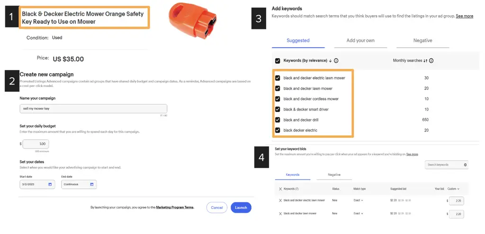
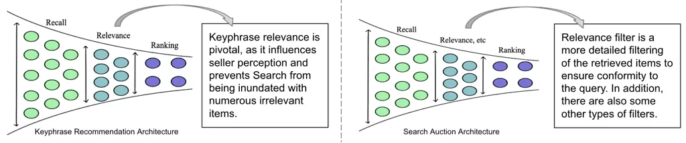
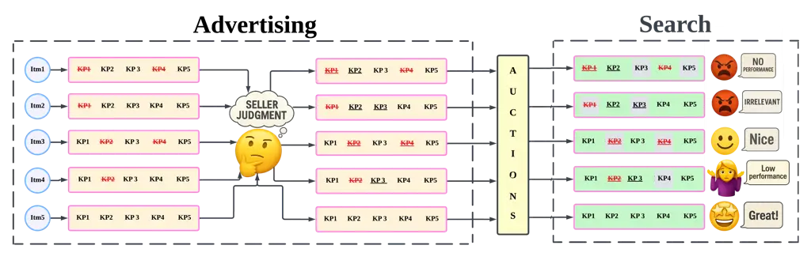
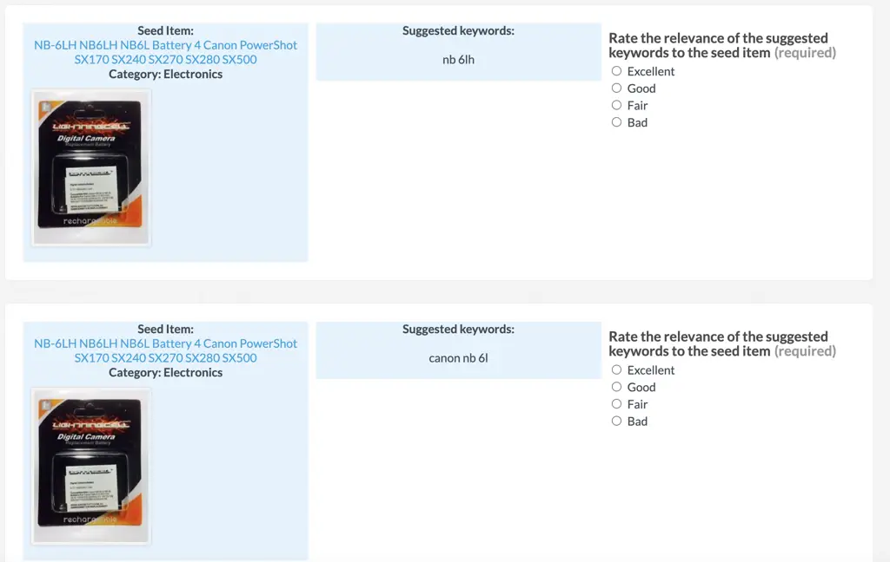
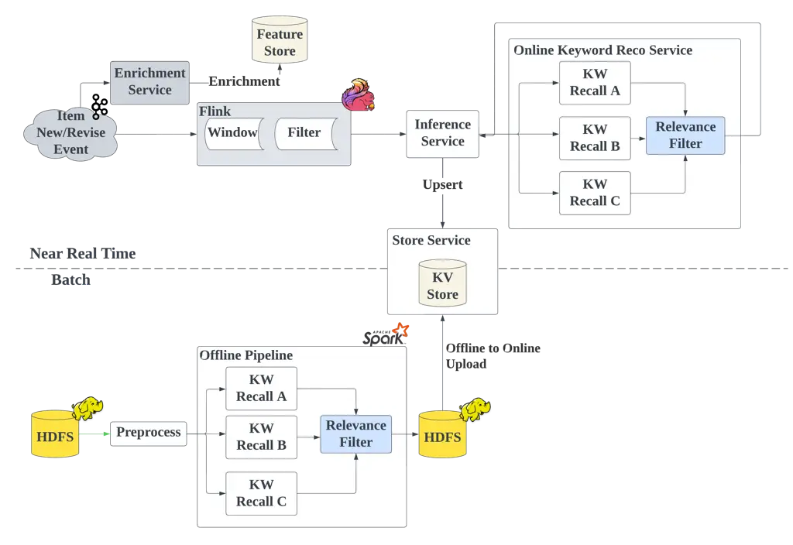

# To Judge or not to Judge: Using LLM Judgements for Advertiser Keyphrase Relevance at eBay

Soumik Dey

^(†)^(†)thanks: Corresponding Author. Email: sodey@ebay.com    Hansi Wu

   Binbin Li

Affiliation: eBay Advertising  
eBay Inc.  
San Jose, California, USA

###### Abstract

E-commerce sellers are recommended keyphrases based on their inventory
on which they advertise to increase buyer engagement (clicks/sales). The
relevance of advertiser keyphrases plays an important role in preventing
the inundation of search systems with numerous irrelevant items that
compete for attention in auctions, in addition to maintaining a healthy
seller perception. In this work, we describe the shortcomings of
training Advertiser keyphrase relevance filter models on
click/sales/search relevance signals and the importance of aligning with
human judgment, as sellers have the power to adopt or reject said
keyphrase recommendations. In this study, we frame Advertiser keyphrase
relevance as a complex interaction between 3 dynamical systems — seller
judgment, which influences seller adoption of our product, Advertising,
which provides the keyphrases to bid on, and Search, who holds the
auctions for the same keyphrases. This study discusses the
practicalities of using human judgment via a case study at eBay
Advertising and demonstrates that using LLM-as-a-judge en-masse as a
scalable proxy for seller judgment to train our relevance models
achieves a better harmony across the three systems, provided that they
are bound by a meticulous evaluation framework grounded in business
metrics.

^(†)^(†)paperid: 123

## 1 Introduction

(a) Buyer side

(b) Seller Side

Figure 1: Screenshot of our keyphrases for manual targeting in Promoted
Listings Priority \[eBay Advertising(2025)\] for eBay Advertising.

Figure 2: A side by side comparison of eBay Advertising for Keyphrase
Recommendation funnel and eBay Search funnel for Auctions.

In the realm of e-commerce, sellers adeptly employ online advertising
solutions, including the use of keyphrase recommendations, to counteract
their often suboptimal positions in organic search results. This
approach enables them to secure a beneficial presence on the search
results page (SRP) and cultivate a greater engagement with potential
buyers, see Figure 1. At eBay, the process of Advertiser keyphrase
recommendation comprises three fundamental steps: retrieval, which
entails the aggregation of keyphrases that are pertinent to the product;
relevance, which involves the further refinement of these keyphrases to
ascertain their pertinence to the item in question; and ranking, which
prioritizes the adoption of keyphrases based on the seller’s budgetary
constraints and preferences. The role of keyphrase relevance is of
paramount importance, as it shapes seller perceptions and aids in
preventing the inundation of search systems with numerous irrelevant
items vying for attention in auctions. Advertiser keyphrase relevance
models are trained to discern overarching patterns within click and
sales data. A keyphrase that has attracted a significant amount of
clicks or sales relative to an item can be deemed relevant to that item.
Fundamentally, clicks and sales constitute robust affirmative indicators
of relevance; however, they are not effective as indicators of
non-relevance. E-commerce datasets are susceptible to
missing-not-at-random (MNAR) conditions due to various biases  \[Chen
et al.(2023)Chen, Dong, Wang, Feng, Wang, and He, Vella(1998b), Joachims
et al.(2007)Joachims, Granka, Pan, Hembrooke, Radlinski, and Gay, Yue
et al.(2010)Yue, Patel, and Roehrig, Joachims et al.(2017)Joachims,
Swaminathan, and Schnabel, Deffayet et al.(2023)Deffayet, Hager,
Renders, and de Rijke, Steck(2010), Lim et al.(2015)Lim, McAuley, and
Lanckriet\]. The absence of clicks for an item in relation to a specific
query does not inherently imply the item’s irrelevance. Within the
e-commerce framework, buyers function as annotators, yet, unlike
traditional annotators, they are exposed to a biased presentation of
items as a result of search rankings, which in turn influences their
annotations in terms of clicks or sales. Consequently, an item that
lacks popularity will occupy a suboptimal position on the SRP because
search rankings are derived from clicks, and as a result, it may fail to
secure any clicks or sales. This bias undermines the reliability of
negative relevance signals that are based solely on clicks or sales.

Figure 3: Auction mechanism of items (Itm) in relation to keyphrases
(KP). Red strikethrough font represents filter of Advertising, the
underline represents seller curation of keyphrases after advertising has
filtered them while gray highlight represents the relevance filter of
Search.

eBay Search shows items in response to buyer queries and also involves
the same tasks, see Figure 2: retrieval, retrieving items related to the
search queries; relevance, a more detailed filtering of the retrieved
items to ensure conformity to the query, and ranking, i.e. ordering the
retrieved items based on potential to achieve clicks so that buyers
interact with them preferentially. From the sellers’ perspective, when
eBay Advertising presents advertised keyphrases to sellers, they choose
to bid on them for their items. These items then enter an auction
corresponding to the keyphrase. This auction process involves a complex
interaction with eBay Search. During this auction, eBay Search acts as a
middleman and aligns the items with the queries, which are exactly the
advertised keyphrases recommended by eBay Advertising, and further
filters the auction items using Search’s relevance filter. This auction
mechanism also ensures that the click data logged will only contain
keyphrases which pass Search’s relevance filter (auction winning
impression gaining keyphrases are logged). This introduces an additional
bias — training will only be on keyphrases which pass the Search
relevance filter. Training on click data ensures that the model never
experiences keyphrases that are irrelevant to Search, while Advertising
does generate such keyphrases and needs to filter them. This middleman
bias is a form of sample selection bias \[Gao et al.(2023)Gao, Han, Zhu,
Yang, Jiang, Xu, and Zheng, Vella(1998a)\], which the click data
additionally suffers from in the context of advertiser keyphrase
recommendation.

The interaction between the Sellers, Advertising and Search displays an
inherent imbalance — Sellers have the ultimate say in adopting
Advertising’s keyphrases while Search has the ultimate say in rejecting
those keyphrases at the time of auction. For instance, take Itm1 from
Figure 3; Advertising considers KP1 and KP4 irrelevant, while eBay
Search regards KP2, KP3, and KP5 as irrelevant and the seller rejecting
KP2 as a legit keyphrase, leading to Itm1 not participating in any
auctions. This outcome occurs regardless of the true relevance of the
keyphrases, which means that even if KP2, KP3, and KP5 are genuinely
relevant, Itm1 will not enter those auctions because the seller and eBay
Search do not find them relevant. An ideal scenario of complete
agreement would be for Itm5 and Itm3 where all parties are in complete
agreement. ¹¹ 1 For Itm3 the outcome is not as great as Itm5 as there
are still some keyphrases which are not getting into auctions. However,
that is more of a retrieval problem than a relevance problem, i.e., why
are the keyphrases KP2and KP4 getting recommended in the first place?

Understanding the dynamics and mechanisms of auctions is essential for
the successful execution of advertising campaigns. However, this
understanding is further complicated by the complex nature of sellers’
perceptions. Promoted Listings Priority, our product, enables manual
targeting, which allows sellers to select their preferred keyphrases
while also granting them the option to follow our recommendations. For
instance, should sellers judge KP2 for Itm1 as irrelevant, they may
choose to disregard this particular keyphrase, thereby rendering our
suggestions ineffective. This scenario can escalate, as sellers often
encounter an abundance of ”irrelevant” keyphrases, discouraging them
from proceeding with the adoption of our product. Such outcomes not only
lead to diminished Seller Satisfaction scores, but also represent a
wasted utilization of resources and opportunities for eBay. Moreover,
offering ostensibly ”sensible” keyphrases lacking substantial targeting
capabilities can result in subpar advertiser campaign performance,
potentially prompting sellers to leave the platform. Consequently, it is
imperative to ensure that keyphrases resonate with human judgment while
simultaneously maintaining robust performance. In this study, we
interpret Advertiser keyphrase relevance as a multifaceted interplay
among three dynamical systems: seller judgment impacting their product
adoption, Advertising supplying the bid and the keyphrases, and Search
orchestrating auctions for those keyphrases.

## 2 Previous Experiments and Related Work

This section highlights prior experiments, their limitations, and our
insights. An earlier BERT model, based on human judgment and 80,000
records with 3 annotators, encountered issues post-launch; sellers
reported irrelevant keyphrases. A post-launch analysis showed
insufficient category representation due to eBay’s extensive categories,
necessitating far more data than 80,000 records.²² 2 The vast scope of
eBay’s 100,000+ categories demands substantial data for adequate
coverage. An xgboost Click-Through rate (CTR) model using click data was
also tested but failed offline evaluations for search alignment and
spot-checked human assessments. A Jaccard \[Murphy(1996)\] index-based
model, a rule-driven token algorithm with a relevance filter,
outperformed and was deployed. The CTR model included the Jaccard index
as a feature but still fell short. Further investigation revealed the
CTR model’s significant bias, lacking representation of item-query pairs
that failed search relevance, perpetuating e-Commerce data biases
discussed in Section 1.

The Jaccard index, computed as the ratio of token intersection to union,
encountered specific challenges. It disproportionately penalized shorter
keyphrases, which are generally head keyphrases critical in driving
major engagement—10% of keyphrases while accounting for 90% of clicks
and sales on eBay. The introduction of the Jaccard filter resulted in
the exclusion of single-token keyphrases, key elements in advertising
for sellers. Furthermore, the lack of semantic awareness in Jaccard
meant it often missed keyphrases that were semantically relevant to
listings. While straightforward to implement within eBay systems, its
utility as a relevance model is limited and primarily served as a
temporary solution.

In the study documented in \[Dey et al.(2025)Dey, Zhang, Wu, Dong, and
Li\], we then devised a 2-layer cross-encoder model that was trained
utilizing search relevance scores. This was specifically aimed at
overcoming the intermediary biases present in click-based training data,
while simultaneously establishing a more resilient framework compared to
the traditional rule-based Jaccard model. This cross-encoder, by
capitalizing on search relevance indicators, demonstrated superior
performance relative to the Jaccard relevance model, largely by reducing
the inherent rule-based biases that disadvantage shorter keyphrases
(potentially head keyphrases), within the Jaccard model. Despite these
improvements, it is critical to note that this model did not entirely
align with human evaluations. The perception held by sellers is
paramount for the successful adoption of our product, as dissatisfaction
among sellers significantly impacted the perceived relevancy of our
keyphrases, subsequently reflected in the Seller Sentiment scores. \[Dey
et al.(2025)Dey, Zhang, Wu, Dong, and Li\] neglected to adequately
consider the essential role of seller perception and its influence on
our keyphrase recommendation strategies. Hence, there was a pronounced
need for an innovative model that more accurately aligns with human
judgment while ensuring precise targeting capabilities without resulting
in diminishing returns for the sellers.

Within the realm of ongoing research, as detailed in \[Wang
et al.(2024)Wang, Sundararaman, Gungor, Xu, Kamath, Chalasani, Hazra,
and Rao, Gurjar et al.(2025)Gurjar, Liu, Kolli, Kumar, and Rahurkar,
Thomas et al.(2024)Thomas, Spielman, Craswell, and Mitra, Gu
et al.(2025)Gu, Jiang, Shi, Tan, Zhai, Xu, Li, Shen, Ma, Liu, Wang,
Zhang, Wang, Gao, Ni, and Guo\], researchers have investigated the
innovative application of augmenting search data through the integration
of labels generated by Large Language Models (LLMs) for the development
of advanced relevance and retrieval models. Their analysis particularly
emphasizes the scalable application of LLM-generated labels, which
effectively addresses the significant expenses associated with
collecting data labeled by human annotators. The researchers initiated
their approach with a limited dataset comprising human annotations,
which was utilized to fine-tune an LLM. This fine-tuned LLM subsequently
facilitated the production of a more extensive array of labels, which in
turn were employed in the training of a more compact model, ultimately
operationalized in a production environment. Despite the growing
inclination towards employing LLMs not only as evaluative tools but also
as data augmentation tools, the literature concurrently presents a body
of criticism \[Bavaresco et al.(2024)Bavaresco, Bernardi, Bertolazzi,
Elliott, Fernández, Gatt, Ghaleb, Giulianelli, Hanna, Koller, Martins,
Mondorf, Neplenbroek, Pezzelle, Plank, Schlangen, Suglia, Surikuchi,
Takmaz, and Testoni, Soboroff(2025), Stureborg et al.(2024)Stureborg,
Alikaniotis, and Suhara\]. These critiques examine the appropriateness
of using LLMs as evaluators and data generators and explore the
multifaceted considerations pertinent to their roles in such capacities.

There are generally two main methods to employ LLM-as-a-judge for data
generation/augmentation:

- •
  General LLM: For successful LLM-as-a-Judge automation, advanced models
  like GPT-4 \[Ouyang et al.(2022)Ouyang, Wu, Jiang, Almeida,
  Wainwright, Mishkin, Zhang, Agarwal, Slama, Ray, Schulman, Hilton,
  Kelton, Miller, Simens, Askell, Welinder, Christiano, Leike, and Lowe,
  OpenAI et al.(2024)OpenAI, Achiam, Adler, Agarwal, Ahmad, Akkaya,
  Aleman, Almeida, Altenschmidt, Altman, Anadkat, Avila, Babuschkin,
  Balaji, Balcom, Baltescu, Bao, Bavarian, Belgum, Bello, Berdine,
  Bernadett-Shapiro, Berner, Bogdonoff, Boiko, Boyd, Brakman, Brockman,
  Brooks, Brundage, Button, Cai, Campbell, Cann, Carey, Carlson,
  Carmichael, Chan, Chang, Chantzis, Chen, Chen, Chen, Chen, Chen,
  Chess, Cho, Chu, Chung, Cummings, Currier, Dai, Decareaux, Degry,
  Deutsch, Deville, Dhar, Dohan, Dowling, Dunning, Ecoffet, Eleti,
  Eloundou, Farhi, Fedus, Felix, Fishman, Forte, Fulford, Gao, Georges,
  Gibson, Goel, Gogineni, Goh, Gontijo-Lopes, Gordon, Grafstein, Gray,
  Greene, Gross, Gu, Guo, Hallacy, Han, Harris, He, Heaton, Heidecke,
  Hesse, Hickey, Hickey, Hoeschele, Houghton, Hsu, Hu, Hu, Huizinga,
  Jain, Jain, Jang, Jiang, Jiang, Jin, Jin, Jomoto, Jonn, Jun, Kaftan,
  Łukasz Kaiser, Kamali, Kanitscheider, Keskar, Khan, Kilpatrick, Kim,
  Kim, Kim, Kirchner, Kiros, Knight, Kokotajlo, Łukasz Kondraciuk,
  Kondrich, Konstantinidis, Kosic, Krueger, Kuo, Lampe, Lan, Lee, Leike,
  Leung, Levy, Li, Lim, Lin, Lin, Litwin, Lopez, Lowe, Lue, Makanju,
  Malfacini, Manning, Markov, Markovski, Martin, Mayer, Mayne, McGrew,
  McKinney, McLeavey, McMillan, McNeil, Medina, Mehta, Menick, Metz,
  Mishchenko, Mishkin, Monaco, Morikawa, Mossing, Mu, Murati, Murk,
  Mély, Nair, Nakano, Nayak, Neelakantan, Ngo, Noh, Ouyang, O’Keefe,
  Pachocki, Paino, Palermo, Pantuliano, Parascandolo, Parish, Parparita,
  Passos, Pavlov, Peng, Perelman, de Avila Belbute Peres, Petrov,
  de Oliveira Pinto, Michael, Pokorny, Pokrass, Pong, Powell, Power,
  Power, Proehl, Puri, Radford, Rae, Ramesh, Raymond, Real, Rimbach,
  Ross, Rotsted, Roussez, Ryder, Saltarelli, Sanders, Santurkar, Sastry,
  Schmidt, Schnurr, Schulman, Selsam, Sheppard, Sherbakov, Shieh,
  Shoker, Shyam, Sidor, Sigler, Simens, Sitkin, Slama, Sohl, Sokolowsky,
  Song, Staudacher, Such, Summers, Sutskever, Tang, Tezak, Thompson,
  Tillet, Tootoonchian, Tseng, Tuggle, Turley, Tworek, Uribe, Vallone,
  Vijayvergiya, Voss, Wainwright, Wang, Wang, Wang, Ward, Wei, Weinmann,
  Welihinda, Welinder, Weng, Weng, Wiethoff, Willner, Winter, Wolrich,
  Wong, Workman, Wu, Wu, Wu, Xiao, Xu, Yoo, Yu, Yuan, Zaremba, Zellers,
  Zhang, Zhang, Zhao, Zheng, Zhuang, Zhuk, and Zoph\] provide a feasible
  substitute for human assessments \[Zheng et al.(2023)Zheng, Chiang,
  Sheng, Zhuang, Wu, Zhuang, Lin, Li, Li, Xing, Zhang, Gonzalez, and
  Stoica\]. Li et al. \[Li et al.(2023)Li, Zhang, Dubois, Taori,
  Gulrajani, Guestrin, Liang, and Hashimoto\] developed an 805-question
  test set to evaluate performance against text-davinci-003 using GPT-4.
  Zheng et al. \[Zhu et al.(2025)Zhu, Wang, and Wang\] created 80
  multi-round questions across eight sectors, employing GPT-4 for
  automated scoring. Despite GPT-4’s demonstrated accuracy and
  consistency over human experts, usage is often hindered by rate limits
  or API call restrictions to external sources. \[Mishra
  et al.(2024)Mishra, Dey, Zhao, Wu, Li, and Madduri, Zhang
  et al.(2025)Zhang, Uçar, Dey, Wu, Li, and Zhang\] utilized the
  Mixtral-7x8B Instruct v0.1 \[Jiang et al.(2024)Jiang, Sablayrolles,
  Roux, Mensch, Savary, Bamford, Chaplot, de las Casas, Hanna, Bressand,
  Lengyel, Bour, Lample, Lavaud, Saulnier, Lachaux, Stock, Subramanian,
  Yang, Antoniak, Scao, Gervet, Lavril, Wang, Lacroix, and Sayed\] model
  to annotate keyphrase relevance in advertising effectively. Its
  open-source status also aids in model distillation and training. ³³ 3
  During its development, models such as LLAMA 2 \[Touvron
  et al.(2023)Touvron, Martin, Stone, Albert, Almahairi, Babaei,
  Bashlykov, Batra, Bhargava, Bhosale, Bikel, Blecher, Ferrer, Chen,
  Cucurull, Esiobu, Fernandes, Fu, Fu, Fuller, Gao, Goswami, Goyal,
  Hartshorn, Hosseini, Hou, Inan, Kardas, Kerkez, Khabsa, Kloumann,
  Korenev, Koura, Lachaux, Lavril, Lee, Liskovich, Lu, Mao, Martinet,
  Mihaylov, Mishra, Molybog, Nie, Poulton, Reizenstein, Rungta, Saladi,
  Schelten, Silva, Smith, Subramanian, Tan, Tang, Taylor, Williams,
  Kuan, Xu, Yan, Zarov, Zhang, Fan, Kambadur, Narang, Rodriguez,
  Stojnic, Edunov, and Scialom\], DBRX \[research team()\], and Qwen-2
  \[Yang et al.(2024)Yang, Yang, Hui, Zheng, Yu, Zhou, Li, Li, Liu,
  Huang, Dong, Wei, Lin, Tang, Wang, Yang, Tu, Zhang, Ma, Yang, Xu,
  Zhou, Bai, He, Lin, Dang, Lu, Chen, Yang, Li, Xue, Ni, Zhang, Wang,
  Peng, Men, Gao, Lin, Wang, Bai, Tan, Zhu, Li, Liu, Ge, Deng, Zhou,
  Ren, Zhang, Wei, Ren, Liu, Fan, Yao, Zhang, Wan, Chu, Liu, Cui, Zhang,
  Guo, and Fan\] were considered but faced distillation and licensing
  constraints for commercial use. A general LLM’s weakness in
  instruction adherence or reasoning could undermine the LLM-as-a-Judge
  methodology, whereas its generality of being a World Knowledge
  recommender \[Lichtenberg et al.(2024)Lichtenberg, Buchholz, and
  Schwöbel\] makes it immune to other biases that fine-tuned models
  might be subject to.
- •
  Fine-tuned LLM: Fine-tuning a judge model typically include \[Huang
  et al.(2024)Huang, Qu, Bu, Zhou, Liu, Yang, Xu, and Zhao\]: (1) Data
  Collection—comprising instructions, evaluation subjects, and
  assessments, often using instruction datasets and GPT-4 or human
  annotations. (2) Prompt Design—adapting prompt templates to the
  evaluation method. (3) Model Fine-Tuning—applying designed prompts and
  data to fine-tune the model using the instruction tuning framework.
  The model uses instructions and responses to generate evaluation
  outputs. Post-fine-tuning, the evaluator model can assess target
  objects. Despite improved test set performance, these models face
  limitations in evaluation abilities and retained biases from human
  annotators \[Gu et al.(2025)Gu, Jiang, Shi, Tan, Zhai, Xu, Li, Shen,
  Ma, Liu, Wang, Zhang, Wang, Gao, Ni, and Guo\]. Other issues like
  improper design of prompts and datasets can lead to poor
  generalization, complicating comparisons with strong models like
  GPT-4.

Moreover, the assessment of models developed using data where LLMs serve
as judges reveals a notable trend: these models are frequently evaluated
by the LLMs themselves. This practice precipitates a self-enhancement
bias—a situation wherein the LLM evaluators exhibit a preference for
responses they have generated. Given the considerable concerns
surrounding self-enhancement bias, as highlighted in \[Ye
et al.(2024)Ye, Wang, Huang, Chen, Zhang, Moniz, Gao, Geyer, Huang,
Chen, Chawla, and Zhang\], it is advisable to refrain from employing the
identical model for evaluation purposes. Nonetheless, this presents only
a temporary measure, as it may lead to the selection of non-optimal
evaluators when appraising the most sophisticated LLMs. Evaluators
grounded in some sort of business impact measures would be a better
alternative.

## 3 Experiment Design

### 3.1 Dataset Collection

#### 3.1.1 Human Judgment

In conducting human relevance evaluations, we acquire crowd-sourced data
concerning the assessment of our keyphrase suggestions. Annotators are
provided with the title of the item, an associated image, and the
recommended keyphrase. They are tasked with evaluating the relevance of
our keyphrases in relation to the item, assigning them labels from a
predefined scale (excellent, good, fair, bad). The instructions given to
the annotators are given below while the interface is illustrated in
Figure 4.

Figure 4: Interface for our human annotators.

We amassed approximately 150,000 annotations regarding our keyphrase
suggestions. Each pairing of item and keyphrase is independently
evaluated by three annotators, after which a conclusive judgment is
reached. Only assessments that demonstrate total agreement among the
annotators are retained for the purposes of this study. Given the binary
nature of our classification task (i.e., relevant versus irrelevant),
annotations labeled excellent or good are categorized as relevant,
whereas those marked as bad or fair are reclassified as irrelevant. ⁴⁴ 4
Given the constraints of budget, time, and an inherited framework of
graded human assessment not originally designed for this task, we
resorted to converting to binary relevance in the absence of more
suitable options.

#### 3.1.2 Click Data

Since clicks are a strong indicator for relevance, we gather click data
amounting to roughly 24 million item keyphrase pairs over a period of 30
days with at least 30 impressions and 1 clicks with a minimum CTR of
0.1. Click data can be seen as data annotated by millions of buyers, and
it is a stronger signal as buyers are spending their time to do so. The
minimum thresholds of CTR, impressions and clicks are used to eliminate
noise such as 1 click 1 impression or 1 click and 1000 impression. An
important thing to note is that due to the nature of the auction
process, all click data is deemed relevant by eBay Search (i.e., they
are only surfaced to buyers because it is deemed relevant by eBay
Search).

Seller adoption of our keyphrases is logged as well — however, they are
unreliable indicators of negative judgment as to the way they are
presented, i.e., they are presented along with the bid. It is hard to
disambiguate the exact cause of non-adoption — is it bids, or
keyphrases? While a case can be made for positive seller adoption as a
reference for positive human judgment, it is redundant in the sense that
adopted keyphrases accepted by sellers will anyway be reflected in click
data if they receive clicks. Hence, we use click data because it is a
stronger signal that is aligned with both the buyer and the seller
judgment.

#### 3.1.3 Search Relevance Data

As detailed in \[Dey et al.(2025)Dey, Zhang, Wu, Dong, and Li\] the
usage of search relevance data is a good way to mitigate middleman bias
in Advertising. The Search relevance data can act as a strong indicator
of irrelevance due to nature of auctions illustrated in Figure 3 —
Search has the ultimate say in who gets to participate in auctions. We
collected around 50 million search relevance scores over a period of 5
months on our keyphrase recommendations.

#### 3.1.4 LLM Judgment Data

In order to obtain a set of scores from a large language model (LLM) as
either an augmentation or a substitute for human evaluation, we
collected 50 million judgment scores derived from the Mixtral 8x7B
Instruct v0.1 model. This process utilized two distinct versions of the
Mixtral 8x7B Instruct v0.1: 1) the standard general-purpose LLM, and 2)
a version fine-tuned specifically to binary human judgment labels. The
general-purpose LLM demonstrates a 90% concordance with click data,
which serves as an indicator of positive human judgments. However, when
evaluated against the human judgment scores collected in the course of
our analysis, the standard LLM shows a fair level of agreement, with a
kappa coefficient of 0.258. In contrast, the fine-tuned LLM exhibits
superior alignment with human-provided judgments, achieving a kappa
coefficient of 0.724, and shows 95% concordance with click data. The
prompt applied in this study is provided below.

### 3.2 Modeling

We used the data sources described in the previous section to model a
cross encoder on cross-entropy loss with keyword \[SEP\] category name
\[SEP\] item title as the format of input. Not all data sources are
created equal — due to the limited nature of the human judgment data it
is merely used as a dataset to create the fine-tuned LLM model whereas
the click data is only used for a positive signal and has to be combined
with other sources of data to train a binary classifier
(relevant/irrelevant).

We trained 5 models to compare with the production model. The models are
described below:

- •
  Search (+/-): This particular model underwent training using the
  search relevance data, which is actively utilized in the current
  production environment and thoroughly explained in \[Dey
  et al.(2025)Dey, Zhang, Wu, Dong, and Li\]. Within this context, the
  search relevance labels serve as the definitive truth markers,
  delineating both relevant and irrelevant data, for the purpose of
  training the binary classification algorithm.
- •
  Click (+) Search (-): This model received training on datasets
  comprising positive click data and negative search data. Essentially,
  it can be regarded as a model exclusively trained on indicators
  pertinent to business outcomes, with the click data representing
  clear-cut positive confirmations and the negative search relevance
  data serving as definitive negative indicators.
- •
  Click (+) LLM (+/-): In this model’s training, click data provided
  unequivocal positive evidence, while the LLM data served as a
  surrogate to represent both affirmative and negative human
  evaluations.
- •
  Click (+) LLM (-): This model was formulated by incorporating click
  data serving as incontrovertible positive evidence, supplemented by
  negative data from the LLM. The positive data from the LLM was
  discarded, with the remaining data acting as a stand-in for adverse
  human evaluation.
- •
  LLM (+/-): The exclusive training of this model utilized relevance
  labels produced by the general Mixtral 8x7B Instruct v0.1 model, where
  assessments from the LLM provided signals both positive and negative
  relevance.
- •
  fine-tuned LLM (+/-): The training of this model relied solely on
  relevance labels generated by the fine-tuned version of the Mixtral
  8x7B Instruct v0.1 model, fine-tuned using human evaluation data, thus
  enabling the LLM assessments to serve as proxies for both positive and
  negative human judgment.

Our chosen cross-encoder is a compact 2-layer bert-tiny \[Turc
et al.(2019)Turc, Chang, Lee, and Toutanova, Bhargava
et al.(2021)Bhargava, Drozd, and Rogers\] model trained using
Cross-Entropy loss on the binary labels, selected due to its efficient
execution and demonstrated effectiveness within our system. ⁵⁵ 5 Refer
to the earlier study in \[Dey et al.(2025)Dey, Zhang, Wu, Dong, and
Li\], which illustrates that 2-layer cross-encoders outperform larger
bi-encoders with only a marginal increase in latency. The training
process of the cross-encoder utilized 4 Nvidia A100-80GB GPUs, over the
course of 8 epochs, implementing a learning rate of 2e-4, and deploying
a per-device batch size of 40960. ⁶⁶ 6 The cross-encoder was
additionally trained using MSE Loss on the yes/no token probabilities
derived from the LLMs, but the performance was significantly poorer,
therefore we omit the results.

### 3.3 Evaluation framework

Given the diverse origins and varying volumes of our data sources, we
opted to test the effect of multiple data sets. Due to the heterogeneous
characteristics of these datasets and the inherent self-enhancement bias
observed in large language models (LLMs), relying solely on LLMs for
result evaluation is problematic. Therefore, it is essential to
benchmark evaluations using certain business metrics, which can be
simulated, or are attainable in an offline environment. Subsequently,
the most suitable candidate model can be tailored to meet specific
business needs and subjected to an online A/B testing process.

In order to assess the performance of the general large language model
(LLM) framework as described in \[Mishra et al.(2025)Mishra, Dey, Wu,
Zhao, Yu, Ni, Li, and Madduri\], we used click data as a reliable
benchmark. This data serves as a strong indicator of positive relevance,
contributing to a dependable evaluation process. The LLM utilized in
this study Mixtral 8x7B Instruct v0.1, exhibited substantial alignment
with a comprehensive array of human-generated positive annotations,
achieving an impressive over 90% agreement by providing affirmative
responses in the evaluated click data. This achievement underscores its
robust performance in realistic settings. In our own research, our aim
is to adopt a methodology that reflects this benchmarking framework. To
scrutinize the effectiveness of the proposed candidate models, our
initial step involved calculating threshold values for each model that
ensure the retention of 95% of clicks extracted from search logs. ⁷⁷ 7
The stipulated 95% threshold is derived from business logic criteria and
is currently implemented for the existing production models. Utilizing
these threshold determinations, we then evaluated three primary
aspects: 1) the potential loss of sales revenue when applying these
thresholds to identical click data, 2) the reduction in keyphrases when
the same thresholds are applied to a segment of our keyphrase
recommendations and, 3) the search pass rate, i.e. the percentage of the
keyphrases that after passing the Advertising relevance filter pass the
search relevance filter. An optimal model is characterized by minimizing
sales loss while maintaining consistent click performance and
simultaneously reducing a larger fraction of our recommended keyphrases
and maintaining a healthy search pass rate for efficiency.

| Model                | \# Keyphrases | Sales | Search Pass Rate |
| -------------------- | ------------- | ----- | ---------------- |
| Search (+/-)         | 0%            | 0%    | 0%               |
| Click (+) LLM (-)    | -31%          | -48%  | +103%            |
| LLM (+/-)            | -68%          | +10%  | +97%             |
| Click (+) LLM (+/-)  | -55%          | -23%  | +100%            |
| Click (+) Search (-) | -26%          | -60%  | +82%             |
| fine-tuned LLM (+/-) | +7%           | -20%  | +56%             |

Table 1: Table showing the performance of all models in comparison to
the production model Search (+/-). The numbers show the
increase/decrease in the volume of our recommendations normalized by
item count and the sales loss/gain in comparison to the production model
when the threshold for maintaining 95% clicks is applied and the
percentage of keyphrases that pass the search relevance filter. Darker
hues denote more advantageous outcomes.

## 4 Results

### 4.1 Offline Results

Analyzing the data presented in Table 1, it is evident that the most
optimal outcomes are achieved with the LLM (+/-) model. The Click (+)
LLM (+/-) emerges as a close contender in terms of performance. Notably,
the LLM (+/-) model surpasses the production model by eliminating a
significantly higher number of recommendations, a decrease by 68%, while
simultaneously achieving an increase in sales by 10%. Interestingly, the
fine-tuned LLM (+/-) model demonstrated the least desirable results,
exhibiting a particularly poor performance relative to other models
under consideration. Paradoxically, it increased the frequency of
keyphrase recommendations while simultaneously negatively impacting
sales. This finding contrasts with existing research where LLMs,
initially fine-tuned based on human evaluations, tend to be more
successful either as evaluators or as generators of initial data. In
addition, all models, with the exception of LLM (+/-), exhibited a
decline in sales, indicative of inefficiency in both their filtering and
learning processes. All models see significant improvement in their
search pass rate, in comparison to the production model. The production
model suffers from the thresholding to maintain clicks, resulting in
lowering of thresholds and giving away too many search irrelevant
keyphrases. From the search pass rate perspective, the fine-tuned LLM
again fares the second worst, with the Click (+) LLM (-) and Click (+)
LLM (+/-) models being the best and the second best, respectively. The
LLM (+/-) model does do relatively well showing that Search and LLM
judgments are well aligned.

### 4.2 Error Analysis

Oftentimes, there is a tendency to adopt or reuse human judgment
frameworks across different projects or use cases in the industry. Our
experiments provide a cautionary tale in doing so. Since our results ran
counterintuitive to the norm of fine-tuned LLMs serving as data
augmentors or evaluators, we did post-experimental analysis as to the
reason behind this observation. We could identify potential problems
with our human judgement data:

- •
  Annotators were asked to rate pairs of keyphrases of items with four
  distinct labels — excellent, good, fair and bad. While they were given
  instructions as to excellent or good being extremely relevant and
  somewhat relevant respectively while fair and bad being bad targeting
  and irrelevant respectively — the open-ended interpretation and the
  complex nature of such labels might have been detrimental to the
  annotators’ judgment. Instead, a simple binary assessment would have
  been more appropriate as our final goal is to do a binary
  classification.
- •
  The scale of annotations might have been inadequate given the huge
  inventory of items on eBay and the diverse set of buyer queries and
  activity we see everyday.
- •
  In addition, while annotators were rendering the judgment, they were
  provided a picture of the item in question while the models are not
  multimodal and are not given any image as input. This creates a
  problem of modality bias \[Park et al.(2024)Park, Jang, Alasaly,
  Mopidevi, Zolensky, Eaton, Lee, and Johnson, Guo et al.(2023)Guo, Nie,
  Cheng, Cheng, Kankanhalli, and Del Bimbo, Dey et al.(2024)Dey, An, and
  Levitan\] — both the annotators and the model should have access to
  the same modalities (sources of input) while they are making a
  judgment. An example is for an item like ‘‘iPhone 11 64GB 128G
  Unlocked ATT Boost Cricket Spectrum Excellent Condition’’ which is
  yellow in color presented in the image but not in the title in any way
  and keyphrases ‘‘yellow iphone’’ and ‘‘red iphone’’ the annotator
  would rate the first as relevant and the second as irrelevant. But
  when the downstream cross-encoder model is presented with this
  information for distillation, with the absence of visual clues to
  guide the model, these data points serve as noise misguiding the
  model.

Although it is crucial to develop enhanced strategies for acquiring
human judgments, devising unique designs for every individual use case
proves to be impractical. Considering the vastness of web data, coupled
with our platform managing 2.3 billion items across a diverse array of
products and use cases, alongside the expense associated with obtaining
human evaluations, it becomes impractical to tailor designs for each
specific case. Additionally, when large language models (LLMs) are
fine-tuned on such data, the biases intrinsic to the dataset tend to be
magnified and propagated to subsequent models, thus leading to erroneous
outcomes. In these scenarios, a meticulous assessment is essential to
evaluate the data’s usage and the necessity of employing a fine-tuned
LLM. Indeed, for practical purposes, it may be advantageous to utilize a
general-purpose LLM, provided that a comprehensive evaluation framework,
based on business metrics, is meticulously implemented.

Moreover, the distillation procedure and click thresholding present
challenges across various models. For instance, the item ‘‘Genuine 15V
4A Power AC Adapter Laptop Charger For Surface Pro 3 4 5 6’’ and the
keyphrase ‘‘microsoft surface charger’’ are considered relevant by both
LLMs; however, the distilled model fine-tuned LLM (+/-) does not,
despite the original LLMs’ agreement. The cross-encoder distilled for
the fine-tuned model displays lower calibration accuracy, excluding
high-conversion items to meet a 95% click threshold. Conversely,
distilled models from alternate sources show superior calibration,
effectively preserving clicks and sales.

Figure 5: Production Serving architecture for our retrieval and
relevance models.

### 4.3 Implementation Details

Our production architecture illustrated in Figure 5 features two
components — Near Real-Time (NRT) Inference and Batch Inference. Batch
inference primarily serves items with a delay, whereas NRT serves items
on an urgent basis, such as items newly created or revised by sellers.
The batch inference is done in two parts: 1) for all items and
keyphrases, and 2) daily differential (Diff), i.e. the difference of all
new items and keyphrases created/revised and then merged with the
existing ones. The NRT inference for our relevance model is written in
the service code using DeepJava \[Deepjavalibrary()\] and onnx
\[developers(2021)\] serving. The NRT service is triggered by the event
of creation or revision, behind a Flink processing window and feature
enrichment modules.

The process of full batch inference encompasses approximately 2.3
billion items, 1 billion keyphrases, and nearly 100 billion combinations
of items and keyphrases. In contrast, daily differential processing
involves servicing about 20 million items, 3 million keyphrases, and
approximately 7 billion item-keyphrase pairings. Since the full batch
inference is executed once, it is the latency of the differential (Diff)
inference that determines the feasibility of deploying a model into
production. The latency for the Diff inference is approximately 1.5
hours. All latency measurements were obtained using PySpark \[Zaharia
et al.(2016)Zaharia, Xin, Wendell, Das, Armbrust, Dave, Meng, Rosen,
Venkataraman, Franklin, Ghodsi, Gonzalez, Shenker, and Stoica\] with a
configuration of 1000 executors, 20GB of memory, and 4 CPU cores, in
conjunction with the transformers library \[Wolf et al.(2020)Wolf,
Debut, Sanh, Chaumond, Delangue, Moi, Cistac, Rault, Louf, Funtowicz,
Davison, Shleifer, von Platen, Ma, Jernite, Plu, Xu, Scao, Gugger,
Drame, Lhoest, and Rush\] and onnxruntime \[developers(2021)\]. Although
the possibility of employing GPU resources was explored, it proved to be
financially prohibitive.

### 4.4 Impact

In our recent deployment, we introduced the LLM (+/-) model into
production, and ran an A/B test with the Search (+/-) model for 2 weeks
across all major marketplaces. As a consequence, we observed a $`15\%`$
decrease in the number of keyphrases delivered to sellers (normalized by
the item count).⁸⁸ 8 This is the decrease at the adgroup level. Our
serving of keyphrases is deduplicated by the formation of an adgroup,
i.e. collection of items. Thus the deduplication effect is dampened at
an adgroup level. Hence we see a dampened effect in comparison to the
offline analysis which is at an item level. We cannot simulate adgroup
analytics offline as it is formed at the time of presentation to the
seller. Furthermore, there was a $`4\%`$ enhancement in the adoption
rate, defined as the proportion of keyphrases accepted by sellers
relative to the total number of suggested keyphrases — showing a greater
acceptance of our keyphrases by the sellers. Our analysis did not reveal
any statistically notable impact on key business indicators such as
revenue, gross merchandise volume bought (GMB), clicks, impressions or
sales. However, there was a positive influence on certain ratio metrics:
the click-through rate ($`CTR=\frac{clicks}{impressions}`$) increased by
$`2.5\%`$, the conversion rate ($`CVR=\frac{purchases}{clicks}`$)
improved by $`5.3\%`$, and the return on advertising spend
($`ROAS=\frac{GMB}{Ads\;Revenue}`$), experienced a notable improvement
of $`11.76\%`$.

Although A/B tests are a great way of measuring short-term effects, a
more concrete long-term effect was reflected in our Seller sentiment
survey. The seller sentiment surveys are conducted biannually, where
sellers are polled about their sentiments about our product offerings
and how they feel about certain aspects of our product. Following the
release of our new relevance model, we observed a noteworthy decline in
the dissatisfaction rate concerning the relevance of our keyphrase
suggestions from $`6\%`$ to $`3\%`$ in the subsequent quarter following
the launch of the model. This progression underscores the substantial
and enduring influence of our model in enhancing seller satisfaction.

## 5 Conclusion

This study conceptualizes Advertiser keyphrase relevance as the
intricate interplay among three dynamical systems: the seller’s
judgment, impacting the adoption of our product; Advertising, which
offers the keyphrases for bidding; and Search, which conducts auctions
for these keyphrases. We present a distillation framework for training
tiny cross-encoder networks from general LLMs like Mixtral 8x7B Instruct
v0.1 and show it’s effectiveness in emulating human judgment while still
maintaining an alignment with Search judgment in the context of
Advertiser keyphrase relevance. We also discuss the practical challenges
of collecting reliable human judgment for a LLM to fine-tune on, thus
paving the way for general LLMs as tools for data augmentation and
evaluation. While we champion the use of general LLMs in this role, we
also advocate for benchmarking said LLMs against some form of business
metrics at scale and also present a framework for evaluation of models
reliant on LLM generated relevance signals for advertiser keyphrase
relevance grounded in business metrics. More generally, this study
presents a discussion regarding various sources of ground-truth one can
use to mitigate the various biases present in Advertising data and how
we can leverage LLMs to mitigate these biases in a scalable manner in
order to serve millions of users with an inventory of over 2.3 billion
items.

## References

- \[Bavaresco et al.(2024)Bavaresco, Bernardi, Bertolazzi, Elliott,
  Fernández, Gatt, Ghaleb, Giulianelli, Hanna, Koller, Martins, Mondorf,
  Neplenbroek, Pezzelle, Plank, Schlangen, Suglia, Surikuchi, Takmaz,
  and Testoni\] A. Bavaresco, R. Bernardi, L. Bertolazzi, D. Elliott,
  R. Fernández, A. Gatt, E. Ghaleb, M. Giulianelli, M. Hanna, A. Koller,
  A. F. T. Martins, P. Mondorf, V. Neplenbroek, S. Pezzelle, B. Plank,
  D. Schlangen, A. Suglia, A. K. Surikuchi, E. Takmaz, and A. Testoni.
  Llms instead of human judges? a large scale empirical study across 20
  nlp evaluation tasks, 2024. URL
  [https://arxiv.org/abs/2406.18403](https://arxiv.org/abs/2406.18403).
- \[Bhargava et al.(2021)Bhargava, Drozd, and Rogers\] P. Bhargava,
  A. Drozd, and A. Rogers. Generalization in nli: Ways (not) to go
  beyond simple heuristics, 2021.
- \[Chen et al.(2023)Chen, Dong, Wang, Feng, Wang, and He\] J. Chen,
  H. Dong, X. Wang, F. Feng, M. Wang, and X. He. Bias and debias in
  recommender system: A survey and future directions. _ACM Trans. Inf.
  Syst._, 41(3), Feb. 2023. ISSN 1046-8188.
  [10.1145/3564284](https://doi.org/10.1145/3564284). URL
  [https://doi.org/10.1145/3564284](https://doi.org/10.1145/3564284).
- \[Deepjavalibrary()\] Deepjavalibrary. Deepjavalibrary/djl: An
  engine-agnostic deep learning framework in java. URL
  [https://github.com/deepjavalibrary/djl](https://github.com/deepjavalibrary/djl).
- \[Deffayet et al.(2023)Deffayet, Hager, Renders, and de Rijke\]
  R. Deffayet, P. Hager, J.-M. Renders, and M. de Rijke. An offline
  metric for the debiasedness of click models. In _Proceedings of the
  46th International ACM SIGIR Conference on Research and Development in
  Information Retrieval_, SIGIR ’23, page 558–568, New York, NY,
  USA, 2023. Association for Computing Machinery. ISBN 9781450394086.
  [10.1145/3539618.3591639](https://doi.org/10.1145/3539618.3591639).
  URL
  [https://doi.org/10.1145/3539618.3591639](https://doi.org/10.1145/3539618.3591639).
- \[developers(2021)\] O. R. developers. Onnx runtime.
  [https://onnxruntime.ai/](https://onnxruntime.ai/), 2021. Version:
  1.20.1.
- \[Dey et al.(2024)Dey, An, and Levitan\] S. Dey, G. An, and S. I.
  Levitan. Analysis and modeling of self-reported and observer-reported
  personality scores from text and speech. In _Speech Prosody 2024_,
  pages 975–979, 2024.
  [10.21437/SpeechProsody.2024-197](https://doi.org/10.21437/SpeechProsody.2024-197).
- \[Dey et al.(2025)Dey, Zhang, Wu, Dong, and Li\] S. Dey, W. Zhang,
  H. Wu, B. Dong, and B. Li. Middleman bias in advertising: Aligning
  relevance of keyphrase recommendations with search. In _Companion
  Proceedings of the ACM on Web Conference 2025_, WWW ’25, page
  2701–2705, New York, NY, USA, 2025. Association for Computing
  Machinery. ISBN 9798400713316.
  [10.1145/3701716.3717858](https://doi.org/10.1145/3701716.3717858).
  URL
  [https://doi.org/10.1145/3701716.3717858](https://doi.org/10.1145/3701716.3717858).
- \[eBay Advertising(2025)\] eBay Advertising. Promoted listings
  priority, Jan 2025. URL
  [https://www.ebayadvertising.com/en/ad-solutions/ad-types/promoted-listings-priority/](https://www.ebayadvertising.com/en/ad-solutions/ad-types/promoted-listings-priority/).
- \[Gao et al.(2023)Gao, Han, Zhu, Yang, Jiang, Xu, and Zheng\] J. Gao,
  S. Han, H. Zhu, S. Yang, Y. Jiang, J. Xu, and B. Zheng. Rec4ad: A free
  lunch to mitigate sample selection bias for ads ctr prediction in
  taobao. In _Proceedings of the 32nd ACM International Conference on
  Information and Knowledge Management_, CIKM ’23, page 4574–4580, New
  York, NY, USA, 2023. Association for Computing Machinery.
  ISBN 9798400701245.
  [10.1145/3583780.3615496](https://doi.org/10.1145/3583780.3615496).
  URL
  [https://doi.org/10.1145/3583780.3615496](https://doi.org/10.1145/3583780.3615496).
- \[Gu et al.(2025)Gu, Jiang, Shi, Tan, Zhai, Xu, Li, Shen, Ma, Liu,
  Wang, Zhang, Wang, Gao, Ni, and Guo\] J. Gu, X. Jiang, Z. Shi, H. Tan,
  X. Zhai, C. Xu, W. Li, Y. Shen, S. Ma, H. Liu, S. Wang, K. Zhang,
  Y. Wang, W. Gao, L. Ni, and J. Guo. A survey on llm-as-a-judge, 2025.
  URL
  [https://arxiv.org/abs/2411.15594](https://arxiv.org/abs/2411.15594).
- \[Guo et al.(2023)Guo, Nie, Cheng, Cheng, Kankanhalli, and Del Bimbo\]
  Y. Guo, L. Nie, H. Cheng, Z. Cheng, M. Kankanhalli, and A. Del Bimbo.
  On modality bias recognition and reduction. _ACM Trans. Multimedia
  Comput. Commun. Appl._, 19(3), Feb. 2023. ISSN 1551-6857.
  [10.1145/3565266](https://doi.org/10.1145/3565266). URL
  [https://doi.org/10.1145/3565266](https://doi.org/10.1145/3565266).
- \[Gurjar et al.(2025)Gurjar, Liu, Kolli, Kumar, and Rahurkar\]
  O. Gurjar, K. S. Liu, P. Kolli, U. Kumar, and M. Rahurkar. Dashclip:
  Leveraging multimodal models for generating semantic embeddings for
  doordash, 2025. URL
  [https://arxiv.org/abs/2504.07110](https://arxiv.org/abs/2504.07110).
- \[Huang et al.(2024)Huang, Qu, Bu, Zhou, Liu, Yang, Xu, and Zhao\]
  H. Huang, Y. Qu, X. Bu, H. Zhou, J. Liu, M. Yang, B. Xu, and T. Zhao.
  An empirical study of llm-as-a-judge for llm evaluation: Fine-tuned
  judge model is not a general substitute for gpt-4, 2024. URL
  [https://arxiv.org/abs/2403.02839](https://arxiv.org/abs/2403.02839).
- \[Jiang et al.(2024)Jiang, Sablayrolles, Roux, Mensch, Savary,
  Bamford, Chaplot, de las Casas, Hanna, Bressand, Lengyel, Bour,
  Lample, Lavaud, Saulnier, Lachaux, Stock, Subramanian, Yang, Antoniak,
  Scao, Gervet, Lavril, Wang, Lacroix, and Sayed\] A. Q. Jiang,
  A. Sablayrolles, A. Roux, A. Mensch, B. Savary, C. Bamford, D. S.
  Chaplot, D. de las Casas, E. B. Hanna, F. Bressand, G. Lengyel,
  G. Bour, G. Lample, L. R. Lavaud, L. Saulnier, M.-A. Lachaux,
  P. Stock, S. Subramanian, S. Yang, S. Antoniak, T. L. Scao, T. Gervet,
  T. Lavril, T. Wang, T. Lacroix, and W. E. Sayed. Mixtral of
  experts, 2024. URL
  [https://arxiv.org/abs/2401.04088](https://arxiv.org/abs/2401.04088).
- \[Joachims et al.(2007)Joachims, Granka, Pan, Hembrooke, Radlinski,
  and Gay\] T. Joachims, L. Granka, B. Pan, H. Hembrooke, F. Radlinski,
  and G. Gay. Evaluating the accuracy of implicit feedback from clicks
  and query reformulations in web search. _ACM Trans. Inf. Syst._,
  25(2):7–es, apr 2007. ISSN 1046-8188.
  [10.1145/1229179.1229181](https://doi.org/10.1145/1229179.1229181).
  URL
  [https://doi.org/10.1145/1229179.1229181](https://doi.org/10.1145/1229179.1229181).
- \[Joachims et al.(2017)Joachims, Swaminathan, and Schnabel\]
  T. Joachims, A. Swaminathan, and T. Schnabel. Unbiased
  learning-to-rank with biased feedback. In _Proceedings of the Tenth
  ACM International Conference on Web Search and Data Mining_, WSDM ’17,
  page 781–789, New York, NY, USA, 2017. Association for Computing
  Machinery. ISBN 9781450346757.
  [10.1145/3018661.3018699](https://doi.org/10.1145/3018661.3018699).
  URL
  [https://doi.org/10.1145/3018661.3018699](https://doi.org/10.1145/3018661.3018699).
- \[Li et al.(2023)Li, Zhang, Dubois, Taori, Gulrajani, Guestrin, Liang,
  and Hashimoto\] X. Li, T. Zhang, Y. Dubois, R. Taori, I. Gulrajani,
  C. Guestrin, P. Liang, and T. B. Hashimoto. Alpacaeval: An automatic
  evaluator of instruction-following models.
  [https://github.com/tatsu-lab/alpaca_eval](https://github.com/tatsu-lab/alpaca_eval),
  5 2023.
- \[Lichtenberg et al.(2024)Lichtenberg, Buchholz, and Schwöbel\] J. M.
  Lichtenberg, A. Buchholz, and P. Schwöbel. Large language models as
  recommender systems: A study of popularity bias, 2024. URL
  [https://arxiv.org/abs/2406.01285](https://arxiv.org/abs/2406.01285).
- \[Lim et al.(2015)Lim, McAuley, and Lanckriet\] D. Lim, J. McAuley,
  and G. Lanckriet. Top-n recommendation with missing implicit feedback.
  In _Proceedings of the 9th ACM Conference on Recommender Systems_,
  pages 309–312, 2015.
- \[Mishra et al.(2024)Mishra, Dey, Zhao, Wu, Li, and Madduri\]
  A. Mishra, S. Dey, J. Zhao, H. Wu, B. Li, and K. Madduri. Graphite: A
  graph-based extreme multi-label short text classifier for keyphrase
  recommendation. In _27th European Conference on Artificial
  Intelligence, 19–24 October 2024, Santiago de Compostela, Spain –
  Including 13th Conference on Prestigious Applications of Intelligent
  Systems (PAIS 2024)_, volume 392 of _Frontiers in Artificial
  Intelligence and Applications_, pages 4657 – 4664. IOS Press, 2024.
  URL
  [https://doi.org/10.3233/FAIA241061](https://doi.org/10.3233/FAIA241061).
- \[Mishra et al.(2025)Mishra, Dey, Wu, Zhao, Yu, Ni, Li, and Madduri\]
  A. Mishra, S. Dey, H. Wu, J. Zhao, H. Yu, K. Ni, B. Li, and
  K. Madduri. GraphEx: A Graph-Based Extraction Method for Advertiser
  Keyphrase Recommendation . In _2025 IEEE 41st International Conference
  on Data Engineering (ICDE)_, pages 4400–4413, Los Alamitos, CA, USA,
  May 2025. IEEE Computer Society.
  [10.1109/ICDE65448.2025.00330](https://doi.org/10.1109/ICDE65448.2025.00330).
  URL
  [https://doi.ieeecomputersociety.org/10.1109/ICDE65448.2025.00330](https://doi.ieeecomputersociety.org/10.1109/ICDE65448.2025.00330).
- \[Murphy(1996)\] A. H. Murphy. The finley affair: A signal event in
  the history of forecast verification. _Weather and Forecasting_,
  11(1):3 – 20, 1996.
  [10.1175/1520-0434(1996)011¡0003:TFAASE¿2.0.CO;2](<https://doi.org/10.1175/1520-0434(1996)011%C2%A10003:TFAASE%C2%BF2.0.CO;2>).
  URL
  [https://journals.ametsoc.org/view/journals/wefo/11/1/1520-0434_1996_011_0003_tfaase_2_0_co_2.xml](https://journals.ametsoc.org/view/journals/wefo/11/1/1520-0434_1996_011_0003_tfaase_2_0_co_2.xml).
- \[OpenAI et al.(2024)OpenAI, Achiam, Adler, Agarwal, Ahmad, Akkaya,
  Aleman, Almeida, Altenschmidt, Altman, Anadkat, Avila, Babuschkin,
  Balaji, Balcom, Baltescu, Bao, Bavarian, Belgum, Bello, Berdine,
  Bernadett-Shapiro, Berner, Bogdonoff, Boiko, Boyd, Brakman, Brockman,
  Brooks, Brundage, Button, Cai, Campbell, Cann, Carey, Carlson,
  Carmichael, Chan, Chang, Chantzis, Chen, Chen, Chen, Chen, Chen,
  Chess, Cho, Chu, Chung, Cummings, Currier, Dai, Decareaux, Degry,
  Deutsch, Deville, Dhar, Dohan, Dowling, Dunning, Ecoffet, Eleti,
  Eloundou, Farhi, Fedus, Felix, Fishman, Forte, Fulford, Gao, Georges,
  Gibson, Goel, Gogineni, Goh, Gontijo-Lopes, Gordon, Grafstein, Gray,
  Greene, Gross, Gu, Guo, Hallacy, Han, Harris, He, Heaton, Heidecke,
  Hesse, Hickey, Hickey, Hoeschele, Houghton, Hsu, Hu, Hu, Huizinga,
  Jain, Jain, Jang, Jiang, Jiang, Jin, Jin, Jomoto, Jonn, Jun, Kaftan,
  Łukasz Kaiser, Kamali, Kanitscheider, Keskar, Khan, Kilpatrick, Kim,
  Kim, Kim, Kirchner, Kiros, Knight, Kokotajlo, Łukasz Kondraciuk,
  Kondrich, Konstantinidis, Kosic, Krueger, Kuo, Lampe, Lan, Lee, Leike,
  Leung, Levy, Li, Lim, Lin, Lin, Litwin, Lopez, Lowe, Lue, Makanju,
  Malfacini, Manning, Markov, Markovski, Martin, Mayer, Mayne, McGrew,
  McKinney, McLeavey, McMillan, McNeil, Medina, Mehta, Menick, Metz,
  Mishchenko, Mishkin, Monaco, Morikawa, Mossing, Mu, Murati, Murk,
  Mély, Nair, Nakano, Nayak, Neelakantan, Ngo, Noh, Ouyang, O’Keefe,
  Pachocki, Paino, Palermo, Pantuliano, Parascandolo, Parish, Parparita,
  Passos, Pavlov, Peng, Perelman, de Avila Belbute Peres, Petrov,
  de Oliveira Pinto, Michael, Pokorny, Pokrass, Pong, Powell, Power,
  Power, Proehl, Puri, Radford, Rae, Ramesh, Raymond, Real, Rimbach,
  Ross, Rotsted, Roussez, Ryder, Saltarelli, Sanders, Santurkar, Sastry,
  Schmidt, Schnurr, Schulman, Selsam, Sheppard, Sherbakov, Shieh,
  Shoker, Shyam, Sidor, Sigler, Simens, Sitkin, Slama, Sohl, Sokolowsky,
  Song, Staudacher, Such, Summers, Sutskever, Tang, Tezak, Thompson,
  Tillet, Tootoonchian, Tseng, Tuggle, Turley, Tworek, Uribe, Vallone,
  Vijayvergiya, Voss, Wainwright, Wang, Wang, Wang, Ward, Wei, Weinmann,
  Welihinda, Welinder, Weng, Weng, Wiethoff, Willner, Winter, Wolrich,
  Wong, Workman, Wu, Wu, Wu, Xiao, Xu, Yoo, Yu, Yuan, Zaremba, Zellers,
  Zhang, Zhang, Zhao, Zheng, Zhuang, Zhuk, and Zoph\] OpenAI, J. Achiam,
  S. Adler, S. Agarwal, L. Ahmad, I. Akkaya, F. L. Aleman, D. Almeida,
  J. Altenschmidt, S. Altman, S. Anadkat, R. Avila, I. Babuschkin,
  S. Balaji, V. Balcom, P. Baltescu, H. Bao, M. Bavarian, J. Belgum,
  I. Bello, J. Berdine, G. Bernadett-Shapiro, C. Berner, L. Bogdonoff,
  O. Boiko, M. Boyd, A.-L. Brakman, G. Brockman, T. Brooks, M. Brundage,
  K. Button, T. Cai, R. Campbell, A. Cann, B. Carey, C. Carlson,
  R. Carmichael, B. Chan, C. Chang, F. Chantzis, D. Chen, S. Chen,
  R. Chen, J. Chen, M. Chen, B. Chess, C. Cho, C. Chu, H. W. Chung,
  D. Cummings, J. Currier, Y. Dai, C. Decareaux, T. Degry, N. Deutsch,
  D. Deville, A. Dhar, D. Dohan, S. Dowling, S. Dunning, A. Ecoffet,
  A. Eleti, T. Eloundou, D. Farhi, L. Fedus, N. Felix, S. P. Fishman,
  J. Forte, I. Fulford, L. Gao, E. Georges, C. Gibson, V. Goel,
  T. Gogineni, G. Goh, R. Gontijo-Lopes, J. Gordon, M. Grafstein,
  S. Gray, R. Greene, J. Gross, S. S. Gu, Y. Guo, C. Hallacy, J. Han,
  J. Harris, Y. He, M. Heaton, J. Heidecke, C. Hesse, A. Hickey,
  W. Hickey, P. Hoeschele, B. Houghton, K. Hsu, S. Hu, X. Hu,
  J. Huizinga, S. Jain, S. Jain, J. Jang, A. Jiang, R. Jiang, H. Jin,
  D. Jin, S. Jomoto, B. Jonn, H. Jun, T. Kaftan, Łukasz Kaiser,
  A. Kamali, I. Kanitscheider, N. S. Keskar, T. Khan, L. Kilpatrick,
  J. W. Kim, C. Kim, Y. Kim, J. H. Kirchner, J. Kiros, M. Knight,
  D. Kokotajlo, Łukasz Kondraciuk, A. Kondrich, A. Konstantinidis,
  K. Kosic, G. Krueger, V. Kuo, M. Lampe, I. Lan, T. Lee, J. Leike,
  J. Leung, D. Levy, C. M. Li, R. Lim, M. Lin, S. Lin, M. Litwin,
  T. Lopez, R. Lowe, P. Lue, A. Makanju, K. Malfacini, S. Manning,
  T. Markov, Y. Markovski, B. Martin, K. Mayer, A. Mayne, B. McGrew,
  S. M. McKinney, C. McLeavey, P. McMillan, J. McNeil, D. Medina,
  A. Mehta, J. Menick, L. Metz, A. Mishchenko, P. Mishkin, V. Monaco,
  E. Morikawa, D. Mossing, T. Mu, M. Murati, O. Murk, D. Mély, A. Nair,
  R. Nakano, R. Nayak, A. Neelakantan, R. Ngo, H. Noh, L. Ouyang,
  C. O’Keefe, J. Pachocki, A. Paino, J. Palermo, A. Pantuliano,
  G. Parascandolo, J. Parish, E. Parparita, A. Passos, M. Pavlov,
  A. Peng, A. Perelman, F. de Avila Belbute Peres, M. Petrov, H. P.
  de Oliveira Pinto, Michael, Pokorny, M. Pokrass, V. H. Pong,
  T. Powell, A. Power, B. Power, E. Proehl, R. Puri, A. Radford, J. Rae,
  A. Ramesh, C. Raymond, F. Real, K. Rimbach, C. Ross, B. Rotsted,
  H. Roussez, N. Ryder, M. Saltarelli, T. Sanders, S. Santurkar,
  G. Sastry, H. Schmidt, D. Schnurr, J. Schulman, D. Selsam,
  K. Sheppard, T. Sherbakov, J. Shieh, S. Shoker, P. Shyam, S. Sidor,
  E. Sigler, M. Simens, J. Sitkin, K. Slama, I. Sohl, B. Sokolowsky,
  Y. Song, N. Staudacher, F. P. Such, N. Summers, I. Sutskever, J. Tang,
  N. Tezak, M. B. Thompson, P. Tillet, A. Tootoonchian, E. Tseng,
  P. Tuggle, N. Turley, J. Tworek, J. F. C. Uribe, A. Vallone,
  A. Vijayvergiya, C. Voss, C. Wainwright, J. J. Wang, A. Wang, B. Wang,
  J. Ward, J. Wei, C. Weinmann, A. Welihinda, P. Welinder, J. Weng,
  L. Weng, M. Wiethoff, D. Willner, C. Winter, S. Wolrich, H. Wong,
  L. Workman, S. Wu, J. Wu, M. Wu, K. Xiao, T. Xu, S. Yoo, K. Yu,
  Q. Yuan, W. Zaremba, R. Zellers, C. Zhang, M. Zhang, S. Zhao,
  T. Zheng, J. Zhuang, W. Zhuk, and B. Zoph. Gpt-4 technical
  report, 2024. URL
  [https://arxiv.org/abs/2303.08774](https://arxiv.org/abs/2303.08774).
- \[Ouyang et al.(2022)Ouyang, Wu, Jiang, Almeida, Wainwright, Mishkin,
  Zhang, Agarwal, Slama, Ray, Schulman, Hilton, Kelton, Miller, Simens,
  Askell, Welinder, Christiano, Leike, and Lowe\] L. Ouyang, J. Wu,
  X. Jiang, D. Almeida, C. Wainwright, P. Mishkin, C. Zhang, S. Agarwal,
  K. Slama, A. Ray, J. Schulman, J. Hilton, F. Kelton, L. Miller,
  M. Simens, A. Askell, P. Welinder, P. F. Christiano, J. Leike, and
  R. Lowe. Training language models to follow instructions with human
  feedback. In S. Koyejo, S. Mohamed, A. Agarwal, D. Belgrave, K. Cho,
  and A. Oh, editors, _Advances in Neural Information Processing
  Systems_, volume 35, pages 27730–27744. Curran Associates, Inc., 2022.
  URL
  [https://proceedings.neurips.cc/paper_files/paper/2022/file/b1efde53be364a73914f58805a001731-Paper-Conference.pdf](https://proceedings.neurips.cc/paper_files/paper/2022/file/b1efde53be364a73914f58805a001731-Paper-Conference.pdf).
- \[Park et al.(2024)Park, Jang, Alasaly, Mopidevi, Zolensky, Eaton,
  Lee, and Johnson\] J. Park, K. J. Jang, B. Alasaly, S. Mopidevi,
  A. Zolensky, E. Eaton, I. Lee, and K. Johnson. Assessing modality bias
  in video question answering benchmarks with multimodal large language
  models, 2024. URL
  [https://arxiv.org/abs/2408.12763](https://arxiv.org/abs/2408.12763).
- \[research team()\] M. research team. Introducing DBRX: A New
  State-of-the-Art Open LLM — databricks.com.
  [https://www.databricks.com/blog/introducing-dbrx-new-state-art-open-llm](https://www.databricks.com/blog/introducing-dbrx-new-state-art-open-llm).
  \[Accessed 16-04-2025\].
- \[Soboroff(2025)\] I. Soboroff. Don’t use llms to make relevance
  judgments. _Information Retrieval Research_, 1(1):29–46, Mar. 2025.
  [10.54195/irrj.19625](https://doi.org/10.54195/irrj.19625). URL
  [https://irrj.org/article/view/19625](https://irrj.org/article/view/19625).
- \[Steck(2010)\] H. Steck. Training and testing of recommender systems
  on data missing not at random. In _Proceedings of the 16th ACM SIGKDD
  International Conference on Knowledge Discovery and Data Mining_, KDD
  ’10, page 713–722, New York, NY, USA, 2010. Association for Computing
  Machinery. ISBN 9781450300551.
  [10.1145/1835804.1835895](https://doi.org/10.1145/1835804.1835895).
  URL
  [https://doi.org/10.1145/1835804.1835895](https://doi.org/10.1145/1835804.1835895).
- \[Stureborg et al.(2024)Stureborg, Alikaniotis, and Suhara\]
  R. Stureborg, D. Alikaniotis, and Y. Suhara. Large language models are
  inconsistent and biased evaluators, 2024. URL
  [https://arxiv.org/abs/2405.01724](https://arxiv.org/abs/2405.01724).
- \[Thomas et al.(2024)Thomas, Spielman, Craswell, and Mitra\]
  P. Thomas, S. Spielman, N. Craswell, and B. Mitra. Large language
  models can accurately predict searcher preferences. SIGIR ’24, page
  1930–1940, New York, NY, USA, 2024. Association for Computing
  Machinery. ISBN 9798400704314.
  [10.1145/3626772.3657707](https://doi.org/10.1145/3626772.3657707).
  URL
  [https://doi.org/10.1145/3626772.3657707](https://doi.org/10.1145/3626772.3657707).
- \[Touvron et al.(2023)Touvron, Martin, Stone, Albert, Almahairi,
  Babaei, Bashlykov, Batra, Bhargava, Bhosale, Bikel, Blecher, Ferrer,
  Chen, Cucurull, Esiobu, Fernandes, Fu, Fu, Fuller, Gao, Goswami,
  Goyal, Hartshorn, Hosseini, Hou, Inan, Kardas, Kerkez, Khabsa,
  Kloumann, Korenev, Koura, Lachaux, Lavril, Lee, Liskovich, Lu, Mao,
  Martinet, Mihaylov, Mishra, Molybog, Nie, Poulton, Reizenstein,
  Rungta, Saladi, Schelten, Silva, Smith, Subramanian, Tan, Tang,
  Taylor, Williams, Kuan, Xu, Yan, Zarov, Zhang, Fan, Kambadur, Narang,
  Rodriguez, Stojnic, Edunov, and Scialom\] H. Touvron, L. Martin,
  K. Stone, P. Albert, A. Almahairi, Y. Babaei, N. Bashlykov, S. Batra,
  P. Bhargava, S. Bhosale, D. Bikel, L. Blecher, C. C. Ferrer, M. Chen,
  G. Cucurull, D. Esiobu, J. Fernandes, J. Fu, W. Fu, B. Fuller, C. Gao,
  V. Goswami, N. Goyal, A. Hartshorn, S. Hosseini, R. Hou, H. Inan,
  M. Kardas, V. Kerkez, M. Khabsa, I. Kloumann, A. Korenev, P. S. Koura,
  M.-A. Lachaux, T. Lavril, J. Lee, D. Liskovich, Y. Lu, Y. Mao,
  X. Martinet, T. Mihaylov, P. Mishra, I. Molybog, Y. Nie, A. Poulton,
  J. Reizenstein, R. Rungta, K. Saladi, A. Schelten, R. Silva, E. M.
  Smith, R. Subramanian, X. E. Tan, B. Tang, R. Taylor, A. Williams,
  J. X. Kuan, P. Xu, Z. Yan, I. Zarov, Y. Zhang, A. Fan, M. Kambadur,
  S. Narang, A. Rodriguez, R. Stojnic, S. Edunov, and T. Scialom. Llama
  2: Open foundation and fine-tuned chat models, 2023. URL
  [https://arxiv.org/abs/2307.09288](https://arxiv.org/abs/2307.09288).
- \[Turc et al.(2019)Turc, Chang, Lee, and Toutanova\] I. Turc,
  M. Chang, K. Lee, and K. Toutanova. Well-read students learn better:
  The impact of student initialization on knowledge distillation.
  _CoRR_, abs/1908.08962, 2019. URL
  [http://arxiv.org/abs/1908.08962](http://arxiv.org/abs/1908.08962).
- \[Vella(1998a)\] F. Vella. Estimating models with sample selection
  bias: A survey. _The Journal of Human Resources_, 33(1):127–169,
  1998a. ISSN 0022166X. URL
  [http://www.jstor.org/stable/146317](http://www.jstor.org/stable/146317).
- \[Vella(1998b)\] F. Vella. Estimating models with sample selection
  bias: A survey. _The Journal of Human Resources_, 33(1):127–169,
  1998b. ISSN 0022166X. URL
  [http://www.jstor.org/stable/146317](http://www.jstor.org/stable/146317).
- \[Wang et al.(2024)Wang, Sundararaman, Gungor, Xu, Kamath, Chalasani,
  Hazra, and Rao\] H. Wang, M. N. Sundararaman, O. Gungor, Y. Xu,
  K. Kamath, R. Chalasani, K. S. Hazra, and J. Rao. Improving pinterest
  search relevance using large language models, 2024. URL
  [https://arxiv.org/abs/2410.17152](https://arxiv.org/abs/2410.17152).
- \[Wolf et al.(2020)Wolf, Debut, Sanh, Chaumond, Delangue, Moi, Cistac,
  Rault, Louf, Funtowicz, Davison, Shleifer, von Platen, Ma, Jernite,
  Plu, Xu, Scao, Gugger, Drame, Lhoest, and Rush\] T. Wolf, L. Debut,
  V. Sanh, J. Chaumond, C. Delangue, A. Moi, P. Cistac, T. Rault,
  R. Louf, M. Funtowicz, J. Davison, S. Shleifer, P. von Platen, C. Ma,
  Y. Jernite, J. Plu, C. Xu, T. L. Scao, S. Gugger, M. Drame, Q. Lhoest,
  and A. M. Rush. Transformers: State-of-the-art natural language
  processing. In _Proceedings of the 2020 Conference on Empirical
  Methods in Natural Language Processing: System Demonstrations_, pages
  38–45, Online, Oct. 2020. Association for Computational Linguistics.
  URL
  [https://www.aclweb.org/anthology/2020.emnlp-demos.6](https://www.aclweb.org/anthology/2020.emnlp-demos.6).
- \[Yang et al.(2024)Yang, Yang, Hui, Zheng, Yu, Zhou, Li, Li, Liu,
  Huang, Dong, Wei, Lin, Tang, Wang, Yang, Tu, Zhang, Ma, Yang, Xu,
  Zhou, Bai, He, Lin, Dang, Lu, Chen, Yang, Li, Xue, Ni, Zhang, Wang,
  Peng, Men, Gao, Lin, Wang, Bai, Tan, Zhu, Li, Liu, Ge, Deng, Zhou,
  Ren, Zhang, Wei, Ren, Liu, Fan, Yao, Zhang, Wan, Chu, Liu, Cui, Zhang,
  Guo, and Fan\] A. Yang, B. Yang, B. Hui, B. Zheng, B. Yu, C. Zhou,
  C. Li, C. Li, D. Liu, F. Huang, G. Dong, H. Wei, H. Lin, J. Tang,
  J. Wang, J. Yang, J. Tu, J. Zhang, J. Ma, J. Yang, J. Xu, J. Zhou,
  J. Bai, J. He, J. Lin, K. Dang, K. Lu, K. Chen, K. Yang, M. Li,
  M. Xue, N. Ni, P. Zhang, P. Wang, R. Peng, R. Men, R. Gao, R. Lin,
  S. Wang, S. Bai, S. Tan, T. Zhu, T. Li, T. Liu, W. Ge, X. Deng,
  X. Zhou, X. Ren, X. Zhang, X. Wei, X. Ren, X. Liu, Y. Fan, Y. Yao,
  Y. Zhang, Y. Wan, Y. Chu, Y. Liu, Z. Cui, Z. Zhang, Z. Guo, and
  Z. Fan. Qwen2 technical report, 2024. URL
  [https://arxiv.org/abs/2407.10671](https://arxiv.org/abs/2407.10671).
- \[Ye et al.(2024)Ye, Wang, Huang, Chen, Zhang, Moniz, Gao, Geyer,
  Huang, Chen, Chawla, and Zhang\] J. Ye, Y. Wang, Y. Huang, D. Chen,
  Q. Zhang, N. Moniz, T. Gao, W. Geyer, C. Huang, P.-Y. Chen, N. V.
  Chawla, and X. Zhang. Justice or prejudice? quantifying biases in
  llm-as-a-judge, 2024. URL
  [https://arxiv.org/abs/2410.02736](https://arxiv.org/abs/2410.02736).
- \[Yue et al.(2010)Yue, Patel, and Roehrig\] Y. Yue, R. Patel, and
  H. Roehrig. Beyond position bias: examining result attractiveness as a
  source of presentation bias in clickthrough data. In _Proceedings of
  the 19th International Conference on World Wide Web_, WWW ’10, page
  1011–1018, New York, NY, USA, 2010. Association for Computing
  Machinery. ISBN 9781605587998.
  [10.1145/1772690.1772793](https://doi.org/10.1145/1772690.1772793).
  URL
  [https://doi.org/10.1145/1772690.1772793](https://doi.org/10.1145/1772690.1772793).
- \[Zaharia et al.(2016)Zaharia, Xin, Wendell, Das, Armbrust, Dave,
  Meng, Rosen, Venkataraman, Franklin, Ghodsi, Gonzalez, Shenker, and
  Stoica\] M. Zaharia, R. S. Xin, P. Wendell, T. Das, M. Armbrust,
  A. Dave, X. Meng, J. Rosen, S. Venkataraman, M. J. Franklin,
  A. Ghodsi, J. Gonzalez, S. Shenker, and I. Stoica. Apache spark: a
  unified engine for big data processing. _Commun. ACM_, 59(11):56–65,
  Oct. 2016. ISSN 0001-0782.
  [10.1145/2934664](https://doi.org/10.1145/2934664). URL
  [https://doi.org/10.1145/2934664](https://doi.org/10.1145/2934664).
- \[Zhang et al.(2025)Zhang, Uçar, Dey, Wu, Li, and Zhang\] R. H. Zhang,
  B. Uçar, S. Dey, H. Wu, B. Li, and R. Zhang. From lazy to prolific:
  Tackling missing labels in open vocabulary extreme classification by
  positive-unlabeled sequence learning. In L. Chiruzzo, A. Ritter, and
  L. Wang, editors, _Findings of the Association for Computational
  Linguistics: NAACL 2025_, pages 1–16, Albuquerque, New Mexico,
  Apr. 2025. Association for Computational Linguistics. ISBN
  979-8-89176-195-7. URL
  [https://aclanthology.org/2025.findings-naacl.1/](https://aclanthology.org/2025.findings-naacl.1/).
- \[Zheng et al.(2023)Zheng, Chiang, Sheng, Zhuang, Wu, Zhuang, Lin, Li,
  Li, Xing, Zhang, Gonzalez, and Stoica\] L. Zheng, W.-L. Chiang,
  Y. Sheng, S. Zhuang, Z. Wu, Y. Zhuang, Z. Lin, Z. Li, D. Li, E. Xing,
  H. Zhang, J. E. Gonzalez, and I. Stoica. Judging llm-as-a-judge with
  mt-bench and chatbot arena. In A. Oh, T. Naumann, A. Globerson,
  K. Saenko, M. Hardt, and S. Levine, editors, _Advances in Neural
  Information Processing Systems_, volume 36, pages 46595–46623. Curran
  Associates, Inc., 2023. URL
  [https://proceedings.neurips.cc/paper_files/paper/2023/file/91f18a1287b398d378ef22505bf41832-Paper-Datasets_and_Benchmarks.pdf](https://proceedings.neurips.cc/paper_files/paper/2023/file/91f18a1287b398d378ef22505bf41832-Paper-Datasets_and_Benchmarks.pdf).
- \[Zhu et al.(2025)Zhu, Wang, and Wang\] L. Zhu, X. Wang, and X. Wang.
  Judgelm: Fine-tuned large language models are scalable judges, 2025.
  URL
  [https://arxiv.org/abs/2310.17631](https://arxiv.org/abs/2310.17631).
