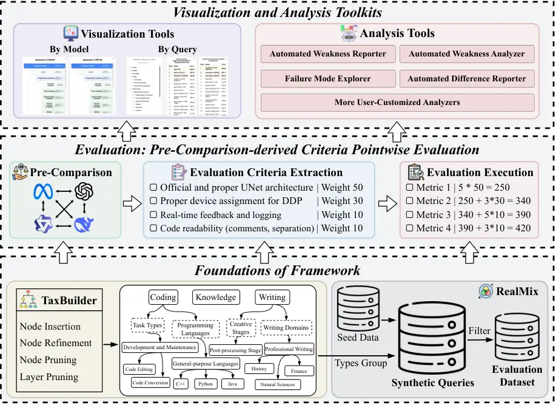
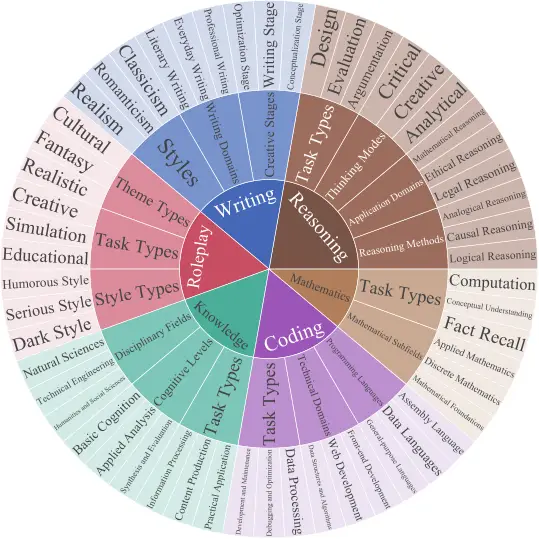
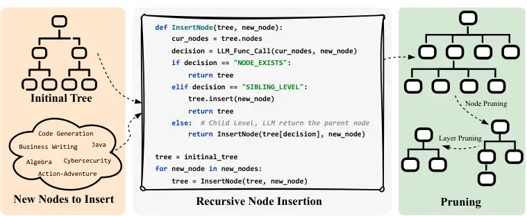

# SCAN: Structured Capability Assessment and Navigation for LLMs

Zongqi Wang ^(†)^(†)thanks: Work done during internship at Baidu, Inc.
Contact: \<zq-wang24@mails.tsinghua.edu.cn\>.    Tianle Gu    Chen Gong
Affiliation:  School of Cyber Engineering, Xidian University      Xin
Tian Affiliation:  Baidu, Inc    Siqi Bao Affiliation:  Baidu, Inc   
Yujiu Yang ^(†)^(†)thanks: Corresponding author: Yujiu Yang
\<yang.yujiu@sz.tsinghua.edu.cn\>.    \[1ex\] Tsinghua Shenzhen
International Graduate School    Tsinghua University

###### Abstract

Evaluating Large Language Models (LLMs) has become increasingly
important, with automatic evaluation benchmarks gaining prominence as
alternatives to human evaluation. While existing research has focused on
approximating model rankings, such benchmarks fail to provide users and
developers with a comprehensive and fine-grained understanding of a
specific model’s capabilities. To fill this gap, we propose SCAN
(Structured Capability Assessment and Navigation), a practical framework
that enables detailed characterization of LLM capabilities through
comprehensive and fine-grained evaluation. SCAN incorporates four key
components: (1) TaxBuilder, which extracts capability-indicating tags
from extensive queries to construct a hierarchical taxonomy
automatically; (2) RealMix, a query synthesis and filtering mechanism
that ensures sufficient evaluation data for each capability tag; (3) a
suite of visualization and analysis tools that facilitate efficient
navigation and analysis of model capabilities; and (4) a PC²-based
(Pre-Comparison-derived Criteria) LLM-as-a-Judge approach that achieves
significantly higher accuracy compared to classic LLM-as-a-Judge method.
Using SCAN, we conduct a comprehensive evaluation of 21 mainstream LLMs.
Our detailed analysis of the GPT-OSS family reveals substantial
performance variations, even within sub-capabilities belonging to the
same category of capability. This finding highlights the importance of
fine-grained evaluation in accurately understanding LLM behavior.
Project homepage and resources are available at
[https://github.com/liudan193/SCAN](https://github.com/liudan193/SCAN).

## 1 Introduction

Evaluating large language models (LLMs) has become increasingly
important as these models advance in various capabilities Wang et al.
(2023); Lin et al. (2024); White et al. (2024); Li et al. (2024c); Li et
al. (2024f); Kim et al. (2025); Qin et al. (2024); Liu et al. (2024b);
Gu et al. (2024a); Saranathan et al. (2024); Habba et al. (2025); van
Schaik and Pugh (2024); You et al. (2024); Chiang et al. (2024b). Among
them, Chatbot Arena Chiang et al. (2024b), which uses over 2.8 million
human-labeled cases, provides relatively accurate evaluations for 223
LLMs (as of 2025-04-09). However, its labor-intensive nature limits its
applicability, which is particularly pronounced during model
development, where timely feedback is essential. These limitations have
motivated researchers to explore automatic evaluation Zheng et al.
(2023); Dubois et al. (2024); Ni et al. (2024); Li et al. (2024e); Zhao
et al. (2024); Liu et al. (2024b), which uses a small amount of data and
LLM-as-a-Judge Gu et al. (2024a); Li et al. (2024b); Ashktorab et al.
(2024); Tseng et al. (2024); Son et al. (2024) to approximate the model
rankings in Chatbot Arena. These automatic evaluation benchmarks have
successfully established a paradigm focused on approximating the
rankings of multiple models.

However, when users and developers aim to gain a comprehensive and
detailed characterization of an LLM’s capabilities, such a paradigm
fails to provide the necessary breadth and granularity. To address this
critical gap in LLM evaluation, we need an approach that is both
comprehensive in scope and fine-grained in detail. In this paper, we
thoroughly discuss the challenges of constructing a comprehensive and
fine-grained evaluation framework and present our solutions, which are
integrated into SCAN (Structured Capability Assessment and Navigation),
a practical framework that effectively addresses these challenges.
Specifically, SCAN incorporates four key designs to systematically
establish such an evaluation framework. (1) To enable comprehensive and
fine-grained evaluation, we propose TaxBuilder, which extracts
capability-indicating tags (e.g., Python programming, physics Q&A) from
a large volume of real-world human queries. These tags span a broad
range of domains, scenarios, and tasks, thereby ensuring wide coverage
of diverse user needs. (2) To facilitate efficient inspection of
fine-grained performance, TaxBuilder organizes queries into a
hierarchical taxonomy, which is further visualized through a dedicated
visualization tool (available on our project page). Together, these
components allow users to quickly navigate and analyze model
capabilities in a structured and intuitive manner. (3) The evaluation
validity of a specific tag would be unreliable if it is only supported
by limited assessment data, which is particularly problematic for tags
in the long-tail distribution. To ensure each tag is evaluated with
sufficient queries, we develop RealMix, which obtains realistic and
high-quality queries through synthesis and filtering. RealMix builds
upon TaxBuilder, thereby enhancing both the coverage and diversity. (4)
Finally, to guarantee evaluation accuracy while maintaining scalability,
we propose a novel pointwise LLM-as-a-Judge based on PC²
(Pre-Comparison-derived Criteria). This method significantly improves
the reliability and accuracy of automatic judgments while avoiding the
prohibitive costs of pairwise evaluation.

To demonstrate the effectiveness of SCAN, we evaluate 21 mainstream LLMs
and conduct in-depth analyses of their results. A key value proposition
of SCAN is its ability to quickly provide comprehensive and detailed
understanding of newly released LLMs. To this end, we conducted a
detailed analysis of the recently released GPT-OSS family using SCAN.
Our analysis reveals several interesting findings: (1) In terms of
overall ranking, GPT-OSS-120B achieves superior performance, surpassing
Deepseek-R1, while GPT-OSS-20B shows relatively weak performance,
falling below Qwen3-8B. (2) Despite its overall strong performance,
GPT-OSS-120B exhibits limited capabilities in writing and roleplay
domains. Conversely, while GPT-OSS-20B generally underperforms, it
demonstrates leading capabilities in the coding domain. (3) Although the
GPT-OSS models show strong coding abilities overall, a fine-grained
analysis by programming language reveals significant variations: they
excel in JavaScript but lag behind in C and Java. (4) In the knowledge
domain, while the GPT-OSS models perform poorly overall, our
fine-grained analysis reveals substantial performance variations across
different sub-domains, indicating inconsistent coverage of
domain-specific knowledge during training. These fine-grained insights
highlight the effectiveness and potential of SCAN.

In summary, our main contributions are three-fold:

$`\bullet`$ We propose shifting evaluation paradigm from rankings to
model understanding. To this end, we introduce SCAN, which facilitates
comprehensive understanding of LLM capabilities (strengths and
weaknesses) through fine-grained evaluation.

$`\bullet`$ We develop the initial version of the taxonomy and
evaluation dataset for six domains: writing, roleplay, knowledge,
coding, mathematics, and reasoning. These are denoted as SCAN-T-V0
(Fig. 2) and SCAN-D-V0 (Tab. 1), respectively.

$`\bullet`$ To showcase the usage of SCAN, we evaluate 21 mainstream
LLMs and conduct in-depth analyses of the results. Through detailed
analysis of the GPT-OSS family models, we uncover several fine-grained
insights, thereby demonstrating the effectiveness and potential of SCAN.



Figure 1: An overview of SCAN framework.

## 2 SCAN

The overview of SCAN is shown in Fig. 1. It consists of three
components: TaxBuilder for building an extensible query taxonomy,
RealMix for generating new queries based on the taxonomy, and
visualization and analysis toolkits for user-friendly interaction.

### 2.1 TaxBuilder



Figure 2: A subset of SCAN-T-V0. Please refer to project page for
complete taxonomy.

To establish a comprehensive and fine-grained evaluation system, we
first need to develop the query taxonomy. To achieve this, we introduce
TaxBuilder, an automatic and extensible solution for constructing
tree-based taxonomy from large volumes of unstructured queries. The
workflow of TaxBuilder is illustrated in Fig. 3.

Preparation. TaxBuilder initiates the process with a manually
constructed basic taxonomy tree $`T_{init}`$. This basic tree is simple
and requires minimal human effort (refer to § C.1.1 for details). Then,
we employ a low-cost model (gpt-4o OpenAI (2024a)) to annotate query
tags for a large set of real user queries ¹¹ 1 We utilize the dataset
made available by the Chatbot Arena team, accessible at
[https://www.kaggle.com/competitions/wsdm-cup-multilingual-chatbot-arena/data](https://www.kaggle.com/competitions/wsdm-cup-multilingual-chatbot-arena/data)..
The primary aim of this phase is to generate a large pool of
unstructured query tags, named $`TG_{init}`$. Further details regarding
this step are elaborated in § C.1.2.



Figure 3: An overview of TaxBuilder, a tree-based automatic taxonomy
generation.

Node Insertion. The most core design of TaxBuilder is its node insertion
mechanism. A naive approach would be to input the entire taxonomy as
context to a powerful LLM and ask it to identify the position for the
new node. However, this task involves both long-context and complex
reasoning, which is challenging even for the most advanced LLMs.
Moreover, as the taxonomy grows, the input context becomes increasingly
longer and the reasoning more difficult, thereby limiting the
extensibility of this approach.

To address this issue, we introduce a recursive node insertion process
inspired by how trees are constructed in data structures. When a new
node needs to be inserted, we traverse the tree step by step. At each
step, the LLM only needs to determine the relationship between the new
node and the nodes at the current level. In this way, the model only
considers a small portion of the tree and reasons over three options:
(1) the node already exists, (2) it is a sibling of the current nodes,
or (3) it should be added as a child of one of them. This design keeps
the context short and the reasoning simple, making TaxBuilder
significantly more scalable as the taxonomy expands.

Formally, given a node $`tg`$ and the current tree $`T_{cur}`$ (we
represent the tree by its root), we invoke LLM-as-Decision-Maker,
denoted as $`DM_{ins}`$, as follows:

```math
DM_{ins}(tg,T^{c}_{cur})\rightarrow\{\text{<E>},\text{<S>},T^{c_{i}}_{cur}\}, \tag{1}
```

where
$`T^{c}_{cur}=\{T^{c_{1}}_{cur},T^{c_{2}}_{cur},\ldots,T^{c_{m}}_{cur}\}`$
denotes the set of first-level child nodes of $`T_{cur}`$. The function
of $`DM_{ins}`$ is to determine the relationship between $`tg`$ and
$`T^{c}_{cur}`$. The prompt for $`DM_{ins}`$ is presented in Fig. 13. It
will return one of three possible relationship types:

- •
  \<E\> (Exists): This indicates that the node $`tg`$ already exists in
  $`T^{c}_{cur}`$ or has a semantically equivalent node. In this case,
  the new node $`n`$ is discarded to avoid redundancy.
- •
  \<S\> (Sibling): This signifies that $`tg`$ is a sibling of the nodes
  $`T^{c}_{cur}`$. Consequently, $`T^{c}_{cur}`$ is updated to include
  $`tg`$, i.e.,
  $`T^{c}_{cur}=\{T^{c_{1}}_{cur},T^{c_{2}}_{cur},\ldots,T^{c_{m}}_{cur}\}\cup\{tg\}`$.
- •
  $`\mathbf{T^{c_{i}}_{cur}}`$ (Child Node): This implies that $`tg`$
  should be a child of the specific node $`T^{c_{i}}_{cur}`$. In this
  scenario, a recursive insertion is performed.

After recursively traversing the entire tree, we successfully insert the
node $`tg`$ and obtain the tree for the next iteration. We iteratively
perform this operation for all nodes, and ultimately obtain a tree that
contains all tags from $`TG_{init}`$.

Node Refinement and Pruning. Node refinement serves two purposes: (1)
resolving incorrect parent-child relationships between nodes at the same
level, and (2) splitting leaf nodes that conflate multiple concepts into
separate, more atomic concepts (e.g., separating "science fiction
fanfiction" into "science fiction" and "fanfiction"). Node pruning
addresses two issues: (1) merging duplicate nodes at the same level, and
(2) removing rarely encountered concepts that unnecessarily complicate
the tree. We perform the refinement and pruning processes recursively,
guided by the LLM-as-Decision-Maker (see Fig. 14), which effectively
corrects faulty nodes and controls node complexity.

Layer Pruning. We introduce two rules to reduce tree depth: (1)
Meaningless depth pruning: if a parent node has only a single child, the
child is pruned to eliminate unnecessary depth; (2) Complexity pruning:
the tree is restricted to a maximum of 4 layers. Nodes beyond the 4
layer are retained only if they have 5 or more child nodes, as such
structures are usually meaningful. which effectively controls tree
complexity and prevents overgrowth.

After completing node insertion, node refinement, node pruning, and
layer pruning, we obtain the final taxonomy, which we call SCAN-T-V0.
The current taxonomy tree is easy to interpret by human, allowing for
convenient manual modification if needed. A simplified version of this
tree is shown in Fig. 2. The formal algorithm for the tree construction
process is provided in Alg. 1.

### 2.2 RealMix

We opt for synthetic data over existing datasets for two reasons: (1)
existing datasets may not contain enough queries with the required tags
in taxonomy, and (2) to prevent data contamination. To ensure the
evaluation data includes high-quality, realistic queries that can be
encountered in real-world, we propose RealMix. RealMix operates by
mixing several appropriate content details from multiple real-user
queries and adapting them to align with the specified tags. While there
are other data synthesis approaches Liu et al. (2024a); Liu et al.
(2025b) that mix multiple queries, none are capable of generating
queries with specified tags. The core advantage of RealMix in fact lies
in that it is built upon the TaxBuilder, which enables controlled and
tag-aligned synthesis.

Seed Data. We first use QwQ-32b Team (2025b); Yang et al. (2024a) to
annotate a set of real-user queries Chiang et al. (2024a) with three
types of labels: domain, query tags, and quality. The domain label
covers six domains: writing, roleplay, knowledge, coding, mathematics,
and reasoning. Query tags are assigned based on SCAN-T-V0. For quality
annotation, each domain is paired with a checklist of seven criteria;
queries meeting at least four are marked as high-quality. In total, we
collect approximately 31,000 high-quality annotated queries. Further
details are provided in § C.2.1.

Query Synthesis. RealMix leverages content from real user queries to
generate queries aligned with specific tags. This approach allows us to
obtain realistic queries associated with desired tags. To synthesize a
query, we sample one reference query and three content queries. A query
generation model then extracts appropriate real-world content from the
content queries and generates a new query that incorporates these
contents while matching the tags of the reference query. If no suitable
content is found for the specified tags, this generation is discarded.
We adopt reference queries instead of random tag combinations from
SCAN-T-V0 since some combinations do not exist in practice. To mitigate
model bias, we employ multiple query generation models
(Deepseek-V3 DeepSeek-AI (2024), gpt-4o, and doubao-1.5pro ByteDance
(2024)). More details are provided in § C.2.2.

Verification and Filtration. We validate both the tags and the quality
of generated query using the same procedure applied to the seed data,
and discard low-quality queries. To further reduce model bias, for each
query, we randomly sample checking models for quality and tags from
three reasoning models (QwQ-32B, Deepseek-R1 DeepSeek-AI (2025), and
o1-mini OpenAI (2024b)).

### 2.3 Visualization and Analysis Toolkits

We provide a suite of visualization and analysis tools to assist users
in understanding and interpreting evaluation results. Due to space
constraints, the description of each tool is provided in § C.3.

## 3 Dataset Description

Dataset Statistics. We construct SCAN-D-V0, the initial version of the
evaluation dataset, which consists of 3,343 queries, each annotated with
a domain and tags. Tab. 1 summarizes the key statistics of SCAN-D-V0. We
ensure that the sample size for each tag in SCAN-T-V0 is at least 19
(#MinNum) to guarantee the statistical representativeness of the
evaluation results.

| Domain      | \#Samples | \#Tags | \#MinNum | Avg.Length |
| ----------- | --------- | ------ | -------- | ---------- |
| Writing     | 1108      | 594    | 19       | 772.57     |
| Roleplay    | 470       | 429    | 19       | 1008.46    |
| Knowledge   | 540       | 315    | 20       | 608.57     |
| Coding      | 636       | 369    | 19       | 1232.03    |
| Mathematics | 344       | 189    | 20       | 817.02     |
| Reasoning   | 245       | 186    | 19       | 904.81     |
| Total       | 3343      | 2082   | 19       | 880.92     |

Table 1: Statistics of SCAN-D-V0.

Figure 4: Comparison of RealMix and real user queries, judged by five
human evaluators.

Quality Control. We validate data quality through three tasks involving
human and automatic evaluation: Five graduate-level annotators perform
two comparative assessments. For each generated query and its
corresponding real user query (i.e., reference query), annotators
evaluate (1) which query is higher in quality and (2) which is more
likely to occur in real-world scenarios. Results in Fig. 4 show
generated queries are consistently preferred, confirming the
effectiveness of RealMix. Details are in § C.4.1. (3) We assess
potential data leakage in generated queries in § C.4.2.

## 4 Pre-Comparison-derived Criteria-based LLM-as-a-Judge

In this section, we first formulate traditional evaluation paradigms and
highlight their strengths and limitations in Sec. 4.1. Then, we present
the motivation and description of our method in Sec. 4.2.

### 4.1 Problem Formulation

Naive Pointwise Evaluation. Naive pointwise evaluation Kim et al.
(2023); Ye and Ng (2024) refers to scoring each response independently.
Judge model $`J`$ is tasked to assign a score to a single response $`y`$
with a naive pointwise evaluation prompt $`p_{o}`$.

```math
J(y|x,p_{o})\rightarrow s\in\mathbb{R}. \tag{2}
```

Pointwise evaluation is straightforward and does not incur unacceptable
evaluation costs as the number of models being evaluated increases.
However, it often produces inferior evaluation results Li et al.
(2024c); Zheng et al. (2023).

Pairwise Evaluation. Pairwise evaluation Cao et al. (2024); Hu et al.
(2024) compares two responses to determine which is better. According to
prior studies Zheng et al. (2023); Li et al. (2024c), while this
approach typically produces more reliable results than pointwise
evaluation, it has a quadratic time complexity O(n²) that becomes
impractical as the number of tested models increases. Therefore, we do
not adopt it in our work.

### 4.2 Methodology

Motivation. Our core insight is that, given the superior performance of
pairwise evaluation over pointwise evaluation, we can adapt the
mechanism of pairwise evaluation into the pointwise setting to create an
enhanced pointwise evaluation. Pairwise evaluation excels in comparing
two responses by identifying their differences, evaluating which
response performs better with respect to each difference, and ultimately
selecting the winner based on advantages in the most important
differences. (See examples in § D.) In contrast, pointwise evaluation
struggles to identify such differences because it evaluates each
response independently. To bridge this gap, we introduce a
pre-comparison phase, where we leverage several auxiliary responses to
extract relevant evaluation criteria before scoring. These criteria act
as proxies for the key differences identified in pairwise evaluation. At
the same time, we prompt the model to assign weights to each criterion,
emulating how pairwise evaluation prioritizes more significant
differences.

Pre-Comparison-derived Criteria Extraction. The core design of PC²
pointwise evaluation lies in extracting criteria from a pre-comparison
process. Specifically, given an instruction $`x`$, we prompt $`n`$ LLMs
$`\{M_{1},M_{2},...,M_{n}\}`$ to produce $`n`$ responses
$`\{y^{1},y^{2},...,y^{n}\}`$. The selection of multiple LLMs is
intended to diversify the responses, thereby facilitating the extraction
of comprehensive, diverse and effective criteria. Subsequently, we
assign the judge model $`J`$ two tasks. The first task involves using
$`J`$ to compare the $`n`$ responses, thereby surfacing their
differences (i.e., criteria). This is done using prompt $`p^{c}`$. The
second task is to weight these criteria using prompt $`p_{w}`$:

```math
\displaystyle J(\{y^{1},y^{2},\dots,y^{n}\}\mid x,p_{c},p_{w})\rightarrow
```

```math
\displaystyle\quad C=\{c_{1},c_{2},\dots,c_{m}\},\;W=\{w_{1},w_{2},\dots,w_{m}\} \tag{3}
```

where $`C`$ represents the criteria, and $`W`$ denotes the corresponding
weights, where $`\sum_{i=1}^{m}w_{i}=100`$. Since we use a reasoning LLM
as the judge model, we typically assign two tasks to the model
simultaneously. If the judge model is a chat model, we recommend
handling these tasks separately.

Evaluation Execution. Once the criteria are determined, we can score a
single response $`y`$:

```math
J(y|x,p_{c},y_{b},C,W)\rightarrow s\in\mathbb{R}, \tag{4}
```

where $`p_{c}`$ represents our criteria-weighted evaluation prompt and
$`s`$ is the final score. For the baseline answer $`y_{b}`$, we first
evaluate it without using any baseline answer, then concatenate the
evaluation results with $`p_{c}`$ to assess other models. This operation
helps improve the stability of multiple evaluations.

This approach leverages the comprehensive understanding gained through
pre-comparison to establish query-specific criteria, enabling more
effective evaluation while maintaining computational efficiency as the
number of evaluated models increases.

## 5 Results on PC² Pointwise Evaluation

In this section, we demonstrate the main experimental results. The
experiment details are shown in § B.1. Results on more benchmark and
ablation results are shown in § A.1.

| Method / Model                          | Accuracy |
| --------------------------------------- | -------- |
| Deepseek-R1                             |          |
|    naive                                | 0.5694   |
|    direct metric decomposition          | 0.6134   |
|    metric decomposition (single model)  | 0.5974   |
|    metric decomposition (diverse model) | 0.6466   |
|    ours                                 | 0.6962   |
| Qwen3-32B                               |          |
|    naive                                | 0.5181   |
|    ours                                 | 0.6535   |
| claude-3.7-sonnet                       |          |
|    naive                                | 0.5959   |
|    ours                                 | 0.7453   |
| gpt-4.1                                 |          |
|    naive                                | 0.6116   |
|    ours                                 | 0.7201   |

Table 2: Comparison of accuracy across different LLM-as-a-Judge methods.

As shown in Tab. 2, naive pointwise evaluation yields relatively low
accuracy across all tested LLMs, confirming its limited reliability as a
judging approach. Introducing metric decomposition markedly improves
performance, with direct decomposition and single-model pre-comparison
offering moderate gains, and diverse-model pre-comparison delivering
more substantial improvements. Building upon this, our method further
incorporates baseline answers, leading to consistent and significant
accuracy gains over all baselines. These results demonstrate that the
combination of criteria decomposition, diverse-model pre-comparison, and
baseline guidance forms a robust and generalizable evaluation strategy.

## 6 Results on SCAN

### 6.1 Overview of Evaluation Results

To utilize SCAN for analysis, we first employ SCAN-D-V0 to evaluate 21
mainstream LLMs in this section. The experimental setup is provided in
§ B.3. An overview of evaluation results is presented in § B.4. For
complete results, please refer to the project homepage.

### 6.2 Exploring SCAN: GPT-OSS as Examples

Upon the release of a new model, our SCAN framework facilitates a rapid,
comprehensive evaluation of its capabilities across diverse domains.
Here, we demonstrate SCAN’s utility through an analysis of the recently
released GPT-OSS family models.

Overview. The overall evaluation results summarized in Tab. 8 show that
GPT-OSS-120B achieves the highest aggregate score, reflecting its strong
overall performance. However, it ranks only 7th in roleplay domain,
highlighting a notable weakness obscured by the composite metric.
Crucially, our framework reveals that GPT-OSS-20B, despite a lower
overall rank, performs exceptionally in coding domain (ranking 2nd),
which demonstrates its specialized strength. This underscores the
effectiveness of our approach in uncovering fine-grained capability
profiles and identifying performance that holistic scores alone cannot
capture.

Figure 5: Fine-grained performance comparison on coding.Programming
Languages.General-purpose Languages.

Figure 6: The top 4 parent nodes exhibiting the largest performance
variance across child nodes, automatically identified by our Failure
Mode Explorer tool. The symbol ‘#’ denotes rankings.

Fine-grained Coding Performance Analysis. Our SCAN framework enables
decomposition of the aggregate coding score by programming language,
allowing evaluation of model performance across specific general-purpose
languages such as C and Java. The results shown in Fig. 5 reveal
substantial performance variation across languages. Notably,
GPT-OSS-120B performs strongly in Python, JavaScript, Go, and Rust, but
shows weaker performance in C and Java—areas where Deepseek-V3 achieves
superior results. This level of granularity is essential for
applications demanding language-specific usage. Furthermore, the
analysis uncovers the "spiky" capability profile of GPT-OSS-20B: it
ranks 2nd in Python and Rust, and outperforms its larger counterpart,
GPT-OSS-120B, in both C and C#. This demonstrates that smaller models
can excel in specific tasks, providing a more efficient option for
domain-specific development. SCAN’s fine granularity thus facilitates
informed, use-case-driven model selection, advancing beyond holistic
rankings toward nuanced capability profiling.

Diagnosing Knowledge Instability through Fine-Grained Analysis. Here, we
demonstrate the use of our analytical tool, Failure Mode Explorer (see
§ C.3). In Fig. 6, we present the tool’s automatically identified 4
parent nodes with the largest performance variance across sub-nodes for
GPT-OSS-120B. Interestingly, all four are within the knowledge domain.
Combined with the observation from Tab. 8 that GPT-OSS-120B’s overall
performance in knowledge is unexceptional, this motivates a deeper
investigation into its capabilities within this domain.

While GPT-OSS-120B ranks third overall in the knowledge domain, a closer
look reveals that its performance is far from uniformly strong. In
GPT-OSS-120B’s case, the internal performance distribution is highly
uneven. For example, within the technical engineering field (parent node
ranked \#2), the model achieves top positions in computer science and
aerospace engineering (#1), yet falls sharply to \#11 in bioengineering.
This demonstrates that, while aggregate scores facilitate macro-level
comparisons, they may conceal important weaknesses in a model’s
capabilities.

To tackle these hidden weaknesses, our SCAN framework converts
coarse-grained aggregate metrics into fine-grained diagnostic signals
that expose exactly where the gaps lie. In the case above, instead of
settling for a general verdict like “the model’s knowledge capability is
weak,” SCAN can pinpoint the specific sub-domains—such as
bioengineering—that are underperforming relative to other strengths. It
is worth noting that these results were automatically detected by our
Failure Mode Explorer tool, further validating SCAN’s effectiveness in
systematically revealing hidden problems.

## 7 Related Work

Automatic Evaluation Benchmark. We review existing benchmarks here,
focusing on their motivations, dataset designs, and evaluation methods.
AlpacaEval-2.0 Dubois et al. (2024) uses 805 curated general-domain data
points to assess instruction-following with win rate metric.
MT-Bench Zheng et al. (2023) includes 80 high-quality queries across 8
domains. It adopts pointwise evaluation on a 1–10 scale. Arena-Hard Li
et al. (2024e) filters 500 challenging Chatbot Arena datasets and uses
win rate metric for evaluation. LiveBench White et al. (2024) manually
updates queries in real-time with rule-based scoring to reduce LLM
biases. Auto-Arena Zhao et al. (2024) employs pairwise debates for
Elo-based ranking, with a 40-query evaluation set. WildBench Lin et al.
(2024) updates real user queries to reflect real-world distributions,
using both win rate and pointwise evaluation. We discuss the differences
between our methods and existing studies in § A.1.

## 8 Conclusion

In this paper, we propose shifting the focus of evaluation from only
rankings and leaderboards to providing valuable insights. To this end,
we introduce SCAN, an extensible evaluation framework featuring
comprehensive and fine-grained queries, along with tools for
visualization and analysis. Additionally, our proposed PC²-based
LLM-as-a-Judge achieves superior accuracy compared to classic evaluation
methods. Finally, through extensive experiments, we demonstrate that
utilizing SCAN enables the convenient identification of a model’s
strengths and weaknesses, thereby providing valuable insights.

In the future, we believe SCAN will provide valuable insights to the
community in the following aspects. (1) For model evaluation, SCAN helps
prevent one-sided understanding of a model’s capabilities, as its broad
coverage across diverse categories. (2) For model training, SCAN can
help identify a model’s strengths and weaknesses; by quantifying
fine-grained performance, it enables developers to adjust training
parameters accordingly, such as data distribution. (3) For data
synthesis, TaxBuilder offers a scalable taxonomy that empowers
developers to generate comprehensive, diverse, and complex synthetic
data for model training.

## Limitations

Currently, our framework is designed primarily for language models, and
does not yet provide support for multimodal models Li et al. (2024d);
Patraucean et al. (2023); Li et al. (2024a); Roberts et al. (2025);
Liang et al. (2021). In future work, we aim to extend the framework to
include multimodal capabilities through a dedicated module, tentatively
named SCAN-Anything.

In addition, the current implementation does not encompass evaluation
dimensions related to AI mechanisms such as safety, honesty, factuality,
hallucination, and fairness Ren et al. (2024); Röttger et al. (2025); Gu
et al. (2024b); Jin et al. (2024); Wang et al. (2024); Liu et al.
(2025a); Luo et al. (2024); Ravi et al. (2024); Ding et al. (2024);
Huang et al. (2023). Nevertheless, the framework is inherently
extensible and can be readily adapted to incorporate these aspects as
additional evaluation domains in subsequent work.

## References

- Abdin et al. (2024) M. Abdin, J. Aneja, H. Behl, S. Bubeck, R.
  Eldan, S. Gunasekar, M. Harrison, R. J. Hewett, M. Javaheripi, P.
  Kauffmann, et al. Phi-4 technical report. arXiv preprint
  arXiv:2412.08905. Cited by: §B.3.
- Achiam et al. (2023) J. Achiam, S. Adler, S. Agarwal, L. Ahmad, I.
  Akkaya, F. L. Aleman, D. Almeida, J. Altenschmidt, S. Altman, S.
  Anadkat, et al. Gpt-4 technical report. arXiv preprint
  arXiv:2303.08774. Cited by: §C.4.2.
- Adler et al. (2024) B. Adler, N. Agarwal, A. Aithal, D. H. Anh, P.
  Bhattacharya, A. Brundyn, J. Casper, B. Catanzaro, S. Clay, J. Cohen,
  et al. Nemotron-4 340b technical report. arXiv preprint
  arXiv:2406.11704. Cited by: §A.1.
- Anthropic (2025) Anthropic Claude 3.7 sonnet and claude code. Note:
  Accessed: 2025-05-05 External Links:
  [Link](https://www.anthropic.com/news/claude-3-7-sonnet) Cited by:
  §B.3.
- Ashktorab et al. (2024) Z. Ashktorab, M. Desmond, Q. Pan, J. M.
  Johnson, M. S. Cooper, E. M. Daly, R. Nair, T. Pedapati, S.
  Achintalwar, and W. Geyer Aligning human and llm judgments: insights
  from evalassist on task-specific evaluations and ai-assisted
  assessment strategy preferences. arXiv preprint arXiv:2410.00873.
  Cited by: §1.
- ByteDance (2024) ByteDance Doubao 1.5 pro. Note:
  [https://seed.bytedance.com/en/special/doubao_1_5_pro/](https://seed.bytedance.com/en/special/doubao_1_5_pro/)Accessed:
  2025-04-30 Cited by: §B.1, §B.3, §2.2.
- Cao et al. (2024) M. Cao, A. Lam, H. Duan, H. Liu, S. Zhang, and K.
  Chen Compassjudger-1: all-in-one judge model helps model evaluation
  and evolution. arXiv preprint arXiv:2410.16256. Cited by: §4.1.
- Chiang et al. (2024a) W. Chiang, E. Frick, L. Dunlap, A.
  Angelopoulos, J. E. Gonzalez, I. Stoica, S. Dane, M. Demkin, and N.
  Keating WSDM cup - multilingual chatbot arena. Note:
  [https://kaggle.com/competitions/wsdm-cup-multilingual-chatbot-arena](https://kaggle.com/competitions/wsdm-cup-multilingual-chatbot-arena)Kaggle
  Cited by: §2.2.
- Chiang et al. (2024b) W. Chiang, L. Zheng, Y. Sheng, A. N.
  Angelopoulos, T. Li, D. Li, B. Zhu, H. Zhang, M. Jordan, J. E.
  Gonzalez, et al. Chatbot arena: an open platform for evaluating llms
  by human preference. In Forty-first International Conference on
  Machine Learning, Cited by: §1.
- DeepSeek-AI (2024) DeepSeek-AI DeepSeek-v3 technical report. External
  Links: 2412.19437, [Link](https://arxiv.org/abs/2412.19437) Cited by:
  §B.1, §B.3, §2.2.
- DeepSeek-AI (2025) DeepSeek-AI DeepSeek-r1: incentivizing reasoning
  capability in llms via reinforcement learning. External Links:
  2501.12948, [Link](https://arxiv.org/abs/2501.12948) Cited by: §B.1,
  §B.3, §2.2.
- Devlin et al. (2019) J. Devlin, M. Chang, K. Lee, and K. Toutanova
  Bert: pre-training of deep bidirectional transformers for language
  understanding. In Proceedings of the 2019 conference of the North
  American chapter of the association for computational linguistics:
  human language technologies, volume 1 (long and short papers),
  pp. 4171–4186. Cited by: §C.4.2.
- Ding et al. (2024) P. Ding, J. Wu, J. Kuang, D. Ma, X. Cao, X. Cai, S.
  Chen, J. Chen, and S. Huang Hallu-pi: evaluating hallucination in
  multi-modal large language models within perturbed inputs. In
  Proceedings of the 32nd ACM International Conference on Multimedia,
  pp. 10707–10715. Cited by: Limitations.
- Dubois et al. (2024) Y. Dubois, B. Galambosi, P. Liang, and T. B.
  Hashimoto Length-controlled alpacaeval: a simple way to debias
  automatic evaluators. arXiv preprint arXiv:2404.04475. Cited by: §1,
  §7.
- Grattafiori et al. (2024) A. Grattafiori, A. Dubey, A. Jauhri, A.
  Pandey, A. Kadian, A. Al-Dahle, A. Letman, A. Mathur, A. Schelten, A.
  Vaughan, et al. The llama 3 herd of models. arXiv preprint
  arXiv:2407.21783. Cited by: §B.3.
- Gu et al. (2024a) J. Gu, X. Jiang, Z. Shi, H. Tan, X. Zhai, C. Xu, W.
  Li, Y. Shen, S. Ma, H. Liu, et al. A survey on llm-as-a-judge. arXiv
  preprint arXiv:2411.15594. Cited by: §1.
- Gu et al. (2024b) T. Gu, Z. Zhou, K. Huang, L. Dandan, Y. Wang, H.
  Zhao, Y. Yao, Y. Yang, Y. Teng, Y. Qiao, et al. Mllmguard: a
  multi-dimensional safety evaluation suite for multimodal large
  language models. Advances in Neural Information Processing Systems 37,
  pp. 7256–7295. Cited by: Limitations.
- Gupta et al. (2024) T. Gupta, S. Shandilya, X. Zhang, S. Ghosh, C.
  Bansal, H. Yao, and S. Rajmohan Unveiling context-aware criteria in
  self-assessing llms. arXiv preprint arXiv:2410.21545. Cited by: §B.1.
- Habba et al. (2025) E. Habba, O. Arviv, I. Itzhak, Y. Perlitz, E.
  Bandel, L. Choshen, M. Shmueli-Scheuer, and G. Stanovsky Dove: a
  large-scale multi-dimensional predictions dataset towards meaningful
  llm evaluation. arXiv preprint arXiv:2503.01622. Cited by: §1.
- Hu et al. (2024) Z. Hu, L. Song, J. Zhang, Z. Xiao, J. Wang, Z.
  Chen, J. Zhao, and H. Xiong Rethinking llm-based preference
  evaluation. arXiv e-prints, pp. arXiv–2407. Cited by: §4.1.
- Huang et al. (2023) K. Huang, X. Liu, Q. Guo, T. Sun, J. Sun, Y.
  Wang, Z. Zhou, Y. Wang, Y. Teng, X. Qiu, et al. Flames: benchmarking
  value alignment of chinese large language models. CoRR. Cited by:
  Limitations.
- Jin et al. (2024) R. Jin, Z. Xu, Y. Zhong, Q. Yao, D. QI, S. K. Zhou,
  and X. Li Fairmedfm: fairness benchmarking for medical imaging
  foundation models. Advances in Neural Information Processing Systems
  37, pp. 111318–111357. Cited by: Limitations.
- Kim et al. (2023) S. Kim, J. Shin, Y. Cho, J. Jang, S. Longpre, H.
  Lee, S. Yun, S. Shin, S. Kim, J. Thorne, et al. Prometheus: inducing
  fine-grained evaluation capability in language models. In The Twelfth
  International Conference on Learning Representations, Cited by: §4.1.
- Kim et al. (2025) S. Kim, J. Suk, J. Y. Cho, S. Longpre, C. Kim, D.
  Yoon, G. Son, Y. Cho, S. Shafayat, J. Baek, S. H. Park, H. Hwang, J.
  Jo, H. Cho, H. Shin, S. Lee, H. Oh, N. Lee, N. Ho, S. J. Joo, M.
  Ko, Y. Lee, H. Chae, J. Shin, J. Jang, S. Ye, B. Y. Lin, S.
  Welleck, G. Neubig, M. Lee, K. Lee, and M. Seo The BiGGen bench: a
  principled benchmark for fine-grained evaluation of language models
  with language models. In Proceedings of the 2025 Conference of the
  Nations of the Americas Chapter of the Association for Computational
  Linguistics: Human Language Technologies (Volume 1: Long Papers), L.
  Chiruzzo, A. Ritter, and L. Wang (Eds.), Albuquerque, New Mexico,
  pp. 5877–5919. External Links:
  [Link](https://aclanthology.org/2025.naacl-long.303/), ISBN
  979-8-89176-189-6 Cited by: §1.
- Lee et al. (2023) A. N. Lee, C. J. Hunter, and N. Ruiz Platypus:
  quick, cheap, and powerful refinement of llms. arXiv preprint
  arXiv:2308.07317. Cited by: §C.4.2.
- Li et al. (2024a) B. Li, Y. Ge, Y. Ge, G. Wang, R. Wang, R. Zhang,
  and Y. Shan Seed-bench: benchmarking multimodal large language models.
  In Proceedings of the IEEE/CVF Conference on Computer Vision and
  Pattern Recognition, pp. 13299–13308. Cited by: Limitations.
- Li et al. (2024b) D. Li, B. Jiang, L. Huang, A. Beigi, C. Zhao, Z.
  Tan, A. Bhattacharjee, Y. Jiang, C. Chen, T. Wu, et al. From
  generation to judgment: opportunities and challenges of
  llm-as-a-judge. arXiv preprint arXiv:2411.16594. Cited by: §1.
- Li et al. (2024c) H. Li, Q. Dong, J. Chen, H. Su, Y. Zhou, Q. Ai, Z.
  Ye, and Y. Liu Llms-as-judges: a comprehensive survey on llm-based
  evaluation methods. arXiv preprint arXiv:2412.05579. Cited by: §1,
  §4.1, §4.1.
- Li et al. (2024d) J. Li, W. Lu, H. Fei, M. Luo, M. Dai, M. Xia, Y.
  Jin, Z. Gan, D. Qi, C. Fu, et al. A survey on benchmarks of multimodal
  large language models. arXiv preprint arXiv:2408.08632. Cited by:
  Limitations.
- Li et al. (2024e) T. Li, W. Chiang, E. Frick, L. Dunlap, T. Wu, B.
  Zhu, J. E. Gonzalez, and I. Stoica From crowdsourced data to
  high-quality benchmarks: arena-hard and benchbuilder pipeline. arXiv
  preprint arXiv:2406.11939. Cited by: §1, §7.
- Li et al. (2024f) Y. Li, T. L. Wong, C. T. Hung, J. Zhao, D.
  Zheng, K. W. Liu, M. R. Lyu, and L. Wang C2LEVA: toward comprehensive
  and contamination-free language model evaluation. arXiv preprint
  arXiv:2412.04947. Cited by: §A.1, §1.
- Li et al. (2023) Y. Li, J. Zhao, D. Zheng, Z. Hu, Z. Chen, X. Su, Y.
  Huang, S. Huang, D. Lin, M. R. Lyu, et al. Cleva: chinese language
  models evaluation platform. arXiv preprint arXiv:2308.04813. Cited by:
  §A.1.
- Li et al. (2024g) Y. Li, M. Zheng, F. Yang, G. Dong, B. Cui, W.
  Chen, Z. Zhou, and W. Zhang FB-bench: a fine-grained multi-task
  benchmark for evaluating llms’ responsiveness to human feedback. arXiv
  preprint arXiv:2410.09412. Cited by: §B.1.
- Liang et al. (2021) P. P. Liang, Y. Lyu, X. Fan, Z. Wu, Y. Cheng, J.
  Wu, L. Chen, P. Wu, M. A. Lee, Y. Zhu, et al. Multibench: multiscale
  benchmarks for multimodal representation learning. Advances in neural
  information processing systems 2021 (DB1), pp. 1. Cited by:
  Limitations.
- Lin et al. (2024) B. Y. Lin, Y. Deng, K. Chandu, F. Brahman, A.
  Ravichander, V. Pyatkin, N. Dziri, R. L. Bras, and Y. Choi Wildbench:
  benchmarking llms with challenging tasks from real users in the wild.
  arXiv preprint arXiv:2406.04770. Cited by: §A.1, §1, §7.
- Liu et al. (2025a) D. Liu, Z. Wang, C. Peng, N. Wang, R. Hu, and X.
  Gao Thinking racial bias in fair forgery detection: models, datasets
  and evaluations. In Proceedings of the AAAI Conference on Artificial
  Intelligence, Vol. 39, pp. 5379–5387. Cited by: Limitations.
- Liu et al. (2025b) F. Liu, W. Zhou, B. Liu, Z. Yu, Y. Zhang, H.
  Lin, Y. Yu, X. Zhou, T. Wang, and Y. Cao QuaDMix: quality-diversity
  balanced data selection for efficient llm pretraining. arXiv preprint
  arXiv:2504.16511. Cited by: §2.2.
- Liu et al. (2024a) Q. Liu, X. Zheng, N. Muennighoff, G. Zeng, L.
  Dou, T. Pang, J. Jiang, and M. Lin Regmix: data mixture as regression
  for language model pre-training. arXiv preprint arXiv:2407.01492.
  Cited by: §2.2.
- Liu et al. (2024b) X. Liu, X. Lei, S. Wang, Y. Huang, A. Feng, B.
  Wen, J. Cheng, P. Ke, Y. Xu, W. L. Tam, et al. AlignBench:
  benchmarking chinese alignment of large language models. In
  Proceedings of the 62nd Annual Meeting of the Association for
  Computational Linguistics (Volume 1: Long Papers), pp. 11621–11640.
  Cited by: §1.
- Luo et al. (2024) W. Luo, T. Shen, W. Li, G. Peng, R. Xuan, H. Wang,
  and X. Yang Halludial: a large-scale benchmark for automatic
  dialogue-level hallucination evaluation. arXiv preprint
  arXiv:2406.07070. Cited by: Limitations.
- Malik et al. (2025) S. Malik, V. Pyatkin, S. Land, J. Morrison, N. A.
  Smith, H. Hajishirzi, and N. Lambert RewardBench 2: advancing reward
  model evaluation. arXiv preprint arXiv:2506.01937. Cited by: §B.1,
  §B.2.
- Ni et al. (2024) J. Ni, F. Xue, X. Yue, Y. Deng, M. Shah, K. Jain, G.
  Neubig, and Y. You MixEval: deriving wisdom of the crowd from llm
  benchmark mixtures. arXiv e-prints, pp. arXiv–2406. Cited by: §1.
- OpenAI (2024a) OpenAI Hello gpt-4o. Note:
  [https://openai.com/index/hello-gpt-4o/](https://openai.com/index/hello-gpt-4o/)Accessed:
  2025-04-30 Cited by: §B.1, §B.3, §2.1.
- OpenAI (2024b) OpenAI OpenAI o1 mini: advancing cost-efficient
  reasoning. Note:
  [https://platform.openai.com/docs/models/o1-mini](https://platform.openai.com/docs/models/o1-mini)Accessed:
  2025-04-30 Cited by: §2.2.
- OpenAI (2025) OpenAI Gpt-oss-120b and gpt-oss-20b model card. External
  Links: 2508.10925, [Link](https://arxiv.org/abs/2508.10925) Cited by:
  §B.3.
- Patraucean et al. (2023) V. Patraucean, L. Smaira, A. Gupta, A.
  Recasens, L. Markeeva, D. Banarse, S. Koppula, M. Malinowski, Y.
  Yang, C. Doersch, et al. Perception test: a diagnostic benchmark for
  multimodal video models. Advances in Neural Information Processing
  Systems 36, pp. 42748–42761. Cited by: Limitations.
- Qin et al. (2024) Y. Qin, K. Song, Y. Hu, W. Yao, S. Cho, X. Wang, X.
  Wu, F. Liu, P. Liu, and D. Yu Infobench: evaluating instruction
  following ability in large language models. arXiv preprint
  arXiv:2401.03601. Cited by: §B.1, §1.
- Ravi et al. (2024) S. S. Ravi, B. Mielczarek, A. Kannappan, D. Kiela,
  and R. Qian Lynx: an open source hallucination evaluation model. arXiv
  preprint arXiv:2407.08488. Cited by: Limitations.
- Ren et al. (2024) R. Ren, S. Basart, A. Khoja, A. Gatti, L. Phan, X.
  Yin, M. Mazeika, A. Pan, G. Mukobi, R. Kim, et al. Safetywashing: do
  ai safety benchmarks actually measure safety progress?. Advances in
  Neural Information Processing Systems 37, pp. 68559–68594. Cited by:
  Limitations.
- Roberts et al. (2025) J. Roberts, M. R. Taesiri, A. Sharma, A.
  Gupta, S. Roberts, I. Croitoru, S. Bogolin, J. Tang, F. Langer, V.
  Raina, et al. Zerobench: an impossible visual benchmark for
  contemporary large multimodal models. arXiv preprint arXiv:2502.09696.
  Cited by: Limitations.
- Röttger et al. (2025) P. Röttger, F. Pernisi, B. Vidgen, and D. Hovy
  Safetyprompts: a systematic review of open datasets for evaluating and
  improving large language model safety. In Proceedings of the AAAI
  Conference on Artificial Intelligence, Vol. 39, pp. 27617–27627. Cited
  by: Limitations.
- Saranathan et al. (2024) G. Saranathan, M. P. Alam, J. Lim, S.
  Bhattacharya, S. Y. Wong, M. Foltin, and C. Xu Dele: data efficient
  llm evaluation. In ICLR 2024 Workshop on Navigating and Addressing
  Data Problems for Foundation Models, Cited by: §1.
- Son et al. (2024) G. Son, H. Ko, H. Lee, Y. Kim, and S. Hong
  Llm-as-a-judge & reward model: what they can and cannot do. arXiv
  preprint arXiv:2409.11239. Cited by: §1.
- Team et al. (2025) G. Team, A. Kamath, J. Ferret, S. Pathak, N.
  Vieillard, R. Merhej, S. Perrin, T. Matejovicova, A. Ramé, M. Rivière,
  et al. Gemma 3 technical report. arXiv preprint arXiv:2503.19786.
  Cited by: §B.3.
- Team (2025a) Q. Team Qwen3 technical report. External Links:
  2505.09388, [Link](https://arxiv.org/abs/2505.09388) Cited by: §B.3.
- Team (2025b) Q. Team QwQ-32b: embracing the power of reinforcement
  learning. External Links:
  [Link](https://qwenlm.github.io/blog/qwq-32b/) Cited by: §B.3, §2.2.
- Tencent (2025) Tencent Tencent hunyuan. Note: Accessed: 2025-05-05
  External Links: [Link](https://hunyuan.tencent.com/) Cited by: §B.3.
- Tseng et al. (2024) Y. Tseng, W. Chen, C. Chen, and H. Chen Are
  expert-level language models expert-level annotators?. arXiv preprint
  arXiv:2410.03254. Cited by: §1.
- van Schaik and Pugh (2024) T. A. van Schaik and B. Pugh A field guide
  to automatic evaluation of llm-generated summaries. In Proceedings of
  the 47th International ACM SIGIR Conference on Research and
  Development in Information Retrieval, pp. 2832–2836. Cited by: §1.
- Wang et al. (2024) S. Wang, P. Wang, T. Zhou, Y. Dong, Z. Tan, and J.
  Li Ceb: compositional evaluation benchmark for fairness in large
  language models. arXiv preprint arXiv:2407.02408. Cited by:
  Limitations.
- Wang et al. (2023) Y. Wang, Z. Yu, Z. Zeng, L. Yang, C. Wang, H.
  Chen, C. Jiang, R. Xie, J. Wang, X. Xie, et al. Pandalm: an automatic
  evaluation benchmark for llm instruction tuning optimization. arXiv
  preprint arXiv:2306.05087. Cited by: §1.
- Wang et al. (2022) Y. Wang, Y. Kordi, S. Mishra, A. Liu, N. A.
  Smith, D. Khashabi, and H. Hajishirzi Self-instruct: aligning language
  models with self-generated instructions. arXiv preprint
  arXiv:2212.10560. Cited by: §A.1.
- White et al. (2024) C. White, S. Dooley, M. Roberts, A. Pal, B.
  Feuer, S. Jain, R. Shwartz-Ziv, N. Jain, K. Saifullah, S. Naidu, et
  al. Livebench: a challenging, contamination-free llm benchmark. arXiv
  preprint arXiv:2406.19314. Cited by: §1, §7.
- Yang et al. (2024a) A. Yang, B. Yang, B. Zhang, B. Hui, B. Zheng, B.
  Yu, C. Li, D. Liu, F. Huang, H. Wei, H. Lin, J. Yang, J. Tu, J.
  Zhang, J. Yang, J. Yang, J. Zhou, J. Lin, K. Dang, K. Lu, K. Bao, K.
  Yang, L. Yu, M. Li, M. Xue, P. Zhang, Q. Zhu, R. Men, R. Lin, T.
  Li, T. Tang, T. Xia, X. Ren, X. Ren, Y. Fan, Y. Su, Y. Zhang, Y.
  Wan, Y. Liu, Z. Cui, Z. Zhang, and Z. Qiu Qwen2.5 technical report.
  arXiv preprint arXiv:2412.15115. Cited by: §2.2.
- Yang et al. (2024b) A. Yang, B. Yang, B. Zhang, B. Hui, B. Zheng, B.
  Yu, C. Li, D. Liu, F. Huang, H. Wei, et al. Qwen2. 5 technical report.
  arXiv preprint arXiv:2412.15115. Cited by: §B.3.
- Ye and Ng (2024) H. Ye and H. T. Ng Self-judge: selective instruction
  following with alignment self-evaluation. arXiv preprint
  arXiv:2409.00935. Cited by: §4.1.
- You et al. (2024) J. You, M. Liu, S. Prabhumoye, M. Patwary, M.
  Shoeybi, and B. Catanzaro LLM-evolve: evaluation for llm’s evolving
  capability on benchmarks. In Proceedings of the 2024 Conference on
  Empirical Methods in Natural Language Processing, pp. 16937–16942.
  Cited by: §1.
- Zeng et al. (2025) Z. Zeng, Y. Wang, H. Hajishirzi, and P. W. Koh
  EvalTree: profiling language model weaknesses via hierarchical
  capability trees. arXiv preprint arXiv:2503.08893. Cited by: §A.1.
- Zhao et al. (2024) R. Zhao, W. Zhang, Y. K. Chia, W. Xu, D. Zhao,
  and L. Bing Auto-arena: automating llm evaluations with agent peer
  battles and committee discussions. arXiv preprint arXiv:2405.20267.
  Cited by: §C.4.2, §1, §7.
- Zheng et al. (2023) L. Zheng, W. Chiang, Y. Sheng, S. Zhuang, Z.
  Wu, Y. Zhuang, Z. Lin, Z. Li, D. Li, E. Xing, et al. Judging
  llm-as-a-judge with mt-bench and chatbot arena. Advances in Neural
  Information Processing Systems 36, pp. 46595–46623. Cited by: §B.1,
  §C.4.4, §1, §4.1, §4.1, §7.
- Zhou et al. (2025) E. Zhou, G. Zheng, B. Wang, Z. Xi, S. Dou, R.
  Bao, W. Shen, L. Xiong, J. Fan, Y. Mou, R. Zheng, T. Gui, Q. Zhang,
  and X. Huang RMB: comprehensively benchmarking reward models in llm
  alignment. In The Thirteenth International Conference on Learning
  Representations, Cited by: §B.1, §B.2.

###### Appendices Contents

1.  1 Introduction
2.  2 SCAN
    1.  2.1 TaxBuilder
    2.  2.2 RealMix
    3.  2.3 Visualization and Analysis Toolkits
3.  3 Dataset Description
4.  4 Pre-Comparison-derived Criteria-based LLM-as-a-Judge
    1.  4.1 Problem Formulation
    2.  4.2 Methodology
5.  5 Results on PC² Pointwise Evaluation
6.  6 Results on SCAN
    1.  6.1 Overview of Evaluation Results
    2.  6.2 Exploring SCAN: GPT-OSS as Examples
7.  7 Related Work
8.  8 Conclusion
9.  References
10. A More Discussion
    1.  A.1 Distinctions from Prior Works Enabled by Fine-Grained
        Dataset
11. B Experiments
    1.  B.1 Experimental Setup for Evaluation Method
    2.  B.2 More Experiment on PC²-Pointwise Evaluation
    3.  B.3 Experimental Setup for Evaluation and Leaderboard
    4.  B.4 Leaderboard
12. C Taxonomy and Dataset
    1.  C.1 TaxBuilder
        1.  C.1.1 Manually Initialized Basic Taxonomy Tree
        2.  C.1.2 Initial Annotation for Query Type Tags
        3.  C.1.3 Algorithm for TaxBuilder
        4.  C.1.4 Prompts for TaxBuilder
    2.  C.2 RealMix
        1.  C.2.1 Seed Data
        2.  C.2.2 Synthesize New Queries
    3.  C.3 Detailed Description of Visualization and Analysis Toolkits
    4.  C.4 SCAN-D-V0
        1.  C.4.1 Query Quality: Human Evaluation
        2.  C.4.2 Query Quality: Data Contamination
        3.  C.4.3 Examples of SCAN-D-V0
        4.  C.4.4 SCAN-HPD
13. D Evaluation Methods

| Dataset               | \#Queries | Cont.-free | Fin.Tag | LongTail | Update |
| --------------------- | --------- | ---------- | ------- | -------- | ------ |
| AlpacaEval2.0         | 805       | ✕          | ✕       | ✕        | ✕      |
| MT-Bench              | 80        | ✕          | ✕       | ✕        | ✕      |
| Arena-Hard            | 500       | ✕          | ✕       | ✕        | ✕      |
| Auto-Arena            | 40        | ✓          | ✕       | ✕        | ✓      |
| LiveBench(2024-11-25) | 300       | ✓          | ✕       | ✕        | ✓      |
| MixEval               | 4000      | ✕          | ✕       | ✕        | ✕      |
| MixEval-Hard          | 1000      | ✓          | ✕       | ✕        | ✕      |
| WildBench             | 1024      | ✕          | ✕       | ✕        | ✕      |
| C²LEVA                | 16115     | ✓          | ✓       | ✕        | ✕      |
| Ours                  | 3343      | ✓          | ✓       | ✓        | ✓      |

Table 3: Comparison of LLM alignment benchmark datasets. “Real.” denotes
real-world queries, “Cont.-free” means contamination-free, “Fin.Tag”
indicates fine-grained tagging.

## Appendix A More Discussion

### A.1 Distinctions from Prior Works Enabled by Fine-Grained Dataset

Several existing studies, such as SELF-INSTRUCT Wang et al. (2022),
Nemotron-4-340B Adler et al. (2024), WildBench Lin et al. (2024),
CLEVA Li et al. (2023), and C²LEVA Li et al. (2024f), provide
fine-grained evaluation of LLM capabilities. However, their taxonomies
are relatively coarse and lack extensibility. For instance, C²LEVA
classifies LLM abilities into four broad categories—Language, Knowledge,
Reasoning, and Harms—and further subdivides Language into only two
types: Typo-Fixing and Transliteration. In contrast, our benchmark
introduces an unprecedentedly detailed, fine-grained, and extensible
taxonomy. Additionally, none of the aforementioned benchmarks provide
visualization or analytical tools tailored for fine-grained evaluation,
which is a key contribution of our work.

A concurrent study, EvalTree Zeng et al. (2025), also organizes queries
into a tree structure. However, our TaxBuilder differs fundamentally.
(1) Unlike EvalTree, which reorganizes existing datasets, our method
starts with a fixed, extensible taxonomy and automatically synthesizes
data to populate it. (2) TaxBuilder supports multi-dimensional
classification based on topic, style, domain, and programming language,
whereas EvalTree organizes queries solely by model capability. (3) Our
method fully leverages the power of advanced reasoning models, resulting
in more accurate classifications. In contrast, EvalTree relies on
sentence embeddings—which may lack precision—and K-Means clustering,
with cluster labels generated by LLMs. (4) We provide analysis tools to
identify model strengths and weaknesses, which are absent in EvalTree.
(6) We also addresses sample size requirements for reliable evaluation
within subcategories, an important factor not considered by EvalTree.

## Appendix B Experiments

### B.1 Experimental Setup for Evaluation Method

Models. The PC² pointwise evaluation involves two types of model. In the
pre-comparison stage, multiple models are utilized to generate
responses. Here we employ gpt-4o-2024-11-20 OpenAI (2024a),
doubao-1-5-pro-32k-250115 ByteDance (2024), and
Deepseek-V3-250324 DeepSeek-AI (2024) to ensure the diversity of the
responses. For judge model, we adopt Deepseek-R1 DeepSeek-AI (2025) due
to its superior reasoning performance. Unless otherwise specified, we
use the officially recommended decoding parameters.

Dataset. All our experiments are based on our pairwise human preference
datasets SCAN-HPD, RewardBench-v2 Malik et al. (2025) and RMB Zhou et
al. (2025). Pairwise human preference datasets usually contain a prompt
and two responses, and the model’s task is to determine which response
is better. In pointwise evaluation, the judge model assigns scores to
both responses, with the higher-scoring response being chosen as the
winner.

SCAN-HPD is a high-quality human preference dataset containing 636
samples. Queries are carefully filtered, and responses are annotated
with majority human labels, making the dataset more representative of
human preferences. A detailed description of SCAN-HPD is provided in
§ C.4.4. RewardBench-v2 is a widely used benchmark for evaluating judge
models, covering several domains: factuality, precise instruction
following, math, safety, and focus. It is commonly used to measure and
compare the performance of different language models. RMB is another
recently popular large-scale human preference dataset comprising 10K
queries for helpfulness and 7K for harmlessness. We only use the
helpfulness subset in paper.

Unless otherwise specified, our experiments are conducted using our own
constructed dataset, SCAN-HPD, which will be publicly released alongside
SCAN-D-V0. Results on RewardBench-v2 and RMB are presented only in
§ B.2.

Baseline. We employ naive pointwise evaluation as main baseline.
Additionally, we also tested the impact of various components on P²C
pointwise evaluation. Direct metric decomposition refers to generating
query-specific criteria based only on the query, without the process of
pre-comparison Li et al. (2024g); Qin et al. (2024); Gupta et al.
(2024). Metric decomposition (single model) refers to using only gpt-4o
with a temperature of 1, generating three responses. Metric
decomposition (diverse model) involves using gpt-4o, doubao-1-5-pro, and
Deepseek-V3 as models for generating auxiliary responses. Metric
decomposition (diverse model) does not adopt the baseline guidance
mechanism. For the baseline answer, we use gpt-4o-2024-11-20 with a
temperature of 1.0 and top-p set to 0.95, generating a single response
as the baseline answer. Regardless of whether we use naive pointwise
evaluation or our method, when adding the baseline answer, we first
evaluate it using the method without the baseline answer and include the
evaluation result in the prompt. This process helps standardize the
evaluation. Detailed instructions can be found in the respective
prompts.

Prompt. For PC² pointwise evaluation, the prompt for
pre-comparison-derived criteria extraction is shown in Fig. 7, the
prompt for evaluation execution is shown in Fig. 8, the prompt for
evaluation execution with baseline answer is shown in Fig. 9. For
pairwise evaluation and naive pointwise evaluation, we directly use the
prompts from MT-Bench Zheng et al. (2023). For direct metric
decomposition, the corresponding prompt is displayed in Fig. 10.


Figure 7: Prompt for pre-comparison-derived criteria extraction.


Figure 8: Prompt for evaluation execution.


Figure 9: Prompt for evaluation execution with baseline answer.


Figure 10: Prompt for naive criteria decomposition.

### B.2 More Experiment on PC²-Pointwise Evaluation

More Benchmarks. To further validate the effectiveness of our method, we
conduct experiments on additional benchmarks, namely
RewardBench-v2 Malik et al. (2025) and RMB Zhou et al. (2025). Both
benchmarks adopt the Best-of-N evaluation paradigm, which requires judge
model selecting the best answer among multiple candidates, making the
task inherently more difficult. The experimental results are reported in
Tab. 4. As can be seen, our method consistently improves performance
across all benchmarks, thereby validating its broad effectiveness.

|                | naive  | ours   |
| -------------- | ------ | ------ |
| RMB            | 0.4068 | 0.5969 |
| RewardBench-v2 | 0.5551 | 0.5869 |

Table 4: Evaluation accuracy results on RewardBench-v2 and RMB.

Ablation Study. To gain deeper insights into the factors that contribute
to the performance of our method, we further conduct extensive ablation
studies along three dimensions: (_i_) pre-com model combination, (_ii_)
number of pre-com models, and (_iii_) order of pre-com models. The
results are summarized in Tab. 5, 6, and 7, respectively.

(1) Ablation on model combination. For model combination (Tab. 5), we
observe that multi-model setups consistently outperform the single-model
baseline (gpt-4o), confirming that a single model is insufficient for
robust judging performance. However, the differences among various
multi-model combinations are relatively small, indicating that the
_diversity_ of the incorporated models, rather than the different
combinations of models, is the key factor that drives performance
improvements.

(2) Ablation on number of models. As shown in Tab. 6, increasing the
number of models does not always lead to better performance. The best
result is obtained when using $`3`$ models, whereas adding more models
sometimes introduces redundancy or noise, resulting in a slight drop in
accuracy.

(3) Ablation on order of models. Finally, we investigate the effect of
model ordering (Tab. 7). The results show that different ordering
permutations lead to only marginal differences in accuracy, suggesting
that the impact of model order is relatively limited. This indicates
that our approach is robust to changes in execution sequence, and the
overall performance is primarily determined by the chosen set of models
rather than their specific order.

These findings provide practical guidance for constructing and
optimizing multi-model judging systems, highlighting the importance of
not only choosing the right set of models but also carefully designing
their arrangement.

| Model Combination                                                      | ACC    |
| ---------------------------------------------------------------------- | ------ |
| single model (gpt-4o)                                                  | 0.5974 |
| gpt-4o + doubao-pro-1.5-32k + Deepseek-V3                              | 0.6962 |
| gpt-4o + doubao-pro-1.5-32k + Qwen2.5-7B-Instruct                      | 0.6904 |
| gpt-4o + doubao-pro-1.5-32k + Meta-Llama-3.1-8B-Instruct               | 0.6747 |
| gpt-4o + doubao-pro-1.5-32k + Phi-4-mini-instruct                      | 0.7077 |
| gpt-4o + Qwen2.5-7B-Instruct + Meta-Llama-3.1-8B-Instruct              | 0.6825 |
| gpt-4o + Qwen2.5-7B-Instruct + Phi-4-mini-instruct                     | 0.6574 |
| Qwen2.5-7B-Instruct + Phi-4-mini-instruct + Meta-Llama-3.1-8B-Instruct | 0.6699 |

Table 5: Ablation on model combination.

| Number of Models | Model Combination                                                                     | ACC    |
| ---------------- | ------------------------------------------------------------------------------------- | ------ |
| 2                | gpt-4o + doubao-pro-1.5-32k                                                           | 0.6699 |
| 3                | gpt-4o + Deepseek-V3 + doubao-pro-1.5-32k                                             | 0.6962 |
| 4                | gpt-4o + doubao-pro-1.5-32k + Deepseek-V3 + Qwen2.5-7B-Instruct                       | 0.6621 |
| 5                | gpt-4o + doubao-pro-1.5-32k + Deepseek-V3 + Qwen2.5-7B-Instruct + Phi-4-mini-instruct | 0.6448 |

Table 6: Ablation on number of models.

| Order of Models                           | ACC    |
| ----------------------------------------- | ------ |
| gpt-4o → doubao-pro-1.5-32k → Deepseek-V3 | 0.6668 |
| gpt-4o → Deepseek-V3 → doubao-pro-1.5-32k | 0.6962 |
| Deepseek-V3 → gpt-4o → doubao-pro-1.5-32k | 0.6699 |
| Deepseek-V3 → doubao-pro-1.5-32k → gpt-4o | 0.6920 |
| doubao-pro-1.5-32k → gpt-4o → Deepseek-V3 | 0.6778 |
| doubao-pro-1.5-32k → Deepseek-V3 → gpt-4o | 0.6605 |

Table 7: Ablation on order of models.

### B.3 Experimental Setup for Evaluation and Leaderboard

Models. We select 21 mainstream LLMs for evaluation. For closed-source
models, we select claude3.7-sonnet-20250219 Anthropic (2025),
gpt-4o-2024-11-20 OpenAI (2024a), qwen-max-2024-10-15  ( ) ,
doubao-1-5-pro-32k-250115 ByteDance (2024), and
hunyuan-standard-2025-02-10 Tencent (2025). For open-source models, we
select Deepseek-V3-250324 DeepSeek-AI (2024),
Deepseek-R1-250120 DeepSeek-AI (2025), QwQ-32B Team (2025b),
Gemma-3-27B-IT Team et al. (2025), Qwen2.5-72B-Instruct Yang et al.
(2024b), Gemma-3-4B-IT Team et al. (2025), Qwen2.5-32B-Instruct Yang et
al. (2024b), Meta-Llama-3.1-70B-Instruct Grattafiori et al. (2024),
Qwen2.5-7B-Instruct Yang et al. (2024b),
Meta-Llama-3.1-8B-Instruct Grattafiori et al. (2024),
Mistral-7B-Instruct-v0.3  ( ) , and Phi-4-Mini-Instruct Abdin et al.
(2024). Additionally, we evaluate recent open-source models:
GPT-OSS-20B OpenAI (2025), GPT-OSS-120B OpenAI (2025), Qwen3-8B Team
(2025a), and Qwen3-32B Team (2025a). Among these, Deepseek-V3-250324 and
Deepseek-R1-250120 are deployed with fp8, while the other models are
deployed with bf16. For all models, if their official decoding
parameters are provided, we use the default settings. If not, we set the
temperature to 0.7 and top_p to 0.95.

### B.4 Leaderboard

We propose in the paper how to quickly check the weaknesses of a LLM
through the tree structure. Due to the limitation of the paper’s length,
we only present the first-level nodes (i.e., the six domain) in the
paper, while the more fine-grained results are presented on our project
website. The leaderboard results, as presented in Tab. 8, reveal some
valuable weaknesses of existing LLMs. These weaknesses can significantly
guide the model’s development if they are timely available during the
development process of the model.

The new overall leader, GPT-OSS-120B, exhibits a strong aptitude for
technical tasks, securing top ranks in coding, reasoning, and
mathematics. However, its performance is less dominant in creative
domains like roleplay. A clear trade-off is visible in other models; for
example, Deepseek-R1-250120 excels more in writing and roleplay but is
weaker in mathematics. Conversely, Gemma-3-27B-IT achieves the top score
in knowledge and ranks highly in reasoning, yet its performance is
notably lower in STEM-oriented subjects like coding and mathematics.
Despite a lower overall ranking, claude-3-7-sonnet-20250219 shows
competitive coding abilities, but its weaker reasoning skills hinder its
general performance. Additionally, it is worth mentioning that
doubao-1-5-pro-32k-250115 possesses a notable advantage in mathematical
abilities relative to its overall rank.

|                                             |            |            |            |            |            |             |            |
| ------------------------------------------- | ---------- | ---------- | ---------- | ---------- | ---------- | ----------- | ---------- |
| Model                                       | Overall    | Writing    | Roleplay   | Knowledge  | Coding     | Mathematics | Reasoning  |
| Closed-source and Open-source (\>100B) LLMs |            |            |            |            |            |             |            |
| GPT-OSS-120B                                | 242.24(1)  | 233.59(4)  | 231.33(7)  | 247.99(3)  | 263.35(1)  | 241.59(2)   | 235.70(1)  |
| Deepseek-V3-250324                          | 237.65(3)  | 233.04(5)  | 237.41(5)  | 250.91(2)  | 247.09(3)  | 220.01(5)   | 229.93(4)  |
| Deepseek-R1-250120                          | 235.25(4)  | 244.14(1)  | 248.29(2)  | 238.19(4)  | 231.94(6)  | 190.58(8)   | 234.91(2)  |
| claude-3-7-sonnet-20250219                  | 225.07(7)  | 232.74(6)  | 224.94(10) | 229.79(8)  | 238.37(5)  | 187.36(10)  | 203.56(11) |
| gpt-4o-2024-11-20                           | 214.80(9)  | 225.90(8)  | 234.42(6)  | 219.31(10) | 202.03(10) | 171.82(11)  | 210.50(9)  |
| qwen-max-2024-10-15                         | 182.59(13) | 187.44(13) | 174.14(14) | 192.56(13) | 183.33(13) | 164.28(13)  | 178.68(14) |
| doubao-1-5-pro-32k-250115                   | 182.23(14) | 175.36(18) | 173.19(15) | 192.40(14) | 187.05(12) | 192.35(6)   | 181.46(13) |
| hunyuan-standard-2025-02-10                 | 156.44(19) | 163.21(20) | 144.43(20) | 156.85(18) | 158.49(18) | 149.47(15)  | 152.47(19) |
| Open-source (\<100B) LLMs                   |            |            |            |            |            |             |            |
| Qwen3-32B                                   | 241.13(2)  | 241.29(2)  | 246.03(3)  | 234.47(6)  | 246.87(4)  | 245.29(1)   | 224.93(6)  |
| Gemma-3-27B-IT                              | 229.88(5)  | 236.63(3)  | 243.59(4)  | 253.25(1)  | 207.01(9)  | 192.19(7)   | 233.82(3)  |
| QwQ-32B                                     | 229.38(6)  | 232.26(7)  | 250.41(1)  | 237.71(5)  | 224.73(7)  | 187.67(9)   | 228.24(5)  |
| Qwen3-8B                                    | 222.88(8)  | 224.63(9)  | 227.69(9)  | 210.07(11) | 219.59(8)  | 241.40(3)   | 216.47(7)  |
| GPT-OSS-20B                                 | 213.72(10) | 196.23(12) | 176.09(13) | 230.79(7)  | 251.59(2)  | 225.26(4)   | 212.92(8)  |
| Gemma-3-4B-IT                               | 203.43(11) | 224.30(10) | 230.57(8)  | 219.62(9)  | 167.27(15) | 137.90(17)  | 207.15(10) |
| Qwen2.5-72B-Instruct                        | 190.42(12) | 197.99(11) | 179.91(11) | 194.18(12) | 190.53(11) | 171.61(12)  | 194.16(12) |
| Qwen2.5-32B-Instruct                        | 176.10(15) | 185.19(14) | 170.58(16) | 174.20(15) | 174.39(14) | 162.31(14)  | 173.53(15) |
| Meta-Llama-3.1-70B-Instruct                 | 170.51(16) | 183.13(15) | 178.49(12) | 167.73(16) | 165.25(16) | 133.37(18)  | 170.07(16) |
| Qwen2.5-7B-Instruct                         | 166.67(17) | 179.10(16) | 164.64(17) | 162.77(17) | 161.99(17) | 146.67(16)  | 163.15(17) |
| Meta-Llama-3.1-8B-Instruct                  | 159.01(18) | 176.65(17) | 159.26(18) | 152.30(20) | 154.93(19) | 119.67(20)  | 159.35(18) |
| Mistral-7B-Instruct-v0.3                    | 148.94(20) | 163.44(19) | 158.07(19) | 152.55(19) | 138.24(21) | 114.74(21)  | 133.61(21) |
| Phi-4-mini-instruct                         | 143.99(21) | 150.48(21) | 144.18(21) | 142.36(21) | 143.21(20) | 123.93(19)  | 148.08(20) |

Table 8: Overall and domain-level scores (fine-grained results on
project page).

## Appendix C Taxonomy and Dataset

### C.1 TaxBuilder

#### C.1.1 Manually Initialized Basic Taxonomy Tree

TaxBuilder requires a manually crafted initial taxonomy as a starting
point. This step is quite straightforward. First, we need to define a
root node—typically a domain—such as coding.

Next, to capture the various aspects of this domain, TaxBuilder asks
users to manually define several classification principles, such as task
types, technical domains, and programming languages.

Finally, we manually construct a basic fine-grained taxonomy. Fig. 11
shows an example of a manually created taxonomy for the coding domain.
Additional examples can be found in our open-source code repository.

Figure 11: Initial taxonomy for coding domain.

#### C.1.2 Initial Annotation for Query Type Tags

We use gpt-4o-2024-11-20 to generate a large number of low-quality query
type tags. The prompt used for generation is shown in Fig. 12.


Figure 12: Prompt for initial annotation of tags.

#### C.1.3 Algorithm for TaxBuilder

The complete TaxBuilder algorithm is presented in Alg. 1.

1: Input: Initial tree $`T_{init}`$, new nodes $`TG_{init}`$,
LLM-as-Decision-Maker of node insertion DM\_(ins)

2: Output: Final taxonomy tree $`T_{final}`$

3:

4: function InsertNode($`T,tg`$)

5:   $`d\leftarrow\texttt{DM${}\_{ins}$}(tg,T^{c})`$

6:   if $`d=`$ "\<E\>" then

7:    return $`T`$

8:   else if $`d=`$ "\<S\>" then

9:    $`T^{c}\leftarrow T^{c}\cup\{tg\}`$

10:    return $`T`$

11:   else$`\triangleright`$ Child level: LLM returns parent node name

12:    $`T^{c_{i}}\leftarrow d`$

13:    return InsertNode($`T^{c_{i}},tg`$)

14:   end if

15: end function

16:

17: function TaxBuilder($`T_{init}`$, $`TG_{init}`$)

18:   $`T_{cur}\leftarrow T_{init}`$

19:   for all $`tg\in TG_{init}`$ do

20:    $`T_{cur}\leftarrow`$ InsertNode($`T_{cur},tg`$)

21:   end for

22:   $`T_{cur}\leftarrow`$ RefinePruneNode($`T_{cur}`$)
$`\triangleright`$ Node refinement and pruning

23:   $`T_{final}\leftarrow`$ PruneLayer($`T_{cur}`$) $`\triangleright`$
Layer pruing

24:   return $`T_{final}`$

25: end function

Algorithm 1 TaxBuilder Algorithm

#### C.1.4 Prompts for TaxBuilder

The prompt for node insertion in the LLM-as-Decision-Maker framework is
shown in Fig. 13. The prompt for node refinement and pruning in the
LLM-as-Decision-Maker framework is shown in Fig. 14.


Figure 13: Prompt of LLM-as-Decision-Maker (node insertion).


Figure 14: Prompt of LLM-as-Decision-Maker (node refinement and
pruning).

### C.2 RealMix

#### C.2.1 Seed Data

The prompt for labeling the domain is shown in Fig.15.

The prompts for query tagging are shown in Fig.16, Fig.17, Fig.18,
Fig.19, Fig.20, and Fig.21.

The prompts for quality labeling are shown in Fig.22, Fig.23, Fig.24,
Fig.25, Fig.26, and Fig. 27.

The seed data is available in our dataset repository.


Figure 15: Prompt of domain annotation.


Figure 16: Prompt of query tags annotation (writing).


Figure 17: Prompt of query tags annotation (roleplay).


Figure 18: Prompt of query tags annotation (knowledge).


Figure 19: Prompt of query tags annotation (coding).


Figure 20: Prompt of query tags annotation (mathematics).


Figure 21: Prompt of query tags annotation (reasoning).


Figure 22: Prompt of quality annotation (writing).


Figure 23: Prompt of quality annotation (roleplay).


Figure 24: Prompt of quality annotation (knowledge).


Figure 25: Prompt of quality annotation (coding).


Figure 26: Prompt of quality annotation (mathematics).


Figure 27: Prompt of quality annotation (reasoning).

#### C.2.2 Synthesize New Queries

The prompt of RealMix is shown in Fig. 28


Figure 28: Prompt of RealMix.

### C.3 Detailed Description of Visualization and Analysis Toolkits

Visualization. Two visualization tools are available: one organizes
results by model, enabling side-by-side comparisons across multiple
models; the other organizes results by query type, allowing users to
examine model rankings under specific query tags.

Analysis. We have implemented four analysis tools including Automatic
Weakness Reporter, Automatic Weakness Analyzer, Failure Mode Explorer,
and Automatic Difference Reporter.

(1) Automatic Weakness Reporter detects capability imbalances by
comparing a model’s ranking at a specific evaluation node with its
overall ranking. If the local ranking differs from the global ranking by
more than a predefined threshold (set to 5 in our experiments), the node
is flagged as a weakness (negative deviation) or as a strength (positive
deviation). This enables rapid localization of domains where the model
exhibits pronounced strengths or weaknesses. For example,
_Gemma-3-4B-IT_ shows its largest deviation in _root.mathematics.Task
Types.Visualization.Geometric Drawing_, where its overall ranking is 9
but its ranking in _Geometric Drawing_ drops to 16, revealing a
substantial weakness in spatial and geometric visualization tasks.

(2) Automatic Weakness Analyzer builds on the results of the Automatic
Weakness Reporter and uses an advanced LLM (QwQ-32B in our study) to
transform numerical deviations into human-readable summaries, grouping
related deficiencies and strengths. This allows evaluators to understand
the qualitative nature of the weaknesses detected. For _Gemma-3-4B-IT_,
for instance, the analyzer output includes: “Coding & Tool Usage:
Struggles with Swift, Batch, Lua programming languages; IDE
configuration and test development.” Such summaries enable model
developers to target specific technical capabilities for improvement.

(3) Failure Mode Explorer investigates whether underperformance in a
hierarchical category is comprehensive or localized. For any
underperforming parent node, it calculates the standard deviation (STD)
of rankings across its child nodes. If the STD is within the top 20% of
all nodes, the performance is considered _unstable_, meaning that low
performance may be caused by a few sub-capabilities. If the STD is in
the bottom 20%, the weakness is _comprehensive_ and spread across all
sub-capabilities. For example, _gemma_ ranks 7 places worse in
_root.mathematics.Mathematical Subfields.Algebra_ than its overall
ranking, with a low STD of 0.4899. This indicates broad underperformance
across Algebra, suggesting the need for holistic improvement rather than
fixes in isolated subfields such as _Linear Algebra_.

(4) Automatic Difference Reporter enables model-to-model comparison by
measuring differences in performance variability across evaluation
nodes. The larger the difference in standard deviation between two
models, the more divergent their capabilities are in that domain. This
is useful for identifying areas of specialization or distinct model
behavior. For instance, a comparison between _claude-3.7-sonnet_ and
_gpt-4o_ reveals substantial differences in _root.roleplay.Style
Types.Experimental Style.Glitch Art_, _root.roleplay.Theme
Types.Emotional.Erotic_, and _root.reasoning.Application
Domains.Personal Development Guidance_, pointing to contrasting
strengths and specialization patterns between the two models.

Overall, this integrated framework transforms large-scale ranking data
into actionable insights. By combining deviation detection, natural
language summarization, hierarchical stability analysis, and comparative
difference measurement, it supports interpretable evaluation and
targeted optimization for LLM development.

### C.4 SCAN-D-V0

#### C.4.1 Query Quality: Human Evaluation

We conduct a comprehensive questionnaire study to evaluate the quality
and human-likeness of automatically generated questions compared to
original real-user questions. Five domain experts (four Master’s holders
and one PhD holder) participate in the questionnaire. The assessment
protocol, shown in Fig. 29, present participants with 20 question pairs
(one generated and one original) in randomized order to prevent
positional bias.


Figure 29: Questionnaire protocol for comparative evaluation.

Tab. 9 presents the detailed evaluation outcomes across all raters. Our
generated questions demonstrate superior quality in 49% of cases
compared to just 9% where original questions are preferred, with 42% of
cases rated as ties. For authenticity assessment, generated questions
are preferred in 27% of cases versus 21% for originals, with a majority
(52%) considered equally authentic. Notably, 37 out of 100 cases are
rated as having both excellent quality, while 47 cases are judged
equally authentic.

| Rating               | Rater 1         | Rater 2         | Rater 3         | Rater 4         | Rater 5         | Total           |
| -------------------- | --------------- | --------------- | --------------- | --------------- | --------------- | --------------- |
|                      | Quality/Reality | Quality/Reality | Quality/Reality | Quality/Reality | Quality/Reality | Quality/Reality |
| 1 (Generated better) | 11/5            | 15/8            | 10/3            | 7/7             | 6/4             | 49/27           |
| 2 (Original better)  | 0/4             | 4/10            | 4/7             | 0/0             | 1/0             | 9/21            |
| 3 (Both inadequate)  | 1/1             | 0/0             | 2/3             | 2/1             | 0/0             | 5/5             |
| 4 (Both excellent)   | 8/10            | 1/2             | 4/7             | 11/12           | 13/16           | 37/47           |

Table 9: Query quality and reality evaluation results by human rater.

#### C.4.2 Query Quality: Data Contamination

Following Auto-Arena Zhao et al. (2024), we employ two methods to detect
test data contamination. The first is the string match metric, as used
in GPT-4 Achiam et al. (2023), which flags a data point as contaminated
if any of three randomly sampled 50-character substrings (or the entire
string, if shorter) from the evaluation sample appears as a substring in
the training set. The second method, inspired by Platypus Lee et al.
(2023), uses sentence embedding similarity: a question is considered
contaminated if its BERT-Large Devlin et al. (2019) embedding has a
cosine similarity above 0.8 with any training item, enabling detection
of paraphrased overlaps.

Applying these methods, we find a contamination rate of 1.41% using the
substring match metric, and a substantially lower rate of 0.21% using
the embedding similarity metric. These results indicate that our
approach is largely robust to data leakage and that potential
contamination is minimal.

#### C.4.3 Examples of SCAN-D-V0

We present several samples of SCAN-D-V0 in Tab. 10.

| Domain      | Sample                                                                                                                                                                                                                                                                                                                                                                                                                                                                                                                                                                                                                                                                                                                                                                          |
| ----------- | ------------------------------------------------------------------------------------------------------------------------------------------------------------------------------------------------------------------------------------------------------------------------------------------------------------------------------------------------------------------------------------------------------------------------------------------------------------------------------------------------------------------------------------------------------------------------------------------------------------------------------------------------------------------------------------------------------------------------------------------------------------------------------- |
| Writing     | Translate and adapt the following mission dialogue into French, ensuring it resonates with a native French speaker. The dialogue should maintain its dramatic tone while incorporating cultural nuances and idiomatic expressions suitable for a fantasy RPG setting. Additionally, optimize the sentence structure to enhance flow and engagement. "Listen carefully, adventurer. The ancient temple lies hidden beyond the Whispering Woods. Within its walls, you will find the Earth Crystal, a source of immense power. Use it wisely, for it can either restore balance or bring about destruction. Be wary of the Guardians; they will test your worth. Prove yourself, and the crystal shall be yours."                                                                 |
| Roleplay    | Please pretend to be my deceased grandfather, who was a gentle and wise artist from the small coastal town of Lestupsk. He used to live in a house near the old fortress on the hill and would often take me to ride the drowsy trams that clanked through our town. He taught me how to draw and always shared stories about his friend, Vanya, another local artist. I miss him so much, especially when I am trying to fall asleep. We begin now. Hello grandpa, I miss you so much! I am feeling very tired and am having trouble falling asleep. Can you please tell me one of those special stories about Vanya and the old trams, and maybe show me how to sketch the view of the fortress from our window? Your stories always made me feel better and helped me sleep. |
| Knowledge   | Analyze how the infrared absorption spectrum of a greenhouse gas (e.g., CO2 or methane) impacts the heat transfer efficiency in a thermodynamic system such as a gas turbine or a heat exchanger. Propose strategies to counteract any detrimental effects on system performance caused by such radiative properties while maintaining environmental compliance.                                                                                                                                                                                                                                                                                                                                                                                                                |
| Coding      | In Java, which method is commonly used to remove quotes from the beginning and end of a string? a) ‘trim()‘ b) ‘replaceAll(""̈, "")‘ c) ‘substring(1, str.length() - 1)‘ d) ‘strip()‘ e) None of the above                                                                                                                                                                                                                                                                                                                                                                                                                                                                                                                                                                       |
| Mathematics | Let $`F=A^{\prime}B^{\prime}C^{\prime}+A^{\prime}B^{\prime}C+A^{\prime}BC^{\prime}+AB^{\prime}C^{\prime}+ABC^{\prime}`$. Using Boolean algebraic laws, simplify the expression $`F`$ to its minimal form. Identify which laws or manipulations you use at each step to arrive at the solution.                                                                                                                                                                                                                                                                                                                                                                                                                                                                                  |
| Reasoning   | A teacher places a book inside a drawer of her desk in the classroom. She then locks the drawer and places the key inside a box on her shelf. After school, the teacher moves the box to the staff room and leaves it on a table. Later, a janitor takes the box from the staff room and places it inside a cabinet in the storage room. Where is the key, and where is the book?                                                                                                                                                                                                                                                                                                                                                                                               |

Table 10: Examples from different domains in SCAN-D-V0.

#### C.4.4 SCAN-HPD

To validate our evaluation methods, we require a robust human preference
dataset. We construct this dataset from seed data, which is well-suited
for our purposes as it contains two responses and a corresponding human
preference label for each query. We begin by randomly sampling 650
queries rated 6 or 7 from the seed data, followed by manual quality
control, yielding a final set of 636 high-quality queries.

Although the seed data includes human preference labels, prior
work Zheng et al. (2023) has raised concerns about their reliability due
to variability in human judgment. To enhance label accuracy, we enlisted
two additional graduate-level annotators and determined the final
preference label via majority voting, thereby mitigating individual
annotator bias. Our annotation interface is illustrated in Fig. 30.

Since our questions are all compliant and commonly seen in real-world
scenarios, they do not pose significant potential participant risks.
Additionally, we pay 300 yuan per day for each participant, and we
ultimately spent 1,200 yuan.

The distribution of SCAN-HPD is shown in Fig. 31. Similar to SCAN-D-V0,
these queries span six domains: writing, roleplay, knowledge, coding,
mathematics, and reasoning.


Figure 30: The annotation interface used for labeling the human
preference dataset.

Figure 31: Domain distribution of SCAN-HPD.

## Appendix D Evaluation Methods


Figure 32: Example (1) of Pairwise Evaluation.


Figure 33: Example (2) of Pairwise Evaluation.
