# ![[Uncaptioned image]](arxiv-2505-11875v1--5cd45b50c60d.figures/figure-1.webp) J1: Exploring Simple Test-Time Scaling for LLM-as-a-Judge

Chi-Min Chan Affiliation: Hong Kong University of Science and Technology
Email: [mailto:cchanbc@connect.ust.hkcchanbc@connect.ust.hk](mailto:)   
Chunpu Xu Affiliation: Hong Kong Polytechnic University    Jiaming Ji
Affiliation: Peking University    Zhen Ye Affiliation: Hong Kong
University of Science and Technology    Pengcheng Wen Affiliation: Hong
Kong University of Science and Technology    Chunyang Jiang
Affiliation: Hong Kong University of Science and Technology    Yaodong
Yang Affiliation: Peking University    Wei Xue Affiliation: Hong Kong
University of Science and Technology    Sirui Han ^(†)^(†)thanks:
Co-corresponding author Affiliation: Hong Kong University of Science and
Technology    Yike Guo ^(†)^(†)thanks: Corresponding author
Affiliation: Hong Kong University of Science and Technology

###### Abstract

The current focus of AI research is shifting from emphasizing model
training towards enhancing evaluation quality, a transition that is
crucial for driving further advancements in AI systems. Traditional
evaluation methods typically rely on reward models assigning scalar
preference scores to outputs. Although effective, such approaches lack
interpretability, leaving users often uncertain about why a reward model
rates a particular response as high or low. The advent of LLM-as-a-Judge
provides a more scalable and interpretable method of supervision,
offering insights into the decision-making process. Moreover, with the
emergence of large reasoning models, which consume more tokens for
deeper thinking and answer refinement, scaling test-time computation in
the LLM-as-a-Judge paradigm presents an avenue for further boosting
performance and providing more interpretability through reasoning
traces. In this paper, we introduce J1-7B, which is first supervised
fine-tuned on reflection-enhanced datasets collected via
rejection-sampling and subsequently trained using Reinforcement Learning
(RL) with verifiable rewards. At inference time, we apply Simple
Test-Time Scaling (STTS) strategies for additional performance
improvement. Experimental results demonstrate that J1-7B surpasses the
previous state-of-the-art LLM-as-a-Judge by 4.8% and exhibits a 5.1%
stronger scaling trend under STTS. Additionally, we present three key
findings: (1) Existing LLM-as-a-Judge does not inherently exhibit such
scaling trend. (2) Model simply fine-tuned on reflection-enhanced
datasets continues to demonstrate similarly weak scaling behavior. (3)
Significant scaling trend emerges primarily during the RL phase,
suggesting that effective STTS capability is acquired predominantly
through RL training. We hope that our comprehensive analysis will
provide insights to the community and contribute to the broader AI
alignment community, especially in the context of developing more robust
and scalable evaluation systems.

|     |
| --- |
|     |

## 1 Introduction

The evaluation of AI models is fundamental to their success (Hoffman
et al., 2018), especially within the context of Reinforcement Learning
from Human Feedback (RLHF) (Ouyang et al., 2022), where accurately
assessing model outputs directly guides policy improvement. The ability
to assess model outputs effectively is also critical to ensuring their
reliability, safety, and alignment with human goals. However,
traditional evaluation methods, such as scalar reward models (Gao
et al., 2023; Bradley & Terry, 1952), often lack interpretability and
transparency, which limits their ability to explain why certain
responses are deemed better than others. This lack of clarity can hinder
trust in AI systems and reduce their overall effectiveness in real-world
applications.

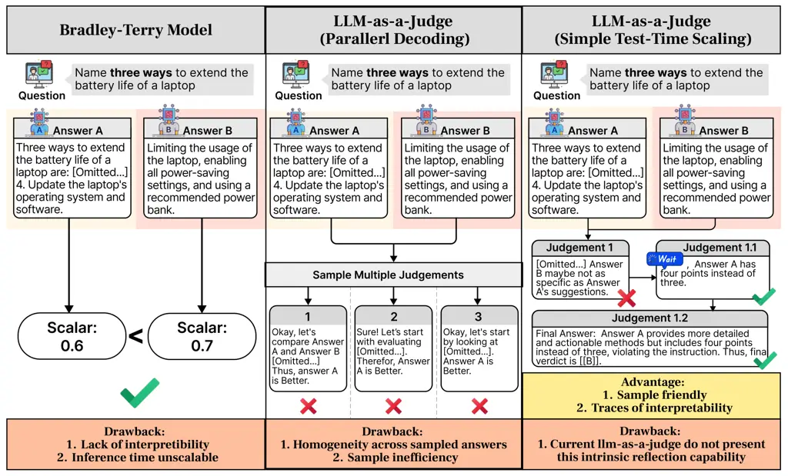

Figure 1: Comparison of Bradley-Terry model and LLM-as-a-Judge under
different scaling strategies.

In response to these challenges, the "LLM-as-a-Judge" paradigm has
gained prominence (Gu et al., 2024; Li et al., 2024). This approach
leverages the capabilities of LLMs themselves to evaluate the outputs of
other AI systems, often other LLMs. The rationale is compelling: LLMs,
particularly those fine-tuned with methods like RLHF, demonstrate a
strong ability to understand instructions and align with human
preferences (Zheng et al., 2023), making them plausible candidates for
automated evaluation. This method offers potential advantages in terms
of speed, cost-efficiency, scalability, and adaptability compared to
purely human-based assessment (Hosking et al., 2023).

However, the LLM-as-a-Judge approach is not a panacea. Ensuring the
reliability and trustworthiness of LLM-as-a-Judge systems remains a
significant open challenge. Specifically, LLM-as-a-Judge also tends to
struggle when evaluating tasks requiring complex reasoning, such as
mathematics or coding, particularly if the judge model itself lacks
proficiency in those areas (Kim et al., 2024; Yu et al., 2025a). With
the advent of large reasoning models (OpenAI, 2024; Guo et al., 2025;
Team et al., 2025), a common paradigm for enhancing the reasoning
capabilities of LLMs involves test-time scaling (Snell et al., 2024).
Existing methods include Best-of-N sampling, which relies on external
validators to select the optimal response (Lightman et al., 2023; Wu
et al., 2024b), and sequential refine, which iteratively revises outputs
by extending Chain-of-Thought(COT) reasoning with reflective
steps (Madaan et al., 2023; OpenAI, 2024; Muennighoff et al., 2025).
Nevertheless, these test-time scaling techniques have primarily focused
on solving tasks, leaving their effectiveness in evaluation scenarios
underexplored. This gap naturally leads to a scientific question: Can
applying test-time scaling techniques to LLM-as-a-Judge enhance its
quality and reliability?

To address the above question, we introduce J1-7B, an LLM-as-a-Judge
trained through a combination of Supervised Fine-Tuning (SFT) and
Reinforcement Learning (RL), specifically optimized to benefit from
Simple Test-Time Scaling (STTS) (Muennighoff et al., 2025), where we
append thinking tokens like "Wait," multiple times to enforce model to
think longer before providing final answers. We provide more discussion
between parallel decoding and STTS in Appendix A. In contrast to
previous approaches (Yu et al., 2025a; Shiwen et al., 2024) that train
LLM-as-a-Judge solely on general judgment datasets—resulting in limited
scaling behavior under STTS, our method introduces a two-stage training
paradigm that effectively enhances reflective reasoning. Specifically,
we first curate a reflection-enhanced dataset augmented explicitly by
STTS tokens through rejection sampling, enabling an effective cold-start
initialization that teaches the model how to utilize reflective
reasoning tokens optimally. Subsequently, we apply RL with verifiable
reward to empower the model to autonomously refine and optimize its
reflective capabilities. As a result of this combined training strategy,
our model, J1-7B, achieves notable performance improvements and
demonstrates an enhanced scaling trend under STTS during inference.

To sum up, the key contribution of our paper are as follows:

- $`\bullet`$
  We identify that existing LLM-as-a-Judge models trained solely on
  general judgment datasets exhibit limited scaling behavior under STTS,
  highlighting an important yet underexplored limitation in current
  frameworks.
- $`\bullet`$
  We introduce a novel two-stage training paradigm, starting with a
  reflection-enhanced SFT dataset curated through rejection sampling,
  effectively initializing the LLM-as-a-Judge to optimally leverage
  reflective reasoning tokens introduced by STTS.
- $`\bullet`$
  We demonstrate that further enhancements in scaling behavior emerge
  explicitly during the RL stage, indicating that the capability for
  effective reflective reasoning under STTS is actively learned and
  reinforced through RL process.
- $`\bullet`$
  Empirically, we validate our proposed method by introducing J1-7B that
  surpasses previous state-of-the-art baselines. Specifically, J1-7B
  achieves a 4.8% improvement in overall judgment performance and
  exhibits a 5.1% stronger scaling trend under STTS, confirming the
  effectiveness and robustness of our proposed training methodology.

## 2 Related Works

### 2.1 LLM-As-A-Judge

The evaluation of Large Language Models (LLMs), particularly for
complex, open-ended tasks, presents significant challenges, as
traditional metrics often fall short and human feedback, while
considered a standard, suffers from scalability issues, high costs, and
inherent biases (Kirk et al., 2023). This has spurred the development of
the "LLM-as-a-judge" paradigm, which utilizes LLMs themselves as
evaluators to offer a scalable and cost-effective alternative (Hosking
et al., 2023; Gu et al., 2024; Li et al., 2024). Research in this domain
encompasses various approaches, including the development of fine-tuned
judges (Zhu et al., 2023; Wang et al., 2023; Li et al., 2023), the
creation of generative or reasoning-based judges that move beyond simple
scores by incorporating critiques (Ankner et al., 2024; Zhang et al.,
2024b; Yu et al., 2024; Ye et al., 2024) or structured evaluation
plans (Saha et al., 2025), and efforts to enhance judging as a general
LLM capability (Yu et al., 2025a). Furthermore, advanced applications
are being explored, such as employing LLMs as critics for iterative
refinement and bug detection (McAleese et al., 2024), enabling
self-improvement through meta-judging (Wu et al., 2024a), and
facilitating scalable oversight where weaker judges evaluate stronger
models (Kenton et al., 2024).

### 2.2 Test-Time Scaling

Recent advances in scaling inference-time computation, such as OpenAI’s
o1/o3 models (OpenAI, 2024), have demonstrated the benefits of
generating additional intermediate tokens before producing a final
answer to enhance reasoning capabilities. This approach has inspired
several community-driven replications, including Deepseek R1 (Guo
et al., 2025), Kimi 1.5 (Team et al., 2025), and other related
efforts (Wang et al., 2024a; Zhang et al., 2024a). In contrast to
sequential refinement strategies for inference-time scaling, parallel
decoding techniques (Snell et al., 2024; Wu et al., 2024b; Brown et al., 2024) offer an alternative paradigm. By generating multiple candidate
sequences in parallel—via repetitive attempts or value-guided
search—these methods improve performance given higher computational
budgets, with proven efficacy in various domains (Zhang et al., 2025;
Chan et al., 2024; Ehrlich et al., 2025; Liu et al., 2025a; Xu et al.,
2024a; Liu et al., 2025b; Ye et al., 2025).

In recent developments, a more lightweight approach for inference-time
scaling has emerged, known as “simple test-time scaling.” (Muennighoff
et al., 2025). This method builds upon large reasoning models and
leverages the inherent reasoning capabilities of existing models. During
the testing phase, it forces the model to engage in additional
reflection by incorporating special tokens such as "wait" during the
model’s reasoning process. This method demonstrates superior scaling
effects compared to repetitive sampling approaches. Notable works in
this area have sparked considerable interest within the research
community, showing great potential. However, current studies have
primarily focused on mathematical and code-related tasks (Yu et al.,
2025b; Shah et al., 2025). Our work fits within this paradigm and
extends its application to the realm of LLM-as-a-judge, specifically in
the context of alignment. We believe this approach represents a key step
toward achieving scalable oversight in AI systems. Furthermore, it
offers a more interpretable evaluation framework, as it traces the
model’s thought process and how its reasoning evolves, providing
valuable insight into the underlying decision-making process.

## 3 Simple Test-Time Scaling for LLM-as-a-Judge

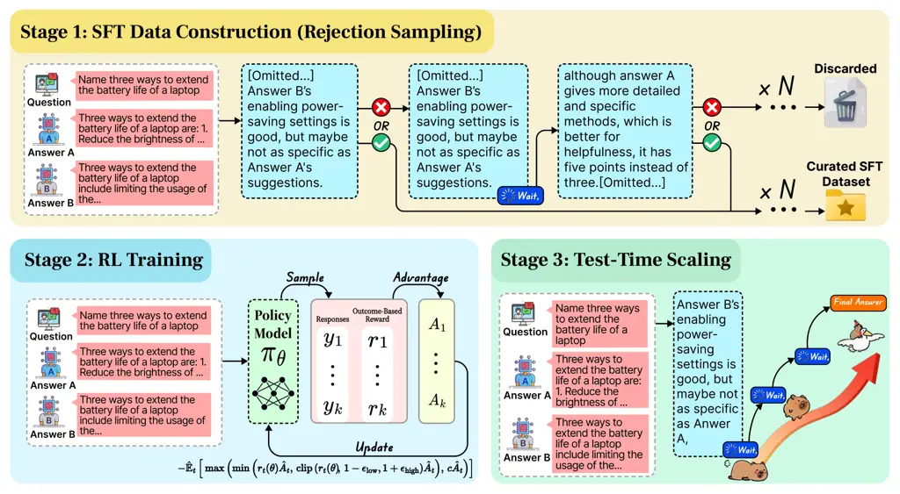

Figure 2: Pipeline of J1-7B. We first curate the SFT dataset through
rejection sampling and subsequently apply RL training to integrate STTS
capabilities into J1-7B .

In this section, we outline our methodological framework in detail. In
Section 3.1, we introduce key concepts, including task definitions and
comparison between traditional reward models and LLM-as-a-Judge . In
Section 3.2, we describe the collection of the SFT dataset via rejection
sampling; In Section 3.3, we detail our RL training approach using a
verifiable reward signal; In Section 3.4, we introduce the
budget-forcing mechanism designed for STTS.

### 3.1 Overview

The core objective of our work is to improve the capability of an
LLM-as-a-Judge in distinguishing the quality of responses. Formally, the
task consists of a query $`q`$, two candidate responses $`a_{1}`$ and
$`a_{2}`$ generated by different models, and a corresponding
human-provided preference $`r_{\text{true}}`$. Specifically, if the
first response $`a_{1}`$ is preferred, $`r_{\text{true}}=0`$;
conversely, if the second response $`a_{2}`$ is preferred,
$`r_{\text{true}}=1`$.

Traditionally, a reward model predicts scalar scores for each response
by evaluating the pairs $`(q,a_{1})`$ and $`(q,a_{2})`$ separately,
denoted as $`r_{\text{predict}}^{(1)}`$ and
$`r_{\text{predict}}^{(2)}`$, respectively. The predicted preference
$`r_{\text{predict}}`$ is determined as:

```math
r_{\text{predict}}=\begin{cases}0,&\text{if }r_{\text{predict}}^{(1)}>r_{\text{predict}}^{(2)}\\[6.0pt]
1,&\text{otherwise}\end{cases} \tag{1}
```

In contrast, an LLM-as-a-Judge typically takes pair-wise input and are
prompterd to directly outputs a preference decision, formally
represented as:

```math
r_{\text{predict}}=\text{LLM}(q,a_{1},a_{2},c),\quad r_{\text{predict}}\in\{0,1\} \tag{2}
```

where $`c`$ is the prompt template that ask LLM to chose the prefered
response and formulate the output in the corresponding format. The
detailed templates for the pair-wise input method are provided in
Appendix H. The accuracy metric
$`\text{acc}(r_{\text{true}},r_{\text{predict}})`$ are used to
quantifies the model’s effectiveness; higher accuracy indicates a
greater ability to distinguish between responses.

### 3.2 Supervised-Finetuning Dataset Curation via Rejection Sampling

To endow the model with foundational reasoning capabilities, a
supervised dataset for cold-start training is essential. Specifically,
our initial dataset is curated from publicly available sources,
including HelpSteer2 (Wang et al., 2024b), Offsetbias (Park et al.,
2024), Wildguard (Han et al., 2024) and Magpie (Xu et al., 2024b). To
augment this dataset with intermediate reasoning steps, we utilize
Deepseek-R1 (Guo et al., 2025), a powerful, open-source reasoning model,
to generate intermediate thought processes along with the final answers.

To ensure the quality of the collected reasoning trajectories, we adopt
a rejection sampling strategy: we retain only those trajectories whose
final answers align with the provided correct answers in the original
dataset. Specifically, for trajectories that initially yield incorrect
final answers, we utilize the method as specified in Section 3.4 to
enforce the model to think again. This reflection procedure is
iteratively performed for three cycles to enrich our dataset with
reflective reasoning patterns.

The detailed workflow for this iterative reflective data collection
process is illustrated in the upper part of Figure 2. The statistical
breakdown of the dataset after each filtering and reflection step is
presented in Appendix B.

### 3.3 Reinforcement Learning

Following the SFT cold-start phase, we further optimize the LLM using
RL, guided by an outcome-based reward strategy. Specifically, we define
the reward as follows:

```math
\text{reward}=\mathbb{I}(r_{\text{predict}}=r_{\text{true}}), \tag{3}
```

where $`\mathbb{I}(\cdot)`$ is the indicator function. This reward
structure assigns a reward of 1 when the model’s predicted preference
aligns with the human ground-truth preference, and 0 otherwise.

We explore several policy gradient algorithms during RL optimization,
including Proximal Policy Optimization (PPO) (Schulman et al., 2017),
Reinforce++ (Hu, 2025), and Group Relative Policy Optimization
(GRPO) (Shao et al., 2024). Additionally, we employ a dual-clip PPO
objective (Ye et al., 2020) to stabilize RL training. The objective
function is given by:

```math
L_{t}^{\text{clip}}(\theta)=-\hat{\mathbb{E}}_{t}\left[\max\left(\min\left(r_{t}(\theta)\hat{A}_{t},\,\text{clip}\left(r_{t}(\theta),1-\epsilon_{\text{low}},1+\epsilon_{\text{high}}\right)\hat{A}_{t}\right),\,c\hat{A}_{t}\right)\right], \tag{4}
```

where $`c>1`$ is a constant indicating the lower bound, $`\hat{A}_{t}`$
is the advantage estimate at token $`t`$, and
$`(\epsilon_{\text{low}},\epsilon_{\text{high}})`$ represent clipping
thresholds, $`r_{t}(\theta)`$ is policy ratio for token $`y_{t}`$ given
context $`x_{t}`$, and is computed as:

```math
r_{t}(\theta)=\frac{\pi_{\theta}(y_{t}|x_{t})}{\pi_{\theta_{\text{old}}}(y_{t}|x_{t})}=\exp\left(\log\pi_{\theta}(y_{t}|x_{t})-\log\pi_{\theta_{\text{old}}}(y_{t}|x_{t})\right), \tag{5}
```

where $`\pi_{\theta}`$ is the current policy parameterized by
$`\theta`$, and $`\pi_{\theta_{\text{old}}}`$ denote the previous
policy. We provide details of different RL algorithms and their
hyperparameters in Appendix E.

By default, we utilize the english DPO subset from the RISE dataset (Yu
et al., 2025a) in the RL phase. We specifically employ the
$`(q,a_{1},a_{2},r_{\text{true}})`$ tuples, excluding the generated CoT
trajectories provided by the original dataset. In Appendix F.1, we
further investigate the impact of employing various data mixtures during
the RL optimization phase.

### 3.4 Simple Test-Time Scaling

During the inference stage, we leverage STTS (Muennighoff et al., 2025)
to further enhance the model’s performance. More concretely, current
reasoning models typically enclose their intermediate thinking processes
within special tokens, such as \<think\> and \</think\>, generating the
final response only after the closing token (\</think\>). Benefiting
from this structured generation pattern, we can explicitly detect when a
model completes its initial reasoning phase. Subsequently, instead of
allowing the model to finalize its answer immediately upon encountering
the \</think\> token, we replace this token with an additional
reflective prompt, such as ‘‘wait’’, thereby encouraging the model to
engage in further reflection before providing its ultimate decision.

Formally, the reflective extension at inference time can be represented
as follows:

```math
r_{predict}=\text{LLM}(q,a_{1},a_{2},c,\{\texttt{<think>},\dots,\texttt{``wait''},\dots,\texttt{</think>}\}),\quad r_{\text{predict}}\in\{0,1\} \tag{6}
```

The workflow of this process is illustrated on the right most panel of
Figure 1. This simple yet effective scaling approach has garnered
attention in recent literature due to its ease of
implementation (Muennighoff et al., 2025; Yu et al., 2025b) and
computational efficiency compared to parallel sampling approaches.

## 4 Experiments

In this section, we introduce the benchmark datasets in Section 4.1,
followed by the description of the baselines in Section 4.2. The
subsequent sections aim to address the following research questions:

- $`\bullet`$
  RQ1: How does J1-7B perform compared to existing state-of-the-art
  models? (Section 4.3)
- $`\bullet`$
  RQ2: How does J1-7B perform under STTS settings? (Section 4.4)
- $`\bullet`$
  RQ3: What factors influence the performance of J1-7B during STTS, such
  as the composition of cold-start dataset, the choice of RL algorithm,
  and the stage of training progression?(Section  4.5,  4.6, 4.7)

We provide more experimental results and case study showcasing the
reflective behaviors during STTS in Appendix G and F,respectively.

|                                                                    |             |            |                    |               |         |
| ------------------------------------------------------------------ | ----------- | ---------- | ------------------ | ------------- | ------- |
| Model                                                              | RewardBench | RewardMath | Anthropic Harmless | CodePrefBench | Overall |
| Results of LLM-as-a-Judge (Proprietary or Larger Models)           |             |            |                    |               |         |
| GPT-4o                                                             | 85.40       | 76.81      | 51.37              | 75.09         | 72.17   |
| o1-mini                                                            | 88.56       | 95.70      | 45.76              | 76.13         | 76.54   |
| Gemini-2.0-flash                                                   | 83.68       | 85.30      | 48.98              | 69.21         | 71.79   |
| Deepseek-R1                                                        | 82.83       | 98.21      | 53.31              | 79.49         | 78.46   |
| Results of Scalar Reward Models (Open Source with Comparable Size) |             |            |                    |               |         |
| InternLM2-7B-Reward                                                | 88.18       | 78.05      | 71.76              | 62.48         | 75.12   |
| Skywork-Reward-Llama3.1-8B                                         | 93.37       | 72.33      | 59.44              | 59.89         | 71.26   |
| FsfairX-LLaMA3-8B                                                  | 84.45       | 66.23      | 53.75              | 58.20         | 65.66   |
| Results of LLM-as-a-Judge (Open Source with Comparable Size)       |             |            |                    |               |         |
| Llama3.1-8B-Instruct                                               | 70.47       | 61.12      | 46.43              | 67.10         | 61.28   |
| Qwen2.5-7B-Instruct                                                | 78.50       | 69.70      | 49.56              | 67.59         | 66.34   |
| Skywork-Critic-Llama3.1-8B                                         | 88.86       | 66.51      | 58.61              | 60.57         | 68.64   |
| RISE-Judge-Qwen2.5-7B                                              | 87.42       | 81.69      | 56.35              | 59.22         | 71.17   |
| Results of Our Models                                              |             |            |                    |               |         |
| J1-7B (SFT Only)                                                   | 85.01       | 82.40      | 53.88              | 49.20         | 67.62   |
| J1-7B (SFT + RL)                                                   | 86.91       | 90.15      | 59.05              | 67.80         | 75.98   |

Table 1: Performance comparison between J1-7B and baseline methods.

### 4.1 Benchmark

We evaluate J1-7B using four diverse preference datasets: Anthropic
Harmless (Bai et al., 2022), RewardMath (Kim et al., 2024),
CodePrefBench (Liu et al., 2024b) and RewardBench (Lambert et al.,
2024). Collectively, these datasets comprehensively cover evaluation
aspects including safety, mathematics, code, and open-domain queries.
Detailed descriptions of these datasets can be found in the Appendix C.

The primary metric used for evaluation across these datasets is accuracy
between $`r_{\text{predict}}`$ and $`r_{\text{true}}`$. When performing
STTS, we measure the relative improvement. Given that baseline models
differ in their initial accuracy scores, we specifically focus on the
relative improvement with respect to the remaining potential for
improvement (i.e., the gap to 100% accuracy), defined formally as:

```math
\Delta~\text{Relative}\%=\frac{\text{Accuracy}_{\text{STTS}}-\text{Accuracy}_{\text{INIT}}}{1-\text{Accuracy}_{\text{INIT}}}\times 100\%. \tag{7}
```

### 4.2 Baselines

We benchmark J1-7B against a diverse set of powerful closed-source and
open-source LLM-as-a-Judge as well as scalar reward models.
Closed-source LLM-as-a-Judge include GPT-4o, o1-mini (OpenAI, 2024), and
Gemini-2.0-flash (Google, 2024), while open-source LLM-as-a-Judge
encompass DeepSeek-R1 (Guo et al., 2025),
LLaMA3.1-8B-Instruct (Grattafiori et al., 2024),
Qwen2.5-7B-Instruct (Yang et al., 2024), as well as previous
state-of-the-art LLM-as-a-Judge Skywork-Critic (Shiwen et al., 2024) and
Rise-Judge (Yu et al., 2025a), which have shown competitive performance
on the RewardBench leaderboard. For the scalar reward models, we compare
with IntermLM2-7B-Reward (Cai et al., 2024),
Skywork-Reward-Llama3.1-8B (Liu et al., 2024a) and
FsfairX-LLaMA3-8B (Xiong et al., 2024).

### 4.3 Overal Results

|     |     |
| --- | --- |
|     |     |
|     |     |

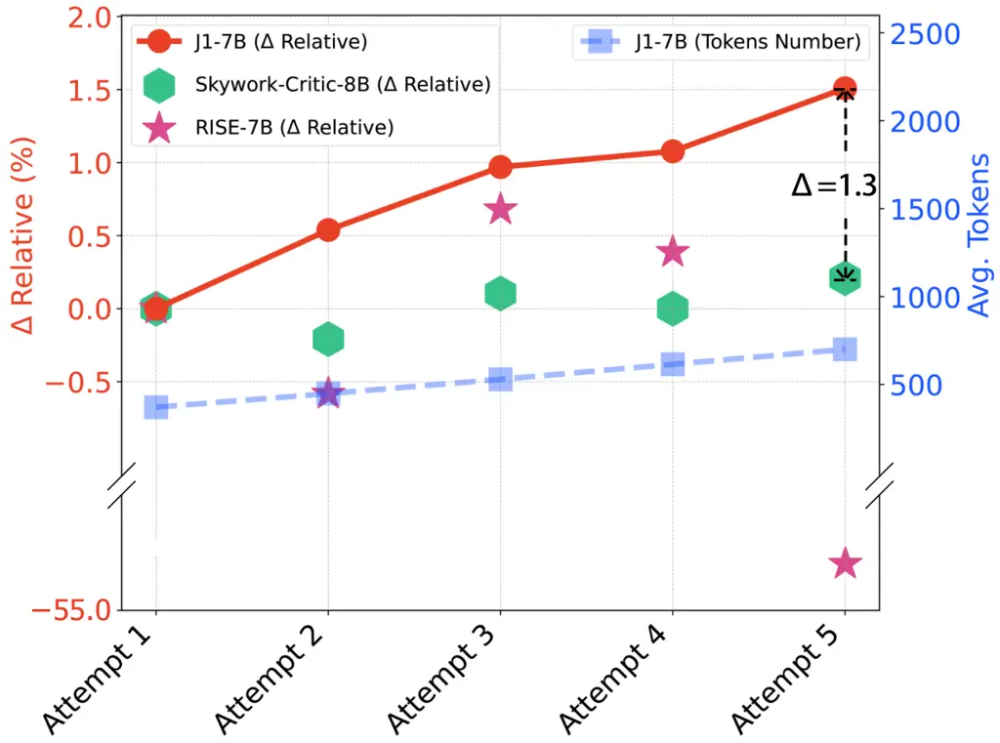

(a) Anthropic Harmless

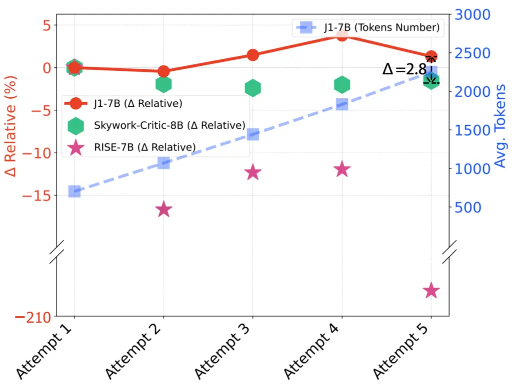

(b) RewardBench

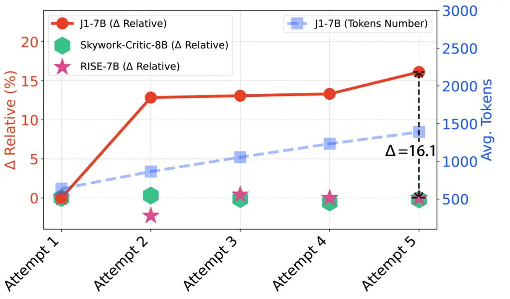

(c) RewardMATH

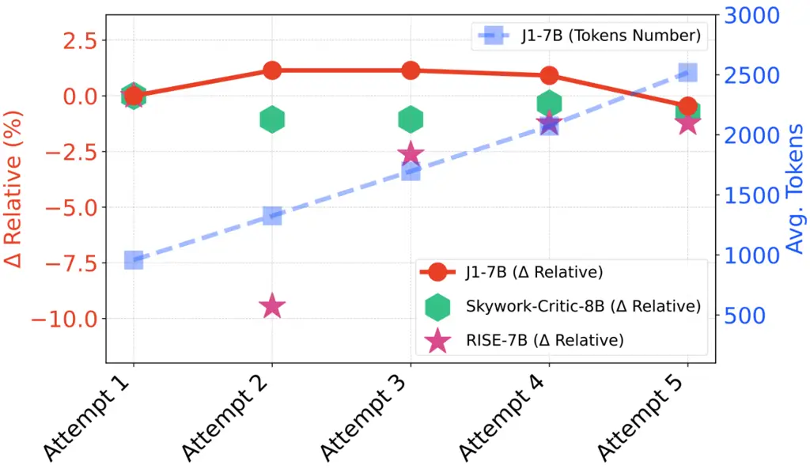

(d) CodePrefBench

Figure 3: Scaling trend for STTS on four different tasks.

(a) Anthropic Harmless

(b) CodePrefBench

(c) RewardBench

(d) RewardMATH

Figure 4: Cold start on reasoning-intensive data improves STTS.

(a) Anthropic Harmless ($`\Delta`$ Relative)

(b) CodePrefBench ($`\Delta`$ Relative)

(c) Anthropic Harmless (Avg. Tokens)

(d) CodePrefBench (Avg. Tokens)

Figure 5: Scaling trend for STTS on Anthropic Harmless and CodePrefBench
with different RL algorithms.

The overall experimental results are summarized in Table 1. Our approach
demonstrates superior performance compared to both advanced
closed-source models and previously established open-source
LLM-as-a-Judge . Although closed-source models such as o1-mini and
Gemini-2.0-flash exhibit exceptional capabilities across various
reasoning benchmarks, their discriminative performance on
preference-based datasets is relatively weaker. This highlights a
notable distribution shift and indicates substantial potential for
improvement in preference discrimination tasks. Furthermore, while
existing state-of-the-art open-source models perform competitively on
the RewardBench dataset, our model consistently surpasses them across
other benchmarks, including mathematics and coding scenarios,
culminating in superior overall performance. Additionally, we
investigate the performance of J1-7B under two conditions: SFT alone and
with subsequent RL. The results underscore the importance of integrating
an RL training stage to enhance overall performance significantly.

### 4.4 J1-7B Demonstrate Superior STTS Scaling Trend.

Furthermore, we evaluate the effectiveness of STTS across the same
tasks, comparing J1-7B ’s performance with that of previous models. By
default, we use “Attempt 1” to denote the original response without
additional reflection, and “Attempt 2-4” to denote that we append
reflective tokens 2-4 times. As is shown in Figure 3, we observe
positive gains from applying STTS to J1-7B across most tasks, typically
showing improvements when adding two reflective tokens. However, adding
further tokens in tasks like RewardBench results in decreased scores. We
hypothesize that this decline is due to the significantly increased
token length, which surpasses the model’s long-context comprehension
capabilities, leading to performance degradation. It is noteworthy that
previous models also output COT processes before their final answers,
but unlike J1-7B , they do not consistently exhibit positive gains from
STTS. We attribute this difference primarily to the benefits derived
from our RL training phase, as further discussed in Section 4.7.

### 4.5 Cold Start on Reasoning-Intensive Data Improve STTS

A natural question is whether incorporating datasets requiring strong
reasoning abilities—such as mathematical and coding tasks—during
cold-start training could further enhance the STTS capability in
downstream tasks. In this section, we explore the effectiveness of using
reasoning-intensive data, distinct from the general judgment data,
during cold-start training.

Specifically, we employ publicly available datasets
OpenR1-Math (HuggingFace, 2025) and CodeForces CoTs (Penedo et al., 2025) and incorporate them alongside LLM-as-a-Judge data during the
cold-start training phase. Experimental results, as presented in
Figure 4, demonstrate that introducing mathematical and coding data not
only benefits the corresponding tasks but also transfers effectively to
safety and open-ended scenarios. Moreover, incorporating these data in
cold start stage not only enhances the performance of the initial
checkpoint but also boosts the effectiveness of the subsequent STTS.

### 4.6 Different RL Algorithms Might Elicit Different STTS behavior

In this section, we investigate whether different RL algorithms result
in varying effectiveness of STTS. Specifically, we take the checkpoints
from Section 4.5 that incorporate reasoning-intensive data in cold start
stage as a start point and utilize different RL algorithms during RL
training. As illustrated in Figure 5, different RL algorithms, namely
Reinforce++, PPO, and GRPO, achieve comparable scores at the trained
checkpoints (scores shown next to the legend). However, we further
observe that in most scenarios, the STTS performance trend for GRPO is
inferior; specifically, increasing the number of reflective tokens does
not yield improved results; instead, it leads to degraded results. Upon
analyzing the number of generated tokens, we find that models optimized
using GRPO tend to produce significantly more tokens. Moreover, with
increasing STTS, the rate of growth in token generation for GRPO models
accelerates faster compared to other algorithms. We attribute this STTS
failure to a decreased model inference capability resulting from
excessively long contexts. Additional analyses provided in the
Appendix F.3 demonstrate that, even without test-time intervention,
models trained with GRPO already exhibit greater usage of reflective
tokens. Consequently, the incremental benefit from further application
of STTS is markedly diminished.

(a)

(b)

(c)

Figure 6: Scaling behaviour of different checkpoints on Anthropic
Harmless.

### 4.7 LLM Learns STTS as RL Steps Increase

In this section, we delve deeper into the origins of the STTS
capability. We hypothesize that models are more likely to acquire
reflection skills during the exploration phase of RL. Prior studies
primarily emphasize that reflective abilities are intrinsically acquired
during pre-training (Shah et al., 2025). Distinct from this intrinsic
perspective, our hypothesis suggests that RL could stimulate STTS
through enforced reflection. To empirically validate this, we evaluate
multiple checkpoints from different stages of the RL training phase.
Figure 6(c) first illustrates that the initial performance of these
checkpoints improves over the course of training. Subsequently, using
the same experimental settings as in previous STTS experiments, we
measure the effectiveness of STTS across checkpoints, as depicted in
Figure 6(a). To quantify the trend of improvement with respect to STTS
attempts, we perform linear regression on the results and compute the
corresponding $`r`$-values, where higher $`r`$-values indicate a more
pronounced upward trend. Figure 6(b) clearly demonstrates an increasing
pattern in $`r`$-values throughout the RL training process. These
findings collectively suggest that the capability of enforced reflection
via STTS likely emerges progressively during reinforcement learning. We
anticipate that this insight will inspire future investigations and
developments within the community.

## 5 Conclusion

In this paper, we investigate the effectiveness of STTS techniques for
enhancing the capabilities and reliability of LLM-as-a-Judge systems. To
this end, we propose J1-7B, a novel LLM-as-a-Judge trained via a
two-stage paradigm, combining SFT on a reflection-enhanced dataset and
RL with verifiable rewards. Our experiments demonstrate that existing
LLM-as-a-Judge methods, trained solely on general judgment datasets,
exhibit limited scaling trends under STTS. In contrast, our approach
significantly improves both baseline performance and STTS effectiveness,
surpassing previous state-of-the-art LLM-as-a-Judge by 4.8% in
performance and exhibiting a 5.1% stronger scaling trend. Furthermore,
detailed experiments reveal that models learn STTS during the RL
process. These findings collectively suggest a promising research
direction in developing more reliable, and scalable LLM-as-a-Judge
systems through structured reflective reasoning strategies.

## References

- Ankner et al. (2024) Zachary Ankner, Mansheej Paul, Brandon Cui,
  Jonathan D Chang, and Prithviraj Ammanabrolu. Critique-out-loud reward
  models. _arXiv preprint arXiv:2408.11791_, 2024.
- Arcuschin et al. (2025) Iván Arcuschin, Jett Janiak, Robert
  Krzyzanowski, Senthooran Rajamanoharan, Neel Nanda, and Arthur Conmy.
  Chain-of-thought reasoning in the wild is not always faithful. _arXiv
  preprint arXiv:2503.08679_, 2025.
- Bai et al. (2022) Yuntao Bai, Andy Jones, Kamal Ndousse, Amanda
  Askell, Anna Chen, Nova DasSarma, Dawn Drain, Stanislav Fort, Deep
  Ganguli, Tom Henighan, et al. Training a helpful and harmless
  assistant with reinforcement learning from human feedback. _arXiv
  preprint arXiv:2204.05862_, 2022.
- Bradley & Terry (1952) Ralph Allan Bradley and Milton E Terry. Rank
  analysis of incomplete block designs: I. the method of paired
  comparisons. _Biometrika_, 39(3/4):324–345, 1952.
- Brown et al. (2024) Bradley Brown, Jordan Juravsky, Ryan Ehrlich,
  Ronald Clark, Quoc V Le, Christopher Ré, and Azalia Mirhoseini. Large
  language monkeys: Scaling inference compute with repeated sampling.
  _arXiv preprint arXiv:2407.21787_, 2024.
- Cai et al. (2024) Zheng Cai, Maosong Cao, Haojiong Chen, Kai Chen,
  Keyu Chen, Xin Chen, Xun Chen, Zehui Chen, Zhi Chen, Pei Chu, Xiaoyi
  Dong, Haodong Duan, Qi Fan, Zhaoye Fei, Yang Gao, Jiaye Ge, Chenya Gu,
  Yuzhe Gu, Tao Gui, Aijia Guo, Qipeng Guo, Conghui He, Yingfan Hu, Ting
  Huang, Tao Jiang, Penglong Jiao, Zhenjiang Jin, Zhikai Lei, Jiaxing
  Li, Jingwen Li, Linyang Li, Shuaibin Li, Wei Li, Yining Li, Hongwei
  Liu, Jiangning Liu, Jiawei Hong, Kaiwen Liu, Kuikun Liu, Xiaoran Liu,
  Chengqi Lv, Haijun Lv, Kai Lv, Li Ma, Runyuan Ma, Zerun Ma, Wenchang
  Ning, Linke Ouyang, Jiantao Qiu, Yuan Qu, Fukai Shang, Yunfan Shao,
  Demin Song, Zifan Song, Zhihao Sui, Peng Sun, Yu Sun, Huanze Tang, Bin
  Wang, Guoteng Wang, Jiaqi Wang, Jiayu Wang, Rui Wang, Yudong Wang,
  Ziyi Wang, Xingjian Wei, Qizhen Weng, Fan Wu, Yingtong Xiong, Chao Xu,
  Ruiliang Xu, Hang Yan, Yirong Yan, Xiaogui Yang, Haochen Ye, Huaiyuan
  Ying, Jia Yu, Jing Yu, Yuhang Zang, Chuyu Zhang, Li Zhang, Pan Zhang,
  Peng Zhang, Ruijie Zhang, Shuo Zhang, Songyang Zhang, Wenjian Zhang,
  Wenwei Zhang, Xingcheng Zhang, Xinyue Zhang, Hui Zhao, Qian Zhao,
  Xiaomeng Zhao, Fengzhe Zhou, Zaida Zhou, Jingming Zhuo, Yicheng Zou,
  Xipeng Qiu, Yu Qiao, and Dahua Lin. Internlm2 technical report, 2024.
- Chan et al. (2024) Chi-Min Chan, Chunpu Xu, Ruibin Yuan, Hongyin Luo,
  Wei Xue, Yike Guo, and Jie Fu. Rq-rag: Learning to refine queries for
  retrieval augmented generation. _arXiv preprint
  arXiv:2404.00610_, 2024.
- Ehrlich et al. (2025) Ryan Ehrlich, Bradley Brown, Jordan Juravsky,
  Ronald Clark, Christopher Ré, and Azalia Mirhoseini. Codemonkeys:
  Scaling test-time compute for software engineering. _arXiv preprint
  arXiv:2501.14723_, 2025.
- Gao et al. (2023) Leo Gao, John Schulman, and Jacob Hilton. Scaling
  laws for reward model overoptimization. In _International Conference
  on Machine Learning_, pp. 10835–10866. PMLR, 2023.
- Google (2024) Google. Gemini 2.0 flash thinking mode.
  [https://cloud.google.com/vertex-ai/generative-ai/docs/thinking-mode](https://cloud.google.com/vertex-ai/generative-ai/docs/thinking-mode),
  December 2024. Accessed: 2025-04-29.
- Grattafiori et al. (2024) Aaron Grattafiori, Abhimanyu Dubey, Abhinav
  Jauhri, Abhinav Pandey, Abhishek Kadian, Ahmad Al-Dahle, Aiesha
  Letman, Akhil Mathur, Alan Schelten, Alex Vaughan, et al. The llama 3
  herd of models. _arXiv preprint arXiv:2407.21783_, 2024.
- Gu et al. (2024) Jiawei Gu, Xuhui Jiang, Zhichao Shi, Hexiang Tan,
  Xuehao Zhai, Chengjin Xu, Wei Li, Yinghan Shen, Shengjie Ma, Honghao
  Liu, et al. A survey on llm-as-a-judge. _arXiv preprint
  arXiv:2411.15594_, 2024.
- Guo et al. (2025) Daya Guo, Dejian Yang, Haowei Zhang, Junxiao Song,
  Ruoyu Zhang, Runxin Xu, Qihao Zhu, Shirong Ma, Peiyi Wang, Xiao Bi,
  et al. Deepseek-r1: Incentivizing reasoning capability in llms via
  reinforcement learning. _arXiv preprint arXiv:2501.12948_, 2025.
- Han et al. (2024) Seungju Han, Kavel Rao, Allyson Ettinger, Liwei
  Jiang, Bill Yuchen Lin, Nathan Lambert, Yejin Choi, and Nouha Dziri.
  Wildguard: Open one-stop moderation tools for safety risks,
  jailbreaks, and refusals of llms. _arXiv preprint
  arXiv:2406.18495_, 2024.
- Hoffman et al. (2018) Robert R Hoffman, Shane T Mueller, Gary Klein,
  and Jordan Litman. Metrics for explainable ai: Challenges and
  prospects. _arXiv preprint arXiv:1812.04608_, 2018.
- Hosking et al. (2023) Tom Hosking, Phil Blunsom, and Max Bartolo.
  Human feedback is not gold standard. _arXiv preprint
  arXiv:2309.16349_, 2023.
- Hu (2025) Jian Hu. Reinforce++: A simple and efficient approach for
  aligning large language models. _arXiv preprint
  arXiv:2501.03262_, 2025.
- HuggingFace (2025) HuggingFace. open-r1/openr1-math-220k.
  [https://huggingface.co/datasets/open-r1/OpenR1-Math-220k](https://huggingface.co/datasets/open-r1/OpenR1-Math-220k), 2025.
  Accessed: 2025-04-29.
- Ji et al. (2024) Jiaming Ji, Donghai Hong, Borong Zhang, Boyuan Chen,
  Josef Dai, Boren Zheng, Tianyi Qiu, Boxun Li, and Yaodong Yang.
  Pku-saferlhf: Towards multi-level safety alignment for llms with human
  preference. _arXiv preprint arXiv:2406.15513_, 2024.
- Kenton et al. (2024) Zachary Kenton, Noah Siegel, János Kramár, Jonah
  Brown-Cohen, Samuel Albanie, Jannis Bulian, Rishabh Agarwal, David
  Lindner, Yunhao Tang, Noah Goodman, et al. On scalable oversight with
  weak llms judging strong llms. _Advances in Neural Information
  Processing Systems_, 37:75229–75276, 2024.
- Kim et al. (2024) Sunghwan Kim, Dongjin Kang, Taeyoon Kwon, Hyungjoo
  Chae, Jungsoo Won, Dongha Lee, and Jinyoung Yeo. Evaluating robustness
  of reward models for mathematical reasoning. _arXiv preprint
  arXiv:2410.01729_, 2024.
- Kirk et al. (2023) Hannah Rose Kirk, Andrew M Bean, Bertie Vidgen,
  Paul Röttger, and Scott A Hale. The past, present and better future of
  feedback learning in large language models for subjective human
  preferences and values. _arXiv preprint arXiv:2310.07629_, 2023.
- Lambert et al. (2024) Nathan Lambert, Valentina Pyatkin, Jacob
  Morrison, LJ Miranda, Bill Yuchen Lin, Khyathi Chandu, Nouha Dziri,
  Sachin Kumar, Tom Zick, Yejin Choi, et al. Rewardbench: Evaluating
  reward models for language modeling. _arXiv preprint
  arXiv:2403.13787_, 2024.
- Li et al. (2024) Dawei Li, Bohan Jiang, Liangjie Huang, Alimohammad
  Beigi, Chengshuai Zhao, Zhen Tan, Amrita Bhattacharjee, Yuxuan Jiang,
  Canyu Chen, Tianhao Wu, et al. From generation to judgment:
  Opportunities and challenges of llm-as-a-judge. _arXiv preprint
  arXiv:2411.16594_, 2024.
- Li et al. (2023) Junlong Li, Shichao Sun, Weizhe Yuan, Run-Ze Fan, Hai
  Zhao, and Pengfei Liu. Generative judge for evaluating alignment.
  _arXiv preprint arXiv:2310.05470_, 2023.
- Lightman et al. (2023) Hunter Lightman, Vineet Kosaraju, Yuri Burda,
  Harrison Edwards, Bowen Baker, Teddy Lee, Jan Leike, John Schulman,
  Ilya Sutskever, and Karl Cobbe. Let’s verify step by step. In _The
  Twelfth International Conference on Learning Representations_, 2023.
- Liu et al. (2024a) Chris Yuhao Liu, Liang Zeng, Jiacai Liu, Rui Yan,
  Jujie He, Chaojie Wang, Shuicheng Yan, Yang Liu, and Yahui Zhou.
  Skywork-reward: Bag of tricks for reward modeling in llms. _arXiv
  preprint arXiv:2410.18451_, 2024a.
- Liu et al. (2025a) Fangfu Liu, Hanyang Wang, Yimo Cai, Kaiyan Zhang,
  Xiaohang Zhan, and Yueqi Duan. Video-t1: Test-time scaling for video
  generation. _arXiv preprint arXiv:2503.18942_, 2025a.
- Liu et al. (2024b) Jiawei Liu, Thanh Nguyen, Mingyue Shang, Hantian
  Ding, Xiaopeng Li, Yu Yu, Varun Kumar, and Zijian Wang. Learning code
  preference via synthetic evolution. _arXiv preprint arXiv:2410.03837_,
  2024b.
- Liu et al. (2025b) Zijun Liu, Peiyi Wang, Runxin Xu, Shirong Ma, Chong
  Ruan, Peng Li, Yang Liu, and Yu Wu. Inference-time scaling for
  generalist reward modeling. _arXiv preprint arXiv:2504.02495_, 2025b.
- Maćkiewicz & Ratajczak (1993) Andrzej Maćkiewicz and Waldemar
  Ratajczak. Principal components analysis (pca). _Computers &
  Geosciences_, 19(3):303–342, 1993.
- Madaan et al. (2023) Aman Madaan, Niket Tandon, Prakhar Gupta, Skyler
  Hallinan, Luyu Gao, Sarah Wiegreffe, Uri Alon, Nouha Dziri, Shrimai
  Prabhumoye, Yiming Yang, et al. Self-refine: Iterative refinement with
  self-feedback. _Advances in Neural Information Processing Systems_,
  36:46534–46594, 2023.
- McAleese et al. (2024) Nat McAleese, Rai Michael Pokorny, Juan
  Felipe Ceron Uribe, Evgenia Nitishinskaya, Maja Trebacz, and Jan
  Leike. Llm critics help catch llm bugs. _arXiv preprint
  arXiv:2407.00215_, 2024.
- Muennighoff et al. (2025) Niklas Muennighoff, Zitong Yang, Weijia Shi,
  Xiang Lisa Li, Li Fei-Fei, Hannaneh Hajishirzi, Luke Zettlemoyer,
  Percy Liang, Emmanuel Candès, and Tatsunori Hashimoto. s1: Simple
  test-time scaling. _arXiv preprint arXiv:2501.19393_, 2025.
- OpenAI (2024) OpenAI. Learning to reason with llms.
  [https://openai.com/index/learning-to-reason-with-llms/](https://openai.com/index/learning-to-reason-with-llms/),
  September 2024. Accessed: 2025-04-29.
- Ouyang et al. (2022) Long Ouyang, Jeffrey Wu, Xu Jiang, Diogo Almeida,
  Carroll Wainwright, Pamela Mishkin, Chong Zhang, Sandhini Agarwal,
  Katarina Slama, Alex Ray, et al. Training language models to follow
  instructions with human feedback. _Advances in neural information
  processing systems_, 35:27730–27744, 2022.
- Park et al. (2024) Junsoo Park, Seungyeon Jwa, Meiying Ren, Daeyoung
  Kim, and Sanghyuk Choi. Offsetbias: Leveraging debiased data for
  tuning evaluators. _arXiv preprint arXiv:2407.06551_, 2024.
- Penedo et al. (2025) Guilherme Penedo, Anton Lozhkov, Hynek Kydlíček,
  Loubna Ben Allal, Edward Beeching, Agustín Piqueres Lajarín, Quentin
  Gallouédec, Nathan Habib, Lewis Tunstall, and Leandro von Werra.
  Codeforces cots.
  [https://huggingface.co/datasets/open-r1/codeforces-cots](https://huggingface.co/datasets/open-r1/codeforces-cots), 2025.
- Saha et al. (2025) Swarnadeep Saha, Xian Li, Marjan Ghazvininejad,
  Jason Weston, and Tianlu Wang. Learning to plan & reason for
  evaluation with thinking-llm-as-a-judge. _arXiv preprint
  arXiv:2501.18099_, 2025.
- Schulman et al. (2015) John Schulman, Philipp Moritz, Sergey Levine,
  Michael Jordan, and Pieter Abbeel. High-dimensional continuous control
  using generalized advantage estimation. _arXiv preprint
  arXiv:1506.02438_, 2015.
- Schulman et al. (2017) John Schulman, Filip Wolski, Prafulla Dhariwal,
  Alec Radford, and Oleg Klimov. Proximal policy optimization
  algorithms. _arXiv preprint arXiv:1707.06347_, 2017.
- Shah et al. (2025) Darsh J Shah, Peter Rushton, Somanshu Singla, Mohit
  Parmar, Kurt Smith, Yash Vanjani, Ashish Vaswani, Adarsh Chaluvaraju,
  Andrew Hojel, Andrew Ma, et al. Rethinking reflection in pre-training.
  _arXiv preprint arXiv:2504.04022_, 2025.
- Shao et al. (2024) Zhihong Shao, Peiyi Wang, Qihao Zhu, Runxin Xu,
  Junxiao Song, Xiao Bi, Haowei Zhang, Mingchuan Zhang, YK Li, Y Wu,
  et al. Deepseekmath: Pushing the limits of mathematical reasoning in
  open language models. _arXiv preprint arXiv:2402.03300_, 2024.
- Shiwen et al. (2024) Tu Shiwen, Zhao Liang, Chris Yuhao Liu, Liang
  Zeng, and Yang Liu. Skywork critic model series.
  [https://huggingface.co/Skywork](https://huggingface.co/Skywork),
  September 2024. URL
  [https://huggingface.co/Skywork](https://huggingface.co/Skywork).
- Snell et al. (2024) Charlie Snell, Jaehoon Lee, Kelvin Xu, and Aviral
  Kumar. Scaling llm test-time compute optimally can be more effective
  than scaling model parameters. _arXiv preprint
  arXiv:2408.03314_, 2024.
- Team et al. (2025) Kimi Team, Angang Du, Bofei Gao, Bowei Xing,
  Changjiu Jiang, Cheng Chen, Cheng Li, Chenjun Xiao, Chenzhuang Du,
  Chonghua Liao, et al. Kimi k1. 5: Scaling reinforcement learning with
  llms. _arXiv preprint arXiv:2501.12599_, 2025.
- Wang et al. (2024a) Jun Wang, Meng Fang, Ziyu Wan, Muning Wen, Jiachen
  Zhu, Anjie Liu, Ziqin Gong, Yan Song, Lei Chen, Lionel M Ni, et al.
  Openr: An open source framework for advanced reasoning with large
  language models. _arXiv preprint arXiv:2410.09671_, 2024a.
- Wang et al. (2020) Wenhui Wang, Furu Wei, Li Dong, Hangbo Bao, Nan
  Yang, and Ming Zhou. Minilm: Deep self-attention distillation for
  task-agnostic compression of pre-trained transformers. _Advances in
  neural information processing systems_, 33:5776–5788, 2020.
- Wang et al. (2023) Yidong Wang, Zhuohao Yu, Zhengran Zeng, Linyi Yang,
  Cunxiang Wang, Hao Chen, Chaoya Jiang, Rui Xie, Jindong Wang, Xing
  Xie, et al. Pandalm: An automatic evaluation benchmark for llm
  instruction tuning optimization. _arXiv preprint
  arXiv:2306.05087_, 2023.
- Wang et al. (2024b) Zhilin Wang, Yi Dong, Olivier Delalleau, Jiaqi
  Zeng, Gerald Shen, Daniel Egert, Jimmy J Zhang, Makesh Narsimhan
  Sreedhar, and Oleksii Kuchaiev. Helpsteer2: Open-source dataset for
  training top-performing reward models. _arXiv preprint
  arXiv:2406.08673_, 2024b.
- Weyssow et al. (2024) Martin Weyssow, Aton Kamanda, Xin Zhou, and
  Houari Sahraoui. Codeultrafeedback: An llm-as-a-judge dataset for
  aligning large language models to coding preferences. _arXiv preprint
  arXiv:2403.09032_, 2024.
- Wu et al. (2024a) Tianhao Wu, Weizhe Yuan, Olga Golovneva, Jing Xu,
  Yuandong Tian, Jiantao Jiao, Jason Weston, and Sainbayar Sukhbaatar.
  Meta-rewarding language models: Self-improving alignment with
  llm-as-a-meta-judge. _arXiv preprint arXiv:2407.19594_, 2024a.
- Wu et al. (2024b) Yangzhen Wu, Zhiqing Sun, Shanda Li, Sean Welleck,
  and Yiming Yang. Inference scaling laws: An empirical analysis of
  compute-optimal inference for problem-solving with language models.
  _arXiv preprint arXiv:2408.00724_, 2024b.
- Xiong et al. (2024) Wei Xiong, Hanze Dong, Chenlu Ye, Ziqi Wang, Han
  Zhong, Heng Ji, Nan Jiang, and Tong Zhang. Iterative preference
  learning from human feedback: Bridging theory and practice for rlhf
  under kl-constraint, 2024.
- Xu et al. (2024a) Guowei Xu, Peng Jin, Li Hao, Yibing Song, Lichao
  Sun, and Li Yuan. Llava-o1: Let vision language models reason
  step-by-step. _arXiv preprint arXiv:2411.10440_, 2024a.
- Xu et al. (2024b) Zhangchen Xu, Fengqing Jiang, Luyao Niu, Yuntian
  Deng, Radha Poovendran, Yejin Choi, and Bill Yuchen Lin. Magpie:
  Alignment data synthesis from scratch by prompting aligned llms with
  nothing. _arXiv preprint arXiv:2406.08464_, 2024b.
- Yang et al. (2024) An Yang, Baosong Yang, Beichen Zhang, Binyuan Hui,
  Bo Zheng, Bowen Yu, Chengyuan Li, Dayiheng Liu, Fei Huang, Haoran Wei,
  et al. Qwen2. 5 technical report. _arXiv preprint
  arXiv:2412.15115_, 2024.
- Ye et al. (2020) Deheng Ye, Zhao Liu, Mingfei Sun, Bei Shi, Peilin
  Zhao, Hao Wu, Hongsheng Yu, Shaojie Yang, Xipeng Wu, Qingwei Guo,
  et al. Mastering complex control in moba games with deep reinforcement
  learning. In _Proceedings of the AAAI conference on artificial
  intelligence_, volume 34, pp. 6672–6679, 2020.
- Ye et al. (2025) Zhen Ye, Xinfa Zhu, Chi-Min Chan, Xinsheng Wang,
  Xu Tan, Jiahe Lei, Yi Peng, Haohe Liu, Yizhu Jin, Zheqi DAI, et al.
  Llasa: Scaling train-time and inference-time compute for llama-based
  speech synthesis. _arXiv preprint arXiv:2502.04128_, 2025.
- Ye et al. (2024) Zihuiwen Ye, Fraser Greenlee-Scott, Max Bartolo, Phil
  Blunsom, Jon Ander Campos, and Matthias Gallé. Improving reward models
  with synthetic critiques. _arXiv preprint arXiv:2405.20850_, 2024.
- Yu et al. (2025a) Jiachen Yu, Shaoning Sun, Xiaohui Hu, Jiaxu Yan,
  Kaidong Yu, and Xuelong Li. Improve llm-as-a-judge ability as a
  general ability. _arXiv preprint arXiv:2502.11689_, 2025a.
- Yu et al. (2024) Yue Yu, Zhengxing Chen, Aston Zhang, Liang Tan,
  Chenguang Zhu, Richard Yuanzhe Pang, Yundi Qian, Xuewei Wang, Suchin
  Gururangan, Chao Zhang, et al. Self-generated critiques boost reward
  modeling for language models. _arXiv preprint arXiv:2411.16646_, 2024.
- Yu et al. (2025b) Zhaojian Yu, Yinghao Wu, Yilun Zhao, Arman Cohan,
  and Xiao-Ping Zhang. Z1: Efficient test-time scaling with code. _arXiv
  preprint arXiv:2504.00810_, 2025b.
- Zhang et al. (2024a) Di Zhang, Jianbo Wu, Jingdi Lei, Tong Che,
  Jiatong Li, Tong Xie, Xiaoshui Huang, Shufei Zhang, Marco Pavone,
  Yuqiang Li, et al. Llama-berry: Pairwise optimization for o1-like
  olympiad-level mathematical reasoning. _arXiv preprint
  arXiv:2410.02884_, 2024a.
- Zhang et al. (2025) Kaiyan Zhang, Jiayuan Zhang, Haoxin Li, Xuekai
  Zhu, Ermo Hua, Xingtai Lv, Ning Ding, Biqing Qi, and Bowen Zhou.
  Openprm: Building open-domain process-based reward models with
  preference trees. In _The Thirteenth International Conference on
  Learning Representations_, 2025.
- Zhang et al. (2024b) Lunjun Zhang, Arian Hosseini, Hritik Bansal,
  Mehran Kazemi, Aviral Kumar, and Rishabh Agarwal. Generative
  verifiers: Reward modeling as next-token prediction. _arXiv preprint
  arXiv:2408.15240_, 2024b.
- Zheng et al. (2023) Lianmin Zheng, Wei-Lin Chiang, Ying Sheng, Siyuan
  Zhuang, Zhanghao Wu, Yonghao Zhuang, Zi Lin, Zhuohan Li, Dacheng Li,
  Eric Xing, et al. Judging llm-as-a-judge with mt-bench and chatbot
  arena. _Advances in Neural Information Processing Systems_,
  36:46595–46623, 2023.
- Zhu et al. (2023) Lianghui Zhu, Xinggang Wang, and Xinlong Wang.
  Judgelm: Fine-tuned large language models are scalable judges. _arXiv
  preprint arXiv:2310.17631_, 2023.

## Appendix A Comparision between Parallel Decoding and STTS

In this section, we present empirical evidence that STTS generates
outputs with greater diversity compared to parallel decoding. We
randomly select 100 instances from four benchmarks and visualize the
results in Figure 7.

The “Original” and “Parallel Decoding” outputs represent two distinct
responses generated with a temperature parameter of 0.8, while the
“STTS” outputs were obtained after four append-wait iterations based on
“Original”. We employ the all-MiniLM-L6-v2 model (Wang et al., 2020) for
embedding generation and use PCA (Maćkiewicz & Ratajczak, 1993) for
dimensionality reduction to plot the distribution trajectories.

Figure 7 clearly demonstrates that while the Original and Parallel
Decoding outputs exhibit similar distribution patterns, STTS outputs
show significantly greater diversity in their spatial distribution.
Combined with Figure 1, our quantitative and qualitative analyses
confirm that STTS exhibits greater diversity compared to parallel
decoding, demonstrating stronger potential to yield superior solutions
through iterative refinement. Moreover, parallel decoding incurs
significant token consumption, whereas STTS is notably more
sample-efficient. Motivated by these findings, we primarily focus on
exploring STTS for LLM-as-a-Judge throughout this paper.

(a) Anthropic Harmless

(b) CodePrefBench

(c) RewardBench

(d) RewardMATH

Figure 7: Distribution patterns between STTS and Parallel Decoding.

## Appendix B Training Dataset Statistics

Below is a brief introduction to each training dataset.

- $`\bullet`$
  HelpSteer2 (Wang et al., 2024b) is an open-source dataset designed to
  train reward models for improved helpfulness. It helps align models to
  be more accurate and coherent while allowing adjustments in response
  complexity and verbosity.
- $`\bullet`$
  Magpie (Xu et al., 2024b) is a large scale synthesized instruction
  dataset. During synthesis, rather than relying on prompt engineering
  or seed questions, instruction data is generated from open-weight LLMs
  by directly using a pre-query template.
- $`\bullet`$
  OffsetBias (Park et al., 2024) is a dataset of paired preferences
  designed to mitigate typical biases found within judge models. This
  dataset is constructed by GPT-4 and Claude-3, and incorporates
  prompting techniques like the Off-topic response approach and the
  Erroneous response approach.
- $`\bullet`$
  WildGuard (Han et al., 2024) is a meticulously balanced multitask
  moderation dataset in 13 risk categories. Data are selected from four
  sources (i.e., synthetic vanilla/adversarial, in-the-wild, and
  annotator-written data) to ensure completeness.

### B.1 Statistics During Rejection Sampling

Table 2 illustrates our data construction procedure using DeepSeek-R1
via rejection sampling. Each cell’s left value indicates the number of
correctly answered samples, while the right value represents the total
samples at the current phase. A notable observation is that the model
initially achieves an overall accuracy of approximately 70%. However,
when employing STTS in subsequent attempts, only around 4% of previously
incorrect responses are corrected. Moreover, this conversion rate
further diminishes with additional attempts, suggesting that while STTS
provides benefits, the model predominantly maintains its initial
decisions.

|            |                 |             |           |           |           |
| ---------- | --------------- | ----------- | --------- | --------- | --------- |
| Dataset    | Original Number | Attempt 0   | Attempt 1 | Attempt 2 | Attempt 3 |
| HelpSteer2 | 6766            | 3366/6766   | 99/3400   | 59/3301   | 36/3242   |
| OffsetBias | 8504            | 7327/8504   | 85/1177   | 44/1092   | 25/1048   |
| WildGuard  | 6709            | 5828/6709   | 110/881   | 29/771    | 19/742    |
| Magpie     | 54582           | 36846/54582 | 599/17736 | 260/17137 | 194/16877 |

Table 2: Statistics of curating process.

### B.2 Other Statistics of Curated Dataset

#### Length Distribution

We present statistical analyses of sequence lengths for the constructed
training data in Figure 8, detailing the distributions across different
datasets. We further partition the data into two categories based on
whether the model correctly or incorrectly answered each instance.
Notably, sequences in the incorrect category consistently exhibit
greater lengths compared to those in the correct category. This
observation suggests that the model may engage in redundant or
ineffective reasoning, employing additional tokens without successfully
arriving at the correct final answer.

(a) HelpSteer2

(b) Magpie

(c) OffsetBias

(d) WildGuard

Figure 8: Length distribution of the curated dataset.

#### Reflective Words Frequency

We further examine the distribution of instances according to the number
of reflective words employed in reasoning, again partitioning the data
into correct and incorrect categories. The results are shown in
Figure 9. Our findings reveal two primary observations: (1) irrespective
of correctness, the majority of instances involve no reflective words;
(2) incorrect instances demonstrate a higher likelihood of employing a
greater number of reflective words compared to correct instances. These
results suggest that moderate reflection is beneficial; a limited use of
reflective words aids the model’s reasoning, whereas the absence or
excessive use of reflection may negatively impact overall performance.

|                                                                                             |
| ------------------------------------------------------------------------------------------- |
| Reflective Words                                                                            |
| Wait, Alternatively, But, However, Hold on, On the other hand, On the contrary, In contrast |

Table 3: Reflective words we take into account.

(a) HelpSteer2

(b) Magpie

(c) OffsetBias

(d) WildGuard

Figure 9: Reflective words frequency of the curated dataset.

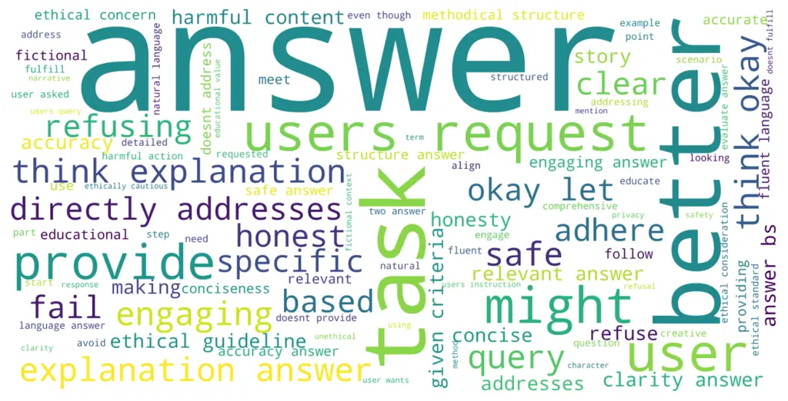

Figure 10: Word cloud of the curated dataset.

#### Word Cloud

The word cloud in Figure 10 visually summarizes the prominent vocabulary
present in our training dataset. It clearly illustrates the relative
prevalence of various terms, particularly those corresponding to
different evaluation criteria (‘ethical concern’, ‘concise’, ‘engaging
answer’, etc.). This visualization supports the conclusion that our
dataset effectively captures the intended phenomenon—that LLM-as-a-Judge
, during reasoning processes, indeed utilize explicit criteria when
formulating their conclusions.

## Appendix C Evaluation Benchmark Details

All evaluation benchmarks consist of binary classification tasks.
Following previous works, we use accuracy as the evaluation metric.
Below is a brief overview of each evaluation benchmark.

- $`\bullet`$
  RewardBench  (Lambert et al., 2024) is a collection of sets consisting
  of a prompt, a chosen response, and a rejected response across
  categories like chat, reasoning, and safety. The dataset is designed
  to evaluate the effectiveness of reward models when dealing with
  complex, organized, and out-of-distribution queries.
- $`\bullet`$
  RewardMath (Kim et al., 2024) is a benchmark crafted to evaluate the
  strength of reward models in tackling mathematical reasoning problems.
  It has a 1:9 ratio of chosen to rejected solutions. Note that in our
  paper, we calculate an instance-wise score rather than a problem-wise
  score, as solely considering whether the reward of the chosen solution
  is the highest can be overly strict.
- $`\bullet`$
  Anthropic Harmless (Bai et al., 2022) is a benchmark used for
  evaluating models’ harmlessness. During the data collection process,
  human annotators are encouraged to provoke LLMs into generating
  harmful responses and to identify which response is more harmful.
- $`\bullet`$
  CodePrefBench (Liu et al., 2024b) is a comprehensive benchmark for
  assessing developer preferences. The examples in the benchmark are
  labeled based on three verifiable criteria: correctness, efficiency,
  and security. Additionally, it includes overall preferences of
  developers as collected from 18 annotators.

## Appendix D Implementation Details

Our initial policy model is based on Qwen2.5-7B-Base. In the SFT stage,
we utilize a learning rate of $`2\times 10^{-5}`$, train for 3 epochs,
set the maximum sequence length to 8192 tokens, and employ a batch size
of 256. For the RL stage, we adopt a learning rate of
$`5\times 10^{-7}`$, conduct training for 15 epochs, use a batch size of
256, and set the number of rollout samples to 8. The default RL
algorithm employed in our primary experiments is Reinforce++. All
experiments are conducted on a NVIDIA H800 cluster. Additional
experimental details, including the hyperparameters for PPO and GRPO
algorithms, can be found in the Appendix E.

## Appendix E Other Training Details

In our experiments, we employ three RL algorithms: PPO, Reinforce++ and
GRPO. Both PPO and Reinforce++ share the same general objective
formulation, differing primarily in how they compute the advantage
estimate.

Specifically, $`\hat{A}_{t}^{\text{PPO}}`$ is computed using the
Generalized Advantage Estimation (GAE) method (Schulman et al., 2015):

```math
\displaystyle\delta_{t} \displaystyle=r_{t}+\gamma V_{t+1}-V_{t}, \tag{8}
```

```math
\displaystyle\hat{A}_{t}^{\text{PPO}} \displaystyle=\sum_{l=0}^{T}(\gamma\lambda)^{l}\delta_{t+l}. \tag{9}
```

For Reinforce++, we adopt the same objective function structure as PPO.
However, the advantage estimate $`\hat{A}_{t}^{\text{RF++}}`$ is defined
differently as follows:

```math
\displaystyle\hat{A}_{t}^{\text{RF++}} \displaystyle=r(x,y)-\beta\sum_{i=t}^{T}\mathbb{D}_{\mathrm{KL}}\left(\pi_{\theta}\parallel\pi_{\mathrm{ref}}\right), \tag{10}
```

```math
\displaystyle\hat{A}_{\text{normalized}}^{\text{RF++}} \displaystyle=\frac{\hat{A}_{t}^{\text{RF++}}-\mu_{\hat{A}}}{\sigma_{\hat{A}}}, \tag{11}
```

where $`\mu_{\hat{A}}`$ and $`\sigma_{\hat{A}}`$ represent the mean and
standard deviation of advantages within each batch respectively and
$`\mathbb{D}_{\mathrm{KL}}\left(\pi_{\theta}\parallel\pi_{\mathrm{ref}}\right)`$
is a token-level Kullback-Leibler divergence penalty between the RL
model and the SFT model distributions.

In contrast, GRPO employs a slightly modified objective, where the KL
divergence term is explicitly separated from the advantage estimate:

```math
L_{t}^{\text{GRPO}}(\theta)=-\hat{\mathbb{E}}_{t}\left[\max\left(\min\left(r_{t}(\theta)\hat{A}_{t},\,\text{clip}\left(r_{t}(\theta),1-\epsilon_{\text{low}},1+\epsilon_{\text{high}}\right)\hat{A}_{t}\right),\,c\hat{A}_{t}\right)-\beta\mathbb{D}_{\mathrm{KL}}\left(\pi_{\theta}\parallel\pi_{\mathrm{ref}}\right)\right], \tag{12}
```

where GRPO’s advantage estimation $`\hat{A}_{t}`$ is computed via
group-relative normalization of rewards that has the similar form as
Equation 11.

Our default hyperparameter settings for RL training are as follows:

- $`\bullet`$
  Clipping lower bound parameter: $`c=3.0`$
- $`\bullet`$
  PPO clip parameters: $`\epsilon_{\text{high}}=0.2`$,
  $`\epsilon_{\text{low}}=0.2`$
- $`\bullet`$
  KL coefficient: $`\beta=0.001`$
- $`\bullet`$
  Learning rate schedule: constant
- $`\bullet`$
  Weight decay: $`0.01`$
- $`\bullet`$
  Rollout temperature: $`1.0`$
- $`\bullet`$
  GAE parameters (Equation 9): discount factor $`\lambda=0.99`$, balance
  factor $`\gamma=0.9`$
- $`\bullet`$
  Critic network learning rate: $`1\times 10^{-5}`$

## Appendix F More Experimental Results

In this section, we present additional experimental results, including
analyses conducted on extended datasets under the experimental settings
described in Sections 4.6 and 4.7. Our findings consistently support
previous observations. As depicted in Figure 11, checkpoints trained
with different RL algorithms initially achieve comparable performance.
However, the GRPO-trained models, due to inherently longer reasoning
sequences, demonstrate slightly diminished effectiveness when applying
STTS. Further, the progression of STTS effectiveness on additional
datasets, illustrated in Figures 12(b), 13(b) and 14(b), confirms our
hypothesis: models gradually acquire the capability to effectively
utilize STTS during the RL process.

(a) RewardBench ($`\Delta`$ Relative)

(b) RewardMATH ($`\Delta`$ Relative)

(c) RewardBench (Avg. Tokens)

(d) RewardMATH (Avg. Tokens)

Figure 11: Scaling trend for STTS on RewardBench and RewardMATH with
different RL algorithms.

(a)

(b)

(c)

Figure 12: Scaling behaviour of different checkpoints on CodePrefBench.

(a)

(b)

(c)

Figure 13: Scaling behaviour of different checkpoints on RewardBench.

(a)

(b)

(c)

Figure 14: Scaling behaviour of different checkpoints on RewardMATH.

### F.1 Different Data Mixture During RL Elicit Different STTS behavior

In this section, we investigate the impact of different data mixtures on
STTS during the RL post-training phase. Specifically, we consider four
distinct data mixtures: (1) Mixture 1: the original mixture used in our
primary experiments; (2) Mixture 2: the original mixture enhanced with
additional safety and code-related datasets (PKU-SafeRLHF (Ji et al., 2024) and CodeUltraFeedback (Weyssow et al., 2024)); (3) Mixture 3: a
further extension on (2) incorporating instances that consistently
remained incorrect after three STTS attempts during the SFT data
construction phase; and (4) Mixture 4: the full RISE dataset, which
includes additional Chinese-language samples.

In this experiment, we employ Reinforce++ and utilize the checkpoint
obtained from the mathematics/code cold-start scenario outlined in
Section 4.5. Our key observation is that variations in data mixture
introduce greater variance in outcomes compared to the choice of
different RL algorithms applied to identical datasets. Additionally,
different data mixtures result in notable differences in both initial
performance and subsequent STTS effectiveness. Notably, we find that
incorporating instances that persistently fail under multiple STTS
attempts leads to a deterioration in both final checkpoint performance
and subsequent STTS effectiveness, despite the increased volume of
training data. We hypothesize that this occurs because RL improvements
depend significantly on successful exploration; persistently incorrect
samples likely represent overly challenging instances for the model,
thus constraining its learning progress. Future research could
beneficially explore strategies for optimally balancing sample
difficulty to enhance model training effectiveness.

(a) Anthropic Harmless ($`\Delta`$ Relative)

(b) CodePrefBench ($`\Delta`$ Relative)

(c) Anthropic Harmless (Avg. Tokens)

(d) CodePrefBench (Avg. Tokens)

Figure 15: Data mixture ablation on Anthropic Harmless and
CodePrefBench.

(a) RewardBench ($`\Delta`$ Relative)

(b) RewardMATH ($`\Delta`$ Relative)

(c) RewardBench (Avg. Tokens)

(d) RewardMATH (Avg. Tokens)

Figure 16: Data mixture ablation on RewardBench and RewardMATH.

### F.2 Decision Change During STTS

We visualize how the decision-making of our model evolves with each
additional "wait" step across four benchmark tasks. Because the
proportion of responses altered after adding each "wait" token is
relatively small (approximately 3%, as detailed in Appendix B.1), we
apply logarithmic scaling to clearly illustrate these changes in the
Sankey diagrams. As depicted in Figure 17, we observe a notable pattern:
each incremental "wait" step results in some responses shifting from
incorrect to correct, while simultaneously causing other responses to
shift from correct to incorrect. The net performance improvement arises
because the proportion of responses transitioning from incorrect to
correct outweighs those moving in the opposite direction. This indicates
that even originally correct responses are vulnerable to becoming
incorrect upon further reflection. Additionally, another source of error
emerges when the model fails to produce parseable outputs after
additional reflection steps. We suggest that future work aimed at
enhancing the effectiveness of STTS should specifically address these
instances where initially correct responses become incorrect after
reflection.

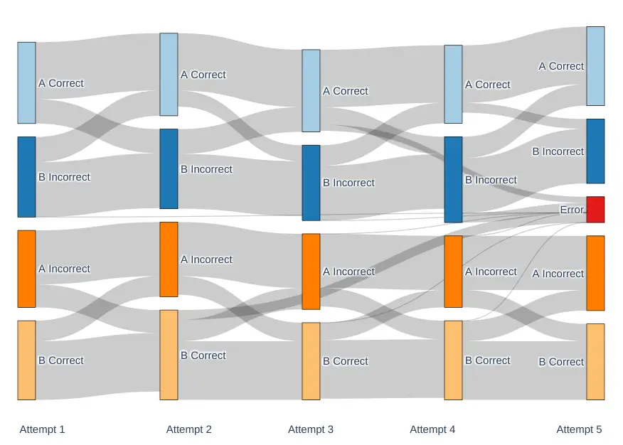

(a) Anthropic Harmless

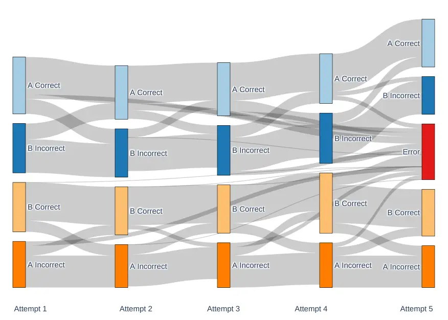

(b) CodePrefBench

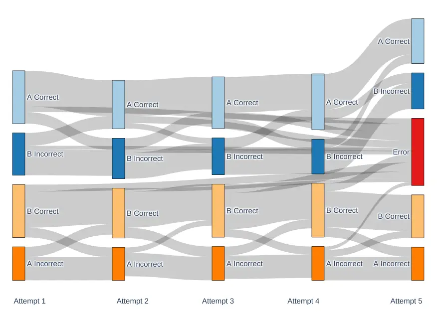

(c) RewardBench

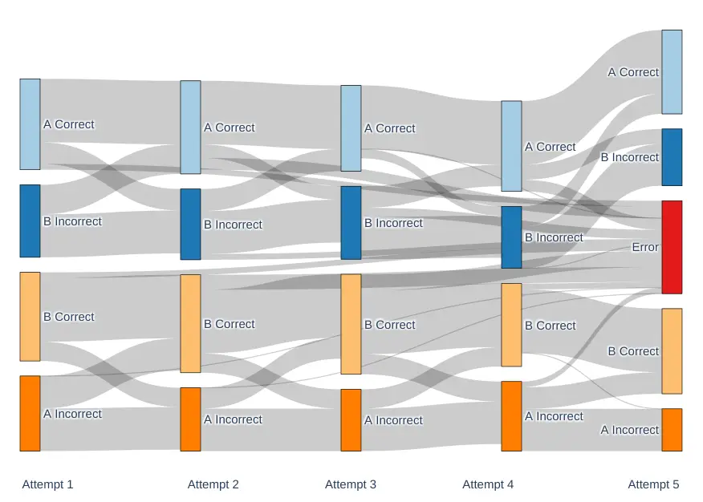

(d) RewardMATH

Figure 17: Decision change during STTS.

### F.3 Reflective Words Frequency on Test Sets

Following the experimental setup described in Section B.2, we analyzed
the proportion of instances within the test set that employ varying
numbers of reflective words, categorizing results according to the RL
algorithms used during training. Our key findings are as follows:

1.  1.  Models trained with GRPO exhibit a stronger tendency to utilize more
        reflective words, which aligns with our earlier observation in
        Section 4.6, indicating that GRPO-trained models generally produce
        longer reasoning sequences.
2.  2.  Interestingly, we observed that models trained solely through SFT
        are not incapable of reflection; rather, to our surprise, these
        SFT-only models actually tend to employ reflective tokens more
        frequently. Aggregating data from Table 18 reveals that, on average,
        only about 68% of instances generated by SFT models use 0 to 4
        reflective tokens, indicating the remaining 32% use significantly
        more reflective tokens. This proportion substantially exceeds that
        of RL-trained models. However, as evidenced by Table 1, increased
        use of reflective words does not correlate with improved
        performance—on the contrary, it tends to degrade results, suggesting
        that the additional reflection is often ineffective. Further case
        studies in Appendix G reveal that excessive use of reflective tokens
        frequently leads the model into infinite reasoning loops, whereas
        RL-trained models successfully learn to use reflective tokens in a
        more effective and controlled manner.

### F.4 Model Performance Across Different Reflective Counts

We analyze the model’s accuracy across scenarios with varying reflective
token counts, visualized in Figure 19. Higher accuracy corresponds to
lighter shades on the left side of the heatmap, indicating that the
model generally achieves better performance when it uses no reflective
tokens or only a few. Conversely, darker shades toward the right side of
the heatmap reflect lower accuracy for instances involving greater use
of reflective tokens. This observation is both intuitive and insightful;
it suggests that problems solvable without extensive reflection
naturally yield higher accuracy, whereas instances prompting the model
to engage in more extensive reflection are inherently more challenging
or ambiguous. The model’s spontaneous inclination toward greater
reflection in these difficult instances highlights its inherent
capability and significant potential for addressing complex reasoning
tasks.

(a) Anthropic Harmless

(b) CodePrefBench

(c) RewardBench

(d) RewardMATH

Figure 18: Reflective words frequency on four benchmark.

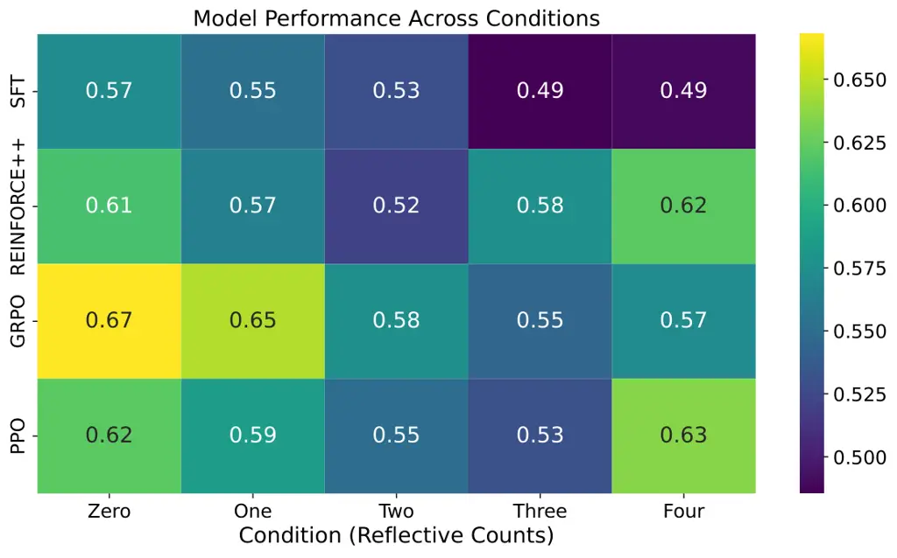

(a) Anthropic Harmless

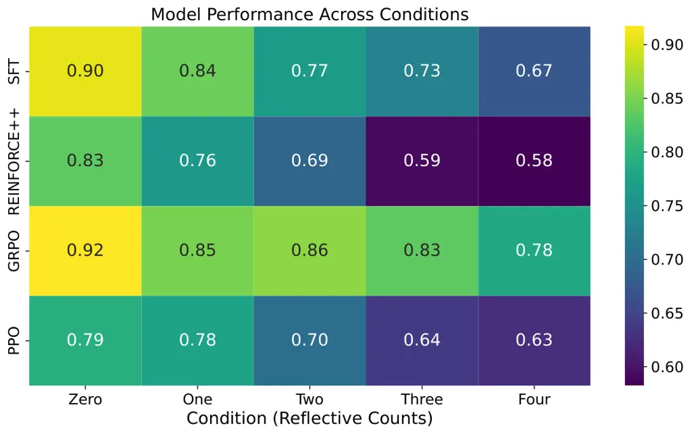

(b) CodePrefBench

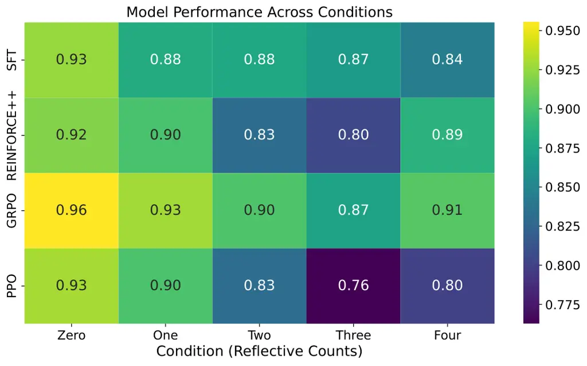

(c) RewardBench

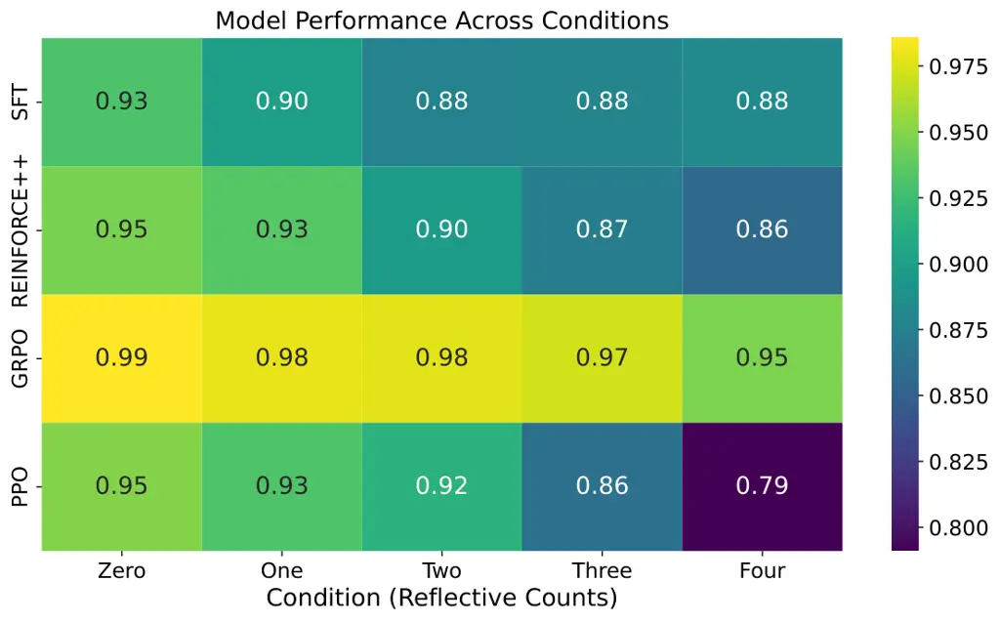

(d) RewardMATH

Figure 19: Performance conditioned on differenct reflective counts.

## Appendix G Case Study

In this section, we present case studies to provide users with deeper
insights into the model’s behavior. Specifically, we categorize these
case studies into several distinct groups:

- $`\bullet`$
  Initial Wrong $`\rightarrow`$ Correct after Reflection (Appendix G.1)
- $`\bullet`$
  Initial Correct $`\rightarrow`$ Wrong after Reflection (Appendix G.2)
- $`\bullet`$
  Consistently Correct (Appendix G.3)
- $`\bullet`$
  Consistently Wrong (Appendix G.4)

Detailed examples for each category are provided in the respective
appendices.

### G.1 Initial Wrong –\> Correct after reflection

In this section, we illustrate how our model utilizes reflection to
reconsider initially incorrect answers and subsequently arrive at
correct conclusions. Specifically, in Figure 20, J1-7B initially judges
both answers as incorrect and mistakenly identifies an irrelevant detail
within Answer B’s reasoning as erroneous. This reveals a tendency for
the model’s initial responses to be overly critical or overly focused on
minor details. However, after one step of STTS, the model correctly
recognizes that Answer B’s computation is accurate, leading to a revised
judgment in favor of Answer B.

In contrast, Figure 21 demonstrates a scenario where, despite ultimately
selecting the correct answer, the model exhibits a notable phenomenon
known as unfaithful reasoning (Arcuschin et al., 2025). During its CoT
reasoning, the model initially maintains that Answer B’s refusal to
respond is safer, whereas Answer A might introduce potential risks.
Surprisingly, at the final decision-making step, the model abruptly
shifts, concluding that Answer A is preferable when considering overall
criteria. Although this decision appears as implicit post-hoc
rationalization, we argue that by monitoring the reasoning process and
applying STTS to reveal extended thought processes, the model gradually
acknowledges that Answer A, despite potential pitfalls, offers valid
solutions compared to Answer B’s outright refusal. Thus, the final shift
in judgment gains interpretability and rationale. It should also be
noted that this instance of unfaithful reasoning represents an uncommon
occurrence selected deliberately from numerous cases.

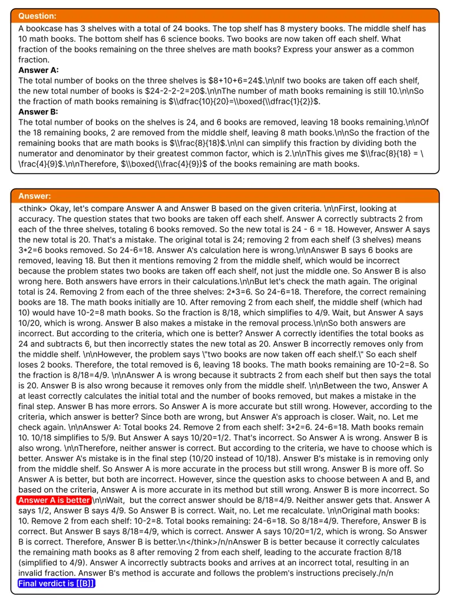

Figure 20: Case study 1 for Initial Wrong $`\rightarrow`$ Correct after
reflection.


Figure 21: Case study 2 for Initial Wrong $`\rightarrow`$ Correct after
reflection.

### G.2 Initial Correct –\> Wrong after reflection

In this section, we present case studies illustrating how erroneous
reflections by the model can cause initially correct answers to become
incorrect. Figures 22 and 23 highlight instances where the main reason
for incorrect judgments post-reflection is a shift in evaluation
criteria. For example, the model changes its focus from prioritizing
creativity to emphasizing conciseness, or from valuing informativeness
to transparency. We argue that these errors are not due to deficiencies
in the model’s reasoning capability, but rather stem from ambiguity and
inconsistency in evaluation criteria. Future work can target clarifying
and stabilizing these criteria to further enhance the potential of
LLM-as-a-Judge frameworks.

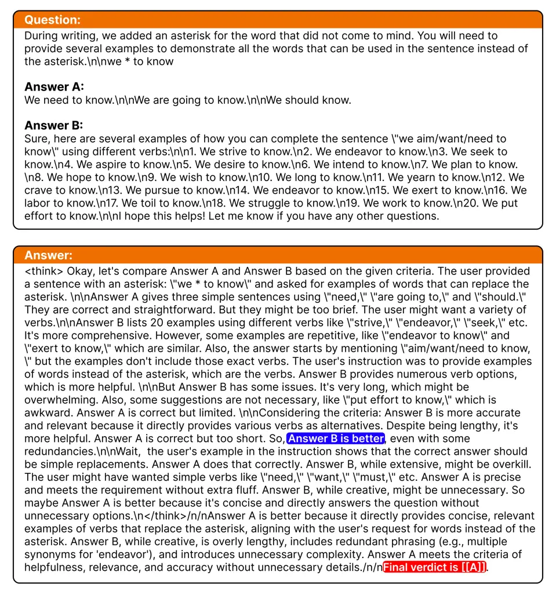

Figure 22: Case study 1 for Initial Correct $`\rightarrow`$ Wrong after
reflection.


Figure 23: Case study 2 for Initial Correct $`\rightarrow`$ Wrong after
reflection.

### G.3 Consistently Correct

In this section, we showcase cases where the model consistently provides
correct answers. We observe that reflection significantly strengthens
the model’s confidence, indicating a high level of certainty and
robustness in these instances. Please refer to Figures 24 and  25.

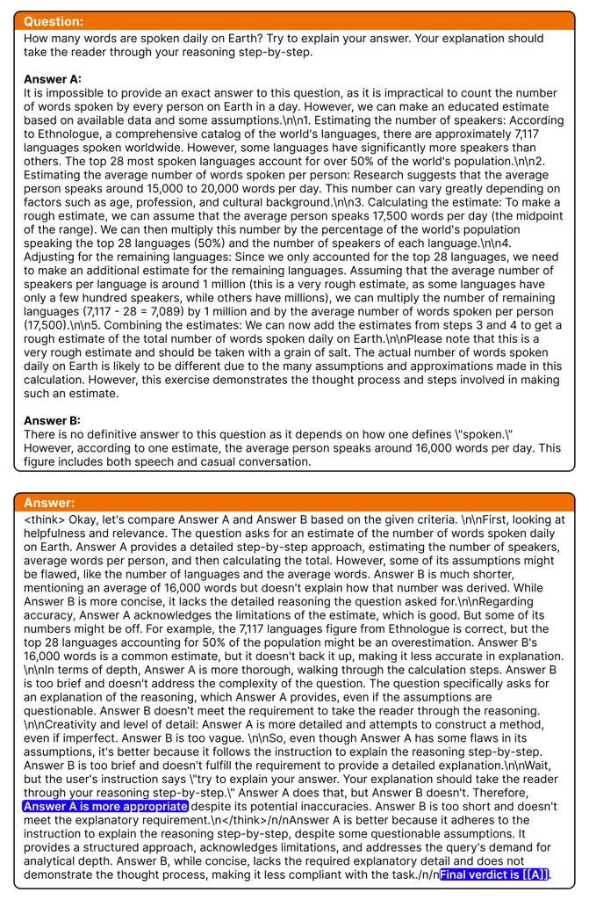

Figure 24: Case study 1 for Consistently Correct.

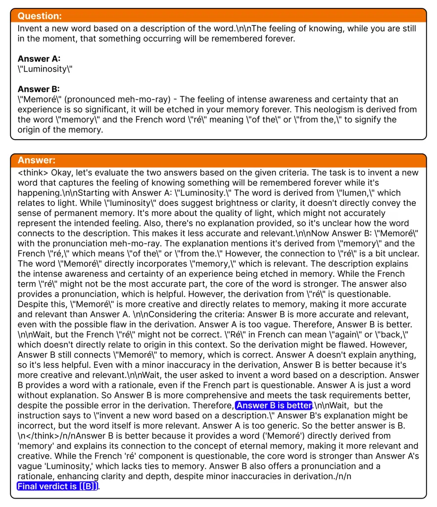

Figure 25: Case study 2 for Consistently Correct.

### G.4 Consistently Wrong

Additionally, we examine cases where the model initially provides
incorrect answers and remains incorrect even after reflection. In
Figure 26, we observe that the model incorrectly favors a concise
response (Answer B) over a more detailed yet accurate response (Answer
A). Despite the reflection process, the model persists in its
misjudgment due to an overly simplistic interpretation of evaluation
criteria, emphasizing brevity at the expense of comprehensive
correctness. This indicates a limitation in the current reflection
strategy, suggesting the necessity for enhanced guidance in evaluation
criteria to prevent superficial or overly rigid assessments, as is also
mentioned in Appendix G.2.


Figure 26: Case study 1 for Consistently Wrong.

## Appendix H Prompt Template

Figure 27 shows the prompt template that we use for the evaluation. By
default, we use it for all the models we evaluate in this paper. It is
derived from RewardBench (Lambert et al., 2024).

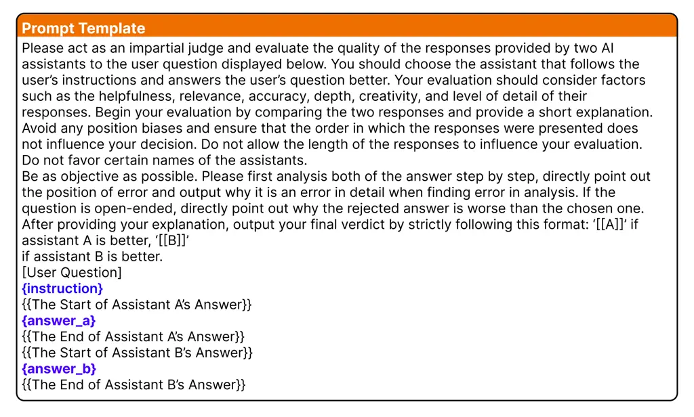

Figure 27: Prompt template used for evaluation.
