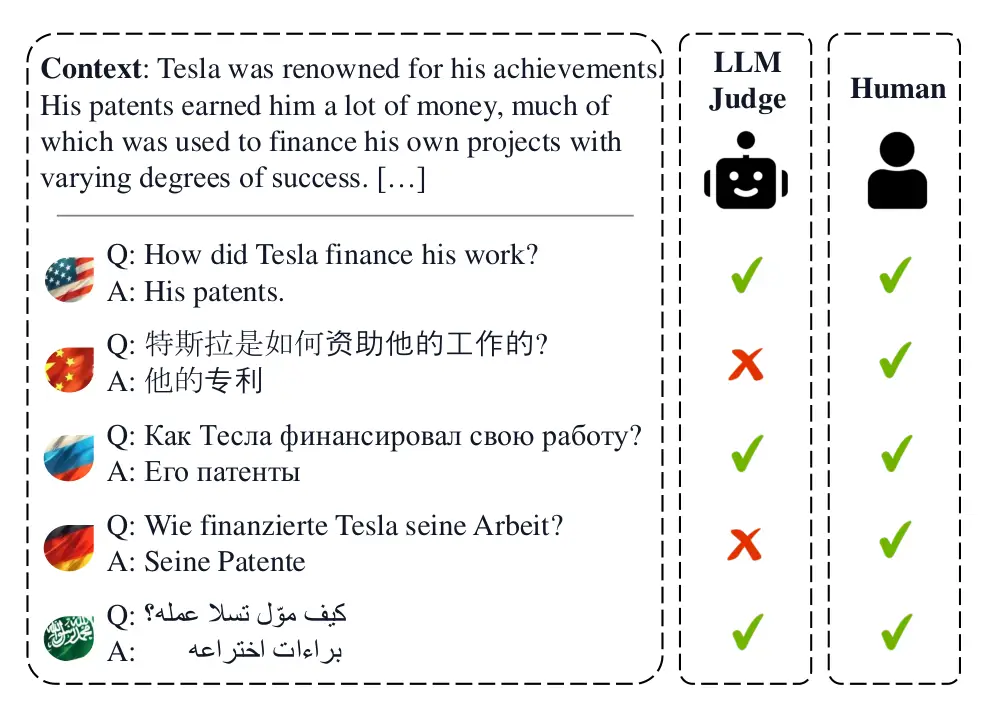
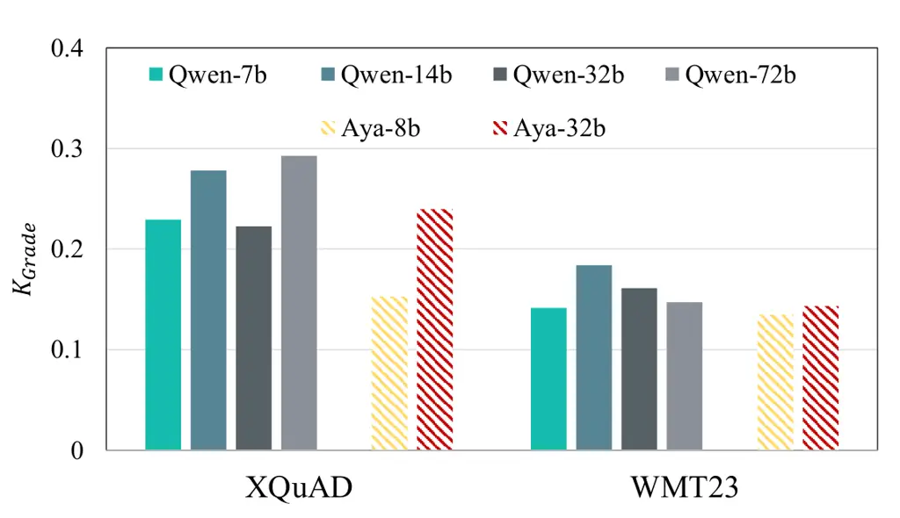

# How Reliable is Multilingual LLM-as-a-Judge?

Xiyan Fu Affiliation:  Independent Researcher    Wei Liu Affiliation: 
Heidelberg Institute for Theoretical Studies
gGmbHxiyan.thea.fu@gmail.com \| wei.liu@h-its.org

###### Abstract

LLM-as-a-Judge has emerged as a popular evaluation strategy, where
advanced large language models assess generation results in alignment
with human instructions. While these models serve as a promising
alternative to human annotators, their reliability in multilingual
evaluation remains uncertain. To bridge this gap, we conduct a
comprehensive analysis of multilingual LLM-as-a-Judge. Specifically, we
evaluate five models from different model families across five diverse
tasks involving 25 languages. Our findings reveal that LLMs struggle to
achieve consistent judgment results across languages, with an average
Fleiss’ Kappa of approximately 0.3, and some models performing even
worse. To investigate the cause of inconsistency, we analyze various
influencing factors. We observe that consistency varies significantly
across languages, with particularly poor performance in low-resource
languages. Additionally, we find that neither training on multilingual
data nor increasing model scale directly improves judgment consistency.
These findings suggest that LLMs are not yet reliable for evaluating
multilingual predictions. We finally propose an ensemble strategy which
improves the consistency of the multilingual judge in real-world
applications.

## 1 Introduction

The success of various approaches based on neural networks has inspired
the development of robust evaluation methods to track advances in the
field of NLP (Sai et al., 2022; Chang et al., 2024). Evaluation aims to
assess the quality and performance of NLP models, typically performed
using evaluation metrics. Prior metrics vary depending on tasks and
evaluation aspects, such as accuracy and F1-score for classification
tasks, and BLUE (Papineni et al., 2002) and ROUGE (Lin, 2004) for
generation tasks. While these metrics benefit evaluations for various
downstream tasks, their reliance on human-annotated references and
n-gram matching limits their flexibility and effectiveness. With the
development of deep learning, pre-trained language model-based
evaluations are introduced, such as BLEURT (Sellam et al., 2020) and
BARTScore (Yuan et al., 2021). They assess output quality by using
pre-trained language model representations and generation probability.



Figure 1: Inconsistency in multilingual LLM-as-a-Judge. Left part shows
a multilingual Question Answering example. All question-answer pairs are
parallel and perfectly aligned across languages. Human evaluators assess
the results with uniform criteria. In contrast, LLM-as-a-Judge
demonstrates inconsistency in its judgments, failing to maintain
consistency across languages.

To offer more efficient and powerful evaluation, some researchers
propose LLM-as-a-judge (Zheng et al., 2023; Li et al., 2024; Gu et al.,
2024), which use powerful LLMs such as GPT4 (Achiam et al., 2023) to
evaluate generated response. Fu et al. (2024) defined evaluation schemes
in the prompt template, and rely on existing LLMs as a judge to offer an
evaluation. To avoid the high cost and potential data leakage, Zhu
et al. (2023) fine-tunes LLMs as their local evaluators. Existing works
(Chiang and Lee, 2023) show that the result of LLM evaluation is
consistent with the results obtained by expert human evaluation. These
methods are subsequently applied to the evaluation of various tasks
(Shen et al., 2023; Fernandes et al., 2023).

Given its superior performance, LLM-as-a-Judge has been extended to
multilingual scenarios, where LLMs are expected to evaluate responses
across different languages  (Rau et al., 2024). However, whether
LLM-as-a-Judge is truly trustworthy for multilingual evaluation remains
uncertain. A reliable multilingual judge should be consistent, i.e., its
judgments should depend on the content of the response rather than the
language in which it is presented. Figure 1 illustrates a multilingual
Question Answering example, where question-answer pairs are parallel
across various languages. A human annotator evaluates these responses
consistently, without being influenced by language differences. To
assess the reliability of multilingual LLM-as-a-Judge, we collect five
datasets covering different tasks, each with parallel data across
multiple languages. We evaluate five models and find that, despite
achieving reasonable accuracy within each task, they all struggle to
maintain consistent judgments across languages.

To further understand the factors affecting consistency, we analyze
results across different dimensions. Notably, we observe that
consistency scores for low-resource languages are significantly lower,
even for multilingual LLMs designed for strong cross-lingual
performance, such as Aya-Expanse (Dang et al., 2024). Furthermore, we
find that the LLM’s judgment consistency is influenced by its
task-specific ability, highlighting the need to consider the alignment
between the evaluation task and the model’s domain expertise. Overall,
our findings shed light on the challenges of using LLM-as-a-Judge in
multilingual settings and provide insights for future research on
improving its reliability.

Our main contributions are as following:

- •
  We investigate the reliability of multilingual LLM-as-a-Judge by
  assessing its consistency across parallel multilingual data. Our
  findings reveal that LLMs struggle to provide consistent judgments
  across languages.
- •
  We conduct a detailed analysis of factors that affect the LLM’s
  consistency across languages. Experimental results show that
  multilingual LLM-as-a-Judge performs poorly in low-resource languages,
  and that the model’s size and whether it undergoes multilingual
  training does not affect its consistency.
- •
  We introduce an ensemble strategy to improve the consistency of the
  multilingual judge in real-world applications.

Figure 2: Prompt template for using LLM-as-a-Judge in a Question
Answering task. Placeholders \<eval_language\>, \<context\>,
\<question\>, \<answer\> are replaced by the input language, and its
corresponding context, question and answer. The text in the prompt is
color-coded to represent different sections: for role definition, for
evaluation rubric, for output.

## 2 Preliminary

### 2.1 LLM-as-a-Judge

|                                 |                         |                 |                                                                                                                                                                                   |      |
| ------------------------------- | ----------------------- | --------------- | --------------------------------------------------------------------------------------------------------------------------------------------------------------------------------- | ---- |
| Dataset                         | Task                    | Answer Type     | Languages                                                                                                                                                                         | Num  |
| XQuAD Artetxe et al. (2020)     | Question Answering      | Extractive Span | English, German, Russian, Spanish, Chinese, Vietnamese, Turkish, Greek, Romanian, Thai, Hindi                                                                                     | 1191 |
| MGSM Shi et al. (2023)          | Math Question Answering | Sentence        | Spanish, French, German, Russian, Chinese, Japanese, Thai, Swahili, Bengali, Telugu                                                                                               | 250  |
| WMT23 Kocmi et al. (2023)       | Machine Translation     | Sentence        | English, Chinese, German, Japanese, Russian, Czech, Ukrainian, Hebrew                                                                                                             | 196  |
| WikiLingua Ladhak et al. (2020) | Summarization           | Sentence        | English, Spanish, Castilian, Portuguese, French, German, Russian, Italian, Indonesian, Dutch, Flemish, Arabic, Chinese, Vietnamese, Thai, Japanese, Korean, Hindi, Czech, Turkish | 142  |
| XDailyDialog Liu et al. (2023)  | Dialogue Generation     | Sentence        | English, Italian, Chinese, German                                                                                                                                                 | 996  |

Table 1: Datasets for multilingual LLM-as-a-Judge evaluation, all
involving parallel data across provided languages. Num indicates the
number of data samples in one language.

LLM-as-a-Judge (Zheng et al., 2023) is a popular method that evaluates
generated outputs without focusing on word-level matching or relying on
highly cost human annotators. Instead, it uses powerful LLMs such as
GPT4 (Achiam et al., 2023) for evaluations covering multiple dimensions.
Following Gu et al. (2024), we define a typical LLM-as-a-Judge as:

```math
\displaystyle p\leftarrow{\rm{\tt LLM}}(C\otimes x) \tag{1}
```

where $`x`$ is the input data awaiting evaluation, $`C`$ is the context
of the input $`x`$, $`\otimes`$ is a combination operator that merges
the input $`x`$ with the context $`C`$, $`{\rm\tt{LLM}}`$ is the model
used for the judgment, and $`p`$ is the evaluation results from the
whole LLM-as-a-Judge process. The context $`C`$ is usually a prompt
template, containing (i) role definition, which defines the task of the
$`{\rm\tt{LLM}}`$; (ii) evaluation rubric, which provides criteria and
guidelines for evaluation; and (iii) output, which regulates output
formats and contents. Figure 2 shows a prompt example in the English
Question Answering task.

Given the format of input $`x`$, LLM-as-a-Judge can be divided into two
groups: (i) pointwise comparison (Gao et al., 2023), where $`x`$ is a
single candidate; (ii) pairwise comparison (Fu et al., 2024), where
$`x`$ is a pair involving candidate and reference. In this paper, we
adopt pointwise evaluation for our experiments, as obtaining parallel
multi-lingual candidates is challenging. Based on the format of the
output, two judgment criteria exist: (i) Yes / No requires a binary
judgment from LLMs, i.e., correct or incorrect. In this case,
LLM-as-a-Judge solely focuses on accuracy. (ii) Score requires a
discrete score from LLMs. Following Chiang and Lee (2023), we define the
score range as 1-5 given its superior evaluation performance. We use
both criteria for the following experiments.

### 2.2 Multilingual LLM-as-a-Judge

In practice, multilingual evaluation is essential for assessing outputs
across different languages, e.g., multilingual summarization. However,
finding human annotators proficient in multiple languages is both
challenging and costly. To address this, LLM-as-a-Judge is extended to
Multilingual LLM-as-a-Judge. Compared to standard LLM-as-a-Judge, the
input $`x`$ in this framework can appear in multiple languages beyond
English. Figure 1 illustrates an example. A reliable Multilingual
LLM-as-a-Judge is expected to provide consistent judgments across
parallel instances in different languages.

## 3 Experiment Setup

### 3.1 Models

We select five LLMs for experiments, including (i) GPT-3.5-turbo,
GPT-4o-2024-08-06 (OpenAI, 2024), since they are leading closed-source
models which achieve State-ot-the-art results in a large range of NLP
tasks; (ii) Llama-3.3-70b (Dubey et al., 2024), Qwen-2.5-72b (Yang
et al., 2024), well known open source models; and (iii)
Aya-expanse-32b (Dang et al., 2024), multilingual specific model. The
model is carefully trained using multilingual data arbitrage,
multilingual preference optimization, and model merging methods, aiming
to achieve robust multilingual capabilities. All the above models are
commonly used as judges (Gu et al., 2024).

### 3.2 Tasks and Datasets

Given our focus on exploring the consistency of LLM-as-a-judge in
multilingual scenarios, we select datasets that contain parallel data
across all tested languages. The parallel structure of the dataset
ensures that the input information remains identical across instances,
with language being the only variable. The selected datasets cover a
variety of NLP tasks, including Question Answering (Artetxe et al.,
2020), Math Question Answering (Shi et al., 2023), Summarization (Ladhak
et al., 2020), Dialogue Generation (Liu et al., 2023), and Machine
Translation (Kocmi et al., 2023), aiming to provide a comprehensive
evaluation. Table 1 provides the details about these datasets.

|          |             |       |        |       |        |       |        |              |        |            |        |
| -------- | ----------- | ----- | ------ | ----- | ------ | ----- | ------ | ------------ | ------ | ---------- | ------ |
|          | Model       | XQuAD |        | MGSM  |        | WMT23 |        | XDailyDialog |        | WikiLingua |        |
|          |             | Acc   | FK     | Acc   | FK     | Acc   | FK     | Acc          | FK     | Acc        | FK     |
| Yes / No | Aya-Expanse | 96.86 | 0.2999 | 56.29 | 0.1895 | 92.64 | 0.1307 | 86.90        | 0.3812 | 89.87      | 0.3421 |
|          | Llama-3.3   | 79.03 | 0.0748 | 64.25 | 0.0991 | 53.57 | 0.1463 | 74.50        | 0.2425 | 59.78      | 0.2325 |
|          | Qwen-2.5    | 93.47 | 0.3620 | 75.93 | 0.2631 | 92.42 | 0.0775 | 78.31        | 0.3093 | 67.68      | 0.3531 |
|          | GPT-3.5     | 97.67 | 0.1399 | 74.51 | 0.1855 | 94.17 | 0.1327 | 83.46        | 0.2127 | 56.14      | 0.1748 |
|          | GPT-4o      | 92.04 | 0.3694 | 84.98 | 0.2352 | 85.88 | 0.1691 | 79.92        | 0.3692 | 65.57      | 0.5424 |
|          |             | Avg   | FK     | Avg   | FK     | Avg   | FK     | Avg          | FK     | Avg        | FK     |
| Grade    | Aya-Expanse | 4.86  | 0.2399 | 3.70  | 0.0260 | 4.58  | 0.1434 | 4.44         | 0.3049 | 4.46       | 0.1865 |
|          | Llama-3.3   | 4.64  | 0.1558 | 3.64  | 0.1084 | 3.18  | 0.2082 | 3.73         | 0.1635 | 3.50       | 0.1412 |
|          | Qwen-2.5    | 4.72  | 0.2926 | 4.62  | 0.0654 | 4.79  | 0.1471 | 4.23         | 0.2602 | 3.63       | 0.2946 |
|          | GPT-3.5     | 4.71  | 0.0971 | 3.57  | 0.0660 | 4.36  | 0.1039 | 4.06         | 0.1240 | 3.23       | 0.0487 |
|          | GPT-4o      | 4.57  | 0.3209 | 3.66  | 0.2041 | 4.57  | 0.1281 | 4.24         | 0.2405 | 3.07       | 0.2803 |

Table 2: Performance of multilingual LLM-as-a-Judge across five
datasets, evaluated on two settings: (i) Yes/No, with binary evaluation
accuracy (Acc), and (ii) Grade, with average grade value (Avg) ranging
from 1 to 5. Fleiss’s Kappa (FK) is calculated for both settings to
measure judgment consistency across parallel data.

### 3.3 Prompts

For each test sample, we select ground truth as evaluated answers. This
is to ensure precise parallel data alignment across all languages.
Judgment instructions are then constructed as described in Section 2 and
subsequently adapted into final prompts tailored for different models.
Full templates are provided in the Appendix A.1.

Existing studies (Sclar et al., 2024) have highlighted the critical role
of prompt selection, as it significantly impacts final performance.
Multilingual scenarios further amplify the challenges for
LLM-as-a-Judge. Following (Ahuja et al., 2023), we adopt an English
prompt with a specified target language indicated by ‘\<eval_language\>’
within the prompt, given its superior performance.

### 3.4 Evaluation Metrics

In this study, we focus on whether the performance of multilingual
LLM-as-a-Judge varies significantly across parallel data in different
languages. That is, whether it exhibits bias toward specific languages.
Therefore, we select Fleiss’ Kappa (FK), a statistical measure of
inter-rater agreement for more than two raters, to measure the
consistency of the LLM-as-a-Judge results across languages. Here, we
treat each model’s output in a particular language as a rater’s
judgment.

While this study focuses on the consistency of LLM-as-a-Judge across
languages, a truly excellent multilingual judge must also ensure
accuracy. High consistency alone does not guarantee correctness, as it
can result from uniformly incorrect judgments. To address this, we
incorporate quality metrics to complement our evaluation: (i) Accuracy
(Acc): For Yes/No judgments we use accuracy to evaluate binary
prediction. (ii) Average Grade (AG): For Grade judgment, we use average
value to evaluate discrete grade prediction. Notably, since we treat the
ground truth as the predicted output to ensure precise parallel data
alignment, the average accuracy and grade are expected to be 100% and a
score of 5, respectively.

## 4 How does multilingual LLM-as-a-Judge perform?

### 4.1 Main Result

Table 2 summarizes the performance of all multilingual LLMs-as-a-Judge
across two judgment criteria: Yes/No and Grade. Based on Fleiss’s Kappa
metric, which measures consistency, GPT-4o achieves the highest
performance, with a score of 0.5424 on WikiLingua for the Yes/No
criterion and 0.3209 on XQuAD for the Grade criterion. However, these
values remain far from the ideal consistency value of 1, and the Kappa
scores of other models are even lower. This highlights that even
powerful LLMs struggle to act as fair and consistent multilingual
judges.

In addition, we observe significant variance in judgment consistency
across different model groups. GPT-4o demonstrates superior Fleiss’
Kappa compared to other models, aligning with its state-of-the-art
status in a wide range of NLP tasks. In contrast, GPT-3.5, a model from
the same series as GPT-4o, exhibits notably lower consistency, with its
Kappa scores typically around half of GPT-4o’s for both judgment
criteria. However, despite GPT-4o attaining the highest Kappa
consistency values, its judgment accuracy is not always the best. This
contradicts the expectation that a strong judge should excel in both
evaluation metrics. We speculate that this discrepancy arises from
GPT-4o applying stricter evaluation standards rather than reflecting
weaker performance. Such strictness makes it more challenging to achieve
both high accuracy (exact correctness) or high ratings (score of 5) and
high consistency simultaneously. Notably, we find that powerful
open-source models, such as Qwen-2.5, achieve comparable performance to
OpenAI models in multilingual judgment tasks. However, another
open-source model, Llama-3.3, exhibits more limited performance.
Furthermore, we experiment with Aya-Expanse, a multilingual LLM
specifically fine-tuned on multilingual data. Despite this
specialization, Aya fails to demonstrate noticeable improvements. This
suggests that fine-tuning with multilingual data may not directly
enhance a model’s ability to perform accurate multilingual judgments.

|        |       |      |       |         |       |
| ------ | ----- | ---- | ----- | ------- | ----- |
|        | XQuAD | MGSM | WMT23 | XDailyD | WikiL |
| YES/No | 0     | 0.6  | -0.5  | -0.3    | 0.7   |
| Grade  | -0.2  | -0.5 | 0     | 0.5     | 0.4   |

Table 3: Spearman Correlation across five datasets for two judgment
criteria: (i) Yes/ No, the correlation between accuracy and kappa; and
(ii) Grade, the correlation between average value and kappa.

### 4.2 Consistency Result

To gain a deeper understanding of the performance of multilingual
LLM-as-a-Judge, we further analyze the trends of Kappa consistency under
the following settings:

Acc / Avg VS. Kappa. We analyze the relationship between prediction
performance which is measured by Accuracy for Yes/No and Average Score
for Grade and consistency measured by Kappa values. Specifically, we
compute the Spearman correlation between accuracy (or average score) and
Fleiss’ Kappa. Table 3 presents the results. We observe that the
Spearman correlation varies inconsistently, depending on the evaluation
tasks and judgment criteria. For the WikiLingua (WikiL) dataset, results
show a positive correlation under two judgment criteria, 0.7 and 0.4
respectively. In contrast, other datasets present contrasting
correlations, either positive or negative, two of them even 0. This
suggests that higher prediction accuracy does not necessarily imply
greater judgment consistency.

Yes / No VS. Grade. We further analyze the consistency, measured by
Kappa values, across the two evaluation criteria: Yes / No and Grade.
Specifically, we calculate the gap between the two criteria, defined as
$`\Delta`$ = Kappa*(Yes/No) - Kappa*(Grade). Figure 3 illustrates the
gap across all datasets. We observe that most gap values are positive,
i.e., consistency in Yes / No evaluations is consistently higher than in
Grade evaluations. It indicates that grade judgment is more challenging
than binary judgment. This result may be due to more options in the
grade scale. In practice, limiting the options for LLM-as-a-Judge may
enhance its effectiveness in applications that demand high multilingual
consistency.

Figure 3: Fleiss Kappa value gap ($`\Delta`$) between Yes / No and Grade
evaluation criteria of various multilingual LLM-as-a-Judge models.

Figure 4: Consistency (Cohen’s Kappa) of LLMs’ judge results between
English and other languages across four datasets and two judge criteria,
Yes / No and Grade.

## 5 What Factors cause inconsistency?

To further understand the inferior consistency of multilingual
LLM-as-a-Judge observed in the main results, we investigate potential
causes in this section.

### 5.1 Correlation between Languages

Existing works found that the training corpus of LLMs is usually
dominated by English, so LLMs may perform strongly in English while
being relatively weaker in other languages. Hence, we conduct an
experiment to explore how close LLM-as-a-Judge performs in non-English
languages compared to English. Specifically, we calculate the
consistency (using Cohen’s Kappa¹¹ 1 Fleiss’ Kappa is ignored as it
works for more than 2 raters.) between LLMs’ judge results on English
and those on other languages. We select three LLMs-GPT-4o, Qwen-2.5-70b,
and Aya-Expanse-32b for experiments since they are a good mix of
closed-source, open-source, and multilingual LLMs. Figure 4 shows
Cohen’s Kappa results of four tasks²² 2 WMT23 is ignored here given
experimented machine translation samples all contain English. with two
judge criteria.

The consistency radar charts for all tasks exhibit noticeable convex and
concave patterns, indicating that consistency results with English vary
across languages. Specifically, LLMs tend to show higher consistency
with European languages. For example, on the XQuAD task, all judge
results for Spanish and German show high consistency, with Cohen’s Kappa
values ranging from 0.30 to 0.61. This is likely due to (i) the LLMs’
training corpus containing more data in these languages, and (ii) their
linguistic proximity to English (belonging to the same language family).
In contrast, LLMs struggle with low-resource languages like Arabic (ar)
and Telugu (te). For instance, on the MGSM task, the Cohen’s Kappa value
between Llama-3.3-70B judge results for Telugu and English is as low as
0.002. This trend persists even with Aya-Expanse-32B, a multilingual LLM
with strong capabilities. These findings suggest that we must be
cautious when using LLM evaluation results for low-resource languages,
as they may be unreliable.

### 5.2 Impact of the judged task

Figure 4 also shows that the radar charts vary significantly across
different tasks. Specifically, on the XQuAD task, the consistency
between LLMs’ judge results on English and other languages generally
ranges from 0.2 to 0.4, with GPT-4o and Qwen-2.5-72b performing the
best. In contrast, the consistency results on the MGSM task drop to
around 0.2, and the results of Qwen-2.5-72b and Aya-Expanse-32b for some
languages are even close to 0 in terms of consistency with the results
in English. However, on the WikiLingua task, the consistency results (in
the Yes/No setting) climb to as high as 0.8. This suggests that when
choosing a multilingual LLM-as-a-Judge for tasks, one should consider
the LLM’s task-related capabilities. The results of Aya-Expanse-32b
confirm this to some extent. Aya-Expanse-32b is an LLM carefully trained
to aim for strong multilingual capacities. However, surprisingly, it
shows the worst consistency between judge results on English and other
languages, especially on the MGSM task. We speculate that this is
because Aya-Expanse-32b has not been primarily trained to solve
reasoning and mathematical problems. This leads to its poor performance
when evaluating the MGSM task, which consists of mathematical questions.
Furthermore, we find that GPT-4o exhibits the best consistency across
all tasks and languages, indicating its superiority in building
multilingual LLM-as-a-Judge.

### 5.3 Prompt Design

Existing research (Sclar et al., 2024) has identified prompt design as a
key factor in LLM-as-a-Judge performance. Therefore, we investigate how
prompt design influences multilingual judgment consistency. As described
in Section 2, the instruction prompt in this work consists of three
components: role definition, evaluation rubric, and output format. Since
the role definition of LLM-as-a-Judge is generally static, our
experiments primarily focus on the latter two components. For the
evaluation rubric, we tested: (i) a general rubric, which defines a
grading scale with simplified descriptions for evaluation, and (ii) a
specific rubric, which defines a grading scale where each grade is
accompanied by detailed rules and explanations. For the output format,
we tested: (i) prediction only, where LLMs output a simple binary
prediction or evaluation grade, and (ii) prediction with explanation,
where LLMs provide both the prediction and the reasoning behind their
judgment. Table 4 shows the results for different prompt designs by
combining these two factors.

|     |                                                 |       |        |       |        |
| --- | ----------------------------------------------- | ----- | ------ | ----- | ------ |
| ID  | Prompt                                          | XQuAD |        | WMT23 |        |
|     |                                                 | Avg   | Kappa  | Avg   | Kappa  |
| ①   | rubric: general out: prediction                 | 4.66  | 0.2517 | 4.55  | 0.1133 |
| ②   | rubric: general out: prediction + explaination  | 4.57  | 0.3209 | 4.57  | 0.1281 |
| ③   | rubric: specific out: prediction                | 4.63  | 0.2145 | 4.57  | 0.1145 |
| ④   | rubric: specific out: prediction + explaination | 4.67  | 0.2239 | 4.63  | 0.1196 |

Table 4: Variation of Accuracy (Acc) and Fleiss Kappa with different
prompt templates for Grade judgment of GPT-4o. rubric and out represent
evaluation guideline and output requests as shown in Section 2.

By comparing the consistency values (Kappa) between prompts with and
without explanation generation (i.e., ① vs. ② and ③ vs. ④), we observe
that prompts with explanation generation consistently achieve superior
results. This indicates that generating explanations to support
judgments can enhance evaluation consistency across all languages.
Additionally, we compare prompts with general and specific rubrics
(i.e., ① vs. ③ and ② vs. ④). Interestingly, we find that providing
specific rules does not always improve consistency. We speculate that
this may be because LLMs are already familiar with commonly used tasks,
making very specific rubrics unnecessary in certain cases.

### 5.4 Model Scale

We further investigate whether the scale of LLMs affects inconsistency
across languages. Specifically, we examine the open-access model
Qwen-2.5, which ranges from 7 billion to 72 billion parameters, and the
multilingual-specific model Aya-Expanse, which ranges from 7 billion to
32 billion parameters. Table 5 presents the results.

For Qwen-2.5 across different model scales, we do not observe any
consistent trend. On the WMT23 dataset, the 14-billion-parameter
Qwen-2.5 model even achieves higher consistency compared to the
72-billion version. Additionally, while the 32-billion Aya-Expanse
outperforms its smaller counterparts, its improvement on WMT23 remains
limited. These findings suggest that increasing the model scale does not
directly lead to enhanced consistency in multilingual LLM-as-a-Judge.



Figure 5: Variation of Fleiss Kappa for Grade judgment (K\_(Grade))
across Qwen-2.5 and Aya-Expanse in different model scale.

## 6 How to choose a Judge in the wild?

Existing results show that Multilingual LLM-as-a-Judge exhibits varying
consistency across different languages and tasks. This raises a natural
question: How can we choose a suitable LLM-as-a-Judge for real-world
applications to ensure relatively consistent evaluations across
languages? Table 2 indicates that GPT-4o generally achieves the highest
consistency, making it an ideal choice. However, its high cost and
potential risk of data leakage pose challenges. To address this, we
propose an Ensemble strategy that leverages a majority vote among
open-source LLMs for judgment, inspired by Verga et al. (2024); Raina
et al. (2024).

Specifically, we conduct experiments using three open-source LLMs:
Llama-3.3-70B, Qwen-2.5-72B, and Aya-Expanse-32B, taking their majority
vote as the final prediction. The ensemble results (Ens) are shown in
Table 5. For comparison, we also report the minimum value (Min) among
the three models, representing the worst-case scenario when the least
reliable judge is unknowingly selected. Furthermore, we compute the gap
between the ensemble results and the minimum value, denoted as
$`\Delta=Ens-Min`$, which reflects the improvement over the worst-case
performance. As shown in Table 5, most gap values are positive, except
for -0.0046 in WMT23 and -0.0142 in another case. Given that other
improvements are generally above 0.1, we conclude that the ensemble
strategy can enhance consistency in real-world applications where the
least reliable LLM might be unknowingly chosen.

|            |        |         |         |         |        |
| ---------- | ------ | ------- | ------- | ------- | ------ |
|            | XQuAD  | MGSM    | WMT23   | XDailyD | WikiL  |
| Yes / No : |        |         |         |         |        |
| Min        | 0.0748 | 0.0991  | 0.0775  | 0.2425  | 0.2325 |
| Ens        | 0.3227 | 0.2162  | 0.0729  | 0.4053  | 0.4217 |
| $`\Delta`$ | 0.2479 | 0.1171  | -0.0046 | 0.1628  | 0.1892 |
| Grade :    |        |         |         |         |        |
| Min        | 0.1558 | 0.0654  | 0.1434  | 0.1635  | 0.1412 |
| Ens        | 0.2617 | 0.0512  | 0.2078  | 0.1675  | 0.2931 |
| $`\Delta`$ | 0.1059 | -0.0142 | 0.0644  | 0.0040  | 0.1519 |

Table 5: Ensemble results (Ens) of Aya, QWen, and Llama. Min indicates
the minimum consistency of the above three models. $`\Delta`$ shows the
gap between ensemble results and minimum value, i.e., $`\Delta`$ = Ens -
Min.

## 7 Related Work

### 7.1 LLM-as-a-judge

With the remarkable performance of LLMs, researchers have increasingly
leveraged them to evaluate generation results in alignment with human
instructions (Zheng et al., 2023), known as LLM-as-a-judge. To apply
LLM-as-a-judge, it is common to start using In-Context Learning (Brown
et al., 2020) methods with advanced LLMs, such as GPT-4 (Achiam et al.,
2023). Li et al. (2024) categorized evaluation prompts into two primary
groups: (i) pairwise comparison, where an LLM is given two candidates
along with context to determine which response is superior (Gao et al.,
2023); and (ii) pointwise evaluation, where an LLM assesses a single
candidate based on specified evaluation criteria (Fu et al., 2024). To
further enhance LLMs’ judging capabilities, other line works apply
preference learning techniques (Wang et al., 2024b; Wu et al., 2024) and
fine-tuning mechanism (Zhu et al., 2023). These methodologies have been
extensively applied across various tasks, including summarization (Shen
et al., 2023; Wang et al., 2023), translation (Kocmi and Federmann,
2023; Fernandes et al., 2023), and written discourse coherence (Naismith
et al., 2023). The widespread adoption of LLM-as-a-judge raises
questions about its reliability and effectiveness. Addressing this,
Chiang and Lee (2023) validated its efficacy by comparing evaluation
outcomes from human judges and LLM-as-a-judge, further highlighting its
potential to significantly enhance efficiency. As a complement to
existing research, we focus on LLM-as-a-Judge in multilingual scenarios.
Recently, Hada et al. (2024) observed that LLM evaluators tend to assign
higher scores in multilingual settings compared to human annotations.
Unlike their work, we investigate the reliability of LLMs-as-a-Judge by
examining their consistency across different languages using parallel
multilingual data.

### 7.2 Bias

Despite the success of LLM-based evaluators, there have been studies
showing that they have some biases (Zheng et al., 2023). One
well-explored bias is position bias (Wang et al., 2024a; Shi et al., 2024) that the evaluation ranking of candidate responses can be easily
hacked by altering their order of appearance in the context. Saito
et al. (2023); Park et al. (2024) introduced length bias that LLMs
prefer more verbose answers even if they have similar qualities, and
authority bias that LLMs favor responses with specific details, e.g.,
citation of authoritative sources. To address the effect of length,
Dubois et al. (2024) introduced a debiasing strategy given
regression-based adjustments for observational causal inference. Beyond
these superficial biases, Park et al. (2024) identified four additional
biases, such as familiar knowledge bias which refers to a preference for
responses describing commonly encountered knowledge in real-world data.
Ye et al. (2024) highlighted the self-enhancement bias, where LLMs tend
to favor responses generated by themselves. Instead, we evaluate biases
in LLM-as-a-Judge with a focus on multilingual bias. We found that
LLM-as-a-Judge struggles to provide consistent judgments across parallel
inputs in different languages, with performance being particularly
inferior for low-resource languages.

## 8 Conclusion

In this paper, we conduct an in-depth analysis of multilingual
LLM-as-a-Judge, focusing on the consistency of its judgments across
parallel data in different languages. Our results show that even
advanced LLMs struggle with consistent judgment, exhibiting significant
variance across languages. Moreover, neither larger model scales nor
specific multilingual training improves judgment reliability. Our
comprehensive analysis provides novel insights into multilingual
LLM-as-a-Judge.

## 9 Limitation

For LLM-as-a-Judge, we focus on pointwise judgment, as obtaining
parallel multilingual incorrect candidates is challenging. This limits
its applicability in real-world scenarios. An interesting avenue for
future work would be to construct a parallel pairwise corpus for
evaluation.

Moreover, due to GPU constraints, we evaluate only open-access models up
to approximately 70 billion parameters. Future work will explore
judgments from larger LLMs.

## References

- Achiam et al. (2023) Josh Achiam, Steven Adler, Sandhini Agarwal, Lama
  Ahmad, Ilge Akkaya, Florencia Leoni Aleman, Diogo Almeida, Janko
  Altenschmidt, Sam Altman, Shyamal Anadkat, et al. 2023. Gpt-4
  technical report. _arXiv preprint arXiv:2303.08774_.
- Ahuja et al. (2023) Kabir Ahuja, Harshita Diddee, Rishav Hada,
  Millicent Ochieng, Krithika Ramesh, Prachi Jain, Akshay Nambi, Tanuja
  Ganu, Sameer Segal, Mohamed Ahmed, Kalika Bali, and Sunayana
  Sitaram. 2023. [MEGA: Multilingual evaluation of generative
  AI](https://doi.org/10.18653/v1/2023.emnlp-main.258). In _Proceedings
  of the 2023 Conference on Empirical Methods in Natural Language
  Processing_, pages 4232–4267, Singapore. Association for Computational
  Linguistics.
- Artetxe et al. (2020) Mikel Artetxe, Sebastian Ruder, and Dani
  Yogatama. 2020. [On the cross-lingual transferability of monolingual
  representations](https://doi.org/10.18653/v1/2020.acl-main.421). In
  _Proceedings of the 58th Annual Meeting of the Association for
  Computational Linguistics_, pages 4623–4637, Online. Association for
  Computational Linguistics.
- Brown et al. (2020) Tom Brown, Benjamin Mann, Nick Ryder, Melanie
  Subbiah, Jared D Kaplan, Prafulla Dhariwal, Arvind Neelakantan, Pranav
  Shyam, Girish Sastry, Amanda Askell, et al. 2020. Language models are
  few-shot learners. _Advances in neural information processing
  systems_, 33:1877–1901.
- Chang et al. (2024) Yupeng Chang, Xu Wang, Jindong Wang, Yuan Wu,
  Linyi Yang, Kaijie Zhu, Hao Chen, Xiaoyuan Yi, Cunxiang Wang, Yidong
  Wang, et al. 2024. A survey on evaluation of large language models.
  _ACM Transactions on Intelligent Systems and Technology_, 15(3):1–45.
- Chiang and Lee (2023) Cheng-Han Chiang and Hung-yi Lee. 2023. [Can
  large language models be an alternative to human
  evaluations?](https://doi.org/10.18653/v1/2023.acl-long.870) In
  _Proceedings of the 61st Annual Meeting of the Association for
  Computational Linguistics (Volume 1: Long Papers)_, pages 15607–15631,
  Toronto, Canada. Association for Computational Linguistics.
- Dang et al. (2024) John Dang, Shivalika Singh, Daniel D’souza, Arash
  Ahmadian, Alejandro Salamanca, Madeline Smith, Aidan Peppin, Sungjin
  Hong, Manoj Govindassamy, Terrence Zhao, Sandra Kublik, Meor Amer,
  Viraat Aryabumi, Jon Ander Campos, Yi-Chern Tan, Tom Kocmi, Florian
  Strub, Nathan Grinsztajn, Yannis Flet-Berliac, Acyr Locatelli, Hangyu
  Lin, Dwarak Talupuru, Bharat Venkitesh, David Cairuz, Bowen Yang, Tim
  Chung, Wei-Yin Ko, Sylvie Shang Shi, Amir Shukayev, Sammie Bae,
  Aleksandra Piktus, Roman Castagné, Felipe Cruz-Salinas, Eddie Kim,
  Lucas Crawhall-Stein, Adrien Morisot, Sudip Roy, Phil Blunsom, Ivan
  Zhang, Aidan Gomez, Nick Frosst, Marzieh Fadaee, Beyza Ermis, Ahmet
  Üstün, and Sara Hooker. 2024. [Aya expanse: Combining research
  breakthroughs for a new multilingual
  frontier](http://arxiv.org/abs/2412.04261).
- Dubey et al. (2024) Abhimanyu Dubey, Abhinav Jauhri, Abhinav Pandey,
  Abhishek Kadian, Ahmad Al-Dahle, Aiesha Letman, Akhil Mathur, Alan
  Schelten, Amy Yang, Angela Fan, et al. 2024. The llama 3 herd of
  models. _arXiv preprint arXiv:2407.21783_.
- Dubois et al. (2024) Yann Dubois, Percy Liang, and Tatsunori
  Hashimoto. 2024. [Length-controlled alpacaeval: A simple debiasing of
  automatic evaluators](https://openreview.net/forum?id=CybBmzWBX0). In
  _First Conference on Language Modeling_.
- Fernandes et al. (2023) Patrick Fernandes, Daniel Deutsch, Mara
  Finkelstein, Parker Riley, André Martins, Graham Neubig, Ankush Garg,
  Jonathan Clark, Markus Freitag, and Orhan Firat. 2023. [The devil is
  in the errors: Leveraging large language models for fine-grained
  machine translation
  evaluation](https://doi.org/10.18653/v1/2023.wmt-1.100). In
  _Proceedings of the Eighth Conference on Machine Translation_, pages
  1066–1083, Singapore. Association for Computational Linguistics.
- Fu et al. (2024) Jinlan Fu, See-Kiong Ng, Zhengbao Jiang, and Pengfei
  Liu. 2024. [GPTScore: Evaluate as you
  desire](https://doi.org/10.18653/v1/2024.naacl-long.365). In
  _Proceedings of the 2024 Conference of the North American Chapter of
  the Association for Computational Linguistics: Human Language
  Technologies (Volume 1: Long Papers)_, pages 6556–6576, Mexico City,
  Mexico. Association for Computational Linguistics.
- Gao et al. (2023) Mingqi Gao, Jie Ruan, Renliang Sun, Xunjian Yin,
  Shiping Yang, and Xiaojun Wan. 2023. Human-like summarization
  evaluation with chatgpt. _arXiv preprint arXiv:2304.02554_.
- Gu et al. (2024) Jiawei Gu, Xuhui Jiang, Zhichao Shi, Hexiang Tan,
  Xuehao Zhai, Chengjin Xu, Wei Li, Yinghan Shen, Shengjie Ma, Honghao
  Liu, Yuanzhuo Wang, and Jian Guo. 2024. [A survey on
  llm-as-a-judge](https://arxiv.org/abs/2411.15594). _arXiv preprint
  arXiv:2411.15594_.
- Hada et al. (2024) Rishav Hada, Varun Gumma, Adrian Wynter, Harshita
  Diddee, Mohamed Ahmed, Monojit Choudhury, Kalika Bali, and Sunayana
  Sitaram. 2024. [Are large language model-based evaluators the solution
  to scaling up multilingual
  evaluation?](https://aclanthology.org/2024.findings-eacl.71/) In
  _Findings of the Association for Computational Linguistics: EACL
  2024_, pages 1051–1070, St. Julian’s, Malta. Association for
  Computational Linguistics.
- Kocmi et al. (2023) Tom Kocmi, Eleftherios Avramidis, Rachel Bawden,
  Ondˇrej Bojar, Anton Dvorkovich, Christian Federmann, Mark Fishel,
  Markus Freitag, Thamme Gowda, Roman Grundkiewicz, Barry Haddow,
  Philipp Koehn, Benjamin Marie, Christof Monz, Makoto Morishita, Kenton
  Murray, Makoto Nagata, Toshiaki Nakazawa, Martin Popel, Maja Popović,
  and Mariya Shmatova. 2023. [Findings of the 2023 conference on machine
  translation (WMT23): LLMs are here but not quite there
  yet](https://doi.org/10.18653/v1/2023.wmt-1.1). In _Proceedings of the
  Eighth Conference on Machine Translation_, pages 1–42, Singapore.
  Association for Computational Linguistics.
- Kocmi and Federmann (2023) Tom Kocmi and Christian Federmann. 2023.
  [Large language models are state-of-the-art evaluators of translation
  quality](https://aclanthology.org/2023.eamt-1.19/). In _Proceedings of
  the 24th Annual Conference of the European Association for Machine
  Translation_, pages 193–203, Tampere, Finland. European Association
  for Machine Translation.
- Ladhak et al. (2020) Faisal Ladhak, Esin Durmus, Claire Cardie, and
  Kathleen McKeown. 2020. [WikiLingua: A new benchmark dataset for
  cross-lingual abstractive
  summarization](https://doi.org/10.18653/v1/2020.findings-emnlp.360).
  In _Findings of the Association for Computational Linguistics: EMNLP
  2020_, pages 4034–4048, Online. Association for Computational
  Linguistics.
- Li et al. (2024) Dawei Li, Bohan Jiang, Liangjie Huang, Alimohammad
  Beigi, Chengshuai Zhao, Zhen Tan, Amrita Bhattacharjee, Yuxuan Jiang,
  Canyu Chen, Tianhao Wu, et al. 2024. From generation to judgment:
  Opportunities and challenges of llm-as-a-judge. _arXiv preprint
  arXiv:2411.16594_.
- Lin (2004) Chin-Yew Lin. 2004. Rouge: A package for automatic
  evaluation of summaries. In _Text summarization branches out_, pages
  74–81.
- Liu et al. (2023) Zeming Liu, Ping Nie, Jie Cai, Haifeng Wang,
  Zheng-Yu Niu, Peng Zhang, Mrinmaya Sachan, and Kaiping Peng. 2023.
  [XDailyDialog: A multilingual parallel dialogue
  corpus](https://doi.org/10.18653/v1/2023.acl-long.684). In
  _Proceedings of the 61st Annual Meeting of the Association for
  Computational Linguistics (Volume 1: Long Papers)_, pages 12240–12253,
  Toronto, Canada. Association for Computational Linguistics.
- Naismith et al. (2023) Ben Naismith, Phoebe Mulcaire, and Jill
  Burstein. 2023. [Automated evaluation of written discourse coherence
  using GPT-4](https://doi.org/10.18653/v1/2023.bea-1.32). In
  _Proceedings of the 18th Workshop on Innovative Use of NLP for
  Building Educational Applications (BEA 2023)_, pages 394–403, Toronto,
  Canada. Association for Computational Linguistics.
- OpenAI (2024) OpenAI. 2024. [Introducing
  gpt-4o](https://openai.com/research/gpt-4o). OpenAI Blog. Accessed:
  2024-06-17.
- Papineni et al. (2002) Kishore Papineni, Salim Roukos, Todd Ward, and
  Wei-Jing Zhu. 2002. [Bleu: a method for automatic evaluation of
  machine translation](https://doi.org/10.3115/1073083.1073135). In
  _Proceedings of the 40th Annual Meeting of the Association for
  Computational Linguistics_, pages 311–318, Philadelphia, Pennsylvania,
  USA. Association for Computational Linguistics.
- Park et al. (2024) Junsoo Park, Seungyeon Jwa, Ren Meiying, Daeyoung
  Kim, and Sanghyuk Choi. 2024. [OffsetBias: Leveraging debiased data
  for tuning
  evaluators](https://doi.org/10.18653/v1/2024.findings-emnlp.57). In
  _Findings of the Association for Computational Linguistics: EMNLP
  2024_, pages 1043–1067, Miami, Florida, USA. Association for
  Computational Linguistics.
- Raina et al. (2024) Vyas Raina, Adian Liusie, and Mark Gales. 2024.
  [Is LLM-as-a-judge robust? investigating universal adversarial attacks
  on zero-shot LLM
  assessment](https://doi.org/10.18653/v1/2024.emnlp-main.427). In
  _Proceedings of the 2024 Conference on Empirical Methods in Natural
  Language Processing_, pages 7499–7517, Miami, Florida, USA.
  Association for Computational Linguistics.
- Rau et al. (2024) David Rau, Hervé Déjean, Nadezhda Chirkova, Thibault
  Formal, Shuai Wang, Stéphane Clinchant, and Vassilina Nikoulina. 2024.
  [BERGEN: A benchmarking library for retrieval-augmented
  generation](https://doi.org/10.18653/v1/2024.findings-emnlp.449). In
  _Findings of the Association for Computational Linguistics: EMNLP
  2024_, pages 7640–7663, Miami, Florida, USA. Association for
  Computational Linguistics.
- Sai et al. (2022) Ananya B Sai, Akash Kumar Mohankumar, and Mitesh M
  Khapra. 2022. A survey of evaluation metrics used for nlg systems.
  _ACM Computing Surveys (CSUR)_, 55(2):1–39.
- Saito et al. (2023) Keita Saito, Akifumi Wachi, Koki Wataoka, and
  Youhei Akimoto. 2023. Verbosity bias in preference labeling by large
  language models. _arXiv preprint arXiv:2310.10076_.
- Sclar et al. (2024) Melanie Sclar, Yejin Choi, Yulia Tsvetkov, and
  Alane Suhr. 2024. [Quantifying language models’ sensitivity to
  spurious features in prompt design or: How i learned to start worrying
  about prompt formatting](https://openreview.net/forum?id=RIu5lyNXjT).
  In _The Twelfth International Conference on Learning Representations_.
- Sellam et al. (2020) Thibault Sellam, Dipanjan Das, and Ankur
  Parikh. 2020. [BLEURT: Learning robust metrics for text
  generation](https://doi.org/10.18653/v1/2020.acl-main.704). In
  _Proceedings of the 58th Annual Meeting of the Association for
  Computational Linguistics_, pages 7881–7892, Online. Association for
  Computational Linguistics.
- Shen et al. (2023) Chenhui Shen, Liying Cheng, Xuan-Phi Nguyen, Yang
  You, and Lidong Bing. 2023. [Large language models are not yet
  human-level evaluators for abstractive
  summarization](https://doi.org/10.18653/v1/2023.findings-emnlp.278).
  In _Findings of the Association for Computational Linguistics: EMNLP
  2023_, pages 4215–4233, Singapore. Association for Computational
  Linguistics.
- Shi et al. (2023) Freda Shi, Mirac Suzgun, Markus Freitag, Xuezhi
  Wang, Suraj Srivats, Soroush Vosoughi, Hyung Won Chung, Yi Tay,
  Sebastian Ruder, Denny Zhou, Dipanjan Das, and Jason Wei. 2023.
  [Language models are multilingual chain-of-thought
  reasoners](https://openreview.net/forum?id=fR3wGCk-IXp). In _The
  Eleventh International Conference on Learning Representations_.
- Shi et al. (2024) Lin Shi, Chiyu Ma, Wenhua Liang, Weicheng Ma, and
  Soroush Vosoughi. 2024. Judging the judges: A systematic investigation
  of position bias in pairwise comparative assessments by llms. _arXiv
  preprint arXiv:2406.07791_.
- Verga et al. (2024) Pat Verga, Sebastian Hofstatter, Sophia Althammer,
  Yixuan Su, Aleksandra Piktus, Arkady Arkhangorodsky, Minjie Xu, Naomi
  White, and Patrick Lewis. 2024. Replacing judges with juries:
  Evaluating llm generations with a panel of diverse models. _arXiv
  preprint arXiv:2404.18796_.
- Wang et al. (2023) Jiaan Wang, Yunlong Liang, Fandong Meng, Zengkui
  Sun, Haoxiang Shi, Zhixu Li, Jinan Xu, Jianfeng Qu, and Jie
  Zhou. 2023. [Is ChatGPT a good NLG evaluator? a preliminary
  study](https://doi.org/10.18653/v1/2023.newsum-1.1). In _Proceedings
  of the 4th New Frontiers in Summarization Workshop_, pages 1–11,
  Singapore. Association for Computational Linguistics.
- Wang et al. (2024a) Peiyi Wang, Lei Li, Liang Chen, Zefan Cai, Dawei
  Zhu, Binghuai Lin, Yunbo Cao, Lingpeng Kong, Qi Liu, Tianyu Liu, and
  Zhifang Sui. 2024a. [Large language models are not fair
  evaluators](https://doi.org/10.18653/v1/2024.acl-long.511). In
  _Proceedings of the 62nd Annual Meeting of the Association for
  Computational Linguistics (Volume 1: Long Papers)_, pages 9440–9450,
  Bangkok, Thailand. Association for Computational Linguistics.
- Wang et al. (2024b) Tianlu Wang, Ilia Kulikov, Olga Golovneva, Ping
  Yu, Weizhe Yuan, Jane Dwivedi-Yu, Richard Yuanzhe Pang, Maryam
  Fazel-Zarandi, Jason Weston, and Xian Li. 2024b. Self-taught
  evaluators. _arXiv preprint arXiv:2408.02666_.
- Wu et al. (2024) Tianhao Wu, Weizhe Yuan, Olga Golovneva, Jing Xu,
  Yuandong Tian, Jiantao Jiao, Jason Weston, and Sainbayar
  Sukhbaatar. 2024. Meta-rewarding language models: Self-improving
  alignment with llm-as-a-meta-judge. _arXiv preprint arXiv:2407.19594_.
- Yang et al. (2024) An Yang, Baosong Yang, Beichen Zhang, Binyuan Hui,
  Bo Zheng, Bowen Yu, Chengyuan Li, Dayiheng Liu, Fei Huang, Haoran Wei,
  et al. 2024. Qwen2. 5 technical report. _arXiv preprint
  arXiv:2412.15115_.
- Ye et al. (2024) Jiayi Ye, Yanbo Wang, Yue Huang, Dongping Chen, Qihui
  Zhang, Nuno Moniz, Tian Gao, Werner Geyer, Chao Huang, Pin-Yu Chen,
  et al. 2024. Justice or prejudice? quantifying biases in
  llm-as-a-judge. _arXiv preprint arXiv:2410.02736_.
- Yuan et al. (2021) Weizhe Yuan, Graham Neubig, and Pengfei Liu. 2021.
  [Bartscore: Evaluating generated text as text
  generation](https://proceedings.neurips.cc/paper/2021/file/e4d2b6e6fdeca3e60e0f1a62fee3d9dd-Paper.pdf).
  In _Advances in Neural Information Processing Systems_, volume 34,
  pages 27263–27277. Curran Associates, Inc.
- Zheng et al. (2023) Lianmin Zheng, Wei-Lin Chiang, Ying Sheng, Siyuan
  Zhuang, Zhanghao Wu, Yonghao Zhuang, Zi Lin, Zhuohan Li, Dacheng Li,
  Eric Xing, Hao Zhang, Joseph E Gonzalez, and Ion Stoica. 2023. Judging
  llm-as-a-judge with mt-bench and chatbot arena. In _Advances in Neural
  Information Processing Systems_, volume 36, pages 46595–46623. Curran
  Associates, Inc.
- Zhu et al. (2023) Lianghui Zhu, Xinggang Wang, and Xinlong Wang. 2023.
  Judgelm: Fine-tuned large language models are scalable judges. _arXiv
  preprint arXiv:2310.17631_.

## Appendix A Experiment Details

### A.1 Prompts

| Task    | Prompt                                                                                                                                                                                                                                                                                                                                                                                                                                                                            |
| ------- | --------------------------------------------------------------------------------------------------------------------------------------------------------------------------------------------------------------------------------------------------------------------------------------------------------------------------------------------------------------------------------------------------------------------------------------------------------------------------------- |
|         | output_format_Yes/No: Please format your response as follows: \<result\>\<justification\>\[Explain why select the grade for the answer. Use one or two sentences at most. Keep explanation as concise as possible.\]\</justification\>\<answer\>\[correct or incorrect\]\</answer\>\</result\>                                                                                                                                                                                    |
|         | output_format_Grade: Please format your response as follows: \<result\>\<justification\>\[Explain why select the grade for the answer. Use one or two sentences at most. Keep the explanation as concise as possible.\]\</justification\>\<answer\>\[a grade from 1, 2, 3, 4, 5\]\</answer\>\</result\>                                                                                                                                                                           |
| XQuAD   | input: Context: \<context\>; Question: \<question\>; Answer: \<answer\>                                                                                                                                                                                                                                                                                                                                                                                                           |
|         | prompt_Yes/No: You are an AI assistant whose purpose is to evaluate the correctness of answers to questions in EVALUATION_LANGUAGE. Given a context, a question, and an answer, your goal is to judge whether the generated answer is correct according to the provided context. Your evaluation should consider correctness and helpfulness. Do not allow the length of the answer to influence your evaluation. Be as objective as possible. \<input\> \<output_format_Yes/No\> |
|         | prompt_Grade: You are an AI assistant whose purpose is to evaluate the correctness of answers to questions in EVALUATION_LANGUAGE. Given a context, a question, and an answer, your goal is to rate the generated answer on a scale from 1 (worst) to 5 (best). Your evaluation should consider correctness and helpfulness. Do not allow the length of the answer to influence your evaluation. Be as objective as possible. \<input\> \<output_format_Grade\>                   |
| MGSM    | input: Question: \<question\>; Answer: \<answer\>                                                                                                                                                                                                                                                                                                                                                                                                                                 |
|         | prompt_Yes/No: You are an AI assistant whose purpose is to evaluate the correctness of answers to questions in EVALUATION_LANGUAGE. Given a question and an answer, your goal is to judge whether the generated answer is correct. Your evaluation should consider correctness and helpfulness. Do not allow the length of the answer to influence your evaluation. Be as objective as possible. \<input\> \<output_format_Yes/No\>                                               |
|         | prompt_Grade: You are an AI assistant whose purpose is to evaluate the correctness of answers to questions in EVALUATION_LANGUAGE. Given a question and an answer, your goal is to rate the generated answer on a scale from 1 (worst) to 5 (best). Your evaluation should consider correctness and helpfulness. Do not allow the length of the answer to influence your evaluation. Be as objective as possible. \<input\> \<output_format_Grade\>                               |
| WMT23   | input: Source: \<source\>; Target: \<target\>                                                                                                                                                                                                                                                                                                                                                                                                                                     |
|         | prompt_Yes/No: You are an AI assistant whose purpose is to evaluate the correctness of machine translation from English to EVALUATION_LANGUAGE. For each pair of sentences, evaluate whether the translated sentence is correct. Your evaluation should consider correctness and helpfulness. Do not allow the length of the answer to influence your evaluation. Be as objective as possible. \<input\> \<output_format_Yes/No\>                                                 |
|         | prompt_Grade: prompt_Yes/No: You are an AI assistant whose purpose is to evaluate the correctness of machine translation from English to EVALUATION_LANGUAGE. For each pair of sentences, evaluate the quality of the translated sentence on a scale from 1 (worst) to 5 (best). Your evaluation should consider correctness and helpfulness. Do not allow the length of the answer to influence your evaluation. Be as objective as possible. \<input\> \<output_format_Yes/No\> |
|         |                                                                                                                                                                                                                                                                                                                                                                                                                                                                                   |
|         |                                                                                                                                                                                                                                                                                                                                                                                                                                                                                   |
|         |                                                                                                                                                                                                                                                                                                                                                                                                                                                                                   |
| WikiL   | input: Document: \<document\>; Summarization: \<summarization\>                                                                                                                                                                                                                                                                                                                                                                                                                   |
|         | prompt_Yes/No: You are an AI assistant whose purpose is to evaluate the correctness of summarization in EVALUATION_LANGUAGE. Given a document, and a summary, your goal is to judge whether the generated summary is correct according to the provided document. Your evaluation should consider correctness and helpfulness. Do not allow the length of the answer to influence your evaluation. Be as objective as possible. \<input\> \<output_format_Yes/No\>                 |
|         | prompt_Grade: prompt_Yes/No: You are an AI assistant whose purpose is to evaluate the correctness of summarization in EVALUATION_LANGUAGE. Given a document, and a summary, your goal is to rate the generated summary on a scale from 1 (worst) to 5 (best). Your evaluation should consider correctness and helpfulness. Do not allow the length of the answer to influence your evaluation. Be as objective as possible. \<input\> \<output_format_Yes/No\>                    |
| XDailyD | input: Dialog: \<dialog\>; Next Utterance: \<next_utterance\>                                                                                                                                                                                                                                                                                                                                                                                                                     |
|         | prompt_Yes/No: You are an AI assistant whose purpose is to evaluate the correctness of dialogue generation in EVALUATION_LANGUAGE. Given a dialog, your goal is to judge whether the generated next utterance is correct. Your evaluation should consider correctness and helpfulness. Do not allow the length of the answer to influence your evaluation. Be as objective as possible. \<input\> \<output_format_Yes/No\>                                                        |
|         | prompt_Grade: prompt_Yes/No: You are an AI assistant whose purpose is to evaluate the correctness of dialogue generation in EVALUATION_LANGUAGE. Given a dialog, your goal is to rate the generated utterance on a scale from 1 (worst) to 5 (best). Your evaluation should consider correctness and helpfulness. Do not allow the length of the answer to influence your evaluation. Be as objective as possible. \<input\> \<output_format_Yes/No\>                             |

Table 6: Prompts of Multilingual LLM-as-a-Judge for various tasks.
