# Teach2Eval: An Indirect Evaluation Method for LLM by Judging How It Teaches

Yuhang Zhou   Xutian Chen   Yixin Cao   Yuchen Ni   Yu He
Affiliation: School of Computer Science, Fudan University
Affiliation: Shanghai Innovation Institute    Siyu Tian   Xiang Liu  
Jian Zhang   Chuanjun Ji   Guangnan Ye   Xipeng Qiu Affiliation: School
of Computer Science, Fudan University Affiliation: Shanghai Innovation
Institute Affiliation: Computer Science Department, NYU Shanghai
Affiliation: DataGrand Inc.

###### Abstract

Recent progress in large language models (LLMs) has outpaced the
development of effective evaluation methods. Traditional benchmarks rely
on task-specific metrics and static datasets, which often suffer from
fairness issues, limited scalability, and contamination risks. In this
paper, we introduce Teach2Eval , an indirect evaluation framework
inspired by the Feynman Technique. Instead of directly testing LLMs on
predefined tasks, our method evaluates a model’s multiple abilities to
teach weaker "student" models to perform tasks effectively. By
converting open-ended tasks into standardized multiple-choice questions
(MCQs) through teacher-generated feedback, Teach2Eval enables scalable,
automated, and multi-dimensional assessment. Our approach not only
avoids data leakage and memorization but also captures a broad range of
cognitive abilities that are orthogonal to current benchmarks.
Experimental results across 26 leading LLMs show strong alignment with
existing human and model-based dynamic rankings, while offering
additional interpretability for training guidance.

¹¹footnotetext: Contribute equally to this work.²²footnotetext: The
corresponding authors:Yixin Cao(yxcao@fudan.edu.cn), Guangnan
Ye(yegn@fudan.edu.cn)

## 1 Introduction

Recent advances in large language models (LLMs) have significantly
expanded their capabilities, enabling them to tackle a diverse range of
general-purpose tasks beyond traditional natural language processing
(NLP) applications OpenAI (2023); Touvron et al. (2023). However, the
progress in model evaluation has not kept pace. Evaluation has primarily
relied on task-specific performance metrics, such as those from
GSM8K Cobbe et al. (2021), MATH Hendrycks et al. (2021), MMLU Hendrycks
et al. (2020), and BigBench Srivastava et al. (2022). These datasets are
often prone to various fairness issues Wei et al. (2023); Zhou et al.
(2023), e.g., the testing data covers sufficient capabilities of
interest in practice? how to fairly judge the open-ended responses?

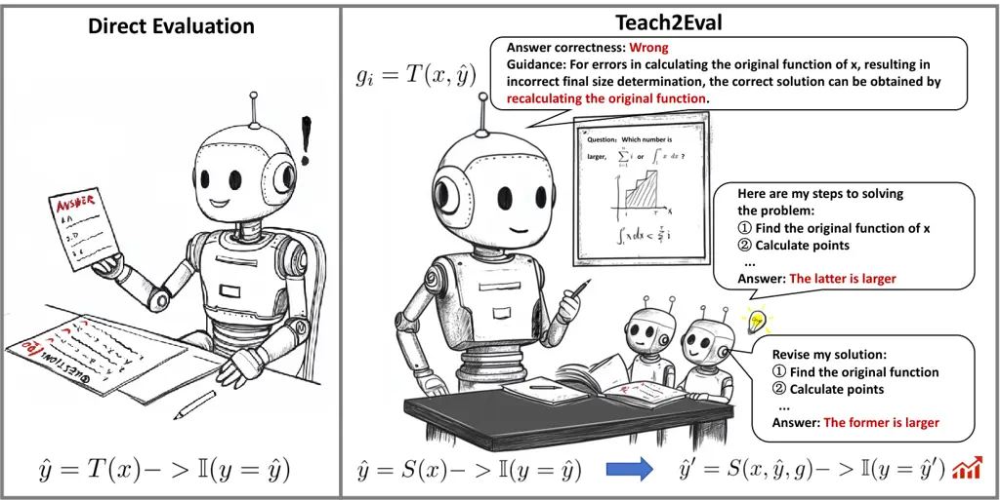

Figure 1: Comparing two evaluation methods. The left shows the use of
static benchmarks to directly evaluate LLM, which may lead to data
contamination and result in artificially high scores; On the right is
Teach2Eval, which generates guidance to enhance the ability of the weak
model as an indirect metric for LLM evaluation.

In this paper, we propose Teach2Eval, an indirect evaluation method that
targets scalable, quantifiable, and multi-dimensional evaluation of
LLMs. Inspired by the Feynman Technique Feynman (2018), which states
"explaining or teaching concepts in a simple, concise manner deepens
one’s understanding of the material", we introduce this principle as a
tool for evaluating abilities beyond learning strategy. Unlike
traditional evaluation methods, Teach2Eval does not directly assess LLMs
through performance metrics on given datasets. Instead, we leverages the
target to teach weak "student" models to complete tasks, as shown in
Figure 1, and the overall performance gains of students shall reflect
multi-dimensional capabilities of the teacher. That is, better students,
better teacher LLMs.

There are several benefits of the above idea, which guides the design of
such an indirect method. First, it transforms open-ended questions into
multi-choice questions (MCQs) while preserving task difficulty, enabling
more standardized and scalable assessment. As LLMs encounter increasing
open-ended queries, traditional evaluation methods face challenges due
to reliance on costly human judgment or inconsistent automated
metrics Gu et al. (2024); Li et al. (2024). While direct conversion to
MCQs simplifies evaluation, it often fails to capture the generative
capabilities of LLMs. In contrast, Teach2Eval leverages LLMs to generate
feedback that guides weaker models to answer in MCQ format. We construct
a benchmark of 60 datasets across four categories—Knowledge, Reasoning,
Understanding, and Multilingual—and standardize them as MCQs with added
misleading options derived from original answers. Evaluation is based on
student model performance gains after teacher-guided learning.
Importantly, the teacher model receives no access to MCQ choices,
ensuring that evaluation reflects student accuracy rather than exposure
to answer options. This approach enables cost-effective, fully automated
evaluation for open-ended tasks.

The second benefit of indirect evaluation is the involvement of
comprehensive abilities. Traditional benchmarks usually focus on one or
several targeted task-specific capabilities through the design of
questions Cao et al. (2025). While, Teach2Eval does not rely on the
questions themselves (orthogonal to existing benchmarks). It grounds the
evaluation in practice, and the teaching process naturally involves
several practical abilities. We categorize them into four levels based
on Bloom’s taxonomy Krathwohl (2002): Application, Judgment, Guidance,
and Reflection. Based on this, we design a multi-dimensional metric, and
also prove that such a metric well supports the claims above.

The third benefit is addressing the problem of data contamination. This
interactive evaluation mechanism introduces dynamic randomness, and
requires models to possess a deeper understanding of the knowledge in
order to effectively teach the student model, memorizing answers becomes
ineffective under this setup. To validate this, we designed a series of
experiments based on the multi-dimensional cognitive abilities,
demonstrating that Teach2Eval not only mitigates data contamination
issue, but also provides fine-grained guidance for model training and
development.

To evaluate this approach, we test 26 latest LLMs and the results show
our method’s results align closely with platforms like Chatbot
Arena Chiang et al. (2024), LiveBench White et al. (2024), and
GPT-as-a-Judge, with similarities of 0.91, 0.92, and 0.88, respectively.
Note that our proposed evaluation is automated and cost-effective.Also,
we evaluate the convergence and robustness of this method based on a
random combination of student models and longer interaction turns. We
present evidence and advantages of using this evaluation method to guide
model training in the final, for instance, by analyzing the evolution of
the two capabilities during model training, our method provides clear
directions for preventing model overfitting.

We make the following contributions:

- •
  We propose a novel, general indirect evaluation method Teach2Eval,
  which effectively addresses multiple issues of current evaluation
  approaches. We have open-sourced our code and data at
  https://github.com/zhiqix/Teach2Eval.
- •
  We define the metric based on students’ improvements, and demonstrates
  its effectiveness in reflecting several cognitive abilities of the
  teacher LLMs, these abilities are orthogonal to the current
  benchmarks.
- •
  Our approach not only provides an effective overall ranking of models
  at low cost, but also enables fine-grained capability analysis to
  guide model training and refinement.

## 2 Related Work

### 2.1 Benchmarks

The most prevalent benchmarks for evaluating models are static,
groundtruth-based ones, such as MCQs or QA tasks with predefined
answers. These benchmarks can be categorized according to the 3H
criteria Bai et al. (2022), with a focus on helpful benchmarks. They
cover a variety of topics, including Understanding, Knowledge,
Reasoning, and Multilingual tasks, as illustrated in Figure 11 of
Appendix B. Examples include MMLU Hendrycks et al. (2020),
GSM-8K Hendrycks et al. (2021), BigBench Srivastava et al. (2022),
AGIEval Zhong et al. (2023), and HellaSwag Zellers et al. (2019).

However, static benchmarks have limitations like contamination,
saturation, overfitting, and a lack of human alignment Yang et al.
(2023); Oren et al. (2023). DynaBench Kiela et al. (2021) addressed
these issues by introducing real-time benchmarks that incorporate human
input. Our system adopts a similar approach, using perturbations from
weak models to increase task difficulty, which can be extended to a
variety of benchmarks.

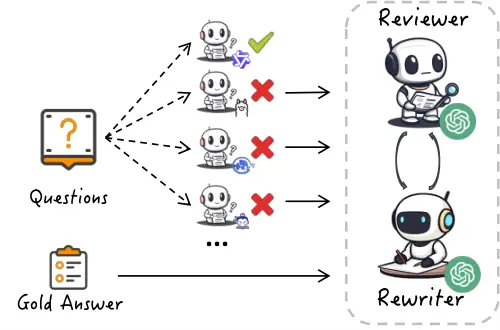

Figure 2: Use multiple weak models to answer questions and collect
incorrect options with gold answers. Use GPT-4o as a rewriter and
reviewer to convert the original question into MCQ format.

### 2.2 LLM Evaluation

Current LLM evaluation methods can be classified into three categories.
First, automatic evaluation using metrics is common, with benchmarks
like MCQ-based datasets using accuracy, sentiment analysis datasets
using F1 score, and text generation datasets using BertScore Zhang
et al. (2019). These metrics provide quick performance assessments but
are limited to simple measures. Second, manual evaluation through human
judgment involves methods like AdaTest  Chen et al. (2023), which gather
human feedback, and approaches like DynaBench Kiela et al. (2021) and
Chatbot Arena Chiang et al. (2024) that use crowdsourcing for diverse
evaluations. Third, LLM-as-a-Judge uses LLMs for evaluation, such as
MT-Bench Zheng et al. (2023), which compares model labels to human
labels, and other approaches that explore whether weak models can assess
stronger ones Khan et al. (2024). Currently, it is crucial to address
the issue of generalization in evaluation  ( ) , our method focuses on
weak models’ improvement to indirect measure the multi-dimensional
abilities of LLMs, ensuring accuracy, economy, and scalability.

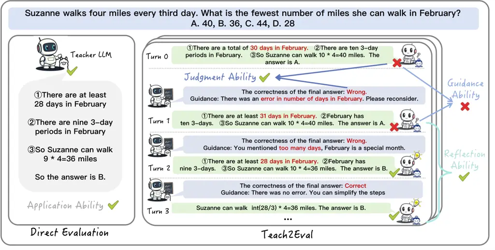

Figure 3: The overall design of Teach2Eval. On the left, Application
Ability is obtained through direct evaluation, while on the right,
multiple turns of guidance from the teacher LLM are used to guide the
weak student model. The final performance gains of the student models is
used as an indirect metirc of the LLM’s ability. At the same time, by
measuring the changes in student model’s ability between dialogues and
the accuracy of teacher model judgments, various cognitive abilities of
teacher models can be measured.

## 3 Method

### 3.1 Data Construction

To ensure the effectiveness and diversity of the evaluation, we collect
60 datasets, and categorize them into Knowledge, Reasoning,
Understanding, and Multilingual domains, with detailed information
provided in the Appendix B. Specifically, due to the limited abilities
of weak models, it is challenging to extract information from their
open-ended responses, the MCQ format is better suited for accurately
evaluating the capabilities of weak models. Therefore, we convert all
the data into MCQ format. Specifically, to construct the set of options,
we utilize a group of models to answer the questions and collect
incorrect answers, as shown in Figure 2. With these answers and the gold
answer from datasets, we use the GPT-4o as the rewriter and reviewer to
ensure proper formatting across the dataset. Besides, to examine LLM’s
alibities across various difficulty levels, we leverage the
Qwen-family Yang et al. (2024) models of different parameter sizes to
sequentially answer all questions. Based on the accuracy of the answers
provided by different model sizes, we categorize the questions by five
difficulty levels, detailed information can be found in Appendix B.

### 3.2 Teach2Eval

We propose Teach2Eval, an indirect evaluation framework that assesses
multi-dimensional capabilities of LLMs by measuring their ability to
guide weak student models toward improved performance, as shown in
Figure 3.

In this setup, each student model $`S_{j}`$ first answers a question
$`d_{i}`$ from dataset $`D`$, using only the question and options. The
teacher LLM $`T`$ then evaluates and provides guidance without seeing
the answer choices, ensuring open-ended problem-solving. In subsequent
rounds, the student model refines its answer based on the latest
guidance $`g_{j,i,t}`$ and its prior response $`a_{j,i,t-1}`$. The
teacher, however, receives the full interaction history to support
reflective reasoning.

The student model’s response at iteration $`t`$ is defined as:

```math
S_{j,i,t}=\begin{cases}S_{j,i,0}(d_{i}),&\text{if }t=0,\\
S_{j,i,t}(d_{i},a_{j,i,t-1},g_{j,i,t}),&\text{if }t>0.\end{cases} \tag{1}
```

The teacher LLM’s output includes both judgment $`j_{j,i,t}`$ and
guidance $`g_{j,i,t}`$, formulated as:

```math
j_{j,i,t},g_{j,i,t}=T\left(d_{i},\left\{a_{j,i,0},\dots,g_{j,i,t-2},a_{j,i,t-1}\right\}\right) \tag{2}
```

Let $`P(S)`$ denote the accuracy of the student model. We define
$`\Delta P_{t}(S)`$ as the change in accuracy between iterations:

```math
\Delta P_{t}(S)=\frac{1}{|D|}\sum_{i=1}^{|D|}\Big(\mathbb{I}(S_{i,t})-\mathbb{I}(S_{i,t-1})\Big), \tag{3}
```

where $`\mathbb{I}(\cdot)`$ is an indicator function for correct
answers. The final improvement after $`T`$ turns becomes a proxy for the
LLM’s comprehensive ability:

```math
\Delta P_{T}(S)=\sum_{t=1}^{T}\Delta P_{t}(S), \tag{4}
```

and we average over all $`M`$ student models to compute the
Comprehensive Ability (CA):

```math
CA=\frac{1}{M}\sum_{j=1}^{M}\Delta P_{T}(S_{j}). \tag{5}
```

### 3.3 Ability Taxonomy and Metrics

By combining the guidance mechanism in this framework with the Bloom’s
taxonomy Krathwohl (2002) of cognitive levels, we categorize the LLM’s
abilities into four levels: Application, Judgment, Guidance, and
Reflection. In the Appendix A, we demonstrate that, in this interactive
setting, Comprehensive Ability can be naturally decomposed into Judgment
Ability, Guidance Ability, and Reflection Ability.

Application Ability (AA) is the accuracy of the LLM directly evaluate on
the benchmark. This is the basic ability of the LLM to use its knowledge
to provide answers. We denote it as the accuracy of the LLM when
performing Zero-Shot testing:

```math
AA=\frac{1}{|D|}\sum_{i=1}^{|D|}\mathbb{I}(T(d_{i})), \tag{6}
```

where $`T(d_{i})`$ is the LLM’s direct answer to question $`d_{i}`$.

Judgment Ability (JA) refers to the LLM’s ability to effectively
evaluate the correctness after receiving a question and its solution, we
can use the gold answer to determine if the teacher model’s judgment is
correct. We denote it as the LLM’s correctness in evaluating students’
initial responses:

```math
JA=\frac{1}{M}\sum_{j=1}^{M}\frac{1}{|D|}\sum_{i=1}^{|D|}\mathbb{I}(J_{1}(d_{i},a_{j,i,0})), \tag{7}
```

where $`J_{1}(\cdot)`$ is the LLM’s judgment in the first round.

Guidance Ability (GA) refers to the LLM’s capability to provide
personalized guidance and corrections based on the solution of weak
models after judging the given solution, quantifies how effectively the
LLM improves student performance after incorrect initial answers:

```math
GA=\frac{1}{M}\sum_{j=1}^{M}\frac{\sum_{i=1}^{|D_{j,\text{incorrect}}|}\mathbb{I}(S_{j,i,1})}{|D_{j,\text{incorrect}}|}. \tag{8}
```

Reflection Ability (RA) refers to the LLM’s capability to engage in
self-reflection across multiple turns of interaction. It captures the
LLM’s capacity to refine its guidance across multiple rounds. For each
turn $`t\geq 2`$:

```math
RA_{t}=\frac{1}{|D_{c,t-1}|}\sum_{i=1}^{|D_{c,t-1}|}\Big[\mathbb{I}(\neg S_{i,t-1}\land S_{i,t})-\mathbb{I}(S_{i,t-1}\land\neg S_{i,t})\Big], \tag{9}
```

where $`D_{c,t-1}`$ contains questions answered correctly in the
previous round, and the overall Reflection Ability is the geometric mean
of improvements:

```math
RA=\frac{1}{M}\sum_{j=1}^{M}\left[\prod_{t=2}^{T}(1+RA_{j,t})-1\right]. \tag{10}
```

## 4 Experience

### 4.1 Experience Setup

In order to expand the evaluation scope of our method as much as
possible, we define the selection criteria for weak student models as
follows: strong instruction-following abilities but weak original
application abilities, the current mainstream end-side models all meet
this condition. So we select four weak models: LLaMA3.2-1B Dubey et al.
(2024), Qwen2.5-1.5B Yang et al. (2024), MiniCPM-2B Hu et al. (2024),
and InternLM2.5-1.8B Cai et al. (2024). Additionally, we select 26
state-of-the-art models, including various families such as LLaMA, Qwen,
and DeepSeek, for evaluation. Detailed information can be found in the
Appendix C. The experiments are conducted using the VLLM 0.6.4 framework
for inference, with the following settings: temperature set to 0.0,
max_token set to 2k, and the experiments were run on four H100 GPUs. We
set the total number of turns to 3.

|                   |               |               |              |       |
| ----------------- | ------------- | ------------- | ------------ | ----- |
| Evaluation Method | Chatbot Arena |               | Livebench    |       |
| Kendall’s Tau     | Spearman Cor  | Kendall’s Tau | Spearman Cor |       |
| Direct Evaluation | 0.581         | 0.775         | 0.538        | 0.709 |
| Teach2Eval        | 0.790         | 0.911         | 0.821        | 0.923 |

Table 1: Comparison of Teach2Eval with Chatbot Arena and Livebench

### 4.2 Main Result

We compare 26 models based on the experimental setup described above,
and the detailed results in Appendix E. To verify the effectiveness of
our evaluation, we compare our results with two prominent leaderboards.
To ensure the consistency of the data distribution, we compare our
reasoning scores with the Chatbot Arena Math benchmark and our overall
scores with the Livebench Reasoning, Math, and Language benchmark. The
correlation coefficients are shown in Table 1. Compared with direct
evaluation, our evaluation method achieves a higher correlation between
two leaderboards, both above 0.90, and is also more cost-effective than
two leaderboards.

Figure 4: The confusion matrix comparison between DeepSeek and LLaMA
models shows the left side without guidance and the right side after 3
turns of guidance. LM and WM represent LLM and weak models, while C and
W represent correct and wrong models, respectively.

|                               |               |             |          |          |            |           |           |               |              |
| ----------------------------- | ------------- | ----------- | -------- | -------- | ---------- | --------- | --------- | ------------- | ------------ |
| Model                         | Overall       |             |          |          |            | Knowledge | Reasoning | Understanding | Multilingual |
|                               | Comprehensive | Application | Judgment | Guidance | Reflection |           |           |               |              |
|                               | Ability       | Ability     | Ability  | Ability  | Ability    |           |           |               |              |
| Qwen2.5-72B-Instruct          | 10.07         | 78.91       | 74.49    | 20.89    | 3.74       | 11.72     | 11.26     | 5.53          | 14.61        |
| DeepSeek-V3                   | 9.84          | 75.20       | 73.78    | 19.45    | 5.05       | 10.29     | 11.12     | 5.71          | 15.07        |
| DeepSeek-R1-Distill-Llama-70B | 9.54          | 76.46       | 73.79    | 18.80    | 3.51       | 10.74     | 11.11     | 5.76          | 11.38        |
| DeepSeek-R1-Distill-Qwen-32B  | 8.68          | 77.56       | 75.00    | 16.67    | 3.62       | 9.12      | 10.04     | 5.51          | 11.25        |
| GPT-4o-0806                   | 8.55          | 76.97       | 75.70    | 15.60    | 6.86       | 9.73      | 9.96      | 4.71          | 10.77        |
| DeepSeek-R1-Distill-Qwen-14B  | 8.31          | 75.03       | 72.52    | 16.71    | 2.91       | 7.86      | 10.32     | 5.12          | 10.20        |
| Llama-3.3-70B-Instruct        | 7.97          | 77.69       | 75.05    | 13.27    | 5.74       | 8.61      | 9.44      | 5.19          | 8.53         |
| Phi-4                         | 7.69          | 76.58       | 73.20    | 15.53    | 3.14       | 7.80      | 9.50      | 4.42          | 9.49         |
| Qwen2.5-Coder-32B-Instruct    | 7.40          | 76.20       | 72.33    | 16.22    | 3.07       | 7.02      | 8.66      | 5.13          | 9.64         |
| Llama-3.1-70B-Instruct        | 7.13          | 75.10       | 71.73    | 15.31    | 3.74       | 8.22      | 7.84      | 4.62          | 9.04         |
| Qwen2.5-32B-Instruct          | 6.85          | 79.23       | 74.09    | 14.33    | 3.74       | 7.82      | 7.30      | 4.80          | 8.82         |
| Qwen2-72B-Instruct            | 6.16          | 74.20       | 72.45    | 13.83    | 3.43       | 7.11      | 6.35      | 4.89          | 6.98         |
| DeepSeek-R1-Distill-Qwen-7B   | 5.61          | 61.93       | 53.82    | 12.53    | 1.67       | 3.48      | 8.68      | 2.62          | 6.31         |
| Qwen2.5-14B-Instruct          | 5.49          | 76.38       | 71.13    | 12.88    | 2.73       | 6.60      | 5.76      | 4.03          | 6.11         |
| Llama-3-70B-Instruct          | 4.17          | 73.03       | 70.89    | 10.36    | 2.30       | 5.09      | 3.78      | 4.02          | 4.14         |
| Qwen2.5-7B-Instruct           | 3.93          | 72.26       | 66.95    | 9.93     | 1.96       | 4.08      | 4.38      | 2.85          | 4.88         |
| Yi1.5-34B-Chat                | 3.93          | 68.61       | 61.74    | 8.93     | 2.17       | 3.31      | 4.44      | 3.46          | 4.52         |
| DeepSeek-R1-Distill-Llama-8B  | 3.60          | 63.87       | 60.45    | 11.15    | 0.41       | 2.34      | 5.59      | 1.90          | 3.11         |
| Yi1.5-9B-Chat                 | 2.56          | 64.19       | 63.55    | 12.05    | 0.87       | 2.66      | 2.82      | 2.06          | 2.68         |
| InternLM2.5-20B               | 2.16          | 64.94       | 62.20    | 8.12     | -0.03      | 2.14      | 2.25      | 2.19          | 1.67         |
| Gemma-2-27b-it                | 1.89          | 70.38       | 67.63    | 8.05     | 0.58       | 1.74      | 1.82      | 1.75          | 2.95         |
| Llama-3.1-8B-Instruct         | 1.79          | 62.37       | 54.12    | 10.13    | 0.55       | 2.37      | 1.55      | 1.46          | 2.42         |
| Gemma-2-9b-it                 | 1.70          | 65.63       | 64.77    | 7.79     | 0.40       | 1.43      | 1.57      | 1.46          | 3.52         |
| Llama-3-8B-Instruct           | 1.37          | 59.66       | 53.79    | 9.69     | 0.42       | 1.90      | 1.14      | 1.31          | 1.37         |
| InternLM2.5-7B                | 1.01          | 55.73       | 52.77    | 5.06     | -1.02      | 0.77      | 0.97      | 1.24          | 1.02         |
| Yi1.5-6B-Chat                 | 0.91          | 57.12       | 54.08    | 9.34     | -0.85      | 1.67      | 0.82      | 0.28          | 1.40         |

Table 2: The performance of the LLMs under Teach2eval demonstrates
overall Comprehensive, Application, Evaluation, Guidance, and Reflection
Ability, as well as Comprehensive Ability on four tasks.

As shown in Table 2, we find that Qwen2.5-72B-Instruct and DeepSeek-V3
performs the best across all four types of tasks, significantly
outperforming the other models. The next best models are GPT-4o and
DeepSeek-R1-Distill series, which show similar performance.
DeepSeek-R1-Distill-Qwen-14B and Phi-4 has only 14B parameters,
demonstrating that even models of this scale can achieve exceptional
performance. For models with 8B parameters or smaller,
DeepSeek-R1-Distill-Qwen-7B shows strong performance, especially in the
reasoning tasks, where its ability even rivals that of the 70B variant
from the same family. Due to DeepSeek-R1-Distill-Qwen-14B’s impressive
performance with models below 20B, we compare its confusion matrix with
that of Llama3.1-70B-Instruct, as shown in Figure 4. The results
indicate that DeepSeek-R1-Distill-Qwen-14B can teach weak models more
effectively within the capacity of teacher models, showcasing its
higher-level abilities.

### 4.3 Ability Dimensional Analysis

To further explore the factors influencing the overall performance of
LLMs, we use the classification method designed in Section 3.3 to assess
the four capabilities of all LLMs and compare them with their
Comprehensive Ability. Table 2 presents a comparison of the four
capabilities with the Comprehensive Ability across all datasets. As
shown in Figure 5, we observe that the correlation between the
Comprehensive Ability and the four capabilities gradually increases. The
Application Ability obtained through traditional direct evaluation has a
relatively low correlation with our Comprehensive Ability, while the
correlation for the higher-order abilities is above 0.9. For some models
that show anomalies in direct evaluations, such as Qwen2.5-32B-Instruct,
which achieves the highest Application Ability, our evaluation method
reveals its true capabilities.

Regarding Judgment Ability, the data for all models exceed 50%,
indicating that all LLMs possess judgment capabilities for weak models.
However, there are significant differences among the models in the
comparisons for Guidance and Reflection abilities. For Reflection
Ability, the models with the worst performance, Yi-1.5-6B-Chat and
InternLM2.5-7B, exhibits inconsistent reflection, performing worse than
the other models.

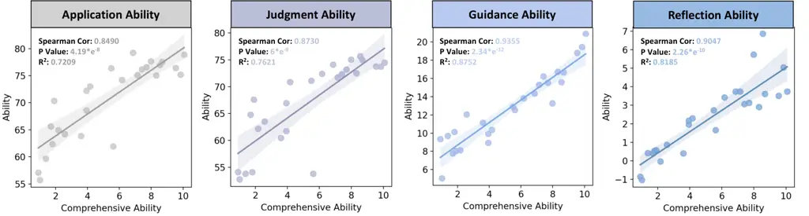

Figure 5: The correlation coefficient between Comprehensive Ability and
the four abilities.

### 4.4 Ablation Experiment

To verify the robustness and convergence of Teach2Eval, we conducted two
ablation experiments.

Ablation1: No bias in random selection of weak models. To assess
potential bias from weak model selection, we evaluate the stability of
results when one of the four weak models is randomly removed. This
yields four combinations of three models each. The resulting
correlations with Chatbot Arena (0.907–0.911) and LiveBench (all 0.92)
confirm the robustness and impartiality of the evaluation mechanism.

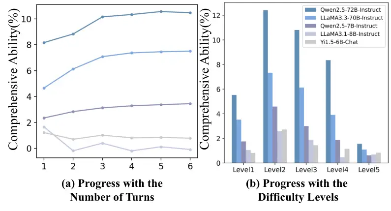

Figure 6: (a) The improvement of weak model capability with changes in
the number of guiding turns; (b) The amount of improvement guided by
different models on data of different difficulty levels.

Ablation2: Weak model improvement tends to stabilize after multiple
guidance turns. To evaluate the convergence and Reflective Ability of
LLMs, we select five representative models, each providing six rounds of
guidance to weak models (performance shown in Figure 6(a)). While
high-performing models show initial gains, the improvement generally
plateaus as the number of rounds increases. Lower-performing models like
LLaMA3.1-8B and Yi1.5-6B reach a plateau even earlier, indicating
limited reflective capability. These results confirm the convergence
behavior of our method. In our main experiments, we adopt the
performance after three turns as the final metric, as most models have
nearly converged by then.

## 5 Insights

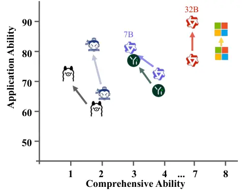

Figure 7: The trend of changes before and after fine-tuning six LLMs:
models with strong abilities can maintain Comprehensive Ability, while
models with weaker abilities show varying degrees of attenuation.

In addition to providing effective model rankings, Teach2Eval can also
offer fine-grained indicators orthogonal to exist benchmarks, which can
transform static task-specific evaluations into dynamic capability-based
evaluations, this analysis of the model can naturally guide further
training and refinement.

Insight1: Models affected by data contamination perform inadequately in
higher-order capabilities. Teach2Eval not only replicates data
contamination but also prevents its occurrence during model training. To
verify its effectiveness in addressing data contamination issue, we
construct a subset of data for distillation and evaluation.
Specifically, we used GPT-4o to traverse and answer the subset, then
applied rejection sampling based on the correct answers and randomly
filter 3,000 samples. Six models were fine-tuned on this subset, as
illustrated in the Figure  7. The results show that most distilled
models exhibit improved Application Ability but diminished Comprehensive
Ability, whereas Qwen2.5-32B and Phi-4, stronger models, remain largely
unchanged — demonstrating that Teach2Eval effectively mitigates
evaluation issues caused by data contamination. Furthermore, tracking
model performance across training stages within this coordinate system
provides feedback that helps reduce the risk of overfitting or data
contamination.

Insight2: The Scaling Law remains valid for higher-order capabilities.
We conduct a study on the Scaling Law Kaplan et al. (2020) of five model
families, including Qwen, Deepseek, LLaMA, InternLM, and Yi, as shown in
Figure 9. Our findings show that, across the overall dataset, the
Comprehensive Ability increases with model size within each family.
However, for the DeepSeek-Distill family models, variations in the size
of the base models (Qwen or Llama) lead to fluctuations in their
higher-order capabilities, which is more consistent with consensus. In
terms of Application Ability, these models follow the trend that larger
sizes yield better performance, which may result in incorrect
evaluations during training, potentially leading to models perform
poorly in reality. This suggests that while models may appear to follow
the Scaling Law in Application Ability, their true capabilities can
differ, we can use higher-order capabilities to assess models’ genuine
performance.

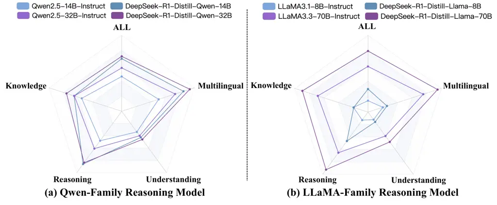

Figure 8: The Comprehensive Ability of reasoning LLMs and their base
models varies on different types of tasks, and reasoning LLMs have shown
improvements in various types, especially in reasoning tasks.

Insight3: Reasoning enhancement is effective in many tasks, but its
impact varies across different tasks. Currently, reasoning LLMs like
OpenAI-o1 Jaech et al. (2024) and Deepseek-R1 Guo et al. (2025) are
gaining popularity. These models use test-time scaling to further
enhance their reasoning abilities, which has attracted significant
attention. To assess the abilities of these reasoning models, we also
select the Deepseek family, which were distilled based on Qwen and LLaMA
models. In Figure 8, we compare the reasoning LLMs with their base
models. Our findings show that the reasoning models outperform the base
models across all tasks, where the 14B reasoning model surpasses the 32B
base model, especially in the Reasoning and Multilingual tasks. The
improvement in the Knowledge task is less pronounced, and only minimal
gains are observed in the Understanding task.

Insight4:The low-order capabilities of weak models can be leveraged to
inversely evaluate the high-order capabilities of stronger models. As
models become increasingly capable, it becomes challenging to find
stronger models or sufficiently broad datasets for effective evaluation.
Previous research Khan et al. (2024) has explored whether the critical
capabilities of weaker models can be used to judge the responses of
stronger models; however, such subjective evaluations are inherently
limited by the capacity ceiling of the weaker models. Teach2Eval
leverages the response-generation capability of weak models, elevating
the evaluation ceiling to match that of the stronger teacher models.
This enables more accurate and effective assessment of model
capabilities, making it particularly suitable for potential future AGI
scenarios.

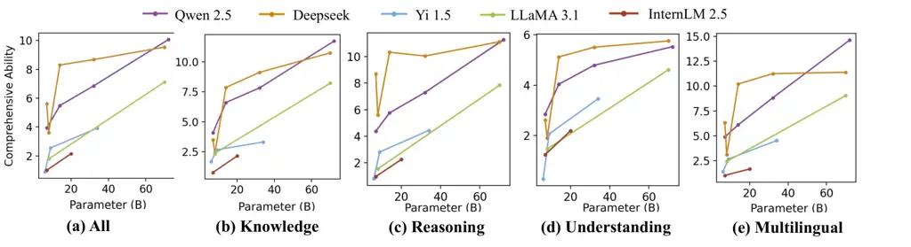

Figure 9: The trend of Comprehensive Ability changing with the
parameters for model-families.

Insight5: Medium-difficulty problems are more successfully guided to
improvements. To analyze the relationship between guidance and model
capability across data difficulty levels, we calculate the guidance
improvement ratios for each difficulty set. The statistical information
can be found in Appendix B, and we also present five models in Figure
6(b). We find that the guidance effect is most effective on data of
medium difficulty, and this effect exhibits a decreasing trend as the
difficulty level increases. Strong models show robust guidance abilities
across all difficulty levels. This indicates that further attention
needs to be paid to the model’s understanding of simple problems during
model training, which may be overlooked in favor of more complex cases.

## 6 Conclusion

Teach2Eval presents a promising direction for evaluating LLMs in a way
that is both scalable and cognitively meaningful. By reframing
evaluation as a teaching process, we move beyond conventional
performance metrics toward a more holistic understanding of model
capabilities. The method naturally addresses key limitations in current
practices—such as dataset bias, contamination, and lack of fine-grained
insights—while remaining cost-effective and fully automated. Our
experiments demonstrate that student-driven evaluation aligns well with
established rankings and provides actionable feedback for model
development. As LLMs continue to evolve, methods like Teach2Eval offer a
practical and insightful path forward for fair, comprehensive, and
interpretable evaluation.

## References

- Bai et al. (2022) Yuntao Bai, Andy Jones, Kamal Ndousse, Amanda
  Askell, Anna Chen, Nova DasSarma, Dawn Drain, Stanislav Fort, Deep
  Ganguli, Tom Henighan, et al. 2022. Training a helpful and harmless
  assistant with reinforcement learning from human feedback. _arXiv
  preprint arXiv:2204.05862_.
- Cai et al. (2024) Zheng Cai, Maosong Cao, Haojiong Chen, Kai Chen,
  Keyu Chen, Xin Chen, Xun Chen, Zehui Chen, Zhi Chen, Pei Chu,
  et al. 2024. Internlm2 technical report. _arXiv preprint
  arXiv:2403.17297_.
- Cao et al. (2025) Yixin Cao, Shibo Hong, Xinze Li, Jiahao Ying, Yubo
  Ma, Haiyuan Liang, Yantao Liu, Zijun Yao, Xiaozhi Wang, Dan Huang,
  et al. 2025. Toward generalizable evaluation in the llm era: A survey
  beyond benchmarks. _arXiv preprint arXiv:2504.18838_.
- Chen et al. (2023) Huili Chen, Xinqiao Zhang, Ke Huang, and Farinaz
  Koushanfar. 2023. Adatest: Reinforcement learning and adaptive
  sampling for on-chip hardware trojan detection. _ACM Transactions on
  Embedded Computing Systems_, 22(2):1–23.
- Chiang et al. (2024) Wei-Lin Chiang, Lianmin Zheng, Ying Sheng,
  Anastasios Nikolas Angelopoulos, Tianle Li, Dacheng Li, Hao Zhang,
  Banghua Zhu, Michael Jordan, Joseph E Gonzalez, et al. 2024. Chatbot
  arena: An open platform for evaluating llms by human preference.
  _arXiv preprint arXiv:2403.04132_.
- Cobbe et al. (2021) Karl Cobbe, Vineet Kosaraju, Mohammad Bavarian,
  Mark Chen, Heewoo Jun, Lukasz Kaiser, Matthias Plappert, Jerry Tworek,
  Jacob Hilton, Reiichiro Nakano, et al. 2021. Training verifiers to
  solve math word problems. _arXiv preprint arXiv:2110.14168_.
- Dubey et al. (2024) Abhimanyu Dubey, Abhinav Jauhri, Abhinav Pandey,
  Abhishek Kadian, Ahmad Al-Dahle, Aiesha Letman, Akhil Mathur, Alan
  Schelten, Amy Yang, Angela Fan, et al. 2024. The llama 3 herd of
  models. _arXiv preprint arXiv:2407.21783_.
- Feynman (2018) Richard P Feynman. 2018. _Feynman lectures on
  computation_. CRC Press.
- Gu et al. (2024) Jiawei Gu, Xuhui Jiang, Zhichao Shi, Hexiang Tan,
  Xuehao Zhai, Chengjin Xu, Wei Li, Yinghan Shen, Shengjie Ma, Honghao
  Liu, et al. 2024. A survey on llm-as-a-judge. _arXiv preprint
  arXiv:2411.15594_.
- Guo et al. (2025) Daya Guo, Dejian Yang, Haowei Zhang, Junxiao Song,
  Ruoyu Zhang, Runxin Xu, Qihao Zhu, Shirong Ma, Peiyi Wang, Xiao Bi,
  et al. 2025. Deepseek-r1: Incentivizing reasoning capability in llms
  via reinforcement learning. _arXiv preprint arXiv:2501.12948_.
- Hendrycks et al. (2020) Dan Hendrycks, Collin Burns, Steven Basart,
  Andy Zou, Mantas Mazeika, Dawn Song, and Jacob Steinhardt. 2020.
  Measuring massive multitask language understanding. _arXiv preprint
  arXiv:2009.03300_.
- Hendrycks et al. (2021) Dan Hendrycks, Collin Burns, Saurav Kadavath,
  Akul Arora, Steven Basart, Eric Tang, Dawn Song, and Jacob
  Steinhardt. 2021. Measuring mathematical problem solving with the math
  dataset. _arXiv preprint arXiv:2103.03874_.
- Hu et al. (2024) Shengding Hu, Yuge Tu, Xu Han, Chaoqun He, Ganqu Cui,
  Xiang Long, Zhi Zheng, Yewei Fang, Yuxiang Huang, Weilin Zhao,
  et al. 2024. Minicpm: Unveiling the potential of small language models
  with scalable training strategies. _arXiv preprint arXiv:2404.06395_.
- Jaech et al. (2024) Aaron Jaech, Adam Kalai, Adam Lerer, Adam
  Richardson, Ahmed El-Kishky, Aiden Low, Alec Helyar, Aleksander Madry,
  Alex Beutel, Alex Carney, et al. 2024. Openai o1 system card. _arXiv
  preprint arXiv:2412.16720_.
- Kaplan et al. (2020) Jared Kaplan, Sam McCandlish, Tom Henighan, Tom B
  Brown, Benjamin Chess, Rewon Child, Scott Gray, Alec Radford, Jeffrey
  Wu, and Dario Amodei. 2020. Scaling laws for neural language models.
  _arXiv preprint arXiv:2001.08361_.
- Khan et al. (2024) Akbir Khan, John Hughes, Dan Valentine, Laura Ruis,
  Kshitij Sachan, Ansh Radhakrishnan, Edward Grefenstette, Samuel R
  Bowman, Tim Rocktäschel, and Ethan Perez. 2024. Debating with more
  persuasive llms leads to more truthful answers. _arXiv preprint
  arXiv:2402.06782_.
- Kiela et al. (2021) Douwe Kiela, Max Bartolo, Yixin Nie, Divyansh
  Kaushik, Atticus Geiger, Zhengxuan Wu, Bertie Vidgen, Grusha Prasad,
  Amanpreet Singh, Pratik Ringshia, et al. 2021. Dynabench: Rethinking
  benchmarking in nlp. _arXiv preprint arXiv:2104.14337_.
- Krathwohl (2002) DR Krathwohl. 2002. A revision bloom’s taxonomy: An
  overview. _Theory into Practice_.
- Li et al. (2024) Dawei Li, Bohan Jiang, Liangjie Huang, Alimohammad
  Beigi, Chengshuai Zhao, Zhen Tan, Amrita Bhattacharjee, Yuxuan Jiang,
  Canyu Chen, Tianhao Wu, et al. 2024. From generation to judgment:
  Opportunities and challenges of llm-as-a-judge. _arXiv preprint
  arXiv:2411.16594_.
- OpenAI (2023) OpenAI. 2023. [Gpt-4 technical
  report](http://arxiv.org/abs/2303.08774).
- Oren et al. (2023) Yonatan Oren, Nicole Meister, Niladri Chatterji,
  Faisal Ladhak, and Tatsunori B Hashimoto. 2023. Proving test set
  contamination in black box language models. _arXiv preprint
  arXiv:2310.17623_.
- Srivastava et al. (2022) Aarohi Srivastava, Abhinav Rastogi, Abhishek
  Rao, Abu Awal Md Shoeb, Abubakar Abid, Adam Fisch, Adam R Brown, Adam
  Santoro, Aditya Gupta, Adrià Garriga-Alonso, et al. 2022. Beyond the
  imitation game: Quantifying and extrapolating the capabilities of
  language models. _arXiv preprint arXiv:2206.04615_.
- Touvron et al. (2023) Hugo Touvron, Louis Martin, Kevin Stone, Peter
  Albert, Amjad Almahairi, Yasmine Babaei, Nikolay Bashlykov, Soumya
  Batra, Prajjwal Bhargava, Shruti Bhosale, et al. 2023. Llama 2: Open
  foundation and fine-tuned chat models. _arXiv preprint
  arXiv:2307.09288_.
- Wei et al. (2023) Tianwen Wei, Liang Zhao, Lichang Zhang, Bo Zhu,
  Lijie Wang, Haihua Yang, Biye Li, Cheng Cheng, Weiwei Lü, Rui Hu,
  et al. 2023. Skywork: A more open bilingual foundation model. _arXiv
  preprint arXiv:2310.19341_.
- White et al. (2024) Colin White, Samuel Dooley, Manley Roberts, Arka
  Pal, Ben Feuer, Siddhartha Jain, Ravid Shwartz-Ziv, Neel Jain, Khalid
  Saifullah, Siddartha Naidu, et al. 2024. Livebench: A challenging,
  contamination-free llm benchmark. _arXiv preprint arXiv:2406.19314_.
- Yang et al. (2024) An Yang, Baosong Yang, Beichen Zhang, Binyuan Hui,
  Bo Zheng, Bowen Yu, Chengyuan Li, Dayiheng Liu, Fei Huang, Haoran Wei,
  et al. 2024. Qwen2. 5 technical report. _arXiv preprint
  arXiv:2412.15115_.
- Yang et al. (2023) Shuo Yang, Wei-Lin Chiang, Lianmin Zheng, Joseph E
  Gonzalez, and Ion Stoica. 2023. Rethinking benchmark and contamination
  for language models with rephrased samples. _arXiv preprint
  arXiv:2311.04850_.
- Zellers et al. (2019) Rowan Zellers, Ari Holtzman, Yonatan Bisk, Ali
  Farhadi, and Yejin Choi. 2019. Hellaswag: Can a machine really finish
  your sentence? _arXiv preprint arXiv:1905.07830_.
- Zhang et al. (2019) Tianyi Zhang, Varsha Kishore, Felix Wu, Kilian Q
  Weinberger, and Yoav Artzi. 2019. Bertscore: Evaluating text
  generation with bert. _arXiv preprint arXiv:1904.09675_.
- Zheng et al. (2023) Lianmin Zheng, Wei-Lin Chiang, Ying Sheng, Siyuan
  Zhuang, Zhanghao Wu, Yonghao Zhuang, Zi Lin, Zhuohan Li, Dacheng Li,
  Eric Xing, et al. 2023. Judging llm-as-a-judge with mt-bench and
  chatbot arena. _Advances in Neural Information Processing Systems_,
  36:46595–46623.
- Zhong et al. (2023) Wanjun Zhong, Ruixiang Cui, Yiduo Guo, Yaobo
  Liang, Shuai Lu, Yanlin Wang, Amin Saied, Weizhu Chen, and Nan
  Duan. 2023. Agieval: A human-centric benchmark for evaluating
  foundation models. _arXiv preprint arXiv:2304.06364_.
- Zhou et al. (2023) Kun Zhou, Yutao Zhu, Zhipeng Chen, Wentong Chen,
  Wayne Xin Zhao, Xu Chen, Yankai Lin, Ji-Rong Wen, and Jiawei
  Han. 2023. Don’t make your llm an evaluation benchmark cheater. _arXiv
  preprint arXiv:2311.01964_.

## Appendix A Description of Ability Deconstruction

We use the improvement in weak model performance as an indicator of the
LLM’s comprehensive ability. Assuming all abilities are for the same
weak student model. This comprehensive ability is influenced by the
three-tier capabilities of the LLM: judgment ability $`JA`$, guidance
ability $`GA`$, and reflection ability $`RA`$. By breaking down the
comprehensive ability, we derive the relationships between these
different capabilities.

First, let $`\Delta S_{1}`$ represent the improvement in the weak
model’s performance after the first turn of guidance, which can be
expressed as follows:

```math
\Delta P_{1}(S)=JA_{1}^{\prime}\cdot GA_{1}\Bigl(JA_{1}\cdot\neg P(S_{0})+P(S_{0})\cdot\neg JA_{1}\Bigr)-\alpha P(S_{0})\cdot\neg JA_{1}
```

Where $`\neg P(S_{0})`$ and $`\neg JA_{1}`$ represent the probability of
initial answer errors in the weak model and the probability of judgment
errors in the LLM in first turn, respectively. $`\alpha`$ is a
fluctuation factor used to measure the conflict between the LLM’s
judgment and guidance, such as when the judgment is correct but the
guidance is erroneous. $`JA^{\prime}`$ is influenced by the elements of
$`JA`$, and it is calculated as follows:

```math
J^{\prime}=\frac{\sum_{d_{i}\in D}(\neg P(S_{0}(d_{i})))}{\sum_{d_{i}\in D}(\neg JA_{1}(d_{i}))}
```

Next, we consider the improvement in the weak model’s performance across
multiple turns of guidance. Let $`\Delta S_{T}`$ denote the performance
improvement of the weak model at the $`T`$-th turn. Assuming that the
LLM’s reflection ability $`RA`$ continuously influences performance
improvement in each turn, we can express the performance improvement
after multiple turns of guidance as follows:

```math
\Delta P_{T}(S)=\Delta P_{1}(S)\cdot(RA+1)
```

Through these equations, we describe that the comprehensive ability of
the LLM is a result of the combined effects of its judgment, guidance,
and reflection abilities. Specifically, the guidance and judgment
abilities interact to improve the performance of the weak model, while
the reflection ability continues to influence performance improvement
across multiple turns of guidance.

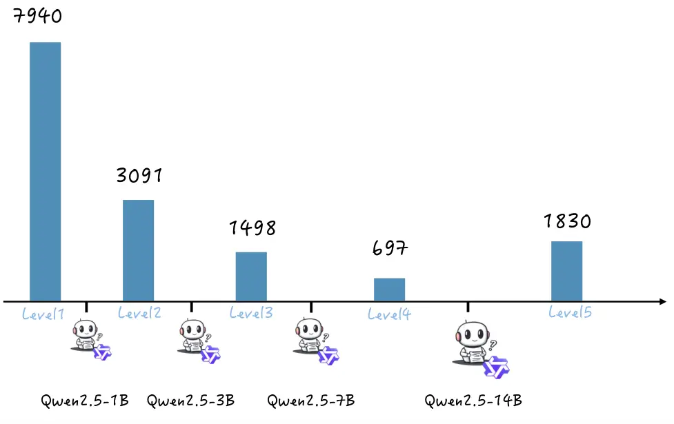

Figure 10: Use Qwen-family models for data difficulty classification.

## Appendix B Datasets and Data Construction

To ensure the comprehensiveness and effectiveness of our evaluation, we
collect 60 datasets and sample 15,000 pieces of data, classify them into
four tasks: Knowledge, Reasoning, Understanding, and Multilingual.
Figure 11 is the data statistical chart, and Table 3 is the data
statistical table.

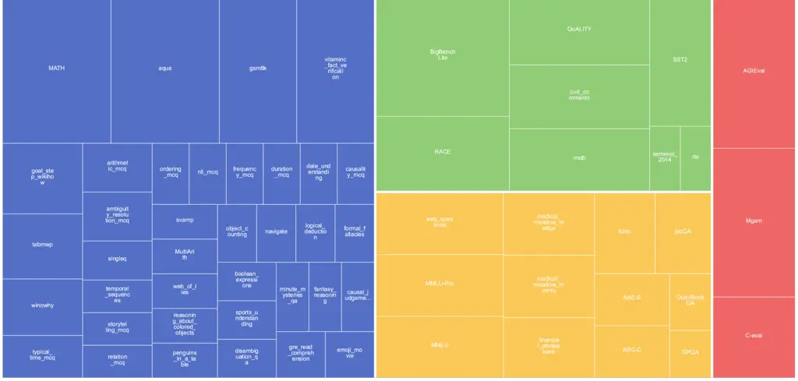

Figure 11: Dataset summary visualization, where blue represents
Reasoning task, green represents Understanding task, yellow represents
Knowledge task, red represents Multilingual task, and block size
represents the number of samples in the dataset.

In order to modify all datasets to MCQ format, we use 10 weak models
such as Qwen2.5-1.5B, Llama3.2-1B, etc., set the Temperature to 0.7, and
randomly answer each question until we collected 3 incorrect answers. We
use GPT-4o as the rewriter and reviewer, with gold answer as the correct
answer and weak models answer as the incorrect answer for format
conversion. We randomly place the correct answer positions during
construction.

Afterwards, in order to classify all the data into difficulty
categories, we used Qwen family models to answer each question
sequentially from 1B to 14B. Classify the data into the difficulty
category corresponding to the first correctly answered model, and set
the question that all models cannot answer as the highest difficulty.
Finally, divide it into five difficulty types, as shown in the
Figure 10.

|               |                                 |      |                          |      |
| ------------- | ------------------------------- | ---- | ------------------------ | ---- |
| Task          | Name                            | Num. | Name                     | Num. |
| Knowledge     | ARC-C                           | 202  | ARC-E                    | 231  |
|               | GPQA                            | 103  | MMLU                     | 433  |
|               | MMLU-Pro                        | 433  | OpenBookQA               | 115  |
|               | web_questions                   | 433  | fomc                     | 246  |
|               | financial_phrasebank            | 289  | jecQA                    | 231  |
|               | medical_meadow_mmmlu            | 289  | medical_meadow_medqa     | 289  |
| Multilingual  | AGIEval                         | 578  | C-eval                   | 311  |
|               | Mgsm                            | 577  |                          |      |
| Understanding | BigBenchLite                    | 1156 | civil_comments           | 462  |
|               | imdb                            | 462  | QuALITY                  | 482  |
|               | RACE                            | 1141 | rte                      | 64   |
|               | semeval_2014                    | 64   | SST2                     | 421  |
| Reasoning     | emoji_movie                     | 50   | gre_read_comprehension   | 32   |
|               | vitaminc_fact_verification      | 879  | causal_judgement         | 50   |
|               | fantasy_reasoning               | 50   | goal_step_wikihow        | 393  |
|               | minute_mysteries_qa             | 50   | winowhy                  | 393  |
|               | disambiguation_qa               | 57   | sports_understanding     | 57   |
|               | boolean_expressions             | 57   | formal_fallacies         | 57   |
|               | logical_deduction               | 57   | navigate                 | 57   |
|               | object_counting                 | 57   | penguins_in_a_table      | 50   |
|               | reasoning_about_colored_objects | 57   | web_of_lies              | 57   |
|               | aqua                            | 1156 | GSM8k                    | 305  |
|               | MATH                            | 694  | MultiArith               | 50   |
|               | singleq                         | 115  | svamp                    | 69   |
|               | tabmwp                          | 231  | ambiguity_resolution_mcq | 92   |
|               | arithmetic_mcq                  | 92   | causality_mcq            | 50   |
|               | date_understanding              | 57   | duration_mcq             | 92   |
|               | frequency_mcq                   | 92   | nli_mcq                  | 92   |
|               | ordering_mcq                    | 92   | relation_mcq             | 92   |
|               | storytelling_mcq                | 92   | temporal_sequences       | 57   |
|               | typical_time_mcq                | 92   |                          |      |

Table 3: Dataset statistical information

## Appendix C Evaluation Models

In order to test the performance of the current model on various tasks,
we select 26 models for testing, including current state-of-the-art open
source models such as LLaMA, Qwen, DeepSeek, Gemma, etc. The detailed
information is shown in Table 4.

| Model Name                    | Model size | Organization    | Deployment method |
| ----------------------------- | ---------- | --------------- | ----------------- |
| GPT-4o-0806                   | Unknown    | OpenAI          | API               |
| Deepseek-v3                   | 671B       | DeepSeek        | API               |
| Qwen2.5-72B-Instruct          | 72B        | Alibaba         | Local             |
| Qwen2-72B-Instruct            | 72B        | Alibaba         | Local             |
| Llama3.3-70B-Instruct         | 70B        | Meta            | Local             |
| Llama3.1-70B-Instruct         | 70B        | Meta            | Local             |
| Llama3-70B-Instruct           | 70B        | Meta            | Local             |
| DeepSeek-R1-Distill-Llama-70B | 70B        | DeepSeek        | Local             |
| Yi-1.5-34B-Chat               | 34B        | 01AI            | Local             |
| Qwen2.5-32B-Instruct          | 32B        | Alibaba         | Local             |
| Qwen2.5-Coder-32B-Instruct    | 32B        | Alibaba         | Local             |
| DeepSeek-R1-Distill-Qwen-32B  | 32B        | DeepSeek        | Local             |
| Gemma-2-27b-it                | 27B        | Google          | Local             |
| InternLM2.5-20B               | 20B        | Shanghai AI Lab | Local             |
| Qwen2.5-14B-Instruct          | 14B        | Alibaba         | Local             |
| DeepSeek-R1-Distill-Qwen-14B  | 14B        | DeepSeek        | Local             |
| Phi-4                         | 14B        | Microsoft       | Local             |
| Yi-1.5-9B-Chat                | 9B         | 01AI            | Local             |
| Gemma2-9B-it                  | 9B         | Google          | Local             |
| DeepSeek-R1-Distill-Llama-8B  | 8B         | DeepSeek        | Local             |
| Llama-3.1-8B-Instruct         | 8B         | Meta            | Local             |
| Llama-3-8B-Instruct           | 8B         | Meta            | Local             |
| Qwen2.5-7B-Instruct           | 7B         | Alibaba         | Local             |
| DeepSeek-R1-Distill-Qwen-7B   | 7B         | DeepSeek        | Local             |
| InternLM2.5-7B                | 7B         | Shanghai AI Lab | Local             |
| Yi-1.5-6B-Chat                | 6B         | 01AI            | Local             |
|                               |            |                 |                   |

Table 4: Models Information

## Appendix D Prompts

### D.1 Weak Student Model Prompts

The main task of the weak model is to answer questions directly and to
re-answer questions according to the guide of the LLM. We have designed
two prompts for this purpose, as shown in Figure  12 and Figure  13.

Figure 12: Prompt of weak model to answer questions directly.

Figure 13: Prompt of weak model to re-answer questions according to the
guide of the LLM.

### D.2 Teacher LLM Prompts

We have designed prompts for teacher models, aimed at enabling them to
reflect better and generate better guides based on the past
teacher-student conversations, as shown in Figure  14

Figure 14: Prompt of LLM to judge and guide based on history solutions
and guidances.

### D.3 LLM-as-a-Judge Prompt

We also design criteria for LLM-as-a-Judge, Figure  15 shows the prompt
using a LLM as a judge.

Figure 15: Prompt of LLM-as-a-Judge.

## Appendix E Test Result

In addition to the overall abilities presented in the main text, we also
analyze the performance of all models on various abilities for each
task, including Knowledge, Reasoning, Understanding, and Multilingual.
Refer to Table 5, Table 6, Table 7, and Table 8 for details.

| Model Name                    | CA    | AA    | JA    | GA    | RA    |
| ----------------------------- | ----- | ----- | ----- | ----- | ----- |
| Qwen2.5-72B-Instruct          | 11.72 | 74.90 | 77.66 | 19.05 | 5.30  |
| DeepSeek-R1-Distill-Llama-70B | 10.74 | 69.03 | 73.78 | 16.21 | 5.36  |
| DeepSeek-V3                   | 10.29 | 68.11 | 76.98 | 17.06 | 5.89  |
| GPT-4o-0806                   | 9.73  | 74.25 | 78.29 | 13.49 | 10.14 |
| DeepSeek-R1-Distill-Qwen-32B  | 9.12  | 71.42 | 74.82 | 13.73 | 5.15  |
| Llama-3.3-70B-Instruct        | 8.61  | 71.90 | 77.22 | 9.50  | 10.06 |
| Llama-3.1-70B-Instruct        | 8.22  | 67.81 | 73.91 | 12.56 | 5.92  |
| DeepSeek-R1-Distill-Qwen-14B  | 7.86  | 68.33 | 70.89 | 12.90 | 2.72  |
| Qwen2.5-32B-Instruct          | 7.81  | 72.97 | 76.28 | 11.97 | 5.61  |
| Phi-4                         | 7.80  | 72.36 | 75.60 | 11.84 | 4.92  |
| Qwen2-72B-Instruct            | 7.11  | 67.87 | 75.09 | 11.01 | 5.49  |
| Qwen2.5-Coder-32B-Instruct    | 7.02  | 66.92 | 74.22 | 12.19 | 4.34  |
| Qwen2.5-14B-Instruct          | 6.60  | 70.96 | 73.88 | 10.89 | 4.74  |
| Llama-3-70B-Instruct          | 5.09  | 68.39 | 72.12 | 8.50  | 4.15  |
| Qwen2.5-7B-Instruct           | 4.08  | 62.18 | 65.56 | 7.49  | 3.19  |
| DeepSeek-R1-Distill-Qwen-7B   | 3.48  | 47.32 | 60.10 | 7.36  | 0.31  |
| Yi1.5-34B-Chat                | 3.31  | 66.52 | 58.80 | 6.10  | 1.84  |
| Yi1.5-9B-Chat                 | 2.66  | 57.99 | 66.45 | 8.60  | 0.19  |
| Llama-3.1-8B-Instruct         | 2.37  | 53.90 | 59.82 | 7.04  | 1.00  |
| DeepSeek-R1-Distill-Llama-8B  | 2.34  | 53.78 | 60.06 | 7.08  | -0.12 |
| InternLM2.5-20B               | 2.14  | 62.06 | 58.88 | 5.95  | 0.32  |
| Meta-Llama-3-8B-Instruct      | 1.90  | 55.18 | 59.94 | 6.53  | 1.56  |
| Gemma-2-27b-it                | 1.74  | 64.05 | 71.48 | 4.94  | 1.55  |
| Yi1.5-6B-Chat                 | 1.66  | 50.50 | 59.65 | 6.46  | -0.16 |
| Gemma-2-9b-it                 | 1.43  | 59.58 | 68.18 | 4.74  | 0.75  |
| InternLM2.5-7B                | 0.77  | 55.43 | 49.38 | 3.27  | -1.02 |

Table 5: Knowledge Task Performance

| Model Name                    | CA    | AA    | JA    | GA    | RA    |
| ----------------------------- | ----- | ----- | ----- | ----- | ----- |
| Qwen2.5-72B-Instruct          | 11.26 | 83.44 | 74.08 | 24.73 | 4.12  |
| DeepSeek-V3                   | 11.12 | 78.80 | 73.23 | 24.54 | 5.10  |
| DeepSeek-R1-Distill-Llama-70B | 11.11 | 81.18 | 75.61 | 23.93 | 3.04  |
| DeepSeek-R1-Distill-Qwen-14B  | 10.32 | 79.96 | 76.60 | 22.44 | 3.20  |
| DeepSeek-R1-Distill-Qwen-32B  | 10.04 | 82.35 | 77.44 | 21.41 | 3.37  |
| GPT-4o-0806                   | 9.96  | 79.13 | 75.39 | 19.96 | 6.32  |
| Phi-4                         | 9.50  | 82.81 | 74.82 | 20.63 | 2.80  |
| Llama-3.3-70B-Instruct        | 9.44  | 84.31 | 75.48 | 17.42 | 5.76  |
| DeepSeek-R1-Distill-Qwen-7B   | 8.68  | 71.67 | 51.21 | 18.57 | 2.81  |
| Qwen2.5-Coder-32B-Instruct    | 8.66  | 82.32 | 71.86 | 20.49 | 3.05  |
| Llama-3.1-70B-Instruct        | 7.84  | 81.36 | 72.30 | 19.00 | 4.07  |
| Qwen2.5-32B-Instruct          | 7.30  | 84.43 | 73.90 | 17.36 | 3.44  |
| Qwen2-72B-Instruct            | 6.35  | 79.40 | 71.58 | 16.72 | 2.84  |
| Qwen2.5-14B-Instruct          | 5.76  | 82.65 | 70.74 | 15.19 | 2.65  |
| DeepSeek-R1-Distill-Llama-8B  | 5.59  | 71.82 | 62.81 | 15.83 | 1.43  |
| Yi1.5-34B-Chat                | 4.44  | 72.68 | 63.97 | 11.36 | 2.24  |
| Qwen2.5-7B-Instruct           | 4.38  | 79.09 | 67.25 | 12.54 | 1.97  |
| Llama-3-70B-Instruct          | 3.78  | 77.11 | 70.76 | 11.95 | 1.65  |
| Yi1.5-9B-Chat                 | 2.82  | 70.24 | 62.69 | 15.66 | 0.94  |
| InternLM2.5-20B               | 2.25  | 63.68 | 63.10 | 9.93  | 0.12  |
| Gemma-2-27b-it                | 1.82  | 74.41 | 65.91 | 9.57  | 0.78  |
| Gemma-2-9b-it                 | 1.57  | 68.38 | 63.57 | 9.27  | 0.49  |
| Llama-3.1-8B-Instruct         | 1.54  | 68.51 | 51.73 | 12.76 | 0.55  |
| Llama-3-8B-Instruct           | 1.14  | 60.96 | 51.29 | 12.46 | 0.02  |
| InternLM2.5-7B                | 0.97  | 50.61 | 54.59 | 6.05  | -1.13 |
| Yi1.5-6B-Chat                 | 0.82  | 61.95 | 51.70 | 12.04 | -0.31 |

Table 6: Reasoning Task Performance

| Model Name                    | CA   | AA    | JA    | GA    | RA    |
| ----------------------------- | ---- | ----- | ----- | ----- | ----- |
| DeepSeek-R1-Distill-Llama-70B | 5.76 | 75.35 | 70.72 | 14.43 | 2.03  |
| DeepSeek-V3                   | 5.71 | 74.48 | 70.29 | 14.29 | 2.44  |
| Qwen2.5-72B-Instruct          | 5.53 | 75.16 | 72.10 | 16.09 | 1.13  |
| DeepSeek-R1-Distill-Qwen-32B  | 5.51 | 75.09 | 71.10 | 12.33 | 2.22  |
| Llama-3.3-70B-Instruct        | 5.19 | 73.33 | 72.40 | 11.50 | 2.58  |
| Qwen2.5-Coder-32B-Instruct    | 5.13 | 75.31 | 70.57 | 13.89 | 1.52  |
| DeepSeek-R1-Distill-Qwen-14B  | 5.12 | 73.19 | 67.72 | 12.11 | 1.80  |
| Qwen2-72B-Instruct            | 4.89 | 70.98 | 70.99 | 13.06 | 2.18  |
| Qwen2.5-32B-Instruct          | 4.79 | 76.34 | 72.18 | 12.72 | 1.97  |
| GPT-4o-0806                   | 4.71 | 77.52 | 73.15 | 12.19 | 3.72  |
| Phi-4                         | 4.42 | 73.05 | 68.97 | 11.68 | 1.90  |
| Llama-3.1-70B-Instruct        | 4.62 | 72.53 | 68.94 | 13.34 | 0.93  |
| Qwen2.5-14B-Instruct          | 4.04 | 72.18 | 68.58 | 12.30 | 1.06  |
| Llama-3-70B-Instruct          | 4.02 | 72.22 | 70.06 | 10.94 | 1.64  |
| Yi1.5-34B-Chat                | 3.46 | 66.44 | 60.70 | 8.50  | 1.80  |
| Qwen2.5-7B-Instruct           | 2.85 | 71.19 | 67.36 | 9.18  | 0.44  |
| DeepSeek-R1-Distill-Qwen-7B   | 2.62 | 61.01 | 49.62 | 9.03  | 0.31  |
| InternLM2.5-20B               | 2.19 | 71.38 | 63.71 | 8.63  | -0.61 |
| Yi1.5-9B-Chat                 | 2.06 | 62.30 | 61.59 | 11.65 | 0.64  |
| DeepSeek-R1-Distill-Llama-8B  | 1.90 | 64.79 | 56.61 | 8.98  | -0.51 |
| Gemma-2-27b-it                | 1.75 | 70.93 | 66.06 | 9.14  | -0.40 |
| Llama-3.1-8B-Instruct         | 1.46 | 63.17 | 50.11 | 10.25 | 0.01  |
| Gemma-2-9b-it                 | 1.46 | 67.83 | 62.82 | 8.44  | -0.31 |
| Llama-3-8B-Instruct           | 1.31 | 64.09 | 49.47 | 9.98  | 0.07  |
| InternLM2.5-7B                | 1.24 | 67.05 | 53.77 | 5.93  | -1.21 |
| Yi1.5-6B-Chat                 | 0.28 | 57.46 | 50.40 | 8.79  | -2.06 |

Table 7: Understanding Task Performance

| Model Name                    | CA    | AA    | JA    | GA    | RA    |
| ----------------------------- | ----- | ----- | ----- | ----- | ----- |
| DeepSeek-V3                   | 15.07 | 78.45 | 78.54 | 19.01 | 11.62 |
| Qwen2.5-72B-Instruct          | 14.61 | 80.00 | 76.02 | 22.31 | 6.90  |
| DeepSeek-R1-Distill-Llama-70B | 11.38 | 76.72 | 75.15 | 16.56 | 6.84  |
| DeepSeek-R1-Distill-Qwen-32B  | 11.25 | 78.63 | 76.57 | 16.37 | 6.34  |
| GPT-4o-0806                   | 10.77 | 72.73 | 78.20 | 13.04 | 12.89 |
| DeepSeek-R1-Distill-Qwen-14B  | 10.20 | 74.88 | 73.17 | 15.64 | 5.79  |
| Qwen2.5-Coder-32B-Instruct    | 9.64  | 74.20 | 75.10 | 15.31 | 5.82  |
| Phi-4                         | 9.49  | 70.44 | 73.38 | 14.52 | 5.13  |
| Llama-3.1-70B-Instruct        | 9.04  | 72.90 | 72.56 | 12.99 | 7.41  |
| Qwen2.5-32B-Instruct          | 8.82  | 80.07 | 75.49 | 12.47 | 7.48  |
| Llama-3.3-70B-Instruct        | 8.53  | 75.84 | 76.11 | 11.04 | 7.36  |
| Qwen2-72B-Instruct            | 6.98  | 76.18 | 74.42 | 11.47 | 6.51  |
| DeepSeek-R1-Distill-Qwen-7B   | 6.31  | 56.86 | 62.80 | 10.90 | 3.55  |
| Qwen2.5-14B-Instruct          | 6.11  | 74.74 | 74.04 | 10.42 | 4.81  |
| Qwen2.5-7B-Instruct           | 4.88  | 69.56 | 67.61 | 7.89  | 5.30  |
| Yi1.5-34B-Chat                | 4.52  | 62.73 | 62.06 | 7.59  | 4.12  |
| Llama-3-70B-Instruct          | 4.15  | 68.81 | 71.04 | 7.54  | 4.09  |
| Gemma-2-9b-it                 | 3.52  | 61.37 | 67.80 | 7.65  | 1.84  |
| DeepSeek-R1-Distill-Llama-8B  | 3.11  | 50.85 | 62.65 | 8.75  | -0.43 |
| Gemma-2-27b-it                | 2.95  | 66.21 | 70.65 | 6.96  | 1.07  |
| Yi1.5-9B-Chat                 | 2.68  | 58.43 | 66.38 | 7.84  | 3.39  |
| Llama-3.1-8B-Instruct         | 2.42  | 53.58 | 62.90 | 7.43  | 1.55  |
| InternLM2.5-20B               | 1.67  | 57.95 | 61.48 | 5.34  | 0.63  |
| Yi1.5-6B-Chat                 | 1.40  | 50.92 | 62.17 | 7.52  | -0.74 |
| Llama-3-8B-Instruct           | 1.37  | 51.47 | 62.99 | 6.26  | 1.24  |
| InternLM2.5-7B                | 1.02  | 44.78 | 49.93 | 3.49  | 0.46  |

Table 8: Multilingual Task Performance

## Appendix F Discuss

### F.1 Compare with GPT-as-a-Judge

To further validate the reliability of Teach2Eval, we also compare it
with the current mainstream LLM-as-a-Judge evaluation approach. We
select 10 models and randomly pick 5000 dialogue samples for each model.
Using GPT-4o, we score the dialogues on four abilities, with the
evaluation criteria detailed in Appendix  D. We compare the Teach2Eval
results with the scores from GPT and find a Spearman correlation of
0.883, while the correlation between Direct Evaluation and GPT scores is
0.833. Our method demonstrates a higher correlation.

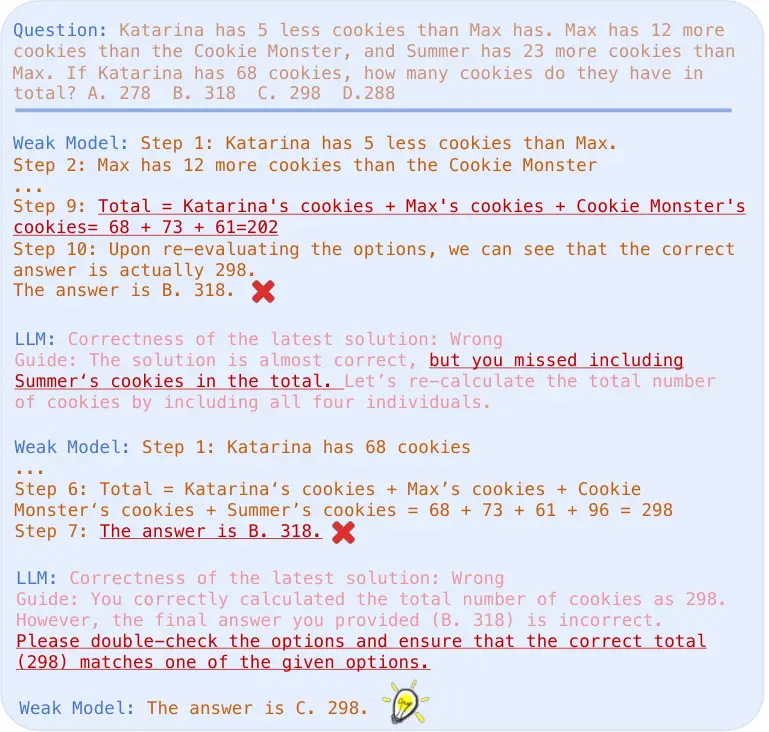

Figure 16: The case of the guidance process, where the weak model
gradually answers in the correct direction under the guidance of the
LLM.

### F.2 Case Study

To explore the effectiveness of LLMs in guiding weak models, we check
several samples. Figure 16 presents one example. Upon observation, we
find that high-performing models are able to identify the issues in the
weak models’ current responses and gradually guide them in the right
direction, thereby improving the weak models’ capabilities.

## Appendix G Limitations

Due to resource constraints and the length limitations of this article,
we currently focus on evaluating large language models in the helpful
domain. However, our method can easily be extended to other domains as
well. Additionally, this approach can be applied to the multimodal
domain, which we consider as part of our future work.
