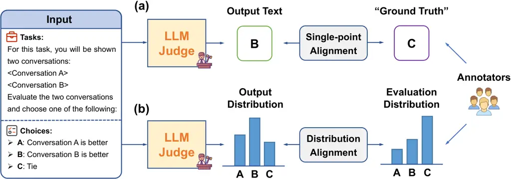
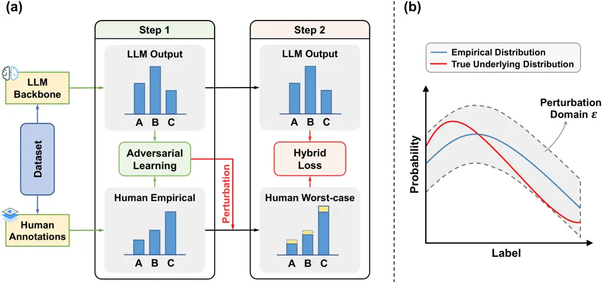

# Beyond Single-Point Judgment: Distribution Alignment for LLM-as-a-Judge

Luyu Chen Affiliation: Gaoling School of Artificial Intelligence, Renmin
University of China Email: [luyu.chen@ruc.edu.cn](mailto:)    Zeyu Zhang
Affiliation: Gaoling School of Artificial Intelligence, Renmin
University of China Email: [xu.chen@ruc.edu.cn](mailto:)    Haoran Tan
Affiliation: Gaoling School of Artificial Intelligence, Renmin
University of China    Quanyu Dai Affiliation: Huawei Noah’s Ark Lab   
Hao Yang Affiliation: Gaoling School of Artificial Intelligence, Renmin
University of China    Zhenhua Dong Affiliation: Huawei Noah’s Ark Lab
   Xu Chen

###### Abstract

LLMs have emerged as powerful evaluators in the LLM-as-a-Judge paradigm,
offering significant efficiency and flexibility compared to human
judgments. However, previous methods primarily rely on single-point
evaluations, overlooking the inherent diversity and uncertainty in human
evaluations. This approach leads to information loss and decreases the
reliability of evaluations. To address this limitation, we propose a
novel training framework that explicitly aligns the LLM-generated
judgment distribution with empirical human distributions. Specifically,
we propose a distributional alignment objective based on KL divergence,
combined with an auxiliary cross-entropy regularization to stabilize the
training process. Furthermore, considering that empirical distributions
may derive from limited human annotations, we incorporate adversarial
training to enhance model robustness against distribution perturbations.
Extensive experiments across various LLM backbones and evaluation tasks
demonstrate that our framework significantly outperforms existing
closed-source LLMs and conventional single-point alignment methods, with
improved alignment quality, evaluation accuracy, and robustness.

## 1 Introduction

¹¹footnotetext: ^(†) Corresponding author.

In recent years, large language models (LLMs) have demonstrated
remarkable progress across various tasks, such as natural language
understanding \[1, 2\], reasoning \[3, 4, 5\], and evaluation \[6, 7\].
One of their most significant applications is for automatic judgment,
which employs LLMs to evaluate specific targets based on predefined
criteria or instructions \[8, 9\]. This LLM-as-a-Judge paradigm offers
significant advantages in efficiency and flexibility due to its
capability to efficiently handle large-scale data and adapt to diverse
evaluation tasks. Therefore, using LLMs as judges has emerged as a
promising alternative to conventional human evaluations \[10\].

Most previous works adopt single-point judgment with LLMs, which just
outputs a single result for each sample \[11, 12, 13\]. Although this
paradigm is straightforward, it overlooks the inherent diversity of
human evaluations. In real-world scenarios, human evaluations are rarely
deterministic. Instead, they tend to follow a distribution with diverse
perspectives and inherent uncertainties \[14, 15\]. Therefore, replacing
this distributional human evaluations with a single-point LLM judgment
may cause information loss \[15\], which limits the comprehensiveness
and reliability of evaluations.

In order to empower LLM judgment with the diversity and uncertainty of
human evaluations, an intuitive approach is to generate a judgment
distribution based on LLMs. Although LLMs can inherently provide
probability distributions over output tokens, previous studies have
shown that they are often overconfident and skewed towards a few
options \[16\]. Besides, most current LLM training approaches focus on
single-point alignment, aiming to maximize the probability of generating
a specific correct or desired output \[17, 18\], as illustrated in
Figure 1(a). This focus inherently limits their ability to capture the
diversity and uncertainty present in human evaluations, hindering
effective distribution alignment. Therefore, it is necessary to design
an explicit distributional alignment framework to align LLMs’ output
with human evaluation distributions, as illustrated in Figure 1(b).



Figure 1: Comparison between single-point alignment and distribution
alignment. (a) Single-point Alignment: in this method, LLMs are trained
to generate outputs that exactly match the desired text. (b)
Distribution Alignment: by using this approach, the models are trained
to produce judgment distributions that align with the human evaluation
distributions.

To address the above challenges, we design a novel framework that
explicitly aligns the output distributions of LLMs with human evaluation
distributions. Specifically, we propose a distributional alignment
objective that leverages the Kullback–Leibler (KL) divergence \[19\] to
minimize the discrepancy between the model’s predicted distribution and
the empirical distribution derived from human annotations. Besides, we
introduce a hybrid loss function that combines the primary KL divergence
objective with an auxiliary cross-entropy loss to improve the training
stability. It combines the distributional advantages of KL divergence
and the stability of single-point alignment. To further mitigate the
risk of overfitting caused by limited human annotations, we propose an
adversarial training strategy to improve model robustness. Specifically,
we apply the worst-case perturbation to the empirical distributions
during optimization, encouraging the model to align with any plausible
distribution within the bounded perturbation set. Our major
contributions are presented as follows:

$`\bullet`$ Explicit Distribution Alignment Framework. We propose a
novel framework to explicitly align the distribution of LLM judgment
with human evaluation distributions, thereby effectively capturing the
uncertainty and diversity inherent in human evaluations.  
$`\bullet`$ Robust Distribution Alignment Methodology. By introducing an
adversarial optimization strategy that leverages distribution
perturbations during training, we significantly enhance the fidelity and
robustness of model alignment with real human evaluation
distributions.  
$`\bullet`$ Extensive Experimental Validations. Experiments across
diverse LLM backbones and evaluation tasks demonstrate that our approach
consistently surpasses existing closed-source LLMs and substantially
outperforms conventional single-point alignment methods in multiple
aspects.

## 2 Related Work

### 2.1 LLM-as-a-Judge

LLMs are increasingly used as automated evaluators (i.e.,
LLM-as-a-Judge) \[11, 12, 13, 20, 21\] due to their efficiency,
scalability, and generalization capabilities \[8, 9\]. Previous works
typically utilize LLMs to produce a single-point deterministic
evaluation, such as binary consistency judgments \[20\] and Likert-scale
ratings \[21\]. However, these approaches neglect the inherent
variability observed in human evaluations, where humans often present
diverse opinions, resulting in evaluation distributions \[14\].
Collapsing this diversity into a single decision overlooks valuable
information \[15\] such as disagreement, uncertainty, and subjectivity.
To address this limitation, we generate probability distributions from
LLMs for evaluations. We propose an explicit alignment method to better
match the distributions generated by LLMs with the actual distributions
provided by human annotators.

### 2.2 Distributional Reward Models

To model diverse human preferences, distributional reward models in
Reinforcement Learning from Human Feedback (RLHF) \[18\] aim to output a
distribution over reward values rather than a single scalar reward \[22,
23, 24\]. Existing research in this area typically employs methods that
model preference score distributions using mean and variance \[22, 23\],
or adopting quantile regression techniques to achieve finer-grained
preference modeling \[24\]. These approaches often infer reward
distributions from human preferences indirectly and necessitate
architectural modifications that may decrease the general capabilities
of LLMs \[25\]. Different from previous studies, our proposed approach
directly leverages the explicit distributions derived from human
evaluations, while it can also preserve the inherent language generation
capabilities of LLMs.

### 2.3 Adversarial Training

Adversarial training can enhance model robustness by exposing models to
worst-case perturbations in training phase, which has been widely
adopted in various fields, such as computer vision \[26, 27\] and
natural language processing \[28, 29\]. It is often formulated as a
min-max optimization problem with two adversarial stages. Specifically,
the maximization stage identifies the worst-case perturbation, and the
minimization stage updates the model parameters to minimize loss under
these perturbations \[30\]. This iterative procedure enables the model
to learn more robust and reliable decision boundaries. Common
optimization algorithms employed in adversarial training include the
Fast Gradient Sign Method (FGSM) \[31\] and Projected Gradient Descent
(PGD) \[32\], both of which have shown strong stability and
effectiveness. In this study, we adopt adversarial training to enhance
the robustness of LLMs, in order to better align model predictions with
human evaluation distributions.

## 3 Preliminary

Consider a dataset $`D`$, where each sample $`x\in D`$ is annotated
independently by $`N`$ human annotators. Each annotator assigns labels
from a discrete set of categories $`\mathcal{C}=\{1,2,\dots,C\}`$. We
define the empirical distribution of human judgments (i.e., human
evaluation distribution) for a given sample $`x`$ as the vector
$`\mathbf{p}(x)\in\mathbb{R}^{C}`$, whose $`i`$-th component is given
by:

```math
p_{i}(x)=\frac{1}{N}\sum_{j=1}^{N}\mathbb{I}(y_{j}=i),\quad\forall i\in\mathcal{C}, \tag{1}
```

where $`y_{j}`$ denotes the label from the $`j`$-th annotator for sample
$`x`$, and $`\mathbb{I}(\cdot)`$ is the indicator function.

Correspondingly, let $`\theta`$ denote the parameters of the LLM. For an
input sample $`x`$, the model outputs a normalized probability
distribution over the $`C`$ categories. This distribution is represented
by the vector $`\mathbf{q_{\theta}}(x)`$, where each component
$`q_{\theta,i}(x)`$ indicates the predicted probability for category
$`i`$. Formally, the probability vector $`\mathbf{q_{\theta}}(x)`$ is
defined as:

```math
\mathbf{q_{\theta}}(x)\in\{\mathbf{q}\in\mathbb{R}^{C}\mid q_{i}\geq 0,\;\forall i\in\mathcal{C},\;\sum_{i=1}^{C}q_{i}=1\}. \tag{2}
```

In classical evaluation settings \[33, 34\], a single deterministic
reference label $`\mathbf{r}(x)\in\{0,1\}^{C}`$ is often used, typically
defined by selecting the most frequent human annotation:

```math
r_{i}(x)=\begin{cases}1,&\text{if }i=\arg\underset{k}{\max}\;p_{k}(x),\\
0,&\text{otherwise.}\end{cases} \tag{3}
```

The primary objective of our method is to optimize the model parameters
$`\theta`$ so that the predicted judgement distribution
$`\mathbf{q_{\theta}}(x)`$ closely aligns with the human judgment
distribution $`\mathbf{p}(x)`$. Our proposed explicit distributional
alignment enables the model to better capture nuanced human judgments,
thereby resulting in more informative and representative evaluations.

## 4 Methodology

### 4.1 Overview

To overcome the limitations of single-point judgments and better reflect
the inherent diversity and uncertainty in human evaluations, we propose
a novel training framework that explicitly aligns model-generated
probability distributions with real-world human evaluation
distributions. Given an input, we extract logits corresponding to the
judgment token to obtain the predicted distribution. Our training
involves two main steps, as demonstrated in Figure 2(a). First of all,
we generate a worst-case perturbation around the empirical distribution
to enhance robustness. Then, we compute the hybrid loss between the
model prediction and the perturbed distribution, and update the model
parameters accordingly. This approach mitigates the inherent limitation
of empirical human distributions, which serve only as imperfect
estimates of the true underlying distributions, as illustrated in
Figure 2(b). By aligning model predictions with all plausible
distributions within the perturbation set, our method promotes more
robust and faithful distributional alignment.

### 4.2 Human Distribution Alignment via Hybrid Loss

To achieve effective alignment between the model’s output distribution
and the human judgment distribution, we propose a hybrid loss function.
This loss function combines KL divergence for distribution alignment
with an auxiliary cross-entropy objective for training stability. First,
to explicitly encourage distributional alignment, we introduce the KL
divergence loss:

```math
\mathcal{L}_{\mathrm{KL}}(\theta)=\frac{1}{|D|}\sum_{x\in D}D_{\mathrm{KL}}\left(\mathbf{p}(x)\parallel\mathbf{q}_{\theta}(x)\right), \tag{4}
```

where $`D_{\mathrm{KL}}(\cdot\parallel\cdot)`$ denotes the KL
divergence. This objective promotes a fine-grained alignment between the
model’s predicted distribution and the human evaluation distribution.
Second, to improve training stability and guide learning with more
direct supervision, we also include an auxiliary cross-entropy loss with
respect to the deterministic label $`\mathbf{r}(x)`$:

```math
\mathcal{L}_{\mathrm{CE}}(\theta)=\frac{1}{|D|}\sum_{x\in D}\mathrm{CE}(\mathbf{q}_{\theta}(x),\mathbf{r}(x)). \tag{5}
```

This hybrid design mirrors the philosophy of knowledge
distillation \[35\], where student models are trained using both soft
targets (through KL divergence from a teacher model) and hard labels
(via cross-entropy with ground truth). This approach leverages the rich
informational content provided by the teacher’s outputs and the direct
guidance of true labels, improving both learning fidelity and
convergence stability. Embracing this principle, our hybrid loss
function blends these two objectives via a weighting factor
$`\alpha\in[0,1]`$:

```math
\mathcal{L}_{\mathrm{Hybrid}}(\theta)=\alpha\cdot\mathcal{L}_{\mathrm{KL}}(\theta)+(1-\alpha)\cdot\mathcal{L}_{\mathrm{CE}}(\theta). \tag{6}
```

This hybrid approach ensures stable training using cross-entropy while
also achieving nuanced distributional alignment through KL divergence.
As a result, it effectively captures both consensus and diversity in
human annotations.



Figure 2: Overview of our proposed framework. (a) Training framework: We
generate adversarial perturbations of the empirical human distribution
and optimize the hybrid loss. (b) Motivation: Illustrates the
relationship between the empirical, perturbed, and true underlying
distributions. Robust alignment mitigates the deviation problem in the
empirical human distribution.

### 4.3 Robust Alignment via Adversarial Training

In practice, due to the limited number of human annotations, we only
have empirical approximations of the human judgment distribution, as
illustrated in Figure 2(b). Directly aligning the model output
$`\mathbf{q}_{\theta}(x)`$ with these empirical approximations
$`\mathbf{p}(x)`$ results in the model overfitting to sampling noise or
artifacts, reducing the robustness of alignment with the true underlying
distribution.

To address this challenge, we introduce adversarial training into our
distribution alignment framework. Specifically, we define a perturbation
set $`\mathcal{E}`$ around the empirical annotation distribution
$`\mathbf{p}(x)`$ and identify the worst-case perturbed distribution
$`\mathbf{p}^{\prime}(x)`$ within this set. Aligning our model with this
worst-case distribution ensures robustness against any plausible
perturbation within $`\mathcal{E}`$, thereby improving alignment with
the human judgment distribution. This transformation converts our
objective into a min-max optimization problem as follows:

```math
\theta^{*}=\arg\min_{\theta}\max_{\mathbf{p}^{\prime}(x)\in\mathcal{E}}\left[\alpha\cdot D_{\mathrm{KL}}(\mathbf{p}^{\prime}(x)\parallel\mathbf{q}_{\theta}(x))+(1-\alpha)\cdot\mathrm{CE}(\mathbf{q}_{\theta}(x),\mathbf{r}(x))\right]. \tag{7}
```

This adversarial training process consists of two alternating steps:

1. Adversarial Distribution Generation: For a fixed model parameter
   $`\theta`$ and each sample $`x`$ in the batch, find the worst-case
   distribution $`\mathbf{p}^{\prime}(x)`$ within the perturbation set
   $`\mathcal{E}`$ that maximizes the loss.
2. Model Update: Update model parameters $`\theta`$ to minimize the
   adversarially perturbed loss.

Through this adversarial training procedure, we explicitly model the
worst-case scenarios of the true underlying human judgment distribution,
thereby ensuring robust and stable alignment. By accounting for
potential annotation noise and sampling artifacts, the model becomes
less sensitive to empirical inaccuracies, thus enhancing its
generalization performance and practical applicability.

### 4.4 Implementing Adversarial Training via Projected Gradient Descent

To solve the inner maximization equation in Equation (7), we adopt
Projected Gradient Descent (PGD) to iteratively search for the
worst-case perturbation within a constrained space. Specifically, we
seek an adversarial distribution $`\mathbf{p}^{\prime}(x)`$ that
maximizes the KL divergence from the model prediction
$`\mathbf{q}_{\theta}(x)`$, while remaining close to the original human
distribution $`\mathbf{p}(x)`$ and preserving the properties of a valid
probability distribution.

We define the feasible perturbation set $`\mathcal{E}`$ as the
intersection of two convex sets as
$`\mathcal{E}=\Delta^{C}\cap\mathcal{B}_{\epsilon^{*}}(\mathbf{p}(x)),`$
where
$`\Delta^{C}=\{\mathbf{p}^{\prime}\in\mathbb{R}^{C}\;\mid\;\sum_{i=1}^{C}p^{\prime}_{i}=1,\;p^{\prime}_{i}\geq 0\}`$
is the $`C`$-dimensional probability simplex, and
$`\mathcal{B}_{\epsilon^{*}}(\mathbf{p}(x))`$ is an $`\ell_{2}`$ ball of
radius $`\epsilon^{*}`$ centered at the original human distribution
$`\mathbf{p}(x)`$. Based on the feasible perturbation set, we design the
optimization procedure as follows. First of all, we initialize the
unperturbed distribution as $`\mathbf{p}^{(0)}=\mathbf{p}(x)`$. Then, we
conduct the gradient ascent by updating the current iterate in the
direction of the gradient of the KL divergence as:

```math
\mathbf{y}^{(t+1)}=\mathbf{p}^{(t)}+\eta\cdot\nabla_{\mathbf{p}^{(t)}}\left[D_{\mathrm{KL}}(\mathbf{p}^{(t)}\parallel\mathbf{q}_{\theta}(x))\right], \tag{8}
```

where $`\eta`$ denotes the step size controlling the gradient ascent
magnitude. After that, we project the updated distribution back onto the
feasible set $`\mathcal{E}`$ with the equation:

```math
\mathbf{p}^{(t+1)}=\Pi_{\mathcal{E}}(\mathbf{y}^{(t+1)})=\arg\min_{\mathbf{p}^{\prime}\in\mathcal{E}}\|\mathbf{p}^{\prime}-\mathbf{y}^{(t+1)}\|_{2}^{2}. \tag{9}
```

This projection step is a convex Quadratically Constrained Quadratic
Program (QCQP) \[36\], as it minimizes a convex quadratic objective over
the intersection of two convex sets: the simplex and the $`\ell_{2}`$
ball. Notably, the intersection $`\mathcal{E}`$ is guaranteed to be
non-empty since the original distribution
$`\mathbf{p}(x)\in\mathcal{E}`$ by definition. Consequently, this
projection problem is well-posed and can be efficiently solved using
off-the-shelf convex optimization solvers such as CVXPY \[37\].

## 5 Experiments

### 5.1 Experiment Setup

Datasets. We select four representative datasets to cover diverse
evaluation tasks \[15\], including Natural Language Inference (NLI),
qualitative evaluation with Likert ratings, and human preference
understanding. The selected datasets are introduced as follows:

- •
  Natural Language Inference (SNLI \[38\]/MNLI \[39\]). These are
  classic benchmarks for the NLI task. Each instance consists of a pair
  of sentences, with five annotators judging their logical relationship
  (entailment, neutral, contradiction). We randomly sample an equal
  number of instances from MNLI (10,000 each) to maintain a comparable
  data scale with SNLI.
- •
  Qualitative Assessment (SummEval \[33\]). This dataset originates from
  the CNN/DailyMail news summarization task and includes summaries
  generated by various automatic summarization models. Each summary is
  rated by experts and crowdsourced workers on a 1-5 Likert scale across
  four dimensions: fluency, coherence, consistency, and relevance. We
  treat each dimension as an independent evaluation instance, totaling
  5,104 samples.
- •
  Human Preference Understanding (MT-Bench \[40\]). This dataset
  assesses the human performance of six LLMs on 80 open-ended multi-turn
  dialogue questions. For each model pair (A vs. B)’s responses, at
  least one human reviewer annotates their preference (A, Tie, B).

All datasets are split into training and test sets at an 8:2 ratio in
our experiments. To facilitate the reproduction, we present the detailed
prompts that are used in all the tasks in Appendix A.

Baselines. We compare our proposed approach against two baseline
methods. (1) Raw Model: We directly evaluate the pretrained LLMs without
any task-specific fine-tuning. This baseline aims to measure the
inherent alignment between pretrained models and human judgment
distributions, reflecting the model’s original capability to approximate
human judgment without explicit training or adjustment. (2) Single-point
Alignment: We adopt the traditional supervised fine-tuning
strategy \[18\], using only the most frequent human annotation label as
the supervision target. This baseline evaluates the effectiveness of
conventional single-point alignment methods.

Models. Our study evaluates both open-source (Qwen2.5-7B \[41\],
LLaMA3.1-8B \[42\]) and closed-source (GPT-4o, GPT-4o-mini) language
models. Open-source models are utilized without additional tuning,
whereas the chosen closed-source models, recognized for their strong
performance, are tested both with and without further training.

Training Details. We fine-tune all selected open-source models using a
uniform hyperparameter configuration to ensure a fair comparison.
Specifically, we employ the AdamW \[43\] optimizer with a learning rate
of $`5\times 10^{-5}`$ and train each model for 2 epochs. To enhance
model robustness, we incorporate adversarial training, setting the
perturbation step size to 0.05 and performing 5 gradient ascent steps
per training iteration. Additionally, we conduct a hyperparameter search
for two critical parameters: the weight parameter $`\alpha`$, chosen
from the set $`\{0,0.2,0.4,0.6,0.8,1.0\}`$, and the perturbation radius
parameter $`\epsilon`$, selected from the set
$`\{0.0,0.05,0.1,0.15,0.2,0.25\}`$. We conduct all experiments on one
NVIDIA A100-40G GPU.

Evaluation Metrics. We employ two primary metrics to measure the
alignment between model-predicted and human-annotated distributions:  
(1) KL Divergence: This metric quantifies the discrepancy between the
model’s predicted distribution $`\mathbf{q}_{\theta}(x)`$ and the human
distribution $`\mathbf{p}(x)`$. Lower KL divergence indicates closer
alignment:

```math
\text{KL}(\mathbf{p}(x)||\mathbf{q}_{\theta}(x))=\sum_{i}\mathbf{p}(x)\log\frac{\mathbf{p}(x)}{\mathbf{q}_{\theta}(x)}. \tag{10}
```

\(2\) Accuracy: Accuracy measures whether the model’s most probable
predicted label aligns with the most frequent label in the human
judgment distribution:

```math
\text{Accuracy}=\frac{1}{|D|}\sum_{x\in D}\mathbb{I}\left(\arg\max_{i\in\mathcal{C}}q_{\theta,i}(x)=\arg\max_{j\in\mathcal{C}}p_{j}(x)\right). \tag{11}
```

Here, $`|D|`$ denotes the total number of test samples,
$`q_{\theta,i}(x)`$ represents the model-predicted probability for
category $`i`$, and $`p_{j}(x)`$ denotes the human judgment distribution
for category $`j`$.

Extracting Model Predictions. We extract model predictions by retrieving
logits corresponding to the judgment token associated with potential
judgment labels (e.g., contradiction, 1, 5). These logits are converted
into probabilities via softmax normalization, and synonymous tokens are
mapped to the standard label space. To maintain consistency across
experiments, we limit the extraction to the top-5 logits because
OpenAI’s API restricts the number of logits returned. Besides, the
logits beyond the fifth highest are generally negligible, with values
often falling below 1e-6.

|             |                     |                  |                 |                  |                 |                  |                 |                  |                 |
| ----------- | ------------------- | ---------------- | --------------- | ---------------- | --------------- | ---------------- | --------------- | ---------------- | --------------- |
| Model       | Method              | SNLI             |                 | MNLI             |                 | Summeval         |                 | MT-Bench         |                 |
|             |                     | KL$`\downarrow`$ | Acc$`\uparrow`$ | KL$`\downarrow`$ | Acc$`\uparrow`$ | KL$`\downarrow`$ | Acc$`\uparrow`$ | KL$`\downarrow`$ | Acc$`\uparrow`$ |
| GPT-4o-mini | Raw model           | 2.13             | 87.0%           | 1.88             | 84.9%           | 5.23             | 25.6%           | 5.63             | 62.3%           |
| GPT-4o      | Raw model           | 1.75             | 85.5%           | 1.16             | 84.2%           | 2.82             | 35.2%           | 2.48             | 68.5%           |
| Qwen2.5     | Raw model           | 2.08             | 83.1%           | 1.77             | 83.5%           | 4.94             | 22.7%           | 3.36             | 62.0%           |
|             | Single-point        | 0.72             | 92.6%           | 0.74             | 89.2%           | 0.74             | 45.8%           | 0.83             | 63.0%           |
|             | Distribution (Ours) | 0.31             | 93.0%           | 0.23             | 89.0%           | 0.52             | 46.6%           | 0.68             | 63.6%           |
| LLaMA3.1    | Raw model           | 0.90             | 64.9%           | 0.67             | 70.5%           | 3.60             | 29.5%           | 1.58             | 53.4%           |
|             | Single-point        | 0.75             | 91.7%           | 0.66             | 89.2%           | 0.59             | 45.9%           | 0.82             | 61.4%           |
|             | Distribution (Ours) | 0.32             | 91.8%           | 0.26             | 89.2%           | 0.51             | 47.8%           | 0.72             | 63.6%           |

Table 1: Main results comparing raw models, single-point alignment, and
our distribution alignment method across four datasets. KL indicates KL
divergence, and Acc denotes top-1 accuracy.

### 5.2 Overall Performance

We evaluate the effectiveness of our distribution alignment method
across four benchmark datasets, including SNLI, MNLI, Summeval, and
MT-Bench. The primary experimental results are presented in Table 1. Our
findings highlight three key aspects as follows:

(1) Necessity of Distribution Alignment. Without specific alignment
training, both open-source and closed-source models demonstrate
substantial divergence between their predictions and human judgment,
with KL divergence typically exceeding 2.0. This indicates that current
models inherently produce judgment distributions that are misaligned
with human evaluations, highlighting the necessity for additional
training of distribution alignment.

(2) Superiority of Our Proposed Method. Compared to conventional
single-point alignment methods, our approach consistently achieves
better distribution alignment across different datasets and LLM
backbones. It significantly reduces KL divergence while maintaining
accuracy, demonstrating its generalization ability and effectiveness in
aligning model outputs with human-labeled distributions.

(3) Correlation between Model Capability and Alignment Performance. We
observe a positive correlation between a model’s inherent capability and
its alignment performance. More capable models, such as GPT-4o, not only
achieve higher accuracy but also yield predicted distributions closer to
human annotations than weaker models like GPT-4o-mini and Qwen2.5. This
suggests that stronger models naturally produce judgments distributions
more consistent with human evaluations.

In conclusion, our method demonstrates superior performance in
distribution alignment compared to raw models and conventional
single-point alignment approaches. It reduces KL divergence while
maintaining accuracy across multiple datasets and various LLM backbones,
presenting the effectiveness of our method in aligning model outputs
with human judgment distributions.

### 5.3 Ablation Study

|              |            |     |     |                  |                 |                  |                 |                  |                 |                  |                 |
| ------------ | ---------- | --- | --- | ---------------- | --------------- | ---------------- | --------------- | ---------------- | --------------- | ---------------- | --------------- |
| Method       | Components |     |     | Qwen2.5          |                 |                  |                 | LLaMA3.1         |                 |                  |                 |
|              | Adv        | KL  | CE  | MNLI             |                 | Summeval         |                 | MNLI             |                 | Summeval         |                 |
|              |            |     |     | KL$`\downarrow`$ | Acc$`\uparrow`$ | KL$`\downarrow`$ | Acc$`\uparrow`$ | KL$`\downarrow`$ | Acc$`\uparrow`$ | KL$`\downarrow`$ | Acc$`\uparrow`$ |
| Raw Model    | \-         | \-  | \-  | 1.77             | 83.5%           | 4.94             | 22.7%           | 0.67             | 70.5%           | 3.60             | 29.5%           |
| Single-point | \-         | \-  | ✓   | 0.74             | 89.2%           | 0.74             | 45.8%           | 0.66             | 89.2%           | 0.59             | 45.9%           |
| Ours (Full)  | ✓          | ✓   | ✓   | 0.23             | 89.0%           | 0.52             | 46.6%           | 0.26             | 89.2%           | 0.51             | 47.8%           |
| Ours w/o Adv | \-         | ✓   | ✓   | 0.25             | 89.0%           | 0.64             | 46.6%           | 0.32             | 89.6%           | 0.62             | 45.9%           |
| Ours w/o KL  | ✓          | \-  | ✓   | 0.78             | 88.4%           | 0.75             | 45.8%           | 0.65             | 89.2%           | 0.65             | 45.4%           |
| Ours w/o CE  | ✓          | ✓   | \-  | 0.23             | 89.0%           | 0.54             | 46.0%           | 0.33             | 88.7%           | 0.58             | 48.0%           |

Table 2: Ablation study of our proposed method. We analyze the
contribution of adversarial training (Adv), KL divergence loss (KL), and
cross-entropy loss (CE) on MNLI and Summeval datasets.

To better understand the contribution of each component in our method,
we conduct an ablation study, whose results are summarized in Table 2.
We observe that removing any single component consistently degrades
alignment performance, resulting in increased KL divergence. This
indicates that all three components complement each other and
collectively enhance distributional alignment.

According to the results, we find that KL divergence loss is the most
crucial. Removing it leads to a significant increase in KL divergence,
which confirms its essential role in human judgment alignment by
penalizing deviations from the target distribution. Besides, adversarial
training also contributes to improving the performance. By introducing
perturbations during training, the model can align better with human
distributions even under worst-case distributional shifts, thereby
improving robustness and generalization. In addition, removing
cross-entropy loss results in only a slight increase in KL divergence.
Although its effect on distributional alignment is limited, extensive
experiments in Section 5.4 demonstrate that a small amount of auxiliary
CE loss can stabilize training.

### 5.4 Impact of Hyper-parameters

Figure 3: Effect of weighting parameter $`\alpha`$ and perturbation
radius $`\epsilon`$ on KL divergence across four datasets. Lower values
indicate better alignment between model predictions and human
distributions.

We further perform experiments on how the weighting parameter $`\alpha`$
and perturbation radius $`\epsilon`$ affect model alignment performance.
Using Qwen2.5 as the base model, we evaluate its alignment performance
across all four datasets. Lower KL divergence indicates better alignment
between the model prediction and the human judgment distribution. The
results are presented in Figure 3.

Impact of Weighting Parameter $`\alpha`$. The weighting parameter
$`\alpha`$ is responsible to balance balances KL divergence and CE
losses, thereby affecting the performance of alignment. According to the
results, we observe that increasing $`\alpha`$ from 0 to approximately
0.8 consistently enhances the alignment performance across all datasets.
However, further increasing $`\alpha`$ from 0.8 to 1.0 causes a
noticeable performance decline, indicating that KL divergence is more
effective than cross-entropy in distribution alignment. However, a small
proportion of cross-entropy loss proves beneficial by stabilizing
training.

Impact of Perturbation Radius $`\epsilon`$. We further explore the
influence of the perturbation radius $`\epsilon`$ in our method. Each
line in Figure 3 corresponds to a specific value of perturbation radius,
and we use the blue line ($`\epsilon=0`$) to represent training without
adversarial perturbations. The results demonstrate that the method
without adversarial training commonly performs the worst. It indicates
that adversarial training can enhance the model’s generalization
capability, thereby improving alignment performance. As the perturbation
parameter $`\epsilon`$ increases, the alignment performance exhibits a
general improvement. However, the performance gains gradually diminish
with increasing perturbation magnitudes, and this trend is particularly
evident on the MNLI dataset.

These results have verified our earlier statements: KL divergence serves
as the primary mechanism for alignment, while incorporating a minor
component of cross-entropy loss can further improve the training
stability. It further underscores the importance of combining both
components. Besides, the integration of moderate adversarial
perturbations further boosts alignment performance by increasing the
model’s robustness against the shifts in real-world human evaluation
distributions. rmance by increasing the model’s robustness against
distributional shifts.

### 5.5 Robustness Analysis

|          |              |                                                             |                 |                 |                 |                 |                 |
| -------- | ------------ | ----------------------------------------------------------- | --------------- | --------------- | --------------- | --------------- | --------------- |
| Dataset  | Method       | KL Divergence at different perturbation levels ($`\delta`$) |                 |                 |                 |                 |                 |
|          |              | $`\delta=0.00`$                                             | $`\delta=0.05`$ | $`\delta=0.10`$ | $`\delta=0.15`$ | $`\delta=0.20`$ | $`\delta=0.25`$ |
| SNLI     | Single-point | 0.715                                                       | 0.717           | 0.708           | 0.692           | 0.720           | 0.709           |
|          | Ours w/o Adv | 0.334                                                       | 0.336           | 0.333           | 0.327           | 0.344           | 0.346           |
|          | Ours (Full)  | 0.324                                                       | 0.325           | 0.323           | 0.317           | 0.335           | 0.336           |
| MNLI     | Single-point | 0.742                                                       | 0.744           | 0.743           | 0.745           | 0.753           | 0.757           |
|          | Ours w/o Adv | 0.271                                                       | 0.272           | 0.272           | 0.276           | 0.283           | 0.293           |
|          | Ours (Full)  | 0.243                                                       | 0.245           | 0.245           | 0.251           | 0.256           | 0.264           |
| Summeval | Single-point | 0.743                                                       | 0.748           | 0.752           | 0.778           | 0.809           | 0.836           |
|          | Ours w/o Adv | 0.639                                                       | 0.643           | 0.649           | 0.669           | 0.707           | 0.735           |
|          | Ours (Full)  | 0.525                                                       | 0.529           | 0.539           | 0.565           | 0.588           | 0.612           |
| MT-Bench | Single-point | 0.833                                                       | 0.833           | 0.837           | 0.832           | 0.836           | 0.848           |
|          | Ours w/o Adv | 0.831                                                       | 0.830           | 0.834           | 0.829           | 0.832           | 0.846           |
|          | Ours (Full)  | 0.675                                                       | 0.676           | 0.678           | 0.675           | 0.677           | 0.689           |

Table 3: The robustness analysis of our distribution alignment method
under varying label perturbation levels ($`\delta`$). The KL divergences
are reported across different datasets and models, with lower KL
divergence indicating better performance in distribution alignment.

To further analyze the robustness of our method, we conduct extensive
experiments by adding random perturbations to the target label
distributions in the test set. Specifically, our random perturbations
$`\delta`$ are ranged from 0.00 to 0.25. The experiments are performed
on all four datasets based on Qwen2.5, and we use the hyper-parameters
identified in Section 5.4 with $`\alpha=0.8`$ and $`\epsilon=0.25`$.

As shown in Table 3, our full method consistently achieves the lowest KL
divergence across all perturbation levels and datasets, outperforming
both the single-point alignment baseline and the variant without
adversarial training. These results suggest that incorporating
adversarial training enables the model to effectively align with all
plausible distributions within the perturbation set, thereby improving
robustness and fidelity in distributional alignment.

## 6 Conclusion

In this paper, we propose a distribution alignment framework that
explicitly aligns the model outputs with the human evaluation
distribution, aiming for more nuanced evaluation results. Specifically,
we employ KL divergence as the main objective to minimize the
discrepancy between model predictions and target distributions.
Furthermore, we introduce a hybrid loss function, incorporating an
auxiliary cross-entropy loss to stabilize training. Finally, adversarial
training is utilized to further enhance alignment performance by
increasing the model’s robustness against distributional shifts.
Experiments demonstrate that our distribution alignment method
outperforms existing single-point alignment approaches and exhibits
strong generalization and robustness across different models and
datasets.

## Limitations

Although our approach can effectively align model outputs with human
judgment distributions, it exhibits two notable limitations. First, the
model’s explainability is limited, as the generated explanations only
correspond to a single sampled judgment rather than interpreting the
entire predicted distribution. Second, suitable training datasets remain
scarce due to high human annotation costs. Most existing datasets
contain only a single annotation per instance. Therefore, improving
model alignment across diverse tasks requires constructing more datasets
with richer human evaluation data. In future work, we will further
improve the explainability and efficiency of our proposed method.

## References

- \[1\] Wayne Xin Zhao, Kun Zhou, Junyi Li, Tianyi Tang, Xiaolei Wang,
  Yupeng Hou, Yingqian Min, Beichen Zhang, Junjie Zhang, Zican Dong,
  Yifan Du, Chen Yang, Yushuo Chen, Zhipeng Chen, Jinhao Jiang, Ruiyang
  Ren, Yifan Li, Xinyu Tang, Zikang Liu, Peiyu Liu, Jian-Yun Nie, and
  Ji-Rong Wen. A survey of large language models. _arXiv preprint
  arXiv:2303.18223_, 2023. URL
  [http://arxiv.org/abs/2303.18223](http://arxiv.org/abs/2303.18223).
- \[2\] Tom Brown, Benjamin Mann, Nick Ryder, Melanie Subbiah, Jared D
  Kaplan, Prafulla Dhariwal, Arvind Neelakantan, Pranav Shyam, Girish
  Sastry, Amanda Askell, Sandhini Agarwal, Ariel Herbert-Voss, Gretchen
  Krueger, Tom Henighan, Rewon Child, Aditya Ramesh, Daniel Ziegler,
  Jeffrey Wu, Clemens Winter, Chris Hesse, Mark Chen, Eric Sigler,
  Mateusz Litwin, Scott Gray, Benjamin Chess, Jack Clark, Christopher
  Berner, Sam McCandlish, Alec Radford, Ilya Sutskever, and Dario
  Amodei. Language models are few-shot learners. In H. Larochelle,
  M. Ranzato, R. Hadsell, M.F. Balcan, and H. Lin, editors, _Advances in
  Neural Information Processing Systems_, volume 33, pages 1877–1901.
  Curran Associates, Inc., 2020a.
- \[3\] Jason Wei, Xuezhi Wang, Dale Schuurmans, Maarten Bosma, Brian
  Ichter, Fei Xia, Ed H. Chi, Quoc V. Le, and Denny Zhou.
  Chain-of-thought prompting elicits reasoning in large language models.
  In _Proceedings of the 36th International Conference on Neural
  Information Processing Systems_, NIPS ’22, Red Hook, NY, USA, 2022.
  Curran Associates Inc. ISBN 9781713871088.
- \[4\] Noah Shinn, Federico Cassano, Ashwin Gopinath, Karthik
  Narasimhan, and Shunyu Yao. Reflexion: language agents with verbal
  reinforcement learning. In _Proceedings of the 37th International
  Conference on Neural Information Processing Systems_, NIPS ’23, Red
  Hook, NY, USA, 2023. Curran Associates Inc.
- \[5\] Aske Plaat, Annie Wong, Suzan Verberne, Joost Broekens, Niki van
  Stein, and Thomas Back. Reasoning with large language models, a
  survey, 2024. URL
  [https://arxiv.org/abs/2407.11511](https://arxiv.org/abs/2407.11511).
- \[6\] Beichen Zhang, Kun Zhou, Xilin Wei, Wayne Xin Zhao, Jing Sha,
  Shijin Wang, and Ji-Rong Wen. Evaluating and improving tool-augmented
  computation-intensive math reasoning. In _Proceedings of the 37th
  International Conference on Neural Information Processing Systems_,
  NIPS ’23, Red Hook, NY, USA, 2023. Curran Associates Inc.
- \[7\] Lianmin Zheng, Wei-Lin Chiang, Ying Sheng, Siyuan Zhuang,
  Zhanghao Wu, Yonghao Zhuang, Zi Lin, Zhuohan Li, Dacheng Li, Eric P.
  Xing, Hao Zhang, Joseph E. Gonzalez, and Ion Stoica. Judging
  llm-as-a-judge with mt-bench and chatbot arena. In _Proceedings of the
  37th International Conference on Neural Information Processing
  Systems_, NIPS ’23, Red Hook, NY, USA, 2023a. Curran Associates Inc.
- \[8\] Haitao Li, Qian Dong, Junjie Chen, Huixue Su, Yujia Zhou,
  Qingyao Ai, Ziyi Ye, and Yiqun Liu. Llms-as-judges: A comprehensive
  survey on llm-based evaluation methods, 2024a. URL
  [https://arxiv.org/abs/2412.05579](https://arxiv.org/abs/2412.05579).
- \[9\] Jiawei Gu, Xuhui Jiang, Zhichao Shi, Hexiang Tan, Xuehao Zhai,
  Chengjin Xu, Wei Li, Yinghan Shen, Shengjie Ma, Honghao Liu, Saizhuo
  Wang, Kun Zhang, Yuanzhuo Wang, Wen Gao, Lionel Ni, and Jian Guo. A
  survey on llm-as-a-judge, 2025. URL
  [https://arxiv.org/abs/2411.15594](https://arxiv.org/abs/2411.15594).
- \[10\] Chunting Zhou, Pengfei Liu, Puxin Xu, Srini Iyer, Jiao Sun,
  Yuning Mao, Xuezhe Ma, Avia Efrat, Ping Yu, Lili Yu, Susan Zhang,
  Gargi Ghosh, Mike Lewis, Luke Zettlemoyer, and Omer Levy. Lima: less
  is more for alignment. In _Proceedings of the 37th International
  Conference on Neural Information Processing Systems_, NIPS ’23, Red
  Hook, NY, USA, 2023. Curran Associates Inc.
- \[11\] Seonghyeon Ye, Doyoung Kim, Hyeongbin Hwang, Seungone Kim,
  Yongrae Jo, James Thorne, Juho Kim, and Minjoon Seo. Flask:
  Fine-grained language model evaluation based on alignment skill sets.
  In _ICLR 2024_. International Conference on Learning Representations
  (ICLR), 2024.
- \[12\] Lianghui Zhu, Xinggang Wang, and Xinlong Wang. Judgelm:
  Fine-tuned large language models are scalable judges, 2025. URL
  [https://arxiv.org/abs/2310.17631](https://arxiv.org/abs/2310.17631).
- \[13\] Bill Yuchen Lin, Yuntian Deng, Khyathi Chandu, Abhilasha
  Ravichander, Valentina Pyatkin, Nouha Dziri, Ronan Le Bras, and Yejin
  Choi. Wildbench: Benchmarking llms with challenging tasks from real
  users in the wild. In _The Thirteenth International Conference on
  Learning Representations_, 2025.
- \[14\] Amos Tversky and Daniel Kahneman. Judgment under uncertainty:
  Heuristics and biases: Biases in judgments reveal some heuristics of
  thinking under uncertainty. _science_, 185(4157):1124–1131, 1974.
- \[15\] Aparna Elangovan, Lei Xu, Jongwoo Ko, Mahsa Elyasi, Ling Liu,
  Sravan Babu Bodapati, and Dan Roth. Beyond correlation: The impact of
  human uncertainty in measuring the effectiveness of automatic
  evaluation and LLM-as-a-judge. In _The Thirteenth International
  Conference on Learning Representations_, 2025. URL
  [https://openreview.net/forum?id=E8gYIrbP00](https://openreview.net/forum?id=E8gYIrbP00).
- \[16\] Esin DURMUS, Karina Nguyen, Thomas Liao, Nicholas Schiefer,
  Amanda Askell, Anton Bakhtin, Carol Chen, Zac Hatfield-Dodds, Danny
  Hernandez, Nicholas Joseph, et al. Towards measuring the
  representation of subjective global opinions in language models. In
  _First Conference on Language Modeling_, 2024.
- \[17\] Tom Brown, Benjamin Mann, Nick Ryder, Melanie Subbiah, Jared D
  Kaplan, Prafulla Dhariwal, Arvind Neelakantan, Pranav Shyam, Girish
  Sastry, Amanda Askell, et al. Language models are few-shot learners.
  _Advances in neural information processing systems_, 33:1877–1901,
  2020b.
- \[18\] Long Ouyang, Jeffrey Wu, Xu Jiang, Diogo Almeida, Carroll
  Wainwright, Pamela Mishkin, Chong Zhang, Sandhini Agarwal, Katarina
  Slama, Alex Ray, et al. Training language models to follow
  instructions with human feedback. _Advances in neural information
  processing systems_, 35:27730–27744, 2022.
- \[19\] Solomon Kullback and Richard A Leibler. On information and
  sufficiency. _The annals of mathematical statistics_,
  22(1):79–86, 1951.
- \[20\] Zheheng Luo, Qianqian Xie, and Sophia Ananiadou. Chatgpt as a
  factual inconsistency evaluator for text summarization, 2023. URL
  [https://arxiv.org/abs/2303.15621](https://arxiv.org/abs/2303.15621).
- \[21\] Mingqi Gao, Jie Ruan, Renliang Sun, Xunjian Yin, Shiping Yang,
  and Xiaojun Wan. Human-like summarization evaluation with
  chatgpt, 2023. URL
  [https://arxiv.org/abs/2304.02554](https://arxiv.org/abs/2304.02554).
- \[22\] Anand Siththaranjan, Cassidy Laidlaw, and Dylan
  Hadfield-Menell. Distributional preference learning: Understanding and
  accounting for hidden context in RLHF. In _The Twelfth International
  Conference on Learning Representations_, 2024. URL
  [https://openreview.net/forum?id=0tWTxYYPnW](https://openreview.net/forum?id=0tWTxYYPnW).
- \[23\] Dexun Li, Cong Zhang, Kuicai Dong, Derrick Goh Xin Deik,
  Ruiming Tang, and Yong Liu. Aligning crowd feedback via distributional
  preference reward modeling. In _ICML 2024 Workshop on Models of Human
  Feedback for AI Alignment_, 2024b.
- \[24\] Nicolai Dorka. Quantile regression for distributional reward
  models in rlhf. _arXiv preprint arXiv:2409.10164_, 2024.
- \[25\] Victor Wang, Michael JQ Zhang, and Eunsol Choi. Improving
  llm-as-a-judge inference with the judgment distribution. _arXiv
  preprint arXiv:2503.03064_, 2025.
- \[26\] Asif Hanif, Muzammal Naseer, Salman Khan, Mubarak Shah, and
  Fahad Shahbaz Khan. Frequency domain adversarial training for robust
  volumetric medical segmentation. In _International Conference on
  Medical Image Computing and Computer-Assisted Intervention_, pages
  457–467. Springer, 2023.
- \[27\] Fu Wang, Zeyu Fu, Yanghao Zhang, and Wenjie Ruan. Self-adaptive
  adversarial training for robust medical segmentation. In
  _International Conference on Medical Image Computing and
  Computer-Assisted Intervention_, pages 725–735. Springer, 2023.
- \[28\] Takeru Miyato, Andrew M Dai, and Ian Goodfellow. Adversarial
  training methods for semi-supervised text classification. In
  _International Conference on Learning Representations_, 2017.
- \[29\] Robin Jia and Percy Liang. Adversarial examples for evaluating
  reading comprehension systems. In _Proceedings of the 2017 Conference
  on Empirical Methods in Natural Language Processing_, pages 2021–2031,
  Copenhagen, Denmark, September 2017. Association for Computational
  Linguistics. doi: 10.18653/v1/D17-1215. URL
  [https://aclanthology.org/D17-1215/](https://aclanthology.org/D17-1215/).
- \[30\] Zhuang Qian, Kaizhu Huang, Qiu-Feng Wang, and Xu-Yao Zhang. A
  survey of robust adversarial training in pattern recognition:
  Fundamental, theory, and methodologies. _Pattern Recognition_,
  131:108889, 2022. ISSN 0031-3203. doi:
  https://doi.org/10.1016/j.patcog.2022.108889. URL
  [https://www.sciencedirect.com/science/article/pii/S0031320322003703](https://www.sciencedirect.com/science/article/pii/S0031320322003703).
- \[31\] Ian J Goodfellow, Jonathon Shlens, and Christian Szegedy.
  Explaining and harnessing adversarial examples. _arXiv preprint
  arXiv:1412.6572_, 2014.
- \[32\] Aleksander Madry, Aleksandar Makelov, Ludwig Schmidt, Dimitris
  Tsipras, and Adrian Vladu. Towards deep learning models resistant to
  adversarial attacks. In _International Conference on Learning
  Representations_, 2018.
- \[33\] Alexander R Fabbri, Wojciech Kryściński, Bryan McCann, Caiming
  Xiong, Richard Socher, and Dragomir Radev. Summeval: Re-evaluating
  summarization evaluation. _Transactions of the Association for
  Computational Linguistics_, 9:391–409, 2021.
- \[34\] Yang Liu, Dan Iter, Yichong Xu, Shuohang Wang, Ruochen Xu, and
  Chenguang Zhu. G-eval: NLG evaluation using gpt-4 with better human
  alignment. In _Proceedings of the 2023 Conference on Empirical Methods
  in Natural Language Processing_, pages 2511–2522, Singapore, December
  2023a. Association for Computational Linguistics. doi:
  10.18653/v1/2023.emnlp-main.153. URL
  [https://aclanthology.org/2023.emnlp-main.153/](https://aclanthology.org/2023.emnlp-main.153/).
- \[35\] G Hinton. Distilling the knowledge in a neural network. In
  _Deep Learning and Representation Learning Workshop in Conjunction
  with NIPS_, 2014.
- \[36\] C. J. Albers, F. Critchley, and J. C. Gower. Quadratic
  minimisation problems in statistics. _J. Multivar. Anal._,
  102(3):698–713, March 2011. ISSN 0047-259X. doi:
  10.1016/j.jmva.2009.12.018. URL
  [https://doi.org/10.1016/j.jmva.2009.12.018](https://doi.org/10.1016/j.jmva.2009.12.018).
- \[37\] Steven Diamond and Stephen Boyd. CVXPY: A Python-embedded
  modeling language for convex optimization. _Journal of Machine
  Learning Research_, 17(83):1–5, 2016.
- \[38\] Samuel R. Bowman, Gabor Angeli, Christopher Potts, and
  Christopher D. Manning. A large annotated corpus for learning natural
  language inference. In _Proceedings of the 2015 Conference on
  Empirical Methods in Natural Language Processing_, pages 632–642,
  Lisbon, Portugal, September 2015. Association for Computational
  Linguistics. doi: 10.18653/v1/D15-1075. URL
  [https://aclanthology.org/D15-1075/](https://aclanthology.org/D15-1075/).
- \[39\] Adina Williams, Nikita Nangia, and Samuel Bowman. A
  broad-coverage challenge corpus for sentence understanding through
  inference. In _Proceedings of the 2018 Conference of the North
  American Chapter of the Association for Computational Linguistics:
  Human Language Technologies, Volume 1 (Long Papers)_, pages 1112–1122,
  New Orleans, Louisiana, June 2018. Association for Computational
  Linguistics. doi: 10.18653/v1/N18-1101. URL
  [https://aclanthology.org/N18-1101/](https://aclanthology.org/N18-1101/).
- \[40\] Lianmin Zheng, Wei-Lin Chiang, Ying Sheng, Siyuan Zhuang,
  Zhanghao Wu, Yonghao Zhuang, Zi Lin, Zhuohan Li, Dacheng Li, Eric P.
  Xing, Hao Zhang, Joseph E. Gonzalez, and Ion Stoica. Judging
  llm-as-a-judge with mt-bench and chatbot arena. In _Proceedings of the
  37th International Conference on Neural Information Processing
  Systems_, NIPS ’23, Red Hook, NY, USA, 2023b. Curran Associates Inc.
- \[41\] An Yang, Baosong Yang, and Beichen Zhang et al. Qwen2.5
  technical report. _arXiv preprint arXiv:2412.15115_, 2024.
- \[42\] Aaron Grattafiori, Abhimanyu Dubey, and Abhinav Jauhri et al.
  The llama 3 herd of models, 2024. URL
  [https://arxiv.org/abs/2407.21783](https://arxiv.org/abs/2407.21783).
- \[43\] Ilya Loshchilov and Frank Hutter. Decoupled weight decay
  regularization. In _International Conference on Learning
  Representations_, 2019. URL
  [https://openreview.net/forum?id=Bkg6RiCqY7](https://openreview.net/forum?id=Bkg6RiCqY7).
- \[44\] Hanmeng Liu, Ruoxi Ning, Zhiyang Teng, Jian Liu, Qiji Zhou, and
  Yue Zhang. Evaluating the logical reasoning ability of chatgpt and
  gpt-4, 2023b. URL
  [https://arxiv.org/abs/2304.03439](https://arxiv.org/abs/2304.03439).

## Appendix A Prompts

Summeval. These prompts are reused from G-Eval\[34\] with slight
modifications. Specifically, the output label region has been explicitly
specified, and the model is instructed to directly output evaluation
results without providing explanations.


MT-Bench. These prompts are reused from MT-Bench\[40\] with slight
modifications.


NLI Tasks. For SNLI and MNLI datasets, prompts are reused from
LogiEval\[44\] with slight modifications.


## Appendix B Ethical Consideration

Our work explores the alignment of LLM-generated evaluation
distributions with human judgment distributions, aiming to enhance the
accuracy, diversity, and robustness of automatic evaluations. This has
positive societal implications by potentially reducing the reliance on
costly and time-consuming human evaluations, enabling scalable and
fairer assessments in applications such as education, content
moderation, and peer review. However, automated judgment systems also
carry inherent risks. Misaligned or overconfident evaluations may lead
to biased decisions, potentially reflecting and amplifying biases subtly
present within the human data used for the alignment process itself.
Such outcomes are particularly detrimental in high-stakes or subjective
domains where fairness is paramount and the nuanced complexities of
human judgment are not easily replicated or may be overlooked by
automated systems.
