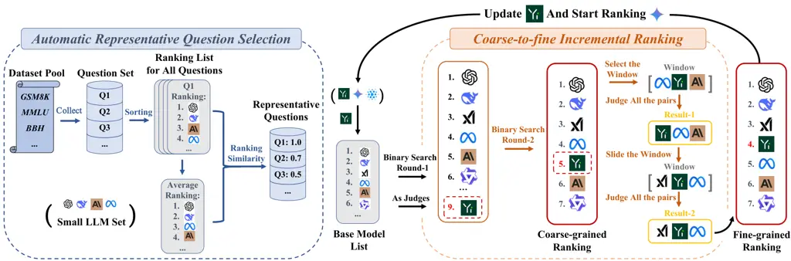
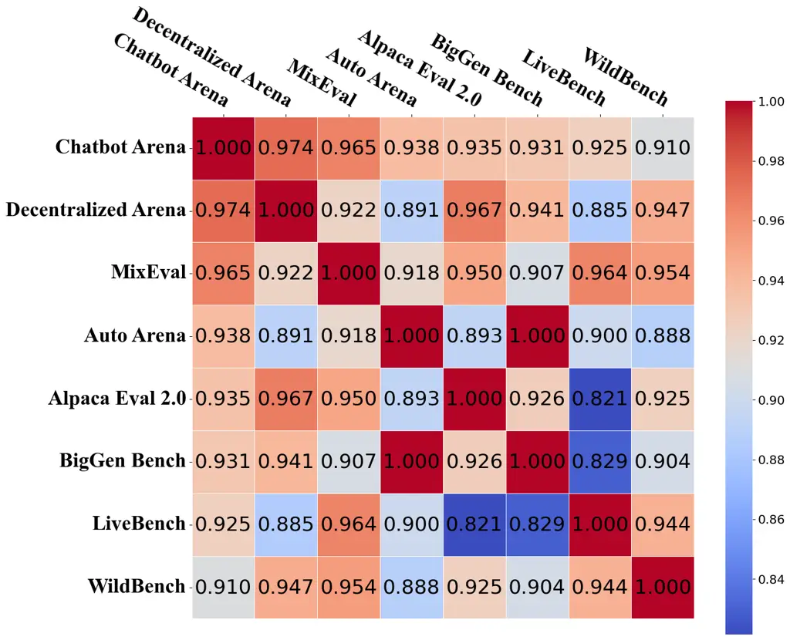
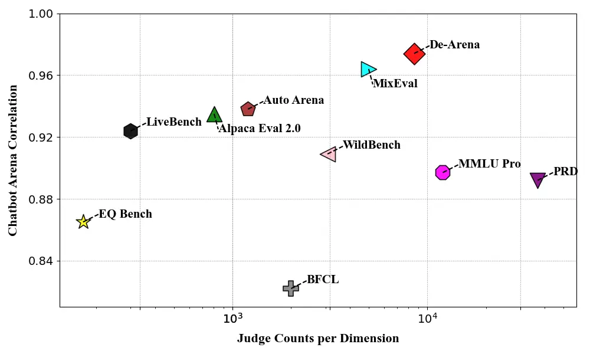
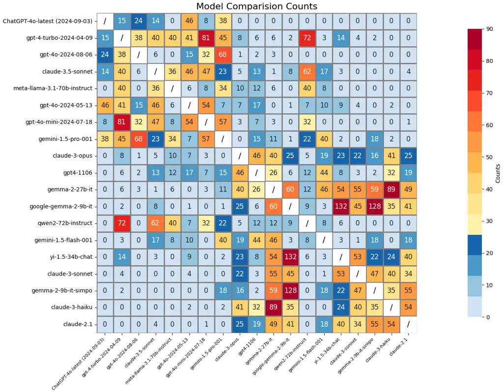
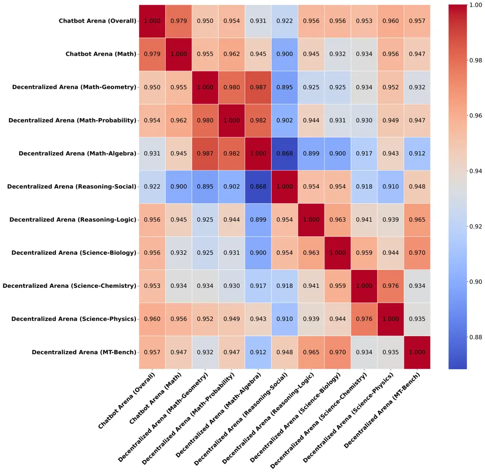
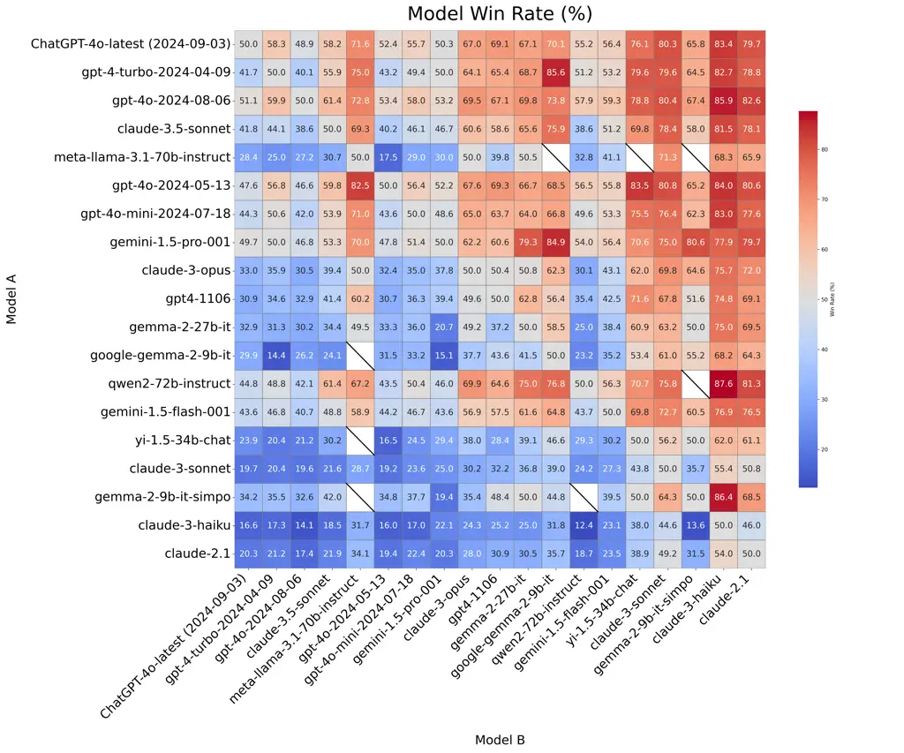

# Decentralized Arena: Towards Democratic and Scalable Automatic Evaluation of Language Models

Yanbin Yin Affiliation: University of California, San Diego. 
Email: <kuzhou@ucsd.edu>    Kun Zhou ^(†)^(†)thanks: Corresponding
authors. Affiliation: University of California, San Diego. 
Email: <zhw085@ucsd.edu>    Zhen Wang Email: <zhh019@ucsd.edu>   
Xiangdong Zhang Affiliation: University of California, San Diego.    
Yifei Shao Affiliation: University of California, San Diego.     Shibo
Hao Affiliation: University of California, San Diego.     Yi Gu
Affiliation: University of California, San Diego.     Jieyuan Liu
Affiliation: University of California, San Diego.     Somanshu Singla
Affiliation: University of California, San Diego.     Tianyang Liu
Affiliation: University of California, San Diego.     Eric P. Xing
Affiliation: Mohamed bin Zayed University of AI.    Zhengzhong Liu
Affiliation: Mohamed bin Zayed University of AI.    Haojian Jin
Affiliation: University of California, San Diego.     Zhiting Hu

###### Abstract

The recent explosion of large language models (LLMs), each with its own
general or specialized strengths, makes scalable, reliable benchmarking
more urgent than ever. Standard practices nowadays face fundamental
trade-offs: closed-ended question-based benchmarks (_e.g.,_ MMLU)
struggle with saturation as newer models emerge, while crowd-sourced
leaderboards (_e.g.,_ Chatbot Arena) rely on costly and slow human
judges. Recently, automated methods (_e.g.,_ LLM-as-a-judge) shed light
on the scalability, but risk bias by relying on one or a few “authority”
models. To tackle these issues, we propose Decentralized Arena
(De-Arena), a fully automated framework leveraging collective
intelligence from all LLMs to evaluate each other. It mitigates
single-model judge bias by democratic, pairwise evaluation, and remains
efficient at scale through two key components: (1) a coarse-to-fine
ranking algorithm for fast incremental insertion of new models with
sub-quadratic complexity, and (2) an automatic question selection
strategy for the construction of new evaluation dimensions. Across
extensive experiments across 66 LLMs, De-Arena attains up to 97%
correlation with human judgements, while significantly reducing the
cost. Our code and data will be publicly released on
[https://github.com/maitrix-org/de-arena](https://github.com/maitrix-org/de-arena).

## 1 Introduction

In recent years, the community has developed thousands of large language
models (LLMs) \[1, 2, 3, 4\] with ever-stronger general and specialized
capabilities. To deploy these models in the real world effectively, we
must assess and rank their performance accurately. Concretely, existing
work mostly collects a set of related high-quality questions, then
judges the outputs of LLM to estimate the corresponding specialized
capability \[5, 6, 7\]. By involving humans to vote on the preference of
all LLM pairs (_i.e.,_ deciding which LLM’s output “wins”), Chatbot
Arena \[8\] provides robust and reliable leaderboards, yielding one of
the most popular LLM benchmarks.

More importantly, with the increasing usage of LLMs in a variety of
industrial applications and scientific tasks \[9, 10, 11, 12\], it’s
crucial to evaluate LLMs’ capabilities on fine-grained dimensions,
_e.g.,_ math reasoning, physical sciences, and more specialized
branches, such as algebra and astrophysics. However, it is rather costly
(both in terms of time and financially) for Chatbot Arena and other
human-annotation-based benchmarks to support the evaluation of thousands
of LLMs in thousands of fine-grained dimensions, _i.e.,_ millions or
even billions of human votes required. Moreover, although human
judgments are still the gold standard, they can exhibit variability and
subtle subjectivity, particularly when frontier models sometimes deploy
persuasive “sycophantic” language \[13\] or other surface cues that may
bias annotators toward incorrect but agreeable responses \[14\]. To
address them, researchers have also studied automatic evaluation
methods, typically selecting one (or few) “strongest” LLM (_e.g.,_
GPT-4) as a judge to evaluate all other model pairs \[15, 16\]. However,
the judge model can be biased, _e.g.,_ by favoring outputs that resemble
its own style \[17, 18\]. Optimizing models based on such evaluations
could end up with overfitting to the biases of single judges.

|               |           |           |           |            |
| ------------- | --------- | --------- | --------- | ---------- |
| Benchmarks    | Judges    | Auto Eval | Auto Data | Open ended |
| Compass Arena | Human     | ✗         | ✗         | ✓          |
| Chatbot Arena | Human     | ✗         | ✗         | ✓          |
| MixEval       | -         | ✓         | ✓         | ✗          |
| LiveBench     | -         | ✓         | ✗         | ✗          |
| Alpaca Eval   | GPT-4     | ✓         | ✗         | ✓          |
| WildBench     | GPT-4     | ✓         | ✗         | ✓          |
| BiGGen Bench  | GPT-4     | ✓         | ✗         | ✓          |
| PRD           | Five LLMs | ✓         | ✗         | ✓          |
| Auto Arena    | Five LLMs | ✓         | ✓         | ✓          |
| De-Arena      | All LLMs  | ✓         | ✓         | ✓          |

Table 1: Comparison of representative LLM benchmarks based on the types
of judge models, whether automatically evaluating LLMs, selecting the
data, or using open-ended questions.

To achieve the goal of reliable and scalable evaluation across various
dimensions, we propose Decentralized Arena (De-Arena), an automatic
evaluation method based on the “wisdom of the crowds”. Table 1
illustrates the main difference between De-Arena and other benchmarks.
The core idea behind De-Arena is to use the collective intelligence of
all LLMs to evaluate and compare themselves. This forms a democratic
system where _all LLMs to be evaluated are also judges to evaluate
others_, leading to fairer rankings than the automatic methods relying
on a few centralized “authority” judge models \[19, 20\]. This should
address the single-judge bias or the bias from a similar model
family \[21\]. Additionally, its automatic benchmarking process also
supports scaling up the number of test LLMs and dimensions with a lower
cost than collecting large-scale human annotations.

To implement our De-Arena, a naive approach is to utilize all the LLMs
to judge all other model pairs (similar to Chatbot Arena), based on
manually crafted or selected high-quality questions. However, it would
lead to a prohibitively expensive time complexity of
$`\mathcal{O}(n^{3}k)`$¹¹ 1 $`n`$ and $`k`$ are the number of models and
questions, respectively.. To make De-Arena a more efficient and fully
automatic paradigm, we devised (1) _the coarse-to-fine incremental
ranking algorithm_ and (2) _the representative question selection
strategy_. Concretely, in our ranking strategy, the LLMs will be
incrementally inserted into the rank list (_i.e.,_ one by one), by first
finding the rough position via binary search and then fine-grained
in-window ranking. Such a way naturally supports gradually growing the
rank list by adding the latest LLMs, and the low complexity of binary
search (_i.e.,_ $`\mathcal{O}(kn\log n)`$) helps greatly reduce the time
cost. We later empirically show that even the coarse-grained step (i.e.,
binary insertion) can achieve highly capable performance, thanks to the
diverse set of judges. Besides efficiency, we introduce an adaptive
weight mechanism and ELo system to re-weight judges dynamically (akin to
PageRank), making De-Arena more reliable.

For question selection, our De-Arena leverages the above ranking
strategy to select a few representative questions that lead to more
consistent results, as the majority. In this way, we ensure that the new
evaluation dimensions can be automatically built by selecting a few
high-value ones from the collected question candidates. Based on the
above designs in De-Arena, we automatically construct nine fine-grained
dimensions, and efficiently evaluate 66 LLMs on them (as shown in
Table 12). Experimental results demonstrate the effectiveness of our
method, achieving up to 97% correlation with human-annotation-based
Chatbot Arena in the overall dimension (shown in Table 2), with a cost
similar to existing benchmarks (shown in Figure 2(b)). Extensive studies
also reveal that our method can significantly reduce the bias from a
single-LLM judge (Table 3 and Table 11), and becomes more stable and
accurate as the number of models increases (Figure 4(a)), demonstrating
its reliability and stability. Ablation study shows that the performance
is robust against choices of multi-judges (e.g., randomly selected
judges), indicating that our De-Arena is robust to potential group bias
as well \[21\].

## 2 Related Work

LLM Evaluation and Benchmark. Early work \[22, 23, 24\] on evaluating
language models primarily focuses on the quality of the generated text,
considering the fluency and relevance. In recent years, large language
models (LLMs) that have undergone pre-training on large-scale corpus,
have demonstrated expert-level text generation abilities \[25, 26\], and
exhibited strong advanced capabilities \[27, 28\], such as reasoning and
planning. Thus, a surge of benchmarks are proposed to assess the
multi-aspect capabilities of LLMs, which are either based on
closed-ended \[29, 30\] or open-ended questions \[8\]. The first type of
benchmarks relies on close-ended questions with accurate answers to
evaluate LLMs, which simplifies the evaluation process. However, due to
the simple formats of the closed-ended questions, they cannot fully
estimate the true user preferences of LLMs in applications \[31\], and
may also be hacked through training on similar data \[32\]. To address
this, Chatbot Arena \[8\] collects open-ended questions, and invites
humans to vote on each pair of LLMs based on their outputs. However,
human annotation is costly, and also makes the overall evaluation
results difficult to reproduce. Therefore, a surge of automatic
evaluation benchmarks has emerged, employing a strong LLM (e.g.,
GPT-4 \[17, 16\]) or a fine-tuned specialized LLM \[33, 34\] to replace
human judges. Despite the low cost, single-LLM judge-based methods may
suffer from the evaluation bias, _e.g.,_ self-enhancement bias \[17\]
and verbosity bias \[35\]. Recent attempts, such as PRD \[36\] and
Auto-Arena \[37\] have explored multi-LLM judgment to mitigate these
issues. However, using more LLMs as judges would significantly increase
the computational and resource cost, limiting the scalability for
evaluating a large number of LLMs and new dimensions.

Collective Intelligence. Collective intelligence arises when multiple
agents collaborate or compete in decentralized networks, often producing
more accurate judgments than any single expert alone \[20, 38\].
Research in crowd-based systems \[19\], multi-agent systems \[39\], and
swarm intelligence \[40, 41\] shows that collecting diverse perspectives
can mitigate individual errors and biases, particularly where no
centralized controller is present. For instance, natural examples of ant
colonies and bird flocks reveal that complex problems can be addressed
effectively through simple agent interactions \[41\]. In this paper, we
extend the principles of collective intelligence to LLM evaluation. We
design a large-scale decentralized system in which LLMs simultaneously
serve as judges and participants. Because each LLM has a distinct
training background, aggregating their judgments reduces the influence
of any single model’s biases. Our experiments highlight that evaluation
reliability consistently improves with the number of participating
models, demonstrating the strong potential of collective intelligence to
enable more robust, accurate, and scalable LLM benchmarking.



Figure 1: The overview of our method, consisting of the automatic
representative question selection strategy (left) and the coarse-to-fine
incremental ranking algorithm (right). Here, we show an example that
creates a new dimension based on existing open-source datasets, and one
of the insert iterations for adding the model Yi into the previous
ranking list.

## 3 Decentralized Arena

This section introduces the detailed design of our Decentralized
Arena (De-Arena). In De-Arena, we focus on the idea of decentralization
that uses all LLMs as judges to vote on other model pairs, based on
high-quality questions in each dimension. It can reduce the cost of
gathering human annotations, and also avoid the bias that may arise from
relying on a single or a small number of judge models. To achieve it, we
devise the coarse-to-fine incremental sort algorithm to efficiently rank
a large number of LLMs, and the automatic question selection algorithm
to select representative data for building new evaluation dimension. The
overview of our De-Arena is shown in Figure 1.

### 3.1 Coarse-to-fine Incremental Ranking Algorithm

Given a set of LLMs $`\{m_{i}\}_{i=1}^{n}`$, we aim to sort them into a
ranking list $`[m_{1},\cdots,m_{n}]`$, according to their performance on
the collected $`k`$ questions. Considering that a surge of stronger LLMs
will be developed in the near future, we devise an LLM sort algorithm
that supports the incremental insertion of new LLMs into the ranking
list. Concretely, we begin with a small set of “seed” models (_i.e.,_ 6
models), which are ranked using a full-sample pairwise comparison
method. In this process, each of the 6 models evaluates and ranks all
the other models, excluding itself. Other models are then incrementally
inserted into the rank list, one by one, where all models in the list
act as judges to help the new model find its position. To efficiently
insert a new model into the list, we devise the coarse-grained binary
search and fine-grained in-window reranking strategies.

Coarse-grained Ranking with Binary Search. Given the current ranking
list $`[m_{1},\cdots,m_{t}]`$ with $`t`$ models, we aim to find the
rough position of the $`t+1`$-th model in an efficient way. As the
ranking list is ordered, we utilize the binary search algorithm \[42\],
which can quickly narrow down the search space via the logarithmic time
complexity. Concretely, we first compare the new model with the one in
the $`t/2`$-th position of the ranking list, where all other models in
the list serve as judges. Given the collected $`k`$ questions, all the
judge LLMs vote on the outputs of the two models (_i.e.,_ deciding whose
output “wins”). If the new LLM owns more wins, we repeat the above step
to find the position of the new LLM in the first half list
$`[m_{1},\cdots,m_{t/2-1}]`$. Otherwise, we repeat it in
$`[m_{t/2+1},\cdots,m_{t}]`$. This loop will continues until narrowing
the search space into a certain position, which is the rough position of
the model. The time complexity of this binary search is
$`\mathcal{O}(kn\log n)`$.

Fine-grained In-window Reranking. After obtaining the rough position of
the new model, we continue to check whether it is suitable and make
refinement if necessary. Here, the new model is compared against its
adjacent peers within a defined local window (_e.g.,_ two models before
and after it in the ranking list). The rationale is that these nearby
LLMs often own similar capabilities to the new one, whose positions in
the ranking list are the hardest to distinguish, warranting closer
comparison. Concretely, we first compare the new LLM with other
in-window models using the collected $`k`$ questions and rerank them,
where all other models outside this window serve as judges. If the
in-window reranking step leads to a change in the new LLM’s position,
the process will be repeated within the updated window until the ranking
list stabilizes. This functions like a sliding window, guiding the LLM
crowd to focus on the most ambiguous comparison pairs, thereby ensuring
accurate rankings while significantly reducing computational costs.

Score Generation and Style Control. After obtaining the ranking list and
pairwise comparison results of all LLM candidates, we follow the
methodology used in Chatbot Arena that computes their corresponding Elo
score to finalize the ranking results:

```math
\small R^{\prime}_{\mathrm{A}}=R_{\mathrm{A}}+K\cdot\left(S_{\mathrm{A}}-\frac{1}{1+10^{\left(R_{\mathrm{B}}-R_{\mathrm{A}}\right)/400}}\right) \tag{1}
```

where $`R_{A}`$ is the Elo score of model A that is iteratively updated
based on the comparison results, $`R^{\prime}_{A}`$ denotes the updated
Elo rating of model A after a pairwise comparison. $`S_{A}`$ is a bool
value that denotes if model A wins the comparison, and $`K`$ is the
coefficient for the score update. As we cannot compare all the model
pairs, we follow Chatbot Arena, which uses logistic regression to fit
the collected comparison data and estimate the Elo score \[43\]. Here,
we consider that the reliability of different LLMs as judges varies.
Therefore, we introduce weights in the loss function. Our rationale is
that an LLM with a higher Elo score is more likely to be a qualified
judge; hence, we utilize the normalized Elo score as the weight in the
loss function. Furthermore, whenever the Elo scores are updated, we
dynamically adjust each model’s weight based on its new score. We also
follow Chatbot Arena, which incorporates a style control mechanism to
reduce the influence of output style.

### 3.2 Automatic Representative Questions Selection

To enable scalability in adding arbitrary new evaluation dimensions in
De-Arena, we devise an automatic representative question selection
algorithm. To build a new dimension, users only need to collect relevant
open-ended questions from open-source datasets. Then, we utilize the
ranking results of LLMs to identify the most representative questions as
high-quality examples for evaluating LLMs.

Open-ended Questions Collecting. Thanks to the rich open-source datasets
in the community, it is easy to search for and collect various relevant
open-source datasets for a certain dimension. However, the collected
examples may differ in the formats, _e.g.,_, multi-choice and open-ended
questions. In De-Arena, as we can leverage LLMs to compare the outputs
of model pairs, we standardize all the data into the open-ended question
format by using GPT-4 with an appropriate prompt.

Ranking-based Representative Questions Selection. Considering the
diverse quality and large scale of the collected questions, we aim to
select a few of the most representative ones for testing LLMs. Instead
of randomly sampling, we design a ranking-based method to select
questions that lead to consistent ranking lists, ensuring high data
quality. Concretely, for each question $`q`$ in the collection, we first
utilize our ranking algorithm in Section 3.1 to produce the ranking list
of a small set of LLMs, denoted as $`L`$. Then, we compute the average
ranking list for all questions by simply accumulating the position of
all LLMs and then sorting them, denoted as $`\hat{L}`$. Next, we compute
the Spearman correlation $`\rho`$ between the ranking list of each
question and the average list, and use the correlation scores to select
the representative questions:

```math
\rho(L,\hat{L})=1-\frac{6\sum_{i=1}^{n}(r(L,m_{i})-r(\hat{L},m_{i}))^{2}}{n\left(n^{2}-1\right)}, \tag{2}
```

where $`r(L,m)`$ returns the position of model $`m`$ in the list, $`n`$
is the model number. Then, questions with higher correlation scores are
selected, as they are more capable of representing the “majority”
preference by yielding ranking results that are highly consistent with
the average model rankings.

## 4 Experiments

Baseline Methods. To verify the effectiveness of our approach, we
compare it with three types of automatic evaluation benchmarks.
Descriptions of each baseline are provided in Appendix G, while detailed
evaluation settings and implementation details are presented in
Appendix H and Appendix I.

$`\bullet`$ _Closed-ended Datasets based Benchmarks._ They rely on
closed-ended questions to evaluate LLMs. Since ground-truth answers are
provided, they compute answer accuracy to rank LLMs. We select the
following benchmarks: (1) CompassAcademic \[44\], (2) BFCL \[45\], (3)
Helm Lite \[46\], (4) LiveBench \[47\], (5) EQ Bench \[48\], (6) MMLU
PRO \[29\], (7) MixEval \[49\], (8) OpenLLM \[50\].

$`\bullet`$ _Single-LLM Judge based Benchmarks._ In these benchmarks, a
single LLM serves as the judge to evaluate LLM pairs. We select the
following baselines: (1)BiGGen Bench \[51\], (2) BiGGen Bench
(Prometheus 2), (3) Alpaca Eval 2.0 \[15\], (4) WildBench \[52\].

$`\bullet`$ _Multi-LLM Judge based Benchmarks._ In these benchmarks, a
set of LLMs is used as the judge models to evaluate LLM pairs. We select
the following ones: (1) PRD \[36\], (2) Auto Arena \[37\].

|                             |         |       |         |       |         |       |       |
| --------------------------- | ------- | ----- | ------- | ----- | ------- | ----- | ----- |
| Benchmarks                  | 15 LLMs |       | 30 LLMs |       | 66 LLMs |       | Avg.  |
|                             | Overall | Math  | Overall | Math  | Overall | Math  |       |
| CompassAcademic             | 0.660   | -     | 0.674   | -     | -       | -     | -     |
| BFCL                        | 0.798   | -     | 0.813   | -     | -       | -     | -     |
| OpenLLM                     | 0.892   | -     | 0.800   | -     | 0.797   | -     | -     |
| Helm Lite                   | 0.725   | 0.656 | 0.748   | 0.660 | 0.750   | 0.665 | 0.701 |
| LiveBench                   | 0.906   | 0.900 | 0.920   | 0.913 | 0.925   | 0.916 | 0.913 |
| EQ Bench                    | 0.911   | -     | 0.860   | -     | 0.865   | -     | -     |
| MMLU PRO                    | 0.952   | -     | 0.897   | -     | 0.897   | -     | -     |
| MixEval                     | 0.954   | -     | 0.963   | -     | 0.965   | -     | -     |
| BigGen Bench (Prometheus 2) | 0.908   | -     | 0.924   | -     | 0.924   | -     | -     |
| BigGen Bench                | 0.919   | -     | 0.930   | -     | 0.931   | -     | -     |
| Alpaca Eval 2.0             | 0.921   | -     | 0.935   | -     | 0.935   | -     | -     |
| WildBench                   | 0.894   | 0.917 | 0.907   | 0.932 | 0.910   | 0.934 | 0.916 |
| PRD                         | 0.851   | 0.904 | 0.892   | 0.916 | -       | -     | -     |
| Auto Arena                  | 0.938   | -     | -       | -     | -       | -     | -     |
| De-Arena                    | 0.957   | 0.939 | 0.967   | 0.952 | 0.974   | 0.959 | 0.958 |

Table 2: Comparison results of the automatic evaluation benchmarks with
Chatbot Arena (Spearman Correlation in overall and math dimensions). We
report the results from the settings of testing 15, 30, and 66 LLMs.
Bold indicates the best results in each group.



(a) Benchmark Spearman correlation.



(b) Benchmark cost and performance.

Figure 2: (a) Spearman correlation between different LLM benchmarks in
the overall dimension. (b)Benchmark cost and performance comparison in
the overall dimension, where we show the average judge counts of each
model and the correlation with Chatbot Arena.

### 4.1 Results Analysis

Surpassing Existing Benchmarks. The comparison results of different
benchmarks are shown in Table 2. First, we observe that multi-LLM
judge-based benchmarks generally perform better than single-LLM
judge-based ones. This indicates that incorporating multiple LLMs as
judges improves the consistency between automated evaluation results and
human preferences. Such a way can reduce the preference bias from only
one judge model. Second, by collecting high-quality questions for
evaluation, MixEval and WildBench outperform other closed-ended and
single-LLM judge-based benchmarks, respectively. MixEval carefully
controls its query distribution to match with real-world user queries,
while WildBench collects massive real-world tasks (_i.e.,_ 1024). It
demonstrates the importance of selecting proper datasets for evaluation.
Besides, our De-Arena surpasses all baselines in most evaluation
settings and the average value. In De-Arena, we extend the multi-LLM
judge strategy into a more democratic paradigm where all LLMs are both
the judges and are to be evaluated, to further reduce the bias.
Furthermore, we devise an automatic question selection strategy that
leverages the correlation of ranking results to find the most
representative questions for evaluation. The above strategies greatly
improve the reliability and scalability of our method, in contrast to
baselines that require human involvement and a large amount of data.

In addition, with the increasing of test LLM number, the difficulty of
accurately ranking all LLMs also increases. As a result, the correlation
scores of most baselines with Chatbot Arena have also decreased. Here,
we can see that our De-Arena can achieve a stable performance and even
perform better in the math dimension. The reason is that the involvement
of more LLMs also introduces more judge models, which can reduce the
bias caused by a few judges, further improving the reliability. We also
report the correlation between our De-Arena and other best-performing
six benchmarks in Figure 2(a). We can see that our De-Arena always has a
high correlation with all the benchmarks, _i.e.,_ $`>0.85`$. It further
indicates the effectiveness of our method for producing reliable ranking
results, as existing benchmarks, echoing with the superior performance
in Table 2.

|             |                  |                      |                  |                      |
| ----------- | ---------------- | -------------------- | ---------------- | -------------------- |
| Methods     | MT-Bench         |                      | Math             |                      |
|             | Corr$`\uparrow`$ | R-Diff$`\downarrow`$ | Corr$`\uparrow`$ | R-Diff$`\downarrow`$ |
| LLaMA-3-70B | 0.815            | 1.71                 | 0.934            | 1.14                 |
| Gemma-2-27B | 0.930            | 1.29                 | 0.932            | 1.00                 |
| Qwen2-70B   | 0.938            | 1.00                 | 0.942            | 1.14                 |
| De-Arena    | 0.956            | 1.00                 | 0.952            | 1.00                 |

Table 3: Judge methods vs. Chatbot Arena: Correlation ($`\uparrow`$) and
Rank Difference ($`\downarrow`$).

Reducing Single-Judge Biases. In De-Arena, our major contribution is to
utilize all LLMs as judges to democratically vote all the model pairs,
reducing the single-judge evaluation bias and improving reliability. To
study it, we compare our De-Arena with several of its variations using a
single LLM as the judge, including LLaMA-3-70B, Gemma-2-27B,
Qwen2-70B-inst, GPT-4o-2024-08-06. Here, we report the Spearman
correlation and the difference in the ranked LLMs between all methods
with Chatbot Arena. As presented in Table 3, the performance of our
De-Arena is consistently better than all other variations, with higher
Spearman correlation and lower rank difference. It indicates that our
democratic voting strategy can avoid the ranking results being biased by
the preference of few LLMs. Also, in our case study, we find that
LLaMA-3-70B and Gemma-2-27B are prone to vote for themselves and the
same series of LLMs, causing their ranks to rise drastically.

Figure 3: Spearman correlation with Chatbot Arena across varying judge
model number.

Robustness against Potential Group Biases. Since De-Arena leverages the
collective intelligence of LLMs to judge each other, it effectively
mitigates single-judge biases. To further assess its robustness and
potential group biases, we varied the number of judge models across
three settings: 8, 16, and 26. For the 8 and 16 settings, we randomly
sampled five different judge sets to evaluate stability; for 26, we used
all suitable open-source models. The final outcomes are presented in
Figure 3. We observe that the performance consistently improves as the
number of judge models increases, with the best performance achieved
when the number reaches 26. This can be attributed to the fact that a
larger number of judge models enables a more democratic and
decentralized evaluation process. As the judge pool grows, the
collective intelligence effect becomes more pronounced, which helps to
further mitigate the biases of individual models. Meanwhile, since the
group consists of highly diverse models, group biases are minimally
introduced. This highlights the strong robustness of using multiple
judges in the evaluation process.

Cost and Scalability Study. In De-Arena, we devise the coarse-to-fine
ranking algorithm and question selection strategy to reduce the cost of
scaling the LLM number. To evaluate this efficiency, we estimate the
cost of our De-Arena with other benchmarks for comparison. As it is hard
to compute the detailed cost, we count the average comparison number of
each LLM, which is relevant to the number of test questions and voting
counts. As shown in Figure 2(b), our De-Arena achieves the best
performance among all benchmarks, with slightly higher cost than
single-LLM judge-based ones. The reason is that we employ the
representative question selection strategy to reduce the number of test
questions (_e.g.,_ 100 instances), and also the ranking algorithm to
reduce the voting counts of judge models. The above designs greatly
reduce the cost from both sides. Besides, as De-Arena has the lower cost
and higher correlation with Chatbot Arena, it shows strong potential as
an effective and scalable automatic counterpart for broader real-world
applications.

(a) De-Arena Correlation Curve



(b) LLM comparison counts.

Figure 4: (a) De-Arena’s mean (blue curve) and variance (shaded area) of
Chatbot Arena correlation in the MT-bench dimension, with the increase
in LLM number. (b) The distribution map of the LLM comparison counts in
the MT-Bench dimension.

Convergence Study. As our De-Arena adopts the coarse-to-fine incremental
ranking strategy, the insertion order of LLMs might affect the stability
of the final ranking results. To study it, we run our method five times,
using different random seeds to shuffle the insertion order, and compute
the mean and variance correlations with Chatbot Arena, in the MT-bench
dimension. As shown in Figure 4(a), we can see that with the involvement
of more models, our ranking results become more stable and robust with
higher correlation and lower variance. It demonstrates the scalability
of our decentralized evaluation strategy with the scaling of LLMs. The
more models participate in the evaluation process, the more reliable and
trustworthy the ranking results for all models.

### 4.2 Ablation and Variation Study

|               |                  |                      |                  |                      |
| ------------- | ---------------- | -------------------- | ---------------- | -------------------- |
| Methods       | MT-Bench         |                      | Math             |                      |
|               | Corr$`\uparrow`$ | Judges$`\downarrow`$ | Corr$`\uparrow`$ | Judges$`\downarrow`$ |
| Ours          | 0.957            | 521495               | 0.962            | 808074               |
| - w/o Fine    | 0.952            | 320715               | 0.961            | 489741               |
| - w/o Coarse  | 0.954            | 352245               | 0.959            | 520580               |
| - Full Sample | 0.956            | 2245874              | 0.962            | 3660355              |

Table 4: Correlations (Corr) and rank differences (R-Diff) between
different judge methods and Chatbot Arena in MT-Bench and Math
dimensions. $`\uparrow`$ denotes the higher the better, while
$`\downarrow`$ denotes the lower the better.

Coarse-to-fine Ranking Algorithm. To study the effectiveness of our
coarse-to-fine ranking algorithm, we remove the coarse-grained binary
search ranking and fine-grained in-window reranking strategies, to build
two variations for comparison: (1) w/o Coarse: ours without
coarse-grained binary search; (2) w/o Fine: ours without fine-grained
in-window reranking. Besides, we also built the variation that uses all
LLMs to vote all the LLM pairs, namely (3) Full Ranking: ours with full
ranking. We conduct the experiments on MT-Bench and Math dimensions, and
report the correlation with Chatbot Arena and the number of judges. As
shown in Table 4, among all the variations, our De-Arena can well
balance the performance and the cost. In De-Arena, both the
coarse-grained binary search and the fine-grained in-window reranking
algorithms contribute to performance improvement while only slightly
increasing the number of judge. Without these strategies, the variation
that needs to fully rank all model pairs greatly increases the cost
($`\times 4`$ judge counts).

|           |          |         |          |             |
| --------- | -------- | ------- | -------- | ----------- |
| Dimension | MT-Bench | Algerba | Geometry | Probability |
| Avg Corr  | 0.957    | 0.942   | 0.956    | 0.961       |
| Std       | 0.0019   | 0.0021  | 0.0015   | 0.0016      |

Table 5: Stability study of our coarse-to-fine ranking algorithm. In
each dimension, we conduct five random experiments by shuffling the
insertion order of models.

|          |        |            |              |
| -------- | ------ | ---------- | ------------ |
| Methods  | Ours   | - w/o Fine | - w/o Coarse |
| Avg Corr | 0.957  | 0.953      | 0.955        |
| Std      | 0.0019 | 0.0031     | 0.0029       |

Table 6: Stability study under variations of our coarse-to-fine ranking
algorithm. Each dimension, we conduct five random experiments by
shuffling the insertion order of models.

Stability Study of Coarse-to-fine Ranking Algorithm In De-Arena, we
adopt an incremental insertion approach, where models are inserted in
different orders and ranked accordingly. To better demonstrate the
stability of our algorithm, we conduct experiments showing that the
insertion order of models into De-Arena has minimal impact on the final
ranking results. Specifically, we perform five random shuffles of the
model insertion order and compute the Spearman correlation between the
resulting rankings and those from Chatbot Arena. As shown in Table 6,
the correlation remains consistently high with very low standard
deviation, confirming the robustness and stability of the coarse-to-fine
ranking algorithm. Furthermore, to verify the stability of our
algorithm’s variations, we conduct the same randomized insertion
experiments under MT-Bench. As shown in Table 6, although the variations
do not perform as well as the full algorithm, their standard deviations
remain very low, indicating strong stability. Therefore, the full
coarse-to-fine ranking algorithm demonstrates the best performance and
is well-suited for scenarios that require highly accurate and stable
rankings.

(a) Ranking difference.

(b) Correlation across question selection methods.

Figure 5: (a) Binary search ranking differences between binary search
and ground truth in four dimensions. (b) Spearman correlation with
Chatbot Arena for different question selection methods.

Accuracy Study of Coarse-grained Binary Search De-Arena heavily relies
on the Coarse-to-Fine Ranking Algorithm, with the accuracy of the binary
search in the first step being crucial for identifying the approximate
ranking range of models. To better demonstrate the accuracy of the
binary search, we monitor the absolute difference between the binary
search ranking and the ground truth ranking during the insertion process
across four dimensions. Finally, we compute the average ranking
difference for all models. As the results shown in Figure 5(a), the
coarse-grained binary search ranking for each model across all
dimensions is very close to its ground truth ranking. With the
subsequent fine-grained ranking adjustments, the accuracy of the
rankings is further improved.

Question Selection Algorithm. To evaluate the effectiveness of our
representative question selection algorithm, we compare it with several
variations using different strategies: (1) Random that randomly selects
the questions; (2) Perplexity that uses the perplexity of
LLaMA-3-8B \[26\] to rank and select the top ones; (3) Anchor
point \[53\] that selects an optimal subset of sub-problems to represent
the full dataset; (4) GPT-4 that crafts prompts to guide GPT-4 to rank
and select the top ones. Here, we utilize them to select 32 questions
from the 80 questions in MT-Bench dataset. As shown in Figure 5(b), all
the variations perform not better than De-Arena, indicating the
effectiveness of our question selection algorithm. Here, random is a
robust baseline that can outperform other variations, while our methods
can lead to a higher correlation with Chatbot Arena than it. The reason
is that we focus on selecting the most representative questions that
reflect the majority, based on ranking similarity. This approach
effectively identifies the most useful ones for testing LLMs.

|           |                  |            |
| --------- | ---------------- | ---------- |
| Dimension | with Elo Weights | No Weights |
| MT-Bench  | 0.957            | 0.949      |
| Math      | 0.959            | 0.953      |

Table 7: Ablation study results about the Elo weight in different
dimensions.

Weights for Judge Models. In De-Arena, we consider that different models
have varying abilities for judging LLMs, thereby devising the weighting
mechanism. It aims to assign higher weights for stronger models and
lower weights for weaker ones. To study its effectiveness, we remove it
and compare the performance changes in the MT-Bench and three math
sub-dimensions. As shown in Table 7, removing the weights would lead to
performance degradation in the correlation score. It indicates the
effectiveness of the weighting mechanism we implemented.

Comparison-count Distribution. Our De-Arena adopts the coarse-to-fine
ranking algorithm, which can allocate more comparisons on the
hard-to-distinguish LLM pairs with neighboring positions in the ranking
list. To study it, we visualize the comparison-count distribution for
all LLMs in Figure 4(b). We can observe that the collective LLM
intelligence automatically focuses primarily on the neighboring LLM
pairs (those close to the diagonal), which are also equivalent to those
with near 50% win rates in Figure 7. In contrast, comparisons between
LLMs with large performance gaps are sparse (or even omitted), reducing
the overall computation cost. Such a distribution is all thanks to our
ranking algorithm, where the binary search and in-window reranking help
reduce the unnecessary comparisons with predictable results and
concentrate on the ambiguous pairs.

## 5 Conclusion

In this paper, we propose Decentralized Arena (De-Arena), a democratic
and fully automatic LLM evaluation system where the models to be
evaluated can also evaluate each other. To make it a more efficient and
automatic system, we devised the coarse-to-fine incremental ranking and
representative question selection strategies. These innovations enable
De-Arena to scale effectively to a large number of LLMs and support
evaluation across fine-grained, diverse dimensions Extensive experiments
have verified the reliability and scalability of our De-Arena. In the
future, we will extend our De-Arena by including more LLMs and useful
evaluation dimensions, supporting fully automatic new dimension
discovery and evaluation, and further exploring the evaluation of
super-human intelligence.

## References

- \[1\] Josh Achiam, Steven Adler, Sandhini Agarwal, Lama Ahmad, Ilge
  Akkaya, Florencia Leoni Aleman, Diogo Almeida, Janko Altenschmidt, Sam
  Altman, Shyamal Anadkat, et al. Gpt-4 technical report. arXiv preprint
  arXiv:2303.08774, 2023.
- \[2\] Hugo Touvron, Thibaut Lavril, Gautier Izacard, Xavier Martinet,
  Marie-Anne Lachaux, Timothée Lacroix, Baptiste Rozière, Naman Goyal,
  Eric Hambro, Faisal Azhar, et al. Llama: Open and efficient foundation
  language models. arXiv preprint arXiv:2302.13971, 2023.
- \[3\] Jinze Bai, Shuai Bai, Yunfei Chu, Zeyu Cui, Kai Dang, Xiaodong
  Deng, Yang Fan, Wenbin Ge, Yu Han, Fei Huang, et al. Qwen technical
  report. arXiv preprint arXiv:2309.16609, 2023.
- \[4\] Aixin Liu, Bei Feng, Bing Xue, Bingxuan Wang, Bochao Wu, Chengda
  Lu, Chenggang Zhao, Chengqi Deng, Chenyu Zhang, Chong Ruan, et al.
  Deepseek-v3 technical report. arXiv preprint arXiv:2412.19437, 2024.
- \[5\] Neel Guha, Julian Nyarko, Daniel Ho, Christopher Ré, Adam
  Chilton, Alex Chohlas-Wood, Austin Peters, Brandon Waldon, Daniel
  Rockmore, Diego Zambrano, et al. Legalbench: A collaboratively built
  benchmark for measuring legal reasoning in large language models.
  Advances in Neural Information Processing Systems, 36, 2024.
- \[6\] Qianqian Xie, Weiguang Han, Xiao Zhang, Yanzhao Lai, Min Peng,
  Alejandro Lopez-Lira, and Jimin Huang. Pixiu: A large language model,
  instruction data and evaluation benchmark for finance. arXiv preprint
  arXiv:2306.05443, 2023.
- \[7\] Nitarshan Rajkumar, Raymond Li, and Dzmitry Bahdanau. Evaluating
  the text-to-sql capabilities of large language models. arXiv preprint
  arXiv:2204.00498, 2022.
- \[8\] Wei-Lin Chiang, Lianmin Zheng, Ying Sheng, Anastasios Nikolas
  Angelopoulos, Tianle Li, Dacheng Li, Hao Zhang, Banghua Zhu, Michael
  Jordan, Joseph E Gonzalez, et al. Chatbot arena: An open platform for
  evaluating llms by human preference. arXiv preprint
  arXiv:2403.04132, 2024.
- \[9\] Xinyi Hou, Yanjie Zhao, Yue Liu, Zhou Yang, Kailong Wang, Li Li,
  Xiapu Luo, David Lo, John Grundy, and Haoyu Wang. Large language
  models for software engineering: A systematic literature review. ACM
  Transactions on Software Engineering and Methodology,
  33(8):1–79, 2024.
- \[10\] Ross Taylor, Marcin Kardas, Guillem Cucurull, Thomas Scialom,
  Anthony Hartshorn, Elvis Saravia, Andrew Poulton, Viktor Kerkez, and
  Robert Stojnic. Galactica: A large language model for science. arXiv
  preprint arXiv:2211.09085, 2022.
- \[11\] Mengge Du, Yuntian Chen, Zhongzheng Wang, Longfeng Nie, and
  Dongxiao Zhang. Large language models for automatic equation discovery
  of nonlinear dynamics. Physics of Fluids, 36(9), 2024.
- \[12\] Arun James Thirunavukarasu, Darren Shu Jeng Ting, Kabilan
  Elangovan, Laura Gutierrez, Ting Fang Tan, and Daniel Shu Wei Ting.
  Large language models in medicine. Nature medicine,
  29(8):1930–1940, 2023.
- \[13\] Mrinank Sharma, Meg Tong, Tomasz Korbak, David Duvenaud, Amanda
  Askell, Samuel R Bowman, Newton Cheng, Esin Durmus, Zac
  Hatfield-Dodds, Scott R Johnston, et al. Towards understanding
  sycophancy in language models. arXiv preprint arXiv:2310.13548, 2023.
- \[14\] Stephanie Schoch, Diyi Yang, and Yangfeng Ji. “this is a
  problem, don’t you agree?” framing and bias in human evaluation for
  natural language generation. In Proceedings of the 1st Workshop on
  Evaluating NLG Evaluation, pages 10–16, 2020.
- \[15\] Yann Dubois, Balázs Galambosi, Percy Liang, and Tatsunori B
  Hashimoto. Length-controlled alpacaeval: A simple way to debias
  automatic evaluators. arXiv preprint arXiv:2404.04475, 2024.
- \[16\] Xuechen Li, Tianyi Zhang, Yann Dubois, Rohan Taori, Ishaan
  Gulrajani, Carlos Guestrin, Percy Liang, and Tatsunori B Hashimoto.
  Alpacaeval: An automatic evaluator of instruction-following
  models, 2023.
- \[17\] Lianmin Zheng, Wei-Lin Chiang, Ying Sheng, Siyuan Zhuang,
  Zhanghao Wu, Yonghao Zhuang, Zi Lin, Zhuohan Li, Dacheng Li, Eric
  Xing, et al. Judging llm-as-a-judge with mt-bench and chatbot arena.
  Advances in Neural Information Processing Systems,
  36:46595–46623, 2023.
- \[18\] Arjun Panickssery, Samuel Bowman, and Shi Feng. Llm evaluators
  recognize and favor their own generations. Advances in Neural
  Information Processing Systems, 37:68772–68802, 2024.
- \[19\] Juho Salminen et al. The role of collective intelligence in
  crowdsourcing innovation. 2015.
- \[20\] James Surowiecki. The Wisdom of Crowds: Why the Many Are
  Smarter than the Few and How Collective Wisdom Shapes Business,
  Economies, Societies, and Nations. Doubleday, New York, 2004.
- \[21\] Shashwat Goel, Joschka Struber, Ilze Amanda Auzina, Karuna K
  Chandra, Ponnurangam Kumaraguru, Douwe Kiela, Ameya Prabhu, Matthias
  Bethge, and Jonas Geiping. Great models think alike and this
  undermines ai oversight. arXiv preprint arXiv:2502.04313, 2025.
- \[22\] Wei Zhao, Maxime Peyrard, Fei Liu, Yang Gao, Christian M Meyer,
  and Steffen Eger. Moverscore: Text generation evaluating with
  contextualized embeddings and earth mover distance. arXiv preprint
  arXiv:1909.02622, 2019.
- \[23\] Tianyi Zhang, Varsha Kishore, Felix Wu, Kilian Q Weinberger,
  and Yoav Artzi. Bertscore: Evaluating text generation with bert. arXiv
  preprint arXiv:1904.09675, 2019.
- \[24\] Weizhe Yuan, Graham Neubig, and Pengfei Liu. Bartscore:
  Evaluating generated text as text generation. Advances in Neural
  Information Processing Systems, 34:27263–27277, 2021.
- \[25\] OpenAI. Gpt-4o system card, 2024.
- \[26\] AI@Meta. Llama 3 model card. 2024.
- \[27\] Chan Hee Song, Jiaman Wu, Clayton Washington, Brian M. Sadler,
  Wei-Lun Chao, and Yu Su. Llm-planner: Few-shot grounded planning for
  embodied agents with large language models. In Proceedings of the
  IEEE/CVF International Conference on Computer Vision (ICCV),
  October 2023.
- \[28\] OpenAI. Openai o1 system card, 2024.
- \[29\] Yubo Wang, Xueguang Ma, Ge Zhang, Yuansheng Ni, Abhranil
  Chandra, Shiguang Guo, Weiming Ren, Aaran Arulraj, Xuan He, Ziyan
  Jiang, et al. Mmlu-pro: A more robust and challenging multi-task
  language understanding benchmark. arXiv preprint
  arXiv:2406.01574, 2024.
- \[30\] David Rein, Betty Li Hou, Asa Cooper Stickland, Jackson Petty,
  Richard Yuanzhe Pang, Julien Dirani, Julian Michael, and Samuel R.
  Bowman. GPQA: A graduate-level google-proof q&a benchmark. In First
  Conference on Language Modeling, 2024.
- \[31\] Shengguang Wu, Shusheng Yang, Zhenglun Chen, and Qi Su.
  Rethinking pragmatics in large language models: Towards open-ended
  evaluation and preference tuning. In Proceedings of the 2024
  Conference on Empirical Methods in Natural Language Processing, pages
  22583–22599, 2024.
- \[32\] Oscar Sainz, Jon Campos, Iker García-Ferrero, Julen Etxaniz,
  Oier Lopez de Lacalle, and Eneko Agirre. NLP evaluation in trouble: On
  the need to measure LLM data contamination for each benchmark. In
  Houda Bouamor, Juan Pino, and Kalika Bali, editors, Findings of the
  Association for Computational Linguistics: EMNLP 2023, pages
  10776–10787, Singapore, December 2023. Association for Computational
  Linguistics.
- \[33\] Junlong Li, Shichao Sun, Weizhe Yuan, Run-Ze Fan, Hai Zhao, and
  Pengfei Liu. Generative judge for evaluating alignment. arXiv preprint
  arXiv:2310.05470, 2023.
- \[34\] Seungone Kim, Juyoung Suk, Shayne Longpre, Bill Yuchen Lin,
  Jamin Shin, Sean Welleck, Graham Neubig, Moontae Lee, Kyungjae Lee,
  and Minjoon Seo. Prometheus 2: An open source language model
  specialized in evaluating other language models. arXiv preprint
  arXiv:2405.01535, 2024.
- \[35\] Keita Saito, Akifumi Wachi, Koki Wataoka, and Youhei Akimoto.
  Verbosity bias in preference labeling by large language models. In
  NeurIPS 2023 Workshop on Instruction Tuning and Instruction
  Following, 2023.
- \[36\] Ruosen Li, Teerth Patel, and Xinya Du. Prd: Peer rank and
  discussion improve large language model based evaluations. arXiv
  preprint arXiv:2307.02762, 2023.
- \[37\] Ruochen Zhao, Wenxuan Zhang, Yew Ken Chia, Deli Zhao, and
  Lidong Bing. Auto arena of llms: Automating llm evaluations with agent
  peer-battles and committee discussions. arXiv preprint
  arXiv:2405.20267, 2024.
- \[38\] Peiran Yao, Jerin George Mathew, Shehraj Singh, Donatella
  Firmani, and Denilson Barbosa. A bayesian approach towards
  crowdsourcing the truths from llms. In NeurIPS 2024 Workshop on
  Bayesian Decision-making and Uncertainty, 2024.
- \[39\] Imène Brigui-Chtioui and Inès Saad. A multiagent approach for
  collective decision making in knowledge management. Group Decision and
  Negotiation, 20:19–37, 2011.
- \[40\] Amrita Chakraborty and Arpan Kumar Kar. Swarm intelligence: A
  review of algorithms. Nature-inspired computing and optimization:
  Theory and applications, pages 475–494, 2017.
- \[41\] Peter A Gloor. Swarm creativity: Competitive advantage through
  collaborative innovation networks. Oxford University Press, 2006.
- \[42\] Anthony Lin. Binary search algorithm. WikiJournal of Science,
  2(1):1–13, 2019.
- \[43\] Arpad E Elo. The proposed uscf rating system, its development,
  theory, and applications. Chess life, 22(8):242–247, 1967.
- \[44\] OpenCompass Contributors. Opencompass: A universal evaluation
  platform for foundation models.
  [https://github.com/open-compass/opencompass](https://github.com/open-compass/opencompass), 2023.
- \[45\] Fanjia Yan, Huanzhi Mao, Charlie Cheng-Jie Ji, Tianjun Zhang,
  Shishir G. Patil, Ion Stoica, and Joseph E. Gonzalez. Berkeley
  function calling leaderboard.
  [https://gorilla.cs.berkeley.edu/blogs/8_berkeley_function_calling_leaderboard.html](https://gorilla.cs.berkeley.edu/blogs/8_berkeley_function_calling_leaderboard.html), 2024.
- \[46\] Percy Liang, Rishi Bommasani, Tony Lee, Dimitris Tsipras,
  Dilara Soylu, Michihiro Yasunaga, Yian Zhang, Deepak Narayanan, Yuhuai
  Wu, Ananya Kumar, et al. Holistic evaluation of language models. arXiv
  preprint arXiv:2211.09110, 2022.
- \[47\] Colin White, Samuel Dooley, Manley Roberts, Arka Pal, Ben
  Feuer, Siddhartha Jain, Ravid Shwartz-Ziv, Neel Jain, Khalid
  Saifullah, Siddartha Naidu, et al. Livebench: A challenging,
  contamination-free llm benchmark. arXiv preprint
  arXiv:2406.19314, 2024.
- \[48\] Samuel J Paech. Eq-bench: An emotional intelligence benchmark
  for large language models. arXiv preprint arXiv:2312.06281, 2023.
- \[49\] Jinjie Ni, Fuzhao Xue, Xiang Yue, Yuntian Deng, Mahir Shah,
  Kabir Jain, Graham Neubig, and Yang You. Mixeval: Deriving wisdom of
  the crowd from llm benchmark mixtures. arXiv preprint
  arXiv:2406.06565, 2024.
- \[50\] Clémentine Fourrier, Nathan Habib, Alina Lozovskaya, Konrad
  Szafer, and Thomas Wolf. Open llm leaderboard v2.
  [https://huggingface.co/spaces/open-llm-leaderboard/open_llm_leaderboard](https://huggingface.co/spaces/open-llm-leaderboard/open_llm_leaderboard), 2024.
- \[51\] Seungone Kim, Juyoung Suk, Ji Yong Cho, Shayne Longpre, Chaeeun
  Kim, Dongkeun Yoon, Guijin Son, Yejin Cho, Sheikh Shafayat, Jinheon
  Baek, et al. The biggen bench: A principled benchmark for fine-grained
  evaluation of language models with language models. arXiv preprint
  arXiv:2406.05761, 2024.
- \[52\] Bill Yuchen Lin, Yuntian Deng, Khyathi Chandu, Faeze Brahman,
  Abhilasha Ravichander, Valentina Pyatkin, Nouha Dziri, Ronan Le Bras,
  and Yejin Choi. Wildbench: Benchmarking llms with challenging tasks
  from real users in the wild. arXiv preprint arXiv:2406.04770, 2024.
- \[53\] Rajan Vivek, Kawin Ethayarajh, Diyi Yang, and Douwe Kiela.
  Anchor points: Benchmarking models with much fewer examples. In Yvette
  Graham and Matthew Purver, editors, Proceedings of the 18th Conference
  of the European Chapter of the Association for Computational
  Linguistics (Volume 1: Long Papers), pages 1576–1601, St. Julian’s,
  Malta, March 2024. Association for Computational Linguistics.
- \[54\] Dan Hendrycks, Collin Burns, Steven Basart, Andy Zou, Mantas
  Mazeika, Dawn Song, and Jacob Steinhardt. Measuring massive multitask
  language understanding. arXiv preprint arXiv:2009.03300, 2020.

|             |        |        |       |       |       |
| ----------- | ------ | ------ | ----- | ----- | ----- |
| Dimension   | Length | Header | List  | Bold  | All   |
| MT-Bench    | 0.933  | 0.914  | 0.911 | 0.897 | 0.932 |
| Algebra     | 0.909  | 0.909  | 0.909 | 0.911 | 0.906 |
| Probability | 0.934  | 0.930  | 0.929 | 0.929 | 0.935 |
| Geometry    | 0.932  | 0.934  | 0.933 | 0.932 | 0.924 |

Table 8: Style control ablation study results across different
dimensions. Each column represents a different style control method
applied, and All denotes controlling all of them.

## Appendix A Style Control Study

Due to variations in training data, different models often exhibit
distinct output styles. Following the approach of Chatbot Arena, we
defined four styles (_i.e.,_ Length, Header, List, Bold) and calculated
the correlation between these styles and the Chatbot Arena style
control. Also, we add the results by controlling all the them.

As the results shown in Table 8, we can see that controlling all of the
styles can achieve better performance in all these dimensions. In
contrast, only using one of them would have an improvement on a certain
dimension, but might also affect the performance in other ones. It
indicates that controlling all styles is capable of well balancing the
capability in all evaluation aspects.

|             |                  |                      |                  |                      |
| ----------- | ---------------- | -------------------- | ---------------- | -------------------- |
| Window size | MT-Bench         |                      | Math             |                      |
|             | Corr$`\uparrow`$ | Judges$`\downarrow`$ | Corr$`\uparrow`$ | Judges$`\downarrow`$ |
| 1           | 0.957            | 521495               | 0.962            | 808074               |
| 2           | 0.953            | 684460               | 0.960            | 1069615              |
| 3           | 0.955            | 892260               | 0.960            | 1284068              |

Table 9: Hyperparameter tuning results about window size.

|                   |       |       |       |       |
| ----------------- | ----- | ----- | ----- | ----- |
| Base Model Number | 3     | 6     | 9     | 12    |
| MT-Bench          | 0.948 | 0.957 | 0.952 | 0.954 |
| Math              | 0.961 | 0.962 | 0.960 | 0.960 |

Table 10: Hyperparameter tuning results about base model number.

## Appendix B Hyper-parameter Tuning

In De-Arena, the window size and base model number are two
hyper-parameters that control the cost of in-window reranking and the
initial ranking list, respectively. Here, we study their best settings
by varying them in $`[1,2,3]`$ and $`[3,6,9,12]`$, respectively. As the
results shown in Table 9, setting the window size to 1 can lead to the
fewest judge counts, and also achieve a good correlation score, which
well balances the performance and the cost. As shown in Table 10, we can
observe that using 6 base models can achieve the best performance. The
reason is that too few or too many models would cause the instability of
the ranking list during incrementally inserting new models.

## Appendix C Impact Statement

Our De-Arena aspires to reshape LLM benchmarking by harnessing
collective intelligence rather than relying on few “authority” models or
costly human annotation. It may carry several potential ethical and
societal impacts:

$`\bullet`$ By involving every participating LLM as both evaluator and
evaluated, De-Arena aims to reduce single-model dominance and mitigate
systemic biases. It encourages more equitable participation and
transparent performance comparisons, fostering an environment in which
models from diverse teams—industry, academia, or open-source
communities—can be assessed on a level playing field.

$`\bullet`$ Traditional benchmarking often depends on extensive human
annotation, which can be labor-intensive, subjective, and slow.
De-Arena’s automatic evaluation minimizes human oversight and lowers
costs, potentially democratizing access to robust evaluation for smaller
research groups or underfunded institutions and easing the ethical
burden associated with human annotators’ time and well-being.

$`\bullet`$ In contrast to single-judge approaches, a decentralized,
multi-LLM system spreads accountability across many models. When
combined with transparency about each model’s contributions to a final
ranking, the system can better highlight disagreements or harmful biases
among models. This collective responsibility promotes more nuanced
scrutiny of anomalies or potentially harmful content.

$`\bullet`$ While distributing decision-making reduces reliance on any
single model’s biases, emergent group biases can still arise if many
models share similar training data or user bases. Continued research is
needed to detect and mitigate these collective distortions, especially
for underrepresented languages or cultural contexts.


## Appendix D Case Study for Question Selection

To better show the effectiveness of our representative question
selection algorithm, we show the questions with the higher and lower
scores using our method in the above example. We can observe that the
selected question with the higher score is indeed with higher quality.
It contains more detailed task description and requires multiple special
knowledge to solve it. In contrast, for the question with the lower
score, its required knowledge is relatively limited. As no clear
instruction is given, it is not easy to distinguish the quality of the
potential outputs from LLMs.

|                             |                             |
| --------------------------- | --------------------------- |
| Results from De-Arena       | Results using LLaMA-3-70B   |
| o1-mini                     | llama-3-70b-instruct        |
| o1-preview                  | meta-llama-3.3-70b-instruct |
| gpt-4o-2024-05-13           | o1-mini                     |
| meta-llama-3.3-70b-instruct | gpt-4o-2024-08-06           |
| gpt-4o-2024-08-06           | o1-preview                  |
| qwen2-72b-instruct          | gpt-4o-2024-05-13           |
| gemma-2-27b-it              | qwen2-72b-instruct          |
| gemma-2-2b-it               | gemma-2-27b-it              |
| llama-3-70b-instruct        | gemma-2-2b-it               |
| gemma-1.1-7b-it             | gemma-1.1-7b-it             |
| gemma-1.1-2b-it             | gemma-1.1-2b-it             |
| qwen2.5-1.5b                | llama2-7b-chat              |
| llama2-7b-chat              | llama2-13b-chat             |
| llama2-13b-chat             | qwen2.5-1.5b                |
| qwen1.5-4b-chat             | qwen1.5-4b-chat             |

Table 11: Comparison of the ranking results using LLaMA-3-70B as the
judge and our method, respectively.

## Appendix E Case Study for Ranking Results

To study the ranking bias in single-LLM judge based methods and our
approach, we show the ranking results using only LLaMA-3-70B as the
judge and our De-Arena in Table 11. In the ranking list using
LLaMA-3-70B as the judge, LLaMA-3-70B itself and its fine-tuned version
Meta-LLaMA-3.3-70B-instruct are both ranked into the first and second
positions, respectively. It demonstrates the existence of the evaluation
bias for single-LLM judge based methods. In contrast, our De-Arena can
produce a more reliable ranking results, which is more consistent as
human preference (as shown in Table 3). It demonstrates that using more
LLMs as judges is promising to obtain more reliable ranking results than
using one or few judge models.

## Appendix F Fine-grained Dimension Correlation

Our approach achieves high correlations with human judge based Chatbot
Arena (95% in the “Overall” dimension). Here, we further report the
correlation between each dimension from our De-Arena and the dimensions
from Chatbot Arena (_i.e.,_ Overall and Math) in Figure 6. We can see
that the correlation scores are always high across these dimensions
($`>0.85`$), indicating the consistency of our automatic ranking results
and human preference. For the fine-grained sub-dimensions about a
certain capability (_i.e.,_ math, reasoning, and science), their
correlations are also relatively higher.

## Appendix G Baseline Details

$`\bullet`$ _Closed-ended Datasets based Benchmarks._

\(1\) CompassAcademic \[44\] selects a set of open-source datasets and
benchmarks and integrates them to evaluate LLMs. (2) BFCL \[45\]
evaluates LLMs’ ability to accurately call functions in real-world data.
(3) Helm Lite \[46\] is a lightweight benchmark consisting of nine
scenarios, including math reasoning, medical QA, and long context QA.
(4) LiveBench \[47\] contains 18 diverse tasks across 6 categories,
which minimizes potential contamination by releasing new questions
monthly. (5) EQ Bench \[48\] is an emotional intelligence benchmark for
evaluating LLMs’ ability to understand complex emotions and social
interactions. (6) MMLU PRO \[29\] is an enhanced benchmark based on
MMLU \[54\], to evaluate the language understanding abilities across
broader and more challenging tasks. (7) MixEval \[49\] collects user
queries from the web and matches them with similar queries from existing
benchmarks, to bridge the gap between real-world user queries and
ground-truth-based evaluation. (8) OpenLLM \[50\] consists of commonly
used datasets such as IFEval, BBH, MATH, GPQA, and MUSR, which compares
LLMs in their own open and reproducible settings.

$`\bullet`$ _Single-LLM Judge based Benchmarks._

(1)BiGGen Bench \[51\] evaluates 9 core capabilities of LLMs, including
instruction following, planning, reasoning, and others, using GPT-4 as
the judge model along with instance-specific evaluation criteria.
Meanwhile, (2) BiGGen Bench (Prometheus 2) employs Prometheus 2 \[34\]
as the judge model, serving as a complement to the original benchmark.
(3) Alpaca Eval 2.0 \[15\] employs GPT-4-Turbo as the judge and computes
the win rates of the LLMs against GPT-4-Turbo for ranking. (4)
WildBench \[52\] compares LLMs with three baseline models: GPT-4-Turbo,
Claude3-Haiku, and Llama-2-70B on 1024 challenging real-world tasks.
GPT-4-turbo is used as a judge to evaluate all the LLM pairs.

$`\bullet`$ _Multi-LLM Judge based Benchmarks._

\(1\) PRD \[36\] uses peer LLMs for weighted rankings of all LLMs,
enabling fairer and more accurate assessments. (2) Auto Arena \[37\]
employs a committee of five strongest LLMs to evaluate other LLMs across
8 task categories.

## Appendix H Evaluation Settings

To provide a comprehensive comparison, we design three settings that
evaluate 15, 30, and 66 LLMs, respectively, and report the performance
on the overall and math dimensions. Following existing work \[49\], we
compute the Spearman Correlation between the ranking list from all
benchmarks and the latest Chatbot Arena leaderboard. Since Chatbot Arena
rankings are based on human annotation, this approach allows us to
estimate the correlation between automatic evaluation and human
preferences. Considering that the set of evaluated LLMs differs among
benchmarks, we select the shared set of LLMs between the benchmark and
Chatbot Arena to compute the correlation.

## Appendix I Implementation Details

For PRD, we re-implement it using the same hyper-parameter setting in
the original paper. For other baseline methods, we collect the results
from their official leaderboards. For our De-Arena, we construct nine
fine-grained dimensions using the data selection method in Section 3.2,
namely math algebra, math geometry, math probability, logic reasoning,
social reasoning, science chemistry, science biology, science physics,
and MT-bench. We involve 15 open-source models in the data selection
process to reduce the time cost. For evaluation, we test 66 models in
total and set the window size for fine-grained reranking to 1. In the
main experiments, we use the average rank of all nine dimensions as our
final Overall rank, and the average rank of the three math
sub-dimensions as our final Math rank. In the evaluation stage, for each
benchmark, we identify and select the most relevant dimension provided
by that benchmark and compare its results with the Chatbot Arena’s
Overall and Math dimensions, for calculating the correlation.

## Appendix J De-Arena Leaderboard

We show the detailed ranking results (_i.e.,_ Elo scores) of all the
evaluation dimensions from our De-Arena leaderboard in Table 12. It
consists of the results from the dimensions of MT-Bench, Math (including
Algebra, Probability, and Geometry three sub-dimensions), Reasoning
(including Social and Logic), Science (including Biology, Chemistry, and
Physics). We also show the average scores for all dimensions as the
overall score. With the fine-grained sub-dimensions about math,
reasoning, and science, we can have a comprehensive understanding of the
detailed capabilities of LLMs, enabling to select the most suitable ones
in specific tasks and scenarios.

## Appendix K Visualization of Win-rate Distribution

To better understand the results of our De-Arena, we also collect the
win-rate of all LLM pairs and draw the distribution map in Figure 7. We
can see that the neighboring models in the ranking list (close to the
diagonal), generally have near 50% win rates. It indicates that they are
the more hard-to-distinguish ones than others with long distances, and
they need more times of comparisons for determining their position in
the ranking list. This echos to the results in Figure 4(b), where we can
see that these neighboring models are also assigned with more comparison
counts in our approach.

|                                |             |             |             |             |             |             |             |             |             |             |
| ------------------------------ | ----------- | ----------- | ----------- | ----------- | ----------- | ----------- | ----------- | ----------- | ----------- | ----------- |
| Model                          | Avg         | Algebra     | Probability | Geometry    | Social      | Logical     | Biology     | Chemistry   | Physics     | MT-Bench    |
| ChatGPT-4o-latest (2024-09-03) | 93.97611237 | 93.25223834 | 90.8076583  | 85.98448817 | 86.71827446 | 100         | 100         | 100         | 98.62585524 | 90.39649681 |
| o1-mini                        | 93.49965051 | 100         | 100         | 100         | 89.87352647 | 94.97639081 | 95.62385008 | 75.21644169 | -           | 92.30699507 |
| o1-preview                     | 91.78818444 | 93.72198245 | 94.02361667 | 89.49116499 | 89.48962613 | 93.65959665 | 94.74772613 | -           | -           | 87.38357803 |
| yi-lightning                   | 90.39547454 | 92.29959103 | 93.09112725 | 86.21341092 | 92.57263596 | 88.97256711 | 88.06702943 | 91.27789372 | 88.37342652 | 92.69158893 |
| glm-4-plus                     | 89.83614921 | 89.16383214 | 81.98647507 | 83.72554158 | 100         | 94.93241923 | 90.77110696 | 88.62203483 | 93.85598831 | 85.46794477 |
| gpt-4o-2024-05-13              | 87.24525238 | 93.62469055 | 88.55622014 | 86.39564946 | 77.75644714 | 85.5560242  | 88.41283385 | 87.05454646 | 96.41218435 | 81.43867531 |
| claude-3.5-sonnet-20241022     | 86.18487078 | 85.70322602 | 85.82789712 | 81.08853546 | 89.24744502 | -           | 83.01772535 | 89.50095243 | 100         | 75.09318483 |
| claude-3.5-sonnet              | 86.0533705  | 84.97424618 | 80.51555832 | 81.47663229 | 92.88930807 | 88.7379798  | 85.15229796 | 87.25551817 | 91.66450066 | 81.81429306 |
| nemotron-70b                   | 85.70411922 | 82.07750032 | 81.70841233 | 76.85175181 | 94.53145012 | 88.98770368 | 85.27553532 | 76.19278843 | 85.71193093 | 100         |
| gpt-4-turbo-2024-04-09         | 85.44134591 | 88.24008459 | 87.79500275 | 83.43704168 | 82.55003583 | 86.58929024 | 87.99407319 | 79.24268595 | 90.17692838 | 82.94697059 |
| gemini-1.5-pro-001             | 83.84274456 | 93.28632947 | 79.80140526 | 85.73710469 | 85.13995771 | 79.22139256 | 86.46757085 | -           | 87.24190789 | 73.84628802 |
| gpt-4o-2024-08-06              | 83.58357517 | 95.45825213 | 86.52136129 | 89.90076493 | 74.61636352 | 77.39296389 | 77.05217011 | 80.41289146 | 92.27434298 | 78.62306627 |
| meta-llama-3.3-70b-instruct    | 81.64213667 | 88.05191213 | 81.50070219 | 76.01034051 | 93.37347192 | 80.58107374 | 80.49115306 | 72.91567181 | 82.81423433 | 79.04067033 |
| gpt-4o-mini-2024-07-18         | 81.62911065 | 91.90507855 | 87.46593196 | 83.73769897 | 75.21167553 | 78.08781194 | 75.84538799 | 76.10327227 | 89.37924614 | 76.92589247 |
| llama-3.1-tulu-3-70b           | 80.69260189 | 83.20202637 | 80.99912888 | 81.36555176 | 73.0850881  | 81.7890594  | 83.98513871 | 79.25643379 | 82.99883141 | 79.55215858 |
| gemini-1.5-flash-001           | 78.66833532 | 83.971693   | 75.58450378 | 81.10124024 | 82.10090965 | 75.78605523 | 78.77971787 | 79.59254762 | 79.80184306 | 71.29650746 |
| qwen2-72b-instruct             | 78.48455626 | 95.56883255 | 86.58621783 | 83.69563472 | 69.74028595 | 73.75123543 | 73.12077365 | 73.36129808 | 78.81838628 | 71.71834187 |
| claude-3-opus                  | 78.10866978 | 77.77044272 | 77.4873327  | 74.31586807 | 82.3069533  | 79.40132155 | 75.88174054 | 80.34596587 | 82.54044867 | 72.9279546  |
| gemma-2-9b-it-simpo            | 77.31789719 | 77.09186481 | 69.27464096 | 72.17173541 | 83.46348374 | 68.03070404 | 86.46613755 | 81.56961063 | 80.47500035 | -           |
| gpt4-1106                      | 77.14331181 | 82.62125793 | 76.45691542 | 75.25907271 | 67.72358159 | 76.19284396 | 78.53497849 | 73.3599233  | 82.95606466 | 81.18516826 |
| gemma-2-27b-it                 | 74.9744008  | 79.32429033 | 74.68913171 | 72.95412253 | 75.46769179 | 75.72526971 | 77.38686738 | 74.41991612 | 74.4943143  | 70.30800333 |
| meta-llama-3.1-70b-instruct    | 74.81908103 | 82.65410121 | 75.1056567  | 73.267449   | 71.7164733  | 75.28740754 | 72.90888115 | 71.61528424 | 75.99739508 | -           |
| yi-1.5-34b-chat                | 71.26419157 | 67.61590435 | 71.75031051 | 68.92660537 | 75.57098544 | 69.26273322 | 77.29432239 | 66.96425091 | 70.395733   | 73.59687895 |
| google-gemma-2-9b-it           | 70.77950078 | 69.24880738 | 73.41916217 | 70.79663106 | 80.30676405 | 76.08614138 | 74.7058259  | 63.4394147  | 60.1404845  | 68.87227591 |
| llama-3-70b-instruct           | 70.20905093 | 63.68177551 | 63.49465684 | 62.46945654 | 72.63114143 | 77.9502143  | 74.4856376  | 74.30515962 | 75.03715503 | 67.82626154 |
| claude-3-sonnet                | 69.41240667 | 62.36474989 | 62.50401897 | 61.45200594 | 75.6759593  | 70.94830758 | 77.32499969 | 71.37876596 | 71.92772412 | 71.13512857 |
| claude-3-haiku                 | 65.60203719 | 59.59236589 | 58.39414152 | 56.83290624 | 76.22751044 | 66.38556042 | 73.9756324  | 65.90048762 | 66.54094904 | 66.56878114 |
| llama-3.1-tulu-3-8b            | 64.13924992 | 74.7934719  | 69.57294421 | 72.08700434 | 49.9473266  | 42.15176782 | 68.92413911 | 62.85180162 | 70.70292737 | 66.2218663  |
| qwen1.5-72b-chat               | 62.17737731 | 71.70038733 | 60.5941344  | 65.90803703 | 65.20990412 | 38.87873049 | 63.5728462  | 63.18615677 | 62.19290741 | 68.35329203 |
| claude-2.0                     | 60.07907816 | 53.95876732 | 54.59652028 | 57.90072173 | 69.89646107 | 58.37909426 | 65.6804687  | 60.83364251 | 66.59410047 | 52.87192713 |
| ministral-8b-it                | 59.8488688  | 61.63242352 | 58.725246   | 69.64691693 | 52.54413325 | 59.03562429 | 62.66986324 | 57.89155735 | 55.91787053 | 60.57618413 |
| qwen1.5-32b-chat               | 59.06682296 | 70.78787721 | 60.35928986 | 61.69634576 | 57.70118438 | 41.23076181 | 59.40325534 | 54.81117145 | 63.07920208 | 62.53231871 |
| meta-llama-3.1-8b-instruct     | 58.47833266 | 65.33759004 | 60.96410289 | 63.03060773 | 48.09357333 | 56.38560314 | 59.60200084 | 55.86477681 | 50.78809065 | 66.23864855 |
| claude-2.1                     | 58.08029878 | 58.04833618 | 51.47446438 | 61.04594773 | 46.53270297 | 61.44324545 | 63.62055392 | 56.78385236 | 68.43538787 | 55.33819815 |
| qwq-32b-preview                | 57.7441793  | 71.64275748 | 65.35384041 | 58.87771141 | 48.61002573 | 54.23148211 | 53.47734778 | 46.74960749 | 56.92639997 | 63.8284413  |
| qwen2.5-1.5b                   | 53.92178189 | 80.25022034 | 71.83262853 | 72.94135308 | 43.70205398 | 36.95513268 | 44.12989317 | 43.1067093  | 52.16952909 | 40.2085168  |
| llama3-8b-instruct             | 52.91726564 | 46.66264507 | 40.01343217 | 44.11394158 | 51.5703736  | 58.94572886 | 60.93646636 | 57.92241191 | 56.85879525 | 59.23159592 |
| starling-lm-7b-beta            | 52.3307152  | 52.84886768 | 46.5522985  | 51.13239206 | 51.61448852 | 48.63101151 | 58.5348304  | 50.50725399 | 44.75096252 | 66.40433164 |
| qwen1.5-14b-chat               | 51.7844422  | 60.51769951 | 48.74784967 | 53.57316657 | 46.29169097 | 35.3542195  | 52.46656265 | 50.86736939 | 54.73141043 | 63.51001115 |
| mistral-8x7b-instruct-v0.1     | 51.55563155 | 51.29291916 | 48.27727168 | 49.19273323 | 42.54964874 | 39.00128601 | 62.82428402 | 56.26412563 | 55.53066816 | 59.06774734 |
| gpt3.5-turbo-0125              | 50.18821862 | 65.17729038 | 58.53802397 | 62.28075511 | 41.45152348 | 25.14406855 | 46.55809712 | 51.41965985 | 50.59440643 | 50.53014266 |
| command-r-(08-2024)            | 48.62671709 | 46.83436386 | 42.80091277 | 52.40409927 | 46.35774401 | 27.95956428 | 55.60311141 | 51.79248215 | 50.9690958  | 62.9190803  |
| openchat-3.5-0106              | 47.43100598 | 50.5316225  | 46.18623367 | 46.49040206 | 43.70677816 | 39.44367439 | 55.48276235 | 43.37252958 | 43.15194557 | 58.51310554 |
| gemma-2-2b-it                  | 46.87564068 | 38.8089853  | 39.96987681 | 45.64812266 | 60.09115358 | 41.30384584 | 62.65299225 | 38.62991027 | 24.78287364 | 69.99300579 |
| command-r-(04-2024)            | 45.65347002 | 33.00394744 | 37.6909176  | 38.12742778 | 46.5288232  | 36.53973546 | 56.21337898 | 52.08000978 | 52.33467243 | 58.36231751 |
| gemini-1.0-pro-001             | 45.55337569 | 51.6275763  | 37.0959279  | 50.19526563 | 29.97602848 | 27.69158385 | 43.65118076 | 55.27507409 | 60.00746246 | 54.46028173 |
| openchat-3.5                   | 45.32554772 | 46.43700574 | 40.73751634 | 46.11460291 | 48.03856938 | 37.81208901 | 43.51031422 | 44.62699512 | 44.5992235  | 56.05361328 |
| gemma-1.1-7b-it                | 45.08073221 | 45.73849545 | 38.11118608 | 39.98693207 | 30.0216809  | 38.86595628 | 52.31782605 | 52.65411393 | 51.64818503 | 56.38221413 |
| starling-lm-7b-alpha           | 42.04507999 | 42.84399348 | 40.46448993 | 39.9951744  | 45.99949677 | 32.59182068 | 46.24425706 | 38.73575836 | 35.37621299 | 56.15451622 |
| mistral-7b-instruct-2          | 36.96477144 | 26.08274886 | 32.40740394 | 24.48546791 | 33.65114071 | 30.10038709 | 46.41225983 | 40.51553273 | 45.39716673 | 53.63083522 |
| llama-3.2-3b-it                | 35.00733269 | 58.69046044 | 44.10665702 | -           | 16.95381455 | 12.75038565 | 28.53090391 | 37.646318   | 33.86613149 | 47.51399047 |
| vicuna-33b                     | 34.88330747 | 27.47528016 | 29.6760891  | 25.60995953 | 42.34355432 | 23.15924552 | 47.12097365 | 33.63396701 | 34.13729337 | 50.79340454 |
| gemma-7b-it                    | 32.62523838 | 24.22405867 | 24.14389506 | 28.60141294 | 36.71945984 | 27.42936244 | 34.3566972  | 35.61243194 | 35.37364385 | 47.16618346 |
| llama-3.2-1b-it                | 31.50652515 | 48.19647744 | 35.35718488 | 38.4098706  | 22.37884882 | 14.82696436 | 30.66596363 | 28.17342475 | 18.52660051 | 47.02339137 |
| smollm2-1.7b                   | 29.77883794 | 41.41094808 | 34.66233542 | 40.86703593 | 24.65541733 | 14.47158568 | 28.68894368 | 21.27370007 | 24.5651071  | 37.41446812 |
| mistral-7b-instruct-1          | 25.18022546 | 24.28958881 | 30.91573756 | 21.30326088 | 25.0166404  | 19.58058203 | 27.73220177 | 21.1732995  | 19.77456982 | 36.83614841 |
| vicuna-13b                     | 24.54431725 | 23.01589211 | 17.95905259 | 22.98158082 | 24.22989261 | 19.67247727 | 34.52179233 | 23.25790538 | 23.32247878 | 31.93778333 |
| gemma-1.1-2b-it                | 22.23412728 | 13.45837587 | 7.880815666 | 21.50934176 | 28.61649971 | 11.99679124 | 28.48075179 | 22.20401391 | 24.68483409 | 41.27572145 |
| qwen1.5-4b-chat                | 21.64067671 | 33.87561687 | 19.1517295  | 25.22230824 | 32.39522118 | 14.53055119 | 14.20140305 | 18.12674834 | 17.35368952 | 19.90882249 |
| llama2-7b-chat                 | 20.37432805 | 12.45837033 | 8.124426409 | 9.546107548 | 23.34687358 | 19.83603456 | 30.18764134 | 22.86497137 | 15.31628193 | 41.68824533 |
| llama2-13b-chat                | 19.7016256  | 7.162722477 | 13.89583417 | 9.340440711 | 23.72229041 | 24.18676702 | 26.80803286 | 18.33849082 | 12.95980209 | 40.90024986 |
| gemma-2b-it                    | 18.70510718 | 12.73154473 | 7.739314245 | 25.55963926 | 20.20062881 | 6.432548745 | 19.03185637 | 18.14493366 | 20.88252343 | 37.62297534 |
| vicuna-7b                      | 17.98491319 | 8.77942567  | 8.020707561 | 9.731584621 | 22.36270901 | 14.08926915 | 28.51353075 | 21.44761184 | 16.70282166 | 32.21655842 |
| zephyr-7b-beta                 | 14.57067856 | 16.3116851  | 10.09469635 | 13.2538558  | 0           | 9.979969635 | 22.337812   | 20.35092805 | 18.4166841  | 20.39047603 |
| koala-13b                      | 9.409161591 | 2.531969921 | 4.683320295 | 2.659127343 | 20.54769134 | 9.810835924 | 19.26051579 | 5.954307371 | 3.708961286 | 15.52572505 |
| openassistant-pythia-12b       | 0.405780038 | 0           | 0           | 0           | 3.652020346 | 0           | 0           | 0           | 0           | 0           |

Table 12: De-Arena Leaderboard on nine fine-grained dimensions.



Figure 6: Correlations between the ranking results from different
dimensions in De-Arena and Chatbot Arena.



Figure 7: Win-rate distribution map for the evaluated LLMs using
De-Arena.
