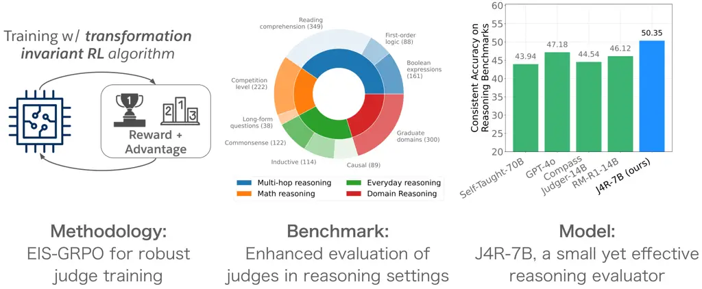
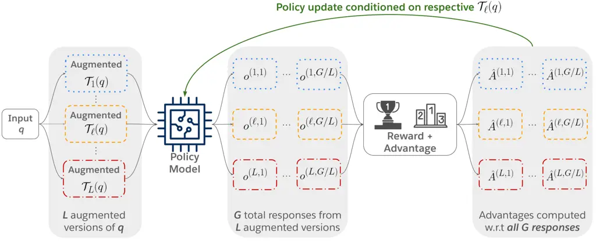
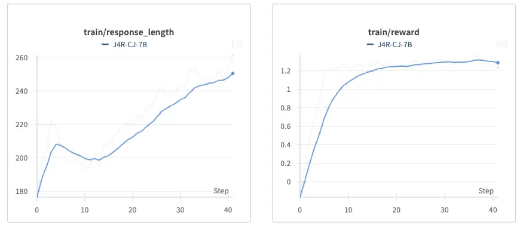

# J4R: Learning to Judge with Equivalent Initial State Group Relative Policy Optimization

Austin Xu    Yilun Zhou    Xuan-Phi Nguyen    Caiming Xiong    Shafiq
Joty Affiliation: Salesforce AI Research Affiliation: Correspondence:
austin.xu@salesforce.com

###### Abstract

To keep pace with the increasing pace of large language models (LLM)
development, model output evaluation has transitioned away from
time-consuming human evaluation to automatic evaluation, where LLMs
themselves are tasked with assessing and critiquing other model outputs.
LLM-as-judge models are a class of generative evaluators that excel in
evaluating relatively simple domains, like chat quality, but struggle in
reasoning intensive domains where model responses contain more
substantive and challenging content. To remedy existing judge
shortcomings, we explore training judges with reinforcement learning
(RL). We make three key contributions: (1) We propose the Equivalent
Initial State Group Relative Policy Optimization (EIS-GRPO) algorithm,
which allows us to train our judge to be robust to positional biases
that arise in more complex evaluation settings. (2) We introduce
ReasoningJudgeBench, a benchmark that evaluates judges in diverse
reasoning settings not covered by prior work. (3) We train Judge for
Reasoning (J4R), a 7B judge trained with EIS-GRPO that outperforms
GPT-4o and the next best small judge by 6.7% and 9%, matching or
exceeding the performance of larger GRPO-trained judges on both
JudgeBench and ReasoningJudgeBench.

: [GitHub](https://github.com/SalesforceAIResearch/ReasoningJudgeBench)
    :
[ReasoningJudgeBench](https://huggingface.co/datasets/Salesforce/ReasoningJudgeBench)

## 1 Introduction

Large language models (LLMs) and LLM-powered agentic systems have been
tasked with solving increasingly difficult problems that require strong
reasoning abilities (Ke et al., 2025). As LLMs are deployed in reasoning
intensive-tasks, evaluation methods have come under mounting pressure to
efficiently and accurately evaluate and critique LLM outputs, especially
when the outputs are not easily verifiable with rules. While human
evaluation remains the gold-standard in such cases, automatic evaluation
approaches, whether it be scalar reward models (RMs) or LLM-as-judges,
have been deployed as a more scalable alternative. However, these
approaches have shortcomings (Cemri et al., 2025): Current verifiers
tend to lock onto stylistic details over substance (Feuer et al., 2024;
Liu et al., 2024; Zeng et al., 2023). RMs are incapable of explaining
their decisions, while judge models are prone to various biases such as
positional (Li et al., 2023; Wang et al., 2023a) and length bias (Zeng
et al., 2023; Park et al., 2024). In all, these drawbacks lead to
evaluators that struggle to evaluate other models in reasoning
settings (Tan et al., 2024; Zhou et al., 2025).



Figure 1: Overview of our three contributions: (1) We propose EIS-GRPO,
a RL training algorithm for training positionally robust judge models.
(2) We create ReasoningJudgeBench, a benchmark of 1,483 pairwise samples
across diverse and underexplored reasoning settings. (3) We train
J4R-7B, a lightweight yet high-performing judge specifically for
reasoning evaluation.

This work explores using reinforcement learning from verifiable rewards
(RLVR) (Lambert et al., 2024; Shao et al., 2024; Guo et al., 2025) to
improve the ability of evaluators, specifically LLM-as-judge models, in
evaluating model responses for reasoning problems. Automatic evaluation
is a natural setting for RLVR: Reinforcement learning (RL) allows the
model to learn how to generate chain-of-thought (CoT) critiques without
supervision from distilled CoT critiques, which are commonly used in
judge model training (e.g., Kim et al. (2023); Kim et al. (2024a); Wang
et al. (2024a); Ye et al. (2024)). Furthermore, automatic evaluation
outputs have a limited set of final outcomes (e.g., “A” or “B” for
pairwise comparisons, 1-5 for single ratings), making them naturally
“verifiable”.

Before simply applying standard RL algorithms (Shao et al., 2024; Guo
et al., 2025) with judge data, we first take a step back and carefully
look into where judges fail in reasoning settings. Our analysis
in Sec. 4 shows that as task difficulty grows, existing judge models,
including those trained with RL, suffer from increasing positional
inconsistency, where swapping the order of the candidates does not lead
to an equivalent swap in judgment. This inconsistency indicates that the
judge is randomly guessing, rather than substantively assessing. To
remedy this, we propose Equivalent Initial State Group Relative Policy
Optimization (EIS-GRPO), which explicitly trains the model to treat
transformations of the same initial state (i.e., input context) as
equivalent, instilling consistency and robustness in judges with zero
additional training overhead. Using EIS-GRPO, we train Judge for
Reasoning (J4R), a 7B LLM judge that specializes in evaluating
reasoning. J4R outperforms GPT-4o by 6.7% and approaches the performance
of 32B RL-trained judges on a suite of reasoning-focused judge
benchmarks.

In our evaluation, we find existing benchmarks of reasoning judges lack
breadth. Notably, JudgeBench (Tan et al., 2024) consists only of 350
pairwise samples sourced from MMLU-Pro (Wang et al., 2024b),
LiveBench (White et al., 2024), and LiveCodeBench (Jain et al., 2024),
missing coverage of different, uniquely challenging reasoning tasks,
like inductive or commonsense reasoning. This leads us to create
ReasoningJudgeBench to augment existing benchmarks with new, challenging
types of reasoning. As shown in Fig. 1, our contributions are threefold:

- •
  Methodology (Sec. 3): We propose Equivalent Initial State GRPO, a
  simple but effective data augmentation method for GRPO that allows us
  to combat judge positional bias while improving performance over
  data-driven approaches.
- •
  Benchmark (Sec. 4.1): We create ReasoningJudgeBench, a benchmark of
  1,483 challenging pairwise samples. Compared to existing
  reasoning-focused judge benchmarks, ReasoningJudgeBench contains 4x
  more samples covering more diverse reasoning settings.
- •
  Model and Analysis (Sec. 5): Using EIS-GRPO, we train J4R-CJ-7B, a 7B
  model that punches above its weight class: It matches the performance
  of larger judge models in reasoning evaluation and outperforms the
  next best $`\leq 14`$B judge by 13% and 9% on JudgeBench and
  ReasoningJudgeBench. We also perform a suite of analyses focused
  on (1) the utility of RL versus other common judge training
  recipes, (2) choice of initial model, and (3) the efficacy of EIS-GRPO
  versus other bias-mitigation training strategies.



Figure 2: Overview of Equivalent Initial State GRPO: Each input $`q`$ is
first transformed via $`\mathcal{T}_{\ell}`$ to a substantively
equivalent version of $`q`$ and used to sample a subgroup of responses.
Responses are rewarded with outcome verification and advantages are
computed jointly across subgroups and within subgroups before being used
to update the policy model with respect to the transformed input. Joint
subgroup advantage computation teaches the model to treat all
transformed inputs as equivalent, training the model to be robust to
non-substantive transformations of the input.

## 2 Background and related work

Learning to reason with reinforcement learning. LLMs have been tasked
with solving increasingly complex problems that require sound reasoning
abilities. This lead to the development of long CoT models like OpenAI’s
o1 (Jaech et al., 2024) or DeepSeek-R1 (Guo et al., 2025), which expend
large amounts of inference-time compute generating “thoughts” before
answering. DeepSeek-R1 revealed that reinforcement learning using
rule-based verification as a reward signal, broadly known as RL from
Verifiable Rewards (Lambert et al., 2024), is capable of unlocking
powerful reasoning abilities from pretrained LLMs. As a result, RL and
long CoT distillation have emerged as popular training paradigms for
reasoning enhancement (Yu et al., 2025a; Liu et al., 2025a; Muennighoff
et al., 2025); See Chen et al. (2025a); Zeng et al. (2024); Xu et al.
(2025) for a complete overview.

Automatic evaluation. Advances in reasoning have largely focused on
settings where answers are easily verifiable (e.g., math). However, many
complex problems, such as long-form report generation, cannot be graded
solely on answer correctness. As a result, strong automatic evaluators
are needed for such reasoning tasks. Automatic evaluation methods
broadly fall under two paradigms: reward models (RMs) (Zhong et al.,
2025), which are non-generative evaluators that output scaler scores,
and LLM-as-judge (Gu et al., 2024), which are generative. The latter has
gained popularity recently with a line of work training specialized
judge models using supervised finetuning (SFT) (Li et al., 2023; Kim
et al., 2023; Kim et al., 2024b), preference optimization (Wang et al.,
2024a; Ye et al., 2024; Hu et al., 2024; Wang et al., 2024c; Saha
et al., 2025), and hybrid objectives using generation and classification
losses (Zhang et al., 2024; Mahan et al., 2024).

Only recently have methods for improving reasoning been applied to
judges, with Liu et al. (2025b) exploring inference-time scaling. The
two most related works to ours are JudgeLRM (Chen et al., 2025b) and the
concurrent RM-R1 (Chen et al., 2025c). JudgeLRM conducts an initial
study of applying Group Relative Policy Optimization (GRPO) for training
judge models, finding that judges trained with RL outperform those
trained with SFT. However, their evaluation is limited to two
non-reasoning benchmarks. RM-R1 fixes the training algorithm, GRPO, and
focuses on analyzing various parts of the RL training pipeline (e.g.,
such as the impact of SFT warm-up). Our work can be seen as
complementary to RM-R1: We propose a novel training methodology,
EIS-GRPO, which was developed after analyzing key failure modes of
judges in reasoning settings, to which many of the same findings in
RM-R1 may apply. More broadly, in contrast to past advances in judge
training, which simply apply the latest training algorithms (DPO, GRPO,
etc.) for judges, we propose a methodological advancement: To our
knowledge, our work is the first RL-based training algorithm designed
with training judges in mind.

Our analysis in Sec. 4 reveals that using RL training alone is
insufficient for evaluating in more difficult reasoning domains.
Concretely, when evaluating challenging samples, RL-trained judges still
exhibit random guessing behavior, which manifests as pairwise
inconsistency: When the order of responses is switched, the judge’s
chosen response switches. In the next section, we present a
general-purpose algorithmic solution, Equivalent Initial State GRPO,
which can be used to train judges to not only reason about responses in
detail, but also to be immune to positional biases.

## 3 Equivalent Initial State GRPO

Here we present Equivalent Initial State GRPO, a policy gradient
algorithm for training models to be robust to input transformations. Our
presentation here is in a general manner, and we describe specific
application to judge model training in Sec. 4. While what we present is
specifically motivated via GRPO, the core ideas are generally applicable
other algorithms, like RLOO (Kool et al., 2019).

### 3.1 Background: Group Relative Policy Optimization

In what follows, we use subscripts indexed with $`t`$ to denote token
index, superscripts indexed with $`(i)`$ to denote sample index (i.e.,
if multiple outputs are generated for the same input).

Proximal Policy Optimization (PPO) (Schulman et al., 2017) is a policy
gradient algorithm that constrains policy updates, preventing large
updates and resulting in more stabilized training. When applied by
earlier works (Ouyang et al., 2022; Stiennon et al., 2020) for
finetuning LLMs, given a question (prompt) $`q`$ , each output token
$`o_{t}`$ is modeled as a separate action, with $`(q,o_{<t})`$ as the
state. Specifically, given a dataset $`\mathcal{D}=\{q\}`$ of questions
$`q`$, the LLM is optimized with the PPO objective

```math
\displaystyle\mathcal{L}_{\text{PPO}}(\theta) \displaystyle=\mathbb{E}_{q\sim\mathcal{D},o\sim\pi_{\theta_{\text{old}}}(\cdot|q)}\left[\frac{1}{|o|}\sum\limits_{t=1}^{|o|}\left(\min\left\{r_{t}(\theta)\hat{A}_{t},\text{clip}\left(r_{t}(\theta);\epsilon\right)\hat{A}_{t}\right\}-\beta D_{\text{KL}}(\pi_{\theta}||\pi_{\text{ref}})\right)\right], \tag{1}
```

where $`\epsilon`$ is the clipping value that controls the allowable
range of policy update, $`\hat{A}_{t}`$ is the advantage estimate for
time $`t`$, $`D_{\text{KL}}`$ is the KL divergence, which regularizes
training by discouraging large deviation from a reference policy
$`\pi_{\text{ref}}`$, and $`r_{t}(\theta)`$ and clip are defined as

```math
\displaystyle r_{t}(\theta)=\frac{\pi_{\theta}(o_{t}|q,o_{<t})}{\pi_{\theta_{\text{old}}}(o_{t}|q,o_{<t})}\hskip 9.24994pt\text{and}\hskip 9.24994pt\text{clip}(x;\epsilon)=\min(1+\epsilon,\max(1-\epsilon,x)), \tag{2}
```

respectively. The original implementation of PPO estimated the advantage
with Generalized Advantage Estimation (GAE) (Schulman et al., 2015),
which uses a value function that is trained jointly with the policy
model and a reward model, typically trained in advance with labeled
preference data. At a very high level, PPO updates the model by
computing how much better or worse a particular action $`o_{t}`$ is than
average via $`\hat{A}_{t}`$, then updates the model in a constrained
region accordingly.

Group Relative Policy Optimization (GRPO) (Shao et al., 2024) was
proposed to simplify the PPO training pipeline, requiring instead a
dataset $`\mathcal{D}=\{(q,a)\}`$ of question $`q`$ and answer $`a`$
pairs. GRPO considers an entire output $`o`$ as a single action, with
original question $`q`$ being the (initial) state. GRPO omits the reward
model and value function by sampling $`G`$ complete responses
$`o^{(1)},\ldots,o^{(G)}`$ per question $`q`$ (known as a group of size
$`G`$) from $`\pi_{\theta_{\text{old}}}`$, then computing the reward
$`R_{i}`$ for each $`o^{(i)}`$ using rule-based verification with answer
$`a`$. Then, the advantage $`\hat{A}_{t}^{(i)}`$ is computed as
$`\hat{A}_{t}^{(i)}=\left(R_{i}-\bar{R}\right)/\sigma_{R}`$, where
$`\bar{R}`$ and $`\sigma_{R}`$ denote the mean and standard deviation of
the rewards $`\{R_{1},\ldots,R_{G}\}`$. Above, the advantage does not
depend on the time-step $`t`$ (i.e., each token is assigned the same
advantage), and as such, we drop the subscript $`t`$ moving forward.
With this advantage estimator, the GRPO objective is

```math
\displaystyle\mathcal{L}_{\text{GRPO}}(\theta) \displaystyle=\mathbb{E}_{(q,a)\sim\mathcal{D},\{o^{(i)}\}_{i=1}^{G}\sim\pi_{\theta_{\text{old}}}(\cdot|q)}
```

```math
\displaystyle\left[\frac{1}{G}\sum\limits_{i=1}^{G}\frac{1}{|o^{(i)}|}\sum\limits_{t=1}^{|o^{(i)}|}\left(\min\left\{r_{t}^{(i)}(\theta)\hat{A}^{(i)},\text{clip}\left(r_{t}^{(i)}(\theta);\epsilon\right)\hat{A}^{(i)}\right\}-\beta D_{\text{KL}}(\pi_{\theta}||\pi_{\text{ref}})\right)\right], \tag{3}
```

where $`r_{t}^{(i)}(\theta)`$ is defined the same as $`r_{t}(\theta)`$
in Eq. 2 for output $`o^{(i)}`$. Many variants of GRPO have recently
been proposed, like DAPO (Yu et al., 2025a) (using different values for
high/low clipping, among other changes) and DR-GRPO (Liu et al., 2025a)
(removing $`\sigma_{R}`$ in the advantage and changing the loss
normalization).

### 3.2 Equivalent Initial State GRPO (EIS-GRPO): Augmenting with State Equivalence

The vanilla formulation of GRPO considers any two questions $`q`$ and
$`q^{\prime}`$ as different states regardless of their specific
contents. However, within a real-world collection of inputs, some states
may exhibit equivalence structure (Li et al., 2006): Different questions
may contain the same relevant information while differing in irrelevant
ways (e.g., stylistic). Consider the following toy example in the math
domain:

```math
\displaystyle q=\text{``Solve {[problem]}. Think step-by-step.''}\hskip 9.24994pt\text{and}\hskip 9.24994ptq^{\prime}=\text{``Provide reasoning before answering: {[problem]}''}
```

Above, $`q`$ and $`q^{\prime}`$ contain the same relevant information,
i.e., the objective is to solve \[problem\], which requires the same
reasoning process (actions) to solve. However, they differ in irrelevant
ways (e.g., CoT prompting language used). While identifying such
equivalent problems in large-scale datasets can be difficult,
transforming a given state (i.e., input) to a set of equivalent versions
is easy via hand-crafted data augmentation strategies (e.g., via
paraphrasing).

Rather than sampling $`G`$ responses from $`q`$, we transform $`q`$ into
$`L`$ equivalent versions,
$`\mathcal{T}_{1}(q),...,\mathcal{T}_{L}(q)`$, and then sample $`G/L`$
responses $`\{o^{(1,\ell)},\ldots,o^{(G/L,\ell)}\}`$ from each
$`T_{\ell}(q)`$, for a total of $`G`$ responses across all
$`\mathcal{T}_{\ell}(q)`$¹¹ 1 In practice, one can vary the number of
outputs sampled for each equivalent initial state $`T_{\ell}(q)`$.
However, for ease of notation and presentation, we assume fixed subgroup
sizes of $`G/L`$.. We call the set of responses sampled from a given
$`T_{\ell}(q)`$ a subgroup. Then, an advantage that is computed jointly
across all subgroups is added to the subgroup-only advantage, and used
to update the policy conditioned on each transformed state
$`\mathcal{T}_{\ell}(q)`$. Concretely, suppose each output
$`o^{(i,\ell)}`$ receives reward $`R^{(i,\ell)}`$, and denote
$`R^{[L]}=\{R^{(1,1)},\ldots,R^{(G/L,1)},\ldots,R^{(1,L)},\ldots,R^{(G/L,L)}\}`$
as the set of rewards across all subgroups and
$`R^{\ell}=\{R^{(1,\ell)},\ldots,R^{(G/L,\ell)}\}`$ as the set of
rewards within each subgroup. Then, define $`\hat{A}^{(i,\ell)}`$ and
$`r_{t}^{(i,\ell)}(\theta)`$ as

```math
\displaystyle\hat{A}^{(i,\ell)}=(R^{(i,\ell)}-{\color[rgb]{1,0.5,0}\bar{R}^{[L]}})/{\color[rgb]{1,0.5,0}\sigma_{R^{[L]}}}+(R^{(i,\ell)}-\bar{R}^{\ell})/\sigma_{R^{\ell}}\hskip 9.24994pt\text{and}\hskip 9.24994ptr_{t}^{(i,\ell)}(\theta)=\frac{\pi_{\theta}(o^{(i,\ell)}_{t}|{\color[rgb]{0,0,1}\mathcal{T}_{\ell}(q)},o^{(i,\ell)}_{<t})}{\pi_{\theta_{\text{old}}}(o_{t}^{(i,\ell)}|{\color[rgb]{0,0,1}\mathcal{T}_{\ell}(q)},o^{(i,\ell)}_{<t})}. \tag{4}
```

The EIS-GRPO objective takes the form

```math
\displaystyle\mathcal{L} {}_{\text{EIS-GRPO }}(\theta)=\mathbb{E}_{(q,a)\sim\mathcal{D},\left\{\{o^{(i,\ell)}\}_{i=1}^{G/L}\sim\pi_{\theta_{\text{old}}}(\cdot|\mathcal{T}_{\ell}(q))\right\}_{\ell=1}^{L}}
```

```math
\displaystyle\left[\frac{1}{G}\sum\limits_{\ell=1}^{L}\sum\limits_{i=1}^{G_{\ell}}\frac{1}{|o^{(i,\ell)}|}\sum\limits_{t=1}^{|o^{(i,\ell)}|}\left(\min\left\{r_{t}^{(i,\ell)}(\theta)\hat{A}^{(i,\ell)},\text{clip}\left(r_{t}^{(i,\ell)}(\theta);\epsilon\right)\hat{A}^{(i,\ell)}\right\}-\beta D_{\text{KL}}(\pi_{\theta}||\pi_{\text{ref}})\right)\right]. \tag{5}
```

The advantage $`\hat{A}^{(i,\ell)}`$ comprises two terms: a term
computed jointly across subgroups (i.e., a global advantage) and a term
computed using only subgroup rewards (i.e., a local advantage). These
two advantages are complementary: The global term ties together all
subgroups, serving as the mechanism that affirms state equivalence,
whereas the local term ensures that each subgroup’s responses are
improved independently. That is, the model is taught that all initial
states are equivalent and to improve performance for each new initial
state. Notably, only using the global advantage may lead to performance
degradation, as we show in Sec. 5.2. Two key behaviors arise from the
above objective:

- •
  Inherent output diversity: The set of outputs across all subgroups is
  necessarily more diverse than a set sampled from just the original
  state. Such diversity was found to help in RL training (Liu et al.,
  2025c).
- •
  Learned state equivalence: By comparing outputs from different
  $`\mathcal{T}_{\ell}(q)`$ against each other via
  $`{\color[rgb]{1,0.5,0}\bar{R}^{[L]}}`$ and
  $`{\color[rgb]{1,0.5,0}\sigma_{R^{[L]}}}`$, each transformed state is
  modeled as equivalent in terms of outcome. Paired with updating the
  policy with respect to $`{\color[rgb]{0,0,1}\mathcal{T}_{\ell}(q)}`$,
  the model is trained to be transformation invariant.

We note that some transformations may change the answer $`a`$ based on
$`\mathcal{T}_{\ell}`$, which we denote as $`a^{(\ell)}`$. As an
example, consider applying EIS-GRPO to train a model to be multiple
choice order invariant (i.e., not sensitive to if the correct answer is
choice $`A`$, $`B`$, $`C`$, or $`D`$), where each $`\mathcal{T}_{\ell}`$
corresponds to a different multiple choice ordering. Concretely,
consider the toy example:

```math
\displaystyle\text{Which animal flies?}\hskip 18.49988pt\mathcal{T}_{1}:\text{[A] Cat; [B] Dog; [C] Bird; [D] Pig}\hskip 18.49988pt\mathcal{T}_{2}:\text{[A] Bird; [B] Pig; [C] Dog; [D] Cat}.
```

Here, the correct answer label must change with each transformation
($`a^{(1)}=[\text{C}]`$ and $`a^{(2)}=[\text{A}]`$). However, the
substance of the correct answer (“Bird”) is the same across subgroups,
making the subgroups comparable and initial states substantively
equivalent.

Connections to existing work. Using data augmentations is inspired by
SimCLR (Chen et al., 2020), a contrastive learning framework that
maximizes representation similarity between different augmentations
(e.g., rotations) of the same image. While SimCLR is explicitly
contrastive, the contrastive nature of EIS-GRPO is more implicit through
the advantage and policy update. EIS-GRPO can be considered a policy
gradient algorithm that leverages state-equivalence, connecting it to a
line of work in exploiting such structure in Markov Decision
Processes (Li et al., 2006; Ravindran and Barto, 2004; Abel et al.,
2016; Asadi et al., 2019) and RL (Brunskill and Li, 2013; Mandel et al.,
2016). Finally, we note that concurrent work, NoisyRollout (Liu et al.,
2025c), in Vision Language Model RL has explored injecting noise into
the image prior to generating group outputs. The key difference between
NoisyRollout and EIS-GRPO is that they do not condition on the
transformed initial state during the policy update, i.e., they use
$`r_{t}^{(i)}(\theta)`$ rather than $`r_{t}^{(i,\ell)}(\theta)`$
(Eq. 4). This difference may appear small but it is crucial, as omitting
state-specific conditioning may lead to sub-optimal or incorrect policy
updates. For example, when $`\mathcal{T}_{\ell}(q)`$ results in a new
answer $`a^{(\ell)}`$, correct behavior is only encouraged when the
policy update is with respect to $`\mathcal{T}_{\ell}(q)`$. As such,
NoisyRollout does not explicitly teach models that augmented initial
states are equivalent; rather, as they note, it serves as a group output
diversification strategy.

## 4 Judge Training with Equivalent Initial State GRPO.

EIS-GRPO, as presented above, is a general-purpose policy-gradient
algorithm. Here, we describe its application for judge training.
Concretely, our goal is to train a pairwise judge, which takes input a
triplet $`(x,y_{1},y_{2})`$ of user input $`x`$ and model responses
$`y_{1}`$ and $`y_{2}`$, parsed into prompt template
$`\mathtt{T}(x,A,B)`$, and generates a natural language output
$`o=\{c,j\}`$, where $`c`$ is a chain-of-thought critique and $`j`$ is
the final judgment ($`A`$ or $`B`$). The prompt template
$`\mathtt{T}(x,A,B)`$ includes evaluation and formatting instructions;
$`x`$ is the user input, $`A`$ is the first response, and $`B`$ is the
second response. In what follows, $`(A=y_{i},B=y_{j})`$ means that
response $`y_{i}`$ is presented to the judge first, and response
$`y_{j}`$ is presented second. Without loss of generality, we assume
that $`y_{1}`$ is the better response. To train a judge model, we
utilize a judgment dataset $`\mathcal{D}=\{(x,y_{1},y_{2})\}`$ of
pairwise responses.

Figure 3: Judge pairwise consistency is inversely correlated with task
difficulty, with very poor consistency in reasoning tasks. Plot of 11
judges, with marker size indicating model size across 3 non-reasoning
(HHH, LFQA, InstruSum) and 1 reasoning benchmark (JudgeBench).

When judging reasoning, are judges just guessing? Past work (Li et al.,
2023; Wang et al., 2023a) has shown that judge models are sensitive to
the order of responses. For each pairwise sample, there are two possible
orderings: $`(A=y_{1},B=y_{2})`$ and $`(A=y_{2},B=y_{1})`$. Merely
swapping the order can elicit a different chosen response $`y`$ from the
judge. As a result, past work has measured judge consistency: the
percentage of pairwise samples the judge chooses the same response in
both orderings, with higher consistency indicating less positional bias.
In Fig. 3, we visualize judge performance on 3 non-reasoning benchmarks
(HHH (Askell et al., 2021), LFQA (Xu et al., 2023), InstruSum (Liu
et al., 2023)) and a reasoning-focused benchmark, JudgeBench (Tan
et al., 2024). The trend is clear: Reasoning evaluation is uniquely
difficult, with judges exhibiting behavior more akin to random guessing
than substantive assessment, as measured by consistency.

Judge inconsistency is not a newly discovered phenomenon, with recent
judge work taking at proactive measures to mitigate this bias during
training, coalescing around using data duplication (Li et al., 2023;
Park et al., 2024; Saha et al., 2025) or simply ensuring balanced
datasets at larger data scales (Wang et al., 2024a; Cao et al., 2024).
The former involves including both $`(A=y_{1},B=y_{2})`$ and
$`(A=y_{2},B=y_{1})`$ orderings in the training set as separate samples,
doubling the size of the training set, whereas the latter does not
explicitly expose swapped order pairs to the judge to save on training
time. Despite targeted training strategies, judges are still not able to
consistently assess as task difficulty grows as shown in Fig. 3.

EIS-GRPO for positionally robust and outcome supervised judge training.
Data-duplication methods suffer from a key drawback: There is no way of
explicitly linking together a train sample and its position-swapped
counterpart; rather, the model consumes each sample independently during
training. EIS-GRPO is uniquely suited to bridge this gap, as it
explicitly trains the judge to be order invariant, leading to higher
consistency and better accuracy, as shown in Sec. 5.2. A natural set of
transformations $`\mathcal{T}`$ in judge training is the order response
pairs in the input $`(x,y_{1},y_{2})`$. Recall that the judge is tasked
with choosing which of responses $`y_{1}`$ or $`y_{2}`$ is better, where
we assume WLOG that $`y_{1}`$ is better. To instill order invariance in
the judge, one can use 2 subgroups where subgroup 1 orders responses as
$`(A=y_{1},B=y_{2})`$, with $`a^{(1)}=A`$, and subgroup 2 orders
responses as $`(A=y_{2},B=y_{1})`$, with $`a^{(2)}=B`$.

To train J4R, we utilize the above subgroup formulation to mitigate
inconsistency. We employ both a judgment reward $`\mathcal{R}_{j}`$ and
format reward $`\mathcal{R}_{f}`$:

```math
\displaystyle\mathcal{R}_{j}(o,a)=\begin{cases}1,\quad\texttt{parse}(o)=a\\
0,\quad\texttt{parse}(o)\neq a\end{cases}\quad\text{and}\quad\mathcal{R}_{f}(o)=\begin{cases}\ \ \ 0.5,\quad o\ \text{formatted correctly}\\
-0.5,\quad\text{otherwise}\end{cases}, \tag{6}
```

where parse$`(o)`$ parses the final judgment from the output $`o`$. We
compute the final reward
$`R^{(i,\ell)}=\mathcal{R}_{j}(o^{(i,\ell)},a^{(\ell)})+\mathcal{R}_{f}(o^{(i,\ell)})`$
and use $`G=32`$, with $`16`$ for each ordering of responses.

For training data, we construct a simple reasoning-centric dataset: We
sample $`20`$ outputs from Qwen2.5-7B,72B (Yang et al., 2024) and
Llama-3.3-70B (Dubey et al., 2024) using the ReClor (Yu et al., 2020)
and MATH (Hendrycks et al., 2021) train sets, forming correct and
incorrect pairs based on outcome labels and removing samples with all
the same outcome (i.e., all correct or incorrect). This yields a compact
training set of $`\sim 10K`$ pairwise samples. We use rollout batch size
of 256, train batch size of 128, constant learning rate of $`1e-6`$,
clip $`\epsilon=0.2`$, and the KL $`\beta=0.0001`$. See Sec. B.1 for
more details. We train two judge variants: J4R-CJ-7B, which is
initialized from CompassJudger-7B (Cao et al., 2024) and
J4R-Qwen-Inst-7B, which is initialized from Qwen2.5-7B-Instruct (Yang
et al., 2024). For both judges, we use a version of the Arena-Hard (Li
et al., 2024) judge prompt template that omits ties; See App. E. As we
show in Sec. 5, EIS-GRPO is effective for both continual finetuning and
ground-up judge training.

### 4.1 Diversifying Reasoning Evaluation with ReasoningJudgeBench

Recent benchmarks have focused largely on evaluating judge robustness to
stylistic factors (e.g., Liu et al. (2024); Zeng et al. (2023)), with
reasoning splits focusing on (relatively easy) math and coding
benchmarks (e.g., using HumanEvalPack (Muennighoff et al., 2023)
prompts). JudgeBench (Tan et al., 2024) takes a step in diversifying
reasoning tasks covered, including knowledge-based reasoning (via
MMLU-Pro (Wang et al., 2024b)) and more difficult data sources (e.g.,
LiveBench (White et al., 2024)). The key insight of JudgeBench is that
if a strong model struggles to answer a question, that same question
will be difficult to assess for the judges. Based on this insight, they
construct JudgeBench in a two-stage manner: (1) Sample multiple outputs
from a strong LLM for a question with an objectively correct answer
(e.g., math questions) and (2) create pairwise test samples by pairing
together a correct and incorrect model response, as determined by final
outcome.

While JudgeBench presents a challenge, it comprises only 350 pairwise
samples that cover only math, code, knowledge-based QA, and logic
puzzles, a subset of the myriad of reasoning tasks available. To
diversify evaluation, we use the JudgeBench data creation pipeline and
GPT-4o to produce ReasoningJudgeBench, which consists of 1,483
challenging response pairs sourced from both established
(ARC-Challenge (Clark et al., 2018), ReClor (Yu et al., 2020),
StrategyQA (Geva et al., 2021), Folio (Han et al., 2022)) and newer
benchmarks (OlympiadBench (He et al., 2024), AIME 2024 and 2025,
SuperGPQA (Du et al., 2025), BIG-Bench Extra Hard (Kazemi et al.,
2025)). In all, ReasoningJudgeBench consists of 4 splits: Math,
multi-hop, domain-specific, and “everyday” reasoning (inductive, causal,
and common-sense); See Fig. 1 (center) for a split-level breakdown
and App. C for further details.

|                 |                         |       |       |       |       |            |       |           |       |       |                     |       |          |        |       |         |
| --------------- | ----------------------- | ----- | ----- | ----- | ----- | ---------- | ----- | --------- | ----- | ----- | ------------------- | ----- | -------- | ------ | ----- | ------- |
|                 |                         | PPE   |       |       |       | JudgeBench |       |           |       |       | ReasoningJudgeBench |       |          |        |       |         |
|                 | Model                   | MBPP  | MATH  | GPQA  | Avg.  | Knowledge  | Math  | Reasoning | Code  | Avg.  | Multi-hop           | Math  | Everyday | Domain | Avg.  | Overall |
| Small Judges    | Prometheus-2-7B         | 29.70 | 33.01 | 27.54 | 30.09 | 16.23      | 33.93 | 28.57     | 35.71 | 24.86 | 16.56               | 29.23 | 17.23    | 16.33  | 18.88 | 24.61   |
|                 | CompassJudger-7B        | 33.89 | 57.27 | 40.86 | 44.02 | 45.45      | 73.21 | 45.92     | 38.10 | 49.14 | 34.95               | 50.38 | 32.62    | 38.00  | 37.76 | 43.64   |
|                 | RISE-Judge-7B           | 41.18 | 61.21 | 36.56 | 46.35 | 44.81      | 57.14 | 35.71     | 47.62 | 44.57 | 28.60               | 51.15 | 31.69    | 36.00  | 34.73 | 41.88   |
|                 | JudgeLRM-7B^(†)         | 28.80 | 40.47 | 24.77 | 31.37 | 25.32      | 44.64 | 34.69     | 47.62 | 33.71 | 5.52                | 20.77 | 14.77    | 13.67  | 11.87 | 25.65   |
|                 | RM-R1-Distill-7B^(†)    | 31.44 | 55.04 | 15.23 | 33.96 | 17.53      | 16.07 | 19.39     | 4.76  | 16.29 | 12.37               | 35.38 | 14.46    | 3.67   | 15.10 | 21.78   |
|                 | CompassJudger-14B       | 36.84 | 59.57 | 40.47 | 45.64 | 46.75      | 73.21 | 45.92     | 42.86 | 50.29 | 37.29               | 51.54 | 28.92    | 36.00  | 37.69 | 44.54   |
|                 | RM-R1-Distill-14B       | 32.94 | 72.89 | 37.46 | 47.80 | 42.21      | 57.14 | 50.00     | 42.86 | 46.86 | 47.16               | 68.08 | 34.77    | 25.33  | 43.70 | 46.12   |
| Ours1           | J4R-Qwen-Inst-7B (ours) | 29.19 | 60.43 | 43.95 | 43.95 | 51.30      | 62.50 | 52.04     | 42.86 | 52.29 | 38.96               | 59.62 | 31.38    | 46.33  | 41.74 | 45.99   |
|                 | J4R-CJ-7B (Ours)        | 37.71 | 64.41 | 45.82 | 49.14 | 55.19      | 71.43 | 54.08     | 56.86 | 56.86 | 39.80               | 61.15 | 36.92    | 42.33  | 45.04 | 50.35   |
| Large Judges    | RISE-Judge-32B          | 43.63 | 69.96 | 43.93 | 52.53 | 46.75      | 60.71 | 36.73     | 52.38 | 46.86 | 45.65               | 55.38 | 27.69    | 40.33  | 42.35 | 47.25   |
|                 | CompassJudger-32B       | 41.10 | 65.16 | 45.66 | 50.66 | 50.00      | 69.64 | 53.06     | 54.76 | 54.57 | 49.16               | 60.77 | 38.15    | 38.00  | 46.53 | 50.59   |
|                 | RM-R1-Distill-32B       | 44.10 | 78.95 | 40.94 | 54.71 | 45.45      | 64.29 | 60.20     | 59.52 | 54.29 | 52.51               | 69.23 | 33.85    | 28.00  | 46.39 | 51.80   |
|                 | Prometheus-2-8x7B       | 27.02 | 37.34 | 31.01 | 31.79 | 37.01      | 57.14 | 37.76     | 21.43 | 38.57 | 20.74               | 38.08 | 26.46    | 25.33  | 25.96 | 32.11   |
|                 | Self-Taught-70B         | 41.93 | 50.08 | 41.68 | 44.57 | 50.65      | 58.93 | 42.86     | 40.48 | 48.57 | 45.32               | 39.62 | 28.31    | 35.67  | 38.64 | 43.93   |
|                 | EvalPlanner-3.3-70B     | -     | -     | -     | \-    | 55.8       | 69.6  | 56.1      | 42.9  | 56.6  | -                   | -     | -        | -      | \-    | \-      |
| Prompted Judges | Qwen2.5-7B-Instruct     | 32.54 | 48.59 | 34.65 | 38.61 | 35.06      | 44.64 | 42.86     | 35.71 | 38.86 | 29.60               | 33.85 | 29.85    | 28.67  | 30.21 | 35.89   |
|                 | GPT-4o-mini             | 39.68 | 55.86 | 41.37 | 45.66 | 51.30      | 60.71 | 44.90     | 50.00 | 50.86 | 51.34               | 45.77 | 40.00    | 36.67  | 40.39 | 42.24   |
|                 | GPT-4o                  | 44.10 | 61.17 | 47.23 | 50.86 | 50.65      | 57.14 | 46.94     | 47.62 | 50.29 | 40.13               | 54.23 | 32.31    | 39.33  | 45.25 | 47.18   |
|                 | o1                      | 52.57 | 94.92 | 71.02 | 72.90 | 78.57      | 92.86 | 82.65     | 92.86 | 83.71 | 77.59               | 90.38 | 58.15    | 65.33  | 73.10 | 76.57   |
|                 | o3-mini                 | 51.08 | 94.61 | 66.05 | 70.64 | 66.23      | 85.71 | 79.59     | 92.86 | 76.28 | 65.72               | 91.92 | 49.85    | 57.33  | 65.14 | 70.69   |
|                 | Deepseek-R1             | 59.96 | 93.52 | 62.07 | 71.89 | 71.43      | 89.29 | 73.47     | 71.43 | 74.86 | 65.05               | 86.15 | 40.00    | 41.67  | 58.53 | 68.43   |

Table 1: J4R-CJ-7B is the best performing small judge, almost matching
the performance of the best large judges despite being 4.5x smaller in
size. Best and second-best in each size range are bolded and underlined.
Avg. is a microaverage across resp. benchmark splits, Overall is an
average of the 3 Avg. scores. Highlighting indicates training method:
SFT, DPO, and RL. ^(†) indicates that a judge had systematic issues with
output format. All values are consistent accuracy.

## 5 Experimental Results and Analysis

Baselines. We compare J4R-CJ-7B against multiple strong, contemporary
pairwise judge models: Prometheus-7B, 8x7B (Kim et al., 2024a),
CompassJudger-7B, 14B, 32B (Cao et al., 2024), RISE-Judge-7B, 32B (Yu
et al., 2025b), Self-Taught-Evaluator-70B (Wang et al., 2024c),
EvalPlanner (Saha et al., 2025), JudgeLRM-7B (Chen et al., 2025b), and
RM-R1-7B, 14B, 32B (Chen et al., 2025c). We report official numbers when
they exist, or run each judge with its associated prompt template
otherwise²² 2 Because our judge is initialized with CompassJudger, we
re-run CompassJudger with our prompt, resulting in different results for
JudgeBench. Our prompt yields a 3.14 point gain for the 7B model and
4.00 and 4.57 point drops for 14B and 32B from our reproduced results.
Extended discussion in Sec. E.1. . For our main results, we also
evaluate o1, o3-mini, GPT-4o, 4o-mini, Qwen2.5-7B (Yang et al., 2024),
and DeepSeek-R1 (Guo et al., 2025) on all benchmarks, using our prompt
(App. E). We additionally evaluate a suite of models on
ReasoningJudgeBench, which we present in Sec. C.2. Unless otherwise
specified, all general-purpose models are instruction tuned versions.

Benchmarks. To assess judge performance in reasoning domains, we use 3
benchmarks: PPE Best-of-$`K`$ (Frick et al., 2024) (MBPP, MATH, and GPQA
splits), JudgeBench (Tan et al., 2024), and ReasoningJudgeBench. PPE
Best-of-$`K`$ contains $`\sim`$2,500 pairwise samples per split, with
judges assessing responses sampled from multiple weaker generators, like
Llama-3-8B. In contrast, JudgeBench and ReasoningJudgeBench require
judges to assess responses from a stronger model (GPT-4o). For all
benchmarks, we adopt a consistent accuracy setup: Each pairwise sample
is evaluated twice, with the order of responses swapped on the second
run. Then, a judge is only considered correct if both orders are
evaluated correctly. This setup is the default for JudgeBench, but
differs from the original PPE setup, which fixes an ordering; as such,
our results for PPE differ from their reported results. For judges that
allow ties, we follow Tan et al. (2024) and consider a run with a tie to
be correct if the non-tie response is correct.

### 5.1 How well does J4R-CJ-7B perform in reasoning settings?

Our main results are presented in Table 1. J4R-CJ-7B outperforms all
small ($`\leq 14`$B) judge models in aggregate (50.35 vs. the next best
46.12) and roughly matches the performance of the best large judge
models. In particular, despite being 4.5x smaller in size, J4R-CJ-7B
(50.35) almost matches RM-R1-32B (51.80), which was trained with both
warm-up SFT with DeepSeek-R1 distilled reasoning traces and GRPO. Such
small gap shows that RL-training alone is insufficient for ensuring
robust reasoning evaluation. As we show later, when given equal compute,
J4R-CJ-7B is able to greatly surpass all larger models. J4R-Qwen-Inst-7B
(45.99), initialized from a much weaker checkpoint, is the second best
performing small judge behind J4R-CJ-7B, surpassing GPT-4o-mini (42.24)
and nearly matching the twice as large RM-R1-14B (46.12).

ReasoningJudgeBench is a significant challenge for judge models, with
many capable judges failing to crack 45%. Judges are relatively strong
in assessing math, but struggle on the other three splits, showing that
evaluating complex natural language reasoning (as opposed to math) is
still an open problem. We present evaluations and analysis for many
additional models (e.g., GPT-4.1 series, Llama-3.1-405B, DeepSeek-V3)
in Sec. C.2.

### 5.2 Additional analysis.

|                                |            |       |            |       |                 |       |
| ------------------------------ | ---------- | ----- | ---------- | ----- | --------------- | ----- |
| Training algorithm             |            |       | JudgeBench |       | Reas.JudgeBench |       |
|                                |            |       | Acc.       | Cons. | Acc.            | Cons. |
| CompassJudger-7B (Initial)     |            |       | 49.14      | 68.86 | 37.69           | 68.58 |
| +SFT                           |            |       | 42.86      | 62.86 | 32.97           | 57.11 |
| +DPO                           |            |       | 46.57      | 68.29 | 38.84           | 69.66 |
| Training data strategy         | Norm.      | Norm. | Acc.       | Cons. | Acc.            | Cons. |
|                                | data. size | time  |            |       |                 |       |
| CompassJudger-7B (Initial)     | \-         | \-    | 49.14      | 68.86 | 37.69           | 68.58 |
| +GRPO w/ \[Bal.\], $`G=32`$    | 1x         | 1x    | 52.00      | 73.43 | 41.34           | 75.52 |
| +GRPO w/ \[Dup.\], $`G=16`$    | 2x         | 1x    | 51.14      | 76.00 | 38.84           | 71.61 |
| +GRPO w/ \[Dup.\], $`G=32`$    | 2x         | 2x    | 51.71      | 77.71 | 42.01           | 77.95 |
| +GRPO w/ global adv., $`G=32`$ | 1x         | 1x    | 49.14      | 69.43 | 37.96           | 68.58 |
| +EIS-GRPO, $`G=32`$ (ours)     | 1x         | 1x    | 56.86      | 81.14 | 45.04           | 80.51 |

Table 2: Comparison on JudgeBench and ReasoningJudgeBench of EIS-GRPO
against (top) various common judge training algorithms and (bottom)
data-driven ways to improve consistency. Both results showcase the
benefits of training with EIS-GRPO.

| Baseline Model | Size    | Avg. tokens          | $`\delta_{\text{inf}}`$ | Baseline | J4R Acc.                               |
| -------------- | ------- | -------------------- | ----------------------- | -------- | -------------------------------------- |
|                | ($`M`$) | ($`T_{\text{inf}}`$) |                         | Acc.     | (FLOP-matched)                         |
| J4R-CJ         | 7B      | 270.28               | 1.0                     | 56.86    | \-                                     |
| CompassJudger  | 14B     | 213.48               | 2.0                     | 50.29    | 57.87$`\pm`$0.013 ($`\uparrow`$ 17.58) |
| CompassJudger  | 32B     | 212.87               | 4.0                     | 54.57    | 62.00$`\pm`$0.012 ($`\uparrow`$ 17.43) |
| RISE-Judge     | 32B     | 532.62               | 9.0                     | 46.86    | 64.10$`\pm`$0.009 ($`\uparrow`$ 17.24) |
| RM-R1          | 14B     | 1621.83              | 12.0                    | 46.86    | 64.48$`\pm`$0.013 ($`\uparrow`$ 17.62) |
| Self-Taught    | 70B     | 394.55               | 15.0                    | 48.57    | 64.59$`\pm`$0.007 ($`\uparrow`$ 16.02) |
| RM-R1          | 32B     | 1792.37              | 30.0                    | 54.29    | 64.94$`\pm`$0.005 ($`\uparrow`$ 10.65) |

Table 3: FLOP-matched evaluation on JudgeBench comparing J4R-CJ-7B to
larger judges that may produce longer outputs. After matching the amount
of compute (last column), J4R-CJ-7B outperforms all larger baselines by
even more significant margins.

How does initial model impact performance? As discussed in Sec. 4, we
start training from CompassJudger-7B for J4R-CJ-7B and Qwen2.5-7B for
J4R-Qwen-Inst-7B. From Table 1, we find that starting from a stronger
judge checkpoint yields results in better aggregate performance (50.35
vs. 45.99). This result is perhaps not surprising given recent
analysis (Yue et al., 2025), which suggests that a primary benefit of
RLVR is modifying the model output distribution to favor correct
reasoning chains that are already within the initial model’s
capabilities. Hence, initializing RL training from a trained judge
provides a “higher floor” from which RL can incentivize correct
judgments. However, this does not mean EIS-GRPO fails with weaker
initial models: J4R-Qwen-Inst-7B improves Qwen2.5-7B from 35.89
aggregate accuracy to 45.99, a 28% gain, and outperforms all other
$`7B`$ judges, some trained with 20x more data. In all, these results
show that past work in training judges is not in vain. Existing judge
models that perform well in non-reasoning settings can be continually
trained with EIS-GRPO to become capable reasoning evaluators. We show
next that EIS-GRPO is unique in its ability to “unlock” the reasoning
evaluation abilities of existing judges: Existing judge training recipes
actually cause degradation with the same seed dataset.

How does EIS-GRPO compare with existing judge training approaches? Here,
we quantify the advantage EIS-GRPO brings over two common judge training
recipes, distillation-based SFT and DPO. Prior work in training judges
distills CoT judgments from a teacher model, then uses either SFT
(e.g., Kim et al. (2023); Cao et al. (2024); Vu et al. (2024)) or DPO
(e.g., Wang et al. (2024a); Hu et al. (2024); Ye et al. (2024)). Using
our training set, we follow the approach of Wang et al. (2024a); Hu
et al. (2024); Ye et al. (2024) and distill CoT judgments from
Llama-3.1-70B to form both a SFT training set and a paired DPO training
set. We ensure each of these training sets are label-balanced, and train
for 1 epoch starting from CompassJudger-7B; Sec. B.3 contains complete
details. Table 2 (top) shows the fundamental limitations of current
judge model paradigms: Even using targeted reasoning data, SFT and DPO
actually decrease performance on JudgeBench relative to the baseline
performance. This perhaps surprising result likely stems from two
factors: teacher-model distillation (1) is out-of-distribution
finetuning and (2) places an inherent upper-bound on performance. Given
that many popular instruction-tuned models are relatively weak reasoning
evaluators (See Sec. C.2), this result highlights limitations of current
distillation-based judge training approaches.

What benefits does EIS-GRPO bring over other data-driven bias-mitigation
strategies? As discussed in Sec. 4, previous work has used
label-balanced training Wang et al. (2024a); Cao et al. (2024) or data
duplication Li et al. (2023); Park et al. (2024); Saha et al. (2025) to
mitigate inconsistency. Here, we show that EIS-GRPO improves upon both
of these approaches for RL. From our train set, we form a data balanced
version (denoted \[Bal\]), where we assign 50% of our dataset to have
label A and 50% label B, and (2) a duplicated variant (denoted \[Dup\]),
which doubles the size of our training set by including each ordering of
responses. For \[Bal\], we run GRPO with the same training setup as
J4R-CJ-7B, as described in Sec. 4. For \[Dup\], we consider two setups.
The first uses $`G=16`$ and doubles the rollout batch size, resulting in
the same number of model updates and training steps as J4R-CJ-7B. The
second applies the exact same training setup as J4R-CJ-7B, resulting in
twice the training steps.

We report normalized training time with respect to J4R-CJ-7B, along with
judge performance, in Table 2 (bottom). Both the balanced dataset and
data duplication approaches result in some gains in accuracy and
consistency, but fall significantly short of EIS-GRPO. For the same
number of model updates, EIS-GRPO improves JudgeBench accuracy 9.4% and
11.2% over \[Bal\] and \[Dup\], respectively. Further, EIS-GRPO teaches
the model to be more robust positional bias via learned state
equivalence, as highlighted by consistency gains. We additionally
exploring using only the global advantage computed across subgroups
(i.e., only the first term of $`\hat{A}^{(i,\ell)}`$ in Eq. 4), and find
that its performance lags all other strategies, highlighting the
necessity of including both global and local information in the
advantage. We present a deeper exploration for why this failure occurs
in Sec. D.1.

Given equal inference-time compute (FLOPs), how does J4R-CJ-7B match up
with larger judges? Here, we present a FLOP-matched evaluation on
JudgeBench. We use the commonly adopted FLOP approximation of
$`2MT_{\text{inf}}`$ (Snell et al., 2024; Sardana et al., 2023), where
$`M`$ is the model size and $`T_{\text{inf}}`$ is the number of
inference tokens. For J4R-CJ-7B and all judges of size $`\geq 14B`$, we
compute the average number of output tokens per sample on JudgeBench,
allowing us to compute a FLOP-scaling ratio
$`\delta_{\text{inf}}=\frac{M_{b}T_{b,\text{inf}}}{M_{\text{J4R}}T_{\text{J4R,inf}}}`$,
where subscript $`b`$ denotes baseline and J4R denotes J4R-CJ-7B. We
then sample $`\delta_{\text{inf}}`$ parallel responses from J4R-CJ-7B
with temperature 1.0 and aggregate via majority vote (i.e.,
self-consistency (Wang et al., 2022)). To reduce compute time, we sample
a fixed set of 128 responses from the J4R-CJ-7B and randomly subsample
for each $`\delta_{\text{inf}}`$. We repeat each subsampling $`100`$
times and report mean and standard deviation. Table 3 shows the benefit
of matched compute: the performance of J4R-CJ-7B improves up to 14%.
When afforded the same compute as RM-R1-32B, it achieves an absolute
score of 64.94, a relative improvement of 19.6%.

| Model               | HHH   | LFQA  | InstruSum |
| ------------------- | ----- | ----- | --------- |
| CompassJudger-7B    | 83.26 | 70.00 | 64.23     |
| J4R-CJ-7B           | 77.83 | 67.69 | 66.91     |
| Qwen2.5-7B-Instruct | 72.40 | 50.77 | 51.82     |
| J4R-Qwen-Inst-7B    | 76.47 | 62.69 | 60.83     |

| $`G`$ | 16    | 24    | 32    | 64    |
| ----- | ----- | ----- | ----- | ----- |
| Acc.  | 40.93 | 40.66 | 45.04 | 44.71 |
| Cons. | 74.92 | 72.49 | 80.51 | 79.97 |

Table 4: Reasoning-specific training generally improves weaker initial
models, but degrades chat evaluation for stronger initial models.

Table 5: Group size $`G`$ ablation.

How does reasoning-specific training affect other domains? We measure
the difference between J4R and initial models on LFQA (Xu et al., 2023)
(long-form answers to open-ended questions), HHH (Askell et al., 2021)
(safety and helpfulness), and InstruSum (Liu et al., 2023)
(summarization quality). Our results, shown in Table 5, are in-line with
expectations: Specializing a strong model towards a specific domain will
reduce general abilities, as shown with degradations in chat-focused
settings (HHH and LFQA), but improves performance when the task is
reasoning-demanding, like contextual comprehension. However, when the
initial model is weak, “low-hanging fruit” gains are available, and
reasoning specific training holistically improves performance.

How does group size affect EIS-GRPO? In Table 5, we use
ReasoningJudgeBench to quantify the effect of group size $`G`$. We find
that performance increases as $`G`$ increases, with the largest gain
occurring from $`24`$ and $`32`$. This highlights the importance of
using sufficient $`G`$ to ensure strong contrastive signals between
subgroups. Using a larger group size of $`64`$ does not yield further
gains.

## 6 Conclusion

We demonstrate the effectiveness of our proposed EIS-GRPO algorithm for
training judge model to be robust to positional biases, which improves
evaluation ability in reasoning-intensive domains. We also introduce
ReasoningJudgeBench, a challenging benchmark of 1,483 challenging
pairwise samples that diversifies existing reasoning benchmarks.
ReasoningJudgeBench reveals that judge models have significant room for
growth in evaluating in reasoning settings.

## References

- Ke et al. \[2025\] Zixuan Ke, Fangkai Jiao, Yifei Ming, Xuan-Phi
  Nguyen, Austin Xu, Do Xuan Long, Minzhi Li, Chengwei Qin, Peifeng
  Wang, Silvio Savarese, et al. A survey of frontiers in llm reasoning:
  Inference scaling, learning to reason, and agentic systems. _arXiv
  preprint arXiv:2504.09037_, 2025.
- Cemri et al. \[2025\] Mert Cemri, Melissa Z Pan, Shuyi Yang, Lakshya A
  Agrawal, Bhavya Chopra, Rishabh Tiwari, Kurt Keutzer, Aditya
  Parameswaran, Dan Klein, Kannan Ramchandran, et al. Why do multi-agent
  llm systems fail? _arXiv preprint arXiv:2503.13657_, 2025.
- Feuer et al. \[2024\] Benjamin Feuer, Micah Goldblum, Teresa Datta,
  Sanjana Nambiar, Raz Besaleli, Samuel Dooley, Max Cembalest, and
  John P Dickerson. Style outweighs substance: Failure modes of llm
  judges in alignment benchmarking. _arXiv preprint
  arXiv:2409.15268_, 2024.
- Liu et al. \[2024\] Yantao Liu, Zijun Yao, Rui Min, Yixin Cao, Lei
  Hou, and Juanzi Li. Rm-bench: Benchmarking reward models of language
  models with subtlety and style. _arXiv preprint
  arXiv:2410.16184_, 2024.
- Zeng et al. \[2023\] Zhiyuan Zeng, Jiatong Yu, Tianyu Gao, Yu Meng,
  Tanya Goyal, and Danqi Chen. Evaluating large language models at
  evaluating instruction following. _arXiv preprint
  arXiv:2310.07641_, 2023.
- Li et al. \[2023\] Junlong Li, Shichao Sun, Weizhe Yuan, Run-Ze Fan,
  Hai Zhao, and Pengfei Liu. Generative judge for evaluating alignment.
  _arXiv preprint arXiv:2310.05470_, 2023.
- Wang et al. \[2023a\] Peiyi Wang, Lei Li, Liang Chen, Zefan Cai, Dawei
  Zhu, Binghuai Lin, Yunbo Cao, Qi Liu, Tianyu Liu, and Zhifang Sui.
  Large language models are not fair evaluators. _arXiv preprint
  arXiv:2305.17926_, 2023a.
- Park et al. \[2024\] Junsoo Park, Seungyeon Jwa, Meiying Ren, Daeyoung
  Kim, and Sanghyuk Choi. Offsetbias: Leveraging debiased data for
  tuning evaluators. _arXiv preprint arXiv:2407.06551_, 2024.
- Tan et al. \[2024\] Sijun Tan, Siyuan Zhuang, Kyle Montgomery,
  William Y Tang, Alejandro Cuadron, Chenguang Wang, Raluca Ada Popa,
  and Ion Stoica. Judgebench: A benchmark for evaluating llm-based
  judges. _arXiv preprint arXiv:2410.12784_, 2024.
- Zhou et al. \[2025\] Yilun Zhou, Austin Xu, Peifeng Wang, Caiming
  Xiong, and Shafiq Joty. Evaluating judges as evaluators: The jetts
  benchmark of llm-as-judges as test-time scaling evaluators. _arXiv
  preprint arXiv:2504.15253_, 2025.
- Lambert et al. \[2024\] Nathan Lambert, Jacob Morrison, Valentina
  Pyatkin, Shengyi Huang, Hamish Ivison, Faeze Brahman, Lester James V
  Miranda, Alisa Liu, Nouha Dziri, Shane Lyu, et al. T$`\backslash`$"
  ulu 3: Pushing frontiers in open language model post-training. _arXiv
  preprint arXiv:2411.15124_, 2024.
- Shao et al. \[2024\] Zhihong Shao, Peiyi Wang, Qihao Zhu, Runxin Xu,
  Junxiao Song, Xiao Bi, Haowei Zhang, Mingchuan Zhang, YK Li, Y Wu,
  et al. Deepseekmath: Pushing the limits of mathematical reasoning in
  open language models. _arXiv preprint arXiv:2402.03300_, 2024.
- Guo et al. \[2025\] Daya Guo, Dejian Yang, Haowei Zhang, Junxiao Song,
  Ruoyu Zhang, Runxin Xu, Qihao Zhu, Shirong Ma, Peiyi Wang, Xiao Bi,
  et al. Deepseek-r1: Incentivizing reasoning capability in llms via
  reinforcement learning. _arXiv preprint arXiv:2501.12948_, 2025.
- Kim et al. \[2023\] Seungone Kim, Jamin Shin, Yejin Cho, Joel Jang,
  Shayne Longpre, Hwaran Lee, Sangdoo Yun, Seongjin Shin, Sungdong Kim,
  James Thorne, et al. Prometheus: Inducing fine-grained evaluation
  capability in language models. In _The Twelfth International
  Conference on Learning Representations_, 2023.
- Kim et al. \[2024a\] Seungone Kim, Juyoung Suk, Shayne Longpre,
  Bill Yuchen Lin, Jamin Shin, Sean Welleck, Graham Neubig, Moontae Lee,
  Kyungjae Lee, and Minjoon Seo. Prometheus 2: An open source language
  model specialized in evaluating other language models. _arXiv preprint
  arXiv:2405.01535_, 2024a.
- Wang et al. \[2024a\] Peifeng Wang, Austin Xu, Yilun Zhou, Caiming
  Xiong, and Shafiq Joty. Direct judgement preference optimization.
  _arXiv preprint arXiv:2409.14664_, 2024a.
- Ye et al. \[2024\] Ziyi Ye, Xiangsheng Li, Qiuchi Li, Qingyao Ai,
  Yujia Zhou, Wei Shen, Dong Yan, and Yiqun Liu. Beyond scalar reward
  model: Learning generative judge from preference data. _arXiv preprint
  arXiv:2410.03742_, 2024.
- Wang et al. \[2024b\] Yubo Wang, Xueguang Ma, Ge Zhang, Yuansheng Ni,
  Abhranil Chandra, Shiguang Guo, Weiming Ren, Aaran Arulraj, Xuan He,
  Ziyan Jiang, et al. Mmlu-pro: A more robust and challenging multi-task
  language understanding benchmark. In _The Thirty-eight Conference on
  Neural Information Processing Systems Datasets and Benchmarks Track_,
  2024b.
- White et al. \[2024\] Colin White, Samuel Dooley, Manley Roberts, Arka
  Pal, Ben Feuer, Siddhartha Jain, Ravid Shwartz-Ziv, Neel Jain, Khalid
  Saifullah, Siddartha Naidu, et al. Livebench: A challenging,
  contamination-free llm benchmark. _arXiv preprint
  arXiv:2406.19314_, 2024.
- Jain et al. \[2024\] Naman Jain, King Han, Alex Gu, Wen-Ding Li,
  Fanjia Yan, Tianjun Zhang, Sida Wang, Armando Solar-Lezama, Koushik
  Sen, and Ion Stoica. Livecodebench: Holistic and contamination free
  evaluation of large language models for code. _arXiv preprint
  arXiv:2403.07974_, 2024.
- Jaech et al. \[2024\] Aaron Jaech, Adam Kalai, Adam Lerer, Adam
  Richardson, Ahmed El-Kishky, Aiden Low, Alec Helyar, Aleksander Madry,
  Alex Beutel, Alex Carney, et al. Openai o1 system card. _arXiv
  preprint arXiv:2412.16720_, 2024.
- Yu et al. \[2025a\] Qiying Yu, Zheng Zhang, Ruofei Zhu, Yufeng Yuan,
  Xiaochen Zuo, Yu Yue, Tiantian Fan, Gaohong Liu, Lingjun Liu, Xin Liu,
  et al. Dapo: An open-source llm reinforcement learning system at
  scale. _arXiv preprint arXiv:2503.14476_, 2025a.
- Liu et al. \[2025a\] Zichen Liu, Changyu Chen, Wenjun Li, Penghui Qi,
  Tianyu Pang, Chao Du, Wee Sun Lee, and Min Lin. Understanding
  r1-zero-like training: A critical perspective. _arXiv preprint
  arXiv:2503.20783_, 2025a.
- Muennighoff et al. \[2025\] Niklas Muennighoff, Zitong Yang, Weijia
  Shi, Xiang Lisa Li, Li Fei-Fei, Hannaneh Hajishirzi, Luke Zettlemoyer,
  Percy Liang, Emmanuel Candès, and Tatsunori Hashimoto. s1: Simple
  test-time scaling. _arXiv preprint arXiv:2501.19393_, 2025.
- Chen et al. \[2025a\] Qiguang Chen, Libo Qin, Jinhao Liu, Dengyun
  Peng, Jiannan Guan, Peng Wang, Mengkang Hu, Yuhang Zhou, Te Gao, and
  Wanxiang Che. Towards reasoning era: A survey of long chain-of-thought
  for reasoning large language models. _arXiv preprint
  arXiv:2503.09567_, 2025a.
- Zeng et al. \[2024\] Zhiyuan Zeng, Qinyuan Cheng, Zhangyue Yin,
  Bo Wang, Shimin Li, Yunhua Zhou, Qipeng Guo, Xuanjing Huang, and
  Xipeng Qiu. Scaling of search and learning: A roadmap to reproduce o1
  from reinforcement learning perspective. _arXiv preprint
  arXiv:2412.14135_, 2024.
- Xu et al. \[2025\] Fengli Xu, Qianyue Hao, Zefang Zong, Jingwei Wang,
  Yunke Zhang, Jingyi Wang, Xiaochong Lan, Jiahui Gong, Tianjian Ouyang,
  Fanjin Meng, et al. Towards large reasoning models: A survey of
  reinforced reasoning with large language models. _arXiv preprint
  arXiv:2501.09686_, 2025.
- Zhong et al. \[2025\] Jialun Zhong, Wei Shen, Yanzeng Li, Songyang
  Gao, Hua Lu, Yicheng Chen, Yang Zhang, Wei Zhou, Jinjie Gu, and Lei
  Zou. A comprehensive survey of reward models: Taxonomy, applications,
  challenges, and future. _arXiv preprint arXiv:2504.12328_, 2025.
- Gu et al. \[2024\] Jiawei Gu, Xuhui Jiang, Zhichao Shi, Hexiang Tan,
  Xuehao Zhai, Chengjin Xu, Wei Li, Yinghan Shen, Shengjie Ma, Honghao
  Liu, et al. A survey on llm-as-a-judge. _arXiv preprint
  arXiv:2411.15594_, 2024.
- Kim et al. \[2024b\] Seungone Kim, Juyoung Suk, Ji Yong Cho, Shayne
  Longpre, Chaeeun Kim, Dongkeun Yoon, Guijin Son, Yejin Cho, Sheikh
  Shafayat, Jinheon Baek, et al. The biggen bench: A principled
  benchmark for fine-grained evaluation of language models with language
  models. _arXiv preprint arXiv:2406.05761_, 2024b.
- Hu et al. \[2024\] Xinyu Hu, Li Lin, Mingqi Gao, Xunjian Yin, and
  Xiaojun Wan. Themis: A reference-free nlg evaluation language model
  with flexibility and interpretability. _arXiv preprint
  arXiv:2406.18365_, 2024.
- Wang et al. \[2024c\] Tianlu Wang, Ilia Kulikov, Olga Golovneva, Ping
  Yu, Weizhe Yuan, Jane Dwivedi-Yu, Richard Yuanzhe Pang, Maryam
  Fazel-Zarandi, Jason Weston, and Xian Li. Self-taught evaluators.
  _arXiv preprint arXiv:2408.02666_, 2024c.
- Saha et al. \[2025\] Swarnadeep Saha, Xian Li, Marjan Ghazvininejad,
  Jason Weston, and Tianlu Wang. Learning to plan & reason for
  evaluation with thinking-llm-as-a-judge. _arXiv preprint
  arXiv:2501.18099_, 2025.
- Zhang et al. \[2024\] Lunjun Zhang, Arian Hosseini, Hritik Bansal,
  Mehran Kazemi, Aviral Kumar, and Rishabh Agarwal. Generative
  verifiers: Reward modeling as next-token prediction. _arXiv preprint
  arXiv:2408.15240_, 2024.
- Mahan et al. \[2024\] Dakota Mahan, Duy Van Phung, Rafael Rafailov,
  Chase Blagden, Nathan Lile, Louis Castricato, Jan-Philipp Fränken,
  Chelsea Finn, and Alon Albalak. Generative reward models. _arXiv
  preprint arXiv:2410.12832_, 2024.
- Liu et al. \[2025b\] Zijun Liu, Peiyi Wang, Runxin Xu, Shirong Ma,
  Chong Ruan, Peng Li, Yang Liu, and Yu Wu. Inference-time scaling for
  generalist reward modeling. _arXiv preprint arXiv:2504.02495_, 2025b.
- Chen et al. \[2025b\] Nuo Chen, Zhiyuan Hu, Qingyun Zou, Jiaying Wu,
  Qian Wang, Bryan Hooi, and Bingsheng He. Judgelrm: Large reasoning
  models as a judge. _arXiv preprint arXiv:2504.00050_, 2025b.
- Chen et al. \[2025c\] Xiusi Chen, Gaotang Li, Ziqi Wang, Bowen Jin,
  Cheng Qian, Yu Wang, Hongru Wang, Yu Zhang, Denghui Zhang, Tong Zhang,
  Hanghang Tong, and Heng Ji. Rm-r1: Reward modeling as reasoning,
  2025c. URL
  [https://arxiv.org/abs/2505.02387](https://arxiv.org/abs/2505.02387).
- Kool et al. \[2019\] Wouter Kool, Herke van Hoof, and Max Welling. Buy
  4 reinforce samples, get a baseline for free! 2019.
- Schulman et al. \[2017\] John Schulman, Filip Wolski, Prafulla
  Dhariwal, Alec Radford, and Oleg Klimov. Proximal policy optimization
  algorithms. _arXiv preprint arXiv:1707.06347_, 2017.
- Ouyang et al. \[2022\] Long Ouyang, Jeffrey Wu, Xu Jiang, Diogo
  Almeida, Carroll Wainwright, Pamela Mishkin, Chong Zhang, Sandhini
  Agarwal, Katarina Slama, Alex Ray, et al. Training language models to
  follow instructions with human feedback. _Advances in neural
  information processing systems_, 35:27730–27744, 2022.
- Stiennon et al. \[2020\] Nisan Stiennon, Long Ouyang, Jeffrey Wu,
  Daniel Ziegler, Ryan Lowe, Chelsea Voss, Alec Radford, Dario Amodei,
  and Paul F Christiano. Learning to summarize with human feedback.
  _Advances in neural information processing systems_,
  33:3008–3021, 2020.
- Schulman et al. \[2015\] John Schulman, Philipp Moritz, Sergey Levine,
  Michael Jordan, and Pieter Abbeel. High-dimensional continuous control
  using generalized advantage estimation. _arXiv preprint
  arXiv:1506.02438_, 2015.
- Li et al. \[2006\] Lihong Li, Thomas J Walsh, and Michael L Littman.
  Towards a unified theory of state abstraction for mdps. _AI&M_,
  1(2):3, 2006.
- Liu et al. \[2025c\] Xiangyan Liu, Jinjie Ni, Zijian Wu, Chao Du,
  Longxu Dou, Haonan Wang, Tianyu Pang, and Michael Qizhe Shieh.
  Noisyrollout: Reinforcing visual reasoning with data augmentation.
  _arXiv preprint arXiv:2504.13055_, 2025c.
- Chen et al. \[2020\] Ting Chen, Simon Kornblith, Mohammad Norouzi, and
  Geoffrey Hinton. A simple framework for contrastive learning of visual
  representations. In _International conference on machine learning_,
  pages 1597–1607. PmLR, 2020.
- Ravindran and Barto \[2004\] Balaraman Ravindran and Andrew G Barto.
  Approximate homomorphisms: A framework for non-exact minimization in
  markov decision processes. 2004.
- Abel et al. \[2016\] David Abel, David Hershkowitz, and Michael
  Littman. Near optimal behavior via approximate state abstraction. In
  _International Conference on Machine Learning_, pages 2915–2923.
  PMLR, 2016.
- Asadi et al. \[2019\] Mahsa Asadi, Mohammad Sadegh Talebi, Hippolyte
  Bourel, and Odalric-Ambrym Maillard. Model-based reinforcement
  learning exploiting state-action equivalence. In _Asian Conference on
  Machine Learning_, pages 204–219. PMLR, 2019.
- Brunskill and Li \[2013\] Emma Brunskill and Lihong Li. Sample
  complexity of multi-task reinforcement learning. _arXiv preprint
  arXiv:1309.6821_, 2013.
- Mandel et al. \[2016\] Travis Mandel, Yun-En Liu, Emma Brunskill, and
  Zoran Popovic. Efficient bayesian clustering for reinforcement
  learning. In _IJCAI_, pages 1830–1838, 2016.
- Askell et al. \[2021\] Amanda Askell, Yuntao Bai, Anna Chen, Dawn
  Drain, Deep Ganguli, Tom Henighan, Andy Jones, Nicholas Joseph, Ben
  Mann, Nova DasSarma, et al. A general language assistant as a
  laboratory for alignment. _arXiv preprint arXiv:2112.00861_, 2021.
- Xu et al. \[2023\] Fangyuan Xu, Yixiao Song, Mohit Iyyer, and Eunsol
  Choi. A critical evaluation of evaluations for long-form question
  answering. _arXiv preprint arXiv:2305.18201_, 2023.
- Liu et al. \[2023\] Yixin Liu, Alexander R Fabbri, Jiawen Chen, Yilun
  Zhao, Simeng Han, Shafiq Joty, Pengfei Liu, Dragomir Radev,
  Chien-Sheng Wu, and Arman Cohan. Benchmarking generation and
  evaluation capabilities of large language models for instruction
  controllable summarization. _arXiv preprint arXiv:2311.09184_, 2023.
- Cao et al. \[2024\] Maosong Cao, Alexander Lam, Haodong Duan, Hongwei
  Liu, Songyang Zhang, and Kai Chen. Compassjudger-1: All-in-one judge
  model helps model evaluation and evolution. _arXiv preprint
  arXiv:2410.16256_, 2024.
- Yang et al. \[2024\] An Yang, Baosong Yang, Beichen Zhang, Binyuan
  Hui, Bo Zheng, Bowen Yu, Chengyuan Li, Dayiheng Liu, Fei Huang, Haoran
  Wei, et al. Qwen2. 5 technical report. _arXiv preprint
  arXiv:2412.15115_, 2024.
- Dubey et al. \[2024\] Abhimanyu Dubey, Abhinav Jauhri, Abhinav Pandey,
  Abhishek Kadian, Ahmad Al-Dahle, Aiesha Letman, Akhil Mathur, Alan
  Schelten, Amy Yang, Angela Fan, et al. The llama 3 herd of models.
  _arXiv preprint arXiv:2407.21783_, 2024.
- Yu et al. \[2020\] Weihao Yu, Zihang Jiang, Yanfei Dong, and Jiashi
  Feng. Reclor: A reading comprehension dataset requiring logical
  reasoning. _arXiv preprint arXiv:2002.04326_, 2020.
- Hendrycks et al. \[2021\] Dan Hendrycks, Collin Burns, Saurav
  Kadavath, Akul Arora, Steven Basart, Eric Tang, Dawn Song, and Jacob
  Steinhardt. Measuring mathematical problem solving with the math
  dataset. _arXiv preprint arXiv:2103.03874_, 2021.
- Li et al. \[2024\] Tianle Li, Wei-Lin Chiang, Evan Frick, Lisa Dunlap,
  Tianhao Wu, Banghua Zhu, Joseph E Gonzalez, and Ion Stoica. From
  crowdsourced data to high-quality benchmarks: Arena-hard and
  benchbuilder pipeline. _arXiv preprint arXiv:2406.11939_, 2024.
- Muennighoff et al. \[2023\] Niklas Muennighoff, Qian Liu, Armel
  Zebaze, Qinkai Zheng, Binyuan Hui, Terry Yue Zhuo, Swayam Singh,
  Xiangru Tang, Leandro von Werra, and Shayne Longpre. Octopack:
  Instruction tuning code large language models. _arXiv preprint
  arXiv:2308.07124_, 2023.
- Clark et al. \[2018\] Peter Clark, Isaac Cowhey, Oren Etzioni, Tushar
  Khot, Ashish Sabharwal, Carissa Schoenick, and Oyvind Tafjord. Think
  you have solved question answering? try arc, the ai2 reasoning
  challenge. _arXiv preprint arXiv:1803.05457_, 2018.
- Geva et al. \[2021\] Mor Geva, Daniel Khashabi, Elad Segal, Tushar
  Khot, Dan Roth, and Jonathan Berant. Did aristotle use a laptop? a
  question answering benchmark with implicit reasoning strategies.
  _Transactions of the Association for Computational Linguistics_,
  9:346–361, 2021.
- Han et al. \[2022\] Simeng Han, Hailey Schoelkopf, Yilun Zhao,
  Zhenting Qi, Martin Riddell, Wenfei Zhou, James Coady, David Peng,
  Yujie Qiao, Luke Benson, et al. Folio: Natural language reasoning with
  first-order logic. _arXiv preprint arXiv:2209.00840_, 2022.
- He et al. \[2024\] Chaoqun He, Renjie Luo, Yuzhuo Bai, Shengding Hu,
  Zhen Leng Thai, Junhao Shen, Jinyi Hu, Xu Han, Yujie Huang, Yuxiang
  Zhang, et al. Olympiadbench: A challenging benchmark for promoting agi
  with olympiad-level bilingual multimodal scientific problems. _arXiv
  preprint arXiv:2402.14008_, 2024.
- Du et al. \[2025\] Xinrun Du, Yifan Yao, Kaijing Ma, Bingli Wang,
  Tianyu Zheng, King Zhu, Minghao Liu, Yiming Liang, Xiaolong Jin,
  Zhenlin Wei, et al. Supergpqa: Scaling llm evaluation across 285
  graduate disciplines. _arXiv preprint arXiv:2502.14739_, 2025.
- Kazemi et al. \[2025\] Mehran Kazemi, Bahare Fatemi, Hritik Bansal,
  John Palowitch, Chrysovalantis Anastasiou, Sanket Vaibhav Mehta,
  Lalit K Jain, Virginia Aglietti, Disha Jindal, Peter Chen, et al.
  Big-bench extra hard. _arXiv preprint arXiv:2502.19187_, 2025.
- Yu et al. \[2025b\] Jiachen Yu, Shaoning Sun, Xiaohui Hu, Jiaxu Yan,
  Kaidong Yu, and Xuelong Li. Improve llm-as-a-judge ability as a
  general ability. _arXiv preprint arXiv:2502.11689_, 2025b.
- Frick et al. \[2024\] Evan Frick, Tianle Li, Connor Chen, Wei-Lin
  Chiang, Anastasios N Angelopoulos, Jiantao Jiao, Banghua Zhu, Joseph E
  Gonzalez, and Ion Stoica. How to evaluate reward models for rlhf.
  _arXiv preprint arXiv:2410.14872_, 2024.
- Yue et al. \[2025\] Yang Yue, Zhiqi Chen, Rui Lu, Andrew Zhao, Zhaokai
  Wang, Shiji Song, and Gao Huang. Does reinforcement learning really
  incentivize reasoning capacity in llms beyond the base model? _arXiv
  preprint arXiv:2504.13837_, 2025.
- Vu et al. \[2024\] Tu Vu, Kalpesh Krishna, Salaheddin Alzubi, Chris
  Tar, Manaal Faruqui, and Yun-Hsuan Sung. Foundational autoraters:
  Taming large language models for better automatic evaluation. _arXiv
  preprint arXiv:2407.10817_, 2024.
- Snell et al. \[2024\] Charlie Snell, Jaehoon Lee, Kelvin Xu, and
  Aviral Kumar. Scaling llm test-time compute optimally can be more
  effective than scaling model parameters. _arXiv preprint
  arXiv:2408.03314_, 2024.
- Sardana et al. \[2023\] Nikhil Sardana, Jacob Portes, Sasha Doubov,
  and Jonathan Frankle. Beyond chinchilla-optimal: Accounting for
  inference in language model scaling laws. _arXiv preprint
  arXiv:2401.00448_, 2023.
- Wang et al. \[2022\] Xuezhi Wang, Jason Wei, Dale Schuurmans, Quoc Le,
  Ed Chi, Sharan Narang, Aakanksha Chowdhery, and Denny Zhou.
  Self-consistency improves chain of thought reasoning in language
  models. _arXiv preprint arXiv:2203.11171_, 2022.
- Khalifa et al. \[2025\] Muhammad Khalifa, Rishabh Agarwal, Lajanugen
  Logeswaran, Jaekyeom Kim, Hao Peng, Moontae Lee, Honglak Lee, and
  Lu Wang. Process reward models that think. _arXiv preprint
  arXiv:2504.16828_, 2025.
- Wang et al. \[2023b\] Tianlu Wang, Ping Yu, Xiaoqing Ellen Tan, Sean
  O’Brien, Ramakanth Pasunuru, Jane Dwivedi-Yu, Olga Golovneva, Luke
  Zettlemoyer, Maryam Fazel-Zarandi, and Asli Celikyilmaz. Shepherd: A
  critic for language model generation. _arXiv preprint
  arXiv:2308.04592_, 2023b.
- Xi et al. \[2024\] Zhiheng Xi, Dingwen Yang, Jixuan Huang, Jiafu Tang,
  Guanyu Li, Yiwen Ding, Wei He, Boyang Hong, Shihan Do, Wenyu Zhan,
  et al. Enhancing llm reasoning via critique models with test-time and
  training-time supervision. _arXiv preprint arXiv:2411.16579_, 2024.
- McAleese et al. \[2024\] Nat McAleese, Rai Michael Pokorny, Juan
  Felipe Ceron Uribe, Evgenia Nitishinskaya, Maja Trebacz, and Jan
  Leike. Llm critics help catch llm bugs. _arXiv preprint
  arXiv:2407.00215_, 2024.
- Akyürek et al. \[2023\] Afra Feyza Akyürek, Ekin Akyürek, Aman Madaan,
  Ashwin Kalyan, Peter Clark, Derry Wijaya, and Niket Tandon. Rl4f:
  Generating natural language feedback with reinforcement learning for
  repairing model outputs. _arXiv preprint arXiv:2305.08844_, 2023.
- Yao et al. \[2023\] Weiran Yao, Shelby Heinecke, Juan Carlos Niebles,
  Zhiwei Liu, Yihao Feng, Le Xue, Rithesh Murthy, Zeyuan Chen, Jianguo
  Zhang, Devansh Arpit, et al. Retroformer: Retrospective large language
  agents with policy gradient optimization. _arXiv preprint
  arXiv:2308.02151_, 2023.
- Xie et al. \[2025\] Zhihui Xie, Liyu Chen, Weichao Mao, Jingjing Xu,
  Lingpeng Kong, et al. Teaching language models to critique via
  reinforcement learning. _arXiv preprint arXiv:2502.03492_, 2025.
- Shah et al. \[2016\] Nihar B Shah, Sivaraman Balakrishnan, Joseph
  Bradley, Abhay Parekh, Kannan Ramch, Martin J Wainwright, et al.
  Estimation from pairwise comparisons: Sharp minimax bounds with
  topology dependence. _Journal of Machine Learning Research_,
  17(58):1–47, 2016.
- He et al. \[2020\] Kaiming He, Haoqi Fan, Yuxin Wu, Saining Xie, and
  Ross Girshick. Momentum contrast for unsupervised visual
  representation learning. In _Proceedings of the IEEE/CVF conference on
  computer vision and pattern recognition_, pages 9729–9738, 2020.
- Lee et al. \[2019\] Kenton Lee, Ming-Wei Chang, and Kristina
  Toutanova. Latent retrieval for weakly supervised open domain question
  answering. _arXiv preprint arXiv:1906.00300_, 2019.
- Gao et al. \[2021\] Luyu Gao, Yunyi Zhang, Jiawei Han, and Jamie
  Callan. Scaling deep contrastive learning batch size under memory
  limited setup. _arXiv preprint arXiv:2101.06983_, 2021.
- Chen et al. \[2022\] Changyou Chen, Jianyi Zhang, Yi Xu, Liqun Chen,
  Jiali Duan, Yiran Chen, Son Tran, Belinda Zeng, and Trishul Chilimbi.
  Why do we need large batchsizes in contrastive learning? a
  gradient-bias perspective. _Advances in Neural Information Processing
  Systems_, 35:33860–33875, 2022.
- \[87\] Leandro von Werra, Younes Belkada, Lewis Tunstall, Edward
  Beeching, Tristan Thrush, Nathan Lambert, Shengyi Huang, Kashif Rasul,
  and Quentin Gallouédec. TRL: Transformer Reinforcement Learning. URL
  [https://github.com/huggingface/trl](https://github.com/huggingface/trl).
- Ivison et al. \[2023\] Hamish Ivison, Yizhong Wang, Valentina Pyatkin,
  Nathan Lambert, Matthew Peters, Pradeep Dasigi, Joel Jang, David
  Wadden, Noah A Smith, Iz Beltagy, et al. Camels in a changing climate:
  Enhancing lm adaptation with tulu 2. _arXiv preprint
  arXiv:2311.10702_, 2023.
- Rein et al. \[2024\] David Rein, Betty Li Hou, Asa Cooper Stickland,
  Jackson Petty, Richard Yuanzhe Pang, Julien Dirani, Julian Michael,
  and Samuel R Bowman. Gpqa: A graduate-level google-proof q&a
  benchmark. In _First Conference on Language Modeling_, 2024.
- Nie et al. \[2024\] Allen Nie, Yuhui Zhang, Atharva Shailesh Amdekar,
  Chris Piech, Tatsunori B Hashimoto, and Tobias Gerstenberg. Moca:
  Measuring human-language model alignment on causal and moral judgment
  tasks. _Advances in Neural Information Processing Systems_, 36, 2024.
- Kıcıman et al. \[2023\] Emre Kıcıman, Robert Ness, Amit Sharma, and
  Chenhao Tan. Causal reasoning and large language models: Opening a new
  frontier for causality. _arXiv preprint arXiv:2305.00050_, 2023.
- Suzgun et al. \[2022\] Mirac Suzgun, Nathan Scales, Nathanael Schärli,
  Sebastian Gehrmann, Yi Tay, Hyung Won Chung, Aakanksha Chowdhery,
  Quoc V Le, Ed H Chi, Denny Zhou, et al. Challenging big-bench tasks
  and whether chain-of-thought can solve them. _arXiv preprint
  arXiv:2210.09261_, 2022.
- Kwon et al. \[2023\] Woosuk Kwon, Zhuohan Li, Siyuan Zhuang, Ying
  Sheng, Lianmin Zheng, Cody Hao Yu, Joseph E. Gonzalez, Hao Zhang, and
  Ion Stoica. Efficient memory management for large language model
  serving with pagedattention. In _Proceedings of the ACM SIGOPS 29th
  Symposium on Operating Systems Principles_, 2023.

## Appendix A Extended Related Work and Discussion

### A.1 Related work: Pointwise generative verification.

While pairwise evaluation forms the focus of our work, evaluation can
also be done in a pointwise manner. Pointwise generative verifiers are
another subset of the generative judge paradigm that assess one response
at a time. Earlier work \[Kim et al., 2024a\] explored using
per-instance references and rubrics to stabilize evaluation, while more
recent work \[Hu et al., 2024\] explores larger-scaled training with
preference optimization. Pointwise evaluators do not necessarily need to
be standalone models: Many pairwise judges (e.g., Wang et al. \[2024a\],
Vu et al. \[2024\], Hu et al. \[2024\], Kim et al. \[2024a\], Li et al.
\[2023\]) are also capable pointwise evaluators, assigning scores of 1-5
or binary pass/fail scores based on certain evaluation criteria. Past
work \[Park et al., 2024\] has also found that pointwise training can
improve pairwise performance. Concurrently, long CoT distillation has
been used to improve such models \[Khalifa et al., 2025\] for math
evaluation. Closely related are critic models, which are models trained
at providing feedback to models. Such models are typically trained with
human critiques \[Wang et al., 2023b\], distillation \[Xi et al., 2024\]
or more recently, RL \[McAleese et al., 2024, Akyürek et al., 2023, Yao
et al., 2023, Xie et al., 2025\].

The efficient pointwise nature makes such evaluators attractive choices
in settings like inference-time verification. However, recent work has
highlighted the difficult nature of single-instance verification in
reasoning intensive domains \[Zhou et al., 2025\]. The pairwise paradigm
offers stability in assessment, as relative comparisons a valuable
“other item” to anchor assessment against. Broadly, relative (ordinal)
assessment has been shown to be easier for humans that pointwise
(cardinal) assessment \[Shah et al., 2016\], a fact that also appears to
carry over to generative verifiers.

### A.2 Discussion and Practical Considerations

Our work demonstrates the effectiveness of EIS-GRPO for training
positionally robust LLM-as-judge models. As our work is focused on
quantifying the performance of our methodology, (analyzing model
initialization, quantifying advantages over other training approaches,
etc.), we did not optimize our training dataset, opting for a simple
approach for generating training pairs used in past work \[Saha et al.,
2025\]. We anticipate that future data-driven investigations, like that
in \[Chen et al., 2025c\], will yield even larger gains.

Finally, we note that EIS-GRPO is naturally impacted by choice of group
size $`G`$, as shown in our last experiment. EIS-GRPO takes inspiration
from contrastive learning frameworks enforce similarity and
dissimilarity within batches of samples \[Chen et al., 2020, He et al.,
2020, Lee et al., 2019\]; The group size $`G`$ in EIS-GRPO can be
thought of as analogous to contrastive learning batch size. A common
criticism of such contrastive learning approaches is that they require
large training batch sizes \[Gao et al., 2021, Chen et al., 2022\],
necessitating large amounts of GPU VRAM. While EIS-GRPO requires
relatively large $`G`$, a key difference between EIS-GRPO and
contrastive learning approaches is that the minimum required GPU VRAM
does not increase as $`G`$ increases. This is because policy updates
occur sequentially. Complications with gradient accumulation for
contrastive learning approaches, described in \[Gao et al., 2021\], are
absent in EIS-GRPO. That is, sampling higher $`G`$ only requires more
training time, not increased hardware minimums.



Figure 4: Reward and length dynamics of training J4R-CJ-7B.

## Appendix B Model training details

### B.1 EIS-GRPO training details

To train our judge to be strong in reasoning domains, we create a
reasoning-based training set of pairwise model responses. In particular,
we sample responses from both weaker (Qwen2.5-7B) and stronger models
(Qwen2.5-72B and Llama3.3-70B) to ensure diversity. We choose two
datasets with training sets, MATH \[Hendrycks et al., 2021\] and
ReClor \[Yu et al., 2020\] with objectively correct answers. We then
prompt each model to answer each question in the training set after
outputting a CoT, sampling $`20`$ responses using temperature of
$`1.0`$. Based on final outputs, we form pairs of “correct” and
“incorrect” responses. This can be viewed as a form of synthetic data
generation, as employed by prior work, e.g., \[Wang et al., 2024c, Saha
et al., 2025\]. All training was conducted on an 8xH200 GPU node.

### B.2 EIS-GRPO training dymanics

We visualize training dynamics Fig. 4, we present the judge response
length and average reward dynamics during training. Response length
grows steadily as training progresses, with the final judge response
length nearly 50% longer than the starting point. Reward grows steadily
over the first quarter of training before transitioning to a more
gradual increase. We additionally find that JudgeBench and
ReasoningJudgeBench performance, both accuracy and consistency, both
improve relatively steadily over the course of training.

### B.3 DPO and SFT judge baseline details

From our train set, we distill $`20`$ CoT judgments from
Llama-3.1-70B-Instruct per prompt using a temperature of $`0.7`$ and
divide the $`20`$ teacher outputs into correct and incorrect outputs
based on ground-truth label. We then form DPO pairs by selecting one
correct and incorrect response. We ensure that the dataset has balanced
labels. For samples where the teacher model produces the same judgment
for all $`20`$ samples (i.e., all correct or all incorrect), we include
the sample as a non-CoT training sample: We remove the requirement for
CoT judgment in the prompt, asking the judge to respond directly with
"A" or "B" without CoT. This type of data sample was found to help judge
training \[Wang et al., 2024a\] and allows us to use all of our training
data, for fair comparison. We additionally add an SFT loss during DPO,
as is commonly done in judge training \[Wang et al., 2024a, Ye et al.,
2024\]. For DPO, we use $`\beta=0.1`$. For SFT, we use the correct
samples from the DPO train set. We train both SFT and DPO models for 1
epoch using TRL \[von Werra et al., \] with commonly found
hyperparameters (e.g., Li et al. \[2023\], Ivison et al. \[2023\]). We
use an effective batch size of 64 and utilize AdamW and a cosine
learning rate scheduler with peak learning rates of $`1e-5`$ (SFT) and
$`5e-7`$ (DPO).

## Appendix C ReasoningJudgeBench: Details and additional results.

Constructing ReasoningJudgeBench follows a three stage approach: (1) We
select a challenging benchmark with objectively correct outcomes, (2) We
prompt a strong LLM (GPT-4o) to provide $`20`$ CoT responses for each
input, (3) We construct pairs using outcome verification, keeping one
correct and one incorrect response per prompt. We samples prompts where
the model gets all $`20`$ responses correct or incorrect. Because judges
are known to exhibit length bias \[Zeng et al., 2023, Park et al.,
2024\], when constructing our pairs, we keep the pair of positive and
negative responses with minimal difference in length in order to create
more challenging pairs.

We chose both established and recent benchmarks as our source datasets.
This allows us to balance challenging, newer samples with existing
samples that are fundamentally challenging, i.e., are still difficult to
answer for models despite being publicly released for some time. In
particular, we use

- •
  ARC-Challenge \[Clark et al., 2018\]: An established multiple-choice
  QA benchmark.
- •
  ReClor \[Yu et al., 2020\] (Validation set): A multiple-choice QA
  benchmark focused on reading comprehension, sourced from professional
  standardized tests.
- •
  StrategyQA \[Geva et al., 2021\]: An implicit, multi-hop reasoning QA
  benchmark.
- •
  Folio \[Han et al., 2022\] (Validation set): A human-written
  first-order logic benchmark
- •
  AIME 2024 and 2025: Competition-level math problems
- •
  OlympiadBench \[He et al., 2024\] (Text-only): Olympiad-level math
  problems.
- •
  SuperGPQA \[Du et al., 2025\] (Random subsample): An expanded version
  of GPQA \[Rein et al., 2024\], scaled to 285 disciplines.
- •
  BIG-Bench Extra Hard \[Kazemi et al., 2025\] (Boolean Expressions,
  Causal Understanding \[Nie et al., 2024, Kıcıman et al., 2023\],
  Disambiguation QA, Hyperbaton, Multi-step arithmetic): A harder
  variant of BigBench-Hard \[Suzgun et al., 2022\].

The above selection of benchmarks was chosen to fill the gaps of
evaluation. Namely, JudgeBench \[Tan et al., 2024\] draws from a small
number of benchmarks, limiting the types of reasoning covered.
ReasoningJudgeBench represents an expansion of reasoning domains
evaluated, including the myriad of unique reasoning tasks from BIG-Bench
Extra Hard. Due to the limited size and difficulty of AIME 2024 and
2025, GPT-4o was only able to generate 15 valid pairs. As a result, we
utilized GPT-4.1-mini to augment math subset. Both models’ responses are
included in the Math subset. The per-split data source breakdown is as
follows, where we abbreviate BIG-Bench Extra Hard as BBEH.

- •
  Multi-hop reasoning \[598 samples\]: ARC-Challenge (60), BBEH Boolean
  Expressions (161), Folio (88), ReClor (289)
- •
  Math \[260 samples\]: AIME 2024 and 2025 (38), BBEH Multi-step
  arithmetic (38), OlympiadBench (184).
- •
  Domain \[300 samples\]: SuperGPQA (300)
- •
  Everyday \[325\]: BBEH Causal Understanding (89), BBEH Disambiguation
  QA (68), BBEH Hyperbaton (114), StrategyQA (54).

### C.1 Model inference details.

All models of size 72B or smaller were run locally on vLLM \[Kwon
et al., 2023\] on nodes of 1,4, or 8xA100s. OpenAI model inference was
run using their Batch API with the following endpoints:
gpt-4o-2024-08-06, gpt-4o-mini-2025-04-16, o3-mini-2025-01-31,
o1-2024-12-17, and o4-mini-2025-04-16. All reasoning models are
evaluated with “reasoning effort” set to medium (default). DeepSeek-R1
and V3 and Llama-3.1-405B were accessed through
[together.ai](https://together.ai).

### C.2 Additional evaluation results

Here, we evaluate a suite of instruct and reasoning models on
ReasoningJudgeBench. We present results in Table 6. We find that
reasoning models tend to perform well on evaluation, with top performers
being o1 at 73.10% and o4-mini at 69.39%. The top models are also the
most consistent, most exceeding 80%. Among instruction-tuned judges,
GPT-4.1 performs well, passing the performance of DeepSeek-R1.

[TABLE]

Table 6: Complete evaluation results for ReasoningJudgeBench, covering
small and large judges (presented in main body), prompted instruction
tuned models, and prompted reasoning models. $`\dagger`$ denotes
systematic issues with output formatting.

## Appendix D Additional analysis and qualitative examples

### D.1 Why does only using a global advantage fail?

In Sec. 5.2, we showed that running EIS-GRPO without individual
advantages resulted in dramatically different results. Concretely, if
one retains the subgroup sampling but calculates the advantage as
$`\tilde{A}^{(i,\ell)}`$, where

```math
\displaystyle\tilde{A}^{(i,\ell)}=(R^{(i,\ell)}-{\color[rgb]{1,0.5,0}\bar{R}^{[L]}})/{\color[rgb]{1,0.5,0}\sigma_{R^{[L]}}}, \tag{7}
```

the performance drops significantly (e.g., from 56.86 on JudgeBench to
49.14). Here we provide an illustrative example into the drawbacks of
only using the global advantage.

Suppose we have two subgroups of 16 responses, denoted subgroup A and
subgroup B, where subgroup A’s performance is very strong (12 responses
of reward 1.5 and 4 responses of reward 1.0) and subgroup B’s
performance is very poor (12 responses of reward 0.0 and 4 responses of
reward 1.0). Now, consider the three candidates for advantage
computation: (1) Separate groups (vanilla GRPO), (2) Global advantage
only, and (3) Global and Local advantage (EIS-GRPO).

Separate groups. Within subgroup A, the reward 1.5 responses will
receive advantage 0.577, while the reward 1.0 responses receive
advantage -1.732. For subgroup B, the reward 1.0 responses will receive
advantage 1.732, while the reward 0.0 responses receive advantage
-0.577. Each subgroup behaves as expected: Better than average rewards
are encouraged, and worse than average rewards are discouraged.

Global advantage only. Computing a mean and standard deviation across
both subgroups yields the following. Within subgroup A, the reward 1.5
responses will receive advantage 1.044, while the reward 1.0 responses
receive advantage 0.285. For subgroup B, the reward 1.0 responses will
receive advantage 1.732, while the reward 0.0 responses receive
advantage -1.234. At first glance, such advantage assignment is
intuitive: The reward 1.5 responses get encouraged heavily, while the
reward 0.0 responses get heavily discouraged.

However, the key drawback is that the poor responses in subgroup B do
not get the necessary positive reinforcement. While a reward 1.0 may be
roughly average on a global scale, they are exceptional by subgroup B
standards. However, these responses are not getting as much positive
advantage because other, stronger responses exist in a different
subgroup.

Global and Local advantage (EIS-GRPO). By summing both global and local
advantages, we arrive at the following advantage assignment. Within
subgroup A, the reward 1.5 responses will receive advantage 1.621, while
the reward 1.0 responses receive advantage -1.447. For subgroup B, the
reward 1.0 responses will receive advantage 2.017, while the reward 0.0
responses receive advantage -1.811. The sum of the two advantages fixes
the issues with Global only: Now, reward 1.0 responses within subgroup B
are properly assigned advantage that results in improvement, while the
global advantage ties together responses across subgroups, promoting
state equivalence.

### D.2 Qualitative J4R-CJ-7B output examples

Example 1: From ReasoningJudgeBench, source dataset AIME 2024.


Example 2: From ReasoningJudgeBench, source dataset BIGBench Extra Hard,
Disambiguation QA split


## Appendix E Prompt templates

### E.1 J4R prompt templates.

We present the prompt template used to evaluate J4R-CJ-7B,
J4R-Qwen-Inst-7B, and CompassJudger below. Originally, CompassJudger
evaluates on JudgeBench using the ArenaHard prompt, which first tasks
the judge with solving the original problem prior to evaluation, which
can be viewed as a form of inference-time compute scaling. Our prompt
only prompts the judge with evaluation, which we find boosts the 7B
model performance but leads to slight degradations for the 14B and 32B
versions, as noted in the main text. Furthermore, we are unable to
reproduce officially reported CompassJudger numbers, the evaluation of
which was run by JudgeBench. For example, JudgeBench reports that
CompassJudger-7B achieves 46.00%. Using JudgeBench’s own scripts, we
obtain a score of 34.43%, whereas with our own implementation, we obtain
a score of 45.71%. As a result, we report deviations with respect to our
reproduced numbers: 45.71% for 7B, 54.29% for 14B, and 59.14% for 32B.


### E.2 Benchmark generation prompts

Below, we provide two sample prompts for generating model responses to
(1) multiple choice questions and (2) math questions when constructing
ReasoningJudgeBench.


