# LLM-based Evaluation Policy Extraction for Ecological Modeling

DOI: [XXXXXXX.XXXXXXX](https://doi.org/XXXXXXX.XXXXXXX)ISBN: 978-1-4503-XXXX-X/18/06

Qi Cheng Affiliation: University of Pittsburgh, Pittsburgh, PA, USA
email: <qic69@pitt.edu> , Licheng Liu Affiliation: University of
Minnesota - Twin Cities, Minneapolis, MN, USA email: <lichengl@umn.edu>
, Qing Zhu Affiliation: Lawrence Berkeley National Lab, Berkeley, CA,
USA email: <QZhu@lbl.gov> , Runlong Yu Affiliation: University of
Pittsburgh, Pittsburgh, PA, USA email: <ruy59@pitt.edu> , Zhenong Jin
Affiliation: University of Minnesota - Twin Cities, Minneapolis, MN, USA
email: <jinzn@umn.edu> , Yiqun Xie Affiliation: University of Maryland,
College Park, MA, USA email: <xie@umd.edu> and Xiaowei Jia
Affiliation: University of Pittsburgh, Pittsburgh, PA, USA email:
<xiaowei@pitt.edu>

2018

###### Abstract.

Evaluating ecological time series is critical for benchmarking model
performance in many important applications, including predicting
greenhouse gas fluxes, capturing carbon-nitrogen dynamics, and
monitoring hydrological cycles. Traditional numerical metrics (e.g.,
R-squared, root mean square error) have been widely used to quantify the
similarity between modeled and observed ecosystem variables, but they
often fail to capture domain-specific temporal patterns critical to
ecological processes. As a result, these methods are often accompanied
by expert visual inspection, which requires substantial human labor and
limits the applicability to large-scale evaluation. To address these
challenges, we propose a novel framework that integrates metric learning
with large language model (LLM)-based natural language policy extraction
to develop interpretable evaluation criteria. The proposed method
processes pairwise annotations and implements a policy optimization
mechanism to generate and combine different assessment metrics. The
results obtained on multiple datasets for evaluating the predictions of
crop gross primary production and carbon dioxide flux have confirmed the
effectiveness of the proposed method in capturing target assessment
preferences, including both synthetically generated and expert-annotated
model comparisons. The proposed framework bridges the gap between
numerical metrics and expert knowledge while providing interpretable
evaluation policies that accommodate the diverse needs of different
ecosystem modeling studies.

## 1. Introduction

Ecological models in environmental science are increasingly used by
government, resource managers, and companies to inform critical
decision-making across various domains, including precision farming,
conservation planning, disaster management, insurance estimation, and
climate policy development. These models use either physics-based
approaches (e.g., process-based models (Fatichi et al., 2016; Zhou
et al., 2021; Hipsey et al., 2019a; Cuddington et al., 2013; Markstrom
et al., 2015)) or data-driven approaches (e.g., machine learning
models (Liu et al., 2024a; Nguyen et al., 2023; Reichstein et al., 2019;
Jia et al., 2021; Schmude et al., \[n. d.\])) to simulate dynamics of
key variables within the target ecosystems. Given their influence on
policy and practical decision-making, effective assessment of ecological
models becomes essential for ensuring the reliability of the model
outputs, and can further help mitigate critical societal risks such as
misguided environmental policies and inefficient resource allocation.

A common approach for assessing ecological models is the visual
inspection of time series predictions. Experts analyze graphical
representations to identify patterns, trends, and anomalies. This method
provides a nuanced understanding of model performance, capturing complex
ecosystem dynamics. However, visual assessments are inherently
subjective, and interpretations can be inconsistent among evaluators.
Moreover, as ecological studies expand in scale, relying solely on
visual assessments becomes increasingly impractical due to the extensive
time and effort required.

On the other hand, traditional quantitative metrics, such as root mean
squared error (RMSE), R-squared, and Pearson correlation, have also been
widely used to compare model outputs with true observations. Each of
these metrics focuses on the assessment of a specific aspect of time
series, e.g., the overall magnitude match or the strength of linear
association between model predictions and true labels. However, these
metrics are unable to capture the complex nature of ecosystem dynamics
and reflect desired ecosystem behaviors, such as the phase alignment of
seasonal cycles, response to extreme weather events, and derivative
relationships between interacting variables (Collier et al., 2018; Gauch
et al., 2023). Moreover, existing metrics often collapse the evaluation
of long temporal data into a single overall performance score, without
explicitly distinguishing between different time periods. Figure 1
illustrates an example in which Model 1 has higher RMSE than Model 2
while human expert considers Model 1 to be superior due to its better
alignment with ground truth observations in the peak period. Finally,
traditional evaluation metrics may not adequately serve the diverse
needs of different studies. In particular, different scientific
communities prioritize distinct temporal patterns in their evaluations,
e.g., agronomists emphasize growing season dynamics of crops while
climatologists focus on crops’ interannual variability.

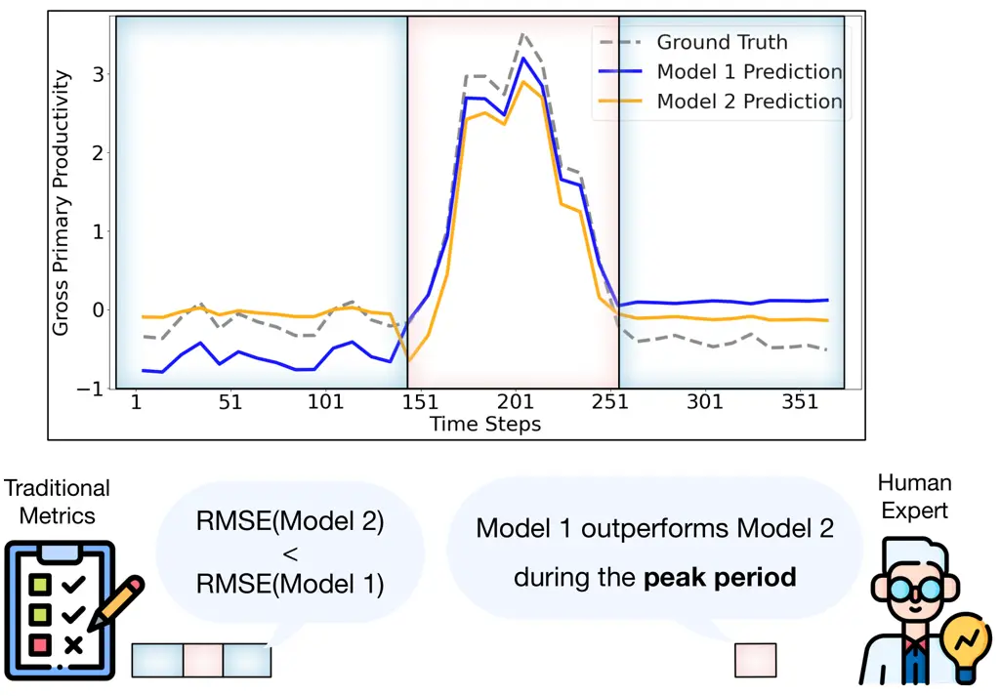

Figure 1. Illustrative example showing the inconsistency in model
ranking by traditional metric (e.g., RMSE) and human expert (e.g.,
emphasizing peak period alignment).

Existing efforts address these issues by combining multiple quantitative
measures including both traditional evaluation metrics and
domain-specific measures (Collier et al., 2018; Konidari and Mavrakis,
2007). These composite metrics are often designed for a specific task
and thus rely on preset weighted combination and cannot adapt to varying
expert requirements. Existing large language models (LLMs)-based
evaluation methods (Lin and Chen, 2023; Wang et al., 2023; Zhu et al.,
2024; Panickssery et al., 2024) face the similar limitation of adapting
to different assessment priorities and are also focused on evaluating
text or image generation tasks. On other hand, prior work explored
building learnable similarity measures for time series data (Kazemi
et al., 2019; Yue et al., 2022), but these “black box” metrics provide
limited interpretability about the time series characteristics being
captured.

In this paper, we introduce the Adaptive Policy Evaluation Framework
(APEF), a novel LLM-based methodology that adaptively formalizes expert
visual assessment patterns into interpretable evaluation policies for a
target evaluation task. By bridging the gap between quantitative metrics
and qualitative expert judgment, APEF advances the rigor and
transparency of model evaluation in ecological modeling. Developed in
collaboration with scientists in different ecological modeling domains,
APEF provides a foundation for developing assessment systems where
different evaluation policies can be standardized for specific contexts
while maintaining adaptability to emerging scientific priorities. The
evaluation process is also highly interpretable as it offers details
about how specific temporal patterns influence model comparisons. APEF
has the potential to support reliable decision-making in many scientific
domains, such as sustainable agriculture and climate change mitigation.

In particular, the proposed APEF pursues the innovation of using an LLM
to automatically extract evaluation policies from expert judgements.
Instead of having the LLM learn the policy from scratch, we propose to
leverage the guidance from a base metric to capture representative
characteristics in ecological time series. The base metric combines
multiple domain-specific metrics with a learnable weighted combination
and is updated in parallel with an LLM-based policy generator. The
LLM-based policy generator iteratively synthesizes human-readable
evaluation policies by leveraging the optimization history for the base
metric and expert judgments. This approach also enables expanding the
assessment priorities beyond those covered in the base metric and
documenting how specific assessment aspects contribute to the final
assessment outcome.

We validate the framework through three complementary studies.
Quantitative benchmarking against expert rankings of GPP and CO₂ flux
predictions demonstrates better or comparable agreement than diverse
baseline metrics, significantly outperforming traditional approaches.
Moreover, APEF is shown to be able to extract interpretable policies
that reflect key assessment priorities.

## 2. Related Work

### 2.1. Evaluation of Ecosystem Modeling

Evaluation of ecological models is important as these models are
frequently used for informing decision-making and advancing scientific
understanding of ecological processes. Such evaluation is highly
challenging as it needs to consider desired data characteristics for
target studies and target communities. For example, when modeling carbon
budget in agricultural ecosystems, agronomists focus on growing season
alignment due to its impact on crop productivity and resource efficiency
while climatologists emphasize annual carbon budgets (IPCC, 2022).
Another common focus of evaluation is on extreme event responses
(droughts, floods), which require non-linear scoring that standard
metrics fail to capture (Cloke and Pappenberger, 2008; Easterling
et al., 2016).

Current evaluation of ecological systems relies on either visual
assessment or pre-defined metrics and rules (Gauch et al., 2023; Garrett
et al., 2024). Visual assessment requires substantial human labor while
pre-defined metrics can only capture a specific aspect of data
properties. Prior work has also explored combining different evaluation
metrics (Collier et al., 2018; Konidari and Mavrakis, 2007), but they
often rely on fixed weights or manual tuning, which fails to capture the
nuanced requirements of specific evaluation tasks. ML-based
methods (Kazemi et al., 2019; Yue et al., 2022) provide the potential to
automatically encode complex time series patterns and efficiently
perform the similarity measurement between samples. Model ensemble can
also be used to estimate model uncertainty (Flato et al., 2014).
However, deploying the evaluation process in real systems often demands
interpretable metrics or rules traceable to known ecological principles
– a requirement unmet by black-box learned metrics.

### 2.2. LLMs in Scientific Evaluation

Large language models have revolutionized scientific workflows through
their ability to parse domain literature and perform diverse
text-related tasks (Boiko et al., 2023). In particular, LLMs have shown
their ability to process complex, unstructured data samples and provide
interpretable assessment criteria for evaluating text and image
data (Lin and Chen, 2023; Wang et al., 2023; Zhu et al., 2024;
Panickssery et al., 2024). Prior work also reports that LLMs can produce
text evaluation similar to human judgements (Chiang and Lee, 2023).
Different from these tasks, the evaluation of ecological modeling tasks
requires the reasoning of whether each model captures key temporal
dynamics related to underlying ecological processes. Our work advances
this frontier through the innovation of leveraging LLM-based for
learning and combining metrics for modeling time series data based on
expert feedback.

## 3. Problem Formulation and Base Metric

We aim to develop evaluation policies for the time series of key
ecological variables through iterative refinement guided by LLMs. The
proposed APEF combines a modular base metric with a policy extraction
mechanism, which adapts evaluation criteria based on expert preferences.
Specifically, given the model-predicted time series for $`N`$ instances
(e.g., locations or years) $`\mathcal{P}=\{P^{1},P^{2},...,P^{N}\}`$,
where each time series $`P^{i}`$ represents predictions over $`T`$
timesteps, $`P^{i}=\{p_{1}^{i},p_{2}^{i},...,p_{T}^{i}\}`$, APEF first
computes a base similarity score by comparing the model predictions
$`\mathcal{P}`$ with corresponding ground truth observations
$`\mathcal{Y}=\{y^{1},y^{2},...,y^{N}\}`$. The base score employs
configurable components related to temporal patterns, peak behaviors,
and derivative patterns (e.g., slope and curvature). The LLM-based
weight optimizer then adjusts these component weights to align with
expert annotations, and feed the results to the policy extraction
process. The overall flow of APEF is shown in Figure 2.

Here we consider pairwise annotations of expert preference, as this is
usually more labor efficient compared to directly scoring each
individual time series or ranking multiple time series. Without loss of
generality, we assume access to a set of pairwise samples
$`\{(P^{i,(a)},P^{i,(b)})\}_{i,a,b}`$, where each pair consists of two
time-series samples $`(a)`$ and $`(b)`$ (e.g., predicted by two
different models) over a specific data instance $`i`$, and the series
$`P^{i,(a)}`$ has better alignment with the observations $`Y^{i}`$ than
$`P^{i,(b)}`$ according to the expert annotation. We create pairwise
samples to be labeled from a set of time series data, ensuring that the
overall ranking of all samples can be reconstructed from the obtained
pairwise preferences.

For each weight optimization step $`d`$, APEF employs a policy
extraction mechanism to derive interpretable evaluation rules
$`\pi_{d}`$. The policy optimizer validates the obtained policies
against a validation set $`\mathcal{V}`$ to ensure consistent evaluation
performance and adaptability to different evaluation contexts.

### 3.1. Base Metric

Ecological time series, such as plant gross primary productivity and
greenhouse gas (GHG) flux, exhibit complex temporal patterns driven by
underlying ecological processes. Traditional evaluation metrics like
RMSE or correlation coefficients often fail to capture many important
domain-specific characteristics, as they treat all time points equally
and ignore critical temporal dependencies. We develop a base metric
system that decomposes time series similarity into three key components:
temporal segmentation, peak behavior analysis, and derivative
relationships, which jointly capture the essential patterns that domain
experts consider when evaluating ecological model predictions (Collier
et al., 2018; Gauch et al., 2023; Flato et al., 2014).

The proposed base metric is built on the recognition that ecological
time series contain periods of varying importance. The design of our
metric is based on the observation that ecological time series contain
periods of varying importance. For instance, growing seasons of plants
typically exhibit more dynamic changes and better reflect the impact of
external drivers compared to the dormant periods, thus requiring more
careful evaluation. To address this, we implement a temporal
segmentation approach that automatically identifies these critical
periods through rise-and-fall pattern detection. Given the time series
of a target variable $`P^{i}=\{p_{1}^{i},p_{2}^{i},...,p_{T}^{i}\}`$,
the algorithm analyzes first-order differences
$`\Delta P^{i}_{t}=p^{i}_{t+1}-p^{i}_{t},t\in\{1,\ldots,T-1\}`$ to
detect sustained directional changes. We then compare these differences
with pre-defined thresholds, as follows:

```math
\displaystyle\text{RisingPeriod} \displaystyle=\{t\mid\Delta P^{i}_{t}>\theta_{\text{rise}},\,\,\,t\in\{1,\ldots,T-1\}\} \tag{1}
```

```math
\displaystyle\text{FallingPeriod} \displaystyle=\{t\mid\Delta P^{i}_{t}<\theta_{\text{fall}},\,\,\,t\in\{1,\ldots,T-1\}\}
```

The thresholds $`\theta_{\text{rise}}=0.01`$ and
$`\theta_{\text{fall}}=-0.01`$ are empirically determined from our
tests. To filter noise and independent data oscillations, we keep only
the time steps in RisingPeriod or FallPeriod if they extends
consecutively for at least $`\theta_{\text{period}}`$ timesteps. The
hyper-parameter $`\theta_{\text{period}}`$ is set as 5 in our tests. The
segmentation method aims to identify a rising period followed by a
falling period, with the interval between them serving as the basis for
peak analysis. In the following discussion, we assume each time series
has only one rise-fall pattern occurrence. For longer time series with
multiple occurences of rise-fall patterns, we can apply this
segmentation method to create shorter sequences.

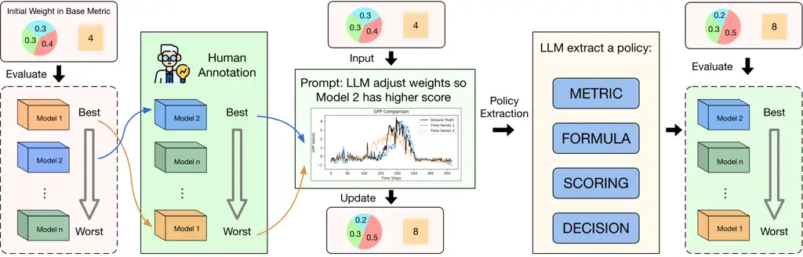

Figure 2. Overall flow of APEF. LLM is first used to adjust weights in
the base metric to align with expert annotation. The weight adjustment
records are then fed to the LLM to extract interpretable evaluation
policies.

To quantify the similarity score for peak values, we employ a soft
matching approach for peak comparison that allows flexible temporal
alignment within a tolerance window. Given a model prediction
$`P^{i}=\{p_{1}^{i},p_{2}^{i},...,p_{T}^{i}\}`$ and ground truth
$`Y^{i}=\{y_{1}^{i},y_{2}^{i},...,y_{T}^{i}\}`$, we define the timestep
of peak, $`\text{Peaks}(P^{i})`$, for the time series $`P^{i}`$ to be
the timesteps of all the local maxima. This is formally expressed as
follows:

```math
\displaystyle\text{Peaks}(P^{i}) \displaystyle=\{t\mid p_{t}^{i}>p_{t-1}^{i}\text{ and }p_{t}^{i}>p_{t+1}^{i},t\in\{2,\ldots,T-1\}\} \tag{2}
```

```math
\displaystyle\text{PeakValues}(P^{i}) \displaystyle=\{p_{t}^{i}\mid t\in\text{Peaks}(P^{i})\}
```

Now given $`\text{Peaks}(P^{i}),\text{Peaks}(Y^{i})`$, we calculate the
similarity score for peak alignment. Formally, we define
$`S_{\text{Peak}}(P^{i},Y^{i})`$ combining both peak time step alignment
and peak value matching, as follows:

```math
\displaystyle S_{\text{PeakX}}(P^{i},Y^{i}) \displaystyle=\sum_{t_{p}\in\text{Peaks}(P^{i})}\sum_{t_{y}\in\text{Peaks}(Y^{i})}\left(1-\frac{|t_{p}-t_{y}|}{\text{tolerance}}\right) \tag{3}
```

```math
\displaystyle S_{\text{PeakY}}(P^{i},Y^{i}) \displaystyle=\sum_{v_{p}\in\text{PeakValues}(P^{i})}\sum_{v_{y}\in\text{PeakValues}(Y^{i})}\left(1-\frac{|v_{p}-v_{y}|}{\max(v_{p},v_{y})}\right)
```

```math
\displaystyle S_{\text{Peak}}(P^{i},Y^{i}) \displaystyle=(1-w_{\text{amp}})*S_{\text{PeakX}}(P^{i},Y^{i})+w_{\text{amp}}*S_{\text{PeakY}}(P^{i},Y^{i})
```

where $`S_{\text{PeakX}}`$ measures the alignment of peak time steps and
$`S_{\text{PeakY}}`$ captures amplitude similarity between peaks.
Tolerance and $`w_{amp}`$ are parameters adjustable in the weight
optimization process detailed in Section 4.1. This soft-matching
formulation accommodates phase shifts while maintaining sensitivity to
magnitude differences. These are crucial considerations in ecological
modeling where both timing and intensity of events matter.

The proposed metric further incorporates another component to capture
system dynamics through derivative analysis. Standard evaluation
metrics, such as RMSE, might show high similarity (or low errors)
between two series with matching values even they exhibit different
rates of changes. In contrast, our approach explicitly considers slope
and curvature. These derivative terms can reflect important ecosystem
characteristics, such as vegetation growth and extreme events, while
also representing important properties in many governing differential
equations of ecosystems (Hipsey et al., 2019b; Katzin et al., 2022; Zhou
et al., 2021). Specifically, we consider both $`P^{i}`$ and
corresponding observation series $`Y^{i}`$ as a function of timestep
$`t`$, so we have $`P^{i}(t)`$ and $`Y^{i}(t)`$. Then we measure the
slope and curvature of each series (e.g., for $`P^{i}(t)`$) as
$`\quad\frac{dP^{i}(t)}{dt}`$ and $`\quad\frac{d^{2}P^{i}(t)}{dt^{2}}`$.
The derivative-based distance score between $`P^{i}`$ and $`Y^{i}`$ is
computed as follows:

```math
\displaystyle S_{\text{slope}}(Y^{i},P^{i}) \displaystyle=\frac{1}{T}\sum_{t=1}^{T}(\frac{dP^{i}(t)}{dt}-\frac{dY^{i}(t)}{dt})^{2} \tag{4}
```

```math
\displaystyle S_{\text{curv}}(Y^{i},P^{i}) \displaystyle=\frac{1}{T}\sum_{t=1}^{T}(\frac{d^{2}P^{i}(t)}{dt^{2}}-\frac{d^{2}Y^{i}(t)}{dt^{2}})^{2}
```

```math
\displaystyle S_{\text{Deriv}}(Y^{i},P^{i}) \displaystyle=w_{\text{der}}*(S_{\text{slope}}(Y^{i},P^{i})+S_{\text{curv}}(Y^{i},P^{i}))
```

where $`w_{\text{der}}`$ is a scaling factor and can be adjusted to
reflect the varying contribution of derivative-based difference to the
overall alignment between model prediction and ground truth. This
multi-order analysis enables capturing both immediate changes and
overall trends, which is essential for evaluating model responses to
environmental perturbations.

Finally, we compute the base metric score combining these components
with period-specific weighting. Given RisingPeriod and FallingPeriod of
the observations $`Y^{i}`$, we define the $`t_{\text{st}}`$ as the
starting time step in RisingPeriod, $`t_{\text{ed}}`$ as the ending
timestep in FallingPeriod. For each time series ($`P^{i}`$ or
$`Y^{i}`$), we segment it into three parts,
$`P^{i}_{\text{before}}=\{p_{t}^{i}\mid t<t_{\text{st}}\}`$,
$`P^{i}_{\text{in}}=\{p_{t}^{i}\mid t_{\text{st}}<t<t_{\text{ed}}\}`$,
and $`P^{i}_{\text{after}}=\{p_{t}^{i}\mid t>t_{\text{ed}}\}`$. We
compute alignment scores separately for each part and then combine them
to get the final base metric score, as follows:

```math
\displaystyle S_{\text{in}}(Y^{i},P^{i}) \displaystyle=S_{\text{Peak}}(P^{i}_{\text{in}},Y^{i}_{\text{in}})+S_{\text{Deriv}}(P^{i}_{\text{in}},Y^{i}_{\text{in}}) \tag{5}
```

```math
\displaystyle S_{\text{before}}(Y^{i},P^{i}) \displaystyle=S_{\text{Peak}}(P^{i}_{\text{before}},Y^{i}_{\text{before}})+S_{\text{Deriv}}(P^{i}_{\text{before}},Y^{i}_{\text{before}})
```

```math
\displaystyle S_{\text{after}}(Y^{i},P^{i}) \displaystyle=S_{\text{Peak}}(P^{i}_{\text{after}},Y^{i}_{\text{after}})+S_{\text{Deriv}}(P^{i}_{\text{after}},Y^{i}_{\text{after}})
```

```math
\displaystyle S(Y^{i},P^{i}) \displaystyle=w_{\text{peak}}S_{\text{before}}(Y^{i},P^{i})
```

```math
\displaystyle+\frac{1-w_{\text{peak}}}{2}(S_{\text{in}}(Y^{i},P^{i})+S_{\text{after}}(Y^{i},P^{i}))
```

This base metric score can also be converted to a similarity measure as
$`S(Y^{i},P^{i})=\frac{1}{1+S(Y^{i},P^{i})}`$. This formulation allows
flexible emphasis on different temporal segments while maintaining a
normalized score range, facilitating consistent model comparison across
different scenarios and time scales.

## 4. LLM-based Policy Extraction

We now describe how to use the LLM to help generate the policy for
evaluating time series outputs. Rather than having LLM learn complex
policies from scratch, we use the base metric to provide guidance to the
policy learning process. Specifically, we first use LLM to optimize each
weight parameter in the base metric to align with the expert
preferences. Then we feed the obtained results to a parallel policy
extraction module to synthesize the evaluation rules.

### 4.1. Weight Optimization in Base Metric

The base metric can prioritize different assessment aspects (e.g., peak
alignment, curvature match) by adjusting its weight parameters. Here we
use $`\mathbf{w}`$ to represent all the adjustable parameters in the
base metric. Optimizing these weights to align with expert preferences
is challenging due to (i) the highly non-linear relationship between
weight parameters and the alignment with pairwise preferences, and (ii)
the desired constraints over the weights to maintain their
interpretability. For example, we may expect each weight to be positive,
with their values normalized over all the weights.

We address this issue through an LLM-based weight optimization mechanism
that dynamically adjusts metric parameters based on the predicted scores
and pairwise expert preferences. Specifically, given a pair of time
series samples $`(P^{i,(a)},P^{i,(b)})`$ for the same instance $`i`$,
assuming expert prefers sample $`(a)`$ over sample $`(b)`$, the
optimizer aims to adjust weights $`\mathbf{w}`$ such that the estimated
base metric scores (Eq. 5) for these two samples align with the expert
preferences:

```math
S(Y^{i},P^{i,(a)})>S(Y^{i},P^{i,(b)}) \tag{6}
```

Here we employ an LLM-based approach to iteratively update weight
parameters $`\mathbf{w}`$ by leveraging a given pair of expert-annotated
time series samples and the optimization history in a structured prompt.
At each iteration $`d`$, the LLM takes the input of the current
estimated weights $`\mathbf{w}_{d}`$, the optimization history
$`\mathcal{H}_{d}`$ until the current iteration, the given pairwise
sample and corresponding observations
$`P^{i,(a,b)}=\{P^{i,(a)},P^{i,(b)},Y^{i}\}`$ , and the optimization
constraints $`\mathcal{C}`$, as follows:

```math
\mathbf{w}_{d+1}=\text{LLM}(\mathbf{w}_{d},\mathcal{H}_{d},P^{i,(a,b)},\mathcal{C}) \tag{7}
```

Here the optimization history
$`\mathcal{H}_{d}=\{(\textbf{w}_{d^{\prime}},\textbf{P}_{d^{\prime}},\rho_{d^{\prime}})\}_{{d^{\prime}}=1}^{d}`$
represents the optimization history over $`d`$ iterations, where
$`\textbf{w}_{d}`$, $`\textbf{P}_{d}`$, and $`\rho_{d}`$ represent the
updated weights, the pairwise time series samples considered in the
iteration $`d`$, and the overall correlations obtained from the training
samples at each iteration $`d`$, respectively. Here the correlation is
measured by comparing the rankings of all the time series in the
training set, as determined using the base metric (Eq. 5) with the
current weight at iteration $`d`$, against the rankings derived from
expert annotations.

To ensure stable weight adjustments over iterations, we incorporate
several practical constraints in $`\mathcal{C}`$, as follows:

- •
  Weight bounds: each parameter in $`\textbf{w}\in[0.1,1.0]`$.
- •
  Smoothness: $`|\mathbf{w}_{t+1}-\mathbf{w}_{t}|\leq\delta`$.
- •
  Normalization: $`\sum_{w_{i}\in\textbf{w}}w_{i}=1`$ for the weights.

We include an example of optimization history and the entire LLM input
in Appendix B.1. After each update iteration, the LLM response is parsed
to extract new weight values. This approach offers threefold benefits.
First, it can leverage patterns in historical performance to make
informed adjustments. Second, it maintains interpretability by providing
reasoning for each weight change. Third, it can adapt to different
evaluation contexts by considering the specific characteristics of the
time series being compared.

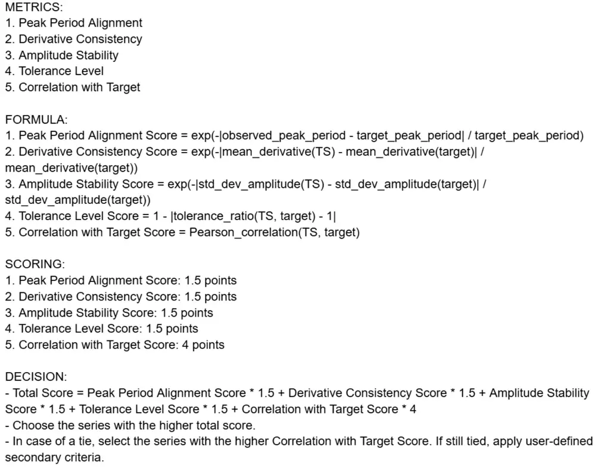

Figure 3. An example of policy extracted by APEF.

### 4.2. Policy Extraction

While the weight optimization process can adjust the parameters in the
base score, it does not provide the underlying rationale for evaluation
preferences and also cannot capture assessment aspects that are not
covered by the base metric. We address these limitations through a
policy extraction mechanism that translates the optimization history
into interpretable evaluation rules. This approach leverages the outcome
of the weight optimization process, while also continuously operating in
parallel to refine natural language policies for explaining the
relationship between time series characteristics and target preferences.

At each iteration $`d`$, given the optimization history
$`\mathcal{H}_{d}`$, the policy extractor generates a structured
evaluation policy $`\pi_{d}`$ consisting of four key components, as

```math
\pi_{d}=\{\mathcal{M}_{d},\mathcal{F}_{d},\mathcal{S}_{d},\mathcal{R}_{d}\}, \tag{8}
```

We describe each component below.

- •
  Metrics $`\mathcal{M}_{D}`$: Name and interpretation of assessment
  metrics. Each assessment metric measures the similarity between two
  time series on a certain aspect, e.g., peak alignment, derivative
  similarity, as follows:

  ```math
  \mathcal{M}_{d}=\{m_{1}:\text{peak alignment},m_{2}:\text{seasonal patterns},...\} \tag{9}
  ```

  It is noteworthy that these assessment metrics are automatically
  extracted by LLM and could be different from the proximity terms
  considered in the base metric.

- •
  Formula: Notably, assessment metrics can be interpreted differently,
  especially when a metric is not widely known. Thus, we ask LLMs to
  provide a mathematical formulation for each metric
  $`m\in\mathcal{M}_{d}`$.

  ```math
  \displaystyle\mathcal{F}_{d}= \displaystyle\{\text{peak tolerance}\,\,\,m_{1}=f_{1}(P^{i},Y^{i}), \tag{10}
  ```

  ```math
  \displaystyle\text{amplitude ratio}\,\,\,m_{2}=f_{2}(P^{i},Y^{i}),...,\}
  ```

  The incorporation of this component helps reduce the uncertainty of
  the obtained policies. We notice that given the same set of samples,
  LLMs may produce different evaluation results over multiple runs if
  the metrics are not explicitly defined with mathematical formulations.

- •
  Scoring: This component quantifies the contribution for each
  assessment metric. Specifically, we assign a positive score $`p`$ for
  each metric $`m`$, as

  ```math
  \mathcal{S}_{d}=\{(m_{1},p_{1}),(m_{2},p_{2}),...\},\,\text{ s.t. }\,\sum p_{i}=K, \tag{11}
  ```

  where the constraint imposed by $`K`$ is to enforce the competition
  between different metrics. We set $`K=10`$ in our tests. The scores
  $`p`$ are used to scale the original value obtained from its formula
  in Eq. 10, which will then be combined for final assessment
  measurement.

- •
  Decision Rule: The final evaluation rule consists of two levels: (i)
  It first creates an overall assessment score by aggregating the scores
  from different assessment metrics using a LLM-generated mathematical
  form, as

  ```math
  f_{\text{aggr}}(m_{1}p_{1},m_{2}p_{2},...). \tag{12}
  ```

  \(ii\) Additionally, in cases where multiple series (e.g.,
  $`P^{i,(a)}`$ and $`P^{i,(a)}`$) have the same overall score, the LLM
  generates additional rules by referring to the original metric values.

This structured policy combines multiple metrics and different numerical
operations, which facilitates capturing the complex assessment
interpretation of domain experts. Additionally, the policies provide
clear rationales for evaluation decisions, enabling domain experts to
understand and verify the learned evaluation criteria.

### 4.3. Policy Optimization

Synthesizing policy from history data is challenging due to the need to
account for diverse time series characteristics as assessment metrics.
The adjustment of these metrics and their associated scores also need to
be reconciled.

We iteratively update the policy by incorporating the optimization
history $`\mathcal{H}_{d}`$, a pairwise time series sample, and the
current policy. To ensure a smooth policy update while enhancing
generalizability, we propose a two-stage policy update approach:

Update of assessment metrics $`\mathcal{M}_{D}`$: In each iteration, in
addition to updating other components of the policy, we permit the
addition or removal of at most one assessment metric $`m`$ along with
its associated score $`p`$. When introducing a new assessment metric
$`m`$, we tentatively use it in isolation to compare each pair of time
series in the expert-annotated training data. The new assessment metric
is retained only if the obtained comparisons align with expert
annotation for a substantial portion of the training pairs.

Policy-level validation: After updating the policy, we validate the new
policy using a separate validation set, which is derived from a subset
of the original training pairwise data. Specifically, we measure the
performance of the updated policy $`\pi_{d+1}`$ on the validation set
and compare it with the policy $`\pi_{d}`$ obtained in the previous
iteration. Additionally, due to the complexity of the policy, we notice
that the LLM may produce different evaluation outcomes in different runs
even though we explicitly specify the calculation of each assessment
metric. Hence, we will have multiple runs over the validation set using
the new policy. The new policy will be retained only when a certain
portion of these runs produce better validation performance. This
process is expressed as follows:

```math
\pi_{\text{new}}=\begin{cases}\pi_{d+1}&\text{if }\rho_{\text{val}}(\pi_{d+1})>\rho_{\text{val}}(\pi_{d})\,\,\text{for\, $\theta$\, LLM runs},\\
\pi_{d}&\text{otherwise},\end{cases} \tag{13}
```

where the threshold $`\theta`$ is set to be 70% in our tests. To ensure
the optimizer evaluates policies over a comprehensive set of scenarios,
we maintain detailed logs of policy updates, validation performance, and
component success rates. This information is crucial for analyzing the
policy optimization process and understanding the characteristics of
successful evaluation criteria.

### 4.4. Extension to Evaluating Multi-variate Series

Ecological models often simultaneously simulate multiple key variables
involved in the target ecosystem, and many variables can be highly
correlated with each other. If an ecological model fails to preserve
these underlying relationships, it lacks physical consistency and
becomes less reliable. Therefore, evaluation should go beyond assessing
the alignment of each predicted series with its corresponding
observations and also consider the interdependencies among predicted
time series for related variables.

We extend the proposed APEF to simultaneously evaluate two time series
of related variables, e.g., crop gross primary production and CO₂ flux.
We can represent the input pairwise sample as
$`(\{P^{i,(a)},Q^{i,(a)}\}`$, $`\{P^{i,(b)},Q^{i,(b)}\})`$, i.e.,
predictions of two variables $`P`$ and $`Q`$ by two models $`(a)`$ and
$`(b)`$. The key idea is to harness the ability of the LLM to formulate
evaluation policies that incorporate association constraints between the
variables. To our knowledge, APEF is also the first automatic evaluation
method that takes into account the relationship between multiple time
series.

During the weight optimization process (Section 4.1), we need to
aggregate the base metric scores obtained for the given two variables to
estimate the overall combined score. Specifically, the combined score is
computed as the average of the individual base metric scores, scaled by
their correlation difference, as follows:

```math
\displaystyle\tilde{S}^{i,(a)}=\frac{S(Y_{p}^{i},P^{i,(a)})+S(Y_{q}^{i},Q^{i,(a)})}{2}\text{Corr}(Y^{i}_{p},Y^{i}_{q},P^{i,(a)},Q^{i,(a)}), \tag{14}
```

```math
\displaystyle\text{Corr}(Y^{i}_{p},Y^{i}_{q},P^{i,(a)},Q^{i,(a)})=1-\left|\text{Spear}(Y_{p}^{i},Y_{q}^{i})-\text{Spear}(P^{i,(a)},Q^{i,(a)})\right|,
```

where $`Y_{p}^{i}`$ and $`Y_{q}^{i}`$ represent the true observation
series of the variable $`P`$ and $`Q`$ for the instance $`i`$, and
$`\text{Spear}(\cdot)`$ represents the Spearman’s correlation. We use
this score to estimate the relative ordering of two samples $`(a)`$ and
$`(b)`$, which is then used to update the weight parameters. It is
noteworthy that the relationship expressed by Eq. 14 may not fully
capture the complex interdependence of the two variables. This score
only serves as a base metric, which can be refined when APEF creates
policies using the LLM. For example, the policy may define its own
temporal consistency measure either by leveraging simple transformations
of the correlation measure or developing a new measure from scratch. We
include an example of obtained policy for two variables in Appendix A.1.

## 5. Evaluation

Our evaluation is focused on the assessment predicting (1) crop gross
primary production (GPP) and (2) CO₂ flux. The proposed APEF can also be
easily applied to other prediction tasks. Our evaluation encompasses
three distinct datasets for real-world GPP and CO₂ flux time series. The
pairwise sample comparison is provided in different ways (e.g., by
expert annotations or pre-defined metrics) across these datasets, which
are used to validate APEF’s ability to learn different evaluation
criteria.

### 5.1. Dataset Description

Each dataset consists of three main components: (1) model predictions of
GPP and CO₂ flux, (2) reference GPP and CO₂ flux data, (3) annotations
for comparing prediction samples. In the following, we will describe
these three components for each dataset.

#### 5.1.1. Synthetic Dataset

We plan to use this synthetic dataset to evaluate if the proposed
framework can recover the assessment using the base metric (described in
Section 3.1) with preset weights and produce sample preferences that
correlate well with the target comparisons generated using these preset
weights. In particular, this dataset utilizes observational time series
data of CO₂ flux and GPP derived from 11 cropland eddy covariance (EC)
flux tower sites located in major U.S. corn and soybean production
regions (Liu et al., 2024b). These sites, including US-Bo1, US-Bo2,
US-Br1, US-Br3, US-IB1, US-KL1, US-Ne1, US-Ne2, US-Ne3, US-Ro1, and
US-Ro5, span across Illinois, Iowa, Michigan, Nebraska, and Minnesota
states. The dataset provides daily-scale measurements from 2000 to 2020,
with each site having different operational periods ranging from 5 to 19
years. For the experiments, we used the observational values of CO₂ flux
and GPP in year 2005 at site US-Bo1 as our ground truth.

We employed data augmentation techniques to generate synthetic model
predictions from the observation time series. Specifically, we created
synthetic prediction series data using a combination of four different
augmentation methods from the TSGM (Time Series Generation Models)
library (Nikitin et al., 2023): addition of random noise, slice and
shuffle, magnitude warping, and window warping. We generated in total 20
model-predicted time series, and randomly selected 10 of them as
training set, 5 of them as validation set, and 5 of them as testing set
for each experiment.

For the experiment on this dataset, we designed three sets of preset
weights to evaluate different aspects of time series similarity through
our base metric components: Peak Period Similarity, Derivative, and
Amplitude. Each set emphasizes one component while maintaining minimal
weights for the others. The preset weight combinations
$`(w_{\text{peak}},w_{\text{der}},w_{\text{amp}})`$ are: Peak Period -
$`(0.8,0.1,0.1)`$, Slope & Curvature - $`(0.1,0.8,0.1)`$, and
Amplitude - $`(0.1,0.1,0.8)`$. We use each preset weight combination to
compute the base metric and then create the target ranking. We use
Eq. 14 to compute the score for two variables GPP+CO₂ and create the
target ranking.

|           |             |       |           |                   |       |           |            |       |           |
| --------- | ----------- | ----- | --------- | ----------------- | ----- | --------- | ---------- | ----- | --------- |
|           | Peak Period |       |           | Slope & Curvature |       |           | Amplitutde |       |           |
|           | CO₂         | GPP   | GPP + CO₂ | CO₂               | GPP   | GPP + CO₂ | CO₂        | GPP   | GPP + CO₂ |
| $`R^{2}`$ | 0.067       | 0.139 | 0.600     | 0.406             | 0.042 | 0.527     | 0.079      | 0.648 | 0.394     |
| RMSE      | 0.067       | 0.139 | 0.600     | 0.406             | 0.042 | 0.588     | 0.079      | 0.648 | 0.406     |
| MAE       | 0.067       | 0.127 | 0.684     | 0.406             | 0.091 | 0.576     | 0.188      | 0.733 | 0.418     |
| NSE       | 0.407       | 0.297 | 0.369     | 0.006             | 0.697 | 0.261     | 0.261      | 0.261 | 0.248     |
| TILDE-Q   | 0.067       | 0.127 | 0.684     | 0.406             | 0.091 | 0.576     | 0.188      | 0.733 | 0.418     |
| PRP-Rank  | 0.321       | 0.067 | 0.115     | 0.115             | 0.418 | 0.139     | 0.152      | 0.321 | 0.261     |
| APEF      | 0.452       | 0.300 | 0.770     | 0.669             | 0.699 | 0.576     | 0.455      | 0.733 | 0.418     |

Table 1. Correlation with simulated weight sets. Each column (Peak
Period, Slope & Curvature, and Amplitude) represent a preset scenario
where the indicated aspect is more valued than others.

|           |            |       |           |       |       |
| --------- | ---------- | ----- | --------- | ----- | ----- |
|           | Annotation |       |           | ILAMB |       |
|           | CO₂        | GPP   | GPP + CO₂ | CO₂   | GPP   |
| $`R^{2}`$ | 0.167      | 0.667 | 0.017     | -     | -     |
| RMSE      | 0.167      | 0.667 | 0.117     | -     | -     |
| MAE       | 0.167      | 0.713 | 0.100     | -     | -     |
| NSE       | 0.367      | 0.217 | 0.283     | -     | -     |
| TILDE-Q   | 0.167      | 0.713 | 0.100     | 0.857 | 0.857 |
| PRP-Rank  | 0.733      | 0.600 | 0.383     | 0.607 | 0.392 |
| APEF      | 0.785      | 0.752 | 0.417     | 0.750 | 0.821 |

Table 2. Correlation with expert annotations (left) and the ILAMB scores
(right).

#### 5.1.2. Human Expert Alignment

In this dataset, we conduct human expert alignment testing, where we
train our framework to learn a policy that mimics expert judgment. We
used the same observation data and synthetic prediction data as the
first dataset. Then we collected pairwise model comparisons from three
domain experts who independently evaluated the performance of different
model predictions. Each expert was presented with pairs of model
predictions of (1) GPP, (2) CO₂ flux, and (3) GPP and CO₂ together, and
provided a comparison. Example annotation task can be found in figure 9
in Appendix C.1. After getting the annotation for the pairwise
comparison, we then used majority voting to create the final reference
rankings. The inter-annotator agreement was assessed using Fleiss’ kappa
coefficient ($`\kappa`$), revealing varying levels of agreement across
different aspects of model evaluation. We have $`\kappa=0.69`$,
$`\kappa=0.58`$ and $`\kappa=0.63`$ for GPP, CO₂, and overall
evaluations respectively. For this experiment, we used the same model
predictions and ground truth time series in Section 5.1.1.

#### 5.1.3. ILAMB Score System

We also validate APEF to reproduce the model rankings in the ILAMB
(International Land Model Benchmarking) scoring system (Collier et al.,
2018). Here the reference CO₂ data are from the NOAA GMD monthly flask
dataset (NOAA, 2024), and the reference GPP data are from the FluxNet
Tower eddy covariance measurements (Tier 1) (Pastorello et al., 2020).
We used model predictions from seven CMIP6 models at the BE-Bra site
(year 2000) as the training set (Eyring et al., 2016). Predictions from
the same models at BE-Vie served as the validation set, while those from
DE-Hai were used for testing. Using different sites ensured a sufficient
sample size, as splitting predictions from only seven models would be
insufficient for meaningful ranking. The predictions are ranked
according to three core components from the ILAMB scoring system: Bias
Score, RMSE Score, and Seasonal Cycle Score. The final ILAMB score for
each prediction is computed as a weighted average of these
metrics (Collier et al., 2018). More details are provided in Appendix
C.2.

### 5.2. Evaluation Results

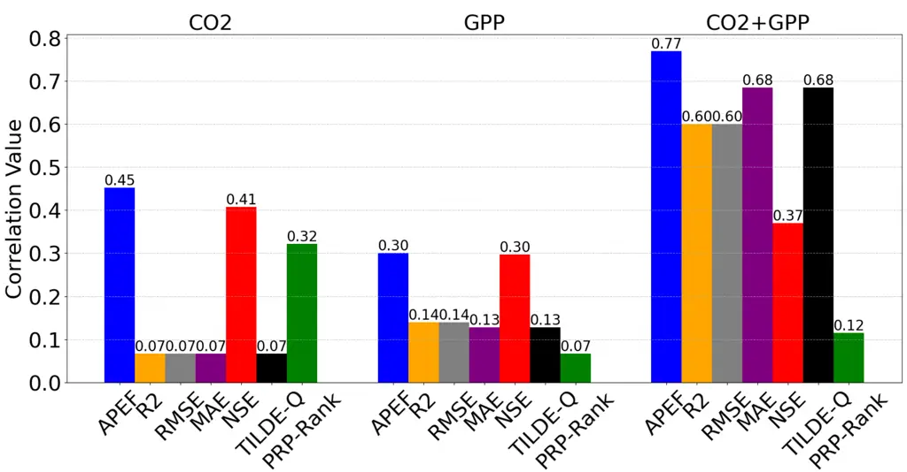

(a) Peak Period.

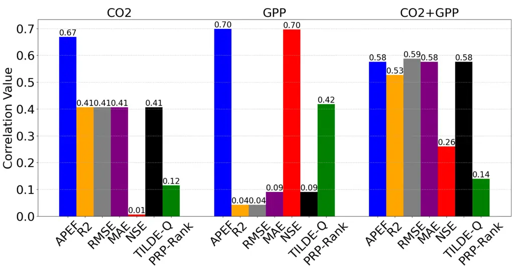

(b) Slope & Curvature

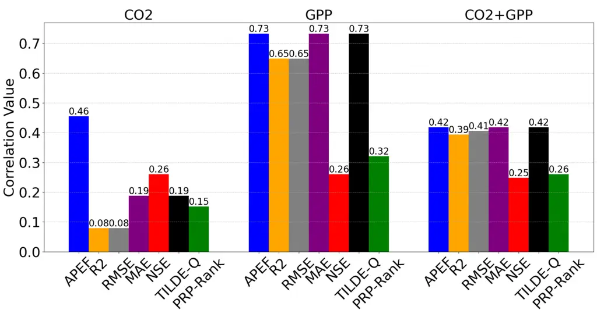

(c) Amplitude.

Figure 4. Correlation performance on the synthetic data using preset
weights.

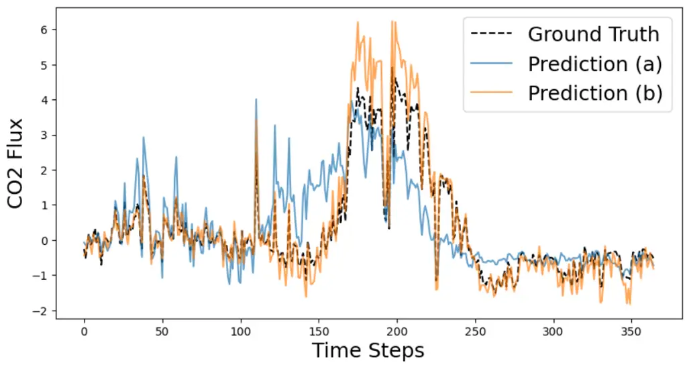

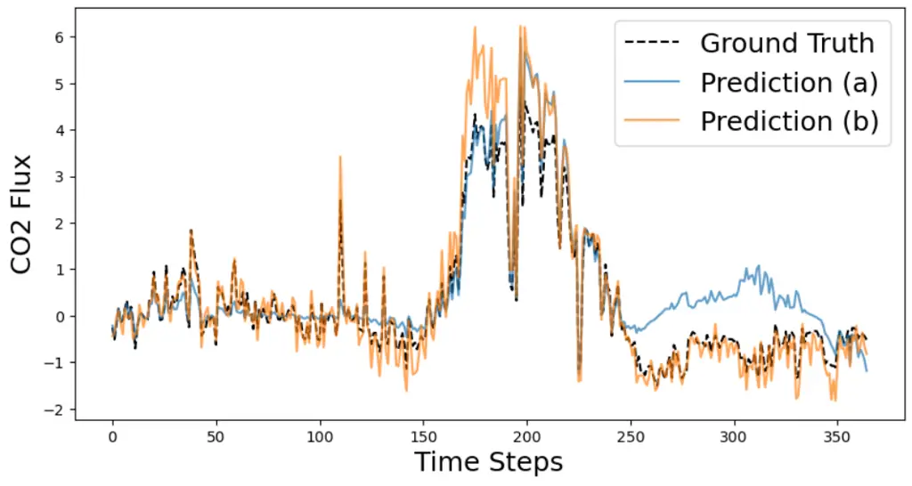

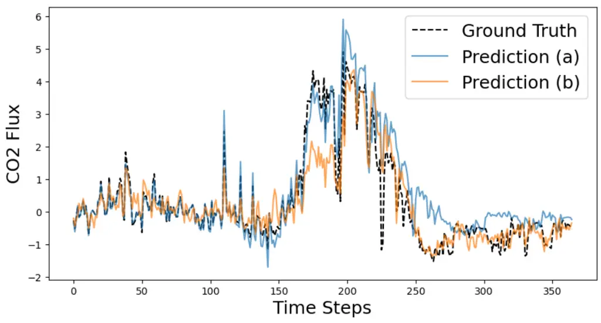

Figure 5. Examples of ranking mismatch in the Peak period weight
setting. In these examples, prediction (a) is better than prediction (b)
according to target annotation and APEF, but standard metric $`R^{2}`$
produces opposite comparison outcome.

In this section, we present and analyze the performance of APEF and
baseline metrics on the three datasets described in Section 5.1. The
baseline metrics include traditional metrics commonly used for time
series regression tasks, including coefficient of determination
($`R^{2}`$), root mean square error (RMSE), mean absolute error (MAE),
and NS efficiency coefficient (NSE) (Wikipedia contributors, 2021). We
also adopted two evaluation approaches, TILDE-Q (Lee et al., 2024) and
PRP-Rank (Qin et al., 2024) as our baselines. TILDE-Q calculates the
shape difference between time series, and PRP-Rank also employ LLMs to
generate a ranking of predictions by doing pairwise comparison. As the
original PRP-Rank is designed to evaluate text generation, we feed the
pairwise time series samples and the observation series as text to
PRP-Rank to obtain the ranking.

For the experiment on synthetic dataset and human annotation, we used 10
model predictions as the training set, 5 model predictions as validation
set, and 5 model prediction as the testing set. For the experinment on
ILAMB dataset, there are 7 model predictions each for training,
validation and testing set. We used o3-mini from OpenAI as the LLM for
both APEF and for PRP-Rank. All result presented are performances on
testing set. More detail about experiment setting can be found in
Appendix D.

#### 5.2.1. Performance on Synthetic Dataset

Table 4 presents the testing performance of APEF and multiple baseline
metrics on the synthetic dataset described in Section 5.1.1. For this
experiment, we use each of the metrics to rank the samples in testing
set and calculate the Spearman’s correlation between the generated
ranking and the ground truth ranking. Here the ground truth ranking is
generated based on the base metric score (Section 3.1) with the preset
weights.

We can observe from Figure 4 that APEF outperforms other metrics in the
Peak Period weight setting which aims to put more focus on the
similarity between prediction and ground truth within the peak period of
CO₂ flux and GPP. The performance difference between APEF and some
baselines for certain variables is not that large because the peak
period is only about 120 days out of a year.

While other metric treat all period of the time series equally, APEF
would extract metrics that focus more on the peak period. For instance,
in the resulting policy of CO₂ flux, we see a unique metric extracted by
LLM called Peak Period Consistency Score (PPCS), for measuring the
length difference of the peak period. This is defined by the LLM as
follow:

```math
\displaystyle PPCS=1-\frac{|\text{Length Peak Period}_{\text{prd}}-\text{Length Peak Period}_{\text{tgt}}|}{\text{Length Peak Period}_{\text{tgt}}}, \tag{15}
```

where $`\text{Length Peak Period}_{\text{tgt}}`$ and
$`\text{Length Peak Period}_{\text{prd}}`$ represent the length of peak
period detected from the reference series $`Y^{i}`$ and the predicted
series $`P^{i}`$.

We can also observe that the performance of APEF outperforms or matches
the performance of other metrics in both the Slope & Curvature and
Amplitude settings. This is also expected because the traditional
metrics are designed to measure the overall errors between prediction
and ground truth time series. For these two settings, we observed that
APEF included traditional metrics as rules in the resulting policy. For
example, we see the following two scoring rules in the final policy of
the CO₂ flux in Amplitude setting:
$`-\text{RMSE}:2\,\,\text{points};-\text{MAE}:2\,\,\text{points}`$.

#### 5.2.2. Performance on Human Expert Alignment

In this experiment, we evaluate the alignment between the predicted
ranking and the target ranking derived from human annotators’ pairwise
comparisons of model predictions. We show the correlation between expert
ranking and metric rankings in Table 3 (left). We can observe that APEF
outperforms other metrics for this settings. The resulting policies in
this experiment include novel rules extracted by the LLM. One example
metric is about the proportion of time steps with large errors, and is
defined as $`N_{\text{violate}}/T`$, where
$`N_{\text{violate}}=\text{Count}\{t\in\{1,...,T\}\,\,\text{s.t.}\,\,|Y^{i}_{t}-P^{i}_{t}|>1.0\}`$.

#### 5.2.3. Performance on the ILAMB dataset

This test uses the ILAMB scoring system, described in Section 5.1.3, to
rank a set of seven CIMP6 models, and uses this ranking as the target
ranking. The ILAMB dataset does not provide GPP and CO₂ data for the
same instances so we only evaluate them separately. Since the scoring
function used in ILAMB is a simple combination of traditional metrics
like bias score and RMSE score, most traditional metrics tend to produce
high correlation performance (\>0.85). Table 3 (right) only shows the
performance of APEF and the baselines TILDE-Q and PRP-Rank. TILDE-Q is
essentially similar to the overall error metric (e.g., RMSE) and thus
gets high correlation. It is worth noticing that the proposed framework
still yield comparable result even when the target score does not
explicitly consider special temporal characteristics in time series.
More importantly, we observe that the final policies learned by APEF
consists entirely of traditional metrics. The metric section of the
policy includes “Mean Absolute Error (MAE), Root Mean Square Error
(RMSE), Variance Explained (R²), Pearson Correlation Coefficient".

### 5.3. Case Study

Figure 5 shows examples where the target score based on the base metric
in the Peak Period setting ranks model (a) to be higher than model (b).
However, the traditional metric, such as $`R^{2}`$, suggests that model
(b) is better. We observe that the predictions (a) is more closely
aligned to the ground truth time series inside peak period (Day 160 to 240) while the predictions (b) is better aligned to ground truth series
outside of peak period. This is a common scenario in CO₂ flux prediction
where models can predict reasonably well in normal days but when there
is a period of abrupt changes, the models perform poorly. For this
example pair, APEF successfully identifies model (a) to be the better
model, because it extracts metrics that focus on the peak period. We
observe the following metric in the resulting policy: “Peak Period
Deviation (PPD): Quantifies how close the observed series peak period is
to the reference via an exponential decay." Even though this is very
different from how the target score defines the similarity within peak
period, but APEF successfully learns to focus on the peak period.

## 6. Conclusion

This paper proposes a new framework APEF for evaluating time series
output of ecological models. Our results on both synthetic and real
datasets highlight several key findings: (1) APEF effectively captures
complex assessment criteria (e.g., those provided by human expert
annotators), as evidenced by its high correlation with target scores.
(2) APEF provides interpretable policies, with extracted metrics
reflecting key assessment priorities. (3) APEF adapts well to different
evaluation settings, such as the synthetic data with varying weight
priorities within the base metric. APEF builds foundation for automated
and interpretable evaluation for ecological time series. We also
anticipate it to serve as cornerstone for broader assessment of complex
data across various scientific domains. Future work includes extending
APEF to accommodate a larger set of interdependent variables and
incorporate user-specified assessment priorities in the generated
policies.

## References

- Boiko et al. (2023) V. A. Boiko, R. MacKnight, and B. Kline. 2023.
  Emergent autonomous scientific research capabilities of large language
  models. _Nature_ 620 (2023), 47–55.
  [https://doi.org/10.1038/s41586-023-06404-x](https://doi.org/10.1038/s41586-023-06404-x)
- Boucher et al. (2020) Olivier Boucher, Jérôme Servonnat, Anna Lea
  Albright, Olivier Aumont, Yves Balkanski, Vladislav Bastrikov, Slimane
  Bekki, Rémy Bonnet, Sandrine Bony, Laurent Bopp, Pascale Braconnot,
  Patrick Brockmann, Patricia Cadule, Arnaud Caubel, Frederique Cheruy,
  Francis Codron, Anne Cozic, David Cugnet, Fabio D’Andrea, Paolo
  Davini, Casimir de Lavergne, Sébastien Denvil, Julie Deshayes, Marion
  Devilliers, Agnes Ducharne, Jean-Louis Dufresne, Eliott Dupont,
  Christian Éthé, Laurent Fairhead, Lola Falletti, Simona Flavoni,
  Marie-Alice Foujols, Sébastien Gardoll, Guillaume Gastineau, Josefine
  Ghattas, Jean-Yves Grandpeix, Bertrand Guenet, E. Guez, Lionel, Eric
  Guilyardi, Matthieu Guimberteau, Didier Hauglustaine, Frédéric
  Hourdin, Abderrahmane Idelkadi, Sylvie Joussaume, Masa Kageyama,
  Myriam Khodri, Gerhard Krinner, Nicolas Lebas, Guillaume Levavasseur,
  Claire Lévy, Laurent Li, François Lott, Thibaut Lurton, Sebastiaan
  Luyssaert, Gurvan Madec, Jean-Baptiste Madeleine, Fabienne Maignan,
  Marion Marchand, Olivier Marti, Lidia Mellul, Yann Meurdesoif,
  Juliette Mignot, Ionela Musat, Catherine Ottlé, Philippe Peylin, Yann
  Planton, Jan Polcher, Catherine Rio, Nicolas Rochetin, Clément
  Rousset, Pierre Sepulchre, Adriana Sima, Didier Swingedouw, Rémi
  Thiéblemont, Abdoul Khadre Traore, Martin Vancoppenolle, Jessica Vial,
  Jérôme Vialard, Nicolas Viovy, and Nicolas Vuichard. 2020.
  Presentation and Evaluation of the IPSL-CM6A-LR Climate Model.
  _Journal of Advances in Modeling Earth Systems_ 12, 7 (2020),
  e2019MS002010.
  [https://doi.org/10.1029/2019MS002010](https://doi.org/10.1029/2019MS002010)
  arXiv:https://agupubs.onlinelibrary.wiley.com/doi/pdf/10.1029/2019MS002010
  e2019MS002010 10.1029/2019MS002010.
- Chiang and Lee (2023) Cheng-Han Chiang and Hung-yi Lee. 2023. Can
  large language models be an alternative to human evaluations? _arXiv
  preprint arXiv:2305.01937_ (2023).
- Cloke and Pappenberger (2008) Hannah L Cloke and Florian
  Pappenberger. 2008. Evaluating forecasts of extreme events for
  hydrological applications: an approach for screening unfamiliar
  performance measures. _Meteorological Applications: A journal of
  forecasting, practical applications, training techniques and
  modelling_ 15, 1 (2008), 181–197.
- Collier et al. (2018) Nathan Collier, Forrest M Hoffman, David M
  Lawrence, Gretchen Keppel-Aleks, Charles D Koven, William J Riley,
  Mingquan Mu, and James T Randerson. 2018. The International Land Model
  Benchmarking (ILAMB) system: design, theory, and implementation.
  _Journal of Advances in Modeling Earth Systems_ 10, 11 (2018),
  2731–2754.
- Cuddington et al. (2013) K Cuddington, M-J Fortin, LR Gerber, Alan
  Hastings, A Liebhold, M O’connor, and C Ray. 2013. Process-based
  models are required to manage ecological systems in a changing world.
  _Ecosphere_ 4, 2 (2013), 1–12.
- Danabasoglu et al. (2020) G. Danabasoglu, J.-F. Lamarque, J.
  Bacmeister, D. A. Bailey, A. K. DuVivier, J. Edwards, L. K. Emmons, J.
  Fasullo, R. Garcia, A. Gettelman, C. Hannay, M. M. Holland, W. G.
  Large, P. H. Lauritzen, D. M. Lawrence, J. T. M. Lenaerts, K. Lindsay,
  W. H. Lipscomb, M. J. Mills, R. Neale, K. W. Oleson, B. Otto-Bliesner,
  A. S. Phillips, W. Sacks, S. Tilmes, L. van Kampenhout, M.
  Vertenstein, A. Bertini, J. Dennis, C. Deser, C. Fischer, B.
  Fox-Kemper, J. E. Kay, D. Kinnison, P. J. Kushner, V. E. Larson, M. C.
  Long, S. Mickelson, J. K. Moore, E. Nienhouse, L. Polvani, P. J.
  Rasch, and W. G. Strand. 2020. The Community Earth System Model
  Version 2 (CESM2). _Journal of Advances in Modeling Earth Systems_ 12,
  2 (2020), e2019MS001916.
  [https://doi.org/10.1029/2019MS001916](https://doi.org/10.1029/2019MS001916)
  arXiv:https://agupubs.onlinelibrary.wiley.com/doi/pdf/10.1029/2019MS001916
  e2019MS001916 2019MS001916.
- Easterling et al. (2016) David R Easterling, Kenneth E Kunkel,
  Michael F Wehner, and Liqiang Sun. 2016. Detection and attribution of
  climate extremes in the observed record. _Weather and Climate
  Extremes_ 11 (2016), 17–27.
- Eyring et al. (2016) V. Eyring, S. Bony, G. A. Meehl, C. A.
  Senior, B. Stevens, R. J. Stouffer, and K. E. Taylor. 2016. Overview
  of the Coupled Model Intercomparison Project Phase 6 (CMIP6)
  experimental design and organization. _Geoscientific Model
  Development_ 9, 5 (2016), 1937–1958.
  [https://doi.org/10.5194/gmd-9-1937-2016](https://doi.org/10.5194/gmd-9-1937-2016)
- Fatichi et al. (2016) Simone Fatichi, Enrique R Vivoni, Fred L Ogden,
  Valeriy Y Ivanov, Benjamin Mirus, David Gochis, Charles W Downer,
  Matteo Camporese, Jason H Davison, Brian Ebel, et al. 2016. An
  overview of current applications, challenges, and future trends in
  distributed process-based models in hydrology. _Journal of Hydrology_
  537 (2016), 45–60.
- Flato et al. (2014) Gregory Flato, Jochem Marotzke, Babatunde Abiodun,
  Pascale Braconnot, Sin Chan Chou, William Collins, Peter Cox, Fatima
  Driouech, Seita Emori, Veronika Eyring, et al. 2014. Evaluation of
  climate models. In _Climate change 2013: the physical science basis.
  Contribution of Working Group I to the Fifth Assessment Report of the
  Intergovernmental Panel on Climate Change_. Cambridge University
  Press, 741–866.
- Garrett et al. (2024) Robert C Garrett, Trevor Harris, Bo Li, and Zhuo
  Wang. 2024. Validating Climate Models with Spherical Convolutional
  Wasserstein Distance. _arXiv preprint arXiv:2401.14657_ (2024).
- Gauch et al. (2023) Martin Gauch, Frederik Kratzert, Oren Gilon,
  Hoshin Gupta, Juliane Mai, Grey Nearing, Bryan Tolson, Sepp
  Hochreiter, and Daniel Klotz. 2023. In defense of metrics: Metrics
  sufficiently encode typical human preferences regarding hydrological
  model performance. _Water Resources Research_ 59, 6 (2023),
  e2022WR033918.
- Gutjahr et al. (2019) O. Gutjahr, D. Putrasahan, K. Lohmann, J. H.
  Jungclaus, J.-S. von Storch, N. Brüggemann, H. Haak, and A.
  Stössel. 2019. Max Planck Institute Earth System Model (MPI-ESM1.2)
  for the High-Resolution Model Intercomparison Project (HighResMIP).
  _Geoscientific Model Development_ 12, 7 (2019), 3241–3281.
  [https://doi.org/10.5194/gmd-12-3241-2019](https://doi.org/10.5194/gmd-12-3241-2019)
- Hipsey et al. (2019a) Matthew R Hipsey, Louise C Bruce, Casper Boon,
  Brendan Busch, Cayelan C Carey, David P Hamilton, Paul C Hanson,
  Jordan S Read, Eduardo De Sousa, Michael Weber, et al. 2019a. A
  General Lake Model (GLM 3.0) for linking with high-frequency sensor
  data from the Global Lake Ecological Observatory Network (GLEON).
  _Geoscientific Model Development_ 12, 1 (2019), 473–523.
- Hipsey et al. (2019b) Matthew R Hipsey, Louise C Bruce, Casper Boon,
  Brendan Busch, Cayelan C Carey, David P Hamilton, Paul C Hanson,
  Jordan S Read, Eduardo de Sousa, Michael Weber, et al. 2019b. A
  General Lake Model (GLM 3.0) for linking with high-frequency sensor
  data from the Global Lake Ecological Observatory Network (GLEON).
  _Geoscientific Model Development_ 12, 1 (2019), 473–523.
- IPCC (2022) IPCC. 2022. IPCC Sixth Assessment Report. (2022).
- Jia et al. (2021) Xiaowei Jia, Jacob Zwart, Jeffrey Sadler, Alison
  Appling, Samantha Oliver, Steven Markstrom, Jared Willard, Shaoming
  Xu, Michael Steinbach, Jordan Read, et al. 2021. Physics-guided
  recurrent graph model for predicting flow and temperature in river
  networks. In _Proceedings of the 2021 SIAM International Conference on
  Data Mining (SDM)_. SIAM, 612–620.
- Katzin et al. (2022) David Katzin, Eldert J Van Henten, and Simon
  Van Mourik. 2022. Process-based greenhouse climate models: Genealogy,
  current status, and future directions. _Agricultural Systems_ 198
  (2022), 103388.
- Kazemi et al. (2019) Seyed Mehran Kazemi, Rishab Goel, Sepehr Eghbali,
  Janahan Ramanan, Jaspreet Sahota, Sanjay Thakur, Stella Wu, Cathal
  Smyth, Pascal Poupart, and Marcus Brubaker. 2019. Time2vec: Learning a
  vector representation of time. _arXiv preprint arXiv:1907.05321_
  (2019).
- Konidari and Mavrakis (2007) Popi Konidari and Dimitrios
  Mavrakis. 2007. A multi-criteria evaluation method for climate change
  mitigation policy instruments. _Energy Policy_ 35, 12 (2007),
  6235–6257.
- Lee et al. (2024) Hyunwook Lee, Chunggi Lee, Hongkyu Lim, and Sungahn
  Ko. 2024. TILDE-Q: A Transformation Invariant Loss Function for
  Time-Series Forecasting. arXiv:2210.15050 \[cs.LG\]
  [https://arxiv.org/abs/2210.15050](https://arxiv.org/abs/2210.15050)
- Lin and Chen (2023) Yen-Ting Lin and Yun-Nung Chen. 2023. Llm-eval:
  Unified multi-dimensional automatic evaluation for open-domain
  conversations with large language models. _arXiv preprint
  arXiv:2305.13711_ (2023).
- Liu et al. (2024a) Licheng Liu, Wang Zhou, Kaiyu Guan, Bin Peng,
  Shaoming Xu, Jinyun Tang, Qing Zhu, Jessica Till, Xiaowei Jia, Chongya
  Jiang, et al. 2024a. Knowledge-guided machine learning can improve
  carbon cycle quantification in agroecosystems. _Nature communications_
  15, 1 (2024), 357.
- Liu et al. (2024b) Licheng Liu, Wang Zhou, Kaiyu Guan, Bin Peng,
  Shaoming Xu, Jinyun Tang, Qing Zhu, Jessica Till, Xiaowei Jia, Chongya
  Jiang, Sheng Wang, Ziqi Qin, Hui Kong, Robert Grant, Symon
  Mezbahuddin, Vipin Kumar, and Zhenong Jin. 2024b. Knowledge-guided
  machine learning can improve carbon cycle quantification in
  agroecosystems. _Nature communications_ 15, 1 (Dec. 2024).
  [https://doi.org/10.1038/s41467-023-43860-5](https://doi.org/10.1038/s41467-023-43860-5)
  Publisher Copyright: © 2024, The Author(s)..
- Markstrom et al. (2015) Steven L Markstrom, R Steve Regan, Lauren E
  Hay, Roland J Viger, Richard M Webb, Robert A Payn, and Jacob H
  LaFontaine. 2015. _PRMS-IV, the precipitation-runoff modeling system,
  version 4_. Technical Report. US Geological Survey.
- Nguyen et al. (2023) Tung Nguyen, Johannes Brandstetter, Ashish
  Kapoor, Jayesh K Gupta, and Aditya Grover. 2023. ClimaX: A foundation
  model for weather and climate. _arXiv preprint arXiv:2301.10343_
  (2023).
- Nikitin et al. (2023) Alexander Nikitin, Letizia Iannucci, and Samuel
  Kaski. 2023. TSGM: A Flexible Framework for Generative Modeling of
  Synthetic Time Series. _arXiv preprint arXiv:2305.11567_ (2023).
- NOAA (2024) NOAA. 2024. Monthly Averages of Carbon Dioxide Flask
  measurements at Trinidad Head, California, United States.
  [https://gml.noaa.gov/data/dataset.php?item=thd-co2-flask-month](https://gml.noaa.gov/data/dataset.php?item=thd-co2-flask-month).
- Panickssery et al. (2024) Arjun Panickssery, Samuel R Bowman, and Shi
  Feng. 2024. Llm evaluators recognize and favor their own generations.
  _arXiv preprint arXiv:2404.13076_ (2024).
- Pastorello et al. (2020) Gilberto Pastorello, Carlo Trotta, Eleonora
  Canfora, Housen Chu, Danielle Christianson, You-Wei Cheah, Cristina
  Poindexter, Jiquan Chen, Abdelrahman Elbashandy, Marty Humphrey,
  et al. 2020. The FLUXNET2015 dataset and the ONEFlux processing
  pipeline for eddy covariance data. _Scientific data_ 7, 1 (2020), 225.
- Qin et al. (2024) Zhen Qin, Rolf Jagerman, Kai Hui, Honglei Zhuang,
  Junru Wu, Le Yan, Jiaming Shen, Tianqi Liu, Jialu Liu, Donald Metzler,
  Xuanhui Wang, and Michael Bendersky. 2024. Large Language Models are
  Effective Text Rankers with Pairwise Ranking Prompting.
  arXiv:2306.17563 \[cs.IR\]
  [https://arxiv.org/abs/2306.17563](https://arxiv.org/abs/2306.17563)
- Reichstein et al. (2019) Markus Reichstein, Gustau Camps-Valls, Bjorn
  Stevens, Martin Jung, Joachim Denzler, Nuno Carvalhais, and F
  Prabhat. 2019. Deep learning and process understanding for data-driven
  Earth system science. _Nature_ 566, 7743 (2019), 195–204.
- Schmude et al. (\[n. d.\]) Johannes Schmude, Sujit Roy, Will Trojak,
  Johannes Jakubik, Daniel Salles Civitarese, Shraddha Singh, Julian
  Kuehnert, Kumar Ankur, Aman Gupta, Christopher E Phillips, et al.
  \[n. d.\]. Prithvi wxc: Foundation model for weather and
  climate, 2024. _URL https://arxiv. org/abs/2409.13598_ (\[n. d.\]).
- Seland et al. (2020) Ø. Seland, M. Bentsen, D. Olivié, T. Toniazzo, A.
  Gjermundsen, L. S. Graff, J. B. Debernard, A. K. Gupta, Y.-C. He, A.
  Kirkevåg, J. Schwinger, J. Tjiputra, K. S. Aas, I. Bethke, Y. Fan, J.
  Griesfeller, A. Grini, C. Guo, M. Ilicak, I. H. H. Karset, O.
  Landgren, J. Liakka, K. O. Moseid, A. Nummelin, C. Spensberger, H.
  Tang, Z. Zhang, C. Heinze, T. Iversen, and M. Schulz. 2020. Overview
  of the Norwegian Earth System Model (NorESM2) and key climate response
  of CMIP6 DECK, historical, and scenario simulations. _Geoscientific
  Model Development_ 13, 12 (2020), 6165–6200.
  [https://doi.org/10.5194/gmd-13-6165-2020](https://doi.org/10.5194/gmd-13-6165-2020)
- Sellar et al. (2019) Alistair A. Sellar, Colin G. Jones, Jane P.
  Mulcahy, Yongming Tang, Andrew Yool, Andy Wiltshire, Fiona M.
  O’Connor, Marc Stringer, Richard Hill, Julien Palmieri, Stephanie
  Woodward, Lee de Mora, Till Kuhlbrodt, Steven T. Rumbold, Douglas I.
  Kelley, Rich Ellis, Colin E. Johnson, Jeremy Walton, Nathan Luke
  Abraham, Martin B. Andrews, Timothy Andrews, Alex T. Archibald,
  Ségolène Berthou, Eleanor Burke, Ed Blockley, Ken Carslaw, Mohit
  Dalvi, John Edwards, Gerd A. Folberth, Nicola Gedney, Paul T.
  Griffiths, Anna B. Harper, Maggie A. Hendry, Alan J. Hewitt, Ben
  Johnson, Andy Jones, Chris D. Jones, James Keeble, Spencer Liddicoat,
  Olaf Morgenstern, Robert J. Parker, Valeriu Predoi, Eddy Robertson,
  Antony Siahaan, Robin S. Smith, Ranjini Swaminathan, Matthew T.
  Woodhouse, Guang Zeng, and Mohamed Zerroukat. 2019. UKESM1:
  Description and Evaluation of the U.K. Earth System Model. _Journal of
  Advances in Modeling Earth Systems_ 11, 12 (2019), 4513–4558.
  [https://doi.org/10.1029/2019MS001739](https://doi.org/10.1029/2019MS001739)
  arXiv:https://agupubs.onlinelibrary.wiley.com/doi/pdf/10.1029/2019MS001739
- Swart et al. (2019) N. C. Swart, J. N. S. Cole, V. V. Kharin, M.
  Lazare, J. F. Scinocca, N. P. Gillett, J. Anstey, V. Arora, J. R.
  Christian, S. Hanna, Y. Jiao, W. G. Lee, F. Majaess, O. A. Saenko, C.
  Seiler, C. Seinen, A. Shao, M. Sigmond, L. Solheim, K. von Salzen, D.
  Yang, and B. Winter. 2019. The Canadian Earth System Model version 5
  (CanESM5.0.3). _Geoscientific Model Development_ 12, 11 (2019),
  4823–4873.
  [https://doi.org/10.5194/gmd-12-4823-2019](https://doi.org/10.5194/gmd-12-4823-2019)
- Wang et al. (2023) Yidong Wang, Zhuohao Yu, Zhengran Zeng, Linyi Yang,
  Cunxiang Wang, Hao Chen, Chaoya Jiang, Rui Xie, Jindong Wang, Xing
  Xie, et al. 2023. Pandalm: An automatic evaluation benchmark for llm
  instruction tuning optimization. _arXiv preprint arXiv:2306.05087_
  (2023).
- Wikipedia contributors (2021) Wikipedia contributors. 2021.
  Nash–Sutcliffe model efficiency coefficient — Wikipedia, The Free
  Encyclopedia.
  [https://en.wikipedia.org/w/index.php?title=Nash%E2%80%93Sutcliffe_model_efficiency_coefficient&oldid=1055432315](https://en.wikipedia.org/w/index.php?title=Nash%E2%80%93Sutcliffe_model_efficiency_coefficient&oldid=1055432315)
  \[Online; accessed 6-February-2022\].
- Yue et al. (2022) Zhihan Yue, Yujing Wang, Juanyong Duan, Tianmeng
  Yang, Congrui Huang, Yunhai Tong, and Bixiong Xu. 2022. Ts2vec:
  Towards universal representation of time series. In _Proceedings of
  the AAAI Conference on Artificial Intelligence_, Vol. 36. 8980–8987.
- Zhou et al. (2021) Wang Zhou, Kaiyu Guan, Bin Peng, Jinyun Tang,
  Zhenong Jin, Chongya Jiang, Robert Grant, and Symon Mezbahuddin. 2021.
  Quantifying carbon budget, crop yields and their responses to
  environmental variability using the ecosys model for US Midwestern
  agroecosystems. _Agricultural and Forest Meteorology_ 307
  (2021), 108521.
- Zhu et al. (2024) Hanwei Zhu, Haoning Wu, Yixuan Li, Zicheng Zhang,
  Baoliang Chen, Lingyu Zhu, Yuming Fang, Guangtao Zhai, Weisi Lin, and
  Shiqi Wang. 2024. Adaptive Image Quality Assessment via Teaching Large
  Multimodal Model to Compare. _arXiv preprint arXiv:2405.19298_ (2024).
- Ziehn et al. (2020) Tilo Ziehn, Matthew Chamberlain, Rachel Law,
  Andrew Lenton, Roger Bodman, Martin Dix, Lauren Stevens, Yingping
  Wang, and Jhan Srbinovsky. 2020. The Australian Earth System Model:
  ACCESS-ESM1.5. _Journal of Southern Hemisphere Earth Systems Science_
  70 (08 2020).
  [https://doi.org/10.1071/ES19035](https://doi.org/10.1071/ES19035)

## Appendix A Policy examples

### A.1. Policy example for two variables

Fig. 6 shows an example of a policy learned for evaluating a pair of
time series for two different variables.

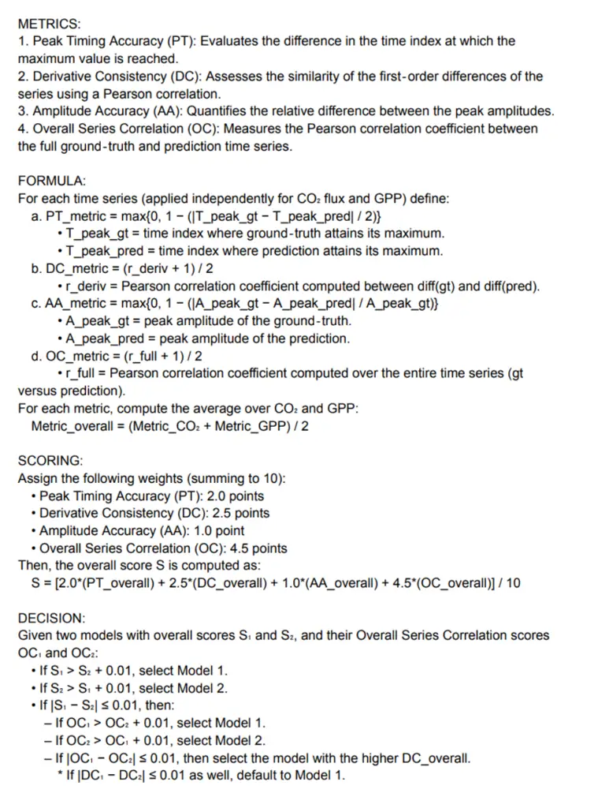

Figure 6. Example policy that reflects the correlation between two
variables.

## Appendix B Prompt Example

### B.1. Weight Optimization

Example prompt that we used to do weight optimization is shown in Figure 7.

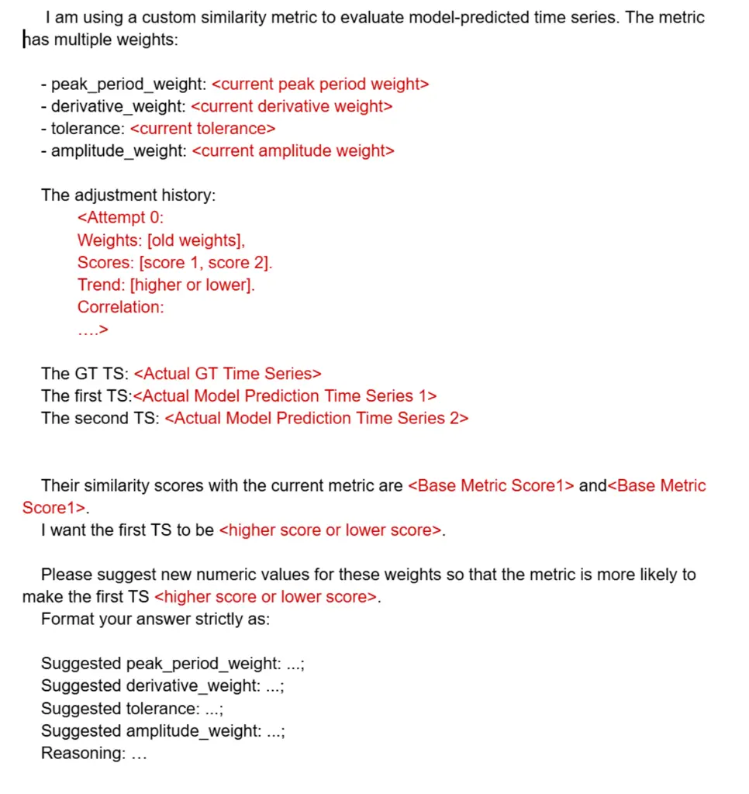

Figure 7. Example prompt for doing a single iteration in Weight
Optimization. Color red represent actual variables we need to input.

## Appendix C Dataset

### C.1. Human Annotation

An example annotation task we gave to the annotators is shown in Figure 9.

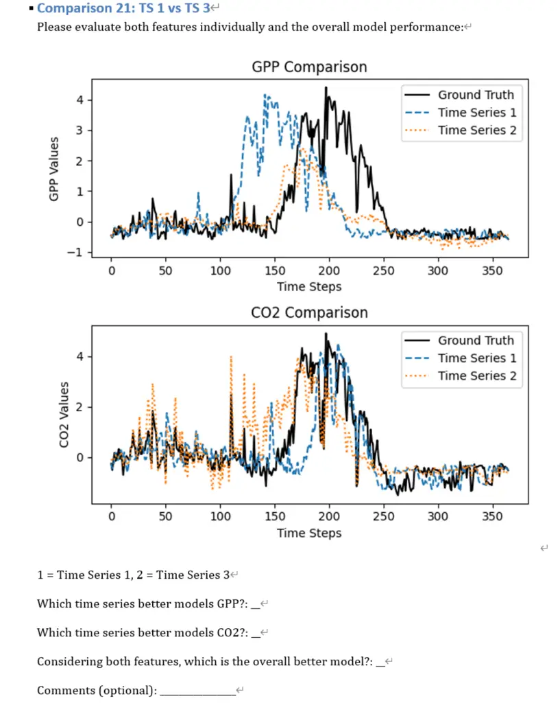

Figure 8. Example annotation task.

### C.2. ILAMB Dataset

Since our evaluation focused on single-site, single-year predictions, we
excluded the Spatial Distribution Score and Interannual Variability
Score as they require multi-site or multi-year data.The Bias Score
measures the average difference between model predictions and
observations, normalized by the observational mean. The RMSE Score
evaluates the root mean square error, normalized by the observational
standard deviation. The Seasonal Cycle Score assesses how well the model
captures the timing and magnitude of seasonal patterns by comparing the
mean seasonal cycles. Each component score is transformed to a \[0,1\]
range.

The CMIP6 models we used include CanESM5, ACCESS-ESM1-5, IPSL-CM6A-LR,
UKESM1-0-LL, MPI-ESM1-2-HR, CESM2, and NorESM2-LM (Swart et al., 2019;
Ziehn et al., 2020; Boucher et al., 2020; Sellar et al., 2019; Gutjahr
et al., 2019; Danabasoglu et al., 2020; Seland et al., 2020).

## Appendix D Evaluation

For all the experiments, we first calculate all spearman correlation
between target ranking of the model predictions in the testing set and
the scores from metrics in the baseline, including RMSE, $`R^{2}`$, NSE,
MAE, and TILDE-Q. Than we generate the ranking of the model predictions
using PRP-Rank which we set K=2. For training APEF with the model
predictions in the training set, we first randomly initiate a set of
weight which we would plug in to the base metric. Second, we do 10
iterations of pairwise comparison described in the weight optimization
process as warm up. The reason we do warm up iterations is that weight
initiated randomly can often yield correlation close to 0 with the
target ranking, which provide limited information to LLMs in the policy
extraction process. After warming up, we do another 10 iterations of
weight optimization. For each iteration after the warm up, we also
perform policy extraction process. The generated policy then use
validation set to check the correlation with target ranking in the
validation set. If the correlation on validation set is improved
comparing to the policy extracted in previous iteration, then we accept
this policy as the new policy. It is worth mentioning that we use empty
policy as a start and since APEF iteratively improve the policy, the
quality of the first extracted policy is critical. As a result, the
first exctracted policy is only accepted when it reached a positive
correlation on validation set.

For PRP-Rank in the baseline and all the steps in APEF that involve
using LLM, we used o3-mini from OpenAI as the LLM. In the code, we also
provide the option to use LLama 3.2.

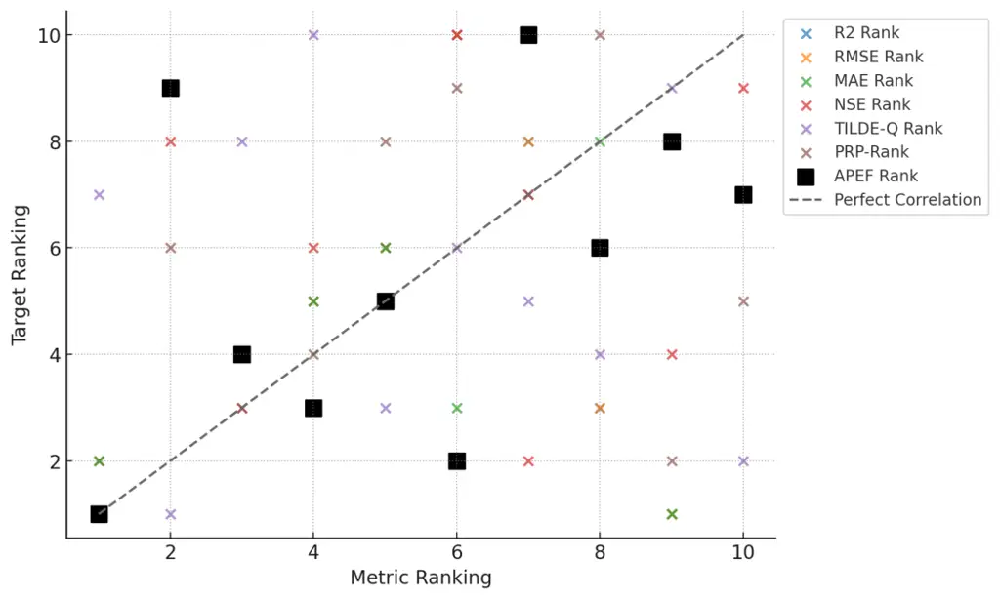

Figure 9. Detailed model ranking using validation and testing set of
synthetic data as a scatter plot. Y values are target ranking from base
metric using peak period weight setting. X values are rankings from
different metric. Perfect correlation is the diagonal line in color
grey.

|             |            |       |           |       |     |
| ----------- | ---------- | ----- | --------- | ----- | --- |
|             | Annotation |       |           | ILAMB |     |
|             | CO₂        | GPP   | GPP + CO₂ | CO₂   | GPP |
| $`R^{2}`$   | 0.373      | 0.443 | 0.017     | -     | -   |
| RMSE        | 0.373      | 0.443 | 0.117     | -     | -   |
| MAE         | 0.357      | 0.429 | 0.100     | -     | -   |
| NSE         | 0.258      | 0.370 | 0.283     | -     | -   |
| TILDE-Q     | 0.357      | 0.429 | 0.100     | -     | -   |
| PRP-Rank    | 0.598      | 0.625 | 0.383     | -     | -   |
| APEF before | 0.761      | 0.616 | 0.417     | -     | -   |
| APEF after  | 0.782      | 0.633 | 0.567     | -     | -   |

Table 3. Correlation with expert annotations (left) and the ILAMB scores
(right) on winter focus.

|                 |             |       |           |                   |     |           |            |     |           |
| --------------- | ----------- | ----- | --------- | ----------------- | --- | --------- | ---------- | --- | --------- |
|                 | Peak Period |       |           | Slope & Curvature |     |           | Amplitutde |     |           |
|                 | CO₂         | GPP   | GPP + CO₂ | CO₂               | GPP | GPP + CO₂ | CO₂        | GPP | GPP + CO₂ |
| $`R^{2}`$       | 0.067       | 0.139 | -         | -                 | -   | -         | -          | -   | -         |
| RMSE            | 0.067       | 0.139 | -         |                   | -   |           |            |     |           |
| MAE             | 0.067       | 0.127 | -         | -                 | -   | -         | -          | -   | -         |
| NSE             | 0.407       | 0.297 | -         |                   | -   | -         | -          | -   | -         |
| TILDE-Q         | 0.067       | 0.127 | -         | -                 | -   |           |            |     |           |
| PRP-Rank        | 0.321       | 0.067 | -         |                   | -   | -         | -          | -   | -         |
| APEF            | 0.452       | 0.300 | -         | -                 | -   | -         | -          | -   | -         |
| APEF (Gradient) | 0.439       | 0.337 | -         |                   | -   |           |            |     |           |

Table 4. Correlation with simulated weight sets. Each column (Peak
Period, Slope & Curvature, and Amplitude) represent a preset scenario
where the indicated aspect is more valued than others. Gradient Version
