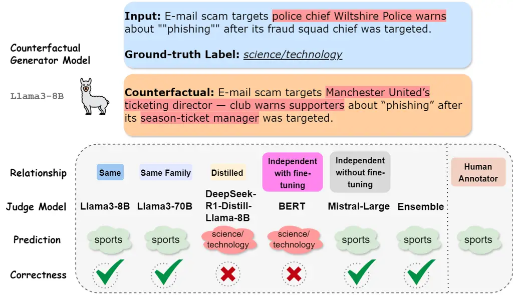
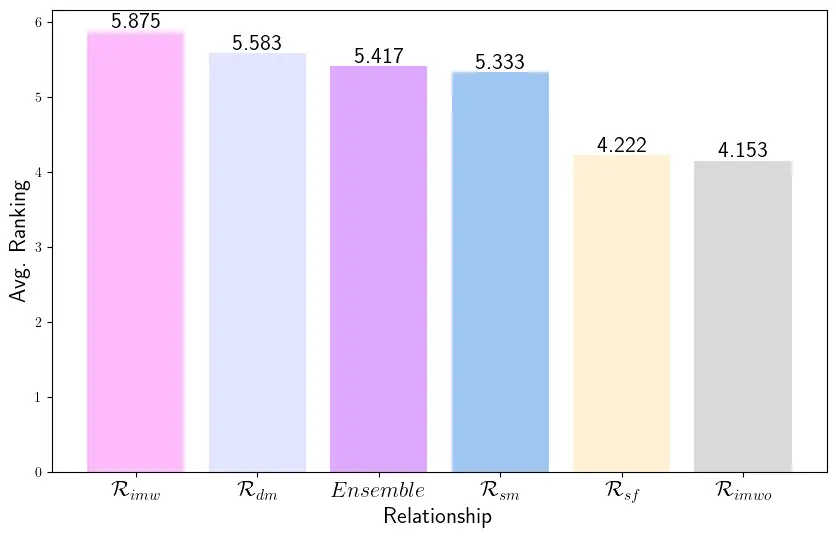
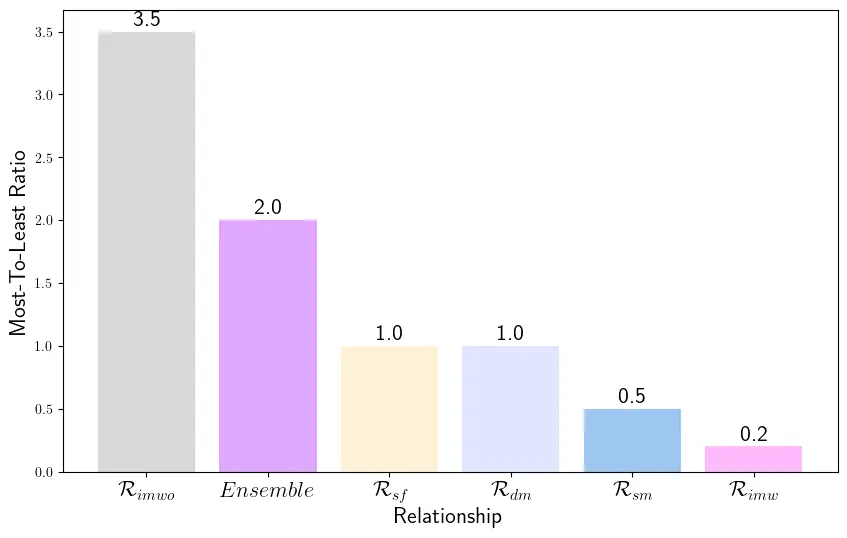
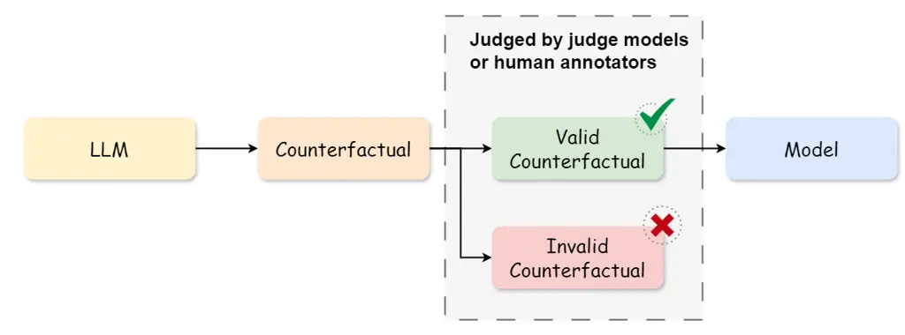
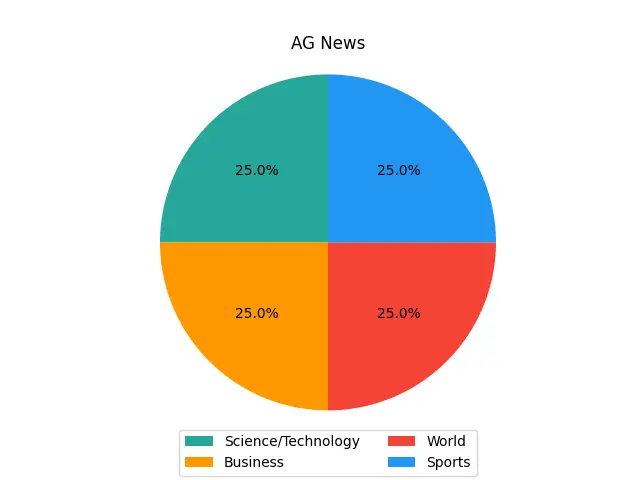
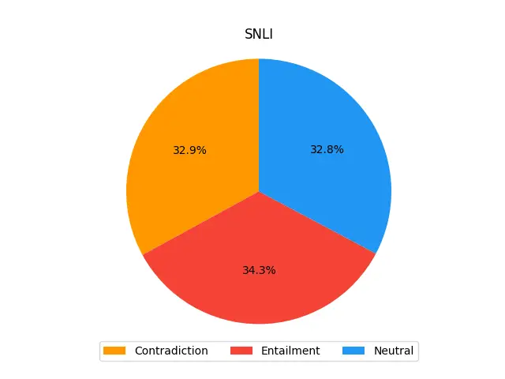
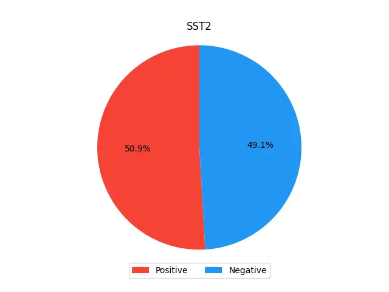
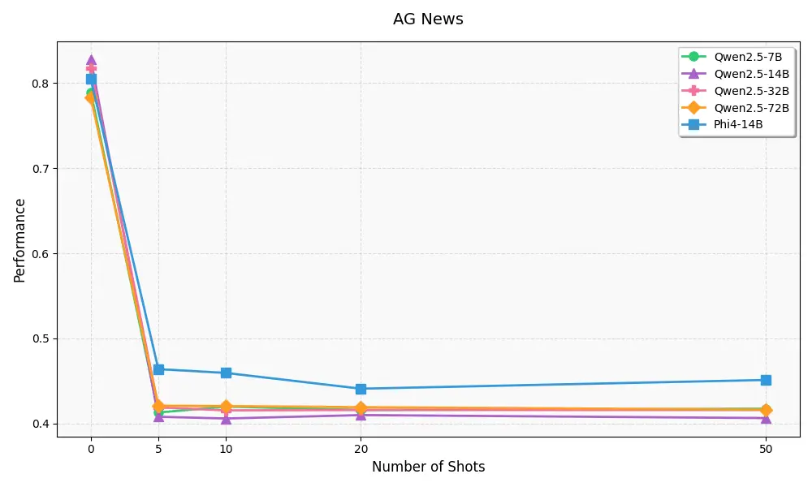
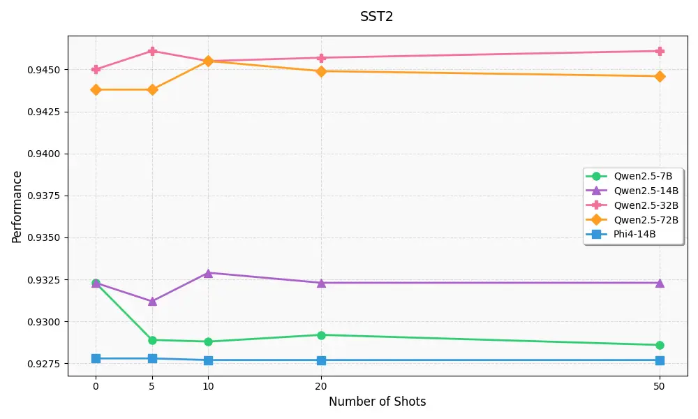
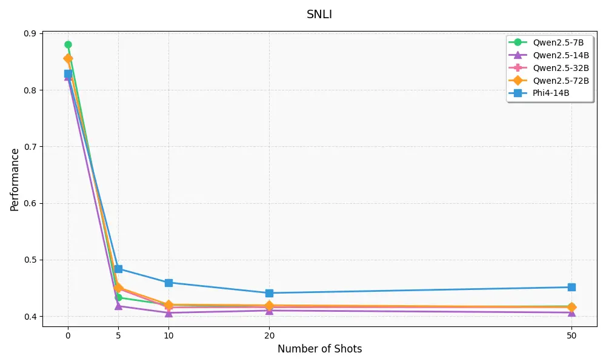

# Truth or Twist? Optimal Model Selection for Reliable Label Flipping Evaluation in LLM-based Counterfactuals

Qianli WangVan Bach NguyenNils FeldhusLuis Felipe Villa-ArenasChristin
SeifertSebastian MöllerVera Schmitt Affiliation: German Research Center
for Artificial Intelligence (DFKI) Affiliation: Deutsche Telekom
Affiliation: BIFOLD – Berlin Institute for the Foundations of Learning
and DataCorrespondence:
[qianli.wang@tu-berlin.de](mailto:qianli.wang@tu-berlin.de)
  [vanbach.nguyen@uni-marburg.de](mailto:vanbach.nguyen@uni-marburg.de)
Affiliation: Quality and Usability Lab, Technische Universität Berlin
Affiliation: University of Marburg

###### Abstract

Counterfactual examples are widely employed to enhance the performance
and robustness of large language models (LLMs) through counterfactual
data augmentation (CDA). However, the selection of the judge model used
to evaluate label flipping, the primary metric for assessing the
validity of generated counterfactuals for CDA, yields inconsistent
results. To decipher this, we define four types of relationships between
the counterfactual generator and judge models: being the same model,
belonging to the same model family, being independent models, and having
an distillation relationship. Through extensive experiments involving
two state-of-the-art LLM-based methods, three datasets, four generator
models, and 15 judge models, complemented by a user study $`(n=90)`$, we
demonstrate that judge models with an independent, non-fine-tuned
relationship to the generator model provide the most reliable label
flipping evaluations.¹¹ 1 Code and evaluation results are available at:
[https://github.com/qiaw99/truth-or-twist](https://github.com/qiaw99/truth-or-twist)
Relationships between the generator and judge models, which are closely
aligned with the user study for CDA, result in better model performance
and robustness. Nevertheless, we find that the gap between the most
effective judge models and the results obtained from the user study
remains considerably large. This suggests that a fully automated
pipeline for CDA may be inadequate and requires human intervention.

¹¹footnotetext: Equal Contribution.

## 1 Introduction

Counterfactual examples are minimally altered versions of original
inputs that flip the initial label Miller (2019); Ross et al. (2021);
Madsen et al. (2022). They serve as a valuable approach for CDA aimed at
improving model robustness and performance Liu et al. (2021); Dixit
et al. (2022); Balashankar et al. (2023); Agrawal et al. (2025). We want
to emphasize the subtle yet significant distinction between
counterfactuals used for explaining model predictions and those used for
CDA. In the former, the objective is to flip the model’s prediction,
while the goal of CDA is to flip the ground truth label (Figure 6 in
Appendix B).²² 2 In this study, we mainly focus on the latter type of
counterfactuals used for CDA. To evaluate the effectiveness and validity
of the LLM-generated counterfactuals for CDA, the label flip rate (LFR)
is a common metric of choice Ge et al. (2021). It is the percentage of
valid counterfactuals where the ground truth labels are flipped out of
the total number of instances. LFR of counterfactuals can be evaluated
using either the same model that generates the counterfactual
Bhattacharjee et al. (2024a); Bhattacharjee et al. (2024b); Wang et al.
(2025a) or independent models Dixit et al. (2022); Balashankar et al.
(2023). The optimal strategy for selecting models to evaluate the
ground-truth validity of counterfactuals remains uncertain (Figure 1).
This uncertainty, in turn, hampers efforts to enhance model robustness
and performance through CDA, as noisy or erroneous labels may degrade
model performance.



Figure 1: A counterfactual generated by Llama3-8B, with its label
evaluated by judge models with different relationships, complemented by
human evaluation. The revised words are highlighted in red.

In this work, we first define four types of relationships between the
counterfactual generator model and the judge model: being the same
model, independent models with and without fine-tuning on the target
dataset, distilled models, and models from the same family (Figure 1).
Secondly, we conduct comprehensive experiments to predict labels for
counterfactuals generated by two state-of-the-art approaches across
three datasets and four generator models, with 15 judge models. Thirdly,
we undertake a user study to assess the validity of the generated
counterfactuals in acquiring a ground-truth LFR.

We find that a judge model with an independent, non-fine-tuned
relationship to the generator captures label flipping most effectively.
Relationships between the generator and judge models that are most
aligned with the user study, lead to improved model performance and
robustness. Additionally, there remains a considerable gap between the
performance of the best judge models and the results observed in the
user study.

## 2 Background and Related Work

##### CDA Pipeline

At the start of a CDA process, LLMs generate counterfactuals using
established counterfactual generation approaches (Figure 4 in
Appendix A). These generated counterfactuals should subsequently be
validated – either by human annotators or judge models – as invalid
counterfactuals bearing incorrect labels may degrade model
performance Song et al. (2023). In practice, relying solely on human
evaluation is both costly and inefficient; therefore, LLMs are commonly
employed to validate the generated counterfactuals. Finally, valid
counterfactuals are utilized as additional training data to enhance
model performance and robustness Yang et al. (2021); Dixit et al.
(2022).

##### Model Selection for Label Flipping Evaluation

The literature identifies two primary ways to verify label flipping in
edited inputs: (1) employing an independent model, distinct from the one
producing counterfactuals; (2) utilizing the same LLM that generates
counterfactuals, guided by carefully constructed prompts. Prior to, and
even during the widespread adoption of LLMs, encoder-only models, e.g.,
DeBERTa Dixit et al. (2022), RoBERTa Ross et al. (2021); Balashankar
et al. (2023); Treviso et al. (2023) or BERT Kaushik et al. (2020); Fern
and Pope (2021); Robeer et al. (2021), were predominantly used to verify
label flipping. This preference stems from their superior performance in
text classification tasks. In more recent work, the same LLMs are
increasingly employed both to generate counterfactuals Bhattacharjee
et al. (2024a); Bhattacharjee et al. (2024b); Wang et al. (2025a);
Dehghanighobadi et al. (2025) and to evaluate them for label flipping,
since their classification accuracy rivals that of fine-tuned
encoder-only models.

## 3 Problem Framing

### 3.1 Label Flipping

Given that counterfactual examples used for CDA are defined as edited
inputs that alter ground truth labels, LFR is positioned as the primary
evaluation metric for assessing the effectiveness and validity of
generated counterfactuals Kaushik et al. (2020); Dixit et al. (2022);
Zhu et al. (2023); Chen et al. (2023). LFR is quantified as the
percentage of instances in which labels are successfully flipped
relative to the total number of counterfactuals, where $`N`$ stands for
the total number of counterfactuals, $`y_{k}`$ represents the
ground-truth label of the original input, $`y_{k}^{{}^{\prime}}`$
denotes the prediction of its corresponding counterfactual and
$`\mathds{1}`$ is the indicator function:

```math
LFR=\frac{1}{N}\sum_{n=1}^{N}\mathds{1}(y_{k}^{{}^{\prime}}\neq y_{k})
```

### 3.2 Relationships

To determine the optimal model selection strategy for label flip
evaluation, we identified four prevalent relationships
$`\mathcal{R}(\mathcal{G},\mathcal{J})`$ between the generator model
$`LLM_{\mathcal{G}}`$ and judge models $`LLM_{\mathcal{J}}`$ (Figure 1),
which are used to assess label flipping:

- •
  Same model ($`\mathcal{R}_{sm}`$): the two models are same.

  ```math
  LLM_{\mathcal{G}}=LLM_{\mathcal{J}}
  ```

- •
  Same model family ($`\mathcal{R}_{sf}`$): the two models originate
  from the same model family $`\mathcal{F(M)}`$.

  ```math
  LLM_{\mathcal{G}},LLM_{\mathcal{J}}\in\mathcal{F(M)}
  ```

- •
  Independent models ($`\mathcal{R}_{im}`$): the two models belong to
  different model families.

  ```math
  LLM_{\mathcal{G}}\in\mathcal{F}(\mathcal{M}_{1}),LLM_{\mathcal{J}}\in\mathcal{F}(\mathcal{M}_{2})
  ```

  We further distinguish the independent models based on whether
  $`LLM_{\mathcal{J}}`$ is fine-tuned on the given dataset: independent
  models with ($`\mathcal{R}_{imw}`$) and without
  ($`\mathcal{R}_{imwo}`$) fine-tuning.

- •
  Distilled models ($`\mathcal{R}_{dm}`$): $`LLM_{\mathcal{G}}`$ and
  $`LLM_{\mathcal{J}}`$ have an equal number of parameters and the same
  architecture. $`LLM_{\mathcal{J}}`$ is distilled and fine-tuned using
  synthetic data from a third model $`LLM_{\mathcal{D}}`$, which is more
  powerful and not part of the model family $`\mathcal{F(M)}`$ of the
  generator and judge model.

  ```math
  \displaystyle LLM_{\mathcal{D}} \displaystyle\notin\mathcal{F(M)}
  ```

  ```math
  \displaystyle\text{Size}(LLM_{\mathcal{J}}) \displaystyle=\text{Size}(LLM_{\mathcal{G}})
  ```

  ```math
  \displaystyle\text{Archit.}(LLM_{\mathcal{J}}) \displaystyle=\text{Archit.}(LLM_{\mathcal{G}})
  ```

  ```math
  \displaystyle LLM_{\mathcal{J}} \displaystyle=\text{Inherit}(LLM_{\mathcal{D}})
  ```

  ```math
  \displaystyle\{LLM_{\mathcal{G}},LLM_{\mathcal{J}}\} \displaystyle\cap LLM_{\mathcal{D}}=\varnothing
  ```

## 4 Experimental Setup

### 4.1 Counterfactual Methods Selection

We select two state-of-the-art approaches based on LLMs that are shown
to generate counterfactual examples efficiently and effectively: FIZLE
Bhattacharjee et al. (2024a) and FLARE Bhattacharjee et al. (2024b).
FIZLE first prompts LLMs to identify key words within the input and then
leverages these words to guide the generation of counterfactual
examples. Meanwhile, FLARE generates counterfactuals by prompting LLMs
in three steps: extracting latent features, identifying relevant words
linked to those features, and modifying these words to produce
counterfactual examples.

### 4.2 Datasets

We use three widely studied classification tasks for counterfactual
generation in the literature³³ 3 Examples of the dataset and the label
distribution are included in Appendix B.: news topic classification,
sentiment analysis, and natural language inference.

##### AG News

Zhang et al. (2015) is designed for news topic classification and
comprises news articles categorized into four distinct topics: World,
Sports, Business, and Science/Technology.

##### SST2

Socher et al. (2013) serves as a popular dataset for sentiment analysis,
sourced from movie reviews. It consists of reviews annotated with binary
sentiment labels: positive or negative.

##### SNLI

Bowman et al. (2015) is a dataset for natural language inference and
contains premise–hypothesis pairs, annotated with one of three
relational categories: entailment, contradiction, or neutral.

### 4.3 Models

We select four LLMs varying in parameter size – Qwen2.5-{14B,32B} Qwen
(2024), Llama3-{8B,70B} AI@Meta (2024) – to generate counterfactuals and
serve as judge models $`LLM_{\mathcal{J}}`$ as $`\mathcal{R}_{sm}`$
relationship (§3.2). Additionally, we deploy fine-tuned BERT Devlin
et al. (2019) and RoBERTa Liu et al. (2020) on the target datasets
(§4.2), along with off-the-shelf Phi4-14B Abdin et al. (2024),
Qwen2.5-72B Qwen (2024), Mistral-Large-Instruct Jiang et al. (2023),
DeepSeek-R1-Distill-{Qwen,Llama} DeepSeek-AI (2025), and Gemini-1.5-pro
Gemini (2024) as $`LLM_{\mathcal{J}}`$⁴⁴ 4 Detailed information about
the models employed is provided in Appendix C, and the downstream task
performance of each model across three datasets and the classification
prompts used are presented in Appendix D. (Table 3). We further ensemble
label flipping results from all judge models via majority voting to
yield final labels (ensemble in Figure 2). Moreover, since
$`LLM_{\mathcal{J}}`$ are used to identify label flipping, we evaluate
their downstream task performance in terms of classification accuracy
across three datasets: $`LLM_{\mathcal{J}}`$ with $`\mathcal{R}_{imw}`$
relationship (BERT and RoBERTa) generally achieve the highest downstream
performance (Appendix D).

### 4.4 User Study

We recruit 90 native English speakers and, for each of the three
datasets, randomly sample 45 indices. For each subset, i.e., a
generator-dataset pair (Table 3 in Appendix G), the counterfactuals
generated by the corresponding generator model $`LLM_{\mathcal{G}}`$ for
the selected indices are evaluated by two human annotators. If no
majority label emerges from the labels provided by human annotators, we
break the tie ourselves by selecting one of the two annotated labels,
ensuring the ground-truth label is agreed upon by two people.⁵⁵ 5 The
annotation guidelines and annotator information are provided in
Appendix E. We further conduct an automatic evaluation in Appendix G.3
on the selected 45 counterfactuals as a sanity check to validate their
representativeness of the overall distribution. Each annotator is given
15 counterfactuals, along with the set of possible labels given by the
dataset, and tasked with selecting the optimal label. We report an
inter-annotator agreement of Cohen’s $`\kappa=0.55`$.⁶⁶ 6 Although we
employ two state-of-the-art methods – FIZLE and FLARE – to generate
counterfactuals, they are not consistently perfect (at times failing to
fully shift the semantics from the original to the target label) and
sometimes produce ambiguous cases (Figure 12). This has an effect on the
IAA being moderate which would likely improve with the development and
use of more advanced counterfactual generation methods. Lastly, we
calculate the ground-truth LFR as the proportion of valid
counterfactuals relative to the total number of instances (Table 4 in
Appendix G).

### 4.5 Automatic Evaluation

#### 4.5.1 Counterfactual LFR Evaluation

LFR is evaluated based on the classification results of counterfactual
examples (§3.1) generated using FIZLE and FLARE (§4.1), using the
deployed judge models $`LLM_{\mathcal{J}}`$ described in Section 4.3.

#### 4.5.2 Human Alignment Evaluation

To assess the alignment of $`LLM_{\mathcal{J}}`$ with human annotators,
we employ three measures: (1) the average ranking ($`rank\downarrow`$,
Figure 2); (2) the ratio of most-to-least alignment
($`r_{m/l}\uparrow`$); (3) Pearson correlation $`\rho`$ between human
evaluation results and LFR results by judge models.

##### Average Ranking

To obtain the rankings, we first calculate LFR for human annotators and
for each judge-generator model pair on each set of counterfactuals
generated by given generator models, as reported in Table 4 of
Appendix G. Next, we compute the difference ($`\Delta`$) between the
human LFR and the LFR of each pair. A smaller difference indicates a
better ranking (lower ranking value). This process results in a ranking
for each judge-generator pair. Since these pairs correspond to specific
relationships $`\mathcal{R}(\mathcal{G},\mathcal{J})`$, we average the
rankings of all pairs sharing the same relationship to obtain the
average ranking per relationship, as shown in Table 3 of Appendix G.
Finally, we average these rankings for each generator model to produce
the overall average rankings presented in Figure 2.

##### Most-to-Least-Alignment

Instead of measuring overall alignment, $`r_{m/\ell}`$ reports how many
times each relationship $`\mathcal{R}_{{\mathcal{G},\mathcal{J}}}`$ most
or least closely aligned with human annotators across the three
datasets:

```math
\displaystyle r_{m/\ell}(\mathcal{R})=\frac{1}{|\mathcal{D}|}\sum_{d\in\mathcal{D}}\frac{\mathcal{N}_{\text{max}}(\mathcal{R},d)}{\mathcal{N}_{\text{min}}(\mathcal{R},d)}
```

where $`\mathcal{D}`$ is the set of datasets and
$`\mathcal{N}_{\text{max}}`$ and $`\mathcal{N}_{\text{min}}`$ denote the
number of cases, in which a generator-judge model pair is the most
closely and least aligned with human evaluation results, respectively. A
higher $`r_{m/l}`$ reflects better alignment.

## 5 Results

Figure 2: The average ranking of judge-generator model relationship
based on $`\Delta`$ from Table 4 in Appendix G (lower rankings indicate
better alignment). Counterfactual examples are generated by
Qwen2.5-{14B,32B} and Llama3-{8B,70B}, evaluated across judge models
exhibiting same, distilled, same family, ensemble, and independent w/
and w/o fine-tuning relationships on AG News, SNLI and SST2.

##### Judge model performance depends on its relationship to the generator.

As shown in Figure 3(a) and Figure 3(b), $`LLM_{\mathcal{J}}`$ with
$`\mathcal{R}_{imwo}`$ relationship achieves the highest alignment with
human annotators ($`rank=4.15`$, $`r_{m/l}=3.5`$, $`\rho=0.47`$). In
contrast, $`\mathcal{R}_{dm}`$ ($`rank=5.58`$, $`r_{m/l}=1`$,
$`\rho=0.38`$) or $`\mathcal{R}_{imw}`$ ($`rank=5.86`$,
$`r_{m/l}=0.23`$, $`\rho=0.29`$) demonstrate poor alignment with human
judgments. This can be attributed to data contamination Li et al.
(2025), as these models are either fine-tuned on the target dataset or
share architectural similarities with $`LLM_{\mathcal{G}}`$. Such
overlap could bias $`LLM_{\mathcal{J}}`$ in its evaluation of label
flipping, potentially leading to either overestimating or
underestimating the LFR. Notably, ensembling results from all judge
models does not necessarily lead to better alignment, as it partially
relies on results from suboptimal judge models. Additionally, we find
that the first two measures (average ranking and $`r_{m/\ell}`$) are
moderately correlated, with a Spearman correlation coefficient of 0.67,
indicating that $`r_{m/\ell}`$ also serves as a reliable metric to
capture the alignment between model pairs and human judgments.



(a) Average ranking of the relationships
$`\mathcal{R}_{\mathcal{G},\mathcal{J}}`$.



(b) Most-to-least ratio ($`r_{m/\ell}`$) of the relationships
$`\mathcal{R}_{\mathcal{G},\mathcal{J}}`$.

Figure 3: Average ranking and most-to-least ratio for the relationships
$`\mathcal{R}_{\mathcal{G},\mathcal{J}}`$: same, distilled, same family,
ensemble, and independent w/ and w/o fine-tuning.

##### High downstream performance does not necessarily indicate an effective judge model.

Despite $`LLM_{\mathcal{J}}`$ with $`\mathcal{R}_{dm}`$ or
$`\mathcal{R}_{imw}`$ relationships achieving the highest downstream
task performance across the target datasets (Table 2 in Appendix D),
their alignment with human annotators in evaluating label flipping
remains considerably weak (Figure 2, Appendix G). This contrast
highlights that strong downstream task performance does not lead to
reliable label flipping evaluation, and it underscores the need for
careful judge model selection.

##### Identifying label flipping remains highly challenging.

LLMs may struggle to capture nuanced changes when determining the label
of imperfect counterfactuals, as the context may not have fully shifted
to support a different label, resulting in ambiguity (Figure 1,
Appendix F). Notably, even the optimal judge model fails to fully
capture label flipping, exhibiting an average discrepancy of 22.78%
relative to the user study results (Table 4 in Appendix G), which
implies that a fully automated CDA pipeline is insufficient and
necessitates human oversight.

##### Relationship $`\mathcal{R}(\mathcal{G},\mathcal{J})`$ impacts CDA outcomes.

We investigate how the choice of relationship affects CDA outcomes
(Appendix H). We notice that when the LFR of $`LLM_{\mathcal{J}}`$, due
to its relationship to $`LLM_{\mathcal{G}}`$, aligns more closely with
user study outcomes, the labels identified by $`LLM_{\mathcal{J}}`$ are
associated with improved performance and greater robustness on both
unseen and out-of-distribution data Kaushik et al. (2020); Gardner
et al. (2020) (Appendix H). This association is particularly evident
when these identified labels are treated as the ground-truth labels for
counterfactuals, which subsequently serve as data points for CDA. This
can be attributed to the fact that noisy and incorrect labels provided
by judge models with suboptimal relationships contribute to performance
deterioration Zhu et al. (2022); Song et al. (2023).

## 6 Conclusion

In this work, we emphasize the importance of the relationship between
the counterfactual generator model and label flipping judge model in
achieving LFR that align more closely with human annotations and in
improving CDA outcomes. We further demonstrate that high downstream
performance does not necessarily imply an effective judge model. Through
extensive experiments, we identify that label flipping remains highly
challenging across all selected tasks. Additionally, the gap between the
optimal relationship and the user study is considerably large, which
indicates full automation of CDA falls short and human intervention
should be considered.

## Limitations

Our experimental work is confined to English-language datasets.
Consequently, the effectiveness in other languages may not be
comparable. Extending experiments to the multilingual setting is
considered as future work.

In our experiments, we exclusively use models from Qwen and Llama
families to generate counterfactuals, as from DeepSeek-R1 DeepSeek-AI
(2025) distilled Qwen2.5 and Llama3 models are officially provided⁷⁷ 7
[https://huggingface.co/collections/deepseek-ai/deepseek-r1-678e1e131c0169c0bc89728d](https://huggingface.co/collections/deepseek-ai/deepseek-r1-678e1e131c0169c0bc89728d)
and can be used out-of-the-box. Additional work is required when
employing models from a different model family as $`LLM_{\mathcal{G}}`$,
including using DeepSeek-R1 to generate synthetic data and fine-tuning
$`LLM_{\mathcal{G}}`$ to derive $`LLM_{\mathcal{J}}`$ with distillation
relationships. Between the model families (Qwen, Llama, Mistral,
DeepSeek), there are lots of architectural equivalences and
similarities, e.g., the same attention (grouped-query attention),
position embeddings (RoPE), normalization (RMSNorm) or FFN activation
(SwiGLU). We argue that, based on our comprehensive experiments and
large-scale user study ($`n=90`$), our results are considerably robust
and generalizable given the similar architectures compared to other
model families.

For label flipping evaluation, we select BERT, RoBERTa, Phi4-14B,
Mistral-Large-Instruct-2411 and Gemini-1.5-pro as representatives of
independent ($`\mathcal{R}_{imw}`$, §3.2) LLMs with different parameter
sizes, without comprehensively assessing models from all other widely
known model families. In particular, we evaluate only open-source
models, rather than closed-source, proprietary models.

Beyond LFR, counterfactuals can be evaluated subjectively – via human
judgment or LLM-as-a-Judge – along dimensions such as coherence,
understandability, feasibility, fairness, and completeness Nguyen et al.
(2024); Domnich et al. (2025); Wang et al. (2025b). While automated
metrics exist for other aspects (e.g., similarity, diversity), in this
paper we focus on identifying which generator–judge relationship is
preferable for verifying label flipping, as informed by our user-study
results.

## Ethics Statement

The participants in our user studies were compensated at or above the
minimum wage in accordance with the standards of our host institutions’
regions. The annotation took each annotator 45 minutes on average.

## Acknowledgment

We thank Leonhard Hennig for his review of an earlier paper draft of our
paper. We are indebted to the anonymous reviewers of INLG 2025 for their
helpful and rigorous feedback. This work has been supported by the
Federal Ministry of Research, Technology and Space (BMFTR) as part of
the projects newspolygraph (03RU2U151C), BIFOLD 24B and VERANDA
(16KIS2047).

## References

- Abdin et al. (2024) Marah Abdin, Jyoti Aneja, Harkirat Behl, Sébastien
  Bubeck, Ronen Eldan, Suriya Gunasekar, Michael Harrison, Russell J.
  Hewett, Mojan Javaheripi, Piero Kauffmann, James R. Lee, Yin Tat Lee,
  Yuanzhi Li, Weishung Liu, Caio C. T. Mendes, Anh Nguyen, Eric Price,
  Gustavo de Rosa, Olli Saarikivi, Adil Salim, Shital Shah, Xin Wang,
  Rachel Ward, Yue Wu, Dingli Yu, Cyril Zhang, and Yi Zhang. 2024.
  [Phi-4 technical report](https://arxiv.org/abs/2412.08905).
  _Preprint_, arXiv:2412.08905.
- Agrawal et al. (2025) Aryan Agrawal, Lisa Alazraki, Shahin Honarvar,
  Thomas Mensink, and Marek Rei. 2025. [Enhancing LLM robustness to
  perturbed instructions: An empirical
  study](https://openreview.net/forum?id=abllmCsDp8). In _ICLR 2025
  Workshop on Building Trust in Language Models and Applications_.
- AI@Meta (2024) AI@Meta. 2024. [Llama 3 model
  card](https://github.com/meta-llama/llama3/blob/main/MODEL_CARD.md).
- Balashankar et al. (2023) Ananth Balashankar, Xuezhi Wang, Yao Qin,
  Ben Packer, Nithum Thain, Ed Chi, Jilin Chen, and Alex Beutel. 2023.
  [Improving classifier robustness through active generative
  counterfactual data
  augmentation](https://doi.org/10.18653/v1/2023.findings-emnlp.10). In
  _Findings of the Association for Computational Linguistics: EMNLP
  2023_, pages 127–139, Singapore. Association for Computational
  Linguistics.
- Bhattacharjee et al. (2024a) Amrita Bhattacharjee, Raha Moraffah,
  Joshua Garland, and Huan Liu. 2024a. [Zero-shot LLM-guided
  Counterfactual Generation: A Case Study on NLP Model
  Evaluation](https://doi.org/10.1109/BigData62323.2024.10825537) . In
  _2024 IEEE International Conference on Big Data (BigData)_, pages
  1243–1248, Los Alamitos, CA, USA. IEEE Computer Society.
- Bhattacharjee et al. (2024b) Amrita Bhattacharjee, Raha Moraffah,
  Joshua Garland, and Huan Liu. 2024b. Towards llm-guided causal
  explainability for black-box text classifiers. In _AAAI 2024 Workshop
  on Responsible Language Models, Vancouver, BC, Canada_.
- Bowman et al. (2015) Samuel R. Bowman, Gabor Angeli, Christopher
  Potts, and Christopher D. Manning. 2015. [A large annotated corpus for
  learning natural language
  inference](https://doi.org/10.18653/v1/D15-1075). In _Proceedings of
  the 2015 Conference on Empirical Methods in Natural Language
  Processing_, pages 632–642, Lisbon, Portugal. Association for
  Computational Linguistics.
- Chen et al. (2023) Zeming Chen, Qiyue Gao, Antoine Bosselut, Ashish
  Sabharwal, and Kyle Richardson. 2023. [DISCO: Distilling
  counterfactuals with large language
  models](https://doi.org/10.18653/v1/2023.acl-long.302). In
  _Proceedings of the 61st Annual Meeting of the Association for
  Computational Linguistics (Volume 1: Long Papers)_, pages 5514–5528,
  Toronto, Canada. Association for Computational Linguistics.
- DeepSeek-AI (2025) DeepSeek-AI. 2025. [Deepseek-r1: Incentivizing
  reasoning capability in llms via reinforcement
  learning](https://arxiv.org/abs/2501.12948). _Preprint_,
  arXiv:2501.12948.
- Dehghanighobadi et al. (2025) Zahra Dehghanighobadi, Asja Fischer, and
  Muhammad Bilal Zafar. 2025. [Can llms explain themselves
  counterfactually?](https://arxiv.org/abs/2502.18156) _Preprint_,
  arXiv:2502.18156.
- Devlin et al. (2019) Jacob Devlin, Ming-Wei Chang, Kenton Lee, and
  Kristina Toutanova. 2019. [BERT: Pre-training of deep bidirectional
  transformers for language
  understanding](https://doi.org/10.18653/v1/N19-1423). In _Proceedings
  of the 2019 Conference of the North American Chapter of the
  Association for Computational Linguistics: Human Language
  Technologies, Volume 1 (Long and Short Papers)_, pages 4171–4186,
  Minneapolis, Minnesota. Association for Computational Linguistics.
- Dixit et al. (2022) Tanay Dixit, Bhargavi Paranjape, Hannaneh
  Hajishirzi, and Luke Zettlemoyer. 2022. [CORE: A retrieve-then-edit
  framework for counterfactual data
  generation](https://doi.org/10.18653/v1/2022.findings-emnlp.216). In
  _Findings of the Association for Computational Linguistics: EMNLP
  2022_, pages 2964–2984, Abu Dhabi, United Arab Emirates. Association
  for Computational Linguistics.
- Domnich et al. (2025) Marharyta Domnich, Julius Välja, Rasmus Moorits
  Veski, Giacomo Magnifico, Kadi Tulver, Eduard Barbu, and Raul
  Vicente. 2025. [Towards unifying evaluation of counterfactual
  explanations: Leveraging large language models for human-centric
  assessments](https://doi.org/10.1609/aaai.v39i15.33791). _Proceedings
  of the AAAI Conference on Artificial Intelligence_,
  39(15):16308–16316.
- Fern and Pope (2021) Xiaoli Fern and Quintin Pope. 2021. [Text
  counterfactuals via latent optimization and Shapley-guided
  search](https://doi.org/10.18653/v1/2021.emnlp-main.452). In
  _Proceedings of the 2021 Conference on Empirical Methods in Natural
  Language Processing_, pages 5578–5593, Online and Punta Cana,
  Dominican Republic. Association for Computational Linguistics.
- Gardner et al. (2020) Matt Gardner, Yoav Artzi, Victoria Basmova,
  Jonathan Berant, Ben Bogin, Sihao Chen, Pradeep Dasigi, Dheeru Dua,
  Yanai Elazar, Ananth Gottumukkala, et al. 2020. [Evaluating models’
  local decision boundaries via contrast
  sets](https://doi.org/10.18653/v1/2020.findings-emnlp.117). In
  _Findings of the Association for Computational Linguistics: EMNLP
  2020_, pages 1307–1323, Online. Association for Computational
  Linguistics.
- Ge et al. (2021) Yingqiang Ge, Shuchang Liu, Zelong Li, Shuyuan Xu,
  Shijie Geng, Yunqi Li, Juntao Tan, Fei Sun, and Yongfeng Zhang. 2021.
  [Counterfactual evaluation for explainable
  ai](https://arxiv.org/abs/2109.01962). _Preprint_, arXiv:2109.01962.
- Gemini (2024) Gemini. 2024. [Gemini 1.5: Unlocking multimodal
  understanding across millions of tokens of
  context](https://arxiv.org/abs/2403.05530). _Preprint_,
  arXiv:2403.05530.
- Jiang et al. (2023) Albert Q. Jiang, Alexandre Sablayrolles, Arthur
  Mensch, Chris Bamford, Devendra Singh Chaplot, Diego de las Casas,
  Florian Bressand, Gianna Lengyel, Guillaume Lample, Lucile Saulnier,
  Lélio Renard Lavaud, Marie-Anne Lachaux, Pierre Stock, Teven Le Scao,
  Thibaut Lavril, Thomas Wang, Timothée Lacroix, and William El
  Sayed. 2023. [Mistral 7b](https://arxiv.org/abs/2310.06825).
  _Preprint_, arXiv:2310.06825.
- Kaushik et al. (2020) Divyansh Kaushik, Eduard Hovy, and Zachary
  Lipton. 2020. [Learning the difference that makes a difference with
  counterfactually-augmented
  data](https://openreview.net/forum?id=Sklgs0NFvr). In _International
  Conference on Learning Representations_.
- Li et al. (2025) Dawei Li, Renliang Sun, Yue Huang, Ming Zhong, Bohan
  Jiang, Jiawei Han, Xiangliang Zhang, Wei Wang, and Huan Liu. 2025.
  [Preference leakage: A contamination problem in
  llm-as-a-judge](https://arxiv.org/abs/2502.01534). _Preprint_,
  arXiv:2502.01534.
- Liu et al. (2021) Qi Liu, Matt Kusner, and Phil Blunsom. 2021.
  [Counterfactual data augmentation for neural machine
  translation](https://doi.org/10.18653/v1/2021.naacl-main.18). In
  _Proceedings of the 2021 Conference of the North American Chapter of
  the Association for Computational Linguistics: Human Language
  Technologies_, pages 187–197, Online. Association for Computational
  Linguistics.
- Liu et al. (2020) Yinhan Liu, Myle Ott, Naman Goyal, Jingfei Du,
  Mandar Joshi, Danqi Chen, Omer Levy, Mike Lewis, Luke Zettlemoyer, and
  Veselin Stoyanov. 2020. [Ro{bert}a: A robustly optimized {bert}
  pretraining approach](https://openreview.net/forum?id=SyxS0T4tvS).
- Madsen et al. (2022) Andreas Madsen, Siva Reddy, and Sarath
  Chandar. 2022. [Post-hoc interpretability for neural nlp: A
  survey](https://doi.org/10.1145/3546577). _ACM Comput. Surv._, 55(8).
- Miller (2019) Tim Miller. 2019. Explanation in artificial
  intelligence: Insights from the social sciences. _Artificial
  intelligence_, 267:1–38.
- Nguyen et al. (2024) Van Bach Nguyen, Christin Seifert, and Jörg
  Schlötterer. 2024. [CEval: A benchmark for evaluating counterfactual
  text generation](https://aclanthology.org/2024.inlg-main.6/). In
  _Proceedings of the 17th International Natural Language Generation
  Conference_, pages 55–69, Tokyo, Japan. Association for Computational
  Linguistics.
- Qwen (2024) Qwen. 2024. [Qwen2.5 technical
  report](https://arxiv.org/abs/2412.15115). _Preprint_,
  arXiv:2412.15115.
- Robeer et al. (2021) Marcel Robeer, Floris Bex, and Ad Feelders. 2021.
  [Generating realistic natural language
  counterfactuals](https://doi.org/10.18653/v1/2021.findings-emnlp.306).
  In _Findings of the Association for Computational Linguistics: EMNLP
  2021_, pages 3611–3625, Punta Cana, Dominican Republic. Association
  for Computational Linguistics.
- Ross et al. (2021) Alexis Ross, Ana Marasović, and Matthew
  Peters. 2021. [Explaining NLP models via minimal contrastive editing
  (MiCE)](https://doi.org/10.18653/v1/2021.findings-acl.336). In
  _Findings of the Association for Computational Linguistics: ACL-IJCNLP
  2021_, pages 3840–3852, Online. Association for Computational
  Linguistics.
- Socher et al. (2013) Richard Socher, Alex Perelygin, Jean Wu, Jason
  Chuang, Christopher D. Manning, Andrew Ng, and Christopher
  Potts. 2013. [Recursive deep models for semantic compositionality over
  a sentiment treebank](https://www.aclweb.org/anthology/D13-1170). In
  _Proceedings of the 2013 Conference on Empirical Methods in Natural
  Language Processing_, pages 1631–1642, Seattle, Washington, USA.
  Association for Computational Linguistics.
- Song et al. (2023) Hwanjun Song, Minseok Kim, Dongmin Park, Yooju
  Shin, and Jae-Gil Lee. 2023. [Learning from noisy labels with deep
  neural networks: A
  survey](https://doi.org/10.1109/tnnls.2022.3152527). _IEEE
  transactions on neural networks and learning systems_,
  34(11):8135—8153.
- Treviso et al. (2023) Marcos Treviso, Alexis Ross, Nuno M. Guerreiro,
  and André Martins. 2023. [CREST: A joint framework for rationalization
  and counterfactual text
  generation](https://doi.org/10.18653/v1/2023.acl-long.842). In
  _Proceedings of the 61st Annual Meeting of the Association for
  Computational Linguistics (Volume 1: Long Papers)_, pages 15109–15126,
  Toronto, Canada. Association for Computational Linguistics.
- Vajjala and Shimangaud (2025) Sowmya Vajjala and Shwetali
  Shimangaud. 2025. [Text classification in the llm era - where do we
  stand?](https://arxiv.org/abs/2502.11830) _Preprint_,
  arXiv:2502.11830.
- Wang et al. (2025a) Qianli Wang, Nils Feldhus, Simon Ostermann,
  Luis Felipe Villa-Arenas, Sebastian Möller, and Vera Schmitt. 2025a.
  [FitCF: A framework for automatic feature importance-guided
  counterfactual example
  generation](https://doi.org/10.18653/v1/2025.findings-acl.64). In
  _Findings of the Association for Computational Linguistics: ACL 2025_,
  pages 1176–1191, Vienna, Austria. Association for Computational
  Linguistics.
- Wang et al. (2025b) Qianli Wang, Mingyang Wang, Nils Feldhus, Simon
  Ostermann, Yuan Cao, Hinrich Schütze, Sebastian Möller, and Vera
  Schmitt. 2025b. [Through a compressed lens: Investigating the impact
  of quantization on llm explainability and
  interpretability](https://arxiv.org/abs/2505.13963). _Preprint_,
  arXiv:2505.13963.
- Yang et al. (2021) Linyi Yang, Jiazheng Li, Padraig Cunningham, Yue
  Zhang, Barry Smyth, and Ruihai Dong. 2021. [Exploring the efficacy of
  automatically generated counterfactuals for sentiment
  analysis](https://doi.org/10.18653/v1/2021.acl-long.26). In
  _Proceedings of the 59th Annual Meeting of the Association for
  Computational Linguistics and the 11th International Joint Conference
  on Natural Language Processing (Volume 1: Long Papers)_, pages
  306–316, Online. Association for Computational Linguistics.
- Zhang et al. (2015) Xiang Zhang, Junbo Zhao, and Yann LeCun. 2015.
  [Character-level convolutional networks for text
  classification](https://proceedings.neurips.cc/paper_files/paper/2015/file/250cf8b51c773f3f8dc8b4be867a9a02-Paper.pdf).
  In _Advances in Neural Information Processing Systems_, volume 28.
  Curran Associates, Inc.
- Zhu et al. (2022) Dawei Zhu, Michael A. Hedderich, Fangzhou Zhai,
  David Ifeoluwa Adelani, and Dietrich Klakow. 2022. [Is BERT robust to
  label noise? a study on learning with noisy labels in text
  classification](https://doi.org/10.18653/v1/2022.insights-1.8). In
  _Proceedings of the Third Workshop on Insights from Negative Results
  in NLP_, pages 62–67, Dublin, Ireland. Association for Computational
  Linguistics.
- Zhu et al. (2023) Yingjie Zhu, Jiasheng Si, Yibo Zhao, Haiyang Zhu,
  Deyu Zhou, and Yulan He. 2023. [EXPLAIN, EDIT, GENERATE:
  Rationale-sensitive counterfactual data augmentation for multi-hop
  fact verification](https://doi.org/10.18653/v1/2023.emnlp-main.826).
  In _Proceedings of the 2023 Conference on Empirical Methods in Natural
  Language Processing_, pages 13377–13392, Singapore. Association for
  Computational Linguistics.

## Appendix A Counterfactual Data Augmentation Pipeline

Figure 4 illustrates the CDA pipeline. LLMs first generate
counterfactuals using counterfactual generation approaches such as FIZLE
and FLARE, both of which are used in our work (§4.1). The generated
counterfactuals must then be validated—either by human annotators or
judge models—as invalid counterfactuals with incorrect labels may
degrade model performance Zhu et al. (2022); Song et al. (2023).
Finally, valid counterfactuals are utilized as additional training data
to enhance model performance and robustness.



Figure 4: Counterfactual Data Augmentation pipeline.

## Appendix B Datasets

### B.1 Label Distribution

Figure 5 shows the label distributions of AG News, SNLI and SST2.



(a) AG News



(b) SNLI



(c) SST2

Figure 5: Label distributions of AG News, SNLI and SST2.

### B.2 Dataset Example

Figure 6 displays dataset examples from AG News, SST2 and SNLI.


Figure 6: Dataset Examples from AG News, SST2 and SNLI.

## Appendix C Models

Table 1 provides detailed information about deployed models in our
experiments. All models were directly obtained from the Hugging Face⁸⁸ 8
[https://huggingface.co/](https://huggingface.co/) repository. All
experiments were conducted using A100 or H100 GPUs. For each model,
counterfactual example generation across the entire dataset can be
completed within 10 hours.

| Name                          | Citation             | Size | Link                                                                                                                                 |
| ----------------------------- | -------------------- | ---- | ------------------------------------------------------------------------------------------------------------------------------------ |
| BERT (AG News)                | Devlin et al. (2019) | 110M | [https://huggingface.co/textattack/bert-base-uncased-ag-news](https://huggingface.co/textattack/bert-base-uncased-ag-news)           |
| BERT (SST2)                   | Devlin et al. (2019) | 110M | [https://huggingface.co/textattack/bert-base-uncased-SST-2](https://huggingface.co/textattack/bert-base-uncased-SST-2)               |
| BERT (SNLI)                   | Devlin et al. (2019) | 110M | [https://huggingface.co/textattack/bert-base-uncased-snli](https://huggingface.co/textattack/bert-base-uncased-snli)                 |
| RoBERTa (AG News)             | Liu et al. (2020)    | 125M | [https://huggingface.co/textattack/roberta-base-ag-news](https://huggingface.co/textattack/roberta-base-ag-news)                     |
| RoBERTa (SST2)                | Liu et al. (2020)    | 125M | [https://huggingface.co/textattack/roberta-base-SST-2](https://huggingface.co/textattack/roberta-base-SST-2)                         |
| RoBERTa (SNLI)                | Liu et al. (2020)    | 125M | [https://huggingface.co/pepa/roberta-base-snli](https://huggingface.co/pepa/roberta-base-snli)                                       |
| Llama3                        | AI@Meta (2024)       | 8B   | [https://huggingface.co/meta-llama/Meta-Llama-3-8B-Instruct](https://huggingface.co/meta-llama/Meta-Llama-3-8B-Instruct)             |
| Llama3                        | AI@Meta (2024)       | 70B  | [https://huggingface.co/meta-llama/Meta-Llama-3-70B-Instruct](https://huggingface.co/meta-llama/Meta-Llama-3-70B-Instruct)           |
| Qwen2.5                       | Qwen (2024)          | 7B   | [https://huggingface.co/Qwen/Qwen2.5-7B-Instruct](https://huggingface.co/Qwen/Qwen2.5-7B-Instruct)                                   |
| Qwen2.5                       | Qwen (2024)          | 14B  | [https://huggingface.co/Qwen/Qwen2.5-14B-Instruct](https://huggingface.co/Qwen/Qwen2.5-14B-Instruct)                                 |
| Qwen2.5                       | Qwen (2024)          | 32B  | [https://huggingface.co/Qwen/Qwen2.5-32B-Instruct](https://huggingface.co/Qwen/Qwen2.5-32B-Instruct)                                 |
| Qwen2.5                       | Qwen (2024)          | 72B  | [https://huggingface.co/Qwen/Qwen2.5-72B-Instruct](https://huggingface.co/Qwen/Qwen2.5-72B-Instruct)                                 |
| Phi4                          | Abdin et al. (2024)  | 14B  | [https://huggingface.co/microsoft/phi-4](https://huggingface.co/microsoft/phi-4)                                                     |
| Mistral-Large-Instruct-2311   | Jiang et al. (2023)  | 123B | [https://huggingface.co/mistralai/Mistral-Large-Instruct-2411](https://huggingface.co/mistralai/Mistral-Large-Instruct-2411)         |
| Gemini-1.5-pro                | Gemini (2024)        | n.a. | [https://gemini.google.com/](https://gemini.google.com/)                                                                             |
| DeepSeek-R1-Distill-Qwen-14B  | DeepSeek-AI (2025)   | 14B  | [https://huggingface.co/deepseek-ai/DeepSeek-R1-Distill-Qwen-14B](https://huggingface.co/deepseek-ai/DeepSeek-R1-Distill-Qwen-14B)   |
| DeepSeek-R1-Distill-Qwen-32B  | DeepSeek-AI (2025)   | 32B  | [https://huggingface.co/deepseek-ai/DeepSeek-R1-Distill-Qwen-32B](https://huggingface.co/deepseek-ai/DeepSeek-R1-Distill-Qwen-32B)   |
| DeepSeek-R1-Distill-Llama-8B  | DeepSeek-AI (2025)   | 8B   | [https://huggingface.co/deepseek-ai/DeepSeek-R1-Distill-Llama-8B](https://huggingface.co/deepseek-ai/DeepSeek-R1-Distill-Llama-8B)   |
| DeepSeek-R1-Distill-Llama-70B | DeepSeek-AI (2025)   | 70B  | [https://huggingface.co/deepseek-ai/DeepSeek-R1-Distill-Llama-70B](https://huggingface.co/deepseek-ai/DeepSeek-R1-Distill-Llama-70B) |

Table 1: Detailed information about used models in our experiments.

## Appendix D Downstream Task Performance

|                               |         |       |       |
| ----------------------------- | ------- | ----- | ----- |
| Model                         | AG News | SST-2 | SNLI  |
| Qwen2.5-7B                    | 78.93   | 93.23 | 88.07 |
| Qwen2.5-14B                   | 82.80   | 93.23 | 82.43 |
| Qwen2.5-32B                   | 81.79   | 94.50 | 85.67 |
| Qwen2.5-72B                   | 78.30   | 94.38 | 85.60 |
| Llama3-8B                     | 71.00   | 86.70 | 50.93 |
| Llama3-70B                    | 83.10   | 94.15 | 62.70 |
| DeepSeek-R1-Distill-Qwen-7B   | 76.92   | 78.56 | 58.87 |
| DeepSeek-R1-Distill-Qwen-14B  | 81.95   | 88.90 | 74.33 |
| DeepSeek-R1-Distill-Qwen-32B  | 83.81   | 93.25 | 79.10 |
| DeepSeek-R1-Distill-Llama-8B  | 80.71   | 85.21 | 49.60 |
| DeepSeek-R1-Distill-Llama-70B | 84.81   | 92.15 | 73.02 |
| bert-base-uncased             | 95.14   | 92.32 | 87.50 |
| roberta-base-uncased          | 94.69   | 94.04 | 88.60 |
| Phi4-14B                      | 80.49   | 92.78 | 82.93 |
| Mistral-Large                 | 79.93   | 84.40 | 85.73 |
| Gemini-1.5-pro                | 83.60   | 95.40 | 77.80 |

Table 2: Downstream task performance, qualified by $`F_{1}`$ score (in
%) on the AG News, SST2 and SNLI datasets.

Table 2 reports the downstream task performance for all LLMs presented
in Table 3 and Section 4.3 on the AG News, SST2, and SNLI datasets.
Zero-shot prompting is applied to DeepSeek-R1-Distill-{Qwen,Llama}, as
few-shot prompting consistently impairs their performance DeepSeek-AI
(2025). Furthermore, as observed in Figure 7 and Figure 9, there is an
inverse correlation between the number of demonstrations and
classification accuracy for the AG News and SNLI datasets, aligned with
the finding of Vajjala and Shimangaud (2025). Similarly, in Figure 8,
increasing number of demonstrations does not yield significant benefits
and, in some cases, even degrades performance for the SST2 dataset.
Therefore, zero-shot prompting is employed for all other decoder-only
LLMs as well. The used prompt instructions are shown in Figure 10.



Figure 7: Classification performance of models on the AG News dataset
under different few-shot learning scenarios ($`n\in\{0,5,10,20,50\}`$).



Figure 8: Classification performance of models on the SST2 dataset under
different few-shot learning scenarios ($`n\in\{0,5,10,20,50\}`$).



Figure 9: Classification performance of models on the SNLI dataset under
different few-shot learning scenarios ($`n\in\{0,5,10,20,50\}`$).


Figure 10: Prompt instruction for classification on AG News, SST2, and
SNLI.

## Appendix E Human Annotation

Figure 11 shows the annotation guideline provided to the recruited human
annotators (§4.4). The counterfactuals are presented to annotators in
the form of questionnaires. We use the Crowdee⁹⁹ 9
[https://www.crowdee.com/](https://www.crowdee.com/) crowdsourcing
platform to recruit annotators, distribute the questionnaires, and store
their responses. A total of 90 annotators were recruited, all of whom
are native English speakers without requiring specific expertise in
explainable AI (XAI). Each annotators will be given 15 counterfactuals,
along with a set of predefined labels depending on datasets (§4.2). Each
counterfactual will be evaluated by at least two annotators.


Figure 11: Annotation guidelines for the user study

## Appendix F Challenges in Label Flipping Identification

Figure 12 displays an example from AG News, its corresponding
counterfactual generated by Llama3-70B using FIZLE, and the
chain-of-thought from DeepSeek-R1-Distill-Llama-70B DeepSeek-AI (2025)
which serves as the judge model $`LLM_{\mathcal{J}}`$ to identify the
label flipping. Underlined words are determined by Llama3-70B and newly
inserted to achieve the necessary label flip.

In the given example, business-related terms such as “stock market” and
“National Exchange” are deliberately inserted in an attempt to flip the
label from sports to business. However, the sentence still centers
around a baseball game, prominently featuring “Randy Johnson”, a
well-known professional pitcher. This kind of example introduces a
unique challenge. Human evaluators may recognize Randy Johnson as a
sports figure and discount the inserted business terms. In contrast,
LLMs may weigh both the artificial business cues and the surrounding
sports context, attempting to reconcile the conflicting signals using
their implicit knowledge. This divergence can lead to different forms of
error:

- •
  Human evaluators may rely more on surface-level keywords and could be
  misled by terms like “stock market”, especially if they lack specific
  domain knowledge.
- •
  LLMs, on the other hand, may attempt to resolve the contradiction by
  grounding entities in factual knowledge, leading to confusion when
  contextual signals conflict.

Such discrepancies may explain observed patterns in the automatic
evaluation (Table 3). For instance, the 100% label flip rate (LFR) by
humans on counterfactuals from the SNLI dataset suggests that annotators
are highly influenced by inserted keywords. Meanwhile, LLMs exhibit
lower FLRs, likely due to their more nuanced, knowledge-driven reasoning
process. This illustrates a key distinction in how humans and models
handle ambiguous inputs: humans may overfit to superficial cues, while
LLMs attempt to resolve deeper semantic inconsistencies.

Furthermore, from the reasoning chains of DeepSeek-R1-Distill-Llama-70B
in Figure 12, we observe that it becomes confused when determining
whether the label of the counterfactual flips, as the context remains
ambiguous despite the inclusion of additional information about the
stock market. This indicates that more advanced techniques for
counterfactual generation are needed, and greater attention should be
devoted to this area.


Figure 12: An example from AG News, its corresponding counterfactual
generated by FIZLE, and the chain-of-thought from
DeepSeek-R1-Distill-Llama-70B. Underlines indicate the insertion of new
words, compared to the original input.

## Appendix G Automatic Evaluation

### G.1 Average Ranking

|             |                        |         |      |      |      |
| ----------- | ---------------------- | ------- | ---- | ---- | ---- |
| Model       | Relation.              | AG News | SST2 | SNLI | Avg. |
| Llama3-8B   | $`\mathcal{R}_{sm}`$   | 1       | 7    | 4    | 4    |
|             | $`\mathcal{R}_{dm}`$   | 3       | 9    | 3    | 5    |
|             | $`\mathcal{R}_{sf}`$   | 4       | 8    | 1    | 4.33 |
|             | $`\mathcal{R}_{imw}`$  | 8       | 3    | 8    | 6.33 |
|             | $`\mathcal{R}_{imwo}`$ | 4.33    | 3.67 | 4.33 | 4.11 |
|             | Ensemble               | 8       | 4    | 8    | 6.67 |
| Qwen2.5-14B | $`\mathcal{R}_{sm}`$   | 4       | 8    | 2    | 4.67 |
|             | $`\mathcal{R}_{dm}`$   | 3       | 9    | 3    | 5    |
|             | $`\mathcal{R}_{sf}`$   | 2       | 6    | 4    | 4    |
|             | $`\mathcal{R}_{imw}`$  | 8       | 2    | 8    | 6    |
|             | $`\mathcal{R}_{imwo}`$ | 4       | 5.33 | 4    | 4.44 |
|             | Ensemble               | 8       | 2    | 8    | 6    |
| Qwen2.5-32B | $`\mathcal{R}_{sm}`$   | 6       | 7    | 6    | 6.33 |
|             | $`\mathcal{R}_{dm}`$   | 1       | 8    | 5    | 4.67 |
|             | $`\mathcal{R}_{sf}`$   | 7       | 6    | 4    | 5.67 |
|             | $`\mathcal{R}_{imw}`$  | 6.5     | 2.5  | 8.5  | 5.83 |
|             | $`\mathcal{R}_{imwo}`$ | 3.33    | 4.67 | 4    | 4    |
|             | Ensemble               | 8       | 5    | 1    | 4.67 |
| Llama3-70B  | $`\mathcal{R}_{sm}`$   | 3       | 9    | 2    | 4.67 |
|             | $`\mathcal{R}_{dm}`$   | 4       | 7    | 3    | 4.67 |
|             | $`\mathcal{R}_{sf}`$   | 2       | 6    | 5    | 4.33 |
|             | $`\mathcal{R}_{imw}`$  | 8       | 4.5  | 8    | 6.83 |
|             | $`\mathcal{R}_{imwo}`$ | 4       | 3.67 | 6    | 4.56 |
|             | Ensemble               | 8       | 3    | 1    | 4    |

(a) Counterfactual examples generated using FIZLE.

|             |                        |         |      |      |      |
| ----------- | ---------------------- | ------- | ---- | ---- | ---- |
| Model       | Relation.              | AG News | SST2 | SNLI | Avg. |
| Llama3-8B   | $`\mathcal{R}_{sm}`$   | 2       | 9    | 7    | 6    |
|             | $`\mathcal{R}_{dm}`$   | 3       | 1    | 8    | 4    |
|             | $`\mathcal{R}_{sf}`$   | 6       | 3    | 3    | 4    |
|             | $`\mathcal{R}_{imw}`$  | 8       | 5.5  | 5    | 6.17 |
|             | $`\mathcal{R}_{imwo}`$ | 3.33    | 5.67 | 5.33 | 4.78 |
|             | Ensemble               | 8       | 4    | 1    | 4.33 |
| Qwen2.5-14B | $`\mathcal{R}_{sm}`$   | 6       | 8    | 4    | 6    |
|             | $`\mathcal{R}_{dm}`$   | 5       | 9    | 8    | 7.33 |
|             | $`\mathcal{R}_{sf}`$   | 4       | 7    | 7    | 6    |
|             | $`\mathcal{R}_{imw}`$  | 8       | 3.5  | 3.5  | 5    |
|             | $`\mathcal{R}_{imwo}`$ | 2       | 3.33 | 5.33 | 3.55 |
|             | Ensemble               | 8       | 4    | 3    | 5    |
| Qwen2.5-32B | $`\mathcal{R}_{sm}`$   | 5       | 6    | 4    | 5    |
|             | $`\mathcal{R}_{dm}`$   | 4       | 9    | 8    | 7    |
|             | $`\mathcal{R}_{sf}`$   | 2       | 8    | 5    | 5    |
|             | $`\mathcal{R}_{imw}`$  | 8.5     | 2.5  | 4.5  | 5.17 |
|             | $`\mathcal{R}_{imwo}`$ | 3.33    | 4.33 | 4    | 3.89 |
|             | Ensemble               | 7       | 4    | 7    | 6    |
| Llama3-70B  | $`\mathcal{R}_{sm}`$   | 6       | 8    | 4    | 6    |
|             | $`\mathcal{R}_{dm}`$   | 4       | 9    | 8    | 7    |
|             | $`\mathcal{R}_{sf}`$   | 2       | 2    | 3    | 2.33 |
|             | $`\mathcal{R}_{imw}`$  | 8       | 6    | 3    | 5.67 |
|             | $`\mathcal{R}_{imwo}`$ | 3       | 2.67 | 6    | 3.89 |
|             | Ensemble               | 8       | 6    | 6    | 6.67 |

(b) Counterfactual examples generated using FLARE.

Table 3: The average ranking of judge-generator model relationship based
on $`\Delta`$ in Table 4 (lower rankings indicate better alignment).
Counterfactual examples are generated by Qwen2.5-{14B,32B} and
Llama3-{8B,70B}, evaluated across judge models exhibiting same,
distilled, same family, and independent w/ and w/o fine-tuning
relationships on AG News, SST2 and SNLI. Green-highlighted values
indicate that the judge model with the given relationship aligns closely
with human annotators, while red-highlighted values indicate the
opposite.

Table 3 shows the average ranking of each judge-generator model
relationship based on $`\Delta`$ in Table 4. Figure 3 shows the average
ranking and $`r_{m/\ell}`$ of the relationships
$`\mathcal{R}_{\mathcal{G},\mathcal{J}}`$. We observe that judge models
with $`\mathcal{R}_{imwo}`$ achieve the lowest average ranking, while
those with $`\mathcal{R}_{imw}`$ achieve the highest. Here, a lower
ranking indicates that the corresponding label-flipping results are more
closely aligned with human evaluation outcomes.

### G.2 LFR Differences in Discrete Values

| Model       | Relation.              | Judge Model ($`LLM_{\mathcal{J}}`$) | AG News    | SST2       | SNLI       |
| ----------- | ---------------------- | ----------------------------------- | ---------- | ---------- | ---------- |
| Llama3-8B   | $`\mathcal{R}_{sm}`$   | Llama3-8B                           | $`+15.36`$ | $`-23.53`$ | $`+27.00`$ |
|             | $`\mathcal{R}_{dm}`$   | DeepSeek-R1-Distill-Llama-8B        | $`+17.36`$ | $`-27.13`$ | $`+26.80`$ |
|             | $`\mathcal{R}_{sf}`$   | Llama3-70B                          | $`+22.56`$ | $`-25.53`$ | $`+20.80`$ |
|             | $`\mathcal{R}_{imw}`$  | BERT                                | $`+36.56`$ | $`-15.33`$ | $`+32.80`$ |
|             | $`\mathcal{R}_{imw}`$  | RoBERTa                             | $`+37.56`$ | $`-23.13`$ | $`+35.80`$ |
|             | $`\mathcal{R}_{imwo}`$ | Phi4-14B                            | $`+15.56`$ | $`-23.53`$ | $`+26.80`$ |
|             | $`\mathcal{R}_{imwo}`$ | Mistral-Large                       | $`+23.56`$ | $`-21.13`$ | $`+32.40`$ |
|             | $`\mathcal{R}_{imwo}`$ | Gemini-1.5-pro                      | $`+28.32`$ | $`-17.65`$ | $`+30.60`$ |
|             | -                      | Ensemble                            | $`+37.56`$ | $`-23.13`$ | $`+35.80`$ |
|             | -                      | User Study                          | $`75.56`$  | $`46.67`$  | $`100.00`$ |
| Qwen2.5-14B | $`\mathcal{R}_{sm}`$   | Qwen2.5-14B                         | $`+21.24`$ | $`-28.62`$ | $`+17.80`$ |
|             | $`\mathcal{R}_{dm}`$   | DeepSeek-R1-Distill-Qwen-14B        | $`+20.64`$ | $`-29.02`$ | $`+18.40`$ |
|             | $`\mathcal{R}_{sf}`$   | Qwen2.5-72B                         | $`+17.04`$ | $`-28.02`$ | $`+21.20`$ |
|             | $`\mathcal{R}_{imw}`$  | BERT                                | $`+46.04`$ | $`-23.02`$ | $`+31.80`$ |
|             | $`\mathcal{R}_{imw}`$  | RoBERTa                             | $`+43.84`$ | $`-24.02`$ | $`+38.60`$ |
|             | $`\mathcal{R}_{imwo}`$ | Phi4-14B                            | $`+14.84`$ | $`-27.62`$ | $`+13.80`$ |
|             | $`\mathcal{R}_{imwo}`$ | Mistral-Large                       | $`+27.04`$ | $`-28.42`$ | $`+22.00`$ |
|             | $`\mathcal{R}_{imwo}`$ | Gemini-1.5-pro                      | $`+22.13`$ | $`-26.62`$ | $`+27.20`$ |
|             | -                      | Ensemble                            | $`+43.84`$ | $`-24.02`$ | $`+32.02`$ |
|             | -                      | User Study                          | $`84.44`$  | $`57.78`$  | $`100.00`$ |
| Qwen2.5-32B | $`\mathcal{R}_{sm}`$   | Qwen2.5-32B                         | $`-10.33`$ | $`-22.13`$ | $`+30.00`$ |
|             | $`\mathcal{R}_{dm}`$   | DeepSeek-R1-Distill-Qwen-32B        | $`-0.53`$  | $`-22.33`$ | $`+25.60`$ |
|             | $`\mathcal{R}_{sf}`$   | Qwen2.5-72B                         | $`-16.21`$ | $`-21.73`$ | $`+23.80`$ |
|             | $`\mathcal{R}_{imw}`$  | BERT                                | $`+9.62`$  | $`-19.53`$ | $`+33.00`$ |
|             | $`\mathcal{R}_{imw}`$  | RoBERTa                             | $`+27.62`$ | $`-15.13`$ | $`+38.20`$ |
|             | $`\mathcal{R}_{imwo}`$ | Phi4-14B                            | $`-3.98`$  | $`-22.93`$ | $`+15.80`$ |
|             | $`\mathcal{R}_{imwo}`$ | Mistral-Large                       | $`+10.22`$ | $`-18.13`$ | $`+22.60`$ |
|             | $`\mathcal{R}_{imwo}`$ | Gemini-1.5-pro                      | $`+3.40`$  | $`-18.76`$ | $`+30.60`$ |
|             | -                      | Ensemble                            | $`+27.62`$ | $`-20.93`$ | $`+12.80`$ |
|             | -                      | User Study                          | $`62.22`$  | $`66.67`$  | $`100.00`$ |
| Llama3-70B  | $`\mathcal{R}_{sm}`$   | Llama3-70B                          | $`+1.84`$  | $`-43.38`$ | $`+16.40`$ |
|             | $`\mathcal{R}_{dm}`$   | DeepSeek-R1-Distill-Llama-70B       | $`+3.84`$  | $`-41.70`$ | $`+18.40`$ |
|             | $`\mathcal{R}_{sf}`$   | Llama3-8B                           | $`-1.76`$  | $`-40.58`$ | $`+26.20`$ |
|             | $`\mathcal{R}_{imw}`$  | BERT                                | $`+18.24`$ | $`-36.98`$ | $`+31.40`$ |
|             | $`\mathcal{R}_{imw}`$  | RoBERTa                             | $`+21.24`$ | $`-36.78`$ | $`+37.40`$ |
|             | $`\mathcal{R}_{imwo}`$ | Phi4-14B                            | $`+0.84`$  | $`-42.38`$ | $`+22.80`$ |
|             | $`\mathcal{R}_{imwo}`$ | Mistral-Large                       | $`+11.64`$ | $`-31.38`$ | $`+29.80`$ |
|             | $`\mathcal{R}_{imwo}`$ | Gemini-1.5-pro                      | $`-10.67`$ | $`-35.17`$ | $`+31.40`$ |
|             | -                      | Ensemble                            | $`+21.24`$ | $`-36.78`$ | $`+9.80`$  |
|             | -                      | User Study                          | $`64.44`$  | $`42.22`$  | $`100.00`$ |

(a) Counterfactual examples generated using FIZLE.

| Model       | Relation.              | Judge Model ($`LLM_{\mathcal{J}}`$) | AG News    | SST2       | SNLI       |
| ----------- | ---------------------- | ----------------------------------- | ---------- | ---------- | ---------- |
| Llama3-8B   | $`\mathcal{R}_{sm}`$   | Llama3-8B                           | $`+50.27`$ | $`11.29`$  | $`+34.86`$ |
|             | $`\mathcal{R}_{dm}`$   | DeepSeek-R1-Distill-Llama-8B        | $`+54.87`$ | $`-1.10`$  | $`+40.46`$ |
|             | $`\mathcal{R}_{sf}`$   | Llama3-70B                          | $`+64.47`$ | $`+4.29`$  | $`+29.26`$ |
|             | $`\mathcal{R}_{imw}`$  | BERT                                | $`+68.27`$ | $`+8.77`$  | $`+31.04`$ |
|             | $`\mathcal{R}_{imw}`$  | RoBERTa                             | $`+68.07`$ | $`+6.24`$  | $`+29.77`$ |
|             | $`\mathcal{R}_{imwo}`$ | Phi4-14B                            | $`+56.07`$ | $`+3.61`$  | $`+28.50`$ |
|             | $`\mathcal{R}_{imwo}`$ | Mistral-Large                       | $`+58.47`$ | $`+9.34`$  | $`+62.34`$ |
|             | $`\mathcal{R}_{imwo}`$ | Gemini-1.5-pro                      | $`+39.43`$ | $`+9.01`$  | $`+30.60`$ |
|             | -                      | Ensemble                            | $`+68.07`$ | $`+6.24`$  | $`+14.25`$ |
|             | -                      | User Study                          | $`86.67`$  | $`73.33`$  | $`100.00`$ |
| Qwen2.5-14B | $`\mathcal{R}_{sm}`$   | Qwen2.5-14B                         | $`46.93`$  | $`-22.44`$ | $`+32.29`$ |
|             | $`\mathcal{R}_{dm}`$   | DeepSeek-R1-Distill-Qwen-14B        | $`+42.13`$ | $`-24.16`$ | $`+46.71`$ |
|             | $`\mathcal{R}_{sf}`$   | Qwen2.5-72B                         | $`+41.93`$ | $`-22.44`$ | $`+36.05`$ |
|             | $`\mathcal{R}_{imw}`$  | BERT                                | $`+53.53`$ | $`-16.93`$ | $`+30.09`$ |
|             | $`\mathcal{R}_{imw}`$  | RoBERTa                             | $`+53.13`$ | $`-19.00`$ | $`+33.23`$ |
|             | $`\mathcal{R}_{imwo}`$ | Phi4-14B                            | $`+41.13`$ | $`-22.44`$ | $`+33.23`$ |
|             | $`\mathcal{R}_{imwo}`$ | Mistral-Large                       | $`+40.73`$ | $`-12.46`$ | $`+54.55`$ |
|             | $`\mathcal{R}_{imwo}`$ | Gemini-1.5-pro                      | $`+11.02`$ | $`-17.75`$ | $`+27.20`$ |
|             | -                      | Ensemble                            | $`+53.13`$ | $`-19.00`$ | $`+33.23`$ |
|             | -                      | User Study                          | $`73.33`$  | $`66.67`$  | $`100.00`$ |
| Qwen2.5-32B | $`\mathcal{R}_{sm}`$   | Qwen2.5-32B                         | $`+38.31`$ | $`-35.36`$ | $`+32.54`$ |
|             | $`\mathcal{R}_{dm}`$   | DeepSeek-R1-Distill-Qwen-32B        | $`+37.71`$ | $`-39.49`$ | $`+50.36`$ |
|             | $`\mathcal{R}_{sf}`$   | Qwen2.5-72B                         | $`+35.91`$ | $`-37.54`$ | $`+34.68`$ |
|             | $`\mathcal{R}_{imw}`$  | BERT                                | $`+47.91`$ | $`-31.92`$ | $`+30.64`$ |
|             | $`\mathcal{R}_{imw}`$  | RoBERTa                             | $`+47.41`$ | $`-32.26`$ | $`+34.92`$ |
|             | $`\mathcal{R}_{imwo}`$ | Phi4-14B                            | $`+36.71`$ | $`-36.39`$ | $`+30.64`$ |
|             | $`\mathcal{R}_{imwo}`$ | Mistral-Large                       | $`+38.91`$ | $`-24.92`$ | $`+53.21`$ |
|             | $`\mathcal{R}_{imwo}`$ | Gemini-1.5-pro                      | $`+12.29`$ | $`-34.32`$ | $`+30.60`$ |
|             | -                      | Ensemble                            | $`+47.31`$ | $`-32.26`$ | $`-34.92`$ |
|             | -                      | User Study                          | $`71.11`$  | $`51.11`$  | $`100.00`$ |
| Llama3-70B  | $`\mathcal{R}_{sm}`$   | Llama3-70B                          | $`+39.13`$ | $`-25.05`$ | $`+36.52`$ |
|             | $`\mathcal{R}_{dm}`$   | DeepSeek-R1-Distill-Llama-70B       | $`+34.73`$ | $`-27.11`$ | $`+44.58`$ |
|             | $`\mathcal{R}_{sf}`$   | Llama3-8B                           | $`+26.53`$ | $`-12.09`$ | $`+33.25`$ |
|             | $`\mathcal{R}_{imw}`$  | BERT                                | $`+42.13`$ | $`-22.53`$ | $`+30.48`$ |
|             | $`\mathcal{R}_{imw}`$  | RoBERTa                             | $`+39.73`$ | $`-23.67`$ | $`+37.53`$ |
|             | $`\mathcal{R}_{imwo}`$ | Phi4-14B                            | $`+33.53`$ | $`-20.69`$ | $`+37.78`$ |
|             | $`\mathcal{R}_{imwo}`$ | Mistral-Large                       | $`+37.53`$ | $`-11.63`$ | $`+47.60`$ |
|             | $`\mathcal{R}_{imwo}`$ | Gemini-1.5-pro                      | $`+19.56`$ | $`-15.17`$ | $`+31.40`$ |
|             | -                      | Ensemble                            | $`+39.73`$ | $`-23.67`$ | $`+37.53`$ |
|             | -                      | User Study                          | $`73.33`$  | $`62.22`$  | $`100.00`$ |

(b) Counterfactual examples generated using FLARE.

Table 4: The LFR difference ($`\Delta\%`$) between the user study and
the judge–generated model relationships (with values closer to 0
indicating better alignment). Counterfactual examples are generated by
Qwen2.5-{14B,32B} and Llama3-{8B,70B}, evaluated across judge models
exhibiting same, distilled, same family, and independent w/ and w/o
fine-tuning relationships on AG News, SST2 and SNLI. The user study to
assess the LFR is conducted on 45 selected counterfactuals (§4.4).
Red-highlighted values indicate that the judge model with the given
relationship aligns closely with human annotators, while
green-highlighted values indicate the opposite.

Table 4 shows the differences calculated by subtracting the user study
results from the results of the judge models $`LLM_{\mathcal{J}}`$
results.

### G.3 A Sanity Check

| Model       | Judge Model ($`LLM_{\mathcal{J}}`$) | AG News   | SST2      | SNLI       |
| ----------- | ----------------------------------- | --------- | --------- | ---------- |
| Llama3-8B   | Llama3-8B                           | $`60.20`$ | $`70.20`$ | $`75.55`$  |
|             | DeepSeek-R1-Distill-Llama-8B        | $`58.20`$ | $`73.80`$ | $`71.11`$  |
|             | Llama3-70B                          | $`53.00`$ | $`72.20`$ | $`82.22`$  |
|             | BERT                                | $`39.00`$ | $`62.00`$ | $`71.11`$  |
|             | RoBERTa                             | $`38.00`$ | $`69.80`$ | $`62.22`$  |
|             | Phi4-14B                            | $`60.00`$ | $`70.20`$ | $`68.88`$  |
|             | Mistral-Large                       | $`52.00`$ | $`67.80`$ | $`62.22`$  |
|             | User Study                          | $`75.56`$ | $`46.67`$ | $`100.00`$ |
| Qwen2.5-14B | Qwen2.5-14B                         | $`57.77`$ | $`93.33`$ | $`84.44`$  |
|             | DeepSeek-R1-Distill-Qwen-14B        | $`63.80`$ | $`95.55`$ | $`91.11`$  |
|             | Qwen2.5-72B                         | $`68.88`$ | $`97.77`$ | $`80.00`$  |
|             | BERT                                | $`26.66`$ | $`86.66`$ | $`73.33`$  |
|             | RoBERTa                             | $`26.66`$ | $`86.66`$ | $`57.77`$  |
|             | Phi4-14B                            | $`71.11`$ | $`93.33`$ | $`86.66`$  |
|             | Mistral-Large                       | $`62.22`$ | $`93.33`$ | $`82.22`$  |
|             | User Study                          | $`84.44`$ | $`57.78`$ | $`100.00`$ |
| Qwen2.5-32B | Qwen2.5-32B                         | $`60.00`$ | $`91.11`$ | $`71.11`$  |
|             | DeepSeek-R1-Distill-Qwen-32B        | $`62.75`$ | $`88.88`$ | $`71.11`$  |
|             | Qwen2.5-72B                         | $`62.22`$ | $`91.11`$ | $`77.77`$  |
|             | BERT                                | $`31.11`$ | $`84.44`$ | $`71.11`$  |
|             | RoBERTa                             | $`33.33`$ | $`84.44`$ | $`57.77`$  |
|             | Phi4-14B                            | $`71.11`$ | $`88.88`$ | $`82.22`$  |
|             | Mistral-Large                       | $`66.66`$ | $`86.66`$ | $`84.44`$  |
|             | User Study                          | $`62.22`$ | $`66.67`$ | $`100.00`$ |
| Llama3-70B  | Llama3-70B                          | $`62.60`$ | $`85.60`$ | $`84.44`$  |
|             | DeepSeek-R1-Distill-Llama-70B       | $`60.60`$ | $`83.92`$ | $`86.66`$  |
|             | Llama3-8B                           | $`66.20`$ | $`82.80`$ | $`71.11`$  |
|             | BERT                                | $`46.20`$ | $`79.20`$ | $`73.33`$  |
|             | RoBERTa                             | $`43.20`$ | $`79.00`$ | $`62.60`$  |
|             | Phi4-14B                            | $`63.60`$ | $`84.60`$ | $`73.33`$  |
|             | Mistral-Large                       | $`52.80`$ | $`73.60`$ | $`75.55`$  |
|             | User Study                          | $`64.44`$ | $`42.22`$ | $`100.00`$ |

(a) Counterfactual examples generated using FIZLE.

| Model       | Judge Model ($`LLM_{\mathcal{J}}`$) | AG News   | SST2      | SNLI       |
| ----------- | ----------------------------------- | --------- | --------- | ---------- |
| Llama3-8B   | Llama3-8B                           | $`42.22`$ | $`80.00`$ | $`64.44`$  |
|             | DeepSeek-R1-Distill-Llama-8B        | $`40.00`$ | $`82.22`$ | $`55.55`$  |
|             | Llama3-70B                          | $`33.33`$ | $`73.33`$ | $`73.33`$  |
|             | BERT                                | $`15.55`$ | $`71.11`$ | $`77.77`$  |
|             | RoBERTa                             | $`17.77`$ | $`73.33`$ | $`75.55`$  |
|             | Phi4-14B                            | $`40.00`$ | $`80.00`$ | $`80.00`$  |
|             | Mistral-Large                       | $`31.11`$ | $`75.55`$ | $`80.00`$  |
|             | User Study                          | $`86.67`$ | $`73.33`$ | $`100.00`$ |
| Qwen2.5-14B | Qwen2.5-14B                         | $`26.66`$ | $`88.88`$ | $`62.22`$  |
|             | DeepSeek-R1-Distill-Qwen-14B        | $`33.33`$ | $`93.33`$ | $`53.33`$  |
|             | Qwen2.5-72B                         | $`37.77`$ | $`91.11`$ | $`66.66`$  |
|             | BERT                                | $`15.55`$ | $`86.66`$ | $`64.44`$  |
|             | RoBERTa                             | $`17.77`$ | $`86.66`$ | $`71.11`$  |
|             | Phi4-14B                            | $`31.11`$ | $`91.11`$ | $`60.00`$  |
|             | Mistral-Large                       | $`37.77`$ | $`79.13`$ | $`71.11`$  |
|             | User Study                          | $`73.33`$ | $`66.67`$ | $`100.00`$ |
| Qwen2.5-32B | Qwen2.5-32B                         | $`37.77`$ | $`86.66`$ | $`57.77`$  |
|             | DeepSeek-R1-Distill-Qwen-32B        | $`33.33`$ | $`88.88`$ | $`42.22`$  |
|             | Qwen2.5-72B                         | $`35.55`$ | $`91.11`$ | $`55.55`$  |
|             | BERT                                | $`13.33`$ | $`84.44`$ | $`64.44`$  |
|             | RoBERTa                             | $`20.00`$ | $`84.44`$ | $`53.33`$  |
|             | Phi4-14B                            | $`33.33`$ | $`88.88`$ | $`53.33`$  |
|             | Mistral-Large                       | $`31.11`$ | $`77.77`$ | $`51.11`$  |
|             | User Study                          | $`71.11`$ | $`51.11`$ | $`100.00`$ |
| Llama3-70B  | Llama3-70B                          | $`35.55`$ | $`91.11`$ | $`62.22`$  |
|             | DeepSeek-R1-Distill-Llama-70B       | $`38.60`$ | $`86.66`$ | $`46.66`$  |
|             | Llama3-8B                           | $`57.77`$ | $`86.66`$ | $`64.44`$  |
|             | BERT                                | $`44.44`$ | $`86.66`$ | $`75.55`$  |
|             | RoBERTa                             | $`37.77`$ | $`86.66`$ | $`60.00`$  |
|             | Phi4-14B                            | $`44.44`$ | $`91.11`$ | $`60.00`$  |
|             | Mistral-Large                       | $`35.55`$ | $`75.55`$ | $`60.00`$  |
|             | User Study                          | $`73.33`$ | $`62.22`$ | $`100.00`$ |

(b) Counterfactual examples generated using FLARE.

Table 5: Label flip rate (in %) for counterfactual examples generated by
Qwen2.5-{14B,32B} and Llama3-{8B,70B}, evaluated across judge models
exhibiting same, distilled, same family, and independent w/ and w/o
fine-tuning relationships, and user study on 45 selected counterfactuals
(§4.4) each from AG News, SST2 and SNLI datasets. Orange-highlighted
values indicate that the judge model with the given relationship aligns
closely with human annotators, while purple-highlighted values indicate
the opposite.

In our user study, we randomly select 45 counterfactuals from each
dataset, generated individually by five counterfactual generator models
$`LLM_{\mathcal{G}}`$ (§4.4). To perform a sanity check and validate the
representativeness of these subsets, we conduct an additional automatic
evaluation on the subset of input data from which the 45 counterfactuals
were generated.

Table 5 outlines the LFR performance of the generated counterfactuals
across the subsets of the three dataset (§4.2). We observe that the
entries in Table 5 differ from those in Table 3, and the optimal judge
model $`LLM_{\mathcal{J}}`$ for a given counterfactual generator model
$`LLM_{\mathcal{G}}`$ and dataset may vary. Nevertheless, our core
finding remain consistent (§5): judge models with an independent
relationship without fine-tuning on the target dataset are the most
effective at capturing actual label flips, as indicated by the alignment
between automatic evaluation results and user study outcomes. In
contrast, independently related judge models that have been fine-tuned
on the target dataset perform the suboptimal.

## Appendix H Counterfactual Data Augmentation

To validate whether and to what extent counterfactual examples enhance
model performance and robustness, we conduct counterfactual data
augmentation (CDA) experiments using a pretrained BERT model,
$`LLM_{\mathcal{C}}`$, without fine-tuning on any target dataset (§4.2).
Note that the BERT model used for the CDA experiment as
$`LLM_{\mathcal{C}}`$ contrasts with the BERT model used as the judge
model $`LLM_{\mathcal{J}}`$ (Table 3), which is fine-tuned on the target
dataset. The training set for fine-tuning the BERT model
($`LLM_{\mathcal{C}}`$) consists of 500 randomly selected instances from
the original training set, along with their corresponding counterfactual
examples generated by the generator model ($`LLM_{\mathcal{G}}`$), with
labels assigned by various judge models ($`LLM_{\mathcal{J}}`$). Our
baseline is a BERT model ($`LLM_{\mathcal{B}}`$), which is fine-tuned
only on the same 500 randomly selected instances from the original
training set.

### H.1 Evaluation on the original test set

Table 6 presents the accuracy of the BERT model ($`LLM_{\mathcal{C}}`$)
augmented with additional counterfactual examples. Both evaluations are
performed on the original test set of each dataset (§4.2). We observe
that, through CDA, the performance of the BERT model
($`LLM_{\mathcal{C}}`$) improves noticeably compared to the baseline
BERT model $`LLM_{\mathcal{B}}`$, by up to 15.13% on average. BERT and
RoBERTa, as $`LLM_{\mathcal{J}}`$, generally provide the most efficient
labels for augmentation across the AG News and SST2 datasets. This may
be ascribable to the fact that the BERT and RoBERTa used as the judge
models ($`LLM_{\mathcal{J}}`$) and the BERT model used for CDA
($`LLM_{\mathcal{C}}`$) share the same or similar architecture, and
thus, the labels provided by judge models $`LLM_{\mathcal{J}}`$ offer
$`LLM_{\mathcal{C}}`$ a greater advantage compared to labels from judge
models with other relationships.

Meanwhile, the performance gains observed when comparing
$`LLM_{\mathcal{B}}`$ and $`LLM_{\mathcal{C}}`$, attributable to
counterfactuals generated by $`LLM_{\mathcal{G}}`$, vary across tasks:
Llama3-70B generates the most effective counterfactual instances on AG
News with averaged accuracy of 0.85, while Qwen2.5-7B is the most
effective on SST2, but it is the least effective on SNLI. The
independent, non-fine-tuned relationship achieves the most closely
aligned flip rate based on the user study. As a result, this
relationship yields the best performance in counterfactual data
augmentation on the AG News and SST2 datasets.

| Model                  | Judge Model                   | Original Test Set |        |       |     | CF Set  |       |       |
| ---------------------- | ----------------------------- | ----------------- | ------ | ----- | --- | ------- | ----- | ----- |
|                        |                               | AG News           | SST2   | SNLI  |     | AG News | SST2  | SNLI  |
| Without CDA (Baseline) |                               | 0.766             | 0.779  | 0.562 |     | 0.307   | 0.516 | 0.289 |
| Llama3-8B-Instruct     | Meta-Llama-3-8B-Instruct      | 0.837             | 0.809  | 0.644 |     | 0.267   | 0.553 | 0.311 |
|                        | DeepSeek-R1-Distill-Llama-8B  | 0.842             | 0.804  | 0.626 |     | 0.296   | 0.586 | 0.244 |
|                        | Meta-Llama-3-70B-Instruct     | 0.833             | 0.8337 | 0.633 |     | 0.278   | 0.588 | 0.276 |
|                        | BERT                          | 0.855             | 0.864  | 0.595 |     | 0.284   | 0.583 | 0.338 |
|                        | RoBERTa                       | 0.869             | 0.873  | 0.604 |     | 0.281   | 0.583 | 0.240 |
|                        | Phi4-14B                      | 0.838             | 0.844  | 0.619 |     | 0.264   | 0.573 | 0.360 |
|                        | Mistral-Large-Instruct        | 0.843             | 0.803  | 0.627 |     | 0.251   | 0.560 | 0.293 |
| Qwen2.5-14B-Instruct   | Qwen2.5-14B-Instruct          | 0.845             | 0.817  | 0.637 |     | 0.281   | 0.578 | 0.364 |
|                        | DeepSeek-R1-Distill-Qwen-14B  | 0.837             | 0.822  | 0.621 |     | 0.274   | 0.546 | 0.258 |
|                        | Qwen2.5-72B-Instruct          | 0.838             | 0.811  | 0.656 |     | 0.291   | 0.561 | 0.280 |
|                        | BERT                          | 0.857             | 0.857  | 0.600 |     | 0.274   | 0.558 | 0.316 |
|                        | RoBERTa                       | 0.869             | 0.791  | 0.632 |     | 0.284   | 0.550 | 0.262 |
|                        | Phi4-14B                      | 0.825             | 0.825  | 0.629 |     | 0.284   | 0.576 | 0.338 |
|                        | Mistral-Large-Instruct        | 0.803             | 0.788  | 0.642 |     | 0.257   | 0.542 | 0.222 |
| Qwen2.5-32B-Instruct   | Qwen2.5-32B-Instruct          | 0.813             | 0.836  | 0.646 |     | 0.277   | 0.547 | 0.347 |
|                        | DeepSeek-R1-Distill-Qwen-32B  | 0.842             | 0.836  | 0.648 |     | 0.286   | 0.533 | 0.351 |
|                        | Qwen2.5-72B-Instruct          | 0.774             | 0.831  | 0.646 |     | 0.264   | 0.532 | 0.316 |
|                        | BERT                          | 0.788             | 0.852  | 0.594 |     | 0.247   | 0.540 | 0.351 |
|                        | RoBERTa                       | 0.866             | 0.853  | 0.644 |     | 0.274   | 0.569 | 0.267 |
|                        | Phi4-14B                      | 0.856             | 0.827  | 0.653 |     | 0.301   | 0.540 | 0.396 |
|                        | Mistral-Large-Instruct        | 0.831             | 0.780  | 0.631 |     | 0.269   | 0.523 | 0.298 |
| Llama3-70B-Instruct    | Meta-Llama-3-70B-Instruct     | 0.853             | 0.803  | 0.606 |     | 0.267   | 0.595 | 0.347 |
|                        | DeepSeek-R1-Distill-Llama-70B | 0.856             | 0.803  | 0.629 |     | 0.267   | 0.570 | 0.267 |
|                        | Meta-Llama-3-8B-Instruct      | 0.846             | 0.820  | 0.624 |     | 0.286   | 0.575 | 0.307 |
|                        | BERT                          | 0.874             | 0.820  | 0.612 |     | 0.254   | 0.600 | 0.324 |
|                        | RoBERTa                       | 0.853             | 0.853  | 0.629 |     | 0.247   | 0.595 | 0.320 |
|                        | Phi4-14B                      | 0.857             | 0.812  | 0.638 |     | 0.267   | 0.570 | 0.369 |
|                        | Mistral-Large-Instruct        | 0.859             | 0.791  | 0.663 |     | 0.235   | 0.568 | 0.289 |

Table 6: Downstream task performance (measured in terms of accuracy) is
evaluated on test set and the set of counterfactuals
(out-of-distribution instances) after applying counterfactual data
augmentation on a BERT model ($`LLM_{\mathcal{C}}`$). The training data
consist of original examples from the target dataset, along with
counterfactual examples generated by Qwen2.5-{14B,32B} and
Llama3-{8B,70B} using FIZLE. The counterfactual labels are provided by
different judge models exhibiting various relationships: same model,
distilled, same family, and independent models with fine-tuning or
without fine-tuning, across the AG News, SST2, and SNLI datasets.

### H.2 Evaluation on the counterfactual set

In comparison to Section §H.1, where $`LLM_{\mathcal{B}}`$ and
$`LLM_{\mathcal{C}}`$ are evaluated on the test set of each dataset, we
further evaluate the fine-tuned BERT model $`LLM_{\mathcal{C}}`$ for CDA
on the set of 45 selected counterfactuals, whose labels are obtained
through the user study (§4.4). Note that the 45 selected counterfactuals
and their corresponding original input texts are excluded from the
training data for the model.

Table 6 illustrates the performance of the BERT model
$`LLM_{\mathcal{C}}`$ after fine-tuning, evaluated on the selected
counterfactuals with human-annotated labels. Similar to Section 5, we
count the number of instances in which $`LLM_{\mathcal{J}}`$ models with
a specific relationship most closely or least align with human
evaluation results across the three datasets. Table 6 outlines that the
judge model $`LLM_{\mathcal{J}}`$ with an independent relationship
without fine-tuning on the target dataset proves to be the most
effective configuration for evaluating the validity of counterfactuals
generated by $`LLM_{\mathcal{G}}`$, which aligns with, and further
validates, our findings in Section 5 (Table 3). Additionally, our
findings further indicate that $`LLM_{\mathcal{J}}`$, when configured
with an independent relationship and no fine-tuning on the target
dataset, generally provides LFR most closely aligned with those from
human evaluation. This setup enables more effective and valid predicted
labels for generated counterfactuals, which in turn contributes to
better-performing and more robust models.

We calculate the Spearman correlation between the rankings of the
generator and judge models in Table 3 and Table 6 (CF set). The results
show a moderate correlation of 0.41 on the AG News dataset, indicating
that the relationships might impact the performance of the CAD.
Specifically, a better relationship may lead to higher accuracy on the
CF test set. In contrast, a weak correlation is observed on other
datasets.
