# Think-J: Learning to Think for Generative LLM-as-a-Judge

Hui Huang^(\*)    Yancheng He^(\*)    Hongli Zhou^(\*)    Rui Zhang   
Wei Liu    Weixun Wang    Jiaheng Liu    Wenbo Su

###### Abstract

LLM-as-a-Judge refers to the automatic modeling of preferences for
responses generated by Large Language Models (LLMs), which is of
significant importance for both LLM evaluation and reward modeling.
Although generative LLMs have made substantial progress in various
tasks, their performance as LLM-Judge still falls short of expectations.
In this work, we propose Think-J, which improves generative
LLM-as-a-Judge by learning how to think. We first utilized a small
amount of curated data to develop the model with initial judgment
thinking capabilities. Subsequently, we optimize the judgment thinking
traces based on reinforcement learning (RL). We propose two methods for
judgment thinking optimization, based on offline and online RL,
respectively. The offline method requires training a critic model to
construct positive and negative examples for learning. The online method
defines rule-based reward as feedback for optimization. Experimental
results showed that our approach can significantly enhance the
evaluation capability of generative LLM-Judge, surpassing both
generative and classifier-based LLM-Judge without requiring extra human
annotations.

¹Alibaba Group, Hangzhou, China

²School of Intelligence Science and Technology, Nanjing University,
Suzhou, China

hh456524@taobao.com, liujiaheng@nju.edu.cn

^(†)^(†)footnotetext: $`*`$ Equal contribution.^(†)^(†)footnotetext:
$`\dagger`$ Corresponding Author.

Code — https://github.com/huihuichyan/think-j

## 1 Introduction

As the capabilities of generative LLMs continue to advance, accurately
evaluating the response quality has emerged as a crucial challenge(Huang
et al. 2025). This is not only vital for more efficient model
development and comparison but also essential in the context of
Reinforcement Learning from Human Feedback (RLHF), which relies on
precise preference modeling as guidance (Wang et al. 2024a; He et al.
2025; Liu et al. 2025c). However, traditional evaluation methods for
generative models, such as BLEU (Papineni et al. 2002), are based on
predefined reference answers, which are often unavailable in open-ended
scenarios.

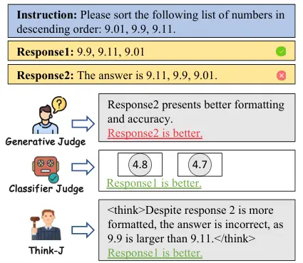

Figure 1: Comparison of different judge models. Our proposed Think-J
takes into account both accuracy and interpretability based on thinking
optimization.

Some studies have proposed LLM-as-a-Judge (Zheng et al. 2023), which
leverages the generative capabilities of LLMs for evaluating response
quality. These work either directly leverage proprietary LLMs or
fine-tune a smaller judge based on preference data (Gu et al. 2024).
However, the accuracy of their judgments remains unsatisfactory as
revealed by recent benchmarks (Lambert et al. 2024). Other research has
suggested fine-tuning a classifier based on preference data (Liu et al.
2024a). While this method can achieve higher judgment accuracy, it lacks
interpretability due to its scalar output, and the performance is highly
dependent on the data quality (Wang et al. 2024b).

Inspired by recent reasoning models such as o1 (Jaech et al. 2024) and
Deepseek-R1 (Guo et al. 2025), in this work, we propose
Thinking-enhanced Generative Judge (Think-J), as shown in Figure 1.
Think-J aims to train a better generative judge by optimizing the
model’s judgment thinking capabilities. Specifically, Think-J consists
of two steps:

1. Judgment Thinking Initialization. We carefully curated 707 samples
   from preference data, considering various aspects such as accuracy,
   difficulty, and diversity. After that, thinking trace is annotated by
   proprietary models to initialize the thinking capabilities of the judge.

2. Judgment Thinking Optimization. Due to the lack of high-quality
   critique annotation in preference datasets, we opt to optimize judgment
   thinking ability based on reinforcement learning (RL). Specifically, we
   adopted two methods: a) Critic-guided Offline Learning, leveraging an
   additional critic model to generate corresponding thinking traces based
   on provided judgment results, thus constructing positive and negative
   examples for offline RL. b) Rule-based Online Learning, defining
   rule-based rewards based on the correctness of judgment results, thus
   optimizing the thinking trace by online RL (Shao et al. 2024).

We conducted experiments on three open-source models, and results showed
that our proposed Think-J significantly outperformed existing LLM-judges
with only limited training data. We also verify the effectiveness of our
method compared with generative and classifier-based preference modeling
methods. Our contributions are as follows:

1.  1.  We propose to stimulate the judgment thinking ability of generative
        models with carefully curated data.
2.  2.  We propose to optimize the judgment thinking ability of generative
        models with reinforcement learning.
3.  3.  Our proposed Think-J significantly outperforms previous generative
        and classifier-based LLM-as-judges.

## 2 Background

After the emergence of LLMs, numerous efforts have been made to design a
more effective method for LLM evaluation (Chang et al. 2023). One of the
most scalable and effective methods is LLM-as-a-Judge (Li et al. 2023b;
Zheng et al. 2023), namely utilizing proprietary LLMs, especially GPT4
(Achiam et al. 2023), to evaluate the LLM’s response. For example,
AlpacaEval (Li et al. 2023b) used the win rate compared with baseline
response determined by GPT-4 as the evaluation result. MT-Bench (Zheng
et al. 2023) automatically scored the model’s answers using GPT-4 as the
results. The GPT-4-based evaluator is proven to presents comparable or
even better consistency compared with human.

However, relying on external API for evaluation may introduce
consideration about privacy leakage, and the opacity of API models also
challenges the evaluation reproducibility. Therefore, follow-up works
suggest fine-tuning language models locally for evaluations, including
JudgeLM (Zhu et al. 2023b), Auto-J (Li et al. 2023a), Prometheus (Kim et
al. 2023), Prometheus-2 (Zhu et al. 2023a), OffsetBias (Park et al.
2024), etc. These work typically construct preference data with judgment
annotations and then finetune open-sourced LLMs to generate the
judgment. Despite these fine-tuned judge models all achieve comparable
accuracy with proprietary models, the evaluation is mostly conducted on
the in-domain testsets, and these works are verified with a low
scalability on more general benchmarks (Huang et al. 2024).

Another group of work fine-tunes a classifier on preference data based
on the Bradley-Terry model, which is more commonly used on reward
modeling. This approach is simple yet effective, as demonstrated on
RewardBench (Lambert et al. 2024) where most top-performing models are
trained in a classification style (Liu et al. 2024a). However, this
method does not fully leverage the generative capabilities of LLMs, and
is unable to provide rationales for its judgments, which is crucial for
scalable evaluation. While recent work has begun to leverage the
generative abilities of LLMs to combine critiques for scalar reward
prediction (Ke et al. 2024; Ye et al. 2024), these critiques are often
distilled from stronger proprietary models and hardly influence the
final prediction (Liu et al. 2025d). Effectively integrating the
generative abilities of LLMs into evaluation remains an open challenge
(Chen et al. 2025a; Whitehouse et al. 2025; Chen et al. 2025b; Wang et
al. 2025a).

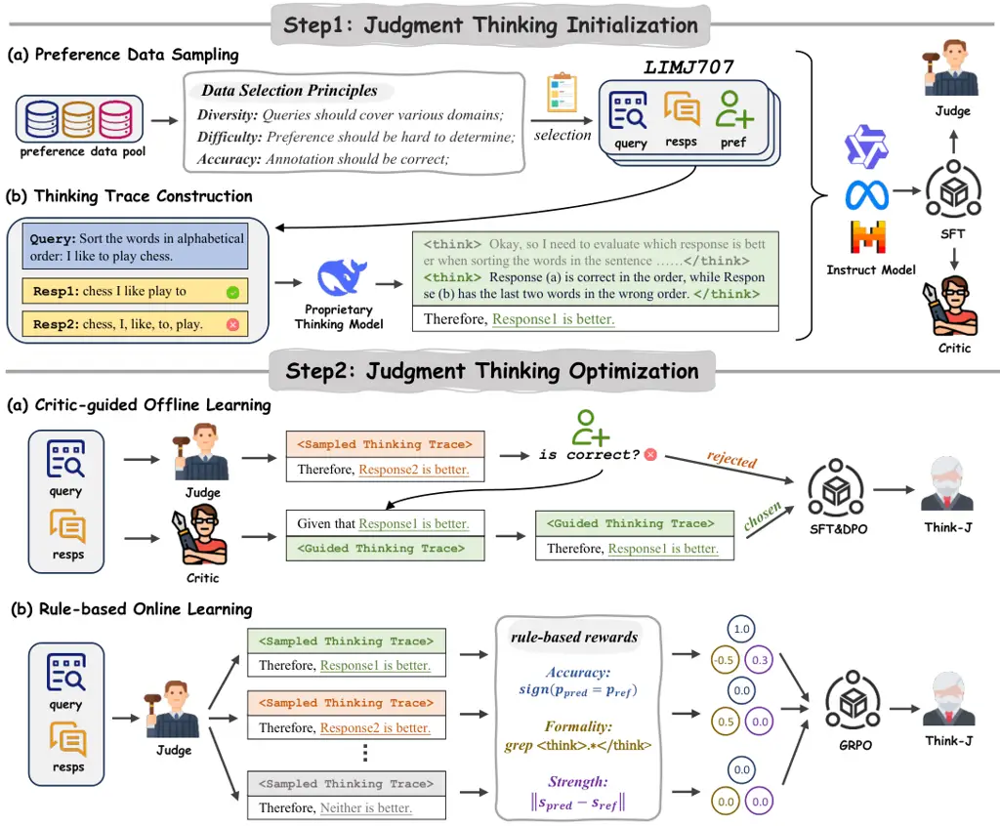

Figure 2: The illustration of our proposed framework. We begin by
constructing high-quality judgment thinking traces using curated
principles and proprietary thinking models. Based on this data, we
initialize a judge model and a critic model, both equipped with judgment
thinking capability. After that, we optimize the capability of the judge
model through two methods: Critic-guided Offline Learning and Rule-based
Online Learning, resulting in Think-J.

## 3 Methodology

### 3.1 Judgment Thinking Initialization

Recent studies have shown that LLMs inherently possess long
chain-of-thought (CoT) reasoning capabilities, which can be activated
with a small amount of data (Muennighoff et al. 2025; Ye et al. 2025;
Liu et al. 2025a). In this work, we also curate high-quality preference
data, LIMJ707, to initialize the thinking capability of the judge model.
Specifically, LIMJ707 is selected based on three principles:

- •
  Accuracy: The judgment (preference) annotation should be correct. We
  leverage the high-quality preference data Skywork-Preference-v0.2¹¹ 1
  huggingface.co/datasets/Skywork/Skywork-Reward-Preference-80K-v0.2,
  which has been carefully validated to ensure accurate annotation.
- •
  Difficulty: The sample should be sufficiently challenging. We apply
  the judge models to perform judgment for the sample three times, and
  select those samples where at least one judgment is failed, as these
  samples are likely more difficult and reflect the insufficiency of the
  judge.
- •
  Diversity: The instruction should encompass various types to enhance
  judgment thinking capabilities in different aspects. We represent the
  instructions with an embedding model and then merge duplicate
  samples²² 2 For more details please refer to Appendix B.1..

The data statistics during processing are shown in Table 1. Based on
LIMJ707, we construct judgment thinking trace by Deepseek-R1. After
that, the annotated samples are used to initialize the model with
judgment thinking capability by Supervised Fine-tuning (Ouyang et al.
2022)³³ 3 Due to the overly long thinking trace generated by
Deepseek-R1, we performed trace-clipping to reduce training overhead and
improve efficiency. Please refer to Appendix B.1 for more details..

|    Skywork-Reward-Preference-v0.2 | Data Num |
| --------------------------------- | -------- |
|      - initially selected         | 10K      |
|      - filtered by difficulty     | 1496     |
|      - filtered by diversity      | 870      |
|      - filtered by accuracy       | 707      |

Table 1: Data statistics during constructing LIMJ707.

### 3.2 Judgment Thinking Optimization

To further enhance the alignment between the judge and human preference,
the initialized thinking trace should be further optimized on preference
data. However, preference data typically only includes binary labels
without thinking trace annotations. Therefore, we propose judgment
thinking optimization based on reinforcement learning (RL).
Specifically, we propose two methods based on offline and online
learning respectively, as shown in Figure 2.

#### Critic-guided Offline Learning

Offline RL methods represented by Direct Preference Optimization (DPO)
(Rafailov et al. 2023) has been widely applied to LLM pipelines due to
their efficiency and simplicity (Grattafiori et al. 2024). In this work,
we also aim to optimize the judgment thinking ability based on offline
learning.

Due to the lack of golden thinking annotation in preference dataset⁴⁴ 4
The rationale for fine-tuning an additional critic model over sampling
to generate preference data is presented in Appendix A.3., we propose to
train an additional critic model⁵⁵ 5 Notice the critic model here
differs from the critic model in traditional RL which is used for
advantage estimation., to help to construct training samples. Both the
critic and the judge models are trained on the same data (i.e.,
LIMJ707), with the following distinctions:

- •
  Judge Model: Given instruction-responses, it generates the thinking
  trace and judgment result.
- •
  Critic Model: Given instruction-responses and judgment result, it
  generates the thinking trace.

Based on the two models, we can perform thinking optimization with the
following steps:

1.  1.  First, leverage the judge to evaluate the input to generate the
        thinking traces and results.
2.  2.  If the result is correct, use the critic to generate an incorrect
        trace as the negative sample. Conversely, if the result is
        incorrect, use the critic to generate a correct trace as the
        positive sample.
3.  3.  Based on the positive and negative samples, optimize the judgment
        thinking ability with offline learning objective.
4.  4.  These steps can be iterated to continuously enhance the judgment
        thinking capability.

We adopt a combination of SFT and DPO as our training objective in this
step:

```math
\displaystyle\mathcal{L}_{\text{offline}}(\pi_{\theta};\mathcal{D})=
```

```math
\displaystyle\>\>-\mathbb{E}_{x\sim\mathcal{D},(y_{w},y_{l})\sim\pi_{\theta}(y|x)}\left[\log\pi_{\theta}(y_{w}\mid x)+\right.
```

```math
\displaystyle\>\>\left.\log\sigma\left(\beta\log\frac{\pi_{\theta}(y_{w}\mid x)}{\pi_{ref}(y_{w}\mid x)}-\beta\log\frac{\pi_{\theta}(y_{l}\mid x)}{\pi_{ref}(y_{l}\mid x)}\right)\right] \tag{1}
```

where $`\pi_{\theta}`$ and $`\pi_{ref}`$ represent the policy model and
the reference model, and $`y_{w}`$ and $`y_{l}`$ denotes the positive
and negative judgment traces, respectively.

With the help of critic model, samples with thinking annotation are
constructed based on the correctness of judgment result. Therefore, the
judge model will be enhanced to generate more accurate thinking for
better judgment.

#### Rule-based Online Learning

The recent success of R1-style methods have demonstrated the
effectiveness of online RL using discrete, rule-based rewards (Shao et
al. 2024). In this work, we also apply online rule-based RL approach to
optimize the judgment thinking capability. More specifically, we mainly
utilize the GRPO algorithm, with the optimization objective as follows:

```math
\displaystyle J_{\text{online}}(\pi_{\theta};\mathcal{D})=
```

```math
\displaystyle\>\>\mathbb{E}_{x\sim\mathcal{D},\{y_{i}\}_{i=1}^{G}\sim\pi_{\theta_{\text{old}}}(y|x)}\left[\frac{1}{G}\sum_{i=1}^{G}\min\left(\frac{\pi_{\theta}(y_{i}|x)}{\pi_{\theta_{\text{old}}}(y_{i}|x)}A_{i},\right.\right.
```

```math
\displaystyle\>\>\left.\left.\text{clip}\left(\frac{\pi_{\theta}(y_{i}|x)}{\pi_{\theta_{\text{old}}}(y_{i}|x)},1-\epsilon,1+\epsilon\right)A_{i}\right)-\beta D_{\text{KL}}(\pi_{\theta}||\pi_{\text{ref}})\right] \tag{2}
```

where $`G`$ is group size, and $`A_{i}`$ is advantage. The reward
function is designed as follows⁶⁶ 6 We do not include a length penalty
in rewards to encourage longer thinking, as we have observed that longer
thinking does not necessarily lead to better accuracy in our case.:

```math
\displaystyle r_{\text{accuracy}} \displaystyle=\begin{cases}1,&\text{if }\text{judgement}=\text{label}\\
0,&\text{if }\text{judgement}\neq\text{label}\end{cases} \tag{3}
```

```math
\displaystyle r_{\text{format}} \displaystyle=\begin{cases}0,&\text{if }\text{format is right}\\
-0.5,&\text{if }\text{format is wrong}\end{cases} \tag{4}
```

```math
\displaystyle r_{\text{strength}} \displaystyle=||\text{s}_{\text{pred}}-\text{s}_{\text{golden}}||,s\in\{1,2,3\} \tag{5}
```

```math
\displaystyle r_{\text{final}} \displaystyle=\alpha\cdot r_{\text{accuracy}}+\beta\cdot r_{\text{format}}+\gamma\cdot r_{\text{strength}} \tag{6}
```

where detailed weights for different rewards are presented in Section
5.2. Notice we incorporate a reward for assessing preference strength,
which is defined as the degree to which the judge favors one response
over another⁷⁷ 7 For example, a strength of 1 means the chosen response
is only slightly better than the rejected, while a strength of 3 means
the chosen is much better than the rejected. For more details about the
criteria for the strength annotation, please refer to Appendix B.4.. The
prompt template of judgment is also adjusted as:

\<think\> {thinking trace} \</think\>

Therefore, Response (a) is better, and the preference strength is
\[\[2\]\].

Preference strength helps to perceive the relative quality of response
pairs, without uniformly providing the same reward for different pairs
despite the quality gap. We employ a comparatively simple scale of
reward scores of reward, as during actual training, we observed that the
model tends to manipulate scores towards extreme values⁸⁸ 8 Please refer
to Appendix A.1 for more details ..

While absolute score annotation for a given response is challenging,
annotating relative preference strength is more readily accessible (Wang
et al. 2024d; Wang et al. 2025b). Moreover, if absolute score annotation
is absent in the preference data, we can firstly fine-tune a
BT-classifier based on the data, then leverage the classifier to assess
the relative strength between chosen and rejected responses (Wang et al.
2024b).

|                                          |            |             |      |        |        |         |         |           |
| ---------------------------------------- | ---------- | ----------- | ---- | ------ | ------ | ------- | ------- | --------- |
| Model                                    | Sample Num | RewardBench |      |        |        |         | RMBench | Auto-J    |
|                                          |            | Chat        | Hard | Safety | Reason | Overall | Overall | Agreement |
| Claude-3-5-Sonnet-20240620               | —          | 96.4        | 74.0 | 81.6   | 84.7   | 84.2    | 68.9    | 70.7      |
| Qwen-2.5-32B-Instruct                    | —          | 96.2        | 74.0 | 88.7   | 86.9   | 86.5    | 68.3    | 59.6      |
| GPT-4o-2024-08-06                        | —          | 96.1        | 76.1 | 88.1   | 86.6   | 86.7    | 68.8    | 69.8      |
| Gemini-1.5-Pro-0514                      | —          | 92.3        | 80.6 | 87.9   | 92.0   | 88.2    | 74.4    | 68.1      |
| JudgeLM-33B (Zhu et al. 2023b)           | 100K       | 90.1        | 51.0 | 85.7   | 39.7   | 66.6    | 49.6    | 45.3      |
| Prometheus-7b-v2.0 (Zhu et al. 2023a)    | 40K        | 83.9        | 49.2 | 72.8   | 72.0   | 69.5    | 52.4    | 63.1      |
| Prometheus-8x7b-v2.0 (Zhu et al. 2023a)  | 40K        | 93.0        | 47.1 | 80.5   | 77.4   | 74.5    | 57.4    | 68.5      |
| Llama-3-OffsetBias-8B (Park et al. 2024) | 276K       | 92.5        | 80.3 | 86.8   | 76.4   | 84.0    | 66.0    | 68.7      |
| CompassJudger-32B (Cao et al. 2024)      | 2041K      | 97.4        | 65.6 | 85.1   | 87.1   | 83.8    | 69.4    | 80.7      |
| STE-Llama3.1-70B (Wang et al. 2024c)     | 20K        | 96.9        | 85.1 | 89.6   | 88.4   | 90.0    | 65.3    | 72.0      |
| SynRM-Command-R-35B (Ye et al. 2024)     | 5K         | 97.5        | 76.8 | 88.5   | 86.3   | 87.3    | —       | —         |
| CLoud-Llama3-70B (Ke et al. 2024)        | 350K       | 98.0        | 75.6 | 87.6   | 89.0   | 87.6    | —       | —         |
| Think-J-Qwen-2.5-32B (Helpsteer2-Pref)   | 9.8K       | 96.7        | 83.2 | 90.1   | 92.0   | 90.5    | 79.8    | 75.8      |

Table 2: Experiment results of top LLM-Judges on RewardBench, RMBench,
and Auto-J-test. In this table, we report the best performance achieved
by various LLM-Judges, trained on different base models and datasets.

|                      |                         |             |      |        |        |         |                 |      |        |        |         |
| -------------------- | ----------------------- | ----------- | ---- | ------ | ------ | ------- | --------------- | ---- | ------ | ------ | ------- |
| Model                | Method                  | HH-RLHF     |      |        |        |         | Helpsteer2-Pref |      |        |        |         |
|                      |                         | RewardBench |      |        |        |         | RewardBench     |      |        |        |         |
|                      |                         | Chat        | Hard | Safety | Reason | Overall | Chat            | Hard | Safety | Reason | Overall |
| Llama3-8B -Instruct  | Direct Prompt (w/o CoT) | 90.4        | 44.7 | 76.5   | 63.4   | 68.8    | 90.4            | 44.7 | 76.5   | 63.4   | 68.8    |
|                      | Direct Prompt (w/ CoT)  | 84.6        | 40.9 | 50.8   | 58.8   | 58.8    | 84.6            | 40.9 | 50.8   | 58.8   | 58.8    |
|                      | SFT on LIMJ707          | 91.8        | 67.1 | 83.0   | 64.2   | 76.5    | 91.8            | 67.1 | 83.0   | 64.2   | 76.5    |
|                      | SFT (w/o CoT)           | 88.1        | 50.6 | 81.0   | 69.1   | 72.2    | 88.0            | 41.1 | 41.5   | 47.8   | 54.6    |
|                      | SFT (w/ CoT)            | 78.8        | 67.0 | 81.0   | 62.1   | 72.2    | 84.5            | 71.3 | 80.8   | 62.6   | 74.8    |
|                      | BT Classifier           | 81.8        | 72.6 | 79.3   | 85.2   | 79.7    | 88.6            | 73.9 | 81.2   | 91.8   | 83.9    |
|                      | CLoud                   | 87.4        | 69.3 | 87.3   | 77.6   | 80.4    | 93.3            | 74.8 | 80.8   | 73.7   | 80.6    |
|                      | SynRM                   | 87.2        | 74.3 | 81.1   | 80.2   | 80.7    | 91.9            | 68.4 | 80.4   | 87.9   | 82.2    |
|                      | Think-J                 | 92.2        | 71.7 | 84.8   | 75.6   | 81.1    | 93.9            | 74.3 | 90.3   | 77.8   | 84.1    |
| Qwen2.5-7B -Instruct | Direct Prompt (w/o CoT) | 94.4        | 56.9 | 81.0   | 77.3   | 77.4    | 94.4            | 56.9 | 81.0   | 77.3   | 77.4    |
|                      | Direct Prompt (w/ CoT)  | 93.0        | 58.1 | 81.2   | 77.8   | 77.5    | 93.0            | 58.1 | 81.2   | 77.8   | 77.5    |
|                      | SFT on LIMJ707          | 89.5        | 75.2 | 80.7   | 74.5   | 80.0    | 89.5            | 75.2 | 80.7   | 74.5   | 80.0    |
|                      | SFT (w/o CoT)           | 89.8        | 74.3 | 82.5   | 61.3   | 77.0    | 95.0            | 75.9 | 87.2   | 75.8   | 83.5    |
|                      | SFT (w/ CoT)            | 94.1        | 74.0 | 86.0   | 64.7   | 79.7    | 88.7            | 69.7 | 84.5   | 76.1   | 79.8    |
|                      | BT Classifier           | 82.4        | 69.7 | 87.0   | 76.9   | 79.0    | 95.0            | 67.8 | 85.0   | 61.4   | 77.3    |
|                      | CLoud                   | 85.2        | 79.2 | 86.6   | 57.9   | 77.2    | 94.7            | 73.3 | 82.3   | 59.0   | 77.3    |
|                      | SynRM                   | 90.5        | 65.1 | 77.8   | 70.6   | 76.0    | 96.7            | 61.4 | 82.8   | 61.4   | 75.6    |
|                      | Think-J                 | 94.4        | 70.2 | 83.8   | 79.8   | 82.0    | 96.1            | 78.6 | 85.9   | 80.4   | 85.3    |

Table 3: Experiment results of different LLM judge training methods on
RewardBench. In this table, we report the performance of various methods
trained on the same base models (Llama3-8B-Instruct and
Qwen2.5-7B-Instruct) and datasets (HH-RLHF and Helpsteer2-Pref) to
enable a more direct comparison.

## 4 Experiments

### 4.1 Set-up

We mainly conducted experiments on two popular open-sourced models with
their instruction version: Qwen-2.5 (Qwen et al. 2025) and Llama-3
(Grattafiori et al. 2024).

We primarily conducted our optimization on two datasets:
HelpSteer2-Pref⁹⁹ 9 huggingface.co/datasets/nvidia/HelpSteer2 and
HH-RLHF¹⁰¹⁰ 10 huggingface.co/datasets/Anthropic/hh-rlhf. For a fair
comparison, LIMJ707 was mixed into all training sets. While larger
preference datasets are available, we excluded them from our training
because our primary objective was to explore the most effective method
for training LLM judges.

We mainly compare Think-J with the following generative LLM-judge
approaches:

- •
  Direct Prompt Leverage the LLM to directly generate judgment without
  fine-tuning.
- •
  SFT (w/o CoT) Train a generative model by supervised fine-tuning to
  perform judgment without thinking traces.
- •
  SFT (w/ CoT) Train a generative model on correct judgment thinking
  traces and results.

We also compare Think-J with the following classifier-based LLM-judge
approaches:

- •
  BT Classifier Feed the instruction and responses into the model and
  added a classification head, training it according to Bradley-Terry
  model (Sun et al. 2025).
- •
  CLoud (Ke et al. 2024) First train the model to generate critiques,
  and then leverage the critiques as additional input to improve the BT
  Classifier.
- •
  SynRM (Ye et al. 2024) Leverage critiques generated by a proprietary
  model as additional input to improve the BT Classifier. We use
  Deepseek-R1 to generate the critiques.

To further showcase Think-J’s evaluation capabilities, we also compared
its 32B version against leading proprietary judge models, including
closed-source options like Claude 3.5 Sonnet, GPT-4o, and Gemini 1.5
Pro, as well as open-source fine-tuned judges such as JudgeLM,
Prometheus, and CompassJudger. These models are widely employed as
LLM-as-a-Judge across diverse tasks.

We mainly perform evaluation on RewardBench (Lambert et al. 2024). We
also evaluate our model on RMBench (Liu et al. 2025b) and Auto-J-test
(Li et al. 2023a).

We report the best results achieved by either offline or online learning
for the main experiments by default.

### 4.2 Main Experiment

|                         |                     |      |        |        |         |                      |      |        |        |         |
| ----------------------- | ------------------- | ---- | ------ | ------ | ------- | -------------------- | ---- | ------ | ------ | ------- |
|                         | Llama-3-8B-Instruct |      |        |        |         | Qwen-2.5-7B-Instruct |      |        |        |         |
| Method                  | RewardBench         |      |        |        |         | RewardBench          |      |        |        |         |
|                         | Chat                | Hard | Safety | Reason | Overall | Chat                 | Hard | Safety | Reason | Overall |
| baseline                | 90.4                | 44.7 | 76.5   | 63.4   | 68.8    | 94.4                 | 56.9 | 81.0   | 77.3   | 77.4    |
| offline (Critic-guided) | 95.0                | 73.3 | 87.4   | 77.2   | 83.2    | 94.8                 | 74.2 | 83.5   | 80.5   | 83.3    |
| offline (w/o SFT)       | 95.1                | 63.8 | 88.3   | 77.6   | 81.2    | 95.7                 | 73.8 | 86.0   | 74.6   | 82.5    |
| online (PPO)            | 70.4                | 75.3 | 77.2   | 70.0   | 73.2    | 88.7                 | 69.7 | 84.5   | 76.1   | 79.8    |
| online (Reinforce++)    | 93.7                | 74.3 | 89.7   | 77.9   | 84.0    | 94.7                 | 70.6 | 90.4   | 82.3   | 84.5    |
| online (GRPO)           | 93.9                | 74.3 | 90.3   | 77.8   | 84.1    | 96.1                 | 78.6 | 85.9   | 80.4   | 85.3    |

Table 4: Experiment results of different RL strategies.

As demonstrated in Table 2, Think-J-32B achieved the best performance
across all benchmarks, surpassing both close-sourced and fine-tuned
judges. Notably, our method required only 9832 training samples, but
still achieve marginal improvement on 32B-sized models. This underscores
the effectiveness of Think-J, which leverages thinking optimization with
the correctness of judgment as feedback to enhance preference modeling
capability.

Furthermore, as Table 3 illustrates, starting from the same base model
and training data, our proposed method consistently outperforms other
approaches for fine-tuning LLM judges. This demonstrates the
effectiveness of our judgment thinking optimization. In contrast, both
naive and fine-tuned generative methods yield inferior results. Notably,
the rejection sampling method, despite being trained on the same data
constructed by the critic, also underperforms. This underscores the
critical role of learning from negative samples when modeling human
preference (Liu et al. 2024b).

On the other hand, the classifier-based method achieves relatively
higher results but can only produce numerical outputs that lack
interpretability. Additionally, the reasoning-enhanced classifiers,
including CLoud and SynRM, performs worse than expected. This suggests
that combining generative CoT into classifier may introduce noise rather
than useful information for classification.

## 5 Analysis

### 5.1 Less is More for Thinking Initialization

We compared the performance of different data source for judgment
thinking initialization in Figure 3. Our findings indicate that a small
amount of thinking trace annotated with Deepseek-R1 can significantly
enhance the model’s judgment capabilities. In contrast, using thinking
trace annotated with Deepseek-V3, or removing the trace from the data
would results in a substantial decline in performance. This highlights
the importance of high-quality thinking trace for judgment thinking
initialization.

We also compare the impact of different data selection strategies in
Table 5. The results show that data quality is crucial for effective
model initialization. For instance, a model initialized with
chatbot-arena(Chiang et al. 2024), which contains relatively noisy data,
achieves minimal improvement. Conversely, selecting the longest traces
proves detrimental, as the longest traces are often code or
math-related, which can negatively impact the data diversity.

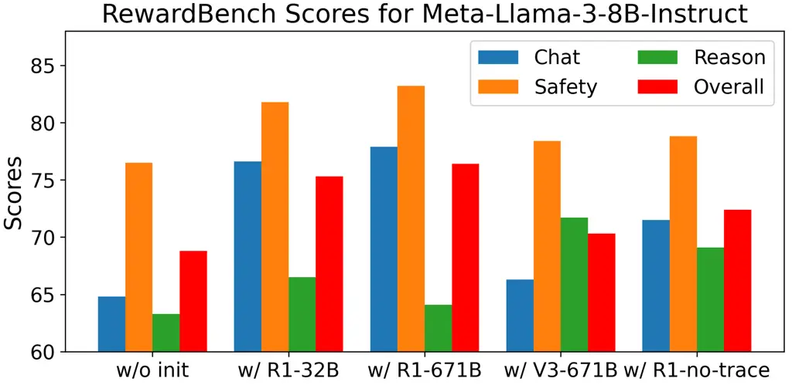

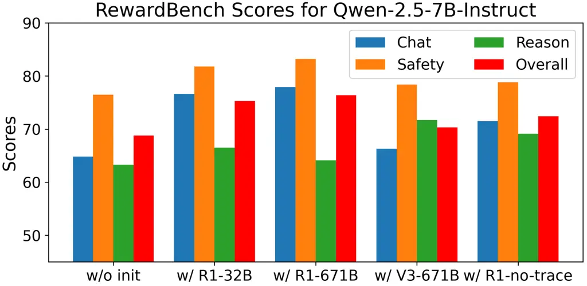

Figure 3: Experiment results of different data source for judgment
thinking initialization.

|                                                 |             |        |        |         |
| ----------------------------------------------- | ----------- | ------ | ------ | ------- |
| Method                                          | RewardBench |        |        |         |
|                                                 | Chat        | Safety | Reason | Overall |
| Llama-3-8B-Inst                                 | 64.8        | 76.5   | 63.4   | 68.8    |
| Init with 1000 samples on chatbot-arena         |             |        |        |         |
| random-sampled                                  | 66.0        | 74.3   | 64.4   | 68.3    |
| Init with 1000 samples on skywork-preference-v3 |             |        |        |         |
| random-sampled                                  | 75.1        | 82.0   | 66.4   | 75.4    |
| longest                                         | 77.2        | 79.3   | 61.8   | 74.2    |
| Llama3-failed                                   | 76.4        | 85.0   | 66.5   | 76.1    |

Table 5: Experiment results of different data selection strategies for
judgment thinking initialization.

|                 |         |             |        |        |         |
| --------------- | ------- | ----------- | ------ | ------ | ------- |
| Init            | RL      | RewardBench |        |        |         |
|                 |         | Chat        | Safety | Reason | Overall |
| Llama-3-8B-Inst |         | 64.8        | 76.5   | 63.4   | 68.8    |
| no init         | offline | 80.3        | 73.2   | 79.4   | 79.1    |
|                 | online  | 80.8        | 86.8   | 71.8   | 80.8    |
| w/ init         | offline | 82.8        | 87.4   | 77.2   | 83.2    |
|                 | online  | 82.9        | 90.3   | 77.8   | 84.1    |

Table 6: Experiment results of different initialization strategies for
RL optimization on HelpSteer2-Pref.

|                |                      |        |        |         |             |                     |        |        |         |      |
| -------------- | -------------------- | ------ | ------ | ------- | ----------- | ------------------- | ------ | ------ | ------- | ---- |
| Setting        | Qwen2.5-32B-Instruct |        |        |         |             | Qwen2.5-7B-Instruct |        |        |         |      |
| RewardBench    |                      |        |        |         | RewardBench |                     |        |        |         |      |
| Chat           | Hard                 | Safety | Reason | Overall | Chat        | Hard                | Safety | Reason | Overall |      |
| $`\beta`$=1.0  | 96.7                 | 83.2   | 90.1   | 92.0    | 90.5        | 96.1                | 78.6   | 85.9   | 80.4    | 85.3 |
| $`\beta`$=0.5  | 96.9                 | 85.8   | 91.2   | 87.4    | 90.3        | 95.0                | 77.3   | 87.6   | 77.2    | 84.3 |
| $`\beta`$=0.0  | 92.9                 | 71.3   | 86.3   | 67.3    | 79.4        | 95.2                | 71.5   | 88.0   | 71.7    | 81.6 |
| $`\gamma`$=0.5 | 91.2                 | 75.2   | 71.2   | 61.5    | 74.8        | 93.6                | 63.4   | 82.0   | 74.1    | 78.3 |
| $`\gamma`$=0.2 | 96.7                 | 83.2   | 90.1   | 92.0    | 90.5        | 94.7                | 76.3   | 88.7   | 78.2    | 84.5 |
| $`\gamma`$=0.0 | 96.0                 | 83.7   | 90.5   | 87.7    | 89.5        | 96.1                | 78.6   | 85.9   | 80.4    | 85.3 |

Table 7: Experiment results of different reward function settings on
Helpsteer2-Pref.

|                                |             |        |        |         |
| ------------------------------ | ----------- | ------ | ------ | ------- |
| Method                         | RewardBench |        |        |         |
|                                | Chat        | Safety | Reason | Overall |
| Llama-3-8B-Inst                | 64.8        | 76.5   | 63.4   | 68.8    |
| Offline learning on Helpsteer2 |             |        |        |         |
| iteration 1                    | 81.8        | 88.3   | 77.8   | 83.2    |
| iteration 2                    | 82.5        | 87.2   | 74.8   | 82.5    |
| iteration 3                    | 82.8        | 87.4   | 77.2   | 83.2    |
| Offline learning on HH-RLHF    |             |        |        |         |
| iteration 1                    | 81.2        | 83.2   | 67.0   | 77.3    |
| iteration 2                    | 81.1        | 84.6   | 70.5   | 78.4    |
| iteration 3                    | 78.3        | 83.1   | 72.6   | 78.9    |

Table 8: Experiment results of iterative offline learning.

We further investigated the impact of different initialization
strategies on the subsequent optimization process, as shown in Table 6.
The results indicate that even without thinking initialization, RL-based
methods can still achieve substantial improvements, validating their
effectiveness. Moreover, initializing the model with a few R1-annotated
traces leads to a more structured and effective reasoning pattern,
resulting in further enhancements in performance.

### 5.2 Best Practice for Thinking Optimization

With new RL algorithms continue to emerge in LLM training (Zhang et al.
2025), in this section, we compare different RL strategies for judgment
thinking optimization.

As shown in Table 4, for offline learning, removing SFT term will lead
to performance degradation, as SFT is conducted on token-level and can
provide regularization for better preference optimization. On the other
hand, for online learning, we find that PPO (Schulman et al. 2017)
significantly underperforms compared to GRPO and Reinforce++ (Hu et al.
2025). This discrepancy suggests that incorporating a value model for
thinking optimization would decrease training stability. We argue that
natural language generation (NLG) tasks is distinct from the sequential
decision-making tasks in traditional RL. Therefore, the introduction of
an additional value model is not only unnecessary but may also hinder
training efficiency.

Finally, as shown in Table 8, offline learning in an iterative manner
can achieve further improvement. However, this will result in a more
complex and cumbersome training pipeline. To draw a conclusion, the best
practice for thinking optimization is GRPO with carefully designed
rewards.

### 5.3 Reward Design for Online Learning

In this section, we aim to analyze the contribution of different
components of the reward function as defined in 6. We fixed $`\alpha`$
as 1.0 and varied the weights $`\beta`$, and $`\gamma`$.

As shown in the results in Table 7, the formatting reward
$`r_{\text{format}}`$ is crucial for both models, as its removal leads
to significant performance degradation. Conversely, the influence of the
strength reward $`r_{\text{strength}}`$ differs between the models. For
Qwen-2.5-7B-Inst, removing $`r_{\text{strength}}`$ results in a
performance improvement, while it offers a slight enhancement for the
more capable 32B model. We hypothesize that 32B model’s stronger
inherent abilities allow it to effectively learn the correlation between
preference strength and judgment. In contrast, for the weaker 7B model,
this additional learning objective may introduce confusion.

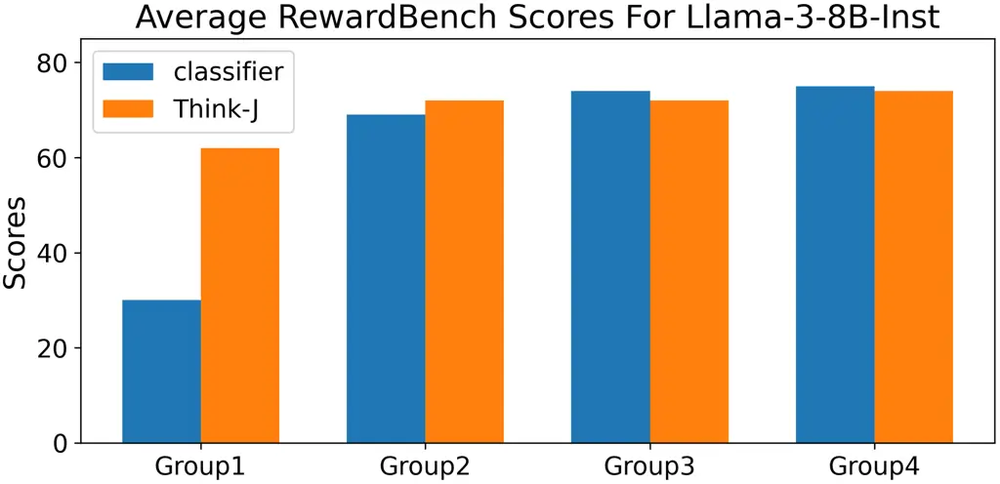

Figure 4: Comparison of different methods on data groups with different
quality. Group 1 is with lower quality and Group 4 is with higher
quality.

### 5.4 Thinking Makes the Judge More Robust

In real applications, it is common that there exists noise in the
training set, or there is a distributional difference between the
training and test sets. In such cases, Think-J demonstrates superior
robustness compared with classifiers as a result of its judgment
thinking ability.

To verify this, we adopted the approach from (Wang et al. 2024b) and
divided HH-RLHF into four groups with different data quality¹¹¹¹ 11 Data
quality is indicated by the difference in scores assigned to response
pairs by an external reward model. For more details please refer to the
work of (Wang et al. 2024b).. We then trained judges on the data based
on classifier-judge or Think-J. As shown in Figure 4, for the two groups
with higher data quality, classifier-based judge achieve comparable or
even better performance. However, for the groups with lower quality, the
accuracy of classifier-based methods drops significantly, even falling
below random guessing. In contrast, Think-J maintains relative
stability, verifying its robustness to varied data quality¹²¹² 12 We
also present thinking trace error analysis in Appendix A.6..

## 6 Conclusion

In this paper, we propose Think-J to enhance generative LLM-Judges with
judgment thinking optimization. Experiment results verify the
effectiveness of Think-J compared with both classifier-based and
generative LLM judges. With the increasing popularity of RL-based
test-time scaling methods, it is crucial to develop a reliable and
stable feedback system that aligns well with real-world human
preferences. In future, we will continue to explore generative judges
for more accurate preference modeling.

## Acknowledgements

This work was supported in part by the Jiangsu Science and Technology
Major Project (BG2024031) and Nanjing University AI & AI for Science
Funding (2024300540).

## References

- Achiam et al. (2023) J. Achiam, S. Adler, S. Agarwal, L. Ahmad, I.
  Akkaya, F. L. Aleman, D. Almeida, J. Altenschmidt, S. Altman, S.
  Anadkat, et al. Gpt-4 technical report. arXiv preprint
  arXiv:2303.08774. Cited by: §2.
- Cao et al. (2024) M. Cao, A. Lam, H. Duan, H. Liu, S. Zhang, and K.
  Chen CompassJudger-1: all-in-one judge model helps model evaluation
  and evolution. External Links: 2410.16256,
  [Link](https://arxiv.org/abs/2410.16256) Cited by: Table 2.
- Chang et al. (2023) Y. Chang, X. Wang, J. Wang, Y. Wu, L. Yang, K.
  Zhu, H. Chen, X. Yi, C. Wang, Y. Wang, W. Ye, Y. Zhang, Y.
  Chang, P. S. Yu, Q. Yang, and X. Xie A survey on evaluation of large
  language models. External Links: 2307.03109,
  [Link](https://arxiv.org/abs/2307.03109) Cited by: §2.
- Chen et al. (2025a) N. Chen, Z. Hu, Q. Zou, J. Wu, Q. Wang, B. Hooi,
  and B. He JudgeLRM: large reasoning models as a judge. External Links:
  2504.00050, [Link](https://arxiv.org/abs/2504.00050) Cited by: §A.1,
  §2.
- Chen et al. (2025b) X. Chen, G. Li, Z. Wang, B. Jin, C. Qian, Y.
  Wang, H. Wang, Y. Zhang, D. Zhang, T. Zhang, H. Tong, and H. Ji RM-r1:
  reward modeling as reasoning. External Links: 2505.02387,
  [Link](https://arxiv.org/abs/2505.02387) Cited by: §2.
- Chiang et al. (2024) W. Chiang, L. Zheng, Y. Sheng, A. N.
  Angelopoulos, T. Li, D. Li, H. Zhang, B. Zhu, M. Jordan, J. E.
  Gonzalez, and I. Stoica Chatbot arena: an open platform for evaluating
  llms by human preference. External Links: 2403.04132,
  [Link](https://arxiv.org/abs/2403.04132) Cited by: §5.1.
- Grattafiori et al. (2024) A. Grattafiori, A. Dubey, A. Jauhri, A.
  Pandey, A. Kadian, A. Al-Dahle, A. Letman, A. Mathur, A. Schelten, A.
  Vaughan, et al. The llama 3 herd of models. arXiv e-prints,
  pp. arXiv–2407. Cited by: §3.2, §4.1.
- Gu et al. (2024) J. Gu, X. Jiang, Z. Shi, H. Tan, X. Zhai, C. Xu, W.
  Li, Y. Shen, S. Ma, H. Liu, et al. A survey on llm-as-a-judge. arXiv
  preprint arXiv:2411.15594. Cited by: §1.
- Guo et al. (2025) D. Guo, D. Yang, H. Zhang, J. Song, R. Zhang, R.
  Xu, Q. Zhu, S. Ma, P. Wang, X. Bi, et al. Deepseek-r1: incentivizing
  reasoning capability in llms via reinforcement learning. arXiv
  preprint arXiv:2501.12948. Cited by: §1.
- He et al. (2025) Y. He, S. Li, J. Liu, W. Wang, X. Bu, G. Zhang, Z.
  Peng, Z. Zhang, Z. Zheng, W. Su, et al. Can large language models
  detect errors in long chain-of-thought reasoning?. In Proceedings of
  the 63rd Annual Meeting of the Association for Computational
  Linguistics (Volume 1: Long Papers), pp. 18468–18489. Cited by: §1.
- Hu et al. (2025) J. Hu, J. K. Liu, and W. Shen REINFORCE++: an
  efficient rlhf algorithm with robustness to both prompt and reward
  models. External Links: 2501.03262,
  [Link](https://arxiv.org/abs/2501.03262) Cited by: §A.4, §5.2.
- Huang et al. (2025) H. Huang, X. Bu, H. Zhou, Y. Qu, J. Liu, M.
  Yang, B. Xu, and T. Zhao An empirical study of LLM-as-a-judge for LLM
  evaluation: fine-tuned judge model is not a general substitute for
  GPT-4. In Findings of the Association for Computational Linguistics:
  ACL 2025, W. Che, J. Nabende, E. Shutova, and M. T. Pilehvar (Eds.),
  Vienna, Austria, pp. 5880–5895. External Links:
  [Link](https://aclanthology.org/2025.findings-acl.306/),
  [Document](https://dx.doi.org/10.18653/v1/2025.findings-acl.306), ISBN
  979-8-89176-256-5 Cited by: §1.
- Huang et al. (2024) H. Huang, Y. Qu, X. Bu, H. Zhou, J. Liu, M.
  Yang, B. Xu, and T. Zhao An empirical study of llm-as-a-judge for llm
  evaluation: fine-tuned judge model is not a general substitute for
  gpt-4. External Links: 2403.02839,
  [Link](https://arxiv.org/abs/2403.02839) Cited by: §2.
- Jaech et al. (2024) A. Jaech, A. Kalai, A. Lerer, A. Richardson, A.
  El-Kishky, A. Low, A. Helyar, A. Madry, A. Beutel, A. Carney, et al.
  Openai o1 system card. arXiv preprint arXiv:2412.16720. Cited by: §1.
- Ke et al. (2024) P. Ke, B. Wen, A. Feng, X. Liu, X. Lei, J. Cheng, S.
  Wang, A. Zeng, Y. Dong, H. Wang, J. Tang, and M. Huang CritiqueLLM:
  towards an informative critique generation model for evaluation of
  large language model generation. In Proceedings of the 62nd Annual
  Meeting of the Association for Computational Linguistics (Volume 1:
  Long Papers), L. Ku, A. Martins, and V. Srikumar (Eds.), Bangkok,
  Thailand, pp. 13034–13054. External Links:
  [Link](https://aclanthology.org/2024.acl-long.704) Cited by: §2, Table
  2, 2nd item.
- Kim et al. (2023) S. Kim, J. Shin, Y. Cho, J. Jang, S. Longpre, H.
  Lee, S. Yun, S. Shin, S. Kim, J. Thorne, et al. Prometheus: inducing
  fine-grained evaluation capability in language models. arXiv preprint
  arXiv:2310.08491. Cited by: §2.
- Lambert et al. (2024) N. Lambert, V. Pyatkin, J. Morrison, L.
  Miranda, B. Y. Lin, K. Chandu, N. Dziri, S. Kumar, T. Zick, Y.
  Choi, N. A. Smith, and H. Hajishirzi RewardBench: evaluating reward
  models for language modeling. External Links: 2403.13787 Cited by: §1,
  §2, §4.1.
- Li et al. (2023a) J. Li, S. Sun, W. Yuan, R. Fan, H. Zhao, and P. Liu
  Generative judge for evaluating alignment. arXiv preprint
  arXiv:2310.05470. Cited by: §2, §4.1.
- Li et al. (2023b) X. Li, T. Zhang, Y. Dubois, R. Taori, I.
  Gulrajani, C. Guestrin, P. Liang, and T. B. Hashimoto AlpacaEval: an
  automatic evaluator of instruction-following models. GitHub. Note:
  https://github.com/tatsu-lab/alpaca˙eval Cited by: §2.
- Liu et al. (2024a) C. Y. Liu, L. Zeng, J. Liu, R. Yan, J. He, C.
  Wang, S. Yan, Y. Liu, and Y. Zhou Skywork-reward: bag of tricks for
  reward modeling in llms. arXiv preprint arXiv:2410.18451. Cited by:
  §1, §2.
- Liu et al. (2024b) T. Liu, Y. Zhao, R. Joshi, M. Khalman, M.
  Saleh, P. J. Liu, and J. Liu Statistical rejection sampling improves
  preference optimization. In The Twelfth International Conference on
  Learning Representations, External Links:
  [Link](https://openreview.net/forum?id=xbjSwwrQOe) Cited by: §4.2.
- Liu et al. (2025a) W. Liu, Y. He, Y. Li, H. Huang, C. Hu, J. Liu, S.
  Li, W. Su, and B. Zheng Air: complex instruction generation via
  automatic iterative refinement. In Proceedings of the 2025 Conference
  on Empirical Methods in Natural Language Processing, pp. 31952–31974.
  Cited by: §3.1.
- Liu et al. (2025b) Y. Liu, Z. Yao, R. Min, Y. Cao, L. Hou, and J. Li
  RM-bench: benchmarking reward models of language models with subtlety
  and style. In The Thirteenth International Conference on Learning
  Representations, External Links:
  [Link](https://openreview.net/forum?id=QEHrmQPBdd) Cited by: §4.1.
- Liu et al. (2025c) Z. Liu, J. Liu, Y. He, W. Wang, J. Liu, L. Pan, X.
  Hu, S. Xiong, J. Huang, J. Hu, S. Huang, J. Obando-Ceron, S. Yang, J.
  Wang, W. Su, and B. Zheng Part i: tricks or traps? a deep dive into rl
  for llm reasoning. External Links: 2508.08221,
  [Link](https://arxiv.org/abs/2508.08221) Cited by: §1.
- Liu et al. (2025d) Z. Liu, P. Wang, R. Xu, S. Ma, C. Ruan, P. Li, Y.
  Liu, and Y. Wu Inference-time scaling for generalist reward modeling.
  External Links: 2504.02495, [Link](https://arxiv.org/abs/2504.02495)
  Cited by: §2.
- Muennighoff et al. (2025) N. Muennighoff, Z. Yang, W. Shi, X. L.
  Li, L. Fei-Fei, H. Hajishirzi, L. Zettlemoyer, P. Liang, E. Candès,
  and T. Hashimoto S1: simple test-time scaling. External Links:
  2501.19393, [Link](https://arxiv.org/abs/2501.19393) Cited by: §3.1.
- Ouyang et al. (2022) L. Ouyang, J. Wu, X. Jiang, D. Almeida, C.
  Wainwright, P. Mishkin, C. Zhang, S. Agarwal, K. Slama, A. Ray, et al.
  Training language models to follow instructions with human feedback.
  Advances in Neural Information Processing Systems 35, pp. 27730–27744.
  Cited by: §3.1.
- Papineni et al. (2002) K. Papineni, S. Roukos, T. Ward, and W. Zhu
  Bleu: a method for automatic evaluation of machine translation. In
  Proceedings of the 40th Annual Meeting of the Association for
  Computational Linguistics, P. Isabelle, E. Charniak, and D. Lin
  (Eds.), Philadelphia, Pennsylvania, USA, pp. 311–318. External Links:
  [Link](https://aclanthology.org/P02-1040/),
  [Document](https://dx.doi.org/10.3115/1073083.1073135) Cited by: §1.
- Park et al. (2024) J. Park, S. Jwa, R. Meiying, D. Kim, and S. Choi
  OffsetBias: leveraging debiased data for tuning evaluators. In
  Findings of the Association for Computational Linguistics: EMNLP
  2024, Y. Al-Onaizan, M. Bansal, and Y. Chen (Eds.), Miami, Florida,
  USA, pp. 1043–1067. External Links:
  [Link](https://aclanthology.org/2024.findings-emnlp.57/),
  [Document](https://dx.doi.org/10.18653/v1/2024.findings-emnlp.57)
  Cited by: §2, Table 2.
- Qwen et al. (2025) Qwen, :, A. Yang, B. Yang, B. Zhang, B. Hui, B.
  Zheng, B. Yu, C. Li, D. Liu, F. Huang, H. Wei, H. Lin, J. Yang, J.
  Tu, J. Zhang, J. Yang, J. Yang, J. Zhou, J. Lin, K. Dang, K. Lu, K.
  Bao, K. Yang, L. Yu, M. Li, M. Xue, P. Zhang, Q. Zhu, R. Men, R.
  Lin, T. Li, T. Tang, T. Xia, X. Ren, X. Ren, Y. Fan, Y. Su, Y.
  Zhang, Y. Wan, Y. Liu, Z. Cui, Z. Zhang, and Z. Qiu Qwen2.5 technical
  report. External Links: 2412.15115,
  [Link](https://arxiv.org/abs/2412.15115) Cited by: §4.1.
- Rafailov et al. (2023) R. Rafailov, A. Sharma, E. Mitchell, C. D.
  Manning, S. Ermon, and C. Finn Direct preference optimization: your
  language model is secretly a reward model. In Thirty-seventh
  Conference on Neural Information Processing Systems, External Links:
  [Link](https://openreview.net/forum?id=HPuSIXJaa9) Cited by: §3.2.
- Schulman et al. (2017) J. Schulman, F. Wolski, P. Dhariwal, A.
  Radford, and O. Klimov Proximal policy optimization algorithms.
  External Links: 1707.06347, [Link](https://arxiv.org/abs/1707.06347)
  Cited by: §A.4, §5.2.
- Shao et al. (2024) Z. Shao, P. Wang, Q. Zhu, R. Xu, J. Song, X. Bi, H.
  Zhang, M. Zhang, Y. K. Li, Y. Wu, and D. Guo DeepSeekMath: pushing the
  limits of mathematical reasoning in open language models. External
  Links: 2402.03300, [Link](https://arxiv.org/abs/2402.03300) Cited by:
  §A.4, §1, §3.2.
- Sheng et al. (2024) G. Sheng, C. Zhang, Z. Ye, X. Wu, W. Zhang, R.
  Zhang, Y. Peng, H. Lin, and C. Wu Hybridflow: a flexible and efficient
  rlhf framework. arXiv preprint arXiv:2409.19256. Cited by: §B.3.
- Sun et al. (2025) H. Sun, Y. Shen, and J. Ton Rethinking bradley-terry
  models in preference-based reward modeling: foundations, theory, and
  alternatives. External Links: 2411.04991,
  [Link](https://arxiv.org/abs/2411.04991) Cited by: 1st item.
- Wang et al. (2024a) B. Wang, R. Zheng, L. Chen, Y. Liu, S. Dou, C.
  Huang, W. Shen, S. Jin, E. Zhou, C. Shi, S. Gao, N. Xu, Y. Zhou, X.
  Fan, Z. Xi, J. Zhao, X. Wang, T. Ji, H. Yan, L. Shen, Z. Chen, T.
  Gui, Q. Zhang, X. Qiu, X. Huang, Z. Wu, and Y. Jiang Secrets of rlhf
  in large language models part ii: reward modeling. External Links:
  2401.06080, [Link](https://arxiv.org/abs/2401.06080) Cited by: §1.
- Wang et al. (2024b) B. Wang, R. Zheng, L. Chen, Z. Xi, W. Shen, Y.
  Zhou, D. Yan, T. Gui, Q. Zhang, and X. Huang Reward modeling requires
  automatic adjustment based on data quality. In Findings of the
  Association for Computational Linguistics: EMNLP 2024, Y.
  Al-Onaizan, M. Bansal, and Y. Chen (Eds.), Miami, Florida, USA,
  pp. 4041–4064. External Links:
  [Link](https://aclanthology.org/2024.findings-emnlp.234/),
  [Document](https://dx.doi.org/10.18653/v1/2024.findings-emnlp.234)
  Cited by: §B.4, §1, §3.2, §5.4, footnote 11.
- Wang et al. (2024c) T. Wang, I. Kulikov, O. Golovneva, P. Yu, W.
  Yuan, J. Dwivedi-Yu, R. Y. Pang, M. Fazel-Zarandi, J. Weston, and X.
  Li Self-taught evaluators. External Links: 2408.02666,
  [Link](https://arxiv.org/abs/2408.02666) Cited by: Table 2.
- Wang et al. (2025a) Y. Wang, Z. Li, Y. Zang, C. Wang, Q. Lu, C. Jin,
  and J. Wang Unified multimodal chain-of-thought reward model through
  reinforcement fine-tuning. External Links: 2505.03318,
  [Link](https://arxiv.org/abs/2505.03318) Cited by: §2.
- Wang et al. (2024d) Z. Wang, A. Bukharin, O. Delalleau, D. Egert, G.
  Shen, J. Zeng, O. Kuchaiev, and Y. Dong HelpSteer2-preference:
  complementing ratings with preferences. External Links: 2410.01257,
  [Link](https://arxiv.org/abs/2410.01257) Cited by: §3.2.
- Wang et al. (2025b) Z. Wang, J. Zeng, O. Delalleau, D. Egert, E.
  Evans, H. Shin, F. Soares, Y. Dong, and O. Kuchaiev Dedicated feedback
  and edit models empower inference-time scaling for open-ended
  general-domain tasks. External Links: 2503.04378,
  [Link](https://arxiv.org/abs/2503.04378) Cited by: §3.2.
- Whitehouse et al. (2025) C. Whitehouse, T. Wang, P. Yu, X. Li, J.
  Weston, I. Kulikov, and S. Saha J1: incentivizing thinking in
  llm-as-a-judge via reinforcement learning. External Links: 2505.10320,
  [Link](https://arxiv.org/abs/2505.10320) Cited by: §2.
- Ye et al. (2025) Y. Ye, Z. Huang, Y. Xiao, E. Chern, S. Xia, and P.
  Liu LIMO: less is more for reasoning. External Links: 2502.03387,
  [Link](https://arxiv.org/abs/2502.03387) Cited by: §3.1.
- Ye et al. (2024) Z. Ye, F. Greenlee-Scott, M. Bartolo, P.
  Blunsom, J. A. Campos, and M. Gallé Improving reward models with
  synthetic critiques. External Links: 2405.20850,
  [Link](https://arxiv.org/abs/2405.20850) Cited by: §2, Table 2, 3rd
  item.
- Zhang et al. (2025) Q. Zhang, F. Lyu, Z. Sun, L. Wang, W. Zhang, Z.
  Guo, Y. Wang, N. Muennighoff, I. King, X. Liu, and C. Ma What, how,
  where, and how well? a survey on test-time scaling in large language
  models. External Links: 2503.24235,
  [Link](https://arxiv.org/abs/2503.24235) Cited by: §5.2.
- Zheng et al. (2023) L. Zheng, W. Chiang, Y. Sheng, S. Zhuang, Z.
  Wu, Y. Zhuang, Z. Lin, Z. Li, D. Li, E. Xing, et al. Judging
  llm-as-a-judge with mt-bench and chatbot arena. arXiv preprint
  arXiv:2306.05685. Cited by: §1, §2.
- Zheng et al. (2024) Y. Zheng, R. Zhang, J. Zhang, Y. YeYanhan, and Z.
  Luo LlamaFactory: unified efficient fine-tuning of 100+ language
  models. In Proceedings of the 62nd Annual Meeting of the Association
  for Computational Linguistics (Volume 3: System Demonstrations),
  pp. 400–410. Cited by: §B.3.
- Zhu et al. (2023a) K. Zhu, Q. Zhao, H. Chen, J. Wang, and X. Xie
  PromptBench: a unified library for evaluation of large language
  models. arXiv preprint arXiv:2312.07910. Cited by: §2, Table 2, Table 2.
- Zhu et al. (2023b) L. Zhu, X. Wang, and X. Wang Judgelm: fine-tuned
  large language models are scalable judges. arXiv preprint
  arXiv:2310.17631. Cited by: §2, Table 2.

## Appendix A Additional Experiments

### A.1 Margin-based Reward for GRPO

As we have explained in Section 3.2, we design the reward function as
the combination of three parts: $`r_{\text{accuracy}}`$,
$`r_{\text{format}}`$, $`r_{\text{strength}}`$. Referring to the work of
Chen et al., for the purpose of more fine-grained judgment prediction,
we also tested the following reward function design:

```math
\displaystyle r_{\text{margin}} \displaystyle=\begin{cases}-||\text{s}_{\text{resp1}}-\text{s}_{\text{resp2}}||,&\text{if }\text{judgement}=\text{label}\\
||\text{s}_{\text{resp1}}-\text{s}_{\text{resp2}}||,&\text{if }\text{judgement}\neq\text{label}\end{cases}
```

where the judgment prediction should also be formatted as:

\<think\> {thinking trace} \</think\>

Therefore, the quality scores for Response (a) and Response (b) are
\[\[30\]\] and \[\[50\]\], respectively.

|                          |                     |      |        |        |         |                      |      |        |        |         |
| ------------------------ | ------------------- | ---- | ------ | ------ | ------- | -------------------- | ---- | ------ | ------ | ------- |
| Method                   | Llama-3-8B-Instruct |      |        |        |         | Qwen-2.5-7B-Instruct |      |        |        |         |
|                          | RewardBench         |      |        |        |         | RewardBench          |      |        |        |         |
|                          | Chat                | Hard | Safety | Reason | Average | Chat                 | Hard | Safety | Reason | Average |
| online (GRPO w/ margin)  | 96.5                | 66.8 | 88.7   | 73.2   | 81.3    | 96.1                 | 72.3 | 83.4   | 76.1   | 82.0    |
| online (GRPO w/o margin) | 93.9                | 74.3 | 90.3   | 77.8   | 84.1    | 96.1                 | 78.6 | 85.9   | 80.4   | 85.3    |

Table 9: Experiment results of the impact of $`r_{margin}`$ on
Helpsteer2-Pref.

This design enables fine-grained absolute response scoring, which is
more useful for LLM preference optimization pipelines. However, as shown
in Table 9, the introduction of margin-based reward results in
performance degradation. By further inspection, we revealed a consistent
issue of reward hacking, where the assigned scores were always driven to
extreme values (e.g., 0 or 100) to maximize the reward. Despite
experimenting with various formulations of $`r_{\text{margin}}`$, we
were unable to effectively mitigate this problem. We believe that
mitigating this reward hacking for $`r_{\text{margin}}`$ necessitates
preference data annotated with absolute scores, which we leave for
future investigation.

### A.2 Efficiency of Trace Clipping

As we explained in Section 3.1 and Appendix B.1, we perform trace
clipping for the thinking traces generated by Deepseek-R1 to reduce
inference overhead and improve traning efficiency. To verify this, we
present the results of thinking trace initialization with and without
trace clipping in Table 10, which clearly shows that when initialization
is performed without trace clipping, the optimization effect
deteriorates, particularly for online RL. This finding supports our
earlier hypothesis that for general LLM judgment, longer thinking do not
necessarily correlate with better accuracy.

|                 |         |             |        |        |         |
| --------------- | ------- | ----------- | ------ | ------ | ------- |
| Init            | RL      | RewardBench |        |        |         |
|                 |         | Chat        | Safety | Reason | Overall |
| Llama-3-8B-Inst |         | 64.8        | 76.5   | 63.4   | 68.8    |
| w/o clipping    | offline | 82.6        | 88.1   | 70.2   | 81.4    |
|                 | online  | 79.6        | 85.1   | 67.5   | 78.7    |
| w/ clipping     | offline | 82.8        | 87.4   | 77.2   | 83.2    |
|                 | online  | 82.9        | 90.3   | 77.8   | 84.1    |

Table 10: Comparison of thinking trace initialization with or without
trace clipping.

Moreover, beyond these performance gains, trace clipping also
significantly reduces inference time and computational requirements. To
quantify this, we evaluated two online-optimized Qwen-2.5-7B-Instruct
models from Table 6 on a single A100-80G GPU. This evaluation involved
bidirectional inference across 5,970 samples from RewardBench, and we
measured both total inference time and average thinking trace length
(tokenized by the Qwen2.5-7B-Instruct tokenizer). As evident from Table
11, trace clipping drastically reduced inference time, primarily due to
the considerable decrease in thinking trace length.

In conclusion, by fostering a more concise thinking process for judgment
thinking initialization, trace-clipping not only accelerates inference
but also enhances optimization performance.

| Init     | RL     | Inference Time(s) | Avg Trace Length |
| -------- | ------ | ----------------- | ---------------- |
| w/o clip | online | 2947.01           | 907.06           |
| w/ clip  | online | 785.42            | 231.26           |

Table 11: Comparison of inference efficiency of trace clipping on
Qwen-2.5-7B-Instruct.

### A.3 Critic-model for Preference Pair Construction

While some of previous construct preference pairs for DPO by sampling
multiple responses, In Section 3.2, we primarily employ a critic model
for constructing the preference pairs. This is because, after judgment
thinking initialization, the model already possesses strong judging
capabilities. This means simply sampling multiple times often doesn’t
guarantee the creation of distinct negative examples for much of the
preference data.

To verify this, we compared both the efficiency and the performance of
our critic-based method and the sampling-based approach on
Llama-3-8B-Instruct. Specifically, for each instruction, we sampled 16
judgments, randomly selecting one correct judgment as the positive
sample and one incorrect judgment as the negative sample. If a pair of
both correct and incorrect judgments couldn’t be found, the sample was
dropped.

| Method   | Original | Sampling-based | Critic-based |
| -------- | -------- | -------------- | ------------ |
| Pair Num | 9125     | 5111           | 8942         |

Table 12: Comparison of preference sample number created by different
methods on Llama-3-8B-Instruct.

|                    |             |      |        |           |         |
| ------------------ | ----------- | ---- | ------ | --------- | ------- |
| Method             | RewardBench |      |        |           |         |
|                    | Chat        | Hard | Safety | Reasoning | Overall |
| Baseline           | 90.4        | 44.7 | 76.5   | 63.4      | 68.6    |
| Sampling-based DPO | 92.9        | 75.0 | 86.9   | 70.1      | 81.2    |
| Critic-guided DPO  | 95.0        | 73.3 | 87.4   | 77.2      | 83.2    |

Table 13: Comparison of offline learning from sampling-based or
critic-guided preference pairs on Llama-3-8B-Instruct.

|               |             |        |           |         |      |
| ------------- | ----------- | ------ | --------- | ------- | ---- |
| Data          | RewardBench |        |           |         |      |
| Chat          | Hard        | Safety | Reasoning | Overall |      |
| Hybirated     | 95.0        | 73.3   | 87.4      | 77.2    | 83.2 |
| Solely-Critic | 94.9        | 72.6   | 88.1      | 77.6    | 83.3 |

Table 14: Comparison of training of on data constructed solely from the
critic model or in a hybrid way on Llama-3-8B-Instruct.

As shown in Table 12, for the Helpsteer2-Pref dataset, even with n=16
samples, the sampling-based method failed to generate negative samples
for nearly half of the data. This significantly reduces data utilization
efficiency. Therefore, our critic-based method substantially outperforms
the sampling-based method, as demonstrated in Table 13.

Moreover, as we opt to using the critic model to only generate the
contrast samples for the preference pairs, we also verified the
effectiveness of training solely on data generated by the critic. As
shown in Table 14, there was no significant difference in performance.
Therefore, we decided to use the critic to construct either positive or
negative samples for a given response. This approach effectively reduces
inference time by half compared to constructing both.

### A.4 Statistical Indicators of Judgment Thinking Optimization

In this section, we present the detailed statistical indicators during
Judgment Thinking Optimization. The statistical indicators of offline
learning, GRPO training, PPO (Schulman et al. 2017) training and
Reinforce++ (Hu et al. 2025) training are presented in Figure 5, 6, 8,
7, respectively.

As the results indicate, GRPO demonstrates consistent and substantial
increases in predicted rewards, a strong signal of learning to generate
desirable outputs, and the critic’s low and stable value function loss
suggests reliable outcome evaluation. While DPO effectively aligns with
preferences, and Reinforce++ and PPO show progress in reward acquisition
and stability, GRPO’s robust reward improvement combined with a
well-functioning critic positions it as the most robust algorithm based
on these indicators. Notably, GRPO’s response length exhibits a
consistent gradual increase, similar to prior work of (Shao et al.
2024), while other methods start to fluctuate after a certain point.
This suggests GRPO effectively learns to generate more detailed
reasoning, enhancing judgment accuracy.

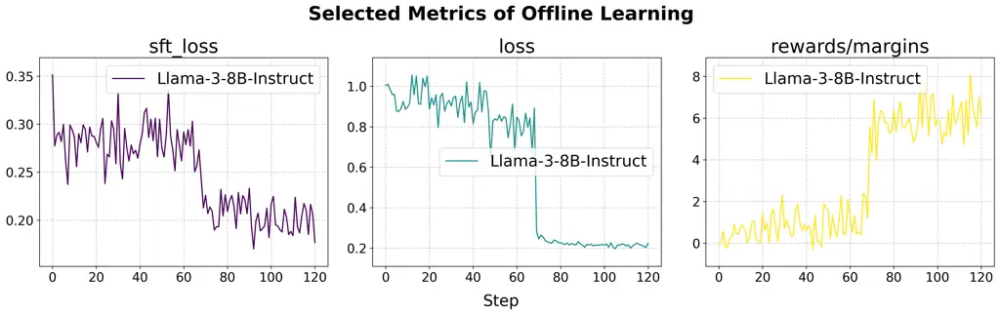

Figure 5: The variation of statistical metrics during offline learning
trained on Helpsteer2-Pref.

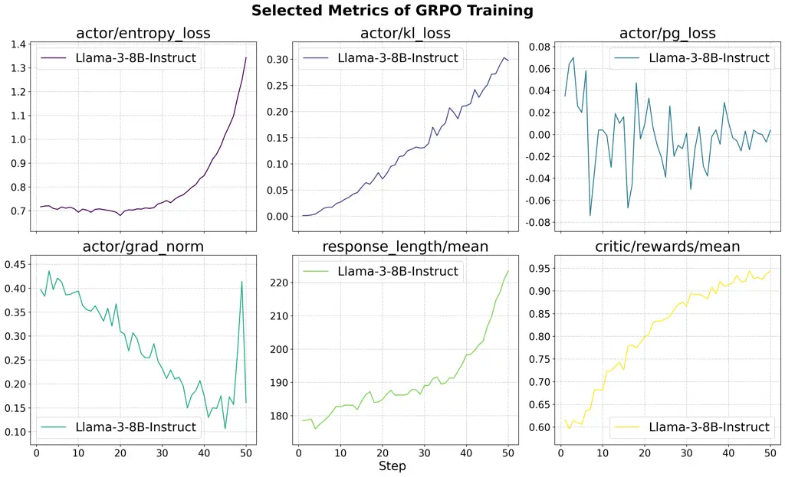

Figure 6: The variation of statistical metrics during GRPO training on
Helpsteer2-Pref.

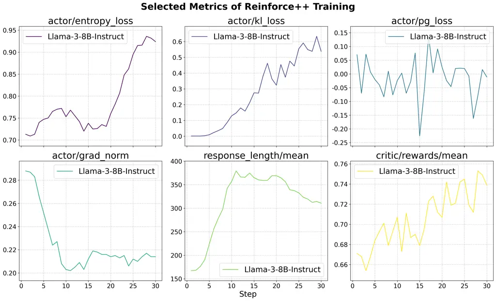

Figure 7: The variation of statistical metrics during Reinforce++
training on Helpsteer2-Pref.

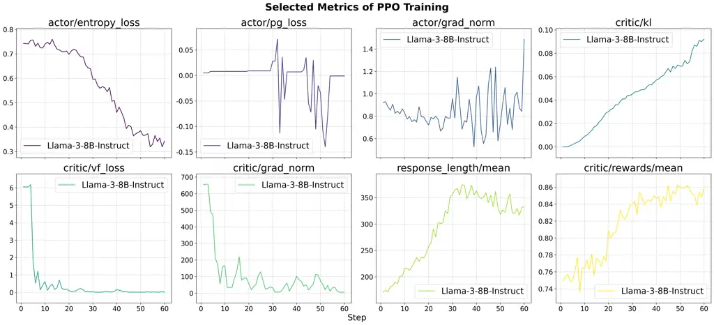

Figure 8: The variation of statistical metrics during PPO training on
Helpsteer2-Pref.

### A.5 Human Evaluation of Thinking Trace Interpretability

To quantitatively verify the improvement of thinking trace
interpretability introduced by our method, we conducted a human
evaluation. We randomly sampled 100 cases from RewardBench and enlisted
three graduate students to manually assess the thinking trace produced
by three judge models: the original model, the model fine-tuned with
Supervised Fine-Tuning (SFT) on positive data only, and our model
optimized with online Reinforcement Learning (RL), Think-J. The students
were instructed to compare the two judgments given by different models
for the same sample and determine which one provided a better thinking.
We then recorded the majority vote from the three students.

| Setting                                | Win Rate |
| -------------------------------------- | -------- |
| Think-J v.s. Original Qwen-2.5-7B-Inst | 100%     |
| Think-J v.s. SFT on Positive Samples   | 67%      |

Table 15: Comparison of interpretability of thinking traces generated by
different judges.

As the results show in Table 15, Think-J unquestionably outperforms the
judgments generated by the original model. This is expected, as the
original model was not optimized for thinking-enhanced judgment, and its
interpretations were too simplistic. Furthermore, Think-J also surpasses
the judgments from the model SFT on positive samples only, underscoring
the necessity of negative samples when optimizing judgment thinking
traces.

### A.6 Limited Failure Analysis of Think-J Robustness

While we generally assume a correct thinking trace would lead to a
correct judgment (and vice versa), we acknowledge cases where an
incorrect thinking trace might still produce the right outcome. To
perform a more in-depth evaluation of the model’s underlying thinking
process, we leveraged an LLM-as-a-Judge approach based on the data and
model in Section 5.4.

|                                    |            |        |           |      |
| ---------------------------------- | ---------- | ------ | --------- | ---- |
| Model                              | Error Rate |        |           |      |
| Chat                               | Hard       | Safety | Reasoning |      |
| Think-J-Qwen-2.5 trained on Group1 | 32.5       | 55.0   | 60.0      | 63.1 |
| Think-J-Qwen-2.5 trained on Group4 | 23.1       | 33.3   | 46.7      | 35.0 |

Table 16: Error rate of thinking traces generated by different Think-J
models trained on different qualities groups of data.

Specifically, we randomly selected 50 samples from RewardBench and
employed GPT-4o to meticulously check for errors in the judgment process
(i.e., the thinking trace) for each model. We removed the final binary
judgment (i.e., ”Response A/B is better”) and focused solely on
verifying errors within the clipped critique itself, even when the final
judgment result was correct. This methodology allowed us to better
assess the robustness of Think-J’s internal logic.

Unexpectedly, as shown in Table 16, our analysis revealed a significant
finding: Despite the high accuracy of the model trained on noised Group
1 data, its thinking trace quality appeared to degrade substantially,
with over 50% of the traces containing identifiable errors. We
hypothesize that for a binary classification task like judgment, an
imperfect thinking trace can still lead to a correct judgment in many
cases, provided the critical point with decisive influence is
identified.

## Appendix B Implementation Details

### B.1 Thinking Trace Clipping

As we have explained in Section 3.1, despite the superior reasoning
capability of Deepseek-R1, the thinking trace generated are excessively
long and could possibly cause difficulty for further optimization and
increase computational overhead. Specifically, for our case, we
hypothesize that general LLM judgment does not necessarily require a
detailed, step-by-step reasoning process. On the contrary, identifying
one key factor is sufficient to make correct judgment in most cases.
Overly long reasoning traces can cause the model to consider factors
that do not affect the preference outcomes, thereby degrading the
effectiveness.

Therefore, we introduce Trace Clipping to enhance the effectiveness of
thinking initialization, as shown in the Example of 9. Specifically, we
observed that the CoTs generated by R1 are composed of two parts: a
lengthy reasoning process, and an explanation which summarizes the
reasoning process. Therefore, we remove the first part and use the
second part as the output trace. Models trained with the clipped trace
will also generate the reasoning trace in a way that directly addresses
the key points. This not only facilitates subsequent optimization but
also enhances the judgment readability.

The experiment analysis of the effectiveness of thinking trace clipping
is presented in Appendix A.2.

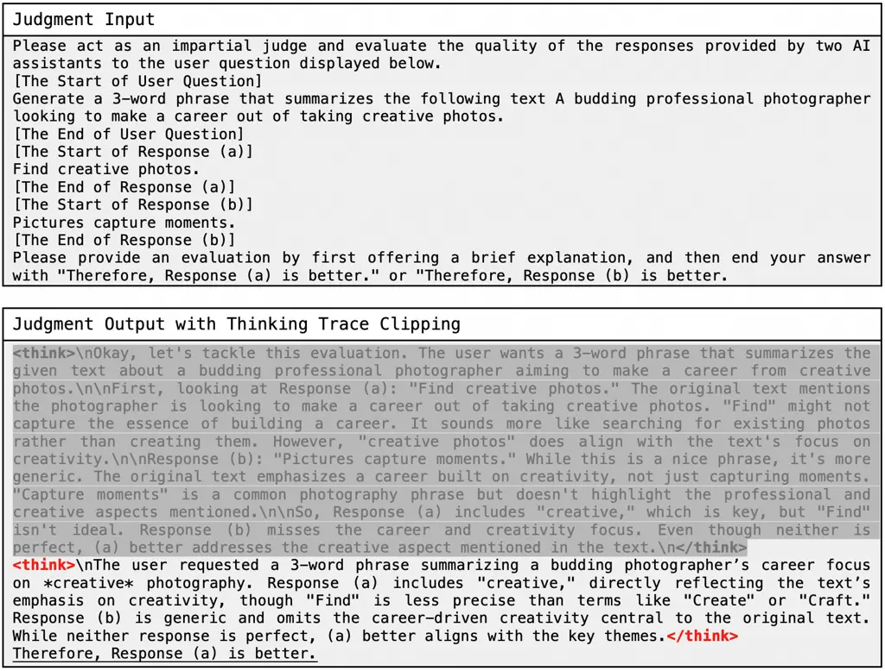

Figure 9: The illustration of Trace Clipping. The first part of thinking
trace is removed, while the second part is used as the output thinking
trace.

### B.2 Judgment Thinking Initialization

As we have explained in Section 3.1, we apply deduplication to ensure
the diversity of LIMJ707. For this purpose, we leverage the algorithm
defined in Algorithm 1 to create instruction data pool, where the
embeddings of instructions are derived based on the model of
instructor-large¹³¹³ 13 https://huggingface.co/hkunlp/instructor-large,
and repetitive instructions are removed based on the similarity of
instruction semantics.

We leverage the prompt templates in Figure 11 and 13 for constructing
thinking trace based on proprietary thinking models. The temperature is
set as 0.0 to enable more accurate judgment.

0:  Instruction Dataset $`D`$ with $`m`$ samples, number of samples to
select $`n`$.

0:  Selected Dataset $`D^{\prime}`$ with $`n`$ samples.

1:  Derive the embeddings for each sample in $`D`$.

2:  Random sample one data point $`x`$ from $`D`$.

3:  Delete $`x`$ from $`D`$, add $`x`$ to $`D^{\prime}`$.

4:  for $`i=1,2,...,n-1`$ do

5:   Calculate the cosine similarity score between $`x`$ and each sample
from $`D`$.

6:   Select the least similar sample $`x^{\prime}`$ from $`D^{\prime}`$.

7:   Let $`x=`$ $`x^{\prime}`$.

8:   Delete $`x`$ from $`D`$, add $`x`$ to $`D^{\prime}`$.

9:  end for

Algorithm 1 Diversity-verified Sampling

Figure 10: The sampling algorithm for LIMJ707 used for diversity
verification.

### B.3 Judgment Thinking Optimization

For judgment thinking optimization, we leverage the prompts in Figure 11
and 12 for offline learning, and the prompts in Figure 13 and 14 for
online learning. The offline learning is implemented based on
Llama-Factory (Zheng et al. 2024), and online learning is implemented
based on verl (Sheng et al. 2024). We present the hyper-parameter
settings in Table 17 and 18.

### B.4 Criteria for Determining Preference Strength

As we have explained in Section 3.2, for Rule-based Online Learning, we
propose an $`r_{strength}`$ for assessing preference strength, which is
defined as the degree to which the judge favors one response over
another. In this section, we would like to detail how we get the
strength annotation for HelpSteer2-Pref and HH-RLHF datasets.

For the HelpSteer2 dataset, we directly adopt the original data
annotations, which were derived from professional human annotators and
provide three distinct strength levels.

For the HH-RLHF dataset, we derive strength annotations following the
method of (Wang et al. 2024b), which involves:

1.  1.  Training multiple Bradley-Terry classifiers on preference data.
2.  2.  Averaging the scores assigned to each data point by these
        classifiers.
3.  3.  Categorizing the strength into three tiers (1, 2, 3) based on the
        score differences between preference pairs.

We opted for a three-level categorization of strength—representing
”slightly better,” ”better,” and ”much better”—due to its clear
interpretability. We found that further granularity did not improve
results and, in some cases, led to the model ”hacking” to extreme
values, as detailed in Appendix B.1.

|                             |          |          |               |
| --------------------------- | -------- | -------- | ------------- |
| hyper-parameter             | SFT      | offline  | BT classifier |
| learning_rate               | 5.00E-06 | 1.00E-06 | 2.00E-06      |
| per_device_train_batch_size | 64       | 64       | 64            |
| cutoff_len                  | 4096     | 4096     | 4096          |
| lr_scheduler                | cosine   | cosine   | cosine        |
| train_epoch                 | 3        | 2        | 2             |
| kl_beta                     | —        | 0.1      | —             |
| deepspeed_stage             | zero3    | zero2    | —             |
| precision                   | bf16     | bf16     | bf16          |
| flash_attn                  | fa2      | fa2      | —             |

Table 17: Hyper-parameter settings for SFT, offline learning and BT
classifier.

|                                                             |            |          |             |
| ----------------------------------------------------------- | ---------- | -------- | ----------- |
| hyper-parameter                                             | GRPO       | PPO      | Reinforce++ |
| data.train_batch_size                                       | 1024       | 1024     | 1024        |
| data.max_prompt_length                                      | 1024       | 1024     | 1024        |
| data.max_response_length                                    | 3072       | 3072     | 3072        |
| actor_rollout_ref.actor.optim.lr                            | 1.00E-06   | 1.00E-06 | 3.00E-06    |
| actor_rollout_ref.actor.ppo_mini_batch_size                 | 256        | 256      | 1024        |
| actor_rollout_ref.actor.ppo_micro_batch_size_per_gpu        | 16         | 4        | 8           |
| actor_rollout_ref.actor.use_kl_loss                         | true       | —        | true        |
| actor_rollout_ref.actor.kl_loss_coef                        | 0.001      | —        | 0.001       |
| actor_rollout_ref.actor.kl_loss_type                        | low_var_kl | —        | mse         |
| actor_rollout_ref.rollout.log_prob_micro_batch_size_per_gpu | 16         | 4        | 8           |
| actor_rollout_ref.rollout.n                                 | 8          | —        | 4           |
| actor_rollout_ref.ref.log_prob_micro_batch_size_per_gpu     | 16         | 4        | 8           |
| critic.optim.lr                                             | —          | 1.00E-05 | —           |
| critic.ppo_micro_batch_size_per_gpu                         | —          | 4        | —           |
| algorithm.kl_ctrl.kl_coef                                   | 0.001      | 0.001    | —           |
| trainer.n_gpus_per_node                                     | 8          | 8        | 8           |
| trainer.nnodes                                              | 2          | 2        | 2           |
| trainer.total_epochs                                        | 10         | 5        | 5           |

Table 18: Hyper-parameter settings for online learning algorithms.

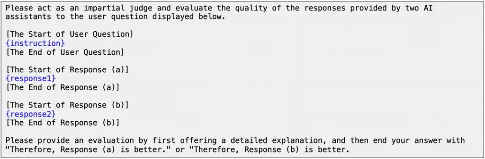

Figure 11: The prompt template used for judgment prediction without
$`r_{strength}`$.

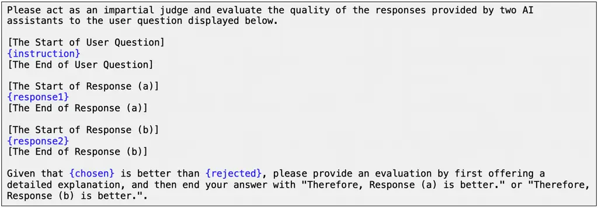

Figure 12: The prompt template used for critique prediction without
$`r_{strength}`$.

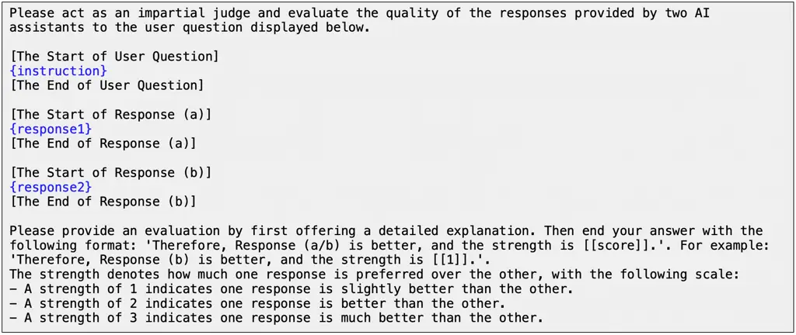

Figure 13: The prompt template used for judgment prediction with
$`r_{strength}`$.

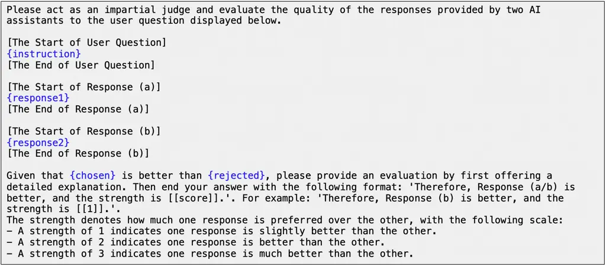

Figure 14: The prompt template used for critique prediction with
$`r_{strength}`$.
