# YESciEval: Robust LLM-as-a-Judge for Scientific Question Answering

Jennifer D’Souza¹    Hamed Babaei Giglou¹    Quentin Münch²
Affiliation: ¹TIB Leibniz Information Centre for Science and Technology,
Hannover, Germany Affiliation: ²Leibniz Universität Hannover, Germany
Email: [{jennifer.dsouza,hamed.babaei}@tib.eu](mailto:)

###### Abstract

Large Language Models (LLMs) drive scientific question-answering on
modern search engines, yet their evaluation robustness remains
underexplored. We introduce YESciEval, an open-source framework that
combines fine-grained rubric-based assessment with reinforcement
learning to mitigate optimism bias in LLM evaluators. We release
multidisciplinary scienceQ&A datasets, including adversarial variants,
with evaluation scores from multiple LLMs. Independent of proprietary
models and human feedback, our approach enables scalable, cost-free
evaluation. By advancing reliable LLM-as-a-judge models, this work
supports AI alignment and fosters robust, transparent evaluation
essential for scientific inquiry.

## 1 Introduction

The rise of scientific search engines powered by generative Large
Language Models (LLMs)—such as [Elicit](https://elicit.com),
[OpenScholar](https://openscholar.allen.ai),
[SciSpace](https://typeset.io), and [ORKG
Ask](https://ask.orkg.org/)—has transformed how researchers search and
synthesize scholarly information. A key feature of these platforms is
scientific question answering (scienceQ&A), where an LLM synthesizes
insights from top-ranked papers to generate concise responses Pride
et al. (2023); Babaei Giglou et al. (2024). While aligning LLMs to human
values (e.g., helpfulness, harmlessness, honesty) is well studied Askell
et al. (2021); Zheng et al. (2023), their real-world robustness in
scienceQ&A remains largely unexplored. The domain-agnostic and free-form
nature of scienceQ&A limits the applicability of traditional
n-gram-based metrics (e.g., BLEU (2002a), ROUGE (2004a)), which may not
fully capture compositional and domain-specific reasoning Krishna et al.
(2021). Human evaluation, though more nuanced, is costly and difficult
to scale Krishna et al. (2023). Recent efforts using LLMs as evaluators
(LLM-as-a-judge Zheng et al. (2023)) show parity with human judgment
Chiang and Lee (2023b) but also exhibit biases Gudibande et al. (2023);
Ye et al. (2024), highlighting the need for a reliable and fair
LLM-based evaluation system. Most prior evaluation work relies on
proprietary GPT models Wang et al. (2023a); Dubois et al. (2023); Liu
et al. (2023); Fu et al. (2024), raising issues of transparency and high
costs at scale Kim et al. (2023); Kim et al. (2024). To address these
challenges, we propose a framework that pairs fine-grained rubrics with
an open-source LLM-as-a-judge methodology, enabling more reliable and
cost-effective evaluation of scienceQ&A across diverse scientific
domains.

Despite the growing use of LLMs for scienceQ&A, a systematic evaluation
framework remains absent, limiting iterative development and
transparency. Such a framework would provide feedback for reward-based
training (e.g., RLAIF Christiano et al. (2017); Bai et al. (2022)) and
help users assess the reliability of automated answers, mitigating
misinformation. While human evaluations are the gold standard, they are
costly and hard to scale Ouyang et al. (2022); Krishna et al. (2023),
underscoring the need for an automated, trustworthy alternative. An
LLM-as-a-judge approach with fine-grained rubrics can address this gap,
enabling robust, repeatable assessments that enhance scienceQ&A systems
and user confidence.

Figure 1: Examples from two domains in the YESciEval science Q&A
dataset. Orange boxes show LLM input: a research question and titles of
top-ranked papers (abstracts omitted for brevity). Green boxes show
answer snippets from two LLMs. Light/dark gray boxes represent
subtle/extreme adversarial variants targeting the conciseness and
correctness rubrics. Yellow highlights indicate perturbations. YESciEval
uses a nine-rubric LLM-as-a-judge scheme and tests robustness via
rubric-specific adversarial edits (see Appendix B for details).

To establish a systematic and transparent evaluation framework for
scienceQ&A, we propose YESciEval, which integrates two core components.
First, we define a nine-rubric multifaceted assessment scheme,
structured into three key dimensions—Linguistic & Stylistic Quality,
Logical & Structural Integrity, and Content Accuracy &
Informativeness—to comprehensively evaluate LLM-generated responses.
Each rubric is scored on a Likert scale (1–5) with predefined
guidelines, ensuring consistent and rigorous assessment. Second, we
address the optimism bias Villaflor et al. (2022) in LLMs, which can
hinder their role as judges by favoring positive engagement over
critical assessment. The title prefix of this paper, YESci (pronounced
‘yes, sigh!’), playfully encapsulates our central research question: how
can we mitigate LLMs’ optimism bias and enhance their robustness as
scienceQ&A evaluators? To tackle this, we employ a two-step alignment
strategy: supervised fine-tuning followed by reinforcement learning
(RLHF), ensuring adherence to our fine-grained rubrics for reliable
evaluation. Additionally, we introduce adversarial
datasets—systematically constructed instances where LLMs are expected to
underperform—to contrast standard and adversarial responses, reinforcing
robustness against evaluation errors. While our approach is applied to
scienceQ&A in this study, mitigating optimism bias in LLM evaluators has
broader implications for other evaluation tasks. By unifying supervized
fine-tuning (SFT), reinforcement learning (RL), and adversarial
perturbations, YESciEval improves the reliability of LLM-based
evaluation, especially for open-source models, reducing reliance on
proprietary systems and offering a scalable, customizable framework for
scientific search.

We select four open-source LLMs spanning 8B to 123B parameters (e.g.,
LLaMA-3.1 and Mistral-Large) from Meta AI, Mistral AI, and Alibaba Cloud
for generating (LLM*(gen)) and evaluating (LLM*(eval)) scienceQ&A. Each
model in the generator role produces a unique scienceQ&A dataset with
its responses as the benign (non-perturbed) dataset, and we introduce
two adversarial perturbation types—extreme (overt distortions) and
subtle (lightweight heuristics)—, yielding 12 datasets. Figure 1
presents two examples from our scienceQ&A dataset. Rotating the four
models as evaluators and scoring responses under our nine-rubric
framework results in 48 LLM-as-a-judge configurations. To validate
generalizability, we apply a two-step alignment strategy (_SFT_ followed
by _RL_) to LLaMA 3.1 8B LLM-as-a-judge, confirming our approach’s
robustness for different model sizes and versions. The recent release of
[LLaMA 4](https://The%20Llama%204%20herd:%20The%20beginning%20of%20a%20new%20era%20of%20natively%20multimodal%20AI%20innovation),
at the time of this writing, underscores the importance of
model-agnostic frameworks like YESciEval.

Despite significant advances in the generative capabilities of LLMs, our
findings reveal that they remain unexpectedly fragile when confronted
with heuristic-based adversarial attacks in the role of a judge. Against
this backdrop of LLM-as-a-judge for scienceQ&A, we pose the following
research questions. RQ1: How similar are scienceQ&A responses across
different LLM families? Given the rapid influx of new LLMs, we aim to
reduce the uncertainty around model choice by clarifying the degree of
similarity in how different model families handle scienceQ&A. RQ2: How
do LLM-as-judge evaluations correlate for the benign scienceQ&A setting?
Beyond examining alignment in evaluative behavior, we investigate
whether LLMs exhibit bias toward their own generated answers. RQ3: Can a
smaller open-source LLM be adapted as an LLM-as-a-judge for scienceQ&A
while overcoming optimism bias? While prior work focuses on tuning LLMs
to specific skills (rubrics), a key challenge remains in mitigating
their optimism bias. We propose a framework that integrates SFT, RL, and
adversarial alignment to equip smaller open-source models with robust
evaluative capabilities. Although we illustrate our approach in the
context of scienceQ&A, these methods can be adapted to other generative
AI scenarios requiring rigorous critique.

This work makes the following key contributions: 1. Multidisciplinary
benign and adversarial scienceQ&A datasets – We release a comprehensive
[scienceQ&A corpus with adversarial
variants](https://doi.org/10.25835/8dcv2ka6) D’Souza et al. (2025) to
evaluate LLM robustness. 2. Comprehensive evaluation benchmark – We
provide evaluation scores and rationales from multiple LLMs in both
vanilla and adversarial settings, supporting further research and
reproducibility. 3. Optimism bias mitigation – We implement a RL
framework to align LLM evaluation behavior with real-world critical
feedback expectations. The YESciEval source code is released at
[https://github.com/sciknoworg/YESciEval](https://github.com/sciknoworg/YESciEval). 4. Scalable, cost-free evaluation paradigm – Our approach is independent
of proprietary models and human feedback, leveraging open-source LLMs
hosted on a centrally managed cloud service,¹¹ 1
[https://docs.hpc.gwdg.de/services/chat-ai/index.html](https://docs.hpc.gwdg.de/services/chat-ai/index.html)
which is publicly accessible to research institutions across Germany
Doosthosseini et al. (2024). While human feedback is invaluable for LLM
alignment, it is often infeasible to obtain. We present a zero-cost
alternative, integrating rubric-based evaluation with adversarial
testing to ensure reliable LLM-as-a-judge models. This eliminates
experimental costs, aside from researcher time and compute resources for
running open-source LLMs.

This research presents a reproducible, cost-free²² 2 In this paper,
“cost-free” refers to the elimination of human annotation and
proprietary API costs, but not compute. framework for evaluating natural
language generation (NLG) in scienceQ&A, advancing AI alignment,
robustness, and contributes to the broader discussion around LLM
plausibility.

## 2 Task Definition

The YESciEval framework for scienceQ&A consists of two tasks:
LLM$`{gen}`$ for generating responses and LLM$`{eval}`$ for evaluating
them.

#### Task 1: ScienceQ&A Generation (LLM\_(gen))

Generates a synthesized summary response $`A`$ to a research question
$`Q`$ using abstracts from the top $`N`$ relevant papers. It must
demonstrate (1) domain knowledge, (2) numerical proficiency, (3)
long-range context understanding, and (4) cause-and-effect reasoning
Wadden et al. (2020).

#### Task 2: ScienceQ&A Evaluation (LLM\_(eval))

Assesses the quality of $`A`$ based on predefined rubrics and context as
$`Q`$ and $`N`$ abstracts. The [evaluation
prompt](https://github.com/sciknoworg/YESciEval/tree/main/yescieval/rubric)
is structured as follows: (1) Context, defining scienceQ&A synthesis as
the generation of a coherent summary from research papers to address
$`Q`$; (2) Role, assigning LLM\_(eval) as the evaluator; (3) Task
Description, ensuring $`A`$ accurately synthesizes information from
abstracts; (4) Evaluation Characteristics, specifying the rubric
applied; (5) Rating Scale, using a 1–5 Likert scale with rubric-specific
guidelines; (6) Response Format, requiring structured ratings and
rationales in JSON format; and (7) Notes, emphasizing objectivity and
adherence to source content. Finally, the output consists of a score
$`S`$ (1–5) and a rationale.

## 3 The YESciEval Qualitative Rubrics

Drawing from a comprehensive review of evaluation rubrics in prior
LLMs-as-a-judge research (see Related Work subsection 7.2), we define a
nine-rubric qualitative evaluation paradigm for YESciEval. Chosen for
simplicity, memorability, and precise definability, these rubrics
minimize overlap while capturing key facets of an ideal LLM response to
science Q&A. Each is framed as a concise question to reduce ambiguity
for LLM-as-a-judge or human evaluators. Organized into three main
evaluation dimensions, they are as follows.

Linguistic & Stylistic Quality concerns grammar, clarity, and adherence
to academic writing. This category comprises three rubrics: 1.
[Cohesion](https://anonymous.4open.science/r/YESciEval/sciqaeval/prompts/Cohesion.txt):
are the sentences connected appropriately such that the resulting
synthesis is cohesive? 2.
[Conciseness](https://anonymous.4open.science/r/YESciEval/sciqaeval/prompts/Conciseness.txt):
is the answer short and clear, without redundant statements? 3.
[Readability](https://anonymous.4open.science/r/YESciEval/sciqaeval/prompts/Readability.txt):
does the answer follow appropriate style and structure conventions for
academic writing, particularly for readability? Logical & Structural
Integrity focuses on the reasoning and organization of information. This
category comprises three rubrics: 4.
[Coherence](https://anonymous.4open.science/r/YESciEval/sciqaeval/prompts/Coherence.txt):
are the ideas connected in a sound and logical manner? 5.
[Integration](https://anonymous.4open.science/r/YESciEval/sciqaeval/prompts/Integration.txt):
are the sources structurally and linguistically well-integrated, using
appropriate markers of provenance/quotation and logical connectors for
each reference? In addition, are the sources integrated as a single
paragraph? 6.
[Relevancy](https://anonymous.4open.science/r/YESciEval/sciqaeval/prompts/Relevancy.txt):
is the information in the answer relevant to the question? Content
Accuracy & Informativeness ensures that the response is both correct and
useful. This category comprises three rubrics: 7.
[Correctness](https://anonymous.4open.science/r/YESciEval/sciqaeval/prompts/Correctness.txt):
is the information in the answer a correct representation of the content
of the provided abstracts? 8.
[Completeness](https://anonymous.4open.science/r/YESciEval/sciqaeval/prompts/Completeness.txt):
is the answer a comprehensive encapsulation of the relevant information
in the provided abstracts? 9.
[Informativeness](https://anonymous.4open.science/r/YESciEval/sciqaeval/prompts/Informativeness.txt):
is the answer a useful and informative reply to the question?

For each rubric, the LLM-as-a-judge rates response quality on a Likert
scale from 1 (very bad) to 5 (very good), with predefined guidelines
ensuring consistency. These guidelines set clear expectations for each
level—for instance, in Readability, a 1 indicates severe issues in
style, structure, and language use, while a 5 reflects an exceptionally
well-written, academically sound synthesis. Standardized criteria help
both LLMs and human evaluators apply consistent judgment. Full rating
guidelines for all nine rubrics are provided in Appendix E. Ideally, an
LLM-as-a-judge assigns perfect scores across all rubrics, while
suboptimal responses receive lower ratings based on specific
deficiencies.

## 4 Science Q&A Datasets

After reviewing existing Q&A datasets (see Related Work subsection 7.1),
we selected two that meet our scienceQ&A task definition: the
ORKGSynthesis dataset (2024) (ORKGSyn) and the BioASQ dataset (2024a).
ORKGSyn offers a diverse set of crowdsourced research questions for
evaluating LLMs’ scienceQ&A capabilities, while BioASQ provides
handcrafted QA pairs spanning four question types. Both were chosen
because they include science questions $`Q`$ with each question linked
to $`N`$ relevant papers.

### 4.1 The ORKGSynthesis Corpus

This corpus comes from the domain-expert-curated structured research
comparisons Oelen et al. (2019) on the Open Research Knowledge Graph
(ORKG) platform Auer et al. (2020). Its accompanying LLM-powered search
engine, ORKG Ask ([https://ask.orkg.org/](https://ask.orkg.org/)),
synthesizes abstracts from the top five papers for any given research
question. Building on this approach and the ORKG as a gold-standard
source, in our prior work Babaei Giglou et al. (2024), we compiled a
dataset of 348 entries—each linking a RQ with exactly five relevant
papers. Since the ORKG spans multiple disciplines, the dataset covers 33
research fields. Table 1 lists the top 10 fields; the full list appears
in Figure 5 in subsection B.1.

| Research field                                        | Frequency |
| ----------------------------------------------------- | --------- |
| Computer Sciences                                     | 125       |
| Physics                                               | 28        |
| Animal Sciences                                       | 19        |
| Chemistry                                             | 17        |
| Urban Studies and Planning                            | 16        |
| Earth Sciences                                        | 14        |
| Oceanography and Atmospheric Sciences and Meteorology | 14        |
| Science and Technology Studies                        | 12        |
| Materials Science and Engineering                     | 12        |
| Engineering                                           | 10        |

Table 1: Top 10 domains in the ORKGSynthesis dataset.

While ORKGSyn is multidisciplinary, the next corpus is in biomedicine.

### 4.2 The BioASQ Corpus

BioASQ Nentidis et al. (2024a) is an annual biomedical semantic indexing
and Q&A challenge. Its 2024 edition covers four NLP tasks, and we focus
on the first: biomedical Q&A. The dataset includes 5389
domain-expert-curated Q&A pairs in four question types: “yes/no,”
“factoid,” “list,” and “summary.” The challenge has three phases (A, A+,
and B), with Phase B linking each question to a human-annotated set of
relevant papers Nentidis et al. (2024b), meeting our requirement of
$`Q`$ with $`N`$ relevant papers. Because $`N`$ varies in BioASQ, we
capped it at 40 for computational feasibility and to fit LLM input
context (see Figure 6, subsection B.2). This variability introduces a
unique scienceQ&A setting compared to ORKGSyn. We narrowed the dataset
to the test set’s 73 “summary” questions, each with up to 40 PubMed
abstracts.

### 4.3 Our ScienceQ&A Dataset Compilation

Now that we had corpora of $`Q`$ linked with $`N`$ paper abstracts, we
need to apply LLM\_(gen).

LLM\_(gen) models. Our selection criteria for LLMs were simple: they had
to be open-source, state-of-the-art at some point, and diverse in size,
including at least one small model. Based on this, we chose Llama 3.1 8B
& 70B MetaAI (2024), Qwen 2.5 72B AlibabaCloud (2024), and Mistral Large
128B MistralAI (2024). All feature 128K-token context windows and excel
in reasoning, coding, and multilingual tasks. Llama 3.1 prioritizes
efficiency and safety with Llama Guard 3, Qwen 2.5 offers robust
multilingual support (29+ languages) and a specialized Coder variant,
while Mistral Large 128B supports 80+ programming languages and is
optimized for single-node inference. While Llama 3.1 emphasizes
open-source accessibility, Qwen 2.5 specializes in multilingual and
coding capabilities, and Mistral Large delivers peak computational
performance despite its size.

LLM\_(gen) task. The four models were applied, in turn, to generate a
synthesized summary response, $`A`$, for a given research question,
$`Q`$, using abstracts from the top $`N`$ relevant papers. The resulting
datasets (downloadable at
[https://doi.org/10.25835/8dcv2ka6](https://doi.org/10.25835/8dcv2ka6))
constitute the “benign” science Q&A dataset variant of this study.

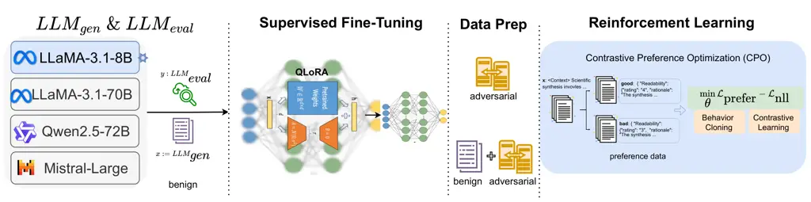

Figure 2: YESciEval LLM-as-a-Judge Alignment: Supervised fine-tuning of
$`LLM_{eval}`$, followed by reinforcement learning via Contrastive
Preference Optimization to align open-source LLMs with desired
rubric-level evaluations.

### 4.4 Our Adversarial ScienceQ&A Corpus

Adversarial attacks in NLP generate text samples designed to mislead
models into incorrect predictions, using either heuristic-based
perturbations or machine learning. Inspired by Jia and Liang (2017), who
applied heuristic adversarial perturbations to assess NLP brittleness in
reading comprehension (2016), we introduce rubric-based adversarial
variants of the benign scienceQ&A dataset to evaluate the robustness of
LLM-as-a-judge systems.

A key question in this study is the reliability of LLM*(eval)’s
qualitative scores for benign synthesized answers $`A`$ generated by
LLM*(gen). Traditionally, human evaluations would serve as a benchmark,
but instead, we assess LLM-as-a-judge robustness through adversarial
testing. This approach indirectly measures reliability by evaluating
whether LLM\_(eval) appropriately differentiates between benign and
perturbed responses. If the model fails to adjust its scores
accordingly, it suggests an inability to critique responses effectively,
thus low reliability on the LLM-as-a-judge.

To systematically evaluate this, we adopt a heuristic-based perturbation
strategy, introducing deliberate errors at specific points in the benign
text with the expectation that evaluation scores should reflect the
resulting quality deterioration. To ensure rigor in adversarial
assessment, we design two variants of adversarial attacks: (1) Subtle
adversarial samples, where minor alterations to the benign text create
realistic yet difficult-to-detect errors, and (2) Extreme adversarial
samples, where substantial modifications make flaws obvious. The
adversarial perturbation heuristics, for both variants, were designed at
the fine-grained rubric level. Thus each of the nine rubrics have subtle
and extreme adversarial perturbation heuristics associated with them.
They are as follows. Relevancy assesses whether the response remains
on-topic, with subtle attacks appending sentences from related synthesis
paragraphs and extreme attacks injecting unrelated sports news.
Correctness tests factual alignment with provided abstracts, using the
same attack strategy. Completeness measures how well the response
encapsulates relevant content, with subtle attacks removing the final
sentence and extreme attacks also appending unrelated text.
Informativeness evaluates the response’s utility, using the same
perturbation as relevancy. Integration examines structural and
linguistic coherence, with subtle attacks removing the first logical
connector and extreme attacks eliminating all connectors. Cohesion
ensures appropriate sentence connections, with subtle attacks swapping
the last two sentences and extreme attacks randomly shuffling them.
Coherence assesses logical idea progression, using the same attack as
relevancy. Readability focuses on adherence to academic writing
conventions, with subtle attacks adding informal blog snippets and
extreme attacks inserting tweets. Conciseness tests redundancy, with
subtle attacks appending an LLM-generated redundant version of the last
sentence and extreme attacks inserting redundant text after every
sentence. Detailed heuristics are provided in Appendix subsection B.3.
These perturbations systematically degrade response quality, ensuring
rigorous evaluation of LLM-as-a-judge reliability. Redundant responses
were LLM-generated and manually refined for fluency. The adversarial
[publicly available](https://doi.org/10.25835/8dcv2ka6) dataset
benchmarks LLMs’ ability to mitigate optimism bias and distinguish
response quality. Unlike synonym substitution attacks (SSAs) Alzantot
et al. (2018), which are conjectured to degrade fluency and meaning
Chiang and Lee (2023a), our rubric-based heuristics introduce syntactic
violations to ensure low-quality text. This controlled degradation
enables precise evaluation of LLM score adjustments for scienceQ&A.

### 4.5 Our LLM-as-a-judge Evaluations

The four models—Llama 3.1 8B & 70B, Qwen 2.5 72B, and Mistral Large
128B—previously used for LLM*(gen) were now tasked with LLM*(eval).
Section 2 details the task specification prompt. Each model evaluated
all instances from ORKGSyn (benign, subtle-adv, extreme-adv) and BioASQ
across the nine YESciEval rubrics. This resulted in 37,584 evaluation
scores for ORKGSyn ($`348\times 3\times 9\times 4`$) and 7,884 for
BioASQ ($`73\times 3\times 9\times 4`$), equating to 9,396 and 1,971
evaluations per model, respectively. Notably, despite requiring GPU
compute, model access incurred zero monetary cost—whereas using
proprietary models like OpenAI’s GPT would have cost at least 1,000
euros or dollars for these evaluations. This reinforces the motivation
of YESciEval, aligned with prior studies Kim et al. (2023); Kim et al.
(2024), to enhance open-source LLM-as-a-judge models for greater
accessibility.

|                           | BioASQ | ORKGSynthesis |
| ------------------------- | ------ | ------------- |
| $`LLM_{gen}`$ Train       | 51     | 234           |
| $`LLM_{gen}`$ Test        | 22     | 105           |
| $`LLM_{eval}`$ Train Sets |        |               |
| SFT                       | 6,504  | 34,991        |
| RL (adversarial)          | 1,669  | 6,148         |
| RL (benign+adversarial)   | 2,569  | 2,290         |
| $`LLM_{eval}`$ Test Set   | 2,376  | 11,340        |

Table 2: Dataset statistics across training and test sets for
$`LLM_{gen}`$ and $`LLM_{eval}`$.

## 5 The YESciEval Alignment Method

This work aims to propose a cost-free evaluation framework without human
annotators or proprietary models. Key contributions include an
adversarial testing strategy for robust LLM-as-a-judge models and the
YESciEval alignment method discussed in this section that can be applied
to open-source LLMs to equip them as robust evaluators.

The methodology is remotely related to self-instruct Wang et al.
(2023b), where LLMs are improved for instruction following
self-generated instructions; except we reinforce evaluation behaviors of
LLMs to desired behaviors by treating undesired behaviors as negative
reward signals. Figure 2 depicts our RL technique applied to learn the
alignments between desirable and undesirable behaviors with the
following steps:

Supervised Fine-Tuning (SFT). To ensure model stability after RL, as a
first step, we fine-tuned the LLaMA-3.1-8B evaluator using data (see
Table 2) from $`x:LLM_{gen}`$ (benign scientific syntheses by four LLMs)
and corresponding $`y:LLM_{eval}`$ rubric-wise evaluations. Each rubric
score is treated as a separate training sample for SFT. To enable
efficient adaptation of large models with minimal compute, we use
Quantized Low-Rank Adaptation (QLoRA) (Dettmers et al., 2023).

Data Preparation for RL. Unlike traditional fine-tuning, RL does not
require large datasets; instead, models learn from comparisons rather
than absolute labels, reducing redundancy and cost (Ziegler et al.,
2019). To this end, the data is divided into benign and adversarial
samples, ensuring that our models reinforce the distinction between
‘good’ (desirable) and ‘bad’ (undesirable) evaluations as it is critical
for preference modeling (Askell et al., 2021). We impose a
100-per-rubrics, per-$`LLM_{eval}`$ threshold (for ORKGSyn, this
threshold is set to 500 due to the large nature of the task) to maintain
a manageable dataset size while preserving diversity across criteria.
Dataset statistics are shown in Table 2. For the adversarial sets (“RL
(adversarial)” row), we define desirable scores as $`1`$ for extreme and
$`\leq 3`$ for subtle adversarial variants across the nine rubrics. This
establishes a clear distinction between good and bad evaluations: any
$`LLM_{eval}`$ rating above the threshold is treated as a bad sample;
otherwise, it is considered good. Given only “RL (adversarial),” RL
tended to mimic poor examples and struggled to imitate from benign
synthesis evaluations, where no adversarial setting is applied. To
address this, we curated a separate set containing both benign and
adversarial examples (statistics shown in the “RL (benign+adversarial)”
row of Table 2), selecting bad examples based on undesirable outcomes in
the adversarial evaluations. The final dataset of
$`\mathcal{D}=\{x_{LLM_{gen}}^{(i)},y_{good}^{(i)},y_{bad}^{(i)}\}_{i=1}^{N}`$
is constructed for RL technique.

Reinforcement Learning. Beyond SFT, reinforcement learning (RL) is used
to align LLM evaluations with desirable and undesirable behaviors,
moving beyond reference-mimicking. This involves modeling preference
data $`\mathcal{D}`$ using Imitation Learning via Contrastive Preference
Optimization (CPO) (Xu et al., 2024). CPO extends Direct Preference
Optimization (DPO) Rafailov et al. (2023) by incorporating hard negative
examples, enabling the model to distinguish high- from low-quality
outputs. This contrastive approach enhances the model’s ability to
prioritize superior responses and reject suboptimal ones, resulting in
more discriminative evaluations. Considering $`\pi_{\theta}`$ as a
parameterized policy, the CPO loss is defined as
$`\min_{\theta}\underbrace{\mathcal{L}(\pi_{\theta},U)}_{\mathcal{L}_{\text{prefer}}}-\underbrace{\mathbb{E}_{(x,y_{good})\sim D}[\log\pi_{\theta}(y_{good}|x)]}_{\mathcal{L}_{\text{NLL}}}`$,
where $`\mathcal{L}_{prefer}`$ is a behavior cloning (BC) (Hejna et al., 2023) regularization that encourages the policy $`\pi_{\theta}`$ to
align with uniform prior distribution $`U`$, derived from reference
policy $`\pi_{LLM_{eval}}`$ by preferring good evaluation $`y_{good}`$
over bad one $`y_{bad}`$. Moreover, the term $`\mathcal{L}_{NLL}`$ is
the negative log-likelihood loss that penalizes the policy for making
poor generation of the action $`y_{good}`$ from given state $`x`$ for
high-quality judgments.

Our resulting aligned models are released on HuggingFace for results
reproducibility at
[https://huggingface.co/SciKnowOrg/YESciEval-ASK-Llama-3.1-8B](https://huggingface.co/SciKnowOrg/YESciEval-ASK-Llama-3.1-8B)
and
[https://huggingface.co/SciKnowOrg/YESciEval-BioASQ-Llama-3.1-8B](https://huggingface.co/SciKnowOrg/YESciEval-BioASQ-Llama-3.1-8B).

Figure 3: Heatmaps depicting agreement for synthesis evaluations on
benign datasets. The x-axis represents the $`LLM_{gen}`$, while the
y-axis denotes the $`LLM_{eval}`$.

Figure 4: Evaluation of synthesis across different models and
fine-tuning strategies on BioASQ and ORKGSynthesis datasets. The
nine-rubrics include Coherence (Cohr), Cohesion (Cohs), Completeness
(Comp), Concisenes (Conc), Correctness (Corr), Informativeness (Info),
Integration (Integ), Readability (Read), and Relevancy (Relv).

## 6 Results and Discussion

In this section, we systematically analyze the results in relation to
the three main research questions outlined in the Introduction.
Specifically, we discuss in detail observations on the results obtained
from the two-stage process: LLM*(gen) (RQ1) and LLM*(eval) (RQ2); and
the application of our YESciEval LLM-as-a-judge alignment method (RQ3).
For details on our experimental setup and training, we refer the reader
to Appen. F and G.

First, we focus on: RQ1: How similar are scienceQ&A responses across the
three different LLM families when applied as LLM*(syn)? To address this
RQ, we measured similarities between benign syntheses generated by the
four models for ORKGSyn and BioASQ separately. Based on a comprehensive
review of NLG metrics Sai et al. (2022), we applied eight diverse
similarity metrics: four for verbatim matching, one edit-distance-based,
and three embedding-based, e.g., MoverScore (2019), BERTScore (2020). To
visualize LLM*(syn) correlations per dataset, we computed confusion
matrices with averaged similarity scores.

Overall, ORKGSyn consistently yielded higher alignment scores than
BioASQ, likely due to its broader domain coverage, with Computer Science
(125 questions) as the largest category. As AI and digital fields grow,
general-purpose LLMs trained on large datasets, including research
papers, exhibit stronger proficiency in these areas. In contrast,
BioASQ’s biomedical focus, a more specialized domain, led to greater
uncertainty and lower correlation scores. Strong correlations emerged
within model pairs: Llama 8B and 70B, likely due to their shared Meta
origin and training data, differing mainly in parameter size, and
Mistral and Qwen, suggesting overlapping training data. These findings
highlight the role of shared training data and architecture in aligning
model outputs across LLM families. Detailed results: 16 confusion
matrices across eight metrics are in Appendix D.

RQ2: How do LLM-as-judge evaluations correlate for the benign scienceQ&A
setting? To address this question, we analyze the results in Figure 3,
focusing on LLM*(eval) outputs. Each LLM evaluated the benign synthesis
dataset created by the four models in their LLM*(syn) roles, with
results presented as a confusion matrix where each cell represents the
averaged score across all rubrics and synthesis instances, mapping
evaluator LLMs (y-axis) against LLM*(syn) models (x-axis). Across both
datasets, evaluators assigned higher scores to BioASQ than ORKGSyn,
likely due to ORKGSyn’s interdisciplinary nature, where LLM*(syn) models
struggled with certain domains. Notably, no LLM\_(eval) exhibited bias
toward its own generated synthesis Li et al. (2025). Instead, all
evaluators consistently preferred synthesis outputs generated by Qwen.
As the largest model, Qwen likely demonstrates superior text generation
abilities, reinforcing the reliability of LLM-as-a-judge, even for
smaller models like Llama 8B.

| Rubric           | G-Eval Liu et al. (2023) | GPTScore Fu et al. (2024) | LLM-Alt Chiang and Lee (2023b) | FLASK Ye et al. (2024) | This YESciEval Work |
| ---------------- | ------------------------ | ------------------------- | ------------------------------ | ---------------------- | ------------------- |
| Coherence        | ✓                        | ✓                         | ✓                              |                        | ✓                   |
| Cohesion         |                          |                           | ✓                              |                        | ✓                   |
| Completeness     |                          | ✓                         |                                | ✓                      | ✓                   |
| Conciseness      |                          | ✓                         |                                | ✓                      | ✓                   |
| Correctness      | ✓(Consistency)           | ✓(Factuality)             |                                | ✓(Logical Correctness) | ✓                   |
| Informativeness  |                          | ✓                         |                                | ✓                      | ✓                   |
| Integration      |                          |                           |                                |                        | ✓                   |
| Readability      | ✓(Fluency)               | ✓                         | ✓                              | ✓                      | ✓                   |
| Relevancy        | ✓                        | ✓                         | ✓                              |                        | ✓                   |
| Harmlessness     |                          |                           |                                | ✓                      |                     |
| Logical Thinking |                          |                           |                                | ✓                      |                     |
| Insightfulness   |                          |                           |                                | ✓                      |                     |
| Engagement       |                          | ✓                         | ✓                              |                        |                     |
| Likeability      |                          | ✓                         | ✓                              |                        |                     |

Table 3: Comparison of evaluation rubrics across different works against
ours (last column). Cells marked in green indicate rubrics that apply to
a particular work.

RQ3: Can a smaller open-source LLM be adapted as an LLM-as-a-judge for
scienceQ&A while overcoming optimism bias? To address this question, we
present a comprehensive results plot in Figure 4, where each column
depicts LLM*(eval) results across three dataset variants, aggregated per
rubric for BioASQ (top row) and ORKGSyn (bottom row). Each LLM*(eval)
line in the plot corresponds to averaged scores on the synthesis output
from the four LLM*(gen) models. The goal is to assess the efficacy of
the YESciEval alignment method on a small LLM-as-a-judge or LLM*(eval)
model, specifically Llama 8B, under the premise that if effective on a
lower-parameter model, it should generalize to larger LLMs. The
highlighted colored lines represent different Llama 8B variants: blue
(vanilla model), yellow (SFT model trained on benign data), red (SFT +
RL with adversarial alignment), and green (SFT + RL with a balanced
subsample of benign and adversarial data). Light gray lines indicate the
vanilla model performances of the other three LLMs. As hypothesized,
vanilla Llama 8B (blue) exhibited excessive optimism, assigning high
scores even in extreme adversarial cases—e.g., scoring above 4 on Corr
(correctness rubric) despite perturbations introducing unrelated sports
news sentences. Fine-tuning on benign data alone (yellow) further
amplified optimism, necessitating alignment. When RL was applied only to
adversarial data (red), the model became overly pessimistic. However,
when RL was trained on both benign and adversarial samples (green),
Llama 8B stabilized as a robust evaluator, addressing the RQ. It
assigned relatively high scores for benign syntheses while
distinguishing adversarial perturbations, scoring around 1 in extreme
cases and around 3 in subtle cases, demonstrating rubric-specific
discrimination.

## 7 Related Work

### 7.1 Question & Answering Benchmarks

Automatic Q&A spans diverse datasets varying in domain and Q&A type. Of
41 NLP Q&A datasets reviewed by Wang (2022), only BioASQ aligns with
scienceQ&A. Multiple-choice (e.g., PubMedQA (2019), MMLU (2021)),
Boolean (e.g., BoolQ (2019)), and numerics (e.g., Math Dataset (2019))
fall outside our scope, as do bibliographic Banerjee et al. (2023) and
knowledge graph extraction datasets Auer et al. (2023); Yan et al.
(2024). Existing benchmarks, such as [Hugging Face
leaderboard](https://huggingface.co/spaces/open-llm-leaderboard/open_llm_leaderboard#/)
tasks Wang et al. (2024); Rein et al. (2023) and alignment-focused
chat-based evaluations Reddy et al. (2019); Zheng et al. (2023); Köpf
et al. (2024), primarily assess multiple-choice reasoning or human
preference alignment. In contrast, we introduce a generative scienceQ&A
dataset, filling a gap in current benchmarking efforts.

### 7.2 LLM-as-a-judge Evaluation Rubrics

LLM-as-a-judge Zheng et al. (2023) initially focused on correlating LLM
evaluations with human judgments in open-domain NLG, primarily using
pairwise preference evaluations Wang et al. (2023a); Chiang and Lee
(2023b); Dubois et al. (2023); Liu et al. (2023). Some works
incorporated rubrics, such as G-Eval Liu et al. (2023) for summarization
and GPTScore Fu et al. (2024), which aligns closely with our criteria.
Recent frameworks emphasize fine-grained rubrics; FLASK Ye et al. (2024)
assesses robustness, correctness, efficiency, factuality, and
readability, of which nine align with our work. Prometheus Kim et al.
(2023); Kim et al. (2024) expands rubric-based evaluation but relies on
human references, whereas we use adversarial data to refine LLM
evaluations without annotations. ScienceQ&A assessment evolved from
three core criteria—comprehensiveness, trust, and utility Pride et al.
(2023)—to the nine rubrics adopted in this work based on our prior work
purely on LLMs for scientific synthesis tasks Babaei Giglou et al.
(2024). Decoupling reliance on human references, our rubric-based
adversarial approach provides a systematic, cost-free framework for
scienceQ&A evaluation.

A comparative summary of widely used LLM-as-a-judge rubrics is provided
in Table 3, with an extended discussion available in Appendix A.2.

## 8 Conclusion

YESciEval is a reproducible, cost-free LLM-as-a-judge framework for
evaluating NLG in scienceQ&A, advancing AI alignment, robustness, and
the broader agenda of LLM plausibility—key factors toward artificial
general intelligence (AGI).

## Acknowledgements

This work is jointly supported by the [SCINEXT
project](https://scinext-project.github.io/) (BMBF, Grant ID:
01IS22070), the KISSKI AI Service Center (BMBF, ID: 01IS22093C), and
[NFDI4DataScience](https://www.nfdi4datascience.de/) (DFG, ID:
460234259).

## 9 Limitations

While our approach offers a robust, cost-free framework for
LLM-as-a-judge evaluation in scienceQ&A, certain methodological choices
present limitations and avenues for future enhancement. One such
direction is the integration of chain-of-thought (CoT) reasoning Wei
et al. (2022), which has shown effectiveness in structured reasoning
tasks such as mathematics and logic (e.g., SelfCheck Miao et al.
(2024)). Although CoT is not yet widely adopted in evaluation settings,
it may improve judgment quality by encouraging more structured and
transparent decision-making. We intend to explore CoT-based evaluators
in future work.

We also opted for reinforcement learning (RL) over few-shot in-context
learning (ICL) Brown et al. (2020) to improve evaluation robustness.
While ICL—where models are conditioned on exemplars, including both good
and bad outputs Fu et al. (2024)—is a compelling alternative, it
presents practical limitations. With nine rubrics in our setup, ICL
would necessitate long prompts potentially exceeding model context
limits. Moreover, curating high-quality negative examples would require
manual annotation, which conflicts with our goal of a fully automated,
zero-cost alignment framework. Nonetheless, we recognize the promise of
ICL and aim to investigate more efficient adaptations in future
iterations.

Finally, while our results on the ORKGSynthesis and BioASQ benchmarks
confirm YESciEval’s effectiveness in scienceQ&A, broader generalization
remains an open question. Notably, our dataset—available at
[https://doi.org/10.25835/8dcv2ka6](https://doi.org/10.25835/8dcv2ka6)—particularly
the portion derived from the Open Research Knowledge Graph (ORKG),
constitutes a strong, domain-diverse test bed D’Souza et al. (2025). It
features research questions submitted by domain experts spanning 33
distinct scientific fields. Figure 1 illustrates examples from the
domains of Physics and Oceanography, highlighting the dataset’s richness
and complexity. This makes our benchmark both novel and distinctive
within the evaluation landscape. Nonetheless, future work will assess
scalability by extending evaluations to substantially larger corpora and
exploring the generalizability of our methodology to generative AI tasks
beyond scienceQ&A.

## References

- AlibabaCloud (2024) AlibabaCloud. 2024. Qwen2.5: A party of foundation
  models!
  [https://qwenlm.github.io/blog/qwen2.5/](https://qwenlm.github.io/blog/qwen2.5/).
  Accessed: 16 February 2025.
- Alzantot et al. (2018) Moustafa Alzantot, Yash Sharma, Ahmed Elgohary,
  Bo-Jhang Ho, Mani Srivastava, and Kai-Wei Chang. 2018. Generating
  natural language adversarial examples. In _Proceedings of the 2018
  Conference on Empirical Methods in Natural Language Processing_, pages
  2890–2896.
- Askell et al. (2021) Amanda Askell, Yuntao Bai, Anna Chen, Dawn Drain,
  Deep Ganguli, Tom Henighan, Andy Jones, Nicholas Joseph, Ben Mann,
  Nova DasSarma, et al. 2021. A general language assistant as a
  laboratory for alignment. _arXiv preprint arXiv:2112.00861_.
- Auer et al. (2023) Sören Auer, Dante AC Barone, Cassiano Bartz,
  Eduardo G Cortes, Mohamad Yaser Jaradeh, Oliver Karras, Manolis
  Koubarakis, Dmitry Mouromtsev, Dmitrii Pliukhin, Daniil Radyush,
  et al. 2023. The sciqa scientific question answering benchmark for
  scholarly knowledge. _Scientific Reports_, 13(1):7240.
- Auer et al. (2020) Sören Auer, Allard Oelen, Muhammad Haris, Markus
  Stocker, Jennifer D’Souza, Kheir Eddine Farfar, Lars Vogt, Manuel
  Prinz, Vitalis Wiens, and Mohamad Yaser Jaradeh. 2020. Improving
  access to scientific literature with knowledge graphs. _Bibliothek
  Forschung und Praxis_, 44(3):516–529.
- Babaei Giglou et al. (2024) Hamed Babaei Giglou, Jennifer D’Souza, and
  Sören Auer. 2024. Llms4synthesis: Leveraging large language models for
  scientific synthesis. In _Proceedings of the 24th ACM/IEEE Joint
  Conference on Digital Libraries_, pages 1–12.
- Bai et al. (2022) Yuntao Bai, Saurav Kadavath, Sandipan Kundu, Amanda
  Askell, Jackson Kernion, Andy Jones, Anna Chen, Anna Goldie, Azalia
  Mirhoseini, Cameron McKinnon, et al. 2022. Constitutional ai:
  Harmlessness from ai feedback. _arXiv preprint arXiv:2212.08073_.
- Banerjee et al. (2023) Debayan Banerjee, Sushil Awale, Ricardo Usbeck,
  and Chris Biemann. 2023. Dblp-quad: A question answering dataset over
  the dblp scholarly knowledge graph. _arXiv preprint arXiv:2303.13351_.
- Banerjee and Lavie (2005) Satanjeev Banerjee and Alon Lavie. 2005.
  [METEOR: An automatic metric for MT evaluation with improved
  correlation with human judgments](https://aclanthology.org/W05-0909).
  In _Proceedings of the ACL Workshop on Intrinsic and Extrinsic
  Evaluation Measures for Machine Translation and/or Summarization_,
  pages 65–72, Ann Arbor, Michigan. Association for Computational
  Linguistics.
- Beltagy et al. (2019) Iz Beltagy, Kyle Lo, and Arman Cohan. 2019.
  [SciBERT: A pretrained language model for scientific
  text](https://doi.org/10.18653/v1/D19-1371). In _Proceedings of the
  2019 Conference on Empirical Methods in Natural Language Processing
  and the 9th International Joint Conference on Natural Language
  Processing (EMNLP-IJCNLP)_, pages 3615–3620, Hong Kong, China.
  Association for Computational Linguistics.
- Botkin (2024) Brad Botkin. 2024. [Usa basketball wins gold medal:
  Stephen curry, lebron james hold off france at 2024 paris
  olympics](https://www.cbssports.com/olympics/news/usa-basketball-wins-gold-medal-stephen-curry-lebron-james-hold-off-france-at-2024-paris-olympics/live/).
  Accessed: 15.01.2025.
- Brown et al. (2020) Tom Brown, Benjamin Mann, Nick Ryder, Melanie
  Subbiah, Jared D Kaplan, Prafulla Dhariwal, Arvind Neelakantan, Pranav
  Shyam, Girish Sastry, Amanda Askell, et al. 2020. Language models are
  few-shot learners. _Advances in neural information processing
  systems_, 33:1877–1901.
- Chen et al. (2024) Ziru Chen, Shijie Chen, Yuting Ning, Qianheng
  Zhang, Boshi Wang, Botao Yu, Yifei Li, Zeyi Liao, Chen Wei, Zitong Lu,
  Vishal Dey, Mingyi Xue, Frazier N. Baker, Benjamin Burns, Daniel
  Adu-Ampratwum, Xuhui Huang, Xia Ning, Song Gao, Yu Su, and Huan
  Sun. 2024. [Scienceagentbench: Toward rigorous assessment of language
  agents for data-driven scientific
  discovery](https://arxiv.org/abs/2410.05080). _Preprint_,
  arXiv:2410.05080.
- Chiang and Lee (2023a) Cheng-Han Chiang and Hung-Yi Lee. 2023a. Are
  synonym substitution attacks really synonym substitution attacks? In
  _Findings of the Association for Computational Linguistics: ACL 2023_,
  pages 1853–1878.
- Chiang and Lee (2023b) Cheng-Han Chiang and Hung-yi Lee. 2023b. [Can
  large language models be an alternative to human
  evaluations?](https://doi.org/10.18653/v1/2023.acl-long.870) In
  _Proceedings of the 61st Annual Meeting of the Association for
  Computational Linguistics (Volume 1: Long Papers)_, pages 15607–15631,
  Toronto, Canada. Association for Computational Linguistics.
- Christiano et al. (2017) Paul F Christiano, Jan Leike, Tom Brown,
  Miljan Martic, Shane Legg, and Dario Amodei. 2017. Deep reinforcement
  learning from human preferences. _Advances in neural information
  processing systems_, 30.
- Clark et al. (2019) Christopher Clark, Kenton Lee, Ming-Wei Chang, Tom
  Kwiatkowski, Michael Collins, and Kristina Toutanova. 2019. Boolq:
  Exploring the surprising difficulty of natural yes/no questions. In
  _Proceedings of the 2019 Conference of the North American Chapter of
  the Association for Computational Linguistics: Human Language
  Technologies, Volume 1 (Long and Short Papers)_, pages 2924–2936.
- Clark et al. (2018) Peter Clark, Isaac Cowhey, Oren Etzioni, Tushar
  Khot, Ashish Sabharwal, Carissa Schoenick, and Oyvind Tafjord. 2018.
  Think you have solved question answering? try arc, the ai2 reasoning
  challenge. _arXiv preprint arXiv:1803.05457_.
- Dettmers et al. (2023) Tim Dettmers, Artidoro Pagnoni, Ari Holtzman,
  and Luke Zettlemoyer. 2023. Qlora: Efficient finetuning of quantized
  llms. _Advances in neural information processing systems_,
  36:10088–10115.
- Devlin et al. (2019) Jacob Devlin, Ming-Wei Chang, Kenton Lee, and
  Kristina Toutanova. 2019. [BERT: Pre-training of deep bidirectional
  transformers for language
  understanding](https://doi.org/10.18653/v1/N19-1423). In _Proceedings
  of the 2019 Conference of the North American Chapter of the
  Association for Computational Linguistics: Human Language
  Technologies, Volume 1 (Long and Short Papers)_, pages 4171–4186,
  Minneapolis, Minnesota. Association for Computational Linguistics.
- Doddington (2002) George Doddington. 2002. Automatic evaluation of
  machine translation quality using n-gram co-occurrence statistics. In
  _Proceedings of the Second International Conference on Human Language
  Technology Research_, HLT ’02, page 138–145, San Francisco, CA, USA.
  Morgan Kaufmann Publishers Inc.
- Doosthosseini et al. (2024) Ali Doosthosseini, Jonathan Decker,
  Hendrik Nolte, and Julian M. Kunkel. 2024. [Chat ai: A seamless
  slurm-native solution for hpc-based
  services](https://arxiv.org/abs/2407.00110). _Preprint_,
  arXiv:2407.00110.
- D’Souza et al. (2025) Jennifer D’Souza, Quentin Muench, and
  Hamed Babaei Giglou. 2025. [Yescieval
  corpus](https://doi.org/10.25835/8DCV2KA6).
- Dubois et al. (2023) Yann Dubois, Chen Xuechen Li, Rohan Taori, Tianyi
  Zhang, Ishaan Gulrajani, Jimmy Ba, Carlos Guestrin, Percy S Liang, and
  Tatsunori B Hashimoto. 2023. Alpacafarm: A simulation framework for
  methods that learn from human feedback. _Advances in Neural
  Information Processing Systems_, 36:30039–30069.
- Evans et al. (2024) Julia Evans, Jennifer D’Souza, and Sören
  Auer. 2024. Large language models as evaluators for scientific
  synthesis. In _Proceedings of the 20th Conference on Natural Language
  Processing (KONVENS 2024)_, pages 1–22.
- Farid (2024) Jawwad Ahmed Farid. 2024. [Can machines
  think?](https://medium.com/educreation/can-machines-think-b6f8476584e3)
  Accessed: 15.01.2025.
- Fu et al. (2024) Jinlan Fu, See Kiong Ng, Zhengbao Jiang, and Pengfei
  Liu. 2024. Gptscore: Evaluate as you desire. In _Proceedings of the
  2024 Conference of the North American Chapter of the Association for
  Computational Linguistics: Human Language Technologies (Volume 1: Long
  Papers)_, pages 6556–6576.
- Garg and Ramakrishnan (2020) Siddhant Garg and Goutham
  Ramakrishnan. 2020. Bae: Bert-based adversarial examples for text
  classification. In _Proceedings of the 2020 Conference on Empirical
  Methods in Natural Language Processing (EMNLP)_, pages 6174–6181.
- Gudibande et al. (2023) Arnav Gudibande, Eric Wallace, Charlie Snell,
  Xinyang Geng, Hao Liu, Pieter Abbeel, Sergey Levine, and Dawn
  Song. 2023. The false promise of imitating proprietary llms. _arXiv
  preprint arXiv:2305.15717_.
- Hauser et al. (2021) Jens Hauser, Zhao Meng, Damián Pascual, and Roger
  Wattenhofer. 2021. Bert is robust! a case against synonym-based
  adversarial examples in text classification. _arXiv preprint
  arXiv:2109.07403_.
- Hejna et al. (2023) Joey Hejna, Rafael Rafailov, Harshit Sikchi,
  Chelsea Finn, Scott Niekum, W Bradley Knox, and Dorsa Sadigh. 2023.
  Contrastive prefence learning: Learning from human feedback without
  rl. _arXiv preprint arXiv:2310.13639_.
- Hendrycks et al. (2021) Dan Hendrycks, Collin Burns, Steven Basart,
  Andy Zou, Mantas Mazeika, Dawn Song, and Jacob Steinhardt. 2021.
  [Measuring massive multitask language
  understanding](https://openreview.net/forum?id=d7KBjmI3GmQ). In
  _International Conference on Learning Representations_.
- Jia and Liang (2017) Robin Jia and Percy Liang. 2017. [Adversarial
  examples for evaluating reading comprehension
  systems](https://doi.org/10.18653/v1/D17-1215). In _Proceedings of the
  2017 Conference on Empirical Methods in Natural Language Processing_,
  pages 2021–2031, Copenhagen, Denmark. Association for Computational
  Linguistics.
- Jin et al. (2020) Di Jin, Zhijing Jin, Joey Tianyi Zhou, and Peter
  Szolovits. 2020. Is bert really robust? a strong baseline for natural
  language attack on text classification and entailment. In _Proceedings
  of the AAAI conference on artificial intelligence_, volume 34, pages
  8018–8025.
- Jin et al. (2019) Qiao Jin, Bhuwan Dhingra, Zhengping Liu, William
  Cohen, and Xinghua Lu. 2019. Pubmedqa: A dataset for biomedical
  research question answering. In _Proceedings of the 2019 Conference on
  Empirical Methods in Natural Language Processing and the 9th
  International Joint Conference on Natural Language Processing
  (EMNLP-IJCNLP)_, pages 2567–2577.
- Kim et al. (2023) Seungone Kim, Jamin Shin, Yejin Cho, Joel Jang,
  Shayne Longpre, Hwaran Lee, Sangdoo Yun, Seongjin Shin, Sungdong Kim,
  James Thorne, et al. 2023. Prometheus: Inducing fine-grained
  evaluation capability in language models. In _The Twelfth
  International Conference on Learning Representations_.
- Kim et al. (2024) Seungone Kim, Juyoung Suk, Shayne Longpre,
  Bill Yuchen Lin, Jamin Shin, Sean Welleck, Graham Neubig, Moontae Lee,
  Kyungjae Lee, and Minjoon Seo. 2024. Prometheus 2: An open source
  language model specialized in evaluating other language models. _arXiv
  preprint arXiv:2405.01535_.
- Kocmi and Federmann (2023) Tom Kocmi and Christian Federmann. 2023.
  Large language models are state-of-the-art evaluators of translation
  quality. In _24th Annual Conference of the European Association for
  Machine Translation_, page 193.
- Köpf et al. (2024) Andreas Köpf, Yannic Kilcher, Dimitri von Rütte,
  Sotiris Anagnostidis, Zhi Rui Tam, Keith Stevens, Abdullah Barhoum,
  Duc Nguyen, Oliver Stanley, Richárd Nagyfi, et al. 2024. Openassistant
  conversations-democratizing large language model alignment. _Advances
  in Neural Information Processing Systems_, 36.
- Krishna et al. (2023) Kalpesh Krishna, Erin Bransom, Bailey Kuehl,
  Mohit Iyyer, Pradeep Dasigi, Arman Cohan, and Kyle Lo. 2023. Longeval:
  Guidelines for human evaluation of faithfulness in long-form
  summarization. In _Proceedings of the 17th Conference of the European
  Chapter of the Association for Computational Linguistics_, pages
  1650–1669.
- Krishna et al. (2021) Kalpesh Krishna, Aurko Roy, and Mohit
  Iyyer. 2021. Hurdles to progress in long-form question answering. In
  _Proceedings of the 2021 Conference of the North American Chapter of
  the Association for Computational Linguistics: Human Language
  Technologies_.
- Kusner et al. (2015) Matt Kusner, Yu Sun, Nicholas Kolkin, and Kilian
  Weinberger. 2015. From word embeddings to document distances. In
  _International conference on machine learning_, pages 957–966. PMLR.
- Levenshtein (1966) VI Levenshtein. 1966. Binary codes capable of
  correcting deletions, insertions, and reversals. _Proceedings of the
  Soviet physics doklady_.
- Li et al. (2025) Dawei Li, Renliang Sun, Yue Huang, Ming Zhong, Bohan
  Jiang, Jiawei Han, Xiangliang Zhang, Wei Wang, and Huan Liu. 2025.
  Preference leakage: A contamination problem in llm-as-a-judge. _arXiv
  preprint arXiv:2502.01534_.
- Liang et al. (2023) Percy Liang, Rishi Bommasani, Tony Lee, Dimitris
  Tsipras, Dilara Soylu, Michihiro Yasunaga, Yian Zhang, Deepak
  Narayanan, Yuhuai Wu, Ananya Kumar, Benjamin Newman, Binhang Yuan,
  Bobby Yan, Ce Zhang, Christian Alexander Cosgrove, Christopher D
  Manning, Christopher Re, Diana Acosta-Navas, Drew Arad Hudson, Eric
  Zelikman, Esin Durmus, Faisal Ladhak, Frieda Rong, Hongyu Ren, Huaxiu
  Yao, Jue WANG, Keshav Santhanam, Laurel Orr, Lucia Zheng, Mert
  Yuksekgonul, Mirac Suzgun, Nathan Kim, Neel Guha, Niladri S.
  Chatterji, Omar Khattab, Peter Henderson, Qian Huang, Ryan Andrew Chi,
  Sang Michael Xie, Shibani Santurkar, Surya Ganguli, Tatsunori
  Hashimoto, Thomas Icard, Tianyi Zhang, Vishrav Chaudhary, William
  Wang, Xuechen Li, Yifan Mai, Yuhui Zhang, and Yuta Koreeda. 2023.
  [Holistic evaluation of language
  models](https://openreview.net/forum?id=iO4LZibEqW). _Transactions on
  Machine Learning Research_. Featured Certification, Expert
  Certification.
- Lin (2004a) Chin-Yew Lin. 2004a. Rouge: A package for automatic
  evaluation of summaries. In _Text summarization branches out_, pages
  74–81.
- Lin (2004b) Chin-Yew Lin. 2004b. [ROUGE: A package for automatic
  evaluation of summaries](https://aclanthology.org/W04-1013). In _Text
  Summarization Branches Out_, pages 74–81, Barcelona, Spain.
  Association for Computational Linguistics.
- Liu et al. (2021) Jian Liu, Leyang Cui, Hanmeng Liu, Dandan Huang,
  Yile Wang, and Yue Zhang. 2021. Logiqa: a challenge dataset for
  machine reading comprehension with logical reasoning. In _Proceedings
  of the Twenty-Ninth International Conference on International Joint
  Conferences on Artificial Intelligence_, pages 3622–3628.
- Liu et al. (2023) Yang Liu, Dan Iter, Yichong Xu, Shuohang Wang,
  Ruochen Xu, and Chenguang Zhu. 2023. G-eval: Nlg evaluation using
  gpt-4 with better human alignment. In _Proceedings of the 2023
  Conference on Empirical Methods in Natural Language Processing_, pages
  2511–2522.
- MetaAI (2024) MetaAI. 2024. Introducing llama 3.1: Our most capable
  models to date.
  [https://ai.meta.com/blog/meta-llama-3-1/](https://ai.meta.com/blog/meta-llama-3-1/).
  Accessed: 16 February 2025.
- Miao et al. (2024) Ning Miao, Yee Whye Teh, and Tom Rainforth. 2024.
  [Selfcheck: Using LLMs to zero-shot check their own step-by-step
  reasoning](https://openreview.net/forum?id=pTHfApDakA). In _The
  Twelfth International Conference on Learning Representations_.
- Mihaylov et al. (2018) Todor Mihaylov, Peter Clark, Tushar Khot, and
  Ashish Sabharwal. 2018. Can a suit of armor conduct electricity? a new
  dataset for open book question answering. In _Proceedings of the 2018
  Conference on Empirical Methods in Natural Language Processing_, pages
  2381–2391.
- MistralAI (2024) MistralAI. 2024. Mistral large 2407.
  [https://mistral.ai/en/news/mistral-large-2407](https://mistral.ai/en/news/mistral-large-2407).
  Accessed: 16 February 2025.
- Nentidis et al. (2024a) Anastasios Nentidis, Georgios Katsimpras,
  Anastasia Krithara, Salvador Lima-López, Eulàlia Farré-Maduell, Martin
  Krallinger, Natalia Loukachevitch, Vera Davydova, Elena Tutubalina,
  and Georgios Paliouras. 2024a. Overview of bioasq 2024: the twelfth
  bioasq challenge on large-scale biomedical semantic indexing and
  question answering. In _International Conference of the Cross-Language
  Evaluation Forum for European Languages_, pages 3–27. Springer.
- Nentidis et al. (2024b) Anastasios Nentidis, Georgios Katsimpras,
  Anastasia Krithara, and Georgios Paliouras. 2024b. Overview of bioasq
  tasks 12b and synergy12 in clef2024. _Working Notes of CLEF_, 2024.
- Oelen et al. (2019) Allard Oelen, Mohamad Yaser Jaradeh, Kheir Eddine
  Farfar, Markus Stocker, and Sören Auer. 2019. [Comparing Research
  Contributions in a Scholarly Knowledge
  Graph](http://ceur-ws.org/Vol-2526). In _Proceedings of the Third
  International Workshop on Capturing Scientific Knowledge co-located
  with the 10th International Conference on Knowledge Capture (K-CAP 2019)_, pages 21–26, Marina Del Rey, CA, USA.
- Ouyang et al. (2022) Long Ouyang, Jeffrey Wu, Xu Jiang, Diogo Almeida,
  Carroll Wainwright, Pamela Mishkin, Chong Zhang, Sandhini Agarwal,
  Katarina Slama, Alex Ray, et al. 2022. Training language models to
  follow instructions with human feedback. _Advances in neural
  information processing systems_, 35:27730–27744.
- Papineni et al. (2002a) Kishore Papineni, Salim Roukos, Todd Ward, and
  Wei-Jing Zhu. 2002a. Bleu: a method for automatic evaluation of
  machine translation. In _Proceedings of the 40th annual meeting of the
  Association for Computational Linguistics_, pages 311–318.
- Papineni et al. (2002b) Kishore Papineni, Salim Roukos, Todd Ward, and
  Wei-Jing Zhu. 2002b. [Bleu: a method for automatic evaluation of
  machine translation](https://doi.org/10.3115/1073083.1073135). In
  _Proceedings of the 40th Annual Meeting on Association for
  Computational Linguistics_, ACL ’02, page 311–318, USA. Association
  for Computational Linguistics.
- Pride et al. (2023) David Pride, Matteo Cancellieri, and Petr
  Knoth. 2023. Core-gpt: Combining open access research and large
  language models for credible, trustworthy question answering. In
  _International Conference on Theory and Practice of Digital
  Libraries_, pages 146–159. Springer.
- Rafailov et al. (2023) Rafael Rafailov, Archit Sharma, Eric Mitchell,
  Stefano Ermon, Christopher D. Manning, and Chelsea Finn. 2023. Direct
  preference optimization: your language model is secretly a reward
  model. In _Proceedings of the 37th International Conference on Neural
  Information Processing Systems_, NIPS ’23, Red Hook, NY, USA. Curran
  Associates Inc.
- Rajpurkar et al. (2016) Pranav Rajpurkar, Jian Zhang, Konstantin
  Lopyrev, and Percy Liang. 2016. [SQuAD: 100,000+ questions for machine
  comprehension of text](https://doi.org/10.18653/v1/D16-1264). In
  _Proceedings of the 2016 Conference on Empirical Methods in Natural
  Language Processing_, pages 2383–2392, Austin, Texas. Association for
  Computational Linguistics.
- Reddy et al. (2019) Siva Reddy, Danqi Chen, and Christopher D
  Manning. 2019. Coqa: A conversational question answering challenge.
  _Transactions of the Association for Computational Linguistics_,
  7:249–266.
- Rein et al. (2023) David Rein, Betty Li Hou, Asa Cooper Stickland,
  Jackson Petty, Richard Yuanzhe Pang, Julien Dirani, Julian Michael,
  and Samuel R Bowman. 2023. Gpqa: A graduate-level google-proof q&a
  benchmark. _arXiv preprint arXiv:2311.12022_.
- Ren et al. (2019) Shuhuai Ren, Yihe Deng, Kun He, and Wanxiang
  Che. 2019. Generating natural language adversarial examples through
  probability weighted word saliency. In _Proceedings of the 57th annual
  meeting of the association for computational linguistics_, pages
  1085–1097.
- Richardson et al. (2013) Matthew Richardson, Christopher JC Burges,
  and Erin Renshaw. 2013. Mctest: A challenge dataset for the
  open-domain machine comprehension of text. In _Proceedings of the 2013
  conference on empirical methods in natural language processing_, pages
  193–203.
- Sai et al. (2022) Ananya B Sai, Akash Kumar Mohankumar, and Mitesh M
  Khapra. 2022. A survey of evaluation metrics used for nlg systems.
  _ACM Computing Surveys (CSUR)_, 55(2):1–39.
- Saxton et al. (2019) David Saxton, Edward Grefenstette, Felix Hill,
  and Pushmeet Kohli. 2019. [Analysing mathematical reasoning abilities
  of neural models](https://openreview.net/forum?id=H1gR5iR5FX). In
  _International Conference on Learning Representations_.
- Singh et al. (2022) Amanpreet Singh, Mike D’Arcy, Arman Cohan, Doug
  Downey, and Sergey Feldman. 2022. [Scirepeval: A multi-format
  benchmark for scientific document
  representations](https://api.semanticscholar.org/CorpusID:254018137).
  In _Conference on Empirical Methods in Natural Language Processing_.
- Strauss et al. (2016) Benjamin Strauss, Bethany Toma, Alan Ritter,
  Marie-Catherine de Marneffe, and Wei Xu. 2016. [Results of the WNUT16
  named entity recognition shared
  task](https://aclanthology.org/W16-3919). In _Proceedings of the 2nd
  Workshop on Noisy User-generated Text (WNUT)_, pages 138–144, Osaka,
  Japan. The COLING 2016 Organizing Committee.
- Su et al. (1992) Keh-Yih Su, Ming-Wen Wu, and Jing-Shin Chang. 1992.
  [A new quantitative quality measure for machine translation
  systems](https://aclanthology.org/C92-2067). In _COLING 1992 Volume 2:
  The 14th International Conference on Computational Linguistics_.
- Talmor and Berant (2018) Alon Talmor and Jonathan Berant. 2018. The
  web as a knowledge-base for answering complex questions. In
  _Proceedings of the 2018 Conference of the North American Chapter of
  the Association for Computational Linguistics: Human Language
  Technologies, Volume 1 (Long Papers)_, pages 641–651.
- Tian et al. (2024) Minyang Tian, Luyu Gao, Dylan Zhang, Xinan Chen,
  Cunwei Fan, Xuefei Guo, Roland Haas, Pan Ji, Kittithat Krongchon, Yao
  Li, et al. 2024. Scicode: A research coding benchmark curated by
  scientists. In _The Thirty-eight Conference on Neural Information
  Processing Systems Datasets and Benchmarks Track_.
- Villaflor et al. (2022) Adam R Villaflor, Zhe Huang, Swapnil Pande,
  John M Dolan, and Jeff Schneider. 2022. Addressing optimism bias in
  sequence modeling for reinforcement learning. In _international
  conference on machine learning_, pages 22270–22283. PMLR.
- Wadden et al. (2020) David Wadden, Shanchuan Lin, Kyle Lo, Lucy Lu
  Wang, Madeleine van Zuylen, Arman Cohan, and Hannaneh
  Hajishirzi. 2020. [Fact or fiction: Verifying scientific
  claims](https://doi.org/10.18653/v1/2020.emnlp-main.609). In
  _Proceedings of the 2020 Conference on Empirical Methods in Natural
  Language Processing (EMNLP)_, pages 7534–7550, Online. Association for
  Computational Linguistics.
- Wang et al. (2023a) Jiaan Wang, Yunlong Liang, Fandong Meng, Zengkui
  Sun, Haoxiang Shi, Zhixu Li, Jinan Xu, Jianfeng Qu, and Jie Zhou.
  2023a. Is chatgpt a good nlg evaluator? a preliminary study. In
  _Proceedings of the 4th New Frontiers in Summarization Workshop_,
  pages 1–11.
- Wang et al. (2023b) Yizhong Wang, Yeganeh Kordi, Swaroop Mishra, Alisa
  Liu, Noah A Smith, Daniel Khashabi, and Hannaneh Hajishirzi. 2023b.
  Self-instruct: Aligning language models with self-generated
  instructions. In _Proceedings of the 61st Annual Meeting of the
  Association for Computational Linguistics (Volume 1: Long Papers)_,
  pages 13484–13508.
- Wang et al. (2024) Yubo Wang, Xueguang Ma, Ge Zhang, Yuansheng Ni,
  Abhranil Chandra, Shiguang Guo, Weiming Ren, Aaran Arulraj, Xuan He,
  Ziyan Jiang, et al. 2024. Mmlu-pro: A more robust and challenging
  multi-task language understanding benchmark. _arXiv preprint
  arXiv:2406.01574_.
- Wang (2022) Zhen Wang. 2022. Modern question answering datasets and
  benchmarks: A survey. _arXiv preprint arXiv:2206.15030_.
- Wei et al. (2022) Jason Wei, Xuezhi Wang, Dale Schuurmans, Maarten
  Bosma, Fei Xia, Ed Chi, Quoc V Le, Denny Zhou, et al. 2022.
  Chain-of-thought prompting elicits reasoning in large language models.
  _Advances in neural information processing systems_, 35:24824–24837.
- Xu et al. (2024) Haoran Xu, Amr Sharaf, Yunmo Chen, Weiting Tan,
  Lingfeng Shen, Benjamin Van Durme, Kenton Murray, and Young Jin
  Kim. 2024. Contrastive preference optimization: pushing the boundaries
  of llm performance in machine translation. In _Proceedings of the 41st
  International Conference on Machine Learning_, ICML’24. JMLR.org.
- Yan et al. (2024) Xi Yan, Patrick Westphal, Jan Seliger, and Ricardo
  Usbeck. 2024. Bridging the gap: Generating a comprehensive biomedical
  knowledge graph question answering dataset. In _ECAI 2024_, pages
  1198–1205. IOS Press.
- Ye et al. (2024) Seonghyeon Ye, Doyoung Kim, Sungdong Kim, Hyeonbin
  Hwang, Seungone Kim, Yongrae Jo, James Thorne, Juho Kim, and Minjoon
  Seo. 2024. [FLASK: Fine-grained language model evaluation based on
  alignment skill sets](https://openreview.net/forum?id=3OfPKwAqPf). In
  _ICLR 2024 Workshop on Large Language Model (LLM) Agents_.
- Zhang et al. (2020) Tianyi Zhang, Varsha Kishore, Felix Wu, Kilian Q.
  Weinberger, and Yoav Artzi. 2020. [Bertscore: Evaluating text
  generation with bert](https://arxiv.org/abs/1904.09675). _Preprint_,
  arXiv:1904.09675.
- Zhao et al. (2019) Wei Zhao, Maxime Peyrard, Fei Liu, Yang Gao,
  Christian M. Meyer, and Steffen Eger. 2019. [MoverScore: Text
  generation evaluating with contextualized embeddings and earth mover
  distance](https://doi.org/10.18653/v1/D19-1053). In _Proceedings of
  the 2019 Conference on Empirical Methods in Natural Language
  Processing and the 9th International Joint Conference on Natural
  Language Processing (EMNLP-IJCNLP)_, pages 563–578, Hong Kong, China.
  Association for Computational Linguistics.
- Zheng et al. (2023) Lianmin Zheng, Wei-Lin Chiang, Ying Sheng, Siyuan
  Zhuang, Zhanghao Wu, Yonghao Zhuang, Zi Lin, Zhuohan Li, Dacheng Li,
  Eric Xing, et al. 2023. Judging llm-as-a-judge with mt-bench and
  chatbot arena. _Advances in Neural Information Processing Systems_,
  36:46595–46623.
- Ziegler et al. (2019) Daniel M Ziegler, Nisan Stiennon, Jeffrey Wu,
  Tom B Brown, Alec Radford, Dario Amodei, Paul Christiano, and Geoffrey
  Irving. 2019. Fine-tuning language models from human preferences.
  _arXiv preprint arXiv:1909.08593_.

## Appendix A Extended Related Work

### A.1 Question & Answering Benchmarks

Automatic Q&A remains a rapidly evolving field, with an expanding array
of datasets supporting its development. These datasets exhibit wide
variation in domains, question types, and generation methodologies. To
contextualize the scienceQ&A focus of this paper, we first provide an
overview of related datasets and highlight their distinctions.

A comprehensive review of NLP Q&A datasets prior to 2022 by Wang (2022)
outlines multiple dataset categories. However, datasets using
multiple-choice answer formats fall outside the scope of this work,
including MCTest (2013) for fictional stories, ARC (2018) for
high-school science exams, OpenBookQA (2018) for science facts, PubMedQA
(2019) for medical summarization, and LogiQA (2021) for logical
reasoning in exams. Similarly, datasets with Boolean answer types (e.g.,
BoolQ (2019)) and numeric result datasets (e.g., Mathematics Dataset
(2019)) are not within our scope. Even datasets requiring entity-based
answers from structured knowledge sources, such as ComplexWebQuestions
(2018), diverge from our focus on generative scienceQ&A. Among the 41
reviewed datasets, only the 2023 release of BioASQ was found to be
directly relevant to our research objective.

Additional scientific Q&A datasets fall outside our research scope, such
as DBLP-QuAD Banerjee et al. (2023) for bibliographic queries and
datasets designed to extract factual knowledge from scientific
literature for knowledge graph population Auer et al. (2023); Yan et al.
(2024). One notable dataset is DBLP-QuAD Banerjee et al. (2023), which
contains 10,000 QA pairs generated via SPARQL queries over the DBLP
scholarly knowledge graph (KG). While valuable for bibliographic
metadata QA, its focus is restricted to bibliographic queries, limiting
its applicability to more diverse or conceptual scholarly questions.
Another dataset we evaluated is the SciQA benchmark Auer et al. (2023),
which includes 100 handcrafted complex QA pairs alongside 2,465
automatically generated ones. These questions are derived from the Open
Research Knowledge Graph (ORKG). However, the dataset’s reliance on
ORKG-specific entities and the need for direct KG access to produce
high-quality answers posed practical challenges for our study, leading
us to exclude it. We also considered the BioKGQA dataset, proposed by
Yan et al. (2024), which features 85,368 QA pairs generated using
multi-noded triples from PrimeKG, a comprehensive KG oriented toward
precision medicine. While its method of leveraging KG structures for QA
generation is innovative, the dataset primarily focuses on fact-based
answers, making it less suitable for exploring nuanced or
multi-dimensional evaluation.

The [Hugging Face
leaderboard](https://huggingface.co/spaces/open-llm-leaderboard/open_llm_leaderboard#/)
serves as a widely recognized benchmark space for new LLMs. Among its
datasets, MMLU-PRO Wang et al. (2024) provides expert-reviewed
multiple-choice questions across diverse domains, including Medicine,
Law, Engineering, and Mathematics. GPQA Rein et al. (2023) similarly
includes multiple-choice questions authored by domain experts in
Biology, Physics, and Chemistry. However, these benchmarks primarily
evaluate intrinsic reasoning ability in answering fixed-choice questions
rather than generative Q&A tasks. Recent LLM evaluation trends emphasize
human-aligned benchmarks for chat assistant alignment, such as MT-Bench
and Chatbot Arena Zheng et al. (2023), which assess open-domain,
multi-turn dialogue abilities. These benchmarks evaluate capabilities in
writing, reasoning, extraction, and domain knowledge (e.g., STEM and
humanities/social sciences), but their focus remains distinct from our
objective. Instead, our work aims to develop a framework that enables
open-source LLMs to robustly evaluate generative scienceQ&A using
standardized, rubrics-based multifaceted assessments, further pushing
the frontier of LLM-as-a-judge capabilities.

### A.2 LLM-as-a-judge Evaluation Rubrics

The early notion of LLM-as-a-judge Zheng et al. (2023) measured the
correlation between an LLM judge and human evaluators in open-domain
instruction following for NLG. Early works on using LLMs as evaluators
of LLM-generated text emphasized pairwise evaluation along a single
dimension of ‘preference’ in determining which response was superior
Wang et al. (2023a); Chiang and Lee (2023b); Dubois et al. (2023); Zheng
et al. (2023); Liu et al. (2023); Kocmi and Federmann (2023).

In these preference comparisons, evaluation rubrics emerged. G-Eval Liu
et al. (2023) incorporated criteria such as coherence, consistency,
fluency, and relevance for summarization benchmarking. The rubrics of
GPTScore Fu et al. (2024) for summarization tasks also align with ours.
However, GPTScore also includes dialogue rubrics aligned with
instruction-following chat-based evaluations such as likeability,
flexibility, inquisitiveness, and engagement, which are out of scope for
scienceQ&A. Open-ended story generation rubrics Chiang and Lee (2023b)
share similarities with scientific QA, where likeability is juxtaposed
against informativeness, relevance to answer pertinence, and grammar to
cohesion, integration, and readability.

ScienceAgentBench (Chen et al., 2024) employs four rubric-based metrics
to evaluate LLMs and agentic AI for generating programmatic workflows
suited to scientific data science applications. Their evaluation rubrics
include Success Rate (SR) (task completion), Valid Execution Rate (VER)
(program runs without error), CodeBERTScore (CBS) (similarity to
reference implementations), and Cost Efficiency (measuring API
expenses). They compiled data science benchmarks across Bioinformatics,
Computational Chemistry, Geographical Information Science, and
Psychology & Cognitive Neuroscience. Their work recommends automating
rubric-based evaluations for generated code quality, a gap we address
differently in this paper.

SciCode (Tian et al., 2024) sourced research-level coding problems
across 16 subfields in natural science disciplines, benchmarking LLMs on
pythonic code generation from docstring-format task descriptions. It
relied on pure quantitative metrics such as pass@1 rate but lacked
detailed rubric-based insights.

More recent works examine fine-grained rubrics. The FLASK Ye et al.
(2024) evaluation rubrics—Robustness, correctness, efficiency,
factuality, commonsense, comprehension, insightfulness, completeness,
metacognition, readability, conciseness, and harmlessness—are closely
related to our work. Nine of their 12 rubrics align with ours, except
insightfulness, harmlessness, and metacognition, which lack clear
definitions for LLMs. Prometheus (Kim et al., 2023; Kim et al., 2024)
developed 1,222 customized rubrics across open-domain benchmarks but
relied on human reference answers. Instead, this work circumvents human
annotation dependence by leveraging adversarial data where the desired
behavior is known.

LLM-based scientific QA evaluation evolved from three criteria Pride
et al. (2023); Evans et al. (2024)—comprehensiveness, trust, and
utility—to nine Babaei Giglou et al. (2024), including relevancy,
correctness, completeness, informativeness, integration, cohesion,
readability, and conciseness.

HELM Liang et al. (2023) set a precedent in holistic language model
evaluation by considering seven quantitative metrics: accuracy,
calibration, robustness, fairness, bias, toxicity, and efficiency. This
multi-metric approach exposed trade-offs across different evaluation
criteria, ensuring that accuracy was not the sole measure of
performance. Inspired by this, our work targets a holistic evaluation of
scienceQ&A, defining a multifaceted qualitative framework of nine
rubrics that comprehensively assess LLM outputs.

This work advances the field by proposing a structured evaluation
methodology that moves beyond traditional ROUGE/BLEU metrics and
proprietary model dependencies. By equipping open-source LLMs with
robust evaluation capabilities, we eliminate reliance on expensive human
annotations and proprietary LLM-generated reference answers. Our
approach ensures that the evaluation of scientific QA models remains
transparent, replicable, and fine-grained, aligning with broader efforts
to standardize LLM assessments.

## Appendix B Science Q&A Datasets

### B.1 The Multidiscplinary ORKGSyn Corpus

The ORKGSyn corpus is a highly multidisciplinary scienceQ&A dataset. In
this context, Figure 5 illustrates the distribution of instances across
34 different scientific disciplines represented in ORKGSyn.

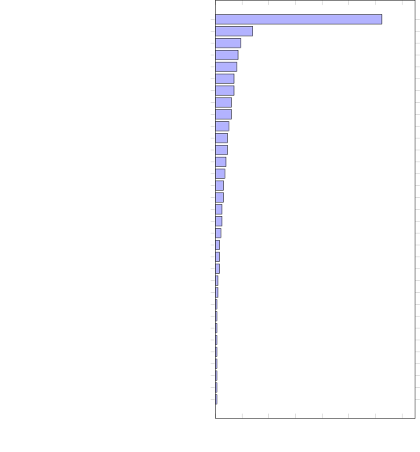

Figure 5: Number of Questions per Research Field on the ORKGSyn Dataset.
The y-axis represents the "Research Fields".

### B.2 The BioASQ Corpus

According to the scienceQ&A task definition, ORKGSyn consistently linked
each $`Q`$ to $`N=5`$ papers with abstracts, whereas in BioASQ, $`N`$
varied between 1 and 40. Figure 6 presents the distribution of
instances, categorized by the number of papers associated with each
$`Q`$.

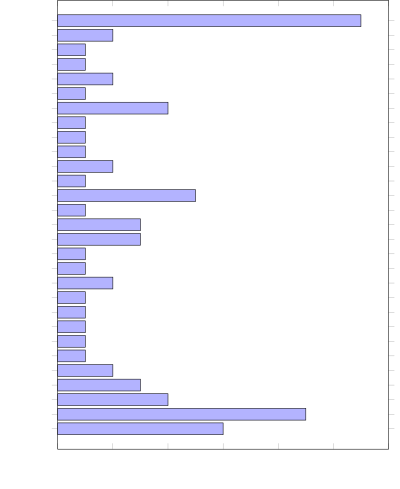

Figure 6: Number of Reference Abstracts per Question on the BioASQ
dataset

### B.3 Our Adversarial Corpus

By constructing an adversarial dataset, we introduce deliberate errors
into the original outputs to test whether LLMs can detect and evaluate
poor-quality responses. This allows for a comparative analysis of
evaluation scores between original and manipulated datasets. While
original syntheses may not always be flawless, adversarial datasets are
designed to exhibit a marked deterioration in quality, and we expect
evaluation scores to reflect this decline. We construct two tiers of
adversarial datasets.

1.  1.  Subtle Adversarial Dataset: Here, reference texts are minimally
        altered, making it challenging for models to detect changes. These
        alterations mimic realistic errors that may go unnoticed in
        automated evaluations.
2.  2.  Extreme Adversarial Dataset: This dataset involves substantial
        modifications to reference texts, making the adversarial setting
        apparent and straightforward for models to identify. The evaluations
        should result in significantly lower scores.

Nine evaluation criteria are systematically targeted during adversarial
dataset creation, with distinct manipulations tailored to degrade the
corresponding aspect of synthesis quality. To simulate varying degrees
of distortion, adversarial sentences were drawn from diverse sources: a
blog post snippet from Farid (2024), a sentence from a sports news
article provided by Botkin (2024), and a tweet sourced from Strauss
et al. (2016). Below, we detail the adversarial interventions and
describe what each criterion evaluates:

1.  1.  Relevancy: Is the information in the answer relevant to the problem?
    - –
      Subtle: Append a sentence from a different synthesis paragraph
      within the same domain.
    - –
      Extreme: Append a sentence from an unrelated sports news article.

2.  2.  Correctness: Is the information in the answer a correct
        representation of the content of the provided abstracts?
    - –
      Subtle: Append a sentence from a different synthesis paragraph
      within the same domain.
    - –
      Extreme: Append a sentence from an unrelated sports news article.

3.  3.  Completeness: Is the answer a comprehensive encapsulation of the
        relevant information in the provided abstracts?
    - –
      Subtle: Remove the last sentence from the synthesis.
    - –
      Extreme: Remove the last sentence and append a sentence from an
      unrelated sports news article.

4.  4.  Informativeness: Is the answer a useful and informative reply to the
        problem?
    - –
      Subtle: Append a sentence from a different synthesis paragraph
      within the same domain.
    - –
      Extreme: Append a sentence from an unrelated sports news article.

5.  5.  Integration: Are the sources structurally and linguistically
        well-integrated, using appropriate markers of provenance/quotation
        and logical connectors for each reference?
    - –
      Subtle: Remove the first logical connector (e.g., "however",
      "therefore").
    - –
      Extreme: Remove all logical connectors.

6.  6.  Cohesion: Are the sentences connected appropriately to make the
        resulting synthesis cohesive?
    - –
      Subtle: Swap the positions of the last two sentences.
    - –
      Extreme: Randomly shuffle all sentences.

7.  7.  Coherence: Are the ideas connected soundly and logically?
    - –
      Subtle: Append a sentence from a different synthesis paragraph
      within the same domain.
    - –
      Extreme: Append a sentence from an unrelated sports news article.

8.  8.  Readability: Does the answer follow appropriate style and structure
        conventions for academic writing, particularly for readability?
    - –
      Subtle: Append a snippet from a casual blog post.
    - –
      Extreme: Append a sentence from an informal tweet.

9.  9.  Conciseness: Is the answer short and clear, without redundant
        statements?
    - –
      Subtle: Use the LLM to generate a redundant version of the last
      sentence and append it to the response.
    - –
      Extreme: Append a redundant version after every sentence in the
      original response.

For the conciseness criterion, redundant sentences were generated by
prompting the original model to unnecessarily rephrase and extend its
outputs. Despite specific instructions to avoid introductory phrases or
comments about the redundancy task, the Llama models frequently failed
to adhere to these guidelines, requiring extensive manual cleanup. For
instance, phrases such as "Here is a redundant sentence…" were
frequently appended to the generated responses. We manually revised over
100 responses generated by the Llama 8B model and 18 by the Llama 70B.
This process culminated in the creation of adversarial datasets with
subtle and extreme degrees of manipulation for each underlying dataset,
resulting in a total of four datasets. By systematically introducing
errors tailored to each quality criterion, these datasets enable a
detailed evaluation of LLM performance across a range of distortions.
This two-level adversarial approach provides a comprehensive method for
assessing the models’ sensitivity to various levels of quality
deterioration and their ability to assign appropriate evaluation scores
under varying conditions.

One of the early papers on LLM-as-a-judge Zheng et al. (2023) also used
the strategy of an adversarial attack to test whether the judge LLM
could detect verbosity bias which is related to our attack for
redundancy.

A key NLP line of research in text adversarial attacks involves synonym
substitution attacks (SSAs) Alzantot et al. (2018) generate adversarial
samples by replacing words with synonyms in benign text, relying on
sophisticated methods such as TextFooler Jin et al. (2020), PWWS Ren
et al. (2019), and BAE Garg and Ramakrishnan (2020). While SSAs were
conjectured to produce low-quality text in fluency and meaning Hauser
et al. (2021); Chiang and Lee (2023a), there was no guarantee of this,
necessitating human raters to compare their assessments against LLM
scores. In contrast, our adversarial attacks, ranging from subtle to
extreme, deliberately violate English syntax, ensuring inherently
low-quality text and obviating the need for human raters. This design
directly tests whether the LLM can overcome its optimism bias and
robustly assign the expected low scores.

## Appendix C Manual Subsample Observations of Vanilla LLM$`{}_{e}val`$

We conducted a manual analysis of evaluation scores generated by Llama
8B, using a structured annotation process to assess the model’s
performance. The human adjudicator categorized issues based on six
criteria from Kim et al. (2023): “rejected feedback is not consistent
with its score,” “too general and abstract,” “overly optimistic,” “not
relevant to the response,” “overly critical,” and “unrelated to the
score rubric.” This analysis covered 20 questions from ORKGSyn and 10
from BioASQ.

Our findings reveal that Llama 8B’s evaluations of vanilla syntheses are
generally aligned with human judgement. However, the feedback provided
by the model tends to be overly general and abstract. For instance,
while Llama 8B often identifies a lack of minor details, it frequently
fails to specify what exactly is missing. In the adversarial settings,
Llama 8B exhibits overly optimistic scoring across all syntheses. This
pattern is consistent for both subtle and extreme adversarial datasets,
though the ORKGSyn dataset receives even higher scores compared to
BioASQ. Additionally, we observed that in a small fraction of cases, the
scores were not relevant to the response. For example, Llama 8B
occasionally hallucinated its own evaluation criteria and scored based
on these fabricated metrics. Another notable issue is the inconsistency
between the rationale provided and the assigned scores. In a few cases,
the evaluation feedback explicitly states that there is almost no
unnecessary information in the synthesis, yet the model assigns a
perfect score of 5. Furthermore, for a significant portion of the
scores, the rationale was very general and abstract, often merely
reciting the evaluation characteristic guidelines provided in the system
prompt without offering specific insights.

## Appendix D Detailed Quantitative Experimental Results

To obtain a comprehensive assessment of the LLM’s performance on the
scientific Q&A task, we conducted a quantitative analysis of their
outputs. This evaluation leverages summarisation-based (such as
BLUE (Papineni et al., 2002b), ROUGE (Lin, 2004b), METEOR (Banerjee and
Lavie, 2005), NIST (Doddington, 2002), and BERTScore (Zhang et al.,
2020)) and edit distance-based (such as WER (Su et al., 1992),
WMD (Kusner et al., 2015), and MoverScore (Zhao et al., 2019)) metrics.
These metrics measure the similarity between text outputs, providing a
quantitative estimate of how closely the generated responses align with
one another. The evaluation process involves treating each LLM response
as a reference and pairing it with the outputs of every other model as
candidates, resulting in all possible pairwise combinations. This
approach ensures that we capture not only the absolute performance of
each model but also their relative alignment. By examining the
similarity scores between models, we gain insights into how consistently
they generate responses.

### D.1 Summarisation-Based Metrics

Evaluating the quality of generated text often requires comparing it to
reference summaries. To achieve this, summarisation-based evaluation
metrics measure the degree of textual overlap between the generated and
reference texts, typically assessing aspects such as precision, recall,
and n-gram similarity. These metrics are widely used in NLP tasks such
as machine translation, text summarisation, and question answering. The
summarisation-based metrics (i.e. BLUE, ROUGE, METEOR, NIST, and
BERTScore) are described as follows.

Bilingual Evaluation Understudy (BLEU). The BLEU (Papineni et al.,
2002b) metric automates machine translation evaluation, offering a
cost-effective alternative to human assessment. It measures n-gram
overlap between a candidate and reference text, with a brevity penalty
to prevent short translations. While widely used, BLEU has limitations,
including insensitivity to semantic meaning and struggles with short
texts.

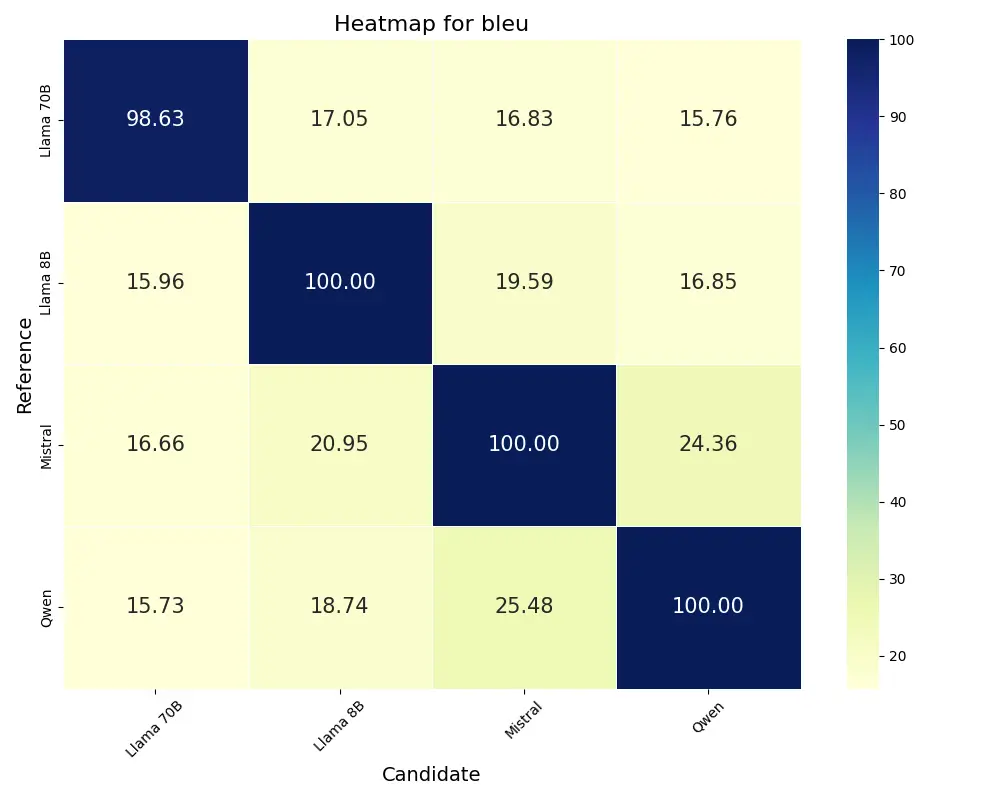

(a) BioASQ

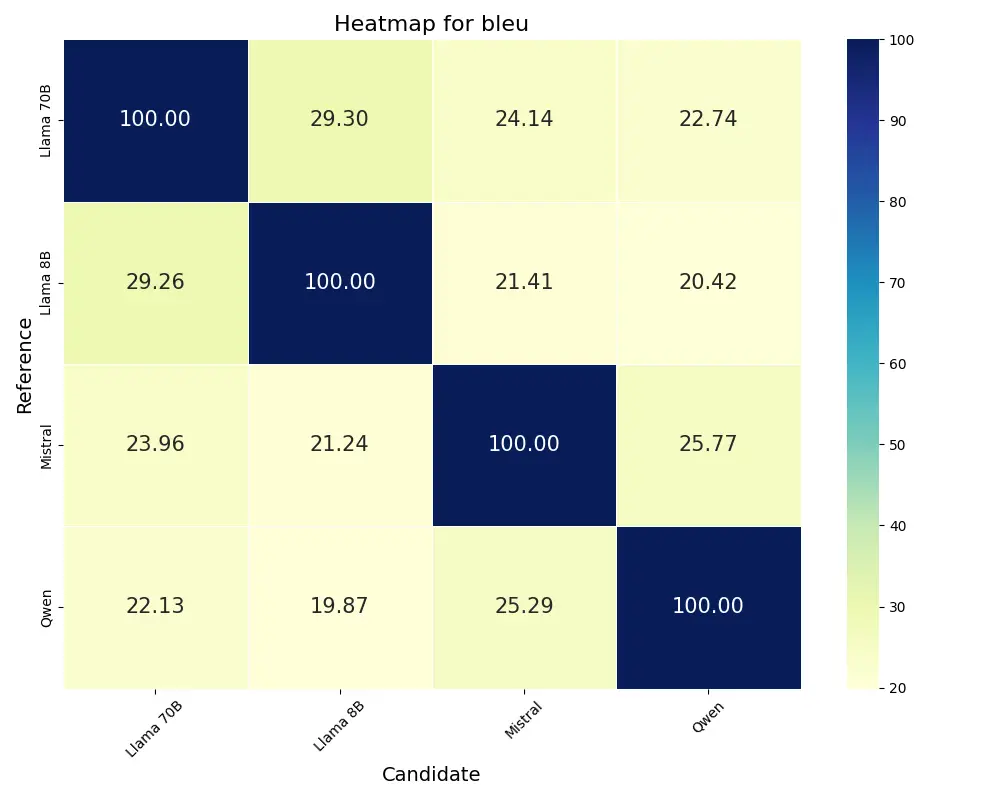

(b) ORKGSynthesis

Figure 7: BLEU metric results.

According to the Figure 7, an anomaly occurs for the LLaMA-3.1-70B model
on the BioASQ dataset, where the score is 98.63. This discrepancy arises
because the BLUE metric averages over n-gram scores, including cases
where higher-order n-grams (e.g., four-grams) are absent in shorter
outputs, forcing those scores to zero. Interestingly, the results reveal
patterns of correlation among specific models. For instance,
Mistral-Large and Qwen2.5-72B exhibit moderate alignment, with scores
around 25, indicating some similarity in their outputs. On the
ORKGSynthesis dataset, the LLaMA-3.1-70B and LLaMA-3.1-8B models display
a relatively high correlation, likely due to their shared Meta origin,
similar training data, and primary differences in parameter count. In
terms of individual performance, Mistral-Large achieves the highest
average BLUE score on the BioASQ dataset, while on the ORKGSynthesis
dataset, Meta’s 70B LLM performs best.

Recall-Oriented Understudy for Gisting Evaluation (ROUGE). ROUGE (Lin,
2004b) is a recall-based metric contrasting with BLEU’s precision focus.
It measures n-gram, word sequence, and word pair overlap between
machine-generated and human summaries. ROUGE-N emphasizes n-gram recall,
while ROUGE-L captures the longest common subsequence (LCS) for better
semantic similarity. Variants like ROUGE-W reward consecutive matches,
and ROUGE-S use skip-bigrams for F-measure calculation. For this
analysis, we used ROUGE-1 for unigram overlap, reflecting term alignment
and content coverage, and ROUGE-L to assess sentence-level structure and
coherence.

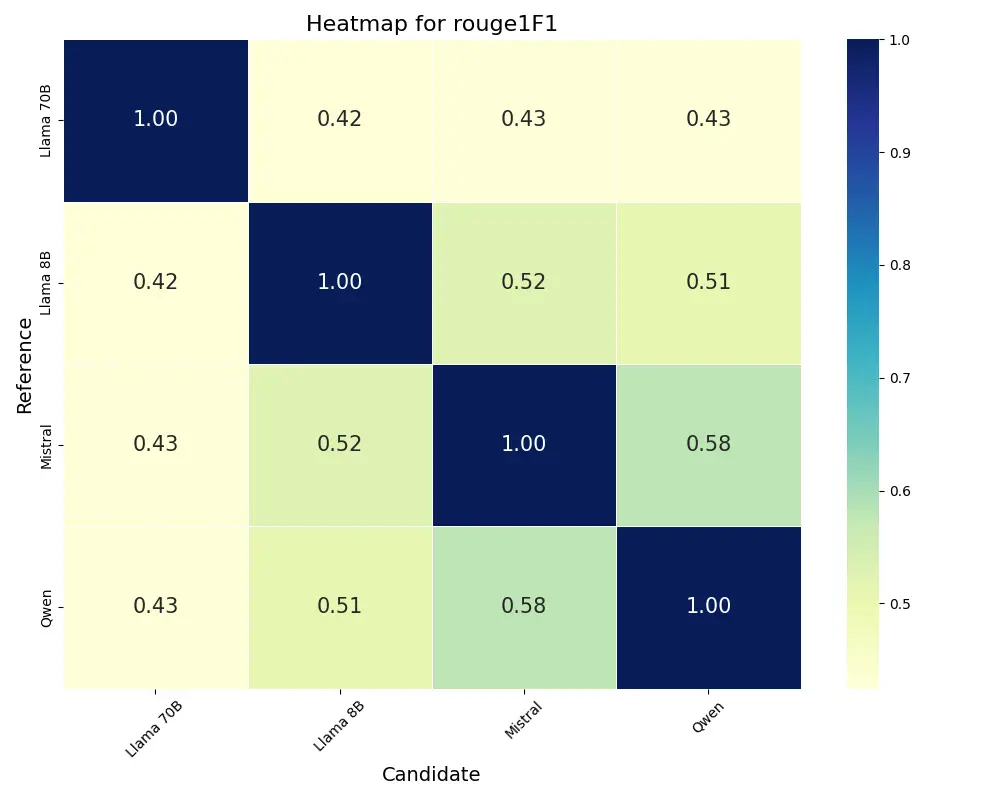

(a) BioASQ

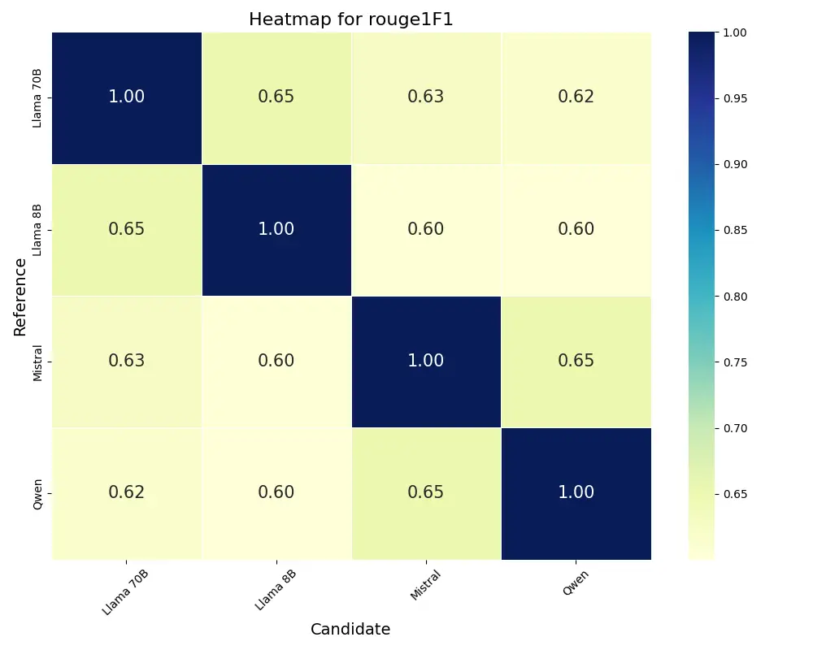

(b) ORKGSynthesis

Figure 8: ROUGE-1 metric results.

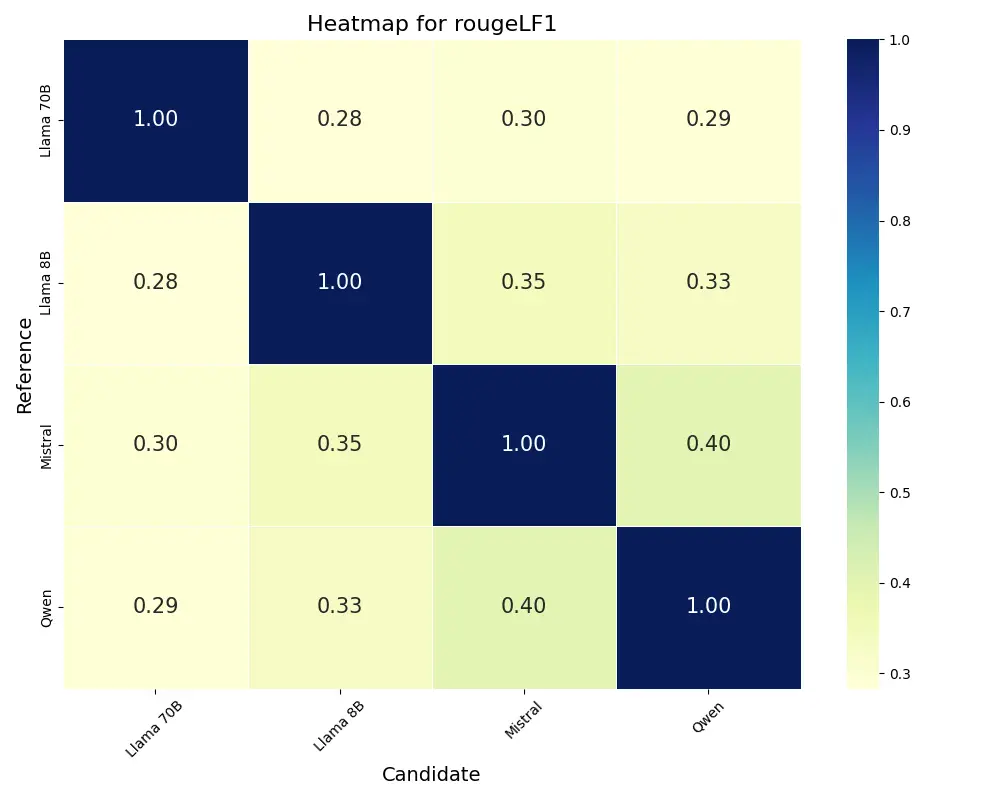

(a) BioASQ

(b) ORKGSynthesis

Figure 9: ROUGE-L metric results.

Illustrated results for ROUGE-1 in Figure 8 and ROUGE-L in Figure 9
exhibit distinct patterns across the two datasets. On the BioASQ
dataset, Mistral-Large and Qwen2.5-72B demonstrate a notable correlation
with a ROUGE-1 score of 0.58, suggesting shared thematic elements or
vocabulary usage in their outputs. Additionally, a ROUGE-L score of 0.4
indicates a moderate similarity in sentence structure and coherence. In
contrast, the LLaMA-3.1-70B model performs relatively poorly, which may
stem from inconsistencies in generating high-quality outputs for certain
tasks in this domain. On the ORKGSynthesis dataset, the LLaMA-3.1-70B
model achieves the highest correlation, particularly when compared to
the smaller LLaMA model. Mistral and Qwen2.5-72B also display a strong
correlation on this dataset, reinforcing their observed alignment.
Exclusively focusing on unigrams in ROUGE-1 yields a higher correlation
than BLUE and ROUGE-L, where overlaps are analyzed up to the four-gram
level. This is because unigram-based evaluations inherently capture a
broader overlap by disregarding strict positional constraints or
dependencies on higher-order matches.

Metric for Evaluation of Translation with Explicit ORdering (METEOR).
METEOR (Banerjee and Lavie, 2005) improves upon BLEU by prioritizing
recall, which better aligns with human judgments. Unlike BLEU’s brevity
penalty, METEOR explicitly integrates recall into its scoring. It also
replaces BLEU’s reliance on higher-order n-grams with direct word
alignment, enhancing semantic and structural accuracy. Additionally,
METEOR avoids BLEU’s zero-score issue by using an alignment-based
approach that captures partial matches and syntactic nuances more
effectively.

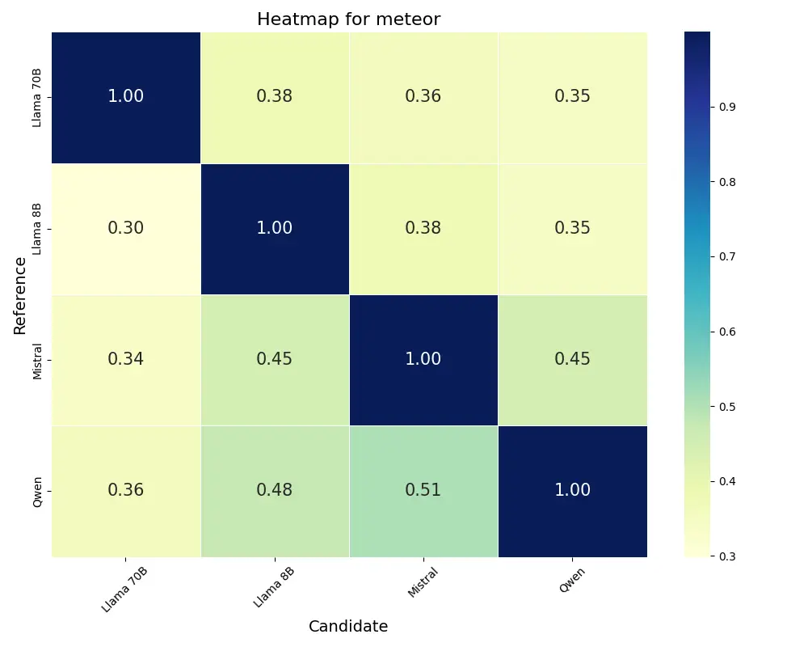

(a) BioASQ

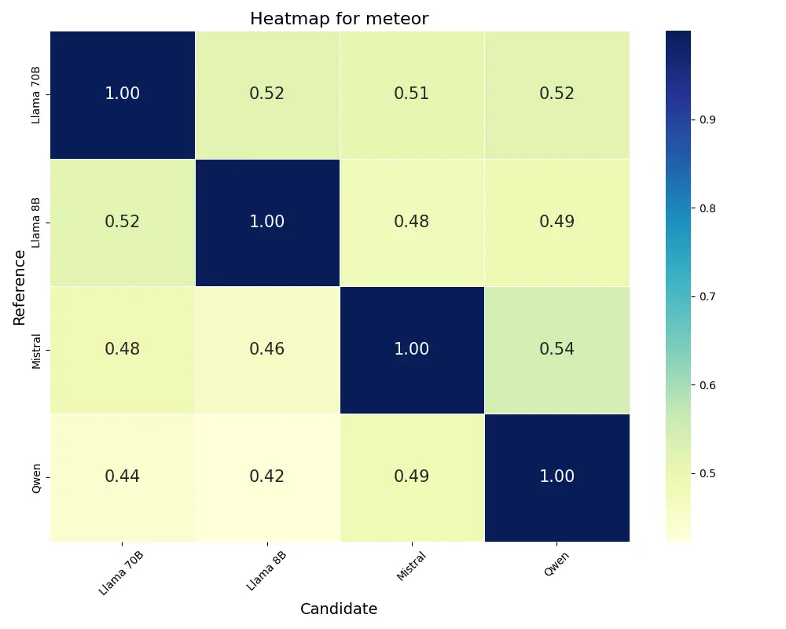

(b) ORKGSynthesis

Figure 10: METEOR metric results.

Results showed in Figure 10 for METEOR metric, which produces scores
ranging from 0 (no correlation) to 1 (perfect correlation). In our
evaluation, METEOR highlighted differences between the models. On the
BioASQ dataset, the LLaMA-3.1-70B model performed poorly, consistent
with earlier metrics. Conversely, the LLaMA-3.1-8B model achieved
comparable scores to Mistral-Large and Qwen2.5-72B, suggesting it
generates responses that align well with unigram matches. For the
ORKGSynthesis dataset, the scores were more uniform across models,
reflecting a general similarity in performance. However, an intriguing
pattern emerged with Qwen2.5-72B: when used as a reference, its scores
varied substantially compared to when it was a candidate. This
discrepancy may be attributable to METEOR’s emphasis on recall. Higher
scores when Qwen2.5-72B is a candidate suggest it produces longer
outputs, increasing the likelihood of matches with reference terms. This
raises questions about the relationship between generation length and
perceived quality in evaluation metrics, which warrants further
investigation.

US National Institute of Standards and Technology (NIST). The
NIST (Doddington, 2002) score builds on the BLUE metric but introduces a
significant enhancement by focusing on the information content of
n-grams. Unlike BLUE, which traditionally weights all matches equally,
NIST prioritizes matches with greater informational value. This approach
stems from the observation that rarer words or n-grams convey more
specific and meaningful information than frequent ones. Consequently,
matching infrequent n-grams contributes more to the NIST score, making
it a more context-sensitive evaluation metric.

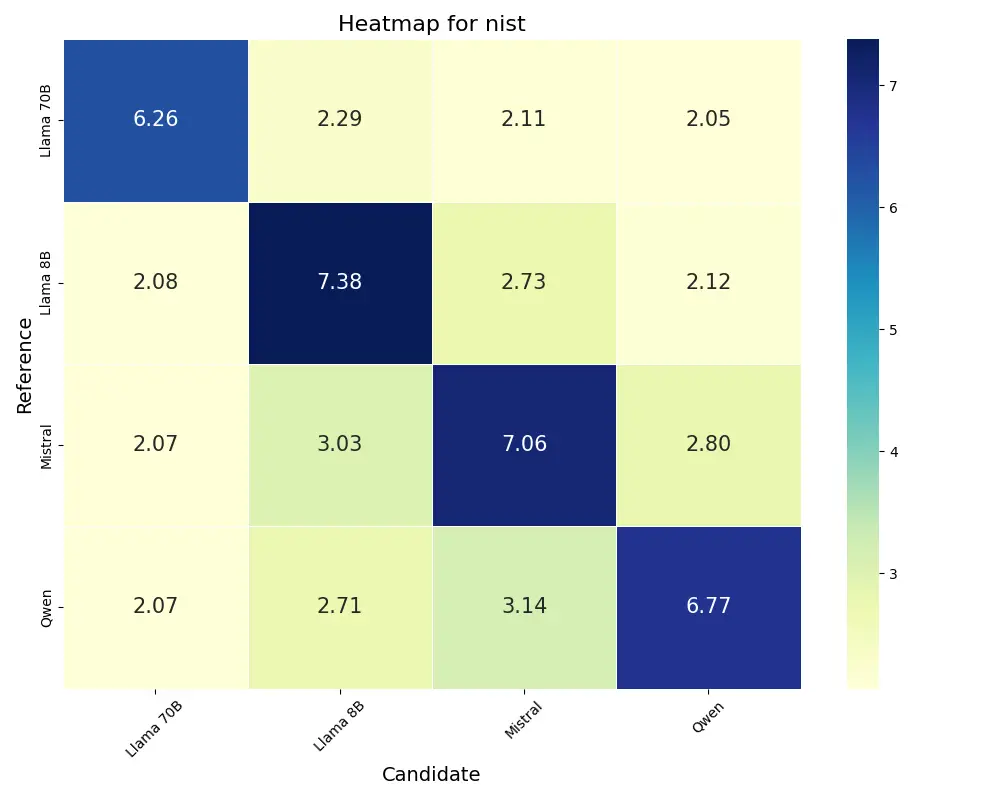

(a) BioASQ

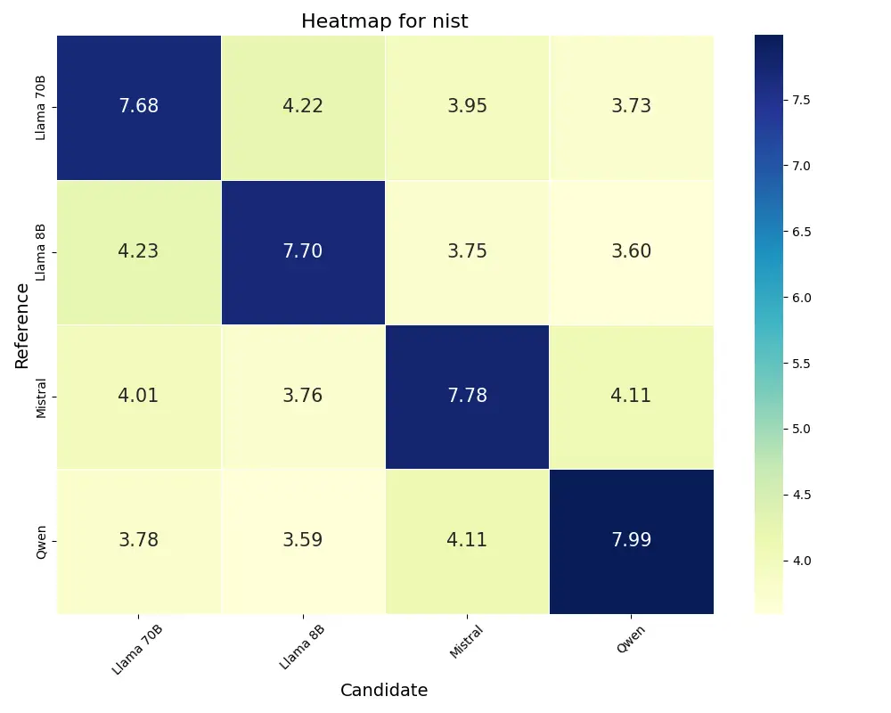

(b) ORKGSynthesis

Figure 11: NIST metric results

The NIST scores are unbounded and range from 0 (indicating poor quality)
to higher positive values, with larger scores reflecting better-quality
matches. Unlike BLUE, the NIST score’s sensitivity to informational
content allows it to provide more nuanced assessments. As shown in
Figure 11 for the BioASQ dataset, the LLaMA-3.1-70B model consistently
underperforms, even when compared against its output. This poor
performance can be attributed to the model’s tendency to generate
shorter responses and repeat words within a single response, leading to
lower overall information gain. In contrast, other models demonstrate
relatively strong correlations, suggesting more balanced and
information-rich outputs. In the ORKGSynthesis dataset, correlations are
notably higher across all models. The LLaMA-3.1-70B model achieves
strong alignment with its smaller counterpart, consistent with
observations in other metrics. Similarly, Mistral-Large and Qwen2.5-72B
continue to display strong correlations.

BERTScore. BERTScore (Zhang et al., 2020) is designed to evaluate text
similarity by leveraging contextualized embeddings from pre-trained
transformer models like BERT (Devlin et al., 2019). Unlike traditional
metrics that rely on exact token matches or n-gram overlap, BERTScore
assesses semantic similarity at a token level, enabling it to recognize
paraphrases, capture long-range dependencies, and account for nuanced
semantic ordering. This approach allows it to surpass earlier metrics in
evaluating complex and varied outputs, as it does not depend solely on
surface-level text similarity. The strength of BERTScore lies in its
ability to align tokens in a candidate sentence with those in a
reference sentence using their embeddings, which encode rich contextual
information. Studies by Zhang et al. (2020) demonstrate that BERTScore
highly correlates with human judgment, making it a valuable tool for
evaluating machine-generated text.

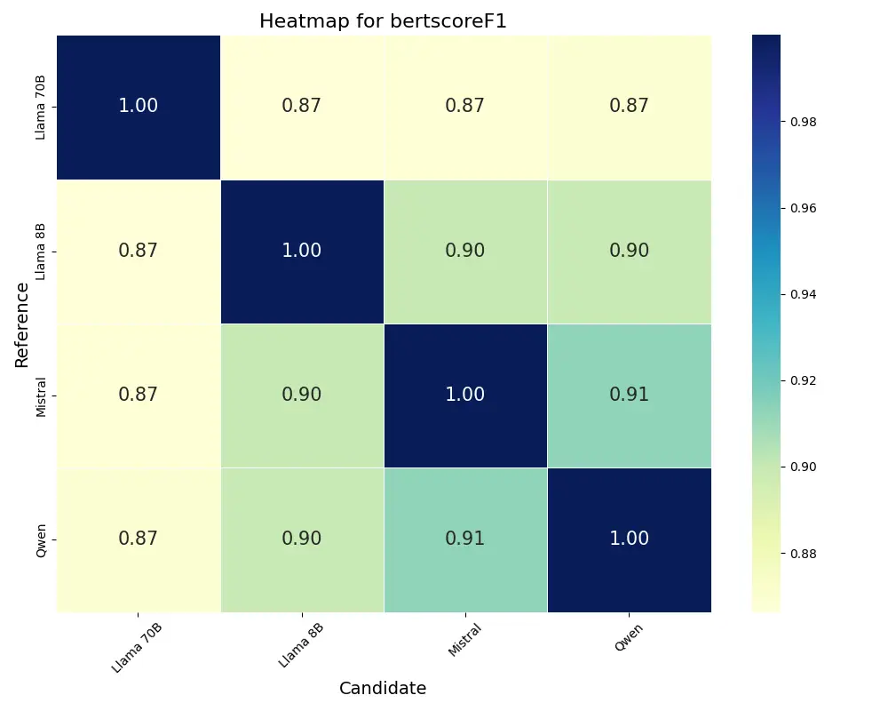

(a) BioASQ

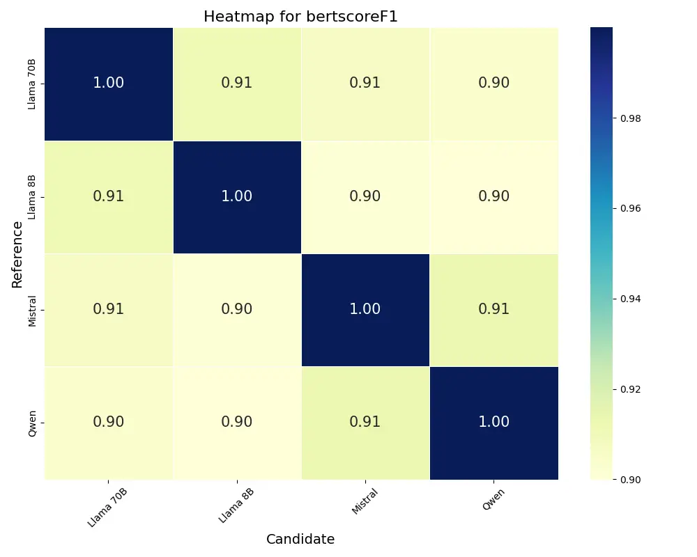

(b) ORKGSynthesis

Figure 12: BERTScore metric results.

BERTScore generates values between 0 and 1, where a score closer to 1
indicates stronger semantic alignment. In our analysis w.r.t Figure 12,
BERTScore highlights the limitations of the LLaMA-3.1-70B model on the
BioASQ dataset, as its tendency to produce incomplete or incoherent
answers results in lower scores. The other models, including those
evaluated on the ORKGSynthesis dataset, achieve scores near 0.9, which
reflects a high degree of semantic similarity between their outputs.
Unlike metrics such as BLUE, ROUGE, or METEOR, which primarily evaluate
surface-level similarity based on token overlap or n-gram matches,
BERTScore incorporates the contextual meaning of tokens. This capability
allows it to capture deeper semantic relationships, even when lexical or
syntactic differences exist between candidate and reference sentences.
Consequently, while earlier metrics may indicate lower correlation,
particularly for models generating paraphrased or stylistically varied
outputs, BERTScore reveals that the underlying semantic content remains
closely aligned. This observation underscores the potential of
embedding-based metrics to provide a more nuanced evaluation of language
model outputs, particularly in tasks where paraphrasing and creative
rewording are common. Furthermore, the high BERTScore results across
most models suggest that their outputs are semantically coherent, even
if traditional metrics fail to capture this aspect. This finding
highlights the value of embedding-based metrics in complementing
traditional approaches, providing a broad evaluation framework. Future
work could explore fine-tuning the embeddings used in BERTScore to align
even more closely with domain-specific human judgments, particularly in
specialized tasks such as medical or scientific text generation.

### D.2 Edit Distance-Based Metrics

To complement summary-based evaluation, we also incorporated edit
distance-based metrics, which assess text similarity by measuring the
number of modifications required to convert one string into another.
This approach originates from Levenshtein distance Levenshtein (1966), a
fundamental concept in text processing commonly applied in
spell-checking and auto-correction. Edit distance evaluation quantifies
text dissimilarity through insertions, deletions, and substitutions. For
instance, converting the word mug to hut requires substituting two
characters (m to h and g to t), which, if we assign a cost of 1 per
insertion/deletion and 2 per substitution, yields an edit distance of 4.
These costs can be adjusted depending on the task.

Word Error Rate (WER). The WER Su et al. (1992) is a similarity metric
grounded in the concept of minimum edit distance, measuring the number
of edits (substitutions, insertions, and deletions) required to
transform a candidate text into reference text. Unlike character-level
edit distance, WER operates at the word level, treating entire words as
the basic transformation units. It is particularly suited for speech
recognition and machine translation, where word-level alignment is
essential. However, the metric has inherent limitations, particularly
its sensitivity to word order. Sentences with semantically identical
meanings but different word arrangements are heavily penalised,
potentially leading to overly pessimistic assessments of similarity.

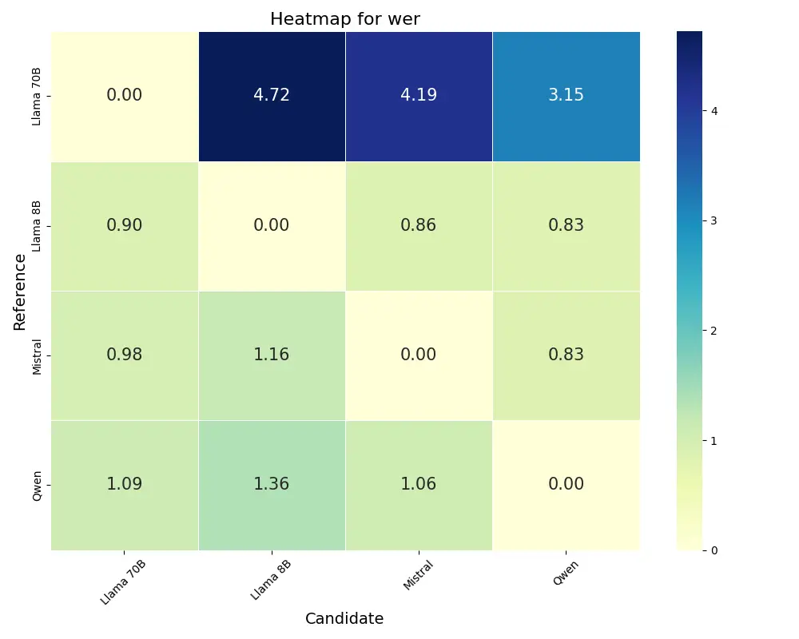

(a) BioASQ

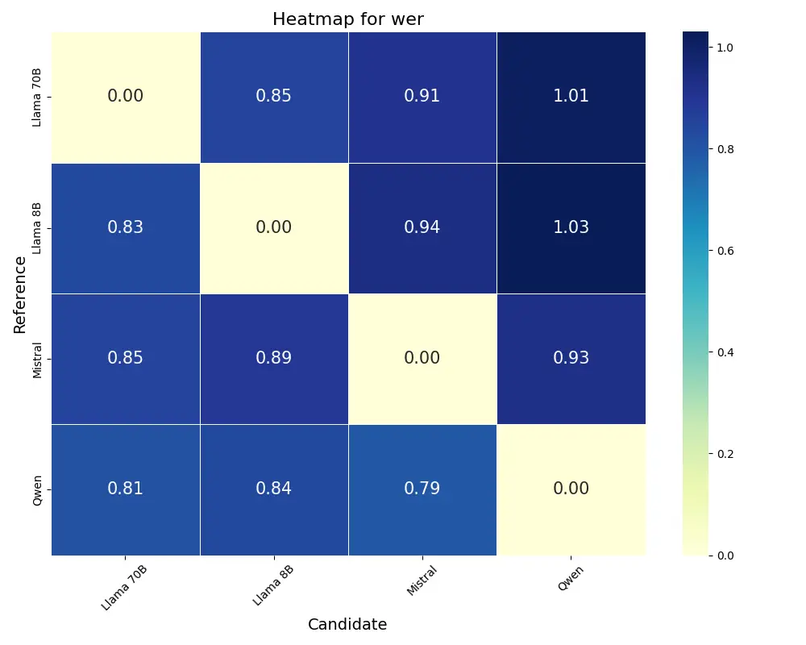

(b) ORKGSynthesis

Figure 13: WER metric results

The analysis of WER according to Figure 13 scores across different
datasets and models reveals several notable patterns. For the BioASQ
dataset, the LLaMA-3.1-70B model exhibits markedly poor performance as a
reference. This behavior can be attributed to the model’s tendency to
produce shorter outputs. Since WER normalizes the number of edits by
reference length, shorter reference texts amplify the impact of any
discrepancies, leading to inflated WER values. This observation aligns
with earlier findings highlighting LLaMA-3.1-70B’s challenges in
generating comprehensive responses for the BioASQ dataset. In contrast,
for the ORKGSynthesis dataset, Qwen2.5-72B demonstrates superior
performance when serving as a reference. However, as a candidate,
Qwen2.5-72B achieves lower scores. This discrepancy likely arises from
Qwen2.5-72B’s tendency to generate longer sequences. In such cases, the
normalization by reference length in the WER formula leads to more
significant deviations when Qwen2.5-72B’s outputs are compared against
shorter references. These findings underscore the metric’s dependence on
the relative length of candidate and reference texts, which can
introduce biases when evaluating models with different generation
strategies. While WER provides a straightforward measure of
surface-level similarity, its inability to account for semantic
equivalence or tolerate variations in word order limits its
applicability in evaluating generative models. For instance, outputs
with paraphrased structures or stylistic differences might receive high
WER scores despite being semantically aligned with the reference.

Word Mover’s Distance (WMD). The WMD Kusner et al. (2015) quantifies the
dissimilarity between two text documents by calculating the minimum
cumulative "distance" that the embedded words in one document must
travel to align with the words in another document. The metric is
inspired by the Earth Movers Distance, a concept in optimal transport
theory, which measures the minimum work required to transform one
probability distribution into another. Unlike greedy matching approaches
like BERTScore, WMD leverages an optimal matching strategy, ensuring a
more precise alignment of semantically relevant terms. In its original
formulation, WMD used Word2Vec embeddings to represent words as vectors
in a continuous space. However, we employed SPECTER2 Singh et al. (2022)
and SciBERT Beltagy et al. (2019) embeddings, designed for scientific
texts and have shown superior performance in domain-specific
applications.

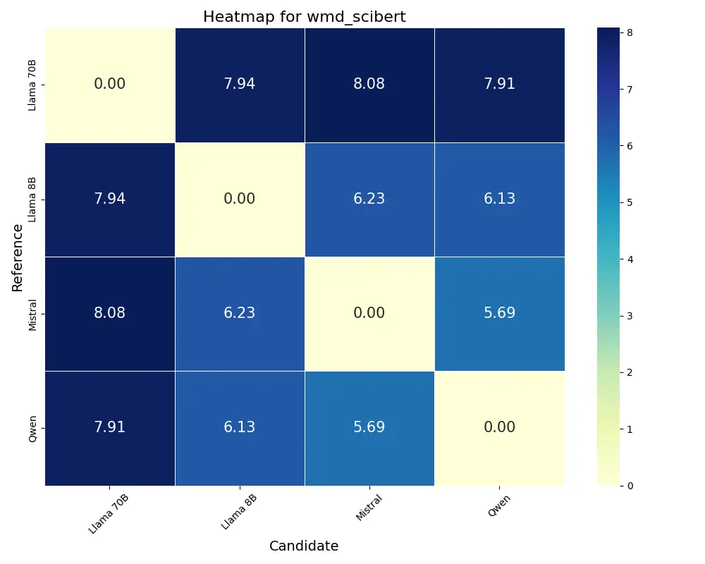

(a) BioASQ

(b) ORKGSynthesis

Figure 14: WMD metric results using SciBERT as embeddings.

(a) BioASQ

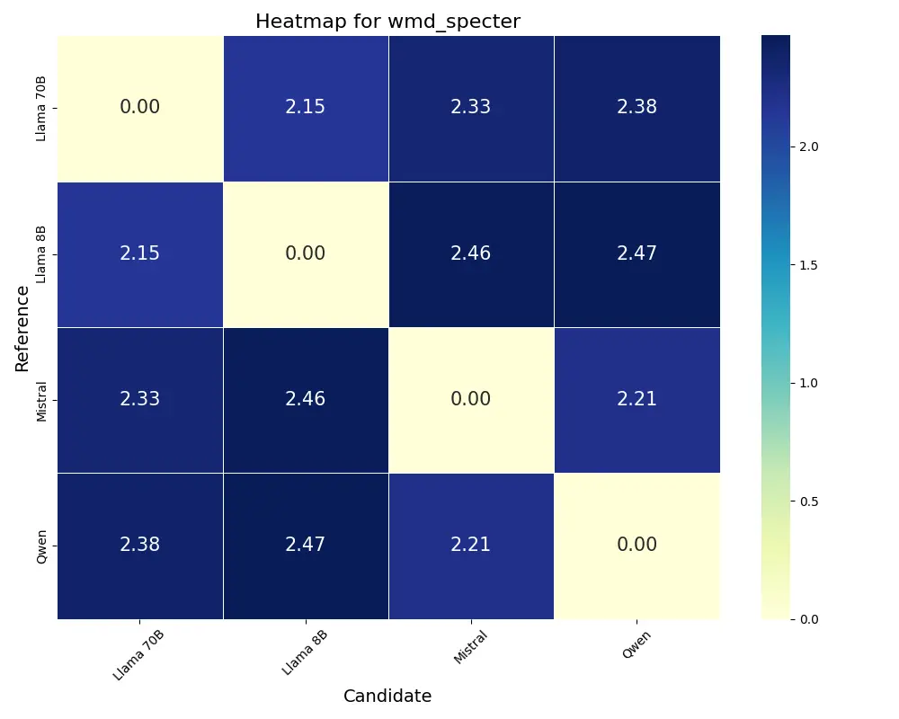

(b) ORKGSynthesis

Figure 15: WMD metric results using SPECTER2 as embeddings.

The results of WMD using SPECTER2 embeddings are represented in
Figure 15 and WMD with SciBERT is represented in Figure 14. A WMD score
of 0 indicates perfect alignment between the candidate and reference
texts, while higher scores denote greater dissimilarity. Analysis of the
WMD scores across datasets highlights several trends. As expected,
LLaMA-3.1-70B exhibits poor performance on the BioASQ dataset,
consistent with its tendency to generate incoherent responses. In
contrast on the ORKGSynthesis dataset, the two LLaMA models show strong
alignment with one another, as do Mistral-Large and Qwen2.5-72B. An
intriguing finding is the significant difference in WMD scores when
using SPECTER embeddings compared to SciBERT embeddings. Specifically,
SPECTER embeddings yield substantially lower WMD scores, suggesting they
provide better semantic representations for this task.

MoverScore. The MoverScore Zhao et al. (2019) is an advanced metric that
extends the principles of WMD to evaluate the dissimilarity of text
documents by comparing both words and n-grams. One of its primary
advantages lies in its use of contextual embeddings, such as those
generated by BERT, instead of static embeddings. This enables MoverScore
to capture nuanced meanings, including word sense disambiguation and
contextual relationships. Another key improvement is its allowance for
many-to-one soft alignments, enabling more flexible matching between
text elements. Furthermore, MoverScore incorporates inverse document
frequency (IDF) weighting, emphasising rare and meaningful words,
ensuring that these words contribute more significantly to the
similarity score. The combination of BERT’s contextual embeddings and
IDF weighting has been shown by Zhao et al. (2019) to correlate highly
with human judgment.

(a) BioASQ

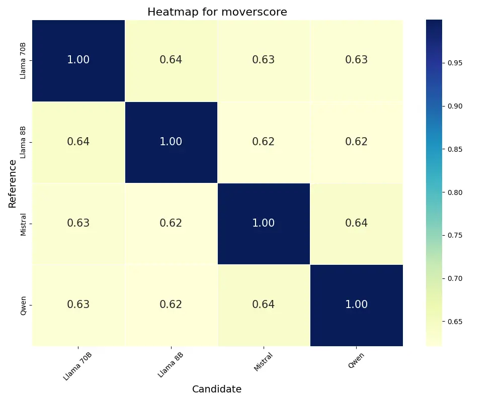

(b) ORKGSynthesis

Figure 16: MoverScore metric results

MoverScore produces a value between 0 and 1, where higher scores
correspond to greater similarity between the candidate and reference
texts. Across both datasets as shown in Figure 16, MoverScore results
hover around 0.62, reflecting moderate alignment. As observed with other
metrics, the LLaMA-3.1-70B model performs slightly worse on the BioASQ
dataset, likely attributable to the model’s struggles with generating
comprehensive and coherent responses. In contrast, the ORKGSynthesis
dataset reveals strong correlations between the outputs of the
Mistral-Large and Qwen2.5-72B models, and between the LLaMA models. The
relatively consistent scores across models suggest that, according to
MoverScore, the quality of responses is comparable. This uniformity can
be interpreted as evidence that the models generate outputs with similar
semantic content and structure, despite potential stylistic differences.

## Appendix E Evaluation Scoring Rubrics and the Five-point Likert Scale

This appendix presents the quality rubrics and their corresponding
5-point Likert scale descriptions used in our evaluation. Table 4
outlines the Linguistic and Stylistic quality rubrics, assessing aspects
such as cohesion, conciseness, and readability. Table 5 details the
Logical and Structural Integrity rubrics, evaluating factors like
argument coherence, integration, and relevancy. Lastly, Table 6
describes the Content Accuracy and Informativeness rubrics, which
measure correctness, completeness, and informativeness.

| Rubric      | 5-point Likert scale description                                                                                                                                                      |
| ----------- | ------------------------------------------------------------------------------------------------------------------------------------------------------------------------------------- |
| Cohesion    | Rating 1. Very bad: The sentences within the synthesis are disconnected, resulting in a disjointed and fragmented narrative.                                                          |
|             | Rating 2. Bad: There are attempts at connecting sentences, but the synthesis often feels disjointed.                                                                                  |
|             | Rating 3. Moderate: The sentences are connected in a way that the synthesis is mostly cohesive, with some areas of improvement.                                                       |
|             | Rating 4. Good: The synthesis is cohesive, with sentences well-connected to form a unified narrative.                                                                                 |
|             | Rating 5. Very good: The synthesis is highly cohesive, with all sentences and paragraphs logically connected, facilitating a clear and coherent narrative flow.                       |
| Conciseness | Rating 1. Very Bad: The synthesis is verbose and cluttered with redundant or irrelevant information, significantly detracting from its clarity and focus.                             |
|             | Rating 2. Bad: The synthesis includes some redundant or irrelevant statements, detracting from its clarity.                                                                           |
|             | Rating 3. Moderate: The synthesis is relatively clear and to the point, but could be more concise by eliminating a few redundant elements.                                            |
|             | Rating 4. Good: The synthesis is concise and to the point, with virtually no redundant statements or unnecessary information.                                                         |
|             | Rating 5. Very Good: The synthesis is precisely concise, delivering information clearly and directly without any superfluous details or redundancy, enhancing its clarity and impact. |
| Readability | Rating 1. Very bad: The synthesis is poorly written, with pervasive issues in style, structure, and language use, making it difficult to understand.                                  |
|             | Rating 2. Bad: The text has noticeable issues with style, structure, or language use, affecting clarity.                                                                              |
|             | Rating 3. Moderate: The synthesis follows appropriate conventions and uses language correctly, with minor issues in style or structure.                                               |
|             | Rating 4. Good: The text is well-structured and easy to read, with language that is appropriately used and only minor stylistic improvements needed.                                  |
|             | Rating 5. Very good: The synthesis is exceptionally well-written, following stylistic and structural conventions with precise language use, making it accessible and easy to read.    |

Table 4: Linguistic and Stylistic Quality Rubrics and their 5-point
Likert Scale Description

| Rubric      | 5-point Likert scale description                                                                                                                                                                                                                                                                        |
| ----------- | ------------------------------------------------------------------------------------------------------------------------------------------------------------------------------------------------------------------------------------------------------------------------------------------------------- |
| Coherence   | Rating 1. Very bad: The synthesis lacks logical connection between ideas, leading to a narrative that is confusing and difficult to follow.                                                                                                                                                             |
|             | Rating 2. Bad: The ideas are not always logically connected, leading to a somewhat confusing narrative.                                                                                                                                                                                                 |
|             | Rating 3. Moderate: The ideas are logically connected for the most part, but the narrative could be strengthened for better clarity.                                                                                                                                                                    |
|             | Rating 4. Good: The ideas are logically and soundly connected, offering a clear and understandable narrative.                                                                                                                                                                                           |
|             | Rating 5. Very good: The ideas within the synthesis are connected in a logical and sound manner, forming a coherent and compelling narrative that is easy to follow.                                                                                                                                    |
| Integration | Rating 1. Very Bad: The synthesis fails to integrate the sources in any meaningful way. It lacks appropriate markers, connectors, or transitions between ideas and fails to combine the information into a single, cohesive paragraph.                                                                  |
|             | Rating 2. Bad: The sources are somewhat integrated but inconsistently. The use of markers and connectors is sporadic or inappropriately applied, and the information is presented in multiple paragraphs without a clear unifying structure.                                                            |
|             | Rating 3. Moderate: The sources are integrated into a coherent manner within one or multiple paragraphs. The transitions or connections could be smoother, and the text would benefit from better paragraph structure to enhance clarity and unity.                                                     |
|             | Rating 4. Good: The sources are well-integrated, using appropriate markers and connectors to create a seamless narrative. The information is effectively organized into a single paragraph, showing a clear, unified approach.                                                                          |
|             | Rating 5. Very Good: The synthesis seamlessly integrates information from the various sources, using appropriate markers and connectors to create a smooth and unified narrative. All information is skillfully condensed into a single, well-structured paragraph, exemplifying excellent integration. |
| Relevancy   | Rating 1. Very bad: The information provided does not relate to the research question, showing a lack of understanding or connection to the topic.                                                                                                                                                      |
|             | Rating 2. Bad: The information occasionally relates to the research question but lacks direct and consistent relevance.                                                                                                                                                                                 |
|             | Rating 3. Moderate: The information is generally related to the research question, with occasional lapses in direct relevance.                                                                                                                                                                          |
|             | Rating 4. Good: The information is consistently relevant to the research question, with only minor exceptions.                                                                                                                                                                                          |
|             | Rating 5. Very good: The synthesis is directly and consistently relevant to the research question, demonstrating a deep understanding of the topic and its nuances.                                                                                                                                     |

Table 5: Logical and Structural Integrity Quality Rubrics and their
5-point Likert Scale Description

| Rubric          | 5-point Likert scale description                                                                                                                                                               |
| --------------- | ---------------------------------------------------------------------------------------------------------------------------------------------------------------------------------------------- |
| Correctness     | Rating 1. Very bad: The synthesis consistently misrepresents or inaccurately portrays the content of the provided abstracts, showing a significant deviation from the original sources.        |
|                 | Rating 2. Bad: The synthesis contains several inaccuracies or misinterpretations of the source abstracts.                                                                                      |
|                 | Rating 3. Moderate: The synthesis accurately represents most of the content from the provided abstracts but may contain minor errors.                                                          |
|                 | Rating 4. Good: The synthesis provides an accurate representation of the content from the provided abstracts with minor exceptions.                                                            |
|                 | Rating 5. Very good: The information in the synthesis is an accurate and faithful representation of the content from the provided abstracts, without any factual errors or misinterpretations. |
| Completeness    | Rating 1. Very bad: The synthesis omits most of the relevant information, failing to capture the essential points or details from the provided abstracts.                                      |
|                 | Rating 2. Bad: Significant portions of relevant information from the provided abstracts are missing.                                                                                           |
|                 | Rating 3. Moderate: The synthesis captures a fair amount of the relevant information, though it may overlook some details.                                                                     |
|                 | Rating 4. Good: The synthesis includes almost all relevant information, missing only minor details.                                                                                            |
|                 | Rating 5. Very good: The synthesis comprehensively encapsulates all relevant information from the provided abstracts, leaving no pertinent details or points unaddressed.                      |
| Informativeness | Rating 1. Very bad: The synthesis offers no valuable insights or useful information in response to the research question, lacking depth and utility.                                           |
|                 | Rating 2. Bad: The answer provides limited new insights or useful information in response to the research question.                                                                            |
|                 | Rating 3. Moderate: The answer is somewhat informative, offering insights or useful information but not in a comprehensive or detailed manner.                                                 |
|                 | Rating 4. Good: The answer is informative and insightful, providing comprehensive information in response to the research question.                                                            |
|                 | Rating 5. Very good: The synthesis is highly informative, providing valuable insights and detailed information that thoroughly addresses the research question.                                |

Table 6: Content Accuracy and Informativeness Quality Rubrics and their
5-point Likert Scale Description

## Appendix F Experimental Setup

Vanilla $`LLM_{eval}`$ models. The Vanilla $`LLM_{eval}`$ models employ
various LLMs, including Mistral-Large-Instruct, LLaMA-3.1-70B-Instruct,
Qwen2.5-72B-Instruct, and LLaMA-3.1-8B-Instruct, as $`LLM_{gen}`$ to
generate response to the questions $`Q`$ based on provided relevant
papers. The evaluations for these models are conducted using
$`LLM_{eval}`$, where each LLM acts as a generator and evaluator in a
pairwise format. For example, Mistral-Large-Instruct serves as the
evaluator for all four $`LLM_{gen}`$ models, and the same process is
applied to the other LLMs. The evaluation results are rated on a 5-point
Likert scale, with each rating accompanied by a rationale that explains
the model’s reasoning. This configuration serves as a baseline for
comparing the performance of different $`LLM_{eval}`$.

SFT (benign). The SFT (benign) experiment involves finetuning the
LLaMA-3.1-8B-Instruct model using structured response $`A`$’s from all
four models from $`x=LLM_{gen}`$ as inputs and quality assessments from
$`y=LLM_{eval}`$ as outputs. The aim is to fine-tune $`LLM_{eval}`$ and
this process is conducted using benign datasets, which contain no
adversarial examples, to ensure that the model is trained in a
controlled, non-hostile environment. The goal is to refine the model’s
performance in a straightforward, non-challenging scenario.

SFT (benign) + RL (adversarial). In this experiment, the finetuned
LLaMA-3.1-8B-Instruct model is further finetuned using the RLAIF
technique, focusing solely on adversarial datasets. As seen in the
results from Figure 4, while SFT (benign) learns how to be the
evaluator, but fails in recognizing the bad examples in adversarial
sets. The SFT (benign) + RL (adversarial) helps $`LLM_{eval}`$ to
imitate the bad examples as well.

SFT (benign) + RL (benign + adversarial). Considering, the SFT
(benign) + RL (adversarial) experiments, while the model achieves high
performance in identifying adversarial samples, it struggles to assign
higher Likert scale ratings to benign samples. This is because the
model’s threshold for defining a "good" sample has been lowered to a
rating of 3. The reason for such a drop in the maximum Likert scale in
testing is due to poor penalization in RL that considered the desirable
threshold of $`\leq 3`$ during the sampling of the data preparation for
RLAIF for the subtle adversarial set. Essentially, training the model
exclusively on adversarial behavior leads to confusion when it
encounters benign examples. To solve this, the SFT (benign) + RL
(benign + adversarial) is ideal for imitating both benign and
adversarial behaviors, which ideally leads to success.

## Appendix G Training Details

Figure 17: The $`y`$ format for fine-tuning models.

Supervised Fine-Tuning. The fine-tuning threats each $`LLM_{gen}`$ as an
input $`x`$ and outputs of all four $`LLM_{eval}`$ as a $`y`$. The
fine-tuning $`SFT`$ dataset stats are represented in Table 2. It
includes research questions, synthesized responses, source papers, and
evaluation rubrics scale to ensure the model learns both synthesis
assessment and evaluation reasoning. The Figure 17 shows the
$`y=LLM_{eval}`$ format during the fine-tuning process for the
"Readability" rubric (the example is chosen from the Adversarial set).
The tokenized sequences were processed with a maximum sequence length
specific to each dataset (ORKG-Synthesis: $`4,645`$ tokens, BioASQ:
$`8,874`$ tokens). We finetuned the model per dataset for 5 epochs using
the Paged AdamW $`8`$-bit optimizer, ensuring memory efficiency. Key
hyperparameters included a batch size of $`1`$ per GPU (we used two
GPUs), gradient accumulation steps equal to batch size, a learning rate
of $`2e-4`$ with a warmup ratio of $`0.03`$, weight decay of $`0.001`$,
and a max gradient norm of $`0.3`$. The fine-tuned model checkpoints
were saved for further analysis and RL-based fine-tuning.

Reinforcement Learning. Several hyperparameters and configurations for
training an LLM with RL are used. Key hyperparameters include a learning
rate of $`2e-4`$, a batch size of $`1`$ (per GPU), and a total of $`2`$
training epochs. The model’s training is configured with a maximum
prompt length of $`4500`$ and a maximum completion length of $`150`$.
The CPO uses a per-device batch size of $`1`$, gradient accumulation
steps of $`1`$, and mixed precision (fp16). Additionally, the model
undergoes fine-tuning with a learning rate of $`2e-4`$.

Hardware and Resource Allocation. For the system setup, two H100 GPUs
were utilized for RL fine-tunings, each with 80 GB of GPU memory, while
for SFT models, only one H100 GPU with the same memory capacity was
used. The CPU configuration for SFT involved 60 GB of memory with 8
cores of CPU, while RL took 60 GB of memory and 16 CPU cores.

## Appendix H Detailed Qualitative Experimental Results

This section represents the detailed qualitative experimental results
for seven models. In the tables, $`LLM_{eval}`$ models are defined as
follows in the table columns:

- •
  M1: Qwen2.5-72B
- •
  M2: LLaMA-3.1-70B
- •
  M3: Mistral-Large
- •
  M4: LLaMA-3.1-8B
- •
  M5: SFT (benign)
- •
  M6: SFT (benign) + RL (adversarial)
- •
  M7: SFT (benign) + RL (benign + adversarial)

The results for the BioASQ dataset are presented in Table 7 for
LLaMA-3.1-8B $`LLM_{gen}`$, Table 8 for LLaMA-3.1-70B $`LLM_{gen}`$,
Table 9 for Qwen2.5-72B $`LLM_{gen}`$, and Table 10 for Mistral-Large
$`LLM_{gen}`$. While, for the ORKGSynthesis dataset, results are
presented in Table 11 for LLaMA-3.1-8B $`LLM_{gen}`$, Table 12 for
LLaMA-3.1-70B $`LLM_{gen}`$, Table 13 for Qwen2.5-72B $`LLM_{gen}`$, and
Table 14 for Mistral-Large $`LLM_{gen}`$.

| Set     | Rubrics             | M1   | M2   | M3   | M4   | M5   | M6   | M7   |
| ------- | ------------------- | ---- | ---- | ---- | ---- | ---- | ---- | ---- |
| benign  | 1\. Coherence       | 4.95 | 4.91 | 4.73 | 5.00 | 4.95 | 3.00 | 4.91 |
|         | 2\. Cohesion        | 4.95 | 4.91 | 4.68 | 4.95 | 4.95 | 3.00 | 4.68 |
|         | 3\. Completeness    | 4.41 | 4.33 | 4.27 | 4.91 | 4.23 | 3.00 | 4.32 |
|         | 4\. Conciseness     | 4.95 | 4.91 | 4.68 | 4.45 | 4.77 | 3.00 | 3.82 |
|         | 5\. Correctness     | 4.95 | 4.92 | 4.64 | 4.73 | 5.00 | 3.00 | 5.00 |
|         | 6\. Informativeness | 4.82 | 4.82 | 4.86 | 5.00 | 4.68 | 3.00 | 5.00 |
|         | 7\. Integration     | 4.91 | 4.91 | 4.55 | 4.77 | 4.95 | 3.00 | 4.59 |
|         | 8\. Readability     | 4.95 | 4.91 | 4.73 | 4.64 | 4.95 | 3.00 | 4.55 |
|         | 9\. Relevancy       | 4.95 | 4.83 | 4.86 | 5.00 | 5.00 | 3.00 | 5.00 |
| extreme | 1\. Coherence       | 2.50 | 3.00 | 3.00 | 4.64 | 3.55 | 1.00 | 1.00 |
|         | 2\. Cohesion        | 4.05 | 4.55 | 3.82 | 4.77 | 4.93 | 3.00 | 4.41 |
|         | 3\. Completeness    | 2.68 | 3.31 | 3.27 | 4.64 | 3.82 | 1.05 | 1.00 |
|         | 4\. Conciseness     | 1.41 | 1.00 | 1.50 | 2.27 | 4.77 | 1.00 | 1.00 |
|         | 5\. Correctness     | 3.91 | 3.90 | 3.73 | 4.68 | 3.59 | 1.00 | 1.00 |
|         | 6\. Informativeness | 3.59 | 4.20 | 3.68 | 4.68 | 3.41 | 1.09 | 1.00 |
|         | 7\. Integration     | 3.73 | 4.08 | 3.18 | 4.77 | 4.82 | 3.00 | 3.14 |
|         | 8\. Readability     | 2.05 | 2.15 | 2.55 | 4.14 | 1.89 | 1.00 | 1.00 |
|         | 9\. Relevancy       | 2.64 | 3.40 | 3.55 | 4.86 | 2.77 | 1.00 | 1.00 |
| subtle  | 1\. Coherence       | 3.82 | 4.10 | 4.14 | 4.82 | 4.86 | 2.91 | 2.73 |
|         | 2\. Cohesion        | 4.05 | 4.25 | 4.23 | 4.68 | 4.82 | 3.00 | 4.64 |
|         | 3\. Completeness    | 4.14 | 4.09 | 3.82 | 4.82 | 4.36 | 3.00 | 3.91 |
|         | 4\. Conciseness     | 3.09 | 2.60 | 2.41 | 3.68 | 4.55 | 2.41 | 2.27 |
|         | 5\. Correctness     | 4.23 | 4.50 | 4.14 | 4.64 | 4.86 | 3.00 | 2.82 |
|         | 6\. Informativeness | 4.18 | 4.40 | 4.23 | 4.95 | 4.59 | 3.00 | 2.77 |
|         | 7\. Integration     | 4.09 | 4.27 | 3.86 | 4.64 | 4.91 | 3.00 | 4.64 |
|         | 8\. Readability     | 3.14 | 2.92 | 3.45 | 4.18 | 4.18 | 2.18 | 1.82 |
|         | 9\. Relevancy       | 4.32 | 4.20 | 4.36 | 5.00 | 4.77 | 2.77 | 2.73 |

Table 7: BioASQ dataset detailed evaluation results of various
$`LLM_{eval}`$ over $`LLM_{gen}=`$ LLaMA-3.1-8B.

| Set     | Rubrics             | M1   | M2   | M3   | M4   | M5   | M6   | M7   |
| ------- | ------------------- | ---- | ---- | ---- | ---- | ---- | ---- | ---- |
| benign  | 1\. Coherence       | 2.91 | 4.90 | 2.91 | 4.91 | 3.64 | 2.55 | 3.09 |
|         | 2\. Cohesion        | 2.91 | 4.90 | 2.86 | 4.86 | 4.05 | 2.32 | 2.86 |
|         | 3\. Completeness    | 2.50 | 3.29 | 2.73 | 4.64 | 3.86 | 2.45 | 2.64 |
|         | 4\. Conciseness     | 2.91 | 4.80 | 3.36 | 4.23 | 3.73 | 2.00 | 2.50 |
|         | 5\. Correctness     | 3.00 | 3.73 | 3.18 | 4.86 | 3.91 | 2.91 | 3.09 |
|         | 6\. Informativeness | 2.77 | 4.36 | 3.00 | 4.95 | 3.27 | 2.50 | 2.95 |
|         | 7\. Integration     | 2.86 | 4.55 | 2.77 | 4.77 | 3.86 | 1.95 | 2.82 |
|         | 8\. Readability     | 2.91 | 4.90 | 3.05 | 4.41 | 3.23 | 2.05 | 2.86 |
|         | 9\. Relevancy       | 2.95 | 3.80 | 3.23 | 4.95 | 3.73 | 2.50 | 3.09 |
| extreme | 1\. Coherence       | 1.50 | 2.09 | 2.14 | 3.59 | 2.73 | 1.00 | 1.00 |
|         | 2\. Cohesion        | 2.50 | 3.92 | 2.64 | 4.50 | 3.45 | 2.27 | 2.68 |
|         | 3\. Completeness    | 1.73 | 2.36 | 2.32 | 4.18 | 2.59 | 1.09 | 1.00 |
|         | 4\. Conciseness     | 1.50 | 1.17 | 1.55 | 2.41 | 3.91 | 1.18 | 1.00 |
|         | 5\. Correctness     | 2.32 | 3.27 | 2.50 | 3.91 | 2.95 | 1.00 | 1.00 |
|         | 6\. Informativeness | 2.09 | 3.18 | 2.41 | 3.95 | 2.05 | 1.00 | 1.00 |
|         | 7\. Integration     | 2.23 | 3.38 | 2.32 | 4.45 | 3.14 | 1.91 | 2.14 |
|         | 8\. Readability     | 1.50 | 1.75 | 1.50 | 3.68 | 2.05 | 1.00 | 1.00 |
|         | 9\. Relevancy       | 1.45 | 2.73 | 2.41 | 3.95 | 2.00 | 1.00 | 1.00 |
| subtle  | 1\. Coherence       | 1.95 | 3.40 | 2.32 | 4.41 | 3.09 | 2.45 | 1.91 |
|         | 2\. Cohesion        | 2.50 | 3.33 | 2.45 | 4.64 | 3.55 | 2.32 | 2.95 |
|         | 3\. Completeness    | 2.59 | 3.36 | 2.95 | 4.77 | 3.59 | 2.64 | 2.27 |
|         | 4\. Conciseness     | 1.86 | 1.86 | 1.64 | 3.23 | 3.82 | 1.64 | 1.32 |
|         | 5\. Correctness     | 2.27 | 3.50 | 2.82 | 4.55 | 3.50 | 3.00 | 2.18 |
|         | 6\. Informativeness | 2.32 | 3.82 | 2.59 | 4.55 | 3.14 | 2.68 | 2.18 |
|         | 7\. Integration     | 2.45 | 3.83 | 2.50 | 4.36 | 3.41 | 1.86 | 2.86 |
|         | 8\. Readability     | 1.91 | 1.92 | 2.41 | 4.05 | 3.27 | 1.68 | 1.50 |
|         | 9\. Relevancy       | 2.36 | 3.67 | 2.68 | 4.82 | 3.14 | 2.41 | 2.09 |

Table 8: BioASQ dataset detailed evaluation results of various
$`LLM_{eval}`$ over $`LLM_{gen}=`$ LLaMA-3.1-70B.

| Set     | Rubrics             | M1   | M2   | M3   | M4   | M5   | M6   | M7   |
| ------- | ------------------- | ---- | ---- | ---- | ---- | ---- | ---- | ---- |
| benign  | 1\. Coherence       | 5.00 | 5.00 | 4.95 | 4.95 | 5.00 | 3.00 | 4.95 |
|         | 2\. Cohesion        | 5.00 | 5.00 | 4.91 | 4.95 | 5.00 | 3.00 | 4.45 |
|         | 3\. Completeness    | 4.27 | 4.00 | 4.36 | 4.73 | 4.27 | 3.00 | 4.05 |
|         | 4\. Conciseness     | 5.00 | 4.91 | 4.91 | 4.55 | 4.86 | 3.00 | 4.45 |
|         | 5\. Correctness     | 4.95 | 5.00 | 4.91 | 4.82 | 4.91 | 3.00 | 4.91 |
|         | 6\. Informativeness | 4.68 | 4.83 | 4.91 | 4.82 | 4.86 | 3.00 | 4.95 |
|         | 7\. Integration     | 4.91 | 5.00 | 4.86 | 4.77 | 4.91 | 3.00 | 4.86 |
|         | 8\. Readability     | 5.00 | 5.00 | 5.00 | 4.45 | 4.86 | 3.00 | 4.86 |
|         | 9\. Relevancy       | 5.00 | 5.00 | 5.00 | 4.91 | 5.00 | 3.00 | 4.91 |
| extreme | 1\. Coherence       | 2.45 | 2.50 | 2.82 | 4.36 | 3.32 | 1.00 | 1.00 |
|         | 2\. Cohesion        | 4.09 | 4.46 | 3.77 | 4.73 | 4.86 | 3.00 | 4.59 |
|         | 3\. Completeness    | 2.32 | 3.10 | 2.68 | 3.95 | 3.91 | 1.00 | 1.00 |
|         | 4\. Conciseness     | 2.27 | 1.60 | 2.09 | 3.27 | 4.77 | 1.09 | 1.09 |
|         | 5\. Correctness     | 3.68 | 3.70 | 3.77 | 4.36 | 3.36 | 1.00 | 1.00 |
|         | 6\. Informativeness | 3.41 | 3.60 | 3.50 | 4.41 | 2.32 | 1.00 | 1.00 |
|         | 7\. Integration     | 3.59 | 4.00 | 3.23 | 4.68 | 4.95 | 3.00 | 3.14 |
|         | 8\. Readability     | 1.91 | 1.75 | 2.23 | 4.23 | 2.05 | 1.00 | 1.00 |
|         | 9\. Relevancy       | 2.18 | 2.70 | 3.59 | 4.68 | 2.55 | 1.00 | 1.00 |
| subtle  | 1\. Coherence       | 3.64 | 4.10 | 4.09 | 4.77 | 4.91 | 3.00 | 3.00 |
|         | 2\. Cohesion        | 4.18 | 4.45 | 4.09 | 4.68 | 4.86 | 3.00 | 4.59 |
|         | 3\. Completeness    | 3.64 | 4.10 | 3.86 | 4.95 | 4.27 | 3.00 | 3.59 |
|         | 4\. Conciseness     | 2.82 | 2.70 | 2.36 | 3.86 | 4.59 | 2.59 | 2.14 |
|         | 5\. Correctness     | 4.23 | 4.30 | 4.00 | 4.59 | 4.73 | 3.00 | 3.14 |
|         | 6\. Informativeness | 4.14 | 4.50 | 4.18 | 4.82 | 4.64 | 3.00 | 3.18 |
|         | 7\. Integration     | 4.00 | 4.55 | 4.00 | 4.86 | 4.95 | 3.00 | 4.45 |
|         | 8\. Readability     | 2.55 | 2.45 | 3.36 | 4.09 | 4.23 | 2.05 | 1.91 |
|         | 9\. Relevancy       | 4.23 | 4.50 | 4.27 | 4.86 | 4.95 | 2.95 | 3.00 |

Table 9: BioASQ dataset detailed evaluation results of various
$`LLM_{eval}`$ over $`LLM_{gen}=`$ Qwen2.5-72B.

| Set     | Rubrics             | M1   | M2   | M3   | M4   | M5   | M6   | M7   |
| ------- | ------------------- | ---- | ---- | ---- | ---- | ---- | ---- | ---- |
| benign  | 1\. Coherence       | 4.91 | 5.00 | 4.95 | 5.00 | 5.00 | 3.00 | 4.91 |
|         | 2\. Cohesion        | 4.91 | 4.92 | 4.77 | 5.00 | 4.95 | 3.00 | 4.73 |
|         | 3\. Completeness    | 4.27 | 4.00 | 4.41 | 4.57 | 4.32 | 3.00 | 4.36 |
|         | 4\. Conciseness     | 4.95 | 4.67 | 4.95 | 4.59 | 4.73 | 2.86 | 3.77 |
|         | 5\. Correctness     | 4.95 | 5.00 | 4.82 | 4.86 | 4.95 | 3.00 | 4.95 |
|         | 6\. Informativeness | 4.64 | 4.75 | 4.91 | 4.91 | 4.73 | 3.00 | 4.91 |
|         | 7\. Integration     | 4.86 | 4.83 | 4.64 | 5.00 | 4.95 | 3.00 | 4.68 |
|         | 8\. Readability     | 4.95 | 4.83 | 5.00 | 4.50 | 4.75 | 2.91 | 4.86 |
|         | 9\. Relevancy       | 4.91 | 4.93 | 4.95 | 5.00 | 5.00 | 3.00 | 5.00 |
| extreme | 1\. Coherence       | 2.27 | 2.09 | 3.14 | 4.41 | 3.50 | 1.00 | 1.00 |
|         | 2\. Cohesion        | 3.95 | 4.42 | 3.77 | 4.68 | 4.91 | 3.00 | 4.18 |
|         | 3\. Completeness    | 2.32 | 2.45 | 2.91 | 4.18 | 3.68 | 1.00 | 1.00 |
|         | 4\. Conciseness     | 1.95 | 1.38 | 1.82 | 3.09 | 4.45 | 1.09 | 1.09 |
|         | 5\. Correctness     | 3.68 | 3.45 | 3.73 | 4.55 | 3.41 | 1.00 | 1.00 |
|         | 6\. Informativeness | 3.45 | 3.18 | 3.73 | 4.45 | 3.00 | 1.05 | 1.00 |
|         | 7\. Integration     | 3.59 | 3.77 | 3.09 | 4.68 | 4.82 | 2.91 | 3.00 |
|         | 8\. Readability     | 2.05 | 2.15 | 2.27 | 4.00 | 2.14 | 1.00 | 1.00 |
|         | 9\. Relevancy       | 2.32 | 2.92 | 3.64 | 4.73 | 3.32 | 1.00 | 1.00 |
| subtle  | 1\. Coherence       | 3.77 | 3.80 | 4.14 | 4.91 | 4.91 | 2.95 | 3.05 |
|         | 2\. Cohesion        | 4.00 | 4.79 | 4.27 | 4.77 | 4.86 | 3.00 | 4.41 |
|         | 3\. Completeness    | 3.86 | 4.20 | 3.50 | 4.91 | 4.50 | 3.00 | 3.68 |
|         | 4\. Conciseness     | 2.91 | 3.15 | 2.82 | 3.91 | 4.91 | 2.59 | 2.27 |
|         | 5\. Correctness     | 4.23 | 4.27 | 4.14 | 4.77 | 4.68 | 3.00 | 3.23 |
|         | 6\. Informativeness | 4.18 | 4.20 | 4.32 | 4.86 | 4.59 | 2.95 | 3.14 |
|         | 7\. Integration     | 3.91 | 4.09 | 3.77 | 4.59 | 4.95 | 3.00 | 4.45 |
|         | 8\. Readability     | 2.82 | 2.54 | 3.73 | 4.36 | 4.59 | 2.27 | 1.95 |
|         | 9\. Relevancy       | 4.27 | 4.18 | 4.41 | 5.00 | 5.00 | 2.95 | 2.95 |

Table 10: BioASQ dataset detailed evaluation results of various
$`LLM_{eval}`$ over $`LLM_{gen}=`$ Mistral-Large.

| Set     | Rubrics             | M1   | M2   | M3   | M4   | M5   | M6   | M7   |
| ------- | ------------------- | ---- | ---- | ---- | ---- | ---- | ---- | ---- |
| benign  | 1\. Coherence       | 4.74 | 4.95 | 4.78 | 4.97 | 4.95 | 3.00 | 4.98 |
|         | 2\. Cohesion        | 4.72 | 4.93 | 4.71 | 4.97 | 4.88 | 3.00 | 4.95 |
|         | 3\. Completeness    | 4.28 | 4.40 | 4.52 | 4.50 | 4.59 | 3.00 | 4.76 |
|         | 4\. Conciseness     | 4.74 | 4.71 | 4.70 | 4.18 | 4.77 | 3.00 | 4.03 |
|         | 5\. Correctness     | 4.86 | 4.97 | 4.79 | 4.83 | 4.91 | 3.00 | 4.94 |
|         | 6\. Informativeness | 4.57 | 4.93 | 4.77 | 4.97 | 4.89 | 3.06 | 4.97 |
|         | 7\. Integration     | 4.70 | 4.90 | 4.68 | 4.89 | 4.93 | 3.00 | 4.91 |
|         | 8\. Readability     | 4.77 | 4.94 | 4.86 | 4.41 | 4.85 | 3.00 | 4.86 |
|         | 9\. Relevancy       | 4.70 | 4.92 | 4.81 | 4.99 | 4.93 | 3.02 | 4.96 |
| extreme | 1\. Coherence       | 2.58 | 3.42 | 3.35 | 4.27 | 4.81 | 1.04 | 1.00 |
|         | 2\. Cohesion        | 3.76 | 4.33 | 3.44 | 4.85 | 4.78 | 3.00 | 4.41 |
|         | 3\. Completeness    | 2.63 | 2.94 | 3.56 | 3.69 | 4.59 | 1.00 | 1.00 |
|         | 4\. Conciseness     | 1.11 | 1.05 | 1.57 | 1.70 | 4.64 | 1.00 | 1.00 |
|         | 5\. Correctness     | 3.81 | 4.09 | 3.98 | 4.24 | 4.82 | 1.01 | 1.00 |
|         | 6\. Informativeness | 3.62 | 4.26 | 3.80 | 4.78 | 4.82 | 1.03 | 1.00 |
|         | 7\. Integration     | 3.37 | 3.90 | 3.16 | 4.72 | 4.86 | 2.73 | 3.10 |
|         | 8\. Readability     | 2.20 | 2.13 | 2.93 | 3.77 | 4.76 | 1.01 | 1.00 |
|         | 9\. Relevancy       | 2.78 | 3.51 | 3.58 | 4.99 | 4.81 | 1.02 | 1.00 |
| subtle  | 1\. Coherence       | 4.21 | 4.70 | 4.51 | 4.81 | 4.95 | 3.00 | 3.44 |
|         | 2\. Cohesion        | 3.98 | 4.49 | 3.96 | 4.90 | 4.84 | 3.00 | 4.52 |
|         | 3\. Completeness    | 4.10 | 4.23 | 3.92 | 4.99 | 4.67 | 3.00 | 4.20 |
|         | 4\. Conciseness     | 2.71 | 2.36 | 2.50 | 3.62 | 4.70 | 2.47 | 2.38 |
|         | 5\. Correctness     | 4.48 | 4.78 | 4.44 | 4.57 | 4.93 | 3.00 | 3.37 |
|         | 6\. Informativeness | 4.35 | 4.79 | 4.50 | 4.90 | 4.87 | 3.03 | 3.38 |
|         | 7\. Integration     | 4.01 | 4.52 | 4.02 | 4.92 | 4.91 | 2.99 | 4.72 |
|         | 8\. Readability     | 3.22 | 2.88 | 3.79 | 4.49 | 4.82 | 2.85 | 2.98 |
|         | 9\. Relevancy       | 4.35 | 4.70 | 4.56 | 4.99 | 4.96 | 2.99 | 3.54 |

Table 11: ORKGSynthesis dataset detailed evaluation results of various
$`LLM_{eval}`$ over $`LLM_{gen}=`$ LLaMA-3.1-8B.

| Set     | Rubrics             | M1   | M2   | M3   | M4   | M5   | M6   | M7   |
| ------- | ------------------- | ---- | ---- | ---- | ---- | ---- | ---- | ---- |
| benign  | 1\. Coherence       | 4.77 | 4.97 | 4.78 | 5.00 | 4.88 | 3.00 | 4.98 |
|         | 2\. Cohesion        | 4.76 | 4.95 | 4.65 | 4.99 | 4.87 | 3.00 | 4.98 |
|         | 3\. Completeness    | 4.32 | 4.46 | 4.54 | 4.61 | 4.69 | 3.00 | 4.75 |
|         | 4\. Conciseness     | 4.77 | 4.75 | 4.65 | 4.15 | 4.73 | 2.99 | 4.05 |
|         | 5\. Correctness     | 4.89 | 4.96 | 4.83 | 4.80 | 4.92 | 3.00 | 4.92 |
|         | 6\. Informativeness | 4.65 | 4.92 | 4.77 | 4.98 | 4.87 | 3.01 | 4.95 |
|         | 7\. Integration     | 4.76 | 4.90 | 4.56 | 4.92 | 4.92 | 3.00 | 4.96 |
|         | 8\. Readability     | 4.80 | 4.98 | 4.90 | 4.41 | 4.89 | 3.00 | 4.94 |
|         | 9\. Relevancy       | 4.73 | 4.90 | 4.75 | 4.99 | 4.93 | 3.03 | 4.94 |
| extreme | 1\. Coherence       | 2.66 | 3.39 | 3.33 | 4.31 | 4.82 | 1.01 | 1.00 |
|         | 2\. Cohesion        | 3.80 | 4.30 | 3.56 | 4.88 | 4.87 | 3.00 | 4.46 |
|         | 3\. Completeness    | 2.74 | 2.97 | 3.56 | 3.63 | 4.56 | 1.00 | 1.00 |
|         | 4\. Conciseness     | 1.09 | 1.02 | 1.62 | 2.29 | 4.56 | 1.00 | 1.00 |
|         | 5\. Correctness     | 3.90 | 4.07 | 3.85 | 4.25 | 4.89 | 1.02 | 1.00 |
|         | 6\. Informativeness | 3.76 | 4.30 | 3.87 | 4.69 | 4.81 | 1.02 | 1.00 |
|         | 7\. Integration     | 3.50 | 4.03 | 3.27 | 4.74 | 4.88 | 2.83 | 3.07 |
|         | 8\. Readability     | 2.16 | 2.03 | 2.95 | 3.85 | 4.71 | 1.00 | 1.00 |
|         | 9\. Relevancy       | 2.80 | 3.67 | 3.70 | 4.92 | 4.86 | 1.00 | 1.00 |
| subtle  | 1\. Coherence       | 4.16 | 4.72 | 4.52 | 4.80 | 4.89 | 3.00 | 3.42 |
|         | 2\. Cohesion        | 4.03 | 4.56 | 4.05 | 4.85 | 4.88 | 3.00 | 4.60 |
|         | 3\. Completeness    | 4.13 | 4.37 | 4.13 | 4.98 | 4.66 | 2.99 | 4.49 |
|         | 4\. Conciseness     | 2.51 | 2.07 | 2.29 | 3.44 | 4.77 | 2.22 | 2.20 |
|         | 5\. Correctness     | 4.35 | 4.76 | 4.31 | 4.50 | 4.92 | 3.00 | 3.38 |
|         | 6\. Informativeness | 4.32 | 4.85 | 4.41 | 4.87 | 4.91 | 3.00 | 3.46 |
|         | 7\. Integration     | 4.08 | 4.49 | 3.98 | 4.93 | 4.90 | 3.00 | 4.87 |
|         | 8\. Readability     | 3.31 | 3.09 | 3.76 | 4.42 | 4.77 | 2.90 | 2.95 |
|         | 9\. Relevancy       | 4.31 | 4.63 | 4.50 | 5.00 | 4.85 | 2.98 | 3.48 |

Table 12: ORKGSynthesis dataset detailed evaluation results of various
$`LLM_{eval}`$ over $`LLM_{gen}=`$ LLaMA-3.1-70B.

| Set     | Rubrics             | M1   | M2   | M3   | M4   | M5   | M6   | M7   |
| ------- | ------------------- | ---- | ---- | ---- | ---- | ---- | ---- | ---- |
| benign  | 1\. Coherence       | 4.86 | 4.99 | 4.87 | 5.00 | 4.93 | 3.01 | 5.00 |
|         | 2\. Cohesion        | 4.86 | 4.98 | 4.78 | 4.99 | 4.90 | 3.00 | 5.00 |
|         | 3\. Completeness    | 4.47 | 4.65 | 4.62 | 4.76 | 4.70 | 3.00 | 4.93 |
|         | 4\. Conciseness     | 4.87 | 4.81 | 4.72 | 4.30 | 4.81 | 3.00 | 4.13 |
|         | 5\. Correctness     | 4.90 | 4.98 | 4.86 | 4.89 | 4.94 | 3.00 | 4.98 |
|         | 6\. Informativeness | 4.78 | 4.98 | 4.91 | 4.97 | 4.93 | 3.06 | 5.00 |
|         | 7\. Integration     | 4.86 | 4.97 | 4.72 | 4.91 | 4.94 | 3.00 | 4.98 |
|         | 8\. Readability     | 4.89 | 4.97 | 4.90 | 4.44 | 4.87 | 3.00 | 4.98 |
|         | 9\. Relevancy       | 4.83 | 4.96 | 4.91 | 5.00 | 4.94 | 3.05 | 4.98 |
| extreme | 1\. Coherence       | 2.74 | 3.75 | 3.54 | 4.47 | 4.91 | 1.04 | 1.00 |
|         | 2\. Cohesion        | 3.94 | 4.44 | 3.70 | 4.91 | 4.88 | 3.00 | 4.51 |
|         | 3\. Completeness    | 2.90 | 2.91 | 3.78 | 3.81 | 4.65 | 1.01 | 1.00 |
|         | 4\. Conciseness     | 1.81 | 1.31 | 1.90 | 2.87 | 4.69 | 1.01 | 1.00 |
|         | 5\. Correctness     | 3.84 | 4.15 | 4.01 | 4.31 | 4.92 | 1.01 | 1.00 |
|         | 6\. Informativeness | 3.84 | 4.51 | 3.98 | 4.78 | 4.81 | 1.00 | 1.00 |
|         | 7\. Integration     | 3.82 | 4.34 | 3.60 | 4.86 | 4.89 | 2.89 | 3.52 |
|         | 8\. Readability     | 2.38 | 2.16 | 3.07 | 4.18 | 4.76 | 1.00 | 1.00 |
|         | 9\. Relevancy       | 3.06 | 3.70 | 3.83 | 4.98 | 4.88 | 1.00 | 1.00 |
| subtle  | 1\. Coherence       | 4.23 | 4.85 | 4.63 | 4.84 | 4.93 | 3.00 | 3.41 |
|         | 2\. Cohesion        | 4.16 | 4.61 | 4.11 | 4.96 | 4.92 | 3.00 | 4.83 |
|         | 3\. Completeness    | 4.40 | 4.50 | 4.30 | 4.99 | 4.73 | 3.00 | 4.79 |
|         | 4\. Conciseness     | 3.13 | 2.82 | 2.68 | 4.50 | 4.83 | 2.89 | 2.97 |
|         | 5\. Correctness     | 4.48 | 4.83 | 4.51 | 4.60 | 4.93 | 3.00 | 3.39 |
|         | 6\. Informativeness | 4.46 | 4.90 | 4.70 | 4.91 | 4.87 | 3.04 | 3.49 |
|         | 7\. Integration     | 4.21 | 4.68 | 4.06 | 4.96 | 4.92 | 3.00 | 4.90 |
|         | 8\. Readability     | 3.71 | 3.21 | 3.86 | 4.53 | 4.82 | 2.91 | 2.98 |
|         | 9\. Relevancy       | 4.42 | 4.73 | 4.66 | 4.97 | 4.92 | 3.00 | 3.49 |

Table 13: ORKGSynthesis dataset detailed evaluation results of various
$`LLM_{eval}`$ over $`LLM_{gen}=`$ Qwen2.5-72B.

| Set     | Rubrics             | M1   | M2   | M3   | M4   | M5   | M6   | M7   |
| ------- | ------------------- | ---- | ---- | ---- | ---- | ---- | ---- | ---- |
| benign  | 1\. Coherence       | 4.79 | 4.95 | 4.83 | 5.00 | 4.92 | 3.00 | 4.98 |
|         | 2\. Cohesion        | 4.78 | 4.93 | 4.76 | 4.99 | 4.91 | 2.99 | 4.98 |
|         | 3\. Completeness    | 4.39 | 4.50 | 4.61 | 4.62 | 4.81 | 3.00 | 4.86 |
|         | 4\. Conciseness     | 4.82 | 4.80 | 4.71 | 4.26 | 4.75 | 2.98 | 4.07 |
|         | 5\. Correctness     | 4.87 | 4.97 | 4.87 | 4.89 | 4.95 | 3.00 | 4.93 |
|         | 6\. Informativeness | 4.70 | 4.94 | 4.85 | 4.97 | 4.92 | 3.03 | 4.95 |
|         | 7\. Integration     | 4.77 | 4.92 | 4.75 | 4.90 | 4.95 | 3.00 | 4.97 |
|         | 8\. Readability     | 4.84 | 4.91 | 4.90 | 4.34 | 4.83 | 2.99 | 4.93 |
|         | 9\. Relevancy       | 4.70 | 4.92 | 4.83 | 5.00 | 4.94 | 3.01 | 4.90 |
| extreme | 1\. Coherence       | 2.58 | 3.50 | 3.47 | 4.34 | 4.88 | 1.00 | 1.00 |
|         | 2\. Cohesion        | 3.72 | 4.29 | 3.62 | 4.87 | 4.90 | 2.99 | 4.60 |
|         | 3\. Completeness    | 2.76 | 2.76 | 3.61 | 3.67 | 4.58 | 1.00 | 1.00 |
|         | 4\. Conciseness     | 1.77 | 1.27 | 1.71 | 2.88 | 4.73 | 1.02 | 1.00 |
|         | 5\. Correctness     | 3.82 | 4.06 | 3.92 | 4.21 | 4.91 | 1.00 | 1.00 |
|         | 6\. Informativeness | 3.69 | 4.43 | 3.90 | 4.83 | 4.87 | 1.00 | 1.00 |
|         | 7\. Integration     | 3.52 | 4.09 | 3.37 | 4.79 | 4.85 | 2.94 | 3.34 |
|         | 8\. Readability     | 2.36 | 2.10 | 2.97 | 3.84 | 4.62 | 1.01 | 1.00 |
|         | 9\. Relevancy       | 2.89 | 3.50 | 3.76 | 4.95 | 4.83 | 1.00 | 1.00 |
| subtle  | 1\. Coherence       | 4.17 | 4.76 | 4.45 | 4.78 | 4.97 | 3.00 | 3.33 |
|         | 2\. Cohesion        | 3.99 | 4.53 | 3.98 | 4.92 | 4.92 | 3.00 | 4.49 |
|         | 3\. Completeness    | 4.05 | 4.38 | 4.11 | 5.00 | 4.66 | 3.00 | 4.64 |
|         | 4\. Conciseness     | 2.98 | 2.66 | 2.60 | 4.22 | 4.85 | 2.90 | 2.89 |
|         | 5\. Correctness     | 4.36 | 4.78 | 4.45 | 4.50 | 4.92 | 3.00 | 3.35 |
|         | 6\. Informativeness | 4.32 | 4.85 | 4.50 | 4.91 | 4.95 | 3.02 | 3.39 |
|         | 7\. Integration     | 4.05 | 4.50 | 4.03 | 4.90 | 4.89 | 3.00 | 4.91 |
|         | 8\. Readability     | 3.43 | 3.02 | 3.82 | 4.61 | 4.85 | 2.86 | 2.97 |
|         | 9\. Relevancy       | 4.30 | 4.68 | 4.52 | 4.99 | 4.96 | 3.00 | 3.42 |

Table 14: ORKGSynthesis dataset detailed evaluation results of various
$`LLM_{eval}`$ over $`LLM_{gen}=`$ Mistral-Large.

## Appendix I Example Evaluations

This section presents example evaluations of LLM-generated responses
based on different rubrics. The examples were selected randomly from
experimental models $`LLM_{eval}`$ outputs in test sets. The examples
showcase both well-performing and problematic cases, emphasizing the
strengths and weaknesses of different models and fine-tuning strategies.
The examples are shown in Table 15 and Table 16, which illustrate the
challenges in vanilla and SFT models in distinguishing the desired
behaviors. However, the SFT (benign) + RL (benign+adversarial) model
demonstrates superior performance, even in terms of its rationales.

Examples from BioASQ in Table 15 show that SFT (benign) + RL
(adversarial) often struggle with coherence and factual accuracy, as
evidenced in examples 3 and 5. In contrast, models combining SFT
(benign) + RL (benign + adversarial) tend to deliver more relevant and
informative outputs, as seen in example 4. In Table 16 for the
ORKGSynthesis dataset, examples in extreme settings, such as the SFT
(benign) + RL (adversarial) rationales in example 8, demonstrate that
$`LLM_{eval}`$ specifically identifies the inclusion of off-topic
sentences, resulting in lower relevance and completeness ratings, as
anticipated.

|     | Set         | LLM\_(gen)    | LLM\_(eval)                                 | Rubric          | Rating | Rationale                                                                                                                                                                                                                                                                                                                                                                                                                                      |
| --- | ----------- | ------------- | ------------------------------------------- | --------------- | ------ | ---------------------------------------------------------------------------------------------------------------------------------------------------------------------------------------------------------------------------------------------------------------------------------------------------------------------------------------------------------------------------------------------------------------------------------------------- |
| 1   | subtle      | LLaMA-3.1-8B  | LLaMA-3.1-8B                                | Readability     | 4      | The synthesis follows academic writing conventions almost perfectly and displays appropriate style. However, the last sentence is a bit unrelated to the research question and seems to be a non-sequitur, which slightly affects the overall rating.                                                                                                                                                                                          |
| 2   | benign      | LLaMA-3.1-70B | SFT (benign)                                | Coherence       | 1      | The synthesis provided does not form a coherent narrative, making it difficult to follow.                                                                                                                                                                                                                                                                                                                                                      |
| 3   | benign      | Mistral-Large | SFT (benign) + RL (adversarial)             | Integration     | 3      | The synthesis integrates the sources into a coherent manner within a single paragraph. However, the transitions or connections between ideas could be smoother. For example, the transition from the information about Denmark to the information about England could be more fluid. Additionally, the synthesis could benefit from better markers of provenance/quotation to clearly indicate which study provided each piece of information. |
| 4   | benign      | Qwen2.5-72B   | SFT (benign) + RL (benign+adversarial)      | Relevancy       | 5      | The synthesis directly and consistently addresses the research question of how circRNAs are derived, providing a clear and concise overview of the back-splicing process and its key aspects.                                                                                                                                                                                                                                                  |
| 5   | adversarial | Mistral-Large | SFT (adversarial) + RL (benign+adversarial) | Accuracy        | 2      | The synthesis contains factual inaccuracies regarding the regulatory mechanisms of circRNAs. While the overall structure is well-organized, some key claims about exon-skipping and alternative splicing are incorrect.                                                                                                                                                                                                                        |
| 6   | subtle      | Qwen2.5-72B   | LLaMA-3.1-8B                                | Coherence       | 4      | The ideas are logically connected for the most part, but the narrative could be strengthened for better clarity. Some minor issues with sentence structure and wording were noted, but they do not significantly impact the overall coherence of the synthesis.                                                                                                                                                                                |
| 7   | benign      | LLaMA-3.1-70B | SFT (benign)                                | Informativeness | 5      | The synthesis is highly informative, providing valuable insights and detailed information that thoroughly addresses the research question.                                                                                                                                                                                                                                                                                                     |
| 8   | subtle      | LLaMA-3.1-70B | SFT (benign) + RL (adversarial)             | Coherence       | 3      | The ideas are logically connected for the most part, but the narrative could be strengthened for better clarity. The synthesis jumps abruptly from discussing the biogenesis of circRNAs to mentioning a mortality rate without adequately transitioning or providing context.                                                                                                                                                                 |
| 9   | extreme     | LLaMA-3.1-70B | SFT (benign) + RL (benign+adversarial)      | Readability     | 1      | The synthesis is poorly written, with pervasive issues in style, structure, and language use, making it difficult to understand. The sentence ’#jets fans must be really confused with \#marksanchez performance as a 2nd string QB for phily!! Lmao’ is entirely unrelated to the topic of eRNAs and disrupts the flow of the text.                                                                                                           |

Table 15: Example evaluation of LLM-generated responses based on
different rubrics for the BioASQ dataset.

|     | Set     | LLM\_(gen)    | LLM\_(eval)                            | Rubric       | Rating | Rationale                                                                                                                                                                                                                                                                                                                                                                                                                                           |
| --- | ------- | ------------- | -------------------------------------- | ------------ | ------ | --------------------------------------------------------------------------------------------------------------------------------------------------------------------------------------------------------------------------------------------------------------------------------------------------------------------------------------------------------------------------------------------------------------------------------------------------- |
| 1   | benign  | LLaMA-3.1-70B | LLaMA-3.1-8B                           | Correctness  | 5      | The synthesis accurately represents the content from the provided abstracts, without any factual errors or misinterpretations. The information is a faithful representation of the original sources, demonstrating a high level of correctness.                                                                                                                                                                                                     |
| 2   | benign  | Mistral-Large | SFT (benign)                           | Integration  | 5      | The synthesis seamlessly integrates information from the various sources, using appropriate markers and connectors to create a smooth and unified narrative. All information is skillfully condensed into a single, well-structured paragraph.                                                                                                                                                                                                      |
| 3   | extreme | Qwen2.5-72B   | SFT (benign) + RL (adversarial)        | Relevancy    | 1      | The synthesis includes a relevant discussion about fake news detection methods, but it deviates significantly from the topic of detecting fake accounts. The last sentence about Stephen Curry, LeBron James, and Kevin Durant winning the 2024 Paris Olympics is completely out of scope and irrelevant to the research question.                                                                                                                  |
| 4   | extreme | Qwen2.5-72B   | SFT (benign) + RL (benign+adversarial) | Completeness | 1      | The synthesis omits most of the relevant information, failing to capture the essential points or details from the provided abstracts. The last sentence of the synthesis is unrelated to the research question and appears to be a random statement about a sporting event.                                                                                                                                                                         |
| 5   | subtle  | LLaMA-3.1-70B | LLaMA-3.1-8B                           | Readability  | 5      | The synthesis follows academic writing conventions perfectly and displays appropriate style, structure, and language use, making it exceptionally accessible and easy to read.                                                                                                                                                                                                                                                                      |
| 6   | extreme | Qwen2.5-72B   | SFT (benign)                           | Readability  | 5      | The synthesis is exceptionally well-written, following stylistic and structural conventions with precise language use, making it accessible and easy to read. The text is well-structured and free of any noticeable issues with style or structure.                                                                                                                                                                                                |
| 7   | subtle  | LLaMA-3.1-8B  | SFT (benign) + RL (adversarial)        | Conciseness  | 2      | The synthesis includes some redundant or irrelevant statements, detracting from its clarity. For example, the synthesis repeats the phrase ’ultimately, finally, and in the end’ and uses phrases like ’undoubtedly revealed, made evident, and clearly demonstrated’ and ’highlighting, underscoring, and emphasizing the pressing, urgent, and critical need.’ These repetitions make the synthesis less concise and more verbose than necessary. |
| 8   | extreme | Mistral-Large | SFT (benign) + RL (benign+adversarial) | Relevancy    | 1      | The synthesis starts off well by addressing the research question, but it includes an unrelated sentence about Stephen Curry, LeBron James, and Kevin Durant, which is completely out of scope and lacks any connection to the topic of optimizing drug delivery methods to effectively cross the blood-brain barrier.                                                                                                                              |

Table 16: Example evaluation of LLM-generated responses based on
different rubrics for the ORKGSynthesis dataset.
