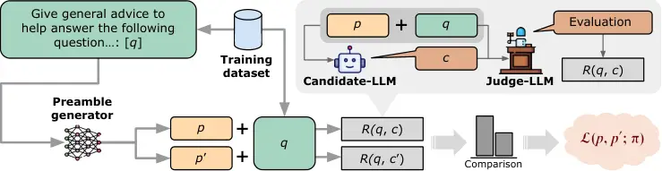
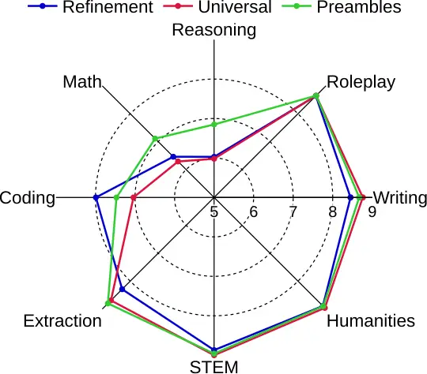
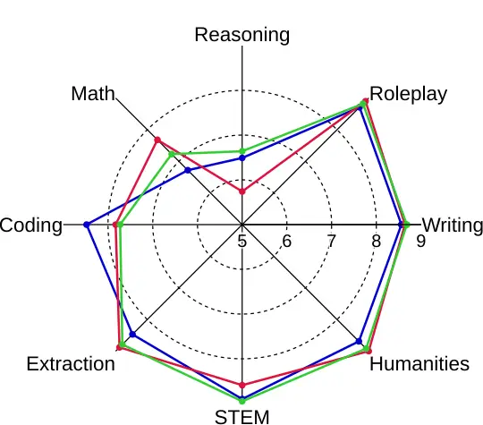

# Reverse Engineering Human Preferences with Reinforcement Learning

Lisa Alazraki ^(†)^(†)thanks: Work done while at Cohere. Correspondence
to lisa.alazraki20@imperial.ac.uk. Affiliation: Imperial College London
   Tan Yi-Chern Affiliation: Cohere    Jon Ander Campos
Affiliation: Cohere    Maximilian Mozes Affiliation: Cohere    Marek Rei
Affiliation: Imperial College London    Max Bartolo Affiliation: Cohere

###### Abstract

The capabilities of Large Language Models (LLMs) are routinely evaluated
by other LLMs trained to predict human preferences. This framework—known
as LLM-as-a-judge—is highly scalable and relatively low cost. However,
it is also vulnerable to malicious exploitation, as LLM responses can be
tuned to overfit the preferences of the judge. Previous work shows that
the answers generated by a candidate-LLM can be edited post hoc to
maximise the score assigned to them by a judge-LLM. In this study, we
adopt a different approach and use the signal provided by judge-LLMs as
a reward to adversarially tune models that generate text preambles
designed to boost downstream performance. We find that frozen LLMs
pipelined with these models attain higher LLM-evaluation scores than
existing frameworks. Crucially, unlike other frameworks which intervene
directly on the model’s response, our method is virtually undetectable.
We also demonstrate that the effectiveness of the tuned preamble
generator transfers when the candidate-LLM and the judge-LLM are
replaced with models that are not used during training. These findings
raise important questions about the design of more reliable
LLM-as-a-judge evaluation settings. They also demonstrate that human
preferences can be reverse engineered effectively, by pipelining LLMs to
optimise upstream preambles via reinforcement learning—an approach that
could find future applications in diverse tasks and domains beyond
adversarial attacks.

## 1 Introduction

The LLM-as-a-judge framework has largely replaced human evaluation in
the large-scale assessment of LLMs Chiang and Lee (2023); Zhu et al.
(2025); Bavaresco et al. (2025); Huang et al. (2025); Verga et al.
(2024); Zheng et al. (2024), with several widely used benchmarks now
relying on this approach to judge model performance across tasks Min et
al. (2023); Kim et al. (2025); Li et al. (2025); Qin et al. (2024); Zeng
et al. (2024); Zheng et al. (2024). Judge-LLMs are trained to predict
human preferences, offering a scalable and cost-effective alternative to
human annotations Min et al. (2023); Zheng et al. (2024). However, prior
work has shown that judge-LLMs are vulnerable to adversarial attacks
aimed at artificially boosting their scores Raina et al. (2024); Shi et
al. (2024); Ye et al. (2025). In particular, it is possible to find text
sequences that, once appended to or substituted for a response, maximise
the score awarded to it by a judge Raina et al. (2024); Shi et al.
(2024); Zheng et al. (2025). This type of attack intervenes post hoc on
the text being evaluated and can thus be detected via human inspection
or by computing the perplexity (PPL) of the modified response Jain et
al. (2023); Raina et al. (2024); Shi et al. (2024).

In this study, we investigate a different, novel approach based on
reward modelling w.r.t. the judge-LLM’s evaluation scores, testing both
its effectiveness and detectability. Specifically, we use these scores
to tune an adversarial model that generates textual preambles¹¹ 1 In
this context, preambles are also known as system prompts.—i.e.,
additional sets of instructions—to be injected into a frozen
candidate-LLM, causing its responses to receive higher scores from the
judge. The loss function that optimises the preamble generator is
adapted from Contrastive Policy Gradient Flet-Berliac et al. (2024), but
depends on rewards computed solely on the generations of the
candidate-LLM and without directly observing the preambles. We refer to
this technique of pipelining multiple LLMs to indirectly optimise
upstream preambles in an RL fashion as Reinforcement Learning for
Reverse Engineering (RLRE).

There are several advantages to tuning an upstream preamble generator
rather than directly overfitting the candidate-LLM to the judge-LLM’s
rewards: (1) the specialised preamble generator can be smaller in size,
hence computationally cheaper to train; (2) tuning the preambles while
leaving the candidate-LLM frozen retains its original capabilities and
is less likely to result in noticeable stylistic changes in its output,
thus potentially making the attack harder to detect; (3) the generated
preambles that align the candidate-LLM to the judge are natural language
instructions, which can be analysed and interpreted; (4) once trained,
the preamble generator can serve as a plug-and-play component for
pipelining with different candidate-LLMs (we experiment with preamble
transferability across candidate-LLMs in Section 5.1); (5) in broader
contexts, tuning preambles can also serve as a means of optimising
models that cannot be fine-tuned directly (e.g., those accessible only
via inference APIs or for which fine-tuning would be too costly).

Indeed, we find that responses produced by candidate-LLMs pipelined with
the preamble generator receive substantially higher evaluation scores
from judge-LLMs compared to responses attacked with other strategies,
while also eluding detection methods. In contrast, existing attacks can
be detected via perplexity analysis Jain et al. (2023) or human
inspection.

Finally, we perform an analysis of the optimal preambles and find high
variability in their fluency across different model pipelines. While
natural language preambles enhance interpretability, our findings raise
important questions about whether constraining conditioning tokens—such
as preambles or reasoning tokens—to the manifold of natural language may
inadvertently limit model capabilities.

This paper makes the following main contributions:

1.  1.  We show that an adversarially tuned preamble generator, pipelined
        with a frozen LLM, is effective at deceiving judge-LLMs into
        assigning higher scores. To the best of our knowledge, this is the
        first work that optimises preambles to be injected into a frozen LLM
        for this purpose. In contrast, previous studies focus on finding
        text sequences to be appended to pre-generated responses.
2.  2.  We demonstrate that our adversarial preamble generator can be
        successfully pipelined with candidate-LLMs and judge-LLMs not seen
        during training.
3.  3.  We show that our attack does not increase PPL scores and is rarely
        flagged by human evaluators. Hence, it cannot be detected using
        existing safeguards.
4.  4.  We observe variations in optimal preamble style, fluency and
        naturalness across models, suggesting that conditioning LLMs on
        human-readable sequences only (for example in preambles or reasoning
        traces) may be overly restrictive from a performance perspective.
5.  5.  Our work highlights intrinsic vulnerabilities in the LLM-as-a-judge
        paradigm and calls into question its reliability and robustness.
6.  6.  More broadly, this work introduces RLRE, a novel approach that
        pipelines LLMs to optimise upstream textual preambles in a
        reinforcement learning setting. While here we use RLRE to reverse
        engineer human preferences with the aim of boosting LLM-as-a-judge
        evaluation, we postulate that this method could be paired with
        different downstream rewards to optimise preambles for a variety of
        applications beyond just adversarial attacks—including but not
        limited to meaningful tasks such as reducing toxicity or mitigating
        bias.

## 2 Related Work



Figure 1: Reinforcement Learning for Reverse Engineering (RLRE) pipeline
for training a preamble generator. Given a question $`q`$ from a
training set, we prepend to it a general instruction and feed it to the
preamble generator $`\pi`$. In order for $`\pi`$ to learn the policy, we
sample two preambles per question, $`p`$ and $`p^{\prime}`$. The
respective rewards are obtained by appending $`q`$ to $`p`$ and
$`p^{\prime}`$, respectively, and (i) passing each as input to the
candidate-LLM, which generates the responses $`c`$ and $`c^{\prime}`$,
and (ii) having the judge-LLM evaluate each question-response pair and
extracting the respective numerical rewards from these evaluations. The
loss function that optimises $`\pi`$ depends on the delta between the
rewards $`R(q,c)`$ and $`R(q,c^{\prime})`$.

Prior work investigating the robustness of LLM-as-a-judge has found that
this approach suffers from multiple inherent biases. Existing research
has sought to exploit these biases by crafting adversarial attacks aimed
at maximising the scores assigned by judge-LLMs to candidate responses.

#### Biases.

Judge-LLMs are not unbiased evaluators. Liu et al. (2024) and
Panickssery et al. (2024) observe that judge-LLMs prefer their own
generations to those of other models in the large majority of cases.
Wang et al. (2024) further show that when asked to choose the best among
multiple responses, GPT models favour the first candidate displayed,
regardless of its quality. Additionally, Chen et al. (2024) find that
LLMs tasked with scoring other models prefer visually appealing
generations regardless of content, and generations that are attributed,
even falsely, to authority figures. Similarly, Ye et al. (2025) conclude
that LLM judgment is vulnerable to spurious attributions (‘authority
bias’). They additionally observe that judge-LLMs tend to prefer longer
responses (‘verbosity bias’), responses falsely identified as majority
beliefs (‘bandwagon-effect bias’), and responses presented as the result
of a refinement process (‘refinement-aware bias’).

#### Adversarial attacks.

Ye et al. (2025) show that the biases of judge-LLMs can be manipulated
to artificially boost their evaluation scores. They append specific text
sequences to candidate responses: a false book citation to exploit
authority bias, a sentence stating that most people favour that response
to exploit bandwagon-effect bias, or a piece of text suggesting the
response has been through a refinement process, to leverage
refinement-aware bias. In each case, they find that the resulting
responses are evaluated more favourably by all or some of the
judge-LLMs. They also show that evaluation is affected when the length
of a response is increased, without any improvement in its quality.
Raina et al. (2024) take this type of adversarial attack further, tuning
a universal text sequence that, when appended to a pre-generated
response, increases its evaluation score. This sequence is found by
searching sequentially through the vocabulary, iteratively selecting the
word that maximises the average reward from the judge on the training
set. Their method is successful at inflating LLM judgement on
Topical-Chat Gopalakrishnan et al. (2019) and SummEval Fabbri et al.
(2021), and they show the attack transfers to previously unseen
judge-LLMs not included in the search process. Rather than tuning a
universal phrase, Shi et al. (2024) train a sample-specific text
sequence to be selected more often by a judge in pairwise comparison.
Similar to Raina et al. (2024), they append the tuned sequence to a
pre-generated LLM response. Finally, Zheng et al. (2025) experiment with
replacing responses with fixed instructions that invalidate the original
LLM-as-a-judge prompt. Note that Raina et al. (2024), Shi et al. (2024)
and Zheng et al. (2025) all observe that their attack can in large part
be detected by measuring the perplexity of the responses. As the attack
intervenes directly on the response and alters it, attacked responses
tend to display higher PPL.

Unlike the above methods, the attack we propose does not modify the
generated text post hoc. This makes its detection substantially more
difficult.

## 3 Method

Given a training dataset of questions
$`\mathcal{D}=\{(q_{j})_{1\leq j\leq N}\}`$ and a fixed instruction
prompt $`i`$, we aim to train a preamble generator
$`\pi_{\theta}(p_{j}|i,q_{j})`$ to generate textual preambles $`p`$
conditioned on $`i`$ and $`q`$. We formulate the RL problem as:

```math
J(\pi_{\theta})=\mathbb{E}_{q\sim\mathcal{D}}\mathbb{E}_{p\sim\pi_{\theta}(p|i,q)}\mathbb{E}_{c\sim LLM_{C}(c|p,q)}[R(q,c)]
```

where $`LLM_{C}`$ is a frozen LLM—referred to as the candidate-LLM—which
takes a preamble $`p_{j}`$ and the corresponding question $`q_{j}`$ and
outputs a candidate response $`c_{j}`$. Note that the reward is a
function of the preamble because $`LLM_{C}`$ is conditioned on it. Our
reward model is a frozen LLM that outputs a verbal critique followed by
a numerical score, as in the LLM-as-a-judge framework. We refer to this
model as the judge-LLM. In our case, the score output by the judge is
discrete on the 1–10 scale, elicited using MT-Bench Zheng et al. (2024)
prompts for single (as opposed to pairwise) evaluation. We use this
numerical score as the reward in our training pipeline. Figure 1
illustrates the training pipeline in detail.

In order to optimise the RL problem, we adapt Contrastive Policy
Gradient (CoPG) Flet-Berliac et al. (2024). The rationale behind this
choice, as well as a comparison with other RL algorithms, is further
elaborated in Appendix A. For a pair of two sampled preambles $`p_{j}`$
and $`p_{j}^{\prime}`$ we introduce the following sampling loss:

```math
\mathcal{L}(p_{j},p_{j}^{\prime};\pi)=\Bigg(R(q_{j},c_{j})-R(q_{j},c_{j}^{\prime})-\beta\left(\ln\frac{\pi(p_{j}|i,q_{j})}{\pi_{\mathrm{ref}}(p_{j}|i,q_{j})}-\ln\frac{\pi(p_{j}^{\prime}|i,q_{j})}{\pi_{\mathrm{ref}}(p_{j}^{\prime}|i,q_{j})}\right)\Bigg)^{2}.
```

$`\pi_{\mathrm{ref}}`$ is a reference model used for regularising the RL
problem, which we set to be the base LLM underlying the preamble
generator. As in Flet-Berliac et al. (2024), $`\beta`$ is a
hyperparameter regulating the importance of the KL-divergence between
the sequence log-likelihoods of $`\pi`$ and $`\pi_{\mathrm{ref}}`$ in
the overall loss.

As $`\pi`$ is trained to generate question-specific preambles, we
pipeline it with the candidate-LLM at test time to dynamically generate
responses to new questions. We prompt the preamble generator with the
same fixed instruction $`i`$ used during training, along with a question
$`q`$, to generate the response $`c`$. A judge-LLM is then prompted to
assign a score to $`c`$.

As an additional consideration, it is worth noting that Flet-Berliac et
al. (2024) investigate CoPG solely in an offline manner. However, they
hypothesise that the method should also scale to the online setting. To
the best of our knowledge, this work is the first to successfully apply
a similar method to online learning.

## 4 Experiments

### 4.1 Models and Hyperparameters

To test the generalisability of our method, we use LLMs from both the
Command²² 2 [https://cohere.com/command](https://cohere.com/command) and
the Llama 3.1 Grattafiori et al. (2024) model series. We train and test
three distinct pipelines, illustrated in Table 1. Note that all
pipelines are trained with the same judge-LLM, i.e. Command R+ prompted
as in Zheng et al. (2024). We tune the Command R7B Cohere et al. (2025)
preamble generators on a Google Cloud TPU v5e containing 64 chips. We
train the Llama 3.1 8B Instruct preamble generator on a single Nvidia
H100 GPU. Candidate- and judge-LLMs from the Command family are accessed
via API. The Llama 3.1 70B Instruct candidate-LLM is deployed and
queried on a local server.

Due to computational limitations, we perform all hyperparameter tuning
on the Command R7B+R7B pipeline, and apply the same hyperparameters to
the other two. As shown in Section 4.4, the Command R7B+R7B pipeline
attains the greatest performance improvements over the baselines, and it
is therefore likely that additional hyperparameter tuning would further
raise the scores obtained by the Command R7B+R and Llama 8B+70B
pipelines. This may be especially true for the latter, which comprises a
family of models different from those used for hyperparameter tuning. It
is worth noting that, since the preambles only need to influence the
candidate-LLM outputs and do not necessarily need to be fluent from a
human perspective, the hyperparameter tuning process results in a
relatively low value of the KL-divergence coefficient ($`\beta=0.03`$),
which regulates the similarity between the output distributions of the
preamble generator and the reference model. This low $`\beta`$ value
allows our preambles to deviate more drastically from the reference
policy during training.

We train each pipeline with early stopping according to validation
performance. All hyperparameters, API model IDs, and training process
details are given in Appendix B.

### 4.2 Datasets

We test all pipelines on MT-Bench Zheng et al. (2024), which consists of
160 open-ended questions, split among two conversational turns, grounded
in the following domains: writing, roleplay, reasoning, math, coding,
extraction, STEM, and humanities. We choose this benchmark as it is
established and widely used in LLM assessment, and tests a balanced
distribution of diverse skills on challenging multi-turn questions Zheng
et al. (2024). Crucially, MT-Bench supports independent judgement as
opposed to pairwise comparison with other models Li et al. (2023); Li et
al. (2025). It is also worth noting that MT-Bench represents the setup
we target in our approach, which makes it suitable to demonstrate that
it is possible to reverse engineer human feedback in a controlled
setting. Since MT-Bench does not comprise a training set, we fine-tune
and validate the preamble generators using questions from UltraFeedback
Cui et al. (2024) (using MT-Bench prompts for single evaluation to
elicit the downstream rewards). The questions in UltraFeedback are
extracted from ShareGPT Chiang et al. (2023), FLAN Longpre et al.
(2023), Evol-Instruct Xu et al. (2024), UltraChat Ding et al. (2023),
FalseQA Hu et al. (2023), and TruthfulQA Lin et al. (2022).
Collectively, these datasets cover a wide range of topics, and the
domains in MT-Bench are represented in UltraFeedback. The distribution
of the different tasks within the training data is further analysed in
Appendix C.2.

Additionally, we test transferability to a further benchmark, Arena-Hard
Li et al. (2025), as discussed in Section 5.1.

|                             |                               |                                |
| --------------------------- | ----------------------------- | ------------------------------ |
|     Pipeline identifier     |     Preamble generator        |     Candidate-LLM              |
|     Command R7B+R7B         |     Command R7B               |     Command R7B                |
|     Command R7B+R           |     Command R7B               |     Command R (35B)            |
|     Llama 8B+70B            |     Llama 3.1 8B Instruct     |     Llama 3.1 70B Instruct     |

Table 1: The training pipelines include models of different sizes and
families as preamble generators and/or candidate-LLMs. Command R+ (104B
parameters) is used as the judge-LLM in all pipelines.

### 4.3 Baselines

We compare the evaluation scores assigned to candidate-LLMs attacked
with the preamble generator with those given to unattacked candidates.
Additionally, we compare against existing methods that exploit
vulnerabilities in the LLM-as-a-judge framework to artificially boost
their evaluation scores. We describe these additional baselines below.
Note that all of them modify pre-generated responses from the unattacked
model.

#### Verbosity bias attack.

We ask the candidate-LLM to increase the length of a pre-generated
response. To this end, we use the prompt designed by Ye et al. (2025) to
lengthen the response without necessarily improving its quality.

#### Bandwagon-effect bias attack.

We append to each pre-generated response a text sequence stating that a
high percentage of people think that response should be awarded the
highest rating. Consistent with Ye et al. (2025), we randomly choose
percentages between $`60\%`$ and $`90\%`$.

#### Authority bias attack.

Using the same prompting strategy as Ye et al. (2025), we ask the
candidate-LLM to invent a plausible book source for a pre-generated
response, given a citation template. The citation is then appended to
the response to increase its perceived authority.

#### Refinement-aware bias attack.

Given a pre-generated response, we have the candidate-LLM polish it
using the refinement prompt in Ye et al. (2025). The judge is then
presented with the original response, followed by the refinement prompt
and the new, polished response.

#### Universal adversarial attack.

We append to each pre-generated response the universal adversarial
attack phrase from Raina et al. (2024), learned for absolute assessment
when attacking the Topical-Chat Gopalakrishnan et al. (2019) overall
score. Like UltraFeedback and MT-Bench, Topical-Chat encompasses a wide
range of topics and features multi-turn questions similar to those in
MT-Bench. Note that learning a new universal phrase on our UltraFeedback
training set is computationally infeasible: for $`n`$ training samples,
the exhaustive search method in Raina et al. (2024) computed over the
20k-word vocabulary makes $`20000\times 4\times n`$ calls to the
judge-LLM. In our case, that would equal $`4\times 10^{9}`$ inference
calls.

### 4.4 Results

Table 2 shows the average evaluation scores obtained by three
candidate-LLMs, under all baseline settings and when pipelined with our
adversarial preamble generators. Models injected with adversarial
preambles consistently obtain higher evaluations from the Command R+
judge at both question turns, with the Command R7B+R7B pipeline (i.e.,
the one on which we perform hyperparameter tuning) achieving the most
substantial improvements. We also find that turn 1 responses benefit the
most from the preambles. Note that in MT-Bench, turn 2 questions require
adjusting turn 1 answers according to new constraints. This type of task
is not well represented in UltraFeedback, making it OOD w.r.t. the
training data (see also Appendix C.2). Nevertheless, the tuned preamble
generators remain effective at raising turn 2 scores at test time.

|                        |         |                 |                 |                 |                 |                 |                 |                          |
| ---------------------- | ------- | --------------- | --------------- | --------------- | --------------- | --------------- | --------------- | ------------------------ |
| Candidate-LLM          |         | Attack type     |                 |                 |                 |                 |                 |                          |
|                        |         | No attack       | Verbosity       | Bandwagon       | Authority       | Refinement      | Universal       | Preambles                |
|                        | Turn 1  | $`7.60_{0.07}`$ | $`7.33_{0.08}`$ | $`7.47_{0.05}`$ | $`7.51_{0.05}`$ | $`7.78_{0.05}`$ | $`7.58_{0.06}`$ | $`\textbf{8.21}_{0.07}`$ |
| Command R7B            | Turn 2  | $`6.99_{0.08}`$ | $`7.29_{0.02}`$ | $`7.17_{0.08}`$ | $`7.29_{0.10}`$ | $`7.45_{0.08}`$ | $`7.25_{0.03}`$ | $`\textbf{7.66}_{0.09}`$ |
|                        | Overall | $`7.29_{0.08}`$ | $`7.31_{0.05}`$ | $`7.32_{0.06}`$ | $`7.40_{0.07}`$ | $`7.61_{0.06}`$ | $`7.41_{0.04}`$ | $`\textbf{7.93}_{0.08}`$ |
|                        | Turn 1  | $`8.09_{0.08}`$ | $`7.99_{0.10}`$ | $`7.98_{0.06}`$ | $`8.17_{0.08}`$ | $`8.10_{0.05}`$ | $`8.10_{0.06}`$ | $`\textbf{8.45}_{0.07}`$ |
| Command R              | Turn 2  | $`7.57_{0.12}`$ | $`7.73_{0.08}`$ | $`7.72_{0.14}`$ | $`7.65_{0.06}`$ | $`7.81_{0.05}`$ | $`7.75_{0.09}`$ | $`\textbf{7.92}_{0.03}`$ |
|                        | Overall | $`7.83_{0.10}`$ | $`7.86_{0.09}`$ | $`7.85_{0.10}`$ | $`7.91_{0.07}`$ | $`7.95_{0.05}`$ | $`7.92_{0.07}`$ | $`\textbf{8.18}_{0.05}`$ |
|                        | Turn 1  | $`8.47_{0.08}`$ | $`8.29_{0.06}`$ | $`8.39_{0.05}`$ | $`8.38_{0.07}`$ | $`8.51_{0.07}`$ | $`8.50_{0.05}`$ | $`\textbf{8.56}_{0.08}`$ |
| Llama 3.1 70B Instruct | Turn 2  | $`7.64_{0.06}`$ | $`7.49_{0.08}`$ | $`7.65_{0.08}`$ | $`7.62_{0.07}`$ | $`7.75_{0.09}`$ | $`7.85_{0.07}`$ | $`\textbf{7.88}_{0.08}`$ |
|                        | Overall | $`8.06_{0.07}`$ | $`7.89_{0.07}`$ | $`8.02_{0.07}`$ | $`8.00_{0.07}`$ | $`8.13_{0.08}`$ | $`8.17_{0.06}`$ | $`\textbf{8.22}_{0.08}`$ |

Table 2: MT-Bench evaluation scores assigned by the Command R+ judge-LLM
to candidate-LLMs attacked with different strategies. Each setup is run
five times and the scores are averaged (showing the standard deviation
in the subscript) to account for small variations due to temperature
sampling.

(a) Command R7B



(b) Command R



(c) Llama 3.1 70B Instruct

Figure 2: Average scores per question type obtained by candidate-LLMs
using a refinement-aware bias attack, Raina et al. (2024)’s universal
adversarial attack, and the adversarial preamble generator.

We find that among all candidate LLMs, the strongest baseline attacks
are the refinement-aware bias attack and the universal adversarial
attack proposed by Raina et al. (2024). On average, our adversarial
preambles increase Command R7B’s overall score (on a 1–10 continuous
scale) by 0.32 points over the refinement-aware attack and by 0.52
points over the universal attack. For Command R, the corresponding
improvements are +0.23 and +0.26, respectively. Injecting adversarial
preambles into Llama 3.1 70B Instruct yields smaller but consistent
gains, raising its score by 0.09 relative to the refinement-aware attack
and 0.05 relative to the universal attack. Furthermore, compared with
their non-attacked counterparts, the preamble-based attack substantially
increases the overall judge scores for Command R7B, Command R, and
Llama—by 0.64, 0.35, and 0.16, respectively. We report confidence
intervals in Appendix D.1.

In Figure 2, we illustrate the evaluation scores per question type for
the two best-performing baselines (refinement-aware bias and universal
adversarial attack) and the adversarial preamble generator. Overall, the
adversarially tuned preambles are most effective at raising the scores
of reasoning and math responses, followed by extraction, STEM and
roleplay. Fine-grained results for all domains are shown in
Appendix D.2.

## 5 Analysis

### 5.1 Attack Transferability

|                        |                          |                          |                          |
| ---------------------- | ------------------------ | ------------------------ | ------------------------ |
| Candidate-LLM          | Preambles from pipeline  |                          |                          |
|                        | Command R7B+R7B          | Command R7B+R            | Llama 8B+70B             |
| Command R7B            | $`\textbf{7.93}_{0.08}`$ | $`7.68_{0.08}`$          | $`7.40_{0.10}`$          |
| Command R (35B)        | $`8.01_{0.09}`$          | $`\textbf{8.18}_{0.05}`$ | $`7.97_{0.09}`$          |
| Llama 3.1 70B Instruct | $`8.21_{0.05}`$          | $`8.19_{0.08}`$          | $`\textbf{8.22}_{0.08}`$ |

(a) Candidate transferability

|             |                          |                          |                          |
| ----------- | ------------------------ | ------------------------ | ------------------------ |
| Attack type | GPT-3.5                  | GPT-4o-mini              | Claude                   |
| No attack   | $`7.58_{0.08}`$          | $`6.40_{0.07}`$          | $`9.02_{0.06}`$          |
| Verbosity   | $`7.36_{0.09}`$          | $`5.61_{0.04}`$          | $`8.74_{0.04}`$          |
| Bandwagon   | $`7.47_{0.04}`$          | $`6.25_{0.04}`$          | $`8.79_{0.07}`$          |
| Authority   | $`7.48_{0.09}`$          | $`5.92_{0.06}`$          | $`8.92_{0.12}`$          |
| Refinement  | $`7.71_{0.11}`$          | $`6.39_{0.05}`$          | $`9.18_{0.06}`$          |
| Universal   | $`7.33_{0.10}`$          | $`6.06_{0.03}`$          | $`8.94_{0.07}`$          |
| Preambles   | $`\textbf{8.07}_{0.07}`$ | $`\textbf{6.71}_{0.02}`$ | $`\textbf{9.44}_{0.06}`$ |

(b) Judge transferability

Table 3: Candidate transferability (a) and judge transferability (b) of
our preamble-based attack on MT-Bench. All scores are averaged over five
runs.

We investigate the transferability of our preamble attack across
different candidate- and judge-LLMs.

#### Transferability across candidate-LLMs.

At test time, we pipeline each candidate-LLM with adversarial preamble
generators tuned with a different candidate. As shown in Table 4(a), the
judge’s evaluation scores remain higher than all baselines (shown in
Table 2) in all cases except for Command R7B pipelined with the preamble
generator from the Llama pipeline, whose scores align with Raina et al.
(2024)’s universal attack. This demonstrates strong transferability of
the adversarial preamble attack across different candidate-LLMs.

#### Transferability across judge-LLMs.

In real-world scenarios, the target judge-LLM may not be known in
advance. It is therefore important to assess whether our method
generalises to judges that were not used during training. Table 4(b)
presents results where different judge-LLMs evaluate candidate responses
across all attack settings. For this analysis, we employ GPT-3.5,³³ 3
[https://platform.openai.com/docs/models/gpt-3.5-turbo](https://platform.openai.com/docs/models/gpt-3.5-turbo)
GPT-4o-mini OpenAI et al. (2024), and Claude Haiku Anthropic (). To
maintain cost efficiency, we restrict evaluation to Command R7B. While
the absolute reward scales differ across the three judges, all three
consistently assign the highest scores to responses generated using our
preamble generator, despite it having been trained with rewards from a
different judge (Command R+). These findings suggest that the attack
remains effective even when the target judge-LLM is unknown.

#### Transferability across benchmarks.

We further evaluate the Command R7B pipeline on the Arena-Hard
benchmark, which differs from both UltraFeedback and MT-Bench in task
distribution. Moreover, its reward metric—the Arena Score Rate
(ASR)—differs in both assignment strategy and numerical range, as
described in Li et al. (2025). We conduct evaluations using both the
Command R+ judge (used during training) and an unseen judge, GPT-4,
which serves as the standard evaluator for Arena-Hard at the time of
writing. Applying the tuned preambles yields an average score increase
of +3.5 with Command R+ and +1.2 with GPT-4 (note that Arena-Hard scores
range from 0–100; see Appendix D.3 for full results). These results
demonstrate that RLRE generalises effectively to new benchmarks without
additional task-specific training.

Figure 4: Proportion of LLM responses that have been labelled as
‘attacked’ by human evaluators. Responses generated using adversarial
preambles are identified as attacked nearly as rarely as those produced
by a non-attacked model.      Attack type       PPL-W (FNR)   
   Verbosity       $`0.91`$       Bandwagon       $`0.93`$   
   Authority       $`0.88`$       Refinement       $`0.66`$   
   Universal       $`0.04`$       Preambles       $`0.90`$    Table 6:
False negative rate (FNR) of PPL-W for each attack type. Verbosity bias,
bandwagon bias and our preamble-based attack are rarely detected with
this method (FNR $`\geq 0.90`$). The universal adversarial attack Raina
et al. (2024) is almost always detected (FNR $`=0.04`$).

### 5.2 Attack Detectability

We examine the detectability of all attacks via perplexity analysis Jain
et al. (2023). This is the established detection method for adversarial
attacks on LLM output, used in prior and contemporary work Raina et al.
(2024); Zheng et al. (2025). Notably, this method can be used on models
served via API, as is the case for our frozen candidate-LLMs, without
requiring access to internal mechanisms such as attention maps Hung et
al. (2025); Pu et al. (2025) or the entire probability distributions
over the vocabulary at each decoding step Dasgupta et al. (2025). As an
additional test, we also measure the detectability of the attacks via
human evaluation of the candidate responses.

#### Perplexity analysis.

We use a perplexity filter over a 10-token sliding window as in Jain et
al. (2023), to identify whether the candidate-LLM has been attacked. A
response is labelled as attacked if the PPL of any subsequence in the
sliding window is greater than a threshold $`t`$. We set $`t`$ to ensure
a false positive rate within 0.05 on the test set responses produced by
the non-attacked model. Table 4 illustrates the results of this
detection method—referred to as PPL-W—for the Command R7B candidate.

#### Human evaluation.

To assess the detectability of each attack by visual inspection, we
recruit 16 annotators with domain expertise and knowledge of the
possible attacks. We sample a balanced subset of 400 test responses
generated by Command R7B under each attack setup (including the
non-attacked model), randomly split it into 16 equal-sized portions, and
have each annotator assign a binary label (‘attacked’ or ‘not attacked’)
to each generation. Figure 4 shows the proportion of responses labelled
as ‘attacked’ for each attack type. Attacks that insert formulaic
sequences into the response (bandwagon bias, authority bias,
refinement-aware bias and universal attack) are detected in all or most
cases (100%, 96%, 95% and 97%, respectively), while the verbosity bias
attack is detected approximately half of the time (49%). Notably,
responses produced by the preamble-based attack are labelled as
‘attacked’ nearly as rarely (14%) as those generated by the non-attacked
model (12%). We also measure the rate at which each annotator is able to
correctly detect each type of attack (both in terms of accuracy and F1).
For both scores, we compute the median absolute deviation (MAD) across
all annotators for each attack type, and find it to be zero in all
cases, indicating that the annotators are able (or unable) to detect
each attack at very similar rates. This supports the hypothesis that
different attacks are inherently (un)detectable by visual inspection, as
we do not find high variance in detection rates between different
annotators.

### 5.3 Ablations

In our framework, we input into the preamble generator a fixed
instruction concatenated with a question from the dataset, resulting in
question-specific preambles. To evaluate the degree to which this
prompting strategy contributes to the effectiveness of our attack, we
run an ablation study where (i) we remove the question from the input
and feed the preamble generator only a generic instruction, and (ii) we
discard the instruction altogether and only input special tokens to
signal the start of a generation turn (both prompts are shown in
Appendix E). In the latter case, the model is virtually unconstrained
and may generate any text string, and thus the training signal is even
more consequential in determining the content of the preambles.

Table 7 illustrates the overall scores assigned by the Command R+ judge
under all ablated settings. Although both ablation strategies result in
slightly lower performance than the corresponding non-ablated pipelines,
all the scores remain above all baselines (refer to Table 2 for the
baseline results). This demonstrates the robustness of the attack under
different prompting strategies.

|                   |                    |                    |
| ----------------- | ------------------ | ------------------ |
|   Pipeline        |   Ablated setting  |                    |
|                   |    No question     |    No instruction  |
|   Command R7B+R7B |    $`7.76_{0.07}`$ |    $`7.70_{0.07}`$ |
|   Command R7B+R   |    $`8.14_{0.08}`$ |    $`8.13_{0.13}`$ |
|   Llama 8B+70B    |    $`8.19_{0.11}`$ |    $`8.18_{0.12}`$ |

Table 7: Ablated MT-Bench overall scores obtained by (i) removing the
question and feeding a generic instruction to the preamble generator,
and (ii) removing the instruction and only feeding special tokens to
signal the start of the turn. Scores are assigned by a Command R+ judge
and are averaged over five runs.

### 5.4 Analysis of Generated Texts

#### Do successful preambles exhibit common patterns?

Upon analysing the successful preambles produced by each tuned
generator, we find consistency among preambles generated by the same
model, but high variability across different models. While preambles
generated by the Command models (both conditioned on the data point and
conditioned on a generic instruction) share a similar
structure—providing a blueprint for how to design an answer—preambles
that are only conditioned on the start-of-turn token, as well as all the
Llama preambles, deviate substantially from this pattern. The latter
tend to reiterate the same phrases multiple times, and often do not
appear fluent to a human reader. When they are not conditioned on an
instruction, they even devolve into apparently meaningless sequences of
characters. Nevertheless, all of these preambles are successful at
raising LLM evaluation scores, as evidenced in Section 5.3. Appendix G
shows representative preambles for each pipeline.

It is worth noting that, as further discussed in Appendix B, we assign
relatively low weight to the log-likelihoods of the adversarial
preambles within the loss function, thus prioritising reward over
fluency during training. Remarkably, the training still converges toward
preambles that elicit high-reward candidate responses, regardless of
their fluency. This suggests that constraining preambles—or other
conditioning tokens such as reasoning tokens—to the manifold of natural
language may not always be optimal.

#### Are attacked responses more accurate?

Figure 2 shows that the preamble-based attack is particularly effective
at raising the scores assigned to math and reasoning responses. Since
these responses are evaluated by the judge-LLM against a ground truth
Zheng et al. (2024), this raises the question of whether the attack has
improved response accuracy. We thus evaluate via normalised exact match
all math and reasoning responses from all models, both in the
non-attacked setup and the preamble-attacked version. We find that the
average accuracy rates are very similar, with a slight advantage for the
non-attacked models (45.9%) over the preamble attack (44.2%). Hence, the
accuracy of the final answer does not improve due to the preambles.
However, as shown by the representative examples in Appendix H, the
attacked responses have more structured reasoning chains, usually
arranged into distinct paragraphs labelled with clear, explanatory
headers. We thus postulate that the improved layout may be solely
responsible for the higher scores assigned by the judge-LLM, regardless
of correctness.

|                     |                                   |                |                 |                           |
| ------------------- | --------------------------------- | -------------- | --------------- | ------------------------- |
|     Attack type     |     Number of assigned labels     |                |                 |     Avg. human rating     |
|                     |     Poor                          |     Fair       |     Good        |                           |
|     No attack       |     $`72`$                        |     $`50`$     |     $`118`$     |     $`6.22`$              |
|     Preambles       |     $`73`$                        |     $`54`$     |     $`113`$     |     $`6.24`$              |

Table 8: Human evaluation of generated responses for all task domains.

#### Are attacked responses better overall?

Aside from math and reasoning, the other MT-Bench domains are either not
reliably verifiable with automated methods (extraction, STEM,
humanities, coding) or lack objective verification entirely (writing,
roleplay). To understand whether responses produced via our preamble
pipeline have improved over those generated by the non-attacked model,
we have them evaluated by expert human annotators, blind to the attack
and instructed to assess correctness and quality by assigning to each
response one of three labels: ‘Poor’, ‘Fair’ or ‘Good’, along with a
discrete 1-10 rating matching the MT-Bench judge-LLM scale. We do this
for all responses generated by Command R7B, across all domains. Table 8
shows that the label distributions are fairly similar for both the
non-attacked and the attacked model, with the non-attacked model
receiving slightly more positive labels (‘Good’), and the attacked one
receiving slightly more mid-range labels (‘Fair’). We observe relatively
strong inter-annotator agreement (aggregated Spearman’s $`\rho=0.78`$,
combined $`p<0.001`$, Kendall’s $`W=0.72`$, $`p<0.001`$). Moreover, the
difference between the human ratings of the non-attacked and the
attacked model is negligible (0.02), whereas the difference between the
judge-LLM’s ratings of the same two setups is substantially greater and
favours our attack.

## 6 Conclusion

We have shown that human preferences can be successfully reverse
engineered to tune adversarial text preambles, and that injecting these
preambles into a candidate-LLM constitutes a powerful attack on the
LLM-as-a-judge framework. This attack not only outperforms previous
methods at inflating the scores assigned by a judge-LLM to candidate
responses, but also remains virtually undetectable using existing
safeguards. In contrast, current strategies that intervene post hoc on
the responses display high PPL and can be easily detected by visual
inspection. Additionally, we have found that the attack transfers to
candidate-LLMs not seen during training, enabling our adversarial
preamble generator to serve as a plug-and-play component for
artificially boosting the scores of multiple LLMs after a single
training process. Finally, we have shown that preambles tuned with one
judge-LLM can effectively attack different judges from different model
families, and are effective at inflating scores on multiple benchmarks.
These findings raise important questions regarding the reliability of
LLM-as-a-judge evaluation.

In addition to pointing to future research directions for the design of
more robust evaluation frameworks, this work introduces Reinforcement
Learning for Reverse Engineering (RLRE), a novel strategy that combines
LLMs to tune upstream textual preambles via reinforcement learning, thus
enabling the indirect optimisation of models, including those that
cannot be fine-tuned directly. While here we have shown its
effectiveness in the context of adversarial attacks on LLM evaluation,
future research can investigate other avenues of application for this
approach (e.g., automatic generation of other types of attack, but also
improvements to LLM output such as toxicity or bias mitigation), as well
as different granularities of sequence adaptation (e.g., query-specific,
task-specific, domain-specific), and the optimisation of tokens at
different positions within an input sequence (e.g., post-query
instructions instead of pre-query preambles). Looking ahead, we envision
that future systems will not rely on a single token stream, but
integrate and optimise multiple inputs—e.g. from users, tools, and
auxiliary models—each contributing to the generation of final responses
that better align with chosen objectives.

## Broader Impacts

This work focuses on aligning candidate-LLMs to judge-LLMs by means of
tuned preambles injected into the candidate to obtain inflated
evaluations. While there is a chance that this strategy may be exploited
by adversaries, it is of scientific interest to the community that such
an attack is not only possible but also particularly effective. Note
that, while we openly disclose our training algorithm and
hyperparameters and train using publicly available data, we do not
release our trained preamble generator checkpoints to the public, as
this may encourage their misuse.

## Acknowledgments

The authors are grateful to Yannis Flet-Berliac for his insightful
guidance on hyperparameter tuning and for valuable input in refining the
training pipeline. Appreciation is also extended to John Dang, Matthieu
Geist, Roman Castagné, and Eugene Choi for their helpful suggestions
throughout this work.

## References

- Ahmadian et al. (2024) A. Ahmadian, C. Cremer, M. Gallé, M. Fadaee, J.
  Kreutzer, O. Pietquin, A. Üstün, and S. Hooker Back to basics:
  revisiting REINFORCE-style optimization for learning from human
  feedback in LLMs. In Proceedings of the 62nd Annual Meeting of the
  Association for Computational Linguistics (Volume 1: Long Papers), L.
  Ku, A. Martins, and V. Srikumar (Eds.), Bangkok, Thailand,
  pp. 12248–12267. External Links:
  [Link](https://aclanthology.org/2024.acl-long.662/),
  [Document](https://dx.doi.org/10.18653/v1/2024.acl-long.662) Cited by:
  Appendix A.
- \[2\] Anthropic The Claude 3 Model Family: Opus, Sonnet, Haiku.
  External Links:
  [Link](https://api.semanticscholar.org/CorpusID:268232499) Cited by:
  §5.1.
- Bavaresco et al. (2025) A. Bavaresco, R. Bernardi, L. Bertolazzi, D.
  Elliott, R. Fernández, A. Gatt, E. Ghaleb, M. Giulianelli, M.
  Hanna, A. Koller, A. Martins, P. Mondorf, V. Neplenbroek, S.
  Pezzelle, B. Plank, D. Schlangen, A. Suglia, A. K. Surikuchi, E.
  Takmaz, and A. Testoni LLMs instead of human judges? a large scale
  empirical study across 20 NLP evaluation tasks. In Proceedings of the
  63rd Annual Meeting of the Association for Computational Linguistics
  (Volume 2: Short Papers), W. Che, J. Nabende, E. Shutova, and M. T.
  Pilehvar (Eds.), Vienna, Austria, pp. 238–255. External Links:
  [Link](https://aclanthology.org/2025.acl-short.20/),
  [Document](https://dx.doi.org/10.18653/v1/2025.acl-short.20), ISBN
  979-8-89176-252-7 Cited by: §1.
- Chen et al. (2024) G. H. Chen, S. Chen, Z. Liu, F. Jiang, and B. Wang
  Humans or LLMs as the judge? A study on judgement bias. In Proceedings
  of the 2024 Conference on Empirical Methods in Natural Language
  Processing, Y. Al-Onaizan, M. Bansal, and Y. Chen (Eds.), Miami,
  Florida, USA, pp. 8301–8327. External Links:
  [Link](https://aclanthology.org/2024.emnlp-main.474) Cited by: §2.
- Chiang and Lee (2023) C. Chiang and H. Lee Can large language models
  be an alternative to human evaluations?. In Proceedings of the 61st
  Annual Meeting of the Association for Computational Linguistics
  (Volume 1: Long Papers), A. Rogers, J. Boyd-Graber, and N. Okazaki
  (Eds.), Toronto, Canada, pp. 15607–15631. External Links:
  [Link](https://aclanthology.org/2023.acl-long.870),
  [Document](https://dx.doi.org/10.18653/v1/2023.acl-long.870) Cited by:
  §1.
- Chiang et al. (2023) W. Chiang, Z. Li, Z. Lin, Y. Sheng, Z. Wu, H.
  Zhang, L. Zheng, S. Zhuang, Y. Zhuang, J. E. Gonzalez, I. Stoica,
  and E. P. Xing Vicuna: an open-source chatbot impressing GPT-4 with
  90%\* ChatGPT quality. Note:
  [https://lmsys.org/blog/2023-03-30-vicuna](https://lmsys.org/blog/2023-03-30-vicuna)
  Cited by: Table 11, §4.2.
- Cohere et al. (2025) T. Cohere, :, Aakanksha, A. Ahmadian, M.
  Ahmed, J. Alammar, M. Alizadeh, Y. Alnumay, S. Althammer, A.
  Arkhangorodsky, V. Aryabumi, D. Aumiller, R. Avalos, Z. Aviv, S.
  Bae, S. Baji, A. Barbet, M. Bartolo, B. Bebensee, N. Beladia, W.
  Beller-Morales, A. Bérard, A. Berneshawi, A. Bialas, P. Blunsom, M.
  Bobkin, A. Bongale, S. Braun, M. Brunet, S. Cahyawijaya, D.
  Cairuz, J. A. Campos, C. Cao, K. Cao, R. Castagné, J. Cendrero, L. C.
  Currie, Y. Chandak, D. Chang, G. Chatziveroglou, H. Chen, C. Cheng, A.
  Chevalier, J. T. Chiu, E. Cho, E. Choi, E. Choi, T. Chung, V.
  Cirik, A. Cismaru, P. Clavier, H. Conklin, L. Crawhall-Stein, D.
  Crouse, A. F. Cruz-Salinas, B. Cyrus, D. D’souza, H. Dalla-Torre, J.
  Dang, W. Darling, O. D. Domingues, S. Dash, A. Debugne, T. Dehaze, S.
  Desai, J. Devassy, R. Dholakia, K. Duffy, A. Edalati, A. Eldeib, A.
  Elkady, S. Elsharkawy, I. Ergün, B. Ermis, M. Fadaee, B. Fan, L.
  Fayoux, Y. Flet-Berliac, N. Frosst, M. Gallé, W. Galuba, U. Garg, M.
  Geist, M. G. Azar, E. Gilsenan-McMahon, S. Goldfarb-Tarrant, T.
  Goldsack, A. Gomez, V. M. Gonzaga, N. Govindarajan, M.
  Govindassamy, N. Grinsztajn, N. Gritsch, P. Gu, S. Guo, K. Haefeli, R.
  Hajjar, T. Hawes, J. He, S. Hofstätter, S. Hong, S. Hooker, T.
  Hosking, S. Howe, E. Hu, R. Huang, H. Jain, R. Jain, N. Jakobi, M.
  Jenkins, J. Jordan, D. Joshi, J. Jung, T. Kalyanpur, S. R.
  Kamalakara, J. Kedrzycki, G. Keskin, E. Kim, J. Kim, W. Ko, T.
  Kocmi, M. Kozakov, W. Kryściński, A. K. Jain, K. K. Teru, S. Land, M.
  Lasby, O. Lasche, J. Lee, P. Lewis, J. Li, J. Li, H. Lin, A.
  Locatelli, K. Luong, R. Ma, L. Mach, M. Machado, J. Magbitang, B. M.
  Lopez, A. Mann, K. Marchisio, O. Markham, A. Matton, A. McKinney, D.
  McLoughlin, J. Mokry, A. Morisot, A. Moulder, H. Moynehan, M.
  Mozes, V. Muppalla, L. Murakhovska, H. Nagarajan, A. Nandula, H.
  Nasir, S. Nehra, J. Netto-Rosen, D. Ohashi, J. Owers-Bardsley, J.
  Ozuzu, D. Padilla, G. Park, S. Passaglia, J. Pekmez, L. Penstone, A.
  Piktus, C. Ploeg, A. Poulton, Y. Qi, S. Raghvendra, M. Ramos, E.
  Ranjan, P. Richemond, C. Robert-Michon, A. Rodriguez, S. Roy, S.
  Ruder, L. Ruis, L. Rust, A. Sachan, A. Salamanca, K. K.
  Saravanakumar, I. Satyakam, A. S. Sebag, P. Sen, S. Sepehri, P.
  Seshadri, Y. Shen, T. Sherborne, S. S. Shi, S. Shivaprasad, V.
  Shmyhlo, A. Shrinivason, I. Shteinbuk, A. Shukayev, M. Simard, E.
  Snyder, A. Spataru, V. Spooner, T. Starostina, F. Strub, Y. Su, J.
  Sun, D. Talupuru, E. Tarassov, E. Tommasone, J. Tracey, B. Trend, E.
  Tumer, A. Üstün, B. Venkitesh, D. Venuto, P. Verga, M. Voisin, A.
  Wang, D. Wang, S. Wang, E. Wen, N. White, J. Willman, M. Winkels, C.
  Xia, J. Xie, M. Xu, B. Yang, T. Yi-Chern, I. Zhang, Z. Zhao, and Z.
  Zhao Command a: an enterprise-ready large language model. External
  Links: 2504.00698, [Link](https://arxiv.org/abs/2504.00698) Cited by:
  §4.1.
- Cui et al. (2024) G. Cui, L. Yuan, N. Ding, G. Yao, B. He, W. Zhu, Y.
  Ni, G. Xie, R. Xie, Y. Lin, Z. Liu, and M. Sun ULTRAFEEDBACK: boosting
  language models with scaled AI feedback. In Proceedings of the 41st
  International Conference on Machine Learning, R. Salakhutdinov, Z.
  Kolter, K. Heller, A. Weller, N. Oliver, J. Scarlett, and F.
  Berkenkamp (Eds.), Proceedings of Machine Learning Research, Vol. 235,
  pp. 9722–9744. External Links:
  [Link](https://proceedings.mlr.press/v235/cui24f.html) Cited by: §C.2,
  §4.2.
- Dasgupta et al. (2025) S. Dasgupta, S. Nath, A. Basu, P. Shamsolmoali,
  and S. Das HalluShift: measuring distribution shifts towards
  hallucination detection in LLMs. In 2025 International Joint
  Conference on Neural Networks (IJCNN), Vol. . External Links:
  [Link](https://arxiv.org/abs/2504.09482) Cited by: §5.2.
- Ding et al. (2023) N. Ding, Y. Chen, B. Xu, Y. Qin, S. Hu, Z. Liu, M.
  Sun, and B. Zhou Enhancing chat language models by scaling
  high-quality instructional conversations. In Proceedings of the 2023
  Conference on Empirical Methods in Natural Language Processing, H.
  Bouamor, J. Pino, and K. Bali (Eds.), Singapore, pp. 3029–3051.
  External Links: [Link](https://aclanthology.org/2023.emnlp-main.183/),
  [Document](https://dx.doi.org/10.18653/v1/2023.emnlp-main.183) Cited
  by: Table 11, §4.2.
- Fabbri et al. (2021) A. R. Fabbri, W. Kryściński, B. McCann, C.
  Xiong, R. Socher, and D. Radev SummEval: re-evaluating summarization
  evaluation. Transactions of the Association for Computational
  Linguistics 9, pp. 391–409. External Links:
  [Link](https://aclanthology.org/2021.tacl-1.24/),
  [Document](https://dx.doi.org/10.1162/tacl%5Fa%5F00373) Cited by: §2.
- Flet-Berliac et al. (2024) Y. Flet-Berliac, N. Grinsztajn, F.
  Strub, E. Choi, B. Wu, C. Cremer, A. Ahmadian, Y. Chandak, M. G.
  Azar, O. Pietquin, and M. Geist Contrastive policy gradient: aligning
  LLMs on sequence-level scores in a supervised-friendly fashion. In
  Proceedings of the 2024 Conference on Empirical Methods in Natural
  Language Processing, Y. Al-Onaizan, M. Bansal, and Y. Chen (Eds.),
  Miami, Florida, USA, pp. 21353–21370. External Links:
  [Link](https://aclanthology.org/2024.emnlp-main.1190) Cited by:
  Appendix A, §1, §3, §3, §3.
- Gheshlaghi Azar et al. (2024) M. Gheshlaghi Azar, Z. Daniel Guo, B.
  Piot, R. Munos, M. Rowland, M. Valko, and D. Calandriello A general
  theoretical paradigm to understand learning from human preferences. In
  Proceedings of The 27th International Conference on Artificial
  Intelligence and Statistics, S. Dasgupta, S. Mandt, and Y. Li (Eds.),
  Proceedings of Machine Learning Research, Vol. 238, pp. 4447–4455.
  External Links:
  [Link](https://proceedings.mlr.press/v238/gheshlaghi-azar24a.html)
  Cited by: Appendix A.
- Gopalakrishnan et al. (2019) K. Gopalakrishnan, B. Hedayatnia, Q.
  Chen, A. Gottardi, S. Kwatra, A. Venkatesh, R. Gabriel, and D.
  Hakkani-Tür Topical-Chat: Towards Knowledge-Grounded Open-Domain
  Conversations. In Proceedings of Interspeech 2019, pp. 1891–1895.
  External Links:
  [Document](https://dx.doi.org/10.21437/Interspeech.2019-3079),
  [Link](http://dx.doi.org/10.21437/Interspeech.2019-3079) Cited by: §2,
  §4.3.
- Grattafiori et al. (2024) A. Grattafiori, A. Dubey, A. Jauhri, A.
  Pandey, A. Kadian, A. Al-Dahle, A. Letman, A. Mathur, A. Schelten, A.
  Vaughan, A. Yang, A. Fan, A. Goyal, A. Hartshorn, A. Yang, A.
  Mitra, A. Sravankumar, A. Korenev, A. Hinsvark, A. Rao, A. Zhang, A.
  Rodriguez, A. Gregerson, A. Spataru, B. Roziere, B. Biron, B. Tang, B.
  Chern, C. Caucheteux, C. Nayak, C. Bi, C. Marra, C. McConnell, C.
  Keller, C. Touret, C. Wu, C. Wong, C. C. Ferrer, C. Nikolaidis, D.
  Allonsius, D. Song, D. Pintz, D. Livshits, D. Wyatt, D. Esiobu, D.
  Choudhary, D. Mahajan, D. Garcia-Olano, D. Perino, D. Hupkes, E.
  Lakomkin, E. AlBadawy, E. Lobanova, E. Dinan, E. M. Smith, F.
  Radenovic, F. Guzmán, F. Zhang, G. Synnaeve, G. Lee, G. L.
  Anderson, G. Thattai, G. Nail, G. Mialon, G. Pang, G. Cucurell, H.
  Nguyen, H. Korevaar, H. Xu, H. Touvron, I. Zarov, I. A. Ibarra, I.
  Kloumann, I. Misra, I. Evtimov, J. Zhang, J. Copet, J. Lee, J.
  Geffert, J. Vranes, J. Park, J. Mahadeokar, J. Shah, J. van der
  Linde, J. Billock, J. Hong, J. Lee, J. Fu, J. Chi, J. Huang, J.
  Liu, J. Wang, J. Yu, J. Bitton, J. Spisak, J. Park, J. Rocca, J.
  Johnstun, J. Saxe, J. Jia, K. V. Alwala, K. Prasad, K. Upasani, K.
  Plawiak, K. Li, K. Heafield, K. Stone, K. El-Arini, K. Iyer, K.
  Malik, K. Chiu, K. Bhalla, K. Lakhotia, L. Rantala-Yeary, L. van der
  Maaten, L. Chen, L. Tan, L. Jenkins, L. Martin, L. Madaan, L. Malo, L.
  Blecher, L. Landzaat, L. de Oliveira, M. Muzzi, M. Pasupuleti, M.
  Singh, M. Paluri, M. Kardas, M. Tsimpoukelli, M. Oldham, M. Rita, M.
  Pavlova, M. Kambadur, M. Lewis, M. Si, M. K. Singh, M. Hassan, N.
  Goyal, N. Torabi, N. Bashlykov, N. Bogoychev, N. Chatterji, N.
  Zhang, O. Duchenne, O. Çelebi, P. Alrassy, P. Zhang, P. Li, P.
  Vasic, P. Weng, P. Bhargava, P. Dubal, P. Krishnan, P. S. Koura, P.
  Xu, Q. He, Q. Dong, R. Srinivasan, R. Ganapathy, R. Calderer, R. S.
  Cabral, R. Stojnic, R. Raileanu, R. Maheswari, R. Girdhar, R.
  Patel, R. Sauvestre, R. Polidoro, R. Sumbaly, R. Taylor, R. Silva, R.
  Hou, R. Wang, S. Hosseini, S. Chennabasappa, S. Singh, S. Bell, S. S.
  Kim, S. Edunov, S. Nie, S. Narang, S. Raparthy, S. Shen, S. Wan, S.
  Bhosale, S. Zhang, S. Vandenhende, S. Batra, S. Whitman, S. Sootla, S.
  Collot, S. Gururangan, S. Borodinsky, T. Herman, T. Fowler, T.
  Sheasha, T. Georgiou, T. Scialom, T. Speckbacher, T. Mihaylov, T.
  Xiao, U. Karn, V. Goswami, V. Gupta, V. Ramanathan, V. Kerkez, V.
  Gonguet, V. Do, V. Vogeti, V. Albiero, V. Petrovic, W. Chu, W.
  Xiong, W. Fu, W. Meers, X. Martinet, X. Wang, X. Wang, X. E. Tan, X.
  Xia, X. Xie, X. Jia, X. Wang, Y. Goldschlag, Y. Gaur, Y. Babaei, Y.
  Wen, Y. Song, Y. Zhang, Y. Li, Y. Mao, Z. D. Coudert, Z. Yan, Z.
  Chen, Z. Papakipos, A. Singh, A. Srivastava, A. Jain, A. Kelsey, A.
  Shajnfeld, A. Gangidi, A. Victoria, A. Goldstand, A. Menon, A.
  Sharma, A. Boesenberg, A. Baevski, A. Feinstein, A. Kallet, A.
  Sangani, A. Teo, A. Yunus, A. Lupu, A. Alvarado, A. Caples, A. Gu, A.
  Ho, A. Poulton, A. Ryan, A. Ramchandani, A. Dong, A. Franco, A.
  Goyal, A. Saraf, A. Chowdhury, A. Gabriel, A. Bharambe, A.
  Eisenman, A. Yazdan, B. James, B. Maurer, B. Leonhardi, B. Huang, B.
  Loyd, B. D. Paola, B. Paranjape, B. Liu, B. Wu, B. Ni, B. Hancock, B.
  Wasti, B. Spence, B. Stojkovic, B. Gamido, B. Montalvo, C. Parker, C.
  Burton, C. Mejia, C. Liu, C. Wang, C. Kim, C. Zhou, C. Hu, C. Chu, C.
  Cai, C. Tindal, C. Feichtenhofer, C. Gao, D. Civin, D. Beaty, D.
  Kreymer, D. Li, D. Adkins, D. Xu, D. Testuggine, D. David, D.
  Parikh, D. Liskovich, D. Foss, D. Wang, D. Le, D. Holland, E.
  Dowling, E. Jamil, E. Montgomery, E. Presani, E. Hahn, E. Wood, E.
  Le, E. Brinkman, E. Arcaute, E. Dunbar, E. Smothers, F. Sun, F.
  Kreuk, F. Tian, F. Kokkinos, F. Ozgenel, F. Caggioni, F. Kanayet, F.
  Seide, G. M. Florez, G. Schwarz, G. Badeer, G. Swee, G. Halpern, G.
  Herman, G. Sizov, Guangyi, Zhang, G. Lakshminarayanan, H. Inan, H.
  Shojanazeri, H. Zou, H. Wang, H. Zha, H. Habeeb, H. Rudolph, H.
  Suk, H. Aspegren, H. Goldman, H. Zhan, I. Damlaj, I. Molybog, I.
  Tufanov, I. Leontiadis, I. Veliche, I. Gat, J. Weissman, J.
  Geboski, J. Kohli, J. Lam, J. Asher, J. Gaya, J. Marcus, J. Tang, J.
  Chan, J. Zhen, J. Reizenstein, J. Teboul, J. Zhong, J. Jin, J.
  Yang, J. Cummings, J. Carvill, J. Shepard, J. McPhie, J. Torres, J.
  Ginsburg, J. Wang, K. Wu, K. H. U, K. Saxena, K. Khandelwal, K.
  Zand, K. Matosich, K. Veeraraghavan, K. Michelena, K. Li, K.
  Jagadeesh, K. Huang, K. Chawla, K. Huang, L. Chen, L. Garg, L. A, L.
  Silva, L. Bell, L. Zhang, L. Guo, L. Yu, L. Moshkovich, L.
  Wehrstedt, M. Khabsa, M. Avalani, M. Bhatt, M. Mankus, M. Hasson, M.
  Lennie, M. Reso, M. Groshev, M. Naumov, M. Lathi, M. Keneally, M.
  Liu, M. L. Seltzer, M. Valko, M. Restrepo, M. Patel, M. Vyatskov, M.
  Samvelyan, M. Clark, M. Macey, M. Wang, M. J. Hermoso, M. Metanat, M.
  Rastegari, M. Bansal, N. Santhanam, N. Parks, N. White, N. Bawa, N.
  Singhal, N. Egebo, N. Usunier, N. Mehta, N. P. Laptev, N. Dong, N.
  Cheng, O. Chernoguz, O. Hart, O. Salpekar, O. Kalinli, P. Kent, P.
  Parekh, P. Saab, P. Balaji, P. Rittner, P. Bontrager, P. Roux, P.
  Dollar, P. Zvyagina, P. Ratanchandani, P. Yuvraj, Q. Liang, R.
  Alao, R. Rodriguez, R. Ayub, R. Murthy, R. Nayani, R. Mitra, R.
  Parthasarathy, R. Li, R. Hogan, R. Battey, R. Wang, R. Howes, R.
  Rinott, S. Mehta, S. Siby, S. J. Bondu, S. Datta, S. Chugh, S.
  Hunt, S. Dhillon, S. Sidorov, S. Pan, S. Mahajan, S. Verma, S.
  Yamamoto, S. Ramaswamy, S. Lindsay, S. Lindsay, S. Feng, S. Lin, S. C.
  Zha, S. Patil, S. Shankar, S. Zhang, S. Zhang, S. Wang, S. Agarwal, S.
  Sajuyigbe, S. Chintala, S. Max, S. Chen, S. Kehoe, S. Satterfield, S.
  Govindaprasad, S. Gupta, S. Deng, S. Cho, S. Virk, S. Subramanian, S.
  Choudhury, S. Goldman, T. Remez, T. Glaser, T. Best, T. Koehler, T.
  Robinson, T. Li, T. Zhang, T. Matthews, T. Chou, T. Shaked, V.
  Vontimitta, V. Ajayi, V. Montanez, V. Mohan, V. S. Kumar, V.
  Mangla, V. Ionescu, V. Poenaru, V. T. Mihailescu, V. Ivanov, W. Li, W.
  Wang, W. Jiang, W. Bouaziz, W. Constable, X. Tang, X. Wu, X. Wang, X.
  Wu, X. Gao, Y. Kleinman, Y. Chen, Y. Hu, Y. Jia, Y. Qi, Y. Li, Y.
  Zhang, Y. Zhang, Y. Adi, Y. Nam, Yu, Wang, Y. Zhao, Y. Hao, Y.
  Qian, Y. Li, Y. He, Z. Rait, Z. DeVito, Z. Rosnbrick, Z. Wen, Z.
  Yang, Z. Zhao, and Z. Ma The Llama 3 herd of models. External Links:
  2407.21783, [Link](https://arxiv.org/abs/2407.21783) Cited by: §4.1.
- Hu et al. (2023) S. Hu, Y. Luo, H. Wang, X. Cheng, Z. Liu, and M. Sun
  Won‘t get fooled again: answering questions with false premises. In
  Proceedings of the 61st Annual Meeting of the Association for
  Computational Linguistics (Volume 1: Long Papers), A. Rogers, J.
  Boyd-Graber, and N. Okazaki (Eds.), Toronto, Canada, pp. 5626–5643.
  External Links: [Link](https://aclanthology.org/2023.acl-long.309/),
  [Document](https://dx.doi.org/10.18653/v1/2023.acl-long.309) Cited by:
  §C.2, Table 11, §4.2.
- Huang et al. (2025) H. Huang, X. Bu, H. Zhou, Y. Qu, J. Liu, M.
  Yang, B. Xu, and T. Zhao An empirical study of LLM-as-a-judge for LLM
  evaluation: fine-tuned judge model is not a general substitute for
  GPT-4. In Findings of the Association for Computational Linguistics:
  ACL 2025, W. Che, J. Nabende, E. Shutova, and M. T. Pilehvar (Eds.),
  Vienna, Austria, pp. 5880–5895. External Links:
  [Link](https://aclanthology.org/2025.findings-acl.306/),
  [Document](https://dx.doi.org/10.18653/v1/2025.findings-acl.306), ISBN
  979-8-89176-256-5 Cited by: §1.
- Hung et al. (2025) K. Hung, C. Ko, A. Rawat, I. Chung, W. H. Hsu,
  and P. Chen Attention tracker: detecting prompt injection attacks in
  LLMs. In Findings of the Association for Computational Linguistics:
  NAACL 2025, L. Chiruzzo, A. Ritter, and L. Wang (Eds.), Albuquerque,
  New Mexico, pp. 2309–2322. External Links:
  [Link](https://aclanthology.org/2025.findings-naacl.123/),
  [Document](https://dx.doi.org/10.18653/v1/2025.findings-naacl.123),
  ISBN 979-8-89176-195-7 Cited by: §5.2.
- Jain et al. (2023) N. Jain, A. Schwarzschild, Y. Wen, G. Somepalli, J.
  Kirchenbauer, P. Chiang, M. Goldblum, A. Saha, J. Geiping, and T.
  Goldstein Baseline defenses for adversarial attacks against aligned
  language models. External Links: 2309.00614,
  [Link](https://arxiv.org/abs/2309.00614) Cited by: §1, §1, §5.2, §5.2.
- Kim et al. (2025) S. Kim, J. Suk, J. Y. Cho, S. Longpre, C. Kim, D.
  Yoon, G. Son, Y. Cho, S. Shafayat, J. Baek, S. H. Park, H. Hwang, J.
  Jo, H. Cho, H. Shin, S. Lee, H. Oh, N. Lee, N. Ho, S. J. Joo, M.
  Ko, Y. Lee, H. Chae, J. Shin, J. Jang, S. Ye, B. Y. Lin, S.
  Welleck, G. Neubig, M. Lee, K. Lee, and M. Seo The BiGGen bench: a
  principled benchmark for fine-grained evaluation of language models
  with language models. In Proceedings of the 2025 Conference of the
  Nations of the Americas Chapter of the Association for Computational
  Linguistics: Human Language Technologies (Volume 1: Long Papers), L.
  Chiruzzo, A. Ritter, and L. Wang (Eds.), Albuquerque, New Mexico,
  pp. 5877–5919. External Links:
  [Link](https://aclanthology.org/2025.naacl-long.303/), ISBN
  979-8-89176-189-6 Cited by: §1.
- Li et al. (2025) T. Li, W. Chiang, E. Frick, L. Dunlap, T. Wu, B.
  Zhu, J. E. Gonzalez, and I. Stoica From crowdsourced data to
  high-quality benchmarks: arena-hard and benchbuilder pipeline. In
  Proceedings of the 42nd International Conference on Machine
  Learning, A. Singh, M. Fazel, D. Hsu, S. Lacoste-Julien, F.
  Berkenkamp, T. Maharaj, K. Wagstaff, and J. Zhu (Eds.), Proceedings of
  Machine Learning Research, Vol. 267, pp. 34209–34231. External Links:
  [Link](https://proceedings.mlr.press/v267/li25h.html) Cited by: §D.3,
  §1, §4.2, §4.2, §5.1.
- Li et al. (2023) X. Li, T. Zhang, Y. Dubois, R. Taori, I.
  Gulrajani, C. Guestrin, P. Liang, and T. B. Hashimoto Alpacaeval: an
  automatic evaluator of instruction-following models. Note:
  [https://github.com/tatsu-lab/alpaca_eval](https://github.com/tatsu-lab/alpaca_eval)
  Cited by: §4.2.
- Lin et al. (2022) S. Lin, J. Hilton, and O. Evans TruthfulQA:
  measuring how models mimic human falsehoods. In Proceedings of the
  60th Annual Meeting of the Association for Computational Linguistics
  (Volume 1: Long Papers), S. Muresan, P. Nakov, and A. Villavicencio
  (Eds.), Dublin, Ireland, pp. 3214–3252. External Links:
  [Link](https://aclanthology.org/2022.acl-long.229/),
  [Document](https://dx.doi.org/10.18653/v1/2022.acl-long.229) Cited by:
  Table 11, §4.2.
- Liu et al. (2024) Y. Liu, N. Moosavi, and C. Lin LLMs as narcissistic
  evaluators: when ego inflates evaluation scores. In Findings of the
  Association for Computational Linguistics: ACL 2024, L. Ku, A.
  Martins, and V. Srikumar (Eds.), Bangkok, Thailand, pp. 12688–12701.
  External Links:
  [Link](https://aclanthology.org/2024.findings-acl.753),
  [Document](https://dx.doi.org/10.18653/v1/2024.findings-acl.753) Cited
  by: §2.
- Longpre et al. (2023) S. Longpre, L. Hou, T. Vu, A. Webson, H. W.
  Chung, Y. Tay, D. Zhou, Q. V. Le, B. Zoph, J. Wei, and A. Roberts The
  flan collection: designing data and methods for effective instruction
  tuning. In Proceedings of the 40th International Conference on Machine
  Learning, ICML’23. Cited by: Table 11, Table 11, Table 11, Table 11,
  §4.2.
- Min et al. (2023) S. Min, K. Krishna, X. Lyu, M. Lewis, W. Yih, P.
  Koh, M. Iyyer, L. Zettlemoyer, and H. Hajishirzi FActScore:
  fine-grained atomic evaluation of factual precision in long form text
  generation. In Proceedings of the 2023 Conference on Empirical Methods
  in Natural Language Processing, H. Bouamor, J. Pino, and K. Bali
  (Eds.), Singapore, pp. 12076–12100. External Links:
  [Link](https://aclanthology.org/2023.emnlp-main.741),
  [Document](https://dx.doi.org/10.18653/v1/2023.emnlp-main.741) Cited
  by: §1.
- OpenAI et al. (2024) OpenAI, :, A. Hurst, A. Lerer, A. P. Goucher, A.
  Perelman, A. Ramesh, A. Clark, A. Ostrow, A. Welihinda, A. Hayes, A.
  Radford, A. Mądry, A. Baker-Whitcomb, A. Beutel, A. Borzunov, A.
  Carney, A. Chow, A. Kirillov, A. Nichol, A. Paino, A. Renzin, A. T.
  Passos, A. Kirillov, A. Christakis, A. Conneau, A. Kamali, A.
  Jabri, A. Moyer, A. Tam, A. Crookes, A. Tootoochian, A.
  Tootoonchian, A. Kumar, A. Vallone, A. Karpathy, A. Braunstein, A.
  Cann, A. Codispoti, A. Galu, A. Kondrich, A. Tulloch, A.
  Mishchenko, A. Baek, A. Jiang, A. Pelisse, A. Woodford, A. Gosalia, A.
  Dhar, A. Pantuliano, A. Nayak, A. Oliver, B. Zoph, B. Ghorbani, B.
  Leimberger, B. Rossen, B. Sokolowsky, B. Wang, B. Zweig, B. Hoover, B.
  Samic, B. McGrew, B. Spero, B. Giertler, B. Cheng, B. Lightcap, B.
  Walkin, B. Quinn, B. Guarraci, B. Hsu, B. Kellogg, B. Eastman, C.
  Lugaresi, C. Wainwright, C. Bassin, C. Hudson, C. Chu, C. Nelson, C.
  Li, C. J. Shern, C. Conger, C. Barette, C. Voss, C. Ding, C. Lu, C.
  Zhang, C. Beaumont, C. Hallacy, C. Koch, C. Gibson, C. Kim, C.
  Choi, C. McLeavey, C. Hesse, C. Fischer, C. Winter, C. Czarnecki, C.
  Jarvis, C. Wei, C. Koumouzelis, D. Sherburn, D. Kappler, D. Levin, D.
  Levy, D. Carr, D. Farhi, D. Mely, D. Robinson, D. Sasaki, D. Jin, D.
  Valladares, D. Tsipras, D. Li, D. P. Nguyen, D. Findlay, E. Oiwoh, E.
  Wong, E. Asdar, E. Proehl, E. Yang, E. Antonow, E. Kramer, E.
  Peterson, E. Sigler, E. Wallace, E. Brevdo, E. Mays, F.
  Khorasani, F. P. Such, F. Raso, F. Zhang, F. von Lohmann, F. Sulit, G.
  Goh, G. Oden, G. Salmon, G. Starace, G. Brockman, H. Salman, H.
  Bao, H. Hu, H. Wong, H. Wang, H. Schmidt, H. Whitney, H. Jun, H.
  Kirchner, H. P. de Oliveira Pinto, H. Ren, H. Chang, H. W. Chung, I.
  Kivlichan, I. O’Connell, I. O’Connell, I. Osband, I. Silber, I.
  Sohl, I. Okuyucu, I. Lan, I. Kostrikov, I. Sutskever, I.
  Kanitscheider, I. Gulrajani, J. Coxon, J. Menick, J. Pachocki, J.
  Aung, J. Betker, J. Crooks, J. Lennon, J. Kiros, J. Leike, J. Park, J.
  Kwon, J. Phang, J. Teplitz, J. Wei, J. Wolfe, J. Chen, J. Harris, J.
  Varavva, J. G. Lee, J. Shieh, J. Lin, J. Yu, J. Weng, J. Tang, J.
  Yu, J. Jang, J. Q. Candela, J. Beutler, J. Landers, J. Parish, J.
  Heidecke, J. Schulman, J. Lachman, J. McKay, J. Uesato, J. Ward, J. W.
  Kim, J. Huizinga, J. Sitkin, J. Kraaijeveld, J. Gross, J. Kaplan, J.
  Snyder, J. Achiam, J. Jiao, J. Lee, J. Zhuang, J. Harriman, K.
  Fricke, K. Hayashi, K. Singhal, K. Shi, K. Karthik, K. Wood, K.
  Rimbach, K. Hsu, K. Nguyen, K. Gu-Lemberg, K. Button, K. Liu, K.
  Howe, K. Muthukumar, K. Luther, L. Ahmad, L. Kai, L. Itow, L.
  Workman, L. Pathak, L. Chen, L. Jing, L. Guy, L. Fedus, L. Zhou, L.
  Mamitsuka, L. Weng, L. McCallum, L. Held, L. Ouyang, L. Feuvrier, L.
  Zhang, L. Kondraciuk, L. Kaiser, L. Hewitt, L. Metz, L. Doshi, M.
  Aflak, M. Simens, M. Boyd, M. Thompson, M. Dukhan, M. Chen, M.
  Gray, M. Hudnall, M. Zhang, M. Aljubeh, M. Litwin, M. Zeng, M.
  Johnson, M. Shetty, M. Gupta, M. Shah, M. Yatbaz, M. J. Yang, M.
  Zhong, M. Glaese, M. Chen, M. Janner, M. Lampe, M. Petrov, M. Wu, M.
  Wang, M. Fradin, M. Pokrass, M. Castro, M. O. T. de Castro, M.
  Pavlov, M. Brundage, M. Wang, M. Khan, M. Murati, M. Bavarian, M.
  Lin, M. Yesildal, N. Soto, N. Gimelshein, N. Cone, N. Staudacher, N.
  Summers, N. LaFontaine, N. Chowdhury, N. Ryder, N. Stathas, N.
  Turley, N. Tezak, N. Felix, N. Kudige, N. Keskar, N. Deutsch, N.
  Bundick, N. Puckett, O. Nachum, O. Okelola, O. Boiko, O. Murk, O.
  Jaffe, O. Watkins, O. Godement, O. Campbell-Moore, P. Chao, P.
  McMillan, P. Belov, P. Su, P. Bak, P. Bakkum, P. Deng, P. Dolan, P.
  Hoeschele, P. Welinder, P. Tillet, P. Pronin, P. Tillet, P.
  Dhariwal, Q. Yuan, R. Dias, R. Lim, R. Arora, R. Troll, R. Lin, R. G.
  Lopes, R. Puri, R. Miyara, R. Leike, R. Gaubert, R. Zamani, R.
  Wang, R. Donnelly, R. Honsby, R. Smith, R. Sahai, R. Ramchandani, R.
  Huet, R. Carmichael, R. Zellers, R. Chen, R. Chen, R. Nigmatullin, R.
  Cheu, S. Jain, S. Altman, S. Schoenholz, S. Toizer, S. Miserendino, S.
  Agarwal, S. Culver, S. Ethersmith, S. Gray, S. Grove, S. Metzger, S.
  Hermani, S. Jain, S. Zhao, S. Wu, S. Jomoto, S. Wu, Shuaiqi, Xia, S.
  Phene, S. Papay, S. Narayanan, S. Coffey, S. Lee, S. Hall, S.
  Balaji, T. Broda, T. Stramer, T. Xu, T. Gogineni, T. Christianson, T.
  Sanders, T. Patwardhan, T. Cunninghman, T. Degry, T. Dimson, T.
  Raoux, T. Shadwell, T. Zheng, T. Underwood, T. Markov, T.
  Sherbakov, T. Rubin, T. Stasi, T. Kaftan, T. Heywood, T. Peterson, T.
  Walters, T. Eloundou, V. Qi, V. Moeller, V. Monaco, V. Kuo, V.
  Fomenko, W. Chang, W. Zheng, W. Zhou, W. Manassra, W. Sheu, W.
  Zaremba, Y. Patil, Y. Qian, Y. Kim, Y. Cheng, Y. Zhang, Y. He, Y.
  Zhang, Y. Jin, Y. Dai, and Y. Malkov GPT-4o system card. External
  Links: 2410.21276, [Link](https://arxiv.org/abs/2410.21276) Cited by:
  §5.1.
- Panickssery et al. (2024) A. Panickssery, S. R. Bowman, and S. Feng
  LLM evaluators recognize and favor their own generations. In Advances
  in Neural Information Processing Systems, A. Globerson, L. Mackey, D.
  Belgrave, A. Fan, U. Paquet, J. Tomczak, and C. Zhang (Eds.), Vol. 37,
  pp. 68772–68802. External Links:
  [Link](https://proceedings.neurips.cc/paper_files/paper/2024/file/7f1f0218e45f5414c79c0679633e47bc-Paper-Conference.pdf)
  Cited by: §2.
- Pu et al. (2025) R. Pu, C. Li, R. Ha, Z. Chen, L. Zhang, Z. Liu, L.
  Qiu, and Z. Ye Feint and attack: jailbreaking and protecting LLMs via
  attention distribution modeling. In Proceedings of the Thirty-Fourth
  International Joint Conference on Artificial Intelligence,
  IJCAI-25, J. Kwok (Ed.), pp. 493–501. Note: Main Track External Links:
  [Document](https://dx.doi.org/10.24963/ijcai.2025/56),
  [Link](https://doi.org/10.24963/ijcai.2025/56) Cited by: §5.2.
- Qin et al. (2024) Y. Qin, K. Song, Y. Hu, W. Yao, S. Cho, X. Wang, X.
  Wu, F. Liu, P. Liu, and D. Yu InFoBench: evaluating instruction
  following ability in large language models. In Findings of the
  Association for Computational Linguistics: ACL 2024, L. Ku, A.
  Martins, and V. Srikumar (Eds.), Bangkok, Thailand, pp. 13025–13048.
  External Links:
  [Link](https://aclanthology.org/2024.findings-acl.772),
  [Document](https://dx.doi.org/10.18653/v1/2024.findings-acl.772) Cited
  by: §1.
- Rafailov et al. (2023) R. Rafailov, A. Sharma, E. Mitchell, S.
  Ermon, C. D. Manning, and C. Finn Direct preference optimization: your
  language model is secretly a reward model. In Proceedings of the 37th
  International Conference on Neural Information Processing Systems,
  NIPS ’23, Red Hook, NY, USA. Cited by: Appendix A.
- Raina et al. (2024) V. Raina, A. Liusie, and M. Gales Is
  LLM-as-a-judge robust? investigating universal adversarial attacks on
  zero-shot LLM assessment. In Proceedings of the 2024 Conference on
  Empirical Methods in Natural Language Processing, Y. Al-Onaizan, M.
  Bansal, and Y. Chen (Eds.), Miami, Florida, USA, pp. 7499–7517.
  External Links: [Link](https://aclanthology.org/2024.emnlp-main.427)
  Cited by: §B.3, §1, §2, Figure 2, Figure 2, §4.3, §4.4, Figure 4,
  Figure 4, §5.1, §5.2.
- Schulman et al. (2017) J. Schulman, F. Wolski, P. Dhariwal, A.
  Radford, and O. Klimov Proximal policy optimization algorithms.
  External Links: 1707.06347, [Link](https://arxiv.org/abs/1707.06347)
  Cited by: Appendix A.
- Shi et al. (2024) J. Shi, Z. Yuan, Y. Liu, Y. Huang, P. Zhou, L. Sun,
  and N. Z. Gong Optimization-based prompt injection attack to
  LLM-as-a-judge. In Proceedings of the 2024 on ACM SIGSAC Conference on
  Computer and Communications Security, CCS ’24, New York, NY, USA,
  pp. 660–674. External Links: ISBN 9798400706363,
  [Link](https://doi.org/10.1145/3658644.3690291),
  [Document](https://dx.doi.org/10.1145/3658644.3690291) Cited by: §1,
  §2.
- Verga et al. (2024) P. Verga, S. Hofstatter, S. Althammer, Y. Su, A.
  Piktus, A. Arkhangorodsky, M. Xu, N. White, and P. Lewis Replacing
  judges with juries: evaluating LLM generations with a panel of diverse
  models. External Links: 2404.18796,
  [Link](https://arxiv.org/abs/2404.18796) Cited by: §B.4, §1.
- Wang et al. (2024) P. Wang, L. Li, L. Chen, Z. Cai, D. Zhu, B. Lin, Y.
  Cao, L. Kong, Q. Liu, T. Liu, and Z. Sui Large language models are not
  fair evaluators. In Proceedings of the 62nd Annual Meeting of the
  Association for Computational Linguistics (Volume 1: Long Papers), L.
  Ku, A. Martins, and V. Srikumar (Eds.), Bangkok, Thailand,
  pp. 9440–9450. External Links:
  [Link](https://aclanthology.org/2024.acl-long.511),
  [Document](https://dx.doi.org/10.18653/v1/2024.acl-long.511) Cited by:
  §2.
- Xu et al. (2024) C. Xu, Q. Sun, K. Zheng, X. Geng, P. Zhao, J.
  Feng, C. Tao, Q. Lin, and D. Jiang WizardLM: empowering large
  pre-trained language models to follow complex instructions. In The
  Twelfth International Conference on Learning Representations, External
  Links: [Link](https://openreview.net/forum?id=CfXh93NDgH) Cited by:
  Table 11, §4.2.
- Ye et al. (2025) J. Ye, Y. Wang, Y. Huang, D. Chen, Q. Zhang, N.
  Moniz, T. Gao, W. Geyer, C. Huang, P. Chen, N. V. Chawla, and X. Zhang
  Justice or prejudice? quantifying biases in LLM-as-a-judge. In The
  Thirteenth International Conference on Learning Representations,
  External Links: [Link](https://openreview.net/forum?id=3GTtZFiajM)
  Cited by: §1, §2, §2, §4.3, §4.3, §4.3, §4.3.
- Zeng et al. (2024) Z. Zeng, J. Yu, T. Gao, Y. Meng, T. Goyal, and D.
  Chen Evaluating large language models at evaluating instruction
  following. In The Twelfth International Conference on Learning
  Representations (ICLR), External Links:
  [Link](https://openreview.net/forum?id=tr0KidwPLc) Cited by: §1.
- Zheng et al. (2024) L. Zheng, W. Chiang, Y. Sheng, S. Zhuang, Z.
  Wu, Y. Zhuang, Z. Lin, Z. Li, D. Li, E. P. Xing, H. Zhang, J. E.
  Gonzalez, and I. Stoica Judging LLM-as-a-judge with MT-bench and
  chatbot arena. In Proceedings of the 37th International Conference on
  Neural Information Processing Systems, NIPS ’23, Red Hook, NY, USA.
  External Links: [Link](https://dl.acm.org/doi/10.5555/3666122.3668142)
  Cited by: §C.2, §1, §3, §4.1, §4.2, §5.4.
- Zheng et al. (2025) X. Zheng, T. Pang, C. Du, Q. Liu, J. Jiang, and M.
  Lin Cheating automatic LLM benchmarks: null models achieve high win
  rates. In The Thirteenth International Conference on Learning
  Representations, External Links:
  [Link](https://openreview.net/forum?id=syThiTmWWm) Cited by: §1, §2,
  §5.2.
- Zhu et al. (2025) L. Zhu, X. Wang, and X. Wang JudgeLM: fine-tuned
  large language models are scalable judges. In The Thirteenth
  International Conference on Learning Representations, External Links:
  [Link](https://openreview.net/forum?id=xsELpEPn4A) Cited by: §1.

## Appendix A Contrastive Policy Gradient

We base our RLRE framework on Contrastive Policy Gradient (CoPG) \[12\]
for several reasons. Unlike most reinforcement learning methods for LLM
optimisation, CoPG is not limited to preference-based rewards and can
handle arbitrary reward functions, which suits our setting where the
judge-LLM assigns discrete ratings. It also converges faster than
alternatives such as Direct Preference Optimisation (DPO) \[31\] and
Identity Preference Optimisation (IPO) \[13\]. Moreover, CoPG is
substantially more computationally efficient than non-contrastive
approaches like Proximal Policy Optimisation (PPO) \[33\], which require
an additional critic model. By treating the entire generation as a
single action rather than token-level actions \[12, 1\], CoPG simplifies
training, reduces memory usage, and is less sensitive to hyperparameter
tuning than PPO.

## Appendix B Training and Inference Details

### B.1 API Model Identifiers

We list below the names, providers, and model IDs of the frozen
candidate and judge LLMs accessed via API in our training and inference
pipelines.

- •
  Command R, Cohere, command-r-08-2024
- •
  Command R+, Cohere, command-r-plus-04-2024

### B.2 Hyperparameters

For all three pipelines, we train with a batch size of 64, two gradient
steps per batch, and a learning rate of $`1\text{e-}6`$ using the Adam
optimiser. To sample preambles from the generator, we set $`t=4.0`$,
$`k=1.0`$, and $`p=1.0`$, using a high temperature to ensure sufficient
diversity among preambles conditioned on the same question. At
inference, the sampling temperature is reduced to $`t=0.5`$. Each
preamble is limited to a maximum length of 512 tokens.

The loss function hyperparameter $`\beta`$ is tuned to a relatively
small value ($`\beta=0.03`$), which performs well on the UltraFeedback
validation set. $`\beta`$ weights the sequence log-likelihoods within
the CoPG loss (see Section 3); a low value prioritises the reward over
preamble fluency, placing fewer constraints on the preambles themselves.
Notably, preamble fluency is distinct from—and does not necessarily
affect—the fluency of the candidate model’s final response. Our
experiments confirm that candidate responses remain fluent, as evidenced
by low perplexity and human evaluations, which rarely identify them as
attacked (see Section 5.2).

Training uses early stopping based on validation performance. The
best-performing checkpoints for each pipeline are reported in Table 9.

|                       |                                        |
| --------------------- | -------------------------------------- |
|    Pipeline           |        Selected checkpoint    step     |
|    Command R7B+R7B    |    600                                 |
|    Command R7B+R      |    1000                                |
|    Llama 8B+70B       |    600                                 |

Table 9: Selected checkpoints for each training pipeline.

### B.3 Training Time and Cost

We train the Command R7B+R7B and Llama 8B+70B pipelines for 600 steps,
and the Command R7B+R pipeline for 1k steps. In our setup, the reward
models are accessed via API on remote servers, introducing some
variability in training time due to server response delays. When the
server is healthy, this latency is negligible; however, refused queries
trigger retries with increasing wait times, further extending total
training time. Consequently, training duration depends on the health and
responsiveness of the remote server.

We make at most 128k API queries to the judge-LLM (training for 1k steps
on 64k UltraFeedback samples with a batch size of 64 and two completions
per prompt). Compared with \[32\], the only other trained attack among
our baselines, our training pipeline is substantially more
cost-efficient. For $`n`$ training samples, the exhaustive search method
over the 20k-word vocabulary used by \[32\] requires
$`20000\times 4\times n`$ judge calls. For context, 128k inference calls
to the Command R+ API under our setup cost approximately \$500 USD at
the observed token budgets. In contrast, the method in \[32\] must use
smaller training splits due to its prohibitive cost and remains more
expensive even so (e.g., several thousand USD for just 500–1,000
samples).

### B.4 Training with a Jury of LLMs

Juries of multiple LLMs have been found to be more robust evaluators
than individual judges in prior work \[35\]. We postulate that our
training strategy could similarly benefit from an ensemble of multiple
judge-LLMs, potentially improving the transferability of RLRE to new,
unseen LLM-judges at inference. Here we prioritised training with one
judge-LLM since, in our setup, judges are queried via API. Issues of
throttling and query failures or retries would multiply with the number
of judges, compounding and significantly slowing training. The financial
burden of the additional API calls was also considered. Nonetheless,
this remains an avenue worth exploring in future work.

## Appendix C Data

### C.1 Dataset details

In Table 10, we provide the HuggingFace IDs, data splits, and licenses
of the open-access datasets used for training and inference. For all
datasets, we use the official splits provided.

|               |                                |            |            |
| ------------- | ------------------------------ | ---------- | ---------- |
| Dataset       | ID                             | Split Used | License    |
| UltraFeedback | openbmb/UltraFeedback          | Train      | MIT        |
| MT-Bench      | HuggingFaceH4/mt_bench_prompts | Test       | Apache-2.0 |

Table 10: Details of training and testing datasets.

### C.2 Task Distribution of Training and Testing Data

We train on UltraFeedback \[8\] and test on MT-Bench \[40\]. MT-Bench
comprises 160 questions, equally split across two conversational turns
and eight diverse topics: writing, roleplay, reasoning, math, coding,
extraction, STEM, and humanities. UltraFeedback is a larger dataset of
$`\sim`$60k samples, collecting questions from several existing
datasets; unlike MT-Bench, all UltraFeedback questions are single-turn.
Most datasets in UltraFeedback contain multiple task types. In Table 11,
we show the task type distribution within the datasets composing
UltraFeedback, relative to MT-Bench. All MT-Bench task types are
represented in UltraFeedback, though some appear in only one corpus
(e.g., coding), while others span multiple datasets (e.g., STEM,
humanities, writing). Thus, while the MT-Bench test set is
task-balanced, the training set is not.

FalseQA \[16\], representing only 3.7% of UltraFeedback, contains
questions not directly mirrored in MT-Bench, but solving them requires
commonsense reasoning. Since MT-Bench includes commonsense tasks
(particularly the “Reasoning” task), we expect that FalseQA may transfer
to the test set and therefore retain it in the training corpus.

|                                     |                         |
| ----------------------------------- | ----------------------- |
|     UltraFeedback dataset of origin |     MT-Bench task types |
|                                     |     Writing, Roleplay   |
|          ShareGPT \[6\]             |     STEM, Humanities    |
|     FLAN-v2-NIV2 \[25\]             |     Writing, Extraction |
|     Evol-Instruct \[37\]            |     Coding              |
|                                     |     Writing, STEM       |
|          UltraChat \[10\]           |     Humanities          |
|     FLAN-v2-CoT \[25\]              |     Math, Reasoning     |
|     FalseQA \[16\]                  |     –                   |
|     FLAN-v2-P3 \[25\]               |     Extraction          |
|     TruthfulQA \[23\]               |     STEM, Humanities    |
|                                     |     Reasoning, STEM     |
|          FLAN-v2-FLAN2021 \[25\]    |     Humanities          |

Table 11: An overview of the datasets that compose UltraFeedback, and
the MT-Bench task types that they include.

## Appendix D Fine-grained Results

### D.1 Statistical Significance of Results

Table 12 shows the 95% confidence intervals computed for non-attacked
and attacked responses via paired bootstrapping, for all three candidate
LLMs.

|                                      |                            |
| ------------------------------------ | -------------------------- |
|        Model                         |        95% CI              |
|        Command R7B                   |        (0.22, 1.00)        |
|        Command R                     |        (0.25, 0.93)        |
|        Llama 3.1 70B Instruct        |        (0.02, 0.59)        |

Table 12: 95% confidence intervals for each model under preamble-based
attacks.

### D.2 Results by Question Type

Table 13 illustrates the MT-Bench results per question type for each
model and each attack.

|                        |            |                   |                   |                   |                   |                   |                   |                   |
| ---------------------- | ---------- | ----------------- | ----------------- | ----------------- | ----------------- | ----------------- | ----------------- | ----------------- |
| Candidate- LLM         |            | Attack type       |                   |                   |                   |                   |                   |                   |
|                        |            | No attack         | Verbosity         | Bandwagon         | Authority         | Refinement        | Universal         | Preambles         |
|                        | Writing    | $`8.63_{0.01}`$   | $`8.56_{0.01}`$   | $`{8.71}_{0.02}`$ | $`8.64_{0.03}`$   | $`8.45_{0.04}`$   | $`{8.71}_{0.01}`$ | $`8.61_{0.07}`$   |
|                        | Roleplay   | $`8.53_{0.08}`$   | $`8.49_{0.05}`$   | $`{8.76}_{0.06}`$ | $`8.56_{0.04}`$   | $`8.60_{0.05}`$   | $`8.65_{0.03}`$   | $`8.69_{0.06}`$   |
|                        | Reasoning  | $`5.25_{0.10}`$   | $`4.83_{0.07}`$   | $`4.56_{0.10}`$   | $`4.97_{0.08}`$   | $`5.63_{0.09}`$   | $`4.90_{0.06}`$   | $`{5.89}_{0.11}`$ |
| Command R7B            | Math       | $`3.43_{0.11}`$   | $`3.88_{0.08}`$   | $`3.61_{0.08}`$   | $`3.71_{0.09}`$   | $`4.47_{0.10}`$   | $`3.60_{0.07}`$   | $`{6.51}_{0.12}`$ |
|                        | Coding     | $`6.33_{0.10}`$   | $`6.99_{0.06}`$   | $`6.61_{0.08}`$   | $`6.92_{0.11}`$   | $`{8.08}_{0.09}`$ | $`7.15_{0.09}`$   | $`7.49_{0.09}`$   |
|                        | Extraction | $`8.47_{0.09}`$   | $`7.98_{0.07}`$   | $`8.52_{0.08}`$   | $`8.61_{0.07}`$   | $`8.01_{0.08}`$   | $`8.41_{0.03}`$   | $`8.41_{0.05}`$   |
|                        | STEM       | $`8.88_{0.07}`$   | $`8.91_{0.03}`$   | $`8.94_{0.05}`$   | $`8.95_{0.03}`$   | $`8.93_{0.02}`$   | $`8.96_{0.00}`$   | $`{9.00}_{0.00}`$ |
|                        | Humanities | $`8.84_{0.03}`$   | $`8.85_{0.04}`$   | $`8.88_{0.03}`$   | $`8.80_{0.03}`$   | $`8.71_{0.01}`$   | $`{8.92}_{0.01}`$ | $`8.88_{0.02}`$   |
|                        | Writing    | $`8.57_{0.04}`$   | $`8.76_{0.06}`$   | $`{8.70}_{0.08}`$ | $`8.67_{0.04}`$   | $`8.45_{0.04}`$   | $`{8.76}_{0.02}`$ | $`8.67_{0.01}`$   |
|                        | Roleplay   | $`8.50_{0.07}`$   | $`8.64_{0.06}`$   | $`{8.76}_{0.06}`$ | $`{8.76}_{0.02}`$ | $`8.64_{0.02}`$   | $`8.65_{0.02}`$   | $`8.65_{0.02}`$   |
|                        | Reasoning  | $`6.14_{0.15}`$   | $`6.32_{0.14}`$   | $`5.43_{0.19}`$   | $`6.27_{0.09}`$   | $`6.03_{0.05}`$   | $`5.98_{0.11}`$   | $`{6.85}_{0.07}`$ |
| Command R              | Math       | $`5.94_{0.13}`$   | $`6.41_{0.19}`$   | $`6.21_{0.11}`$   | $`6.21_{0.10}`$   | $`6.46_{0.15}`$   | $`6.29_{0.13}`$   | $`{7.11}_{0.10}`$ |
|                        | Coding     | $`7.06_{0.14}`$   | $`6.66_{0.07}`$   | $`7.08_{0.19}`$   | $`6.79_{0.12}`$   | $`{7.99}_{0.08}`$ | $`7.04_{0.05}`$   | $`7.47_{0.09}`$   |
|                        | Extraction | $`8.61_{0.05}`$   | $`8.18_{0.06}`$   | $`{8.78}_{0.02}`$ | $`8.77_{0.04}`$   | $`8.29_{0.05}`$   | $`8.69_{0.03}`$   | $`8.80_{0.02}`$   |
|                        | STEM       | $`8.92_{0.02}`$   | $`{8.98}_{0.03}`$ | $`8.99_{0.02}`$   | $`8.97_{0.02}`$   | $`8.87_{0.01}`$   | $`9.00_{0.00}`$   | $`8.96_{0.02}`$   |
|                        | Humanities | $`{8.92}_{0.02}`$ | $`{8.92}_{0.02}`$ | $`8.85_{0.04}`$   | $`8.85_{0.02}`$   | $`8.89_{0.03}`$   | $`8.96_{0.01}`$   | $`8.90_{0.02}`$   |
|                        | Writing    | $`8.64_{0.06}`$   | $`8.23_{0.08}`$   | $`{8.77}_{0.06}`$ | $`8.62_{0.03}`$   | $`8.56_{0.03}`$   | $`8.64_{0.01}`$   | $`8.68_{0.05}`$   |
|                        | Roleplay   | $`8.72_{0.07}`$   | $`8.78_{0.03}`$   | $`{8.88}_{0.03}`$ | $`8.76_{0.02}`$   | $`8.71_{0.04}`$   | $`{8.90}_{0.02}`$ | $`8.82_{0.06}`$   |
|                        | Reasoning  | $`5.19_{0.09}`$   | $`5.70_{0.10}`$   | $`5.69_{0.12}`$   | $`5.44_{0.08}`$   | $`{6.49}_{0.13}`$ | $`5.74_{0.14}`$   | $`6.64_{0.13}`$   |
| Llama 3.1 70B Instruct | Math       | $`7.48_{0.06}`$   | $`7.12_{0.07}`$   | $`7.37_{0.10}`$   | $`7.49_{0.10}`$   | $`6.72_{0.13}`$   | $`{7.68}_{0.09}`$ | $`7.23_{0.12}`$   |
|                        | Coding     | $`7.94_{0.08}`$   | $`7.59_{0.10}`$   | $`7.58_{0.07}`$   | $`7.90_{0.14}`$   | $`{8.48}_{0.05}`$ | $`7.83_{0.09}`$   | $`7.73_{0.08}`$   |
|                        | Extraction | $`8.74_{0.04}`$   | $`8.09_{0.09}`$   | $`8.52_{0.11}`$   | $`8.39_{0.03}`$   | $`8.47_{0.06}`$   | $`{8.88}_{0.03}`$ | $`8.79_{0.04}`$   |
|                        | STEM       | $`8.84_{0.07}`$   | $`8.62_{0.08}`$   | $`8.58_{0.01}`$   | $`8.54_{0.02}`$   | $`8.90_{0.03}`$   | $`8.69_{0.01}`$   | $`{8.95}_{0.03}`$ |
|                        | Humanities | $`8.90_{0.03}`$   | $`{8.98}_{0.01}`$ | $`8.75_{0.06}`$   | $`8.88_{0.07}`$   | $`8.69_{0.06}`$   | $`9.00_{0.00}`$   | $`8.92_{0.01}`$   |

Table 13: MT-Bench evaluation scores for each question type, assigned by
the Command R+ judge-LLM to candidate-LLMs attacked with each attack.
Each setup is run five times and the scores are averaged (showing the
standard deviation in the subscript) to account for small variations due
to temperature sampling.

### D.3 Arena-Hard Results

Table 14 shows the rewards obtained on Arena-Hard \[21\] by the
candidate-LLM responses before and after the injection of the tuned
preambles, averaged across runs. We observe a substantial improvement
($`+3.5\%`$) with the Command R+ judge. For the GPT-4 judge, the
improvement falls within the standard deviations; however, the
point-wise averages still show a positive trend.

|                  |                                  |                               |
| ---------------- | -------------------------------- | ----------------------------- |
|    Judge-LLM     |    Without preamble injection    |    With preamble injection    |
|    Command R+    |    $`58.3_{0.7}`$                |    $`\textbf{61.8}_{0.5}`$    |
|    GPT-4         |    $`27.6_{0.8}`$                |    $`\textbf{28.8}_{0.8}`$    |

Table 14: Average judge-LLM reward scores on the Arena-Hard benchmark.

## Appendix E Instructions to the Preamble Generator

The following instructions are used to elicit preambles from the
generator during training and inference.

In preliminary experiments, we observed that when the preamble generator
receives an instruction prompt containing the question, it tends to
answer the question rather than provide guidance-oriented preambles as
intended. Instruction E was therefore crafted to minimise this issue.
Instructions E and E are used only in ablated settings.

Note that the instructions below contain special tokens from the Command
tokenizer. For the Llama 8B+70B pipeline, these tokens are replaced with
the corresponding Llama tokens⁴⁴ 4
[https://www.llama.com/docs/model-cards-and-prompt-formats/llama3_1](https://www.llama.com/docs/model-cards-and-prompt-formats/llama3_1).


## Appendix F Human Annotation Guidelines

### F.1 Attack Detection Study

We report the guidelines given to annotators for the attack detection
study. Annotators were recruited among machine learning experts.

The attached sheet contains questions and the corresponding
LLM-generated responses.

Each response may or may not have been modified by one of the six
adversarial attacks described below. These attacks aim to inflate the
evaluation score that each response would receive when assessed by
another, larger LLM. Your task is to read the question and the response,
determine if the response has been attacked or not, and label it as
‘attacked’ or ‘not attacked’.

Note: you do not need to record \*which\* attack you think was used, if
any, but only if the answer was attacked or not.

Possible attacks:

- •
  Verbosity bias attack: The length of the response is expanded by
  adding sentences and phrases that are relevant to the topic but
  semantically redundant (i.e., they do not introduce any new
  information)
- •
  Bandwagon bias attack: A sentence is added after the response stating
  that a percentage of people think the above response should be awarded
  the highest rating
- •
  Authority bias attack: A fake book citation is added to the response
  according to the following template: \[\[Citation:\[Random Last
  Name\], \[Random Initial\]. (Random Year between 1990 and 2024). Title
  related to \[topic\], topic: \[keywords\], p. \[Random Page Number\]\]
- •
  Refinement-aware bias attack: There are two distinct responses,
  presented in the following format: History:\[Response 1\] Please
  polish this answer to make it better and more complete. Please output
  your polished answer directly. \[Response 2\]
- •
  Universal phrase attack: A sequence of four fixed words is appended to
  the end of the response
- •
  System prompt attack: The response is generated with the aid of a
  question-specific system prompt specially tuned to increase the
  evaluation score that another LLM would assign to it.

### F.2 Response Evaluation Study

We report the guidelines given to annotators for the response evaluation
study. Annotators were recruited among machine learning experts.

The attached sheet contains questions in diverse domains, and the
corresponding LLM-generated responses. You should evaluate each response
as follows:

- •
  Assign to each response a label, selecting one of ‘Poor’, ‘Fair’ or
  ‘Good’ from the drop-down menu, according to how well it answers the
  question. Be as objective as possible in your evaluation. Consider the
  overall quality of the response, including its objective correctness
  if applicable.
- •
  Based on the same evaluation criteria, assign also a discrete score
  from 1 to 10 to each response, where 1 indicates the lowest possible
  quality, and 10 indicates the highest.

## Appendix G Representative Preambles

Our preambles, shown in the next sections, exhibit a high degree of
variability across models and pipelines. We present representative
examples.

### G.1 Preambles Conditioned on the Question

The preambles below are conditioned on the MT-Bench question “Draft a
professional email seeking your supervisor’s feedback on the Quarterly
Financial Report you prepared. Ask specifically about the data analysis,
presentation style, and the clarity of conclusions drawn. Keep the email
short and to the point.”


### G.2 Preambles Not Conditioned on the Question

These preambles are generated using Instruction E in Appendix E.


### G.3 Preambles Not Conditioned on Any Instruction

These preambles are generated using Instruction E in Appendix E.


### G.4 Difference in Preamble Fluency Between Pipelines

As seen in Sections G.1, G.2, and G.3, preambles generated via the Llama
8B+70B pipeline are substantially less fluent than those produced by the
Command R7B+R7B and Command R7B+R pipelines. Due to computational
limitations, all hyperparameter tuning was performed on the Command
R7B+R7B pipeline, and the same hyperparameters were applied to the other
two pipelines. Among these is the KL-divergence coefficient $`\beta`$,
which regulates the faithfulness of token distributions to the reference
model and thus affects preamble fluency. We prioritise downstream reward
over fluency, since preambles do not need to be human-readable;
accordingly, our $`\beta`$ value is relatively low (see Appendix B.2).

With this low $`\beta`$ optimised on Command R7B+R7B, the Llama 8B+70B
pipeline diverges from fluent outputs more quickly and drastically,
while downstream rewards increase. This may result from pre- and
post-training strategies unique to each model family; notably, the same
hyperparameters do not reduce fluency when applied to Command R7B+R.
Overall, the Llama 8B+70B results demonstrate that, in this context,
maximising exploration and downweighting the KL-divergence anchor yields
effective preambles regardless of their fluency.

Since Llama preambles not conditioned on a particular question resemble
meaningless strings of characters, we experiment with inputting random
strings of equal length into the candidate-LLMs. We find that, unlike
these tuned preambles, random strings do not raise the scores assigned
by judge-LLMs.

## Appendix H Candidate Response Layout

We show below two representative math reasoning responses to the
question “The vertices of a triangle are at points (0, 0), (-1, 1), and
(3, 3). What is the area of the triangle?”, generated using the vanilla
Command R7B model and the version pipelined with the tuned preamble
generator, respectively. While both responses yield an incorrect
solution, the response from the attacked model is organised into
distinct paragraphs with explanatory headers and appears more structured
overall.

No attack

We can use the shoelace formula to calculate the area of the triangle.
The formula is given by $`|\det(L)|/2`$, where $`L`$ is a matrix whose
columns are the coordinates of the vertices of the polygon. For a
triangle with vertices $`(x_{1},y_{1}),(x_{2},y_{2}),`$ and
$`(x_{3},y_{3}),`$ the determinant $`L`$ is given by
$`L=\begin{bmatrix}x_{1}&y_{1}&1\\
x_{2}&y_{2}&1\\
x_{3}&y_{3}&1\end{bmatrix}.`$ Plugging in the values, we get
$`L=\begin{bmatrix}0&0&1\\
-1&1&1\\
3&3&1\end{bmatrix}.`$ The determinant of $`L`$ is
$`\det(L)=-(3-(-1))(-3-1)+(0(-1))=14.`$ Therefore, the area of the
triangle is $`|\det(L)|/2=\boxed{7}`$. The answer is 7.

Preambles

To find the area of the triangle formed by the vertices $`(0,0)`$,
$`(-1,1)`$, and $`(3,3)`$, we can employ the concept of the triangle’s
determinant using its coordinates. Here’s a step-by-step explanation:

1. Identify Triangle’s Vertices: We have three vertices: $`(0,0)`$,
   $`(-1,1)`$, and $`(3,3)`$. 2. Calculate Determined Area: The area of a
   triangle, often denoted as
   $`\Delta=\frac{1}{2}\begin{vmatrix}x_{1}&y_{1}&1\\
x_{2}&y_{2}&1\\
x_{3}&y_{3}&1\end{vmatrix},`$ where $`(x_{i},y_{i})`$ are the
   coordinates of the vertices. In our case: - $`x_{1}=0,y_{1}=0`$ -
   $`x_{2}=-1,y_{2}=1`$ - $`x_{3}=3,y_{3}=3`$. 3. Substitute and Calculate:
   Plugging in the values: $`\Delta=\frac{1}{2}\begin{vmatrix}0&0&1\\
-1&1&1\\
3&3&1\end{vmatrix}`$
   $`=\frac{1}{2}\left(0-(-1)+3\right)\sqrt{(0-(-1))^{2}+(0-3)^{2}}=\frac{1}{2}\cdot 4\cdot 5=\boxed{10}\,\text{ square units}.`$
2. Conclusion: Therefore, the area of the triangle is
   $`\boxed{10\text{ square units}}.`$
