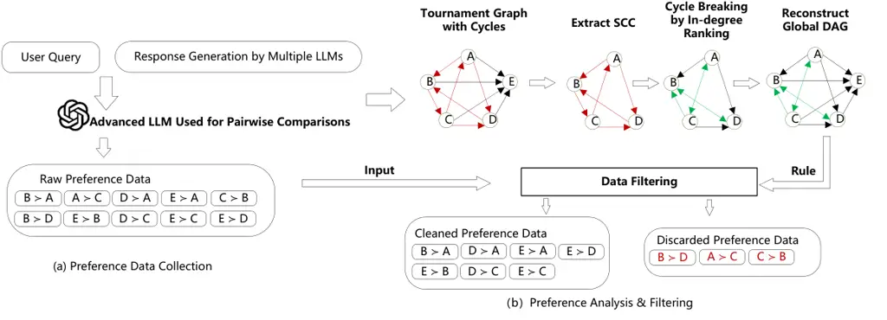

# ELSPR: Evaluator LLM Training Data Self-Purification on Non-Transitive Preferences via Tournament Graph Reconstruction

Yan Yu    Yilun Liu ^(†)^(†)thanks: 🖂˜ Corresponding author.    Minggui
He    Shimin Tao    Weibin Meng    Xinhua Yang    Li Zhang    Hongxia Ma
   Dengye Li    Daimeng Wei    Boxing Chen    Fuliang Li

###### Abstract

Pairwise evaluation of large language models (LLMs) has become the
dominant paradigm for benchmarking open-ended tasks, yet non-transitive
preferences—where evaluators prefer A over B, B over C, but C over
A—fundamentally undermine ranking reliability. We show that this
critical issue stems largely from low-quality data that contains
inherently ambiguous preference pairs. To address this challenge, we
propose ELSPR, a principled graph-theoretic framework that models
pairwise preferences as tournament graphs and systematically identifies
problematic training data. ELSPR quantifies non-transitivity through
strongly connected components (SCCs) analysis and measures overall
preference clarity using a novel normalized directed graph structural
entropy metric. Our filtering methodology selectively removes preference
data that induce non-transitivity while preserving transitive
preferences. Extensive experiments on the AlpacaEval benchmark
demonstrate that models fine-tuned on ELSPR-filtered data achieve
substantial improvements: a 13.8% reduction in non-transitivity, a 0.088
decrease in structural entropy, and significantly enhanced
discriminative power in real-world evaluation systems. Human validation
confirms that discarded data exhibit dramatically lower inter-annotator
agreement (34.4% vs. 52.6%) and model-human consistency (51.2% vs.
80.6%) compared to cleaned data. These findings establish ELSPR as an
effective data self-purification approach for developing more robust,
consistent, and human-aligned LLM evaluation systems.

¹Northeastern University, Shenyang, China

²Huawei, Beijing, China

³Tongji University, Shanghai, China

⁴Huawei Canada, Montreal, Canada

🖂 liuyilun3@huawei.com, lifuliang@cse.neu.edu.cn

Code & Datasets — https://github.com/yy0525/ELSPR

## 1 Introduction

With the rapid advancement of large language model (LLM; OpenAI et al.
2024; Qwen Team 2025; Meta AI 2024) technology, an increasing number of
models have become available, making it essential to evaluate their
capabilities for selecting the most suitable one. However, existing
benchmarks such as MMLU (Hendrycks et al. 2020) and HELM (Liang et al. 2022) have been shown to be insufficient for capturing performance
differences in open-ended tasks (Zheng et al. 2024).

Given the lack of definitive answers in open-ended tasks, human expert
evaluation is considered the gold standard. Yet, due to its high cost
and limited scalability, the mainstream approach has shifted toward
using LLM-as-a-Judge for efficient evaluation. Recent studies have
demonstrated that powerful LLMs, such as GPT-4, can achieve high
consistency with human judgments (Zheng et al. 2024; Dubois et al.
2023). Among various approaches, pairwise comparison has emerged as the
dominant paradigm, due to its strong alignment with human
preferences (Samvelyan et al. 2024; Chen et al. 2024a; Li et al. 2023;
Chiang et al. 2024; Liu et al. 2024; Liusie et al. 2024).

Despite these promising results, LLM-as-a-Judge still suffers from
various biases—such as position, verbosity, conformity, selection, and
self-reinforcement bias—which compromise evaluation reliability (Xu et
al. 2024; Zheng et al. 2024; Koo et al. 2024; Ye et al. 2025; Wei et al.
2024; Choi et al. 2025). A particularly underexplored yet critical issue
is the non-transitivity of preferences generated by evaluator LLMs
(e.g., $`A\succ B`$, $`B\succ C`$, $`C\succ A`$), where $`\succ`$
denotes “is preferred to”; that is, $`A\succ B`$ means $`A`$ is
preferred over $`B`$. An illustration is provided in Figure 1. Recent
research (Xu et al. 2025) analyzed inconsistencies in the GPT-4
evaluation outcomes when conducting pairwise comparisons between
different baseline models. Building on the widely adopted AlpacaEval
framework, their findings indicate that preference non-transitivity
significantly undermines the robustness of evaluation systems, leading
to inconsistent model rankings under various baselines and thereby
compromising the reliability of LLM-based evaluators. However, their
analysis is limited to observing preference non-transitivity within
triplets of samples and does not extend to larger sample sets. Moreover,
they do not propose an effective method to substantially reduce the
degree of non-transitivity exhibited by evaluator LLMs. These
limitations highlight the need for more comprehensive investigations,
particularly with larger sample sets, to further explore preference
non-transitivity within LLM-based evaluation frameworks.

Worryingly, this issue is also inherited by specialized evaluators such
as JudgeLM, PandaLM, and Auto-J (Zhu et al. 2025; Wang et al. 2024b; Li
et al. 2024a), which are trained through the distillation of knowledge
from advanced models. The distillation process may inadvertently
propagate non-transitive judgment patterns to downstream evaluators.

We hypothesize that the presence of low-quality training data may impair
the transitivity of the preferences generated by the evaluator LLM. Many
pairwise comparisons, particularly those from open-ended tasks, lack
definitive ground truth due to their inherent subjectivity. Human
annotators frequently demonstrate significant disagreement, with
empirical studies reporting inter-annotator agreement rates as low as
65.7% (Li et al. 2023), indicating that such tasks fundamentally lack
universally accepted preference orderings. Consequently, training models
with ambiguous and low-quality training data may introduce or exacerbate
non-transitive preference relationships, undermining the development of
stable and reliable evaluator LLMs. This phenomenon underscores the
critical necessity of implementing robust filtering mechanisms to
eliminate unreliable data points prior to model training.

In this paper, we present a novel graph-theoretic approach to assess and
mitigate preference non-transitivity in evaluator LLMs. Our method,
ELSPR, formulates multi-response pairwise comparisons as tournament
graphs and systematically filters preference data that induce to overall
preference non-transitivity. To quantify preference clarity, we
introduce a new metric based on two-dimensional structural entropy of
directed graphs. Experimental results demonstrate that models fine-tuned
on cleaned data reduce preference non-transitivity by 13.78% and
structural entropy by 0.0879, while achieving more robust rankings in
real-world evaluation systems, as evidenced by increased standard
deviations in MT-bench evaluation framework metrics. Human evaluation
studies further validate our approach, confirming that data inducing to
overall preference non-transitivity correlates with low inter-annotator
agreement among human evaluators and poor alignment between LLM
evaluations and human majority votes. These findings underscore ELSPR’s
effectiveness in developing more reliable evaluation systems for LLMs.
Specifically, our contributions are:

- •
  We introduce a graph-theoretic approach to systematically study the
  non-transitivity problem in preference data generated by evaluator
  LLM, reveal significant non-transitivity, and propose a
  two-dimensional structural entropy to quantify preference clarity.
- •
  We propose a robust filtering methodology leveraging tournament graph
  theory to systematically identify and eliminate preference data that
  induce non-transitivity in evaluator LLMs. Our experimental results
  demonstrate that this approach significantly reduces preference
  non-transitivity, decreases structural entropy, and substantially
  enhances the evaluation robustness of the resulting models when
  deployed in real-world evaluation systems.
- •
  We empirically demonstrate through human evaluation that data causing
  preference non-transitivity is inherently ambiguous and low-quality,
  with significantly lower inter-annotator agreement (34.4% vs. 52.6%)
  and lower consistency between evaluator LLM assessments and human
  majority votes (51.2% vs. 80.6%).

Figure 1: Non-Transitive Preferences in LLM-as-a-Judge for Pairwise
Comparisons (e.g., $`A\succ B`$, $`B\succ C`$, $`C\succ A`$).

## 2 Related Work

### 2.1 LLM-as-a-Judge and Its Non-Transitive Preferences

The prevailing LLM-as-a-Judge paradigm operates primarily through
pairwise comparisons, as evidenced in established frameworks such as
VicunaEval, AlpacaEval, and Arena-Hard (Chiang et al. 2023; Li et al.
2023; Li et al. 2024b). These systems collect responses generated by
various LLMs for a given set of questions and then employ advanced LLMs
as judges to determine preference orders between response pairs, thus
evaluating the relative performance of different models. Recent studies
demonstrate that even advanced models such as GPT-4 exhibit significant
preference non-transitivity when used in evaluation systems,
substantially undermining the reliability of evaluation outcomes.
Despite systematic exploration of six distinct prompt templates,
improvements in mitigating preference non-transitivity remain
limited (Xu et al. 2025). This issue extends to Reinforcement Learning
from Human Feedback (RLHF), where non-transitive preferences
significantly impair performance. Recent research suggests that this
non-transitivity can hinder the learning algorithm from stably
converging to the global optimum, leading to preference cycles and thus
hindering the effective utilization of preference data (Zhou et al.
2025).

To address this critical challenge, we systematically investigate the
underlying conditions that generate non-transitivity in LLM-as-a-Judge
systems and introduce a novel methodology to mitigate such
inconsistencies.



Figure 2: ELSPR (Evaluator LLM training data Self-purification
non-transitive Preferences via tournament graph Reconstruction)
framework overview. (a) Raw preference data is collected via pairwise
comparisons conducted by an advanced LLM. (b) The core analysis and
filtering process: The raw data is first modeled as a tournament graph
to identify cycles within SCCs. These cycles are then broken by
reconstructing each SCC into a DAG based on in-degree ranking. The final
global DAG serves as a rule to filter the initial raw data, separating
it into a cleaned, transitively consistent training set and a discarded
set of non-transitive preferences.

### 2.2 Data Selection for LLM Fine-tuning

Previous research (Chen et al. 2024b; Ge et al. 2024; Li et al. 2024c)
has established that extracting high-quality subsets from synthetic
training sets is crucial for effective fine-tuning. This approach not
only enhances the performance of the model, but also substantially
reduces the computational requirements. However, this strategy remains
underexplored in the domain of LLM-as-a-Judge. Existing methodologies
predominantly focus on scaling model architectures or refining
engineering techniques, while neglecting the potential benefits of
optimizing training data quality.

## 3 Methodology

This section presents a graph-theoretic analysis method using tournament
graphs to analyze pairwise preferences from evaluator LLMs. The method
introduces quality analysis criteria for training data, including
non-transitivity detection via strongly connected components (SCCs) and
preference clarity analysis via graph entropy. Additionally, a data
filtering method is proposed to mitigate non-transitive preferences.
Figure 2 outlines the overall framework, with implementation details
provided in the following subsections.

### 3.1 Background

Modeling preferences generated by LLM as a tournament graph. For each
question $`q_{i}\in Q`$, given the response set
$`A_{i}=\{a_{1},a_{2},...,a_{n}\}`$ from $`n`$ LLMs, we construct a
tournament graph $`G_{i}=(V_{i},E_{i})`$ through the following
procedure: vertices: set $`V_{i}=\{v_{1},v_{2},...,v_{n}\}`$ corresponds
to responses $`A_{i}=\{a_{1},a_{2},...,a_{n}\}`$. Edges: Defined by
preferences generated by evaluator LLM:

```math
\displaystyle E_{i}=\bigcup_{\begin{subarray}{c}1\leq j,k\leq n\\
j\neq k\end{subarray}}\begin{cases}v_{k}\rightarrow v_{j},&\begin{aligned} \text{if }\mathcal{J}(a_{j},a_{k})=\text{`win'}\\
\text{ and }\mathcal{J}(a_{k},a_{j})=\text{`lose'}\end{aligned}\\[10.00002pt]
v_{j}\rightarrow v_{k},&\begin{aligned} \text{if }\mathcal{J}(a_{j},a_{k})=\text{`lose'}\\
\text{ and }\mathcal{J}(a_{k},a_{j})=\text{`win'}\end{aligned}\\[10.00002pt]
v_{j}\leftrightarrow v_{k},&\text{otherwise}\end{cases} \tag{1}
```

Here, $`\mathcal{J}(a_{j},a_{k})\in\{\text{`win'},\text{`lose'}\}`$
denotes the pairwise comparison result between answers $`a_{j}`$ and
$`a_{k}`$, where $`a_{j}`$ appears before $`a_{k}`$ in the prompt.

Considering the common position bias in evaluator LLMs (Wang et al.
2024a), we apply position swapping by comparing each response pair in
both orders: $`\mathcal{J}(a_{j},a_{k})`$ and
$`\mathcal{J}(a_{k},a_{j})`$. This ensures a more robust and balanced
assessment (Zheng et al. 2024). If the preferences differ across
orders—indicating possible position bias—a bidirectional edge is added
between the corresponding vertices to represent a ‘tie’.

### 3.2 Quality Analysis Framework for Evaluator LLM Training Data

We introduce a framework for analyzing evaluator LLM training data
quality. Leveraging directed graph representations of preference
tournaments, the framework introduces two metrics: SCC analysis
quantifying preference non-transitivity and two-dimensional structural
entropy measuring preference clarity.

Quantifying preference non-transitivity via SCC analysis. SCCs are
maximal subgraphs where any two vertices are mutually reachable through
directed paths. This property provides a natural mechanism for
identifying preference cycles—a direct manifestation of non-transitivity
in evaluator LLM judgments. When vertex $`v_{i}`$ can reach vertex
$`v_{j}`$ via a directed path, this indicates a preference chain
$`a_{j}\succ\cdot\succ a_{i}`$. The simultaneous existence of paths from
$`v_{i}`$ to $`v_{j}`$ and from $`v_{j}`$ to $`v_{i}`$ represents
contradictory preference relationships, signaling a violation of
transitivity.

We employ Tarjan’s algorithm (Tarjan 1972) to efficiently identify SCCs
in our directed graphs. Tarjan’s algorithm operates in linear time,
specifically $`\mathcal{O}(|V|+|E|)`$, where $`|V|`$ and $`|E|`$ denote
the number of vertices and edges, respectively, ensuring scalability to
large graphs. Since non-transitivity requires at least three elements in
a cycle, we focus on SCCs containing more than two vertices.
Additionally, we exclude cases where every vertex pair shares
bidirectional edges (indicating ‘tie’), as these represent consistent
preference relations. For example, the pattern $`(A=B)`$, $`(B=C)`$,
$`(C=A)`$ constitutes a valid SCC but maintains transitive preference
relationships. Formally, we identify the set of non-transitive SCCs as:

```math
\mathcal{S}_{\text{n-t}}=\left\{S\in\text{SCCs}(G)\,\middle|\,\begin{aligned} |S|>2\land\exists v_{j},v_{k}\in S,\\
(v_{j}\leftrightarrow v_{k})\notin E(S)\end{aligned}\right\}, \tag{2}
```

where $`\text{SCCs}(G)`$ represents all SCC in graph $`G`$, $`|S|`$
denotes the component size, and
$`(v_{j}\leftrightarrow v_{k})\notin E(S)`$ indicates the absence of
bidirectional edges between some vertices.

To quantify the prevalence of non-transitivity across our entire
training set, we compute the non-transitivity ratio:

```math
\rho_{\text{non-trans}}=\frac{\sum_{q_{i}\in\mathbf{Q}}|S_{\text{n-t}}(G_{i})|}{\sum_{q_{i}\in\mathbf{Q}}|V_{i}|}, \tag{3}
```

where the numerator represents the total number of vertices in
non-transitive SCCs across all questions $`\mathbf{Q}`$, and the
denominator represents the total number of vertices across all graphs.
This metric ranges from 0 to 1, with higher values indicating greater
prevalence of non-transitive in the evaluator LLM’s preferences. A
perfectly transitive preference system would yield
$`\rho_{\text{non-trans}}=0`$, while completely cyclical preferences
would approach $`\rho_{\text{non-trans}}=1`$.

Analysis of preference clarity based the structural entropy of directed
graph. While the SCC-based approach effectively quantifies preference
non-transitivity, this metric alone is insufficient to characterize
preference linearity. For instance, a dataset comprised entirely of
preference ‘tie’ would exhibit perfect transitivity yet fail to
establish any linear ordering. To address this limitation, we introduce
directed graph entropy as a complementary measurement. Structural
entropy (Li and Pan 2016) extends Shannon entropy (Shannon 1948) to
directed graphs, providing a measure of system uncertainty and the
complexity of relationships within the graph. These concepts have been
widely applied across various domains  (Zou et al. 2024; Duan et al.
2024; Peng et al. 2024; Hou et al. 2025). We introduce and refine the
two-dimensional structural entropy metric for directed graphs to analyze
the overall clarity of preferences in evaluator LLMs.

A crucial observation drives our methodology is that SCCs composed of
single vertices inherently exhibit strict transitivity. Preference
relations among such singleton components naturally form a linear order
that does not increase preference complexity. For example, consider
preferences $`A\succ B`$, $`B\succ C`$, and $`A\succ C`$. These form a
clear linear order $`A\succ B\succ C`$, where each vertex constitutes
its own singleton SCC. This clarity reflects the inherent transitivity
of singleton SCCs. Based on this insight, we adopt SCCs as the basic
community units when calculating structural entropy. To ensure accurate
quantification of meaningful structural complexity, we exclude
interactions between pure single-point SCCs. Instead, we retain only
interactions between singleton SCCs and multi-vertex SCCs, as well as
interactions between different multi-vertex SCCs. This selective
approach ensures more accurate quantification of meaningful structural
complexity. Consequently, preference relations closer to a linear order
produce lower entropy values.

Figure 3: Cases of High and Low Structural Entropy in Preference
Tournaments.

Figure 3 illustrates two contrasting scenarios that provide an intuitive
explanation of the two-dimensional structural entropy in tournament
graph preference relations. Figure 3 (a) depicts a high entropy case
with a chaotic tournament containing multiple preference cycles
resulting in complex non-transitive relationships. In contrast, Figure 3
(b) shows a low entropy case with a perfectly ordered tournament where
responses form a clear linear hierarchy, producing a simple transitive
structure.

Given a directed graph $`G=(V,E)`$ with $`n=|V|`$ vertices, we perform
SCC decomposition resulting in
$`\text{SCCs}(G)=\{SCC_{1},SCC_{2},\ldots,SCC_{L}\}`$, where $`L`$ is
the total number of SCCs. For any vertex $`v\in V`$, we denote
$`d_{\text{in}}(v)`$ and $`d_{\text{out}}(v)`$ as the in-degree and
out-degree of $`v`$ in $`G`$. For any $`SCC_{i}`$, we define its volume
as $`v(SCC_{i})=\sum_{v\in SCC_{i}}d_{\text{in}}(v)`$, while $`v(G)`$
represents the total in-degree of the entire graph.

The two-dimensional structural entropy is computed as:

```math
\displaystyle H^{2}(G) \displaystyle=-\sum_{j=1}^{L}\frac{g_{j}}{v(G)}\log_{2}\frac{v(SCC_{j})}{v(G)}
```

```math
\displaystyle-\sum_{j=1}^{L}\frac{v(SCC_{j})}{v(G)}\left(\sum_{v\in SCC_{j}}\frac{d_{\text{in}}(v)}{v(SCC_{j})}\log_{2}\frac{d_{\text{in}}(v)}{v(SCC_{j})}\right), \tag{4}
```

The first term captures the entropy of the partition (inter-community
complexity), while the second term captures the weighted average of
entropies within each SCC (intra-community complexity). The variable
$`g_{j}`$ represents the number of incoming edges to $`SCC_{j}`$ from
vertices outside this component, specifically counting edges between
singleton SCCs and multi-vertex SCCs, as well as edges between different
multi-vertex SCCs. This value quantifies the external influence on each
SCC and plays a crucial role in measuring cross-community complexity.

To facilitate meaningful comparisons across graphs of different sizes,
we normalize the structural entropy. The normalized structural entropy
for a graph $`G`$ is defined as:

```math
\tau(G)=\frac{H^{2}(G)}{\log_{2}n}. \tag{5}
```

Normalization is necessary since raw entropy increases with graph size.
Dividing by $`\log_{2}n`$ scales the entropy to a range between 0 and 1,
where values closer to 0 indicate more ordered structures approaching
linear hierarchy, while values closer to 1 suggest higher complexity and
less clear preference ordering. The upper bound $`\log_{2}n`$ represents
the maximum possible entropy for a graph with $`n`$ vertices,
corresponding to a completely uniform distribution of structural
information. To evaluate the overall preference clarity of an evaluator
LLM across a set of questions $`\mathbf{Q}`$, we compute the average
normalized structural entropy:

```math
\tau_{\text{avg}}=\frac{\sum_{q_{i}\in\mathbf{Q}}\tau(G_{i})}{|\mathbf{Q}|}, \tag{6}
```

Here, $`\tau(G_{i})`$ is the normalized structural entropy for the graph
$`G_{i}`$ corresponding to question $`q_{i}`$, and $`|\mathbf{Q}|`$ is
the total number of questions in the set $`\mathbf{Q}`$.

The $`\tau_{\text{avg}}`$ metric quantifies preference clarity: higher
values indicate complex, non-transitive patterns, while lower values
reflect relationships closer to linear order. It enables objective
assessment of consistency across evaluator LLMs, where lower entropy
denotes more coherent and interpretable preferences.

### 3.3 Filtering Strategy for Preference Data That Induce Non-Transitivity

If cycles within each SCC of a directed graph can be eliminated to form
DAGs, the entire graph can be transformed into a DAG. Our framework
leverages this property by converting each SCC into a DAG while
preserving inter-SCC preference relations, ensuring global acyclicity
without altering component relationships. From the resulting DAG, we
derive transitive preference relations to filter evaluator LLMs’
preference data, enabling training data self-purification. The procedure
is:

1.  1.  For each $`SCC_{i}`$ compute the in-degree $`e_{i}^{\text{in}}`$ for
        each vertex $`v_{i}`$, representing its global ‘win’ score. Vertices
        with higher in-degree scores are prioritized over those with lower
        scores. To reconstruct the internal edges within $`SCC_{i}`$, first
        remove all original edges between vertices within $`SCC_{i}`$. Then,
        for any pair $`v_{i},v_{j}`$: if
        $`e_{i}^{\text{in}}>e_{j}^{\text{in}}`$, add a directed edge
        $`v_{j}\rightarrow v_{i}`$; if
        $`e_{i}^{\text{in}}=e_{j}^{\text{in}}`$, add a bidirectional edge
        $`v_{i}\leftrightarrow v_{j}`$.
2.  2.  After processing all SCCs, the original cyclic graph is transformed
        into a DAG. This DAG is used to filter the training data as follows:
        For bidirectional edges $`(v_{i}\leftrightarrow v_{j})`$, the
        correct preferences are recorded as
        $`\mathcal{J}(a_{i},a_{j})=\text{`tie'}`$ and
        $`\mathcal{J}(a_{j},a_{i})=\text{`tie'}`$. For unidirectional edges
        $`(v_{i}\rightarrow v_{j})`$, the correct preferences are recorded
        as $`\mathcal{J}(a_{i},a_{j})=\text{`lose'}`$ and
        $`\mathcal{J}(a_{j},a_{i})=\text{`win'}`$.
3.  3.  The training data are traversed sequentially. All instances that are
        consistent with the correct preferences are added to the training
        set “Cleaned”, while the remaining data are placed in the training
        set “Discarded”.

The final “Cleaned” training data only retains linearly transitive
preference data, resulting in $`\rho_{\text{non-trans}}=0`$ and
$`\tau_{\text{avg}}=0`$. Our approach balances optimality and
scalability, with an overall time complexity of
$`\mathcal{O}(|V|^{2}+|E|)`$, consisting of $`\mathcal{O}(|V|^{2})`$ for
graph construction, $`\mathcal{O}(|V|+|E|)`$ for SCC decomposition,
$`\mathcal{O}(|V|^{2})`$ for intra-SCC reconstruction, and
$`\mathcal{O}(|E|)`$ for edge filtering. The detailed algorithmic
procedure is provided in Appendix A.

## 4 Experiment Setup

|                          |                                          |                                    |                                          |                                    |                                          |                                    |                                          |                                    |                                          |                                    |
| ------------------------ | ---------------------------------------- | ---------------------------------- | ---------------------------------------- | ---------------------------------- | ---------------------------------------- | ---------------------------------- | ---------------------------------------- | ---------------------------------- | ---------------------------------------- | ---------------------------------- |
| Model                    | Helpful_Base                             |                                    | Vicuna                                   |                                    | Oasst                                    |                                    | Koala                                    |                                    | Self-instruct                            |                                    |
|                          | $`\rho_{\text{non-trans}}^{\downarrow}`$ | $`\tau_{\text{avg}}^{\downarrow}`$ | $`\rho_{\text{non-trans}}^{\downarrow}`$ | $`\tau_{\text{avg}}^{\downarrow}`$ | $`\rho_{\text{non-trans}}^{\downarrow}`$ | $`\tau_{\text{avg}}^{\downarrow}`$ | $`\rho_{\text{non-trans}}^{\downarrow}`$ | $`\tau_{\text{avg}}^{\downarrow}`$ | $`\rho_{\text{non-trans}}^{\downarrow}`$ | $`\tau_{\text{avg}}^{\downarrow}`$ |
| Stronger LLMs            |                                          |                                    |                                          |                                    |                                          |                                    |                                          |                                    |                                          |                                    |
| Qwen2.5-Max              | 63.7%                                    | 0.805                              | 75.4%                                    | 0.845                              | 64.3%                                    | 0.788                              | 71.5%                                    | 0.830                              | 65.0%                                    | 0.780                              |
| Base models and Variants |                                          |                                    |                                          |                                    |                                          |                                    |                                          |                                    |                                          |                                    |
| Qwen-Base                | 82.8%                                    | 0.922                              | 78.9%                                    | 0.891                              | 83.4%                                    | 0.914                              | 81.0%                                    | 0.910                              | 81.5%                                    | 0.912                              |
| Qwen-Raw                 | 62.0%                                    | 0.796                              | 57.5%                                    | 0.803                              | 55.8%                                    | 0.773                              | 64.3%                                    | 0.816                              | 59.7%                                    | 0.767                              |
| Qwen-Random              | 60.6%                                    | 0.790                              | 63.6%                                    | 0.808                              | 58.8%                                    | 0.771                              | 60.4%                                    | 0.812                              | 57.1%                                    | 0.764                              |
| Qwen-Cleaned (ours)      | 44.9%                                    | 0.700                              | 43.9%                                    | 0.726                              | 47.0%                                    | 0.694                              | 48.5%                                    | 0.715                              | 49.0%                                    | 0.680                              |
| LLaMA-Base               | 76.4%                                    | 0.852                              | 67.0%                                    | 0.846                              | 67.4%                                    | 0.793                              | 69.9%                                    | 0.818                              | 71.0%                                    | 0.809                              |
| LLaMA-Raw                | 59.0%                                    | 0.765                              | 60.2%                                    | 0.772                              | 58.2%                                    | 0.760                              | 57.2%                                    | 0.746                              | 60.0%                                    | 0.783                              |
| LLaMA-Cleaned (ours)     | 40.2%                                    | 0.652                              | 45.4%                                    | 0.691                              | 43.0%                                    | 0.629                              | 44.4%                                    | 0.659                              | 42.0%                                    | 0.642                              |

Table 1: Comparison of Preference Non-Transitivity and Overall Clarity
for evaluator LLMs. Qwen-Base denotes to the original
Qwen2.5-7B-Instruct model, while Qwen-Raw, Qwen-Random, and Qwen-Cleaned
denote models fine-tuned on the “Raw”, “Random”, and “Cleaned” training
sets, respectively. For example, Qwen-Cleaned in the Helpful_Base column
reflects the performance of the model fine-tuned on the ”Cleaned”
training set derived from filtered Helpful_Base training set.

### 4.1 Dataset

In this study, we conduct experimental validation using the AlpacaEval
benchmark (Li et al. 2023). AlpacaEval is specifically designed to
assess the overall capabilities of LLMs in open-ended tasks, covering a
wide range of evaluation scenarios such as reasoning and text and code
generation. The benchmark comprises five datasets, Helpful_Base, Oasst,
Koala, Vicuna, and Self-Instruct.

### 4.2 Preference Data Collection

We evaluated Qwen2.5-Max (Qwen Team 2025) on 2.5k human-annotated
samples from AlpacaEval using the chain-of-thought (COT) comparison (Li
et al. 2023). Qwen2.5-Max achieved a human agreement rate of 68.9%.
Based on these results, we selected it as our teacher model for
preference data generation.

### 4.3 Experiment Details

21 representative LLMs were selected from the AlpacaEval leaderboard (14
for training, 7 for testing). All experiments employed CoT comparison
templates with temperature set to 0, and preferences were generated via
the Qwen2.5-Max API. The unfiltered “Raw” datasets were processed
according to the procedure described in Section 3.3 to produce “Cleaned”
training sets; the corresponding distributions are illustrated in
Figure 4. Qwen2.5-7B-Instruct was fine-tuned on both versions of each of
the five datasets using LoRA (Hu et al. 2022) (rank $`=8`$, 3 epochs,
learning rate $`=1\times 10^{-4}`$, batch size $`=16`$).

Figure 4: Comparison of data volumes between “Raw” and “Cleaned”
training sets across datasets. The “Cleaned” training set’s volume is
approximately 80% of the “Raw” training set for each dataset.

## 5 Results and Analysis

This section verifies the effectiveness of the proposed filtering method
on five datasets. The analysis begins with an examination of preference
non-transitivity degree and overall preference clarity of evaluator
LLMs. To further demonstrate the method’s effectiveness, experiments
based on actual usage scenarios are conducted using the MT-bench
evaluation framework to calculate the standard deviation between final
results. Additionally, a detailed data quality analysis examines two key
aspects of manual evaluation: (1) consistency between manual annotators,
and (2) consistency between evaluation results and human majority vote.

### 5.1 Main Results

Analysis of preference non-transitivity and clarity. As shown in
Table 1, models fine-tuned on the “Cleaned” training set demonstrate the
lowest preference non-transitivity and highest preference clarity across
all datasets, including Qwen2.5-Max, highlighting the effectiveness of
our proposed data filtering methodology. To verify that models
fine-tuned on the “Cleaned” training set achieve lower preference
non-transitivity and higher preference clarity even on “unseen”
questions, we conducted cross-validation as our out-of-domain experiment
by testing each fine-tuned model across five test sets. As demonstrated
in Table 2, models fine-tuned on “Cleaned” training set exhibited an
average reduction in non-transitivity of 13.8% compared to those trained
on “Raw” training set. Table 3 shows a reduction of 0.088 in normalized
structural entropy, indicating clearer overall preferences. Detailed
results are in Appendix B.

| Dataset       | Raw   | Cleaned | $`\Delta`$ |
| ------------- | ----- | ------- | ---------- |
| Helpful_Base  | 66.0% | 50.3%   | -15.7%     |
| Vicuna        | 61.6% | 51.0%   | -10.6%     |
| Oasst         | 62.6% | 48.7%   | -13.9%     |
| Koala         | 64.1% | 48.7%   | -15.4%     |
| Self-instruct | 67.2% | 53.8%   | -13.4%     |
| Average       | 64.3% | 50.5%   | -13.8%     |

Table 2: Comparison of $`\rho_{\text{non-trans}}`$ (average preference
non-transitivity) between models fine-tuned on “Raw” and “Cleaned”
training sets using Qwen2.5-7B-Instruct.

| Dataset       | Raw   | Cleaned | $`\Delta`$ |
| ------------- | ----- | ------- | ---------- |
| Helpful_Base  | 0.820 | 0.717   | -0.103     |
| Vicuna        | 0.806 | 0.737   | -0.069     |
| Oasst         | 0.797 | 0.710   | -0.087     |
| Koala         | 0.804 | 0.718   | -0.086     |
| Self-instruct | 0.829 | 0.735   | -0.094     |
| Average       | 0.811 | 0.723   | -0.088     |

Table 3: Comparison of $`\tau_{\text{avg}}`$ (average preference
clarity) between models fine-tuned on “Raw” and “Cleaned” training sets
using Qwen2.5-7B-Instruct.

Human validation of discarded data quality. To verify the low quality of
discarded data, we evaluated 100 randomly sampled instances from both
“Cleaned” and “Discarded” sets across five datasets (1,000 total
instances). Three independent annotators assessed these samples,
enabling measurement of inter-annotator consistency and model-human
alignment. Results in Table 4 indicate that human annotator consistency
in the “Discard” training set averages only 34.4%, significantly lower
than the 52.6% observed in the “Cleaned” training set. This confirms
that data leading to non-transitive preferences is inherently ambiguous.
Furthermore, model evaluation reveals that consistency between the
“Discarded” training set and human majority votes averages merely 51.2%,
substantially below the 80.6% achieved by the “Cleaned” training set.
These findings provide compelling evidence that the “Discarded” training
set contains low-quality preference pairs unsuitable for training models
to learn consensus human preferences.

For deeper insight into non-transitive preferences, we observed that
source response pairs exhibiting non-transitivity demonstrate higher
textual similarity. This observation suggests that preference cycles are
likely to occur when the quality difference between source responses
falls below the just noticeable difference (JND) (Stern and Johnson 2010) threshold of the evaluator LLM. As shown in Table 5, we quantified
content similarity between response pairs by calculating Self-Bleu
scores. Source response pairs with non-transitive preference relations
consistently displayed higher Self-Bleu values than those with
transitive relations, confirming that preference non-transitivity
correlates with greater text similarity between comparative samples.

|         | HC      |           | MHA     |           |
| ------- | ------- | --------- | ------- | --------- |
| Dataset | Cleaned | Discarded | Cleaned | Discarded |
| Help.   | 59%     | 46%       | 72%     | 45%       |
| Vicuna  | 48%     | 24%       | 78%     | 47%       |
| Oasst   | 56%     | 33%       | 83%     | 53%       |
| Koala   | 54%     | 41%       | 84%     | 61%       |
| Self.   | 46%     | 28%       | 86%     | 50%       |
| Average | 52.6%   | 34.4%     | 80.6%   | 51.2%     |

Table 4: Comparison of Human Evaluation Consistency and Model-Human
Agreement between training sets. HC: Human Consistency (inter-annotator
consensus); MHA: Model-Human Agreement (alignment with majority vote).
Help. = Helpful_Base; Self. = Self-instruct.

| Pref.  | Helpful. | Vicuna | Oasst  | Koala  | Self.  |
| ------ | -------- | ------ | ------ | ------ | ------ |
| Non.   | 0.0903   | 0.1026 | 0.0946 | 0.0888 | 0.1135 |
| Trans. | 0.0713   | 0.0918 | 0.0788 | 0.0746 | 0.0829 |

Table 5: Comparison of source text pair Self-Bleu scores across
datasets. Non. and Trans. indicate source pairs from non-transitive and
transitive preferences; Helpful. = Helpful_Base; Self. = Self-instruct.

Performance analysis of real-world evaluation systems. We compared the
performance of our trained evaluator LLMs within the MT-bench evaluation
framework (Zheng et al. 2024). We adopted the adjusted win rate
calculation consistent with the MT-bench evaluation methodology. This
metric normalizes performance by treating ties as partial wins, defined
as $`r_{\text{adj}}=(r_{w}+0.5\cdot r_{t})/(r_{w}+r_{l}+r_{t})`$, where
$`r_{w}`$, $`r_{l}`$, and $`r_{t}`$ represent the win rate, loss rate,
and tie rate respectively. The adjusted rate $`r_{\text{adj}}`$ serves
as the primary indicator for our model ranking. Results in Table 6
demonstrate that models fine-tuned on the “Cleaned” training sets
exhibit significantly higher standard deviations in their adjusted win
rates across five datasets. This indicates enhanced robustness of the
evaluation results and better differentiation of performance differences
between models.

| Dataset    | Help. | Vicu. | Oasst | Koala | Self. |
| ---------- | ----- | ----- | ----- | ----- | ----- |
| Cleaned    | 16.1% | 16.6% | 13.1% | 14.9% | 9.7%  |
| Raw        | 12.2% | 13.6% | 11.0% | 12.3% | 8.2%  |
| $`\Delta`$ | +3.9% | +3.0% | +2.1% | +2.6% | +1.5% |

Table 6: Standard deviation analysis. Help. = Helpful_Base; Vicu. =
Vicuna; Self. = Self-instruct.

|               | MHA   |         | SC   |         |
| ------------- | ----- | ------- | ---- | ------- |
| Dataset       | Raw   | Cleaned | Raw  | Cleaned |
| Helpful_base  | 66.9% | 66.9%   | 0.93 | 0.97    |
| Vicuna        | 65.2% | 65.8%   | 0.97 | 0.98    |
| Oasst         | 66.4% | 67.6%   | 0.93 | 0.93    |
| Koala         | 66.4% | 66.9%   | 0.98 | 0.98    |
| Self-instruct | 67.8% | 68.3%   | 0.98 | 1.00    |
| Average       | 66.5% | 67.1%   | 0.96 | 0.97    |

Table 7: Comparison of Model-Human Agreement (MHA) and Spearman
Correlation (SC) between fine-tuned models. Spearman Correlation
quantifies the rank correlation between model and human preferences.

Analysis of human agreement impact. The model’s alignment with human
preferences was evaluated by calculating agreement rates and Spearman
correlation coefficients on 2.5k manually annotated preference labels
from AlpacaEval. Results in Table 7 indicate that models fine-tuned on
the “Cleaned” training set consistently outperformed those trained on
“Raw” training set across multiple dataset, with maximum improvements of
1.2% in human agreement and 0.04 in Spearman correlation. These results
demonstrate that filtering ambiguous, low-quality preference data not
only improves discrimination and enhances the performance of downstream
evaluation systems but also increases consistency with human judgment,
providing strong evidence for practical applications.

### 5.2 Ablation Studies

Effect of Different Base Models: Testing using the same steps with
LLaMA3.1-8B-Instruct confirms our findings: models trained on the
“Cleaned” training set consistently outperformed those trained on the
“Raw” training set (Table 1). Data Filtering Analysis: Our “Cleaned” set
retained approximately 80% of the raw data (Figure 4). A control
experiment with random 20% filtering (Qwen-Random) produced results
similar to training on the “Raw” set but with higher preference
non-transitivity, confirming that our targeted approach improves data
quality beyond simple reduction (Table 1). Prompt Format Variations:
Additional experiments with prompts explicitly allowing “tie” judgments
further validated our methodology. Detailed prompt templates and results
are provided in Appendices B and C.

## 6 Conclusion

We propose ELSPR, a graph-theoretic framework to analyze and mitigate
non-transitivity in evaluator LLMs by modeling pairwise comparisons as a
tournament graph and filtering problematic data. Ambiguous, low-quality
preferences are a major source of non-transitive judgments, and targeted
filtering improves evaluation reliability. Empirical results show that
filtered data aligns better with human judgments and can fine-tune
models to reduce non-transitive bias and structural entropy. This work
underscores the importance of data quality and provides a scalable
approach to enhance consistency on future benchmarks.

## Acknowledgments

This work is supported by the National Natural Science Foundation of
China under Grant Nos. 62572105 and U22B2005; the Liaoning
Revitalization Talents Program under Grant No. XLYC2403086.

## References

- Chen et al. (2024a) G. H. Chen, S. Chen, Z. Liu, F. Jiang, and B. Wang
  Humans or LLMs as the judge? a study on judgement bias. In Proceedings
  of the 2024 Conference on Empirical Methods in Natural Language
  Processing, Y. Al-Onaizan, M. Bansal, and Y. Chen (Eds.), Miami,
  Florida, USA, pp. 8301–8327. External Links:
  [Link](https://aclanthology.org/2024.emnlp-main.474/),
  [Document](https://dx.doi.org/10.18653/v1/2024.emnlp-main.474) Cited
  by: §1.
- Chen et al. (2024b) L. Chen, S. Li, J. Yan, H. Wang, K. Gunaratna, V.
  Yadav, Z. Tang, V. Srinivasan, T. Zhou, H. Huang, and H. Jin
  AlpaGasus: training a better alpaca with fewer data. In The Twelfth
  International Conference on Learning Representations, External Links:
  [Link](https://openreview.net/forum?id=FdVXgSJhvz) Cited by: §2.2.
- Chiang et al. (2023) W. Chiang, Z. Li, Z. Lin, Y. Sheng, Z. Wu, H.
  Zhang, L. Zheng, S. Zhuang, Y. Zhuang, J. E. Gonzalez, I. Stoica,
  and E. P. Xing Vicuna: an open-source chatbot impressing gpt-4 with
  90%\* chatgpt quality. External Links:
  [Link](https://lmsys.org/blog/2023-03-30-vicuna/) Cited by: §2.1.
- Chiang et al. (2024) W. Chiang, L. Zheng, Y. Sheng, A. N.
  Angelopoulos, T. Li, D. Li, B. Zhu, H. Zhang, M. Jordan, J. E.
  Gonzalez, and I. Stoica Chatbot arena: an open platform for evaluating
  LLMs by human preference. In Forty-first International Conference on
  Machine Learning, External Links:
  [Link](https://openreview.net/forum?id=3MW8GKNyzI) Cited by: §1.
- Choi et al. (2025) H. K. Choi, W. Xu, C. Xue, S. Eckman, and C. K.
  Reddy Mitigating selection bias with node pruning and auxiliary
  options. In Proceedings of the 63rd Annual Meeting of the Association
  for Computational Linguistics (Volume 1: Long Papers), W. Che, J.
  Nabende, E. Shutova, and M. T. Pilehvar (Eds.), Vienna, Austria,
  pp. 5190–5215. External Links:
  [Link](https://aclanthology.org/2025.acl-long.259/), ISBN
  979-8-89176-251-0 Cited by: §1.
- Duan et al. (2024) L. Duan, X. Chen, W. Liu, D. Liu, K. Yue, and A. Li
  Structural entropy based graph structure learning for node
  classification. Proceedings of the AAAI Conference on Artificial
  Intelligence 38 (8), pp. 8372–8379. External Links:
  [Link](https://ojs.aaai.org/index.php/AAAI/article/view/28679),
  [Document](https://dx.doi.org/10.1609/aaai.v38i8.28679) Cited by:
  §3.2.
- Dubois et al. (2023) Y. Dubois, C. X. Li, R. Taori, T. Zhang, I.
  Gulrajani, J. Ba, C. Guestrin, P. S. Liang, and T. B. Hashimoto
  AlpacaFarm: a simulation framework for methods that learn from human
  feedback. In Advances in Neural Information Processing Systems, A.
  Oh, T. Naumann, A. Globerson, K. Saenko, M. Hardt, and S. Levine
  (Eds.), Vol. 36, pp. 30039–30069. External Links:
  [Link](https://proceedings.neurips.cc/paper_files/paper/2023/file/5fc47800ee5b30b8777fdd30abcaaf3b-Paper-Conference.pdf)
  Cited by: §1.
- Ge et al. (2024) Y. Ge, Y. Liu, C. Hu, W. Meng, S. Tao, X. Zhao, M.
  Xia, Z. Li, B. Chen, H. Yang, B. Li, T. Xiao, and J. Zhu Clustering
  and ranking: diversity-preserved instruction selection through
  expert-aligned quality estimation. In Proceedings of the 2024
  Conference on Empirical Methods in Natural Language Processing, Y.
  Al-Onaizan, M. Bansal, and Y. Chen (Eds.), Miami, Florida, USA,
  pp. 464–478. External Links:
  [Link](https://aclanthology.org/2024.emnlp-main.28/),
  [Document](https://dx.doi.org/10.18653/v1/2024.emnlp-main.28) Cited
  by: §2.2.
- Hendrycks et al. (2020) D. Hendrycks, C. Burns, S. Basart, A. Zou, M.
  Mazeika, D. Song, and J. Steinhardt Measuring massive multitask
  language understanding. arXiv preprint arXiv:2009.03300. Cited by: §1.
- Hou et al. (2025) Y. Hou, H. Zhu, R. Liu, Y. Su, J. Xia, J. Wu, and K.
  Xu Structural entropy guided unsupervised graph out-of-distribution
  detection. Proceedings of the AAAI Conference on Artificial
  Intelligence 39 (16), pp. 17258–17266. External Links:
  [Link](https://ojs.aaai.org/index.php/AAAI/article/view/33897),
  [Document](https://dx.doi.org/10.1609/aaai.v39i16.33897) Cited by:
  §3.2.
- Hu et al. (2022) E. J. Hu, Y. Shen, P. Wallis, Z. Allen-Zhu, Y. Li, S.
  Wang, L. Wang, and W. Chen LoRA: low-rank adaptation of large language
  models. In International Conference on Learning Representations,
  External Links: [Link](https://openreview.net/forum?id=nZeVKeeFYf9)
  Cited by: §4.3.
- Koo et al. (2024) R. Koo, M. Lee, V. Raheja, J. I. Park, Z. M. Kim,
  and D. Kang Benchmarking cognitive biases in large language models as
  evaluators. In Findings of the Association for Computational
  Linguistics: ACL 2024, L. Ku, A. Martins, and V. Srikumar (Eds.),
  Bangkok, Thailand, pp. 517–545. External Links:
  [Link](https://aclanthology.org/2024.findings-acl.29/),
  [Document](https://dx.doi.org/10.18653/v1/2024.findings-acl.29) Cited
  by: §1.
- Li and Pan (2016) A. Li and Y. Pan Structural information and
  dynamical complexity of networks. IEEE Transactions on Information
  Theory 62 (6), pp. 3290–3339. External Links:
  [Document](https://dx.doi.org/10.1109/TIT.2016.2555904) Cited by:
  §3.2.
- Li et al. (2024a) J. Li, S. Sun, W. Yuan, R. Fan, hai zhao, and P. Liu
  Generative judge for evaluating alignment. In The Twelfth
  International Conference on Learning Representations, External Links:
  [Link](https://openreview.net/forum?id=gtkFw6sZGS) Cited by: §1.
- Li et al. (2024b) T. Li, W. Chiang, E. Frick, L. Dunlap, T. Wu, B.
  Zhu, J. E. Gonzalez, and I. Stoica From crowdsourced data to
  high-quality benchmarks: arena-hard and benchbuilder pipeline. CoRR
  abs/2406.11939. External Links:
  [Link](https://doi.org/10.48550/arXiv.2406.11939) Cited by: §2.1.
- Li et al. (2023) X. Li, T. Zhang, Y. Dubois, R. Taori, I.
  Gulrajani, C. Guestrin, P. Liang, and T. B. Hashimoto AlpacaEval: an
  automatic evaluator of instruction-following models. GitHub. Note:
  https://github.com/tatsu-lab/alpaca˙eval Cited by: §1, §1, §2.1, §4.1,
  §4.2.
- Li et al. (2024c) Y. Li, B. Hui, X. Xia, J. Yang, M. Yang, L.
  Zhang, S. Si, L. Chen, J. Liu, T. Liu, F. Huang, and Y. Li One-shot
  learning as instruction data prospector for large language models. In
  Proceedings of the 62nd Annual Meeting of the Association for
  Computational Linguistics (Volume 1: Long Papers), L. Ku, A. Martins,
  and V. Srikumar (Eds.), Bangkok, Thailand, pp. 4586–4601. External
  Links: [Link](https://aclanthology.org/2024.acl-long.252/),
  [Document](https://dx.doi.org/10.18653/v1/2024.acl-long.252) Cited by:
  §2.2.
- Liang et al. (2022) P. Liang, R. Bommasani, T. Lee, D. Tsipras, D.
  Soylu, M. Yasunaga, Y. Zhang, D. Narayanan, Y. Wu, A. Kumar, et al.
  Holistic evaluation of language models. arXiv preprint
  arXiv:2211.09110. Cited by: §1.
- Liu et al. (2024) Y. Liu, H. Zhou, Z. Guo, E. Shareghi, I. Vulic, A.
  Korhonen, and N. Collier Aligning with human judgement: the role of
  pairwise preference in large language model evaluators. arXiv preprint
  arXiv:2403.16950. Cited by: §1.
- Liusie et al. (2024) A. Liusie, P. Manakul, and M. Gales LLM
  comparative assessment: zero-shot NLG evaluation through pairwise
  comparisons using large language models. In Proceedings of the 18th
  Conference of the European Chapter of the Association for
  Computational Linguistics (Volume 1: Long Papers), Y. Graham and M.
  Purver (Eds.), St. Julian’s, Malta, pp. 139–151. External Links:
  [Link](https://aclanthology.org/2024.eacl-long.8/) Cited by: §1.
- Meta AI (2024) Meta AI Introducing llama 3.1: our most capable models
  to date. Note: https://ai.meta.com/blog/meta-llama-3-1/ Cited by: §1.
- OpenAI et al. (2024) OpenAI, J. Achiam, S. Adler, S. Agarwal, L.
  Ahmad, I. Akkaya, F. L. Aleman, D. Almeida, J. Altenschmidt, S.
  Altman, S. Anadkat, and othres GPT-4 technical report. External Links:
  2303.08774, [Link](https://arxiv.org/abs/2303.08774) Cited by: §1.
- Peng et al. (2024) H. Peng, J. Zhang, X. Huang, Z. Hao, A. Li, Z. Yu,
  and P. S. Yu Unsupervised social bot detection via structural
  information theory. ACM Trans. Inf. Syst. 42 (6). External Links: ISSN
  1046-8188, [Link](https://doi.org/10.1145/3660522),
  [Document](https://dx.doi.org/10.1145/3660522) Cited by: §3.2.
- Qwen Team (2025) Qwen Team Qwen2.5-max: exploring the intelligence of
  large-scale moe models. Qwen Blog. Note: Accessed on 2025-04-05
  External Links: [Link](https://qwenlm.github.io/zh/blog/qwen2.5-max/)
  Cited by: §1, §4.2.
- Samvelyan et al. (2024) M. Samvelyan, S. C. Raparthy, A. Lupu, E.
  Hambro, A. H. Markosyan, M. Bhatt, Y. Mao, M. Jiang, J.
  Parker-Holder, J. Foerster, T. Rocktäschel, and R. Raileanu Rainbow
  teaming: open-ended generation of diverse adversarial prompts. In
  Advances in Neural Information Processing Systems, A. Globerson, L.
  Mackey, D. Belgrave, A. Fan, U. Paquet, J. Tomczak, and C. Zhang
  (Eds.), Vol. 37, pp. 69747–69786. External Links:
  [Link](https://proceedings.neurips.cc/paper_files/paper/2024/file/8147a43d030b43a01020774ae1d3e3bb-Paper-Conference.pdf)
  Cited by: §1.
- Shannon (1948) C. E. Shannon A mathematical theory of communication.
  The Bell System Technical Journal 27 (3), pp. 379–423. External Links:
  [Document](https://dx.doi.org/10.1002/j.1538-7305.1948.tb01338.x)
  Cited by: §3.2.
- Stern and Johnson (2010) M. K. Stern and J. H. Johnson Just noticeable
  difference. The corsini encyclopedia of psychology, pp. 1–2. Cited by:
  §5.1.
- Tarjan (1972) R. Tarjan Depth-first search and linear graph
  algorithms. SIAM Journal on Computing 1 (2), pp. 146–160. External
  Links: [Document](https://dx.doi.org/10.1137/0201010),
  [Link](https://doi.org/10.1137/0201010) Cited by: §3.2.
- Wang et al. (2024a) P. Wang, L. Li, L. Chen, Z. Cai, D. Zhu, B.
  Lin, Y. Cao, L. Kong, Q. Liu, T. Liu, and Z. Sui Large language models
  are not fair evaluators. In Proceedings of the 62nd Annual Meeting of
  the Association for Computational Linguistics (Volume 1: Long
  Papers), L. Ku, A. Martins, and V. Srikumar (Eds.), Bangkok, Thailand,
  pp. 9440–9450. External Links:
  [Link](https://aclanthology.org/2024.acl-long.511/),
  [Document](https://dx.doi.org/10.18653/v1/2024.acl-long.511) Cited by:
  §3.1.
- Wang et al. (2024b) Y. Wang, Z. Yu, W. Yao, Z. Zeng, L. Yang, C.
  Wang, H. Chen, C. Jiang, R. Xie, J. Wang, X. Xie, W. Ye, S. Zhang,
  and Y. Zhang PandaLM: an automatic evaluation benchmark for LLM
  instruction tuning optimization. In The Twelfth International
  Conference on Learning Representations, External Links:
  [Link](https://openreview.net/forum?id=5Nn2BLV7SB) Cited by: §1.
- Wei et al. (2024) S. Wei, C. Wu, H. Huang, and H. Chen Unveiling
  selection biases: exploring order and token sensitivity in large
  language models. In Findings of the Association for Computational
  Linguistics: ACL 2024, L. Ku, A. Martins, and V. Srikumar (Eds.),
  Bangkok, Thailand, pp. 5598–5621. External Links:
  [Link](https://aclanthology.org/2024.findings-acl.333/),
  [Document](https://dx.doi.org/10.18653/v1/2024.findings-acl.333) Cited
  by: §1.
- Xu et al. (2024) W. Xu, G. Zhu, X. Zhao, L. Pan, L. Li, and W. Wang
  Pride and prejudice: LLM amplifies self-bias in self-refinement. In
  Proceedings of the 62nd Annual Meeting of the Association for
  Computational Linguistics (Volume 1: Long Papers), L. Ku, A. Martins,
  and V. Srikumar (Eds.), Bangkok, Thailand, pp. 15474–15492. External
  Links: [Link](https://aclanthology.org/2024.acl-long.826/),
  [Document](https://dx.doi.org/10.18653/v1/2024.acl-long.826) Cited by:
  §1.
- Xu et al. (2025) Y. Xu, L. Ruis, T. Rocktäschel, and R. Kirk
  Investigating non-transitivity in llm-as-a-judge. arXiv preprint
  arXiv:2502.14074. Cited by: §1, §2.1.
- Ye et al. (2025) J. Ye, Y. Wang, Y. Huang, D. Chen, Q. Zhang, N.
  Moniz, T. Gao, W. Geyer, C. Huang, P. Chen, N. V. Chawla, and X. Zhang
  Justice or prejudice? quantifying biases in LLM-as-a-judge. In The
  Thirteenth International Conference on Learning Representations,
  External Links: [Link](https://openreview.net/forum?id=3GTtZFiajM)
  Cited by: §1.
- Zheng et al. (2024) L. Zheng, W. Chiang, Y. Sheng, S. Zhuang, Z.
  Wu, Y. Zhuang, Z. Lin, Z. Li, D. Li, E. Xing, et al. Judging
  llm-as-a-judge with mt-bench and chatbot arena. Advances in Neural
  Information Processing Systems 36. Cited by: §1, §1, §1, §3.1, §5.1.
- Zhou et al. (2025) R. Zhou, M. Fazel, and S. S. Du Extragradient
  preference optimization (egpo): beyond last-iterate convergence for
  nash learning from human feedback. arXiv preprint arXiv:2503.08942.
  Cited by: §2.1.
- Zhu et al. (2025) L. Zhu, X. Wang, and X. Wang JudgeLM: fine-tuned
  large language models are scalable judges. In The Thirteenth
  International Conference on Learning Representations, External Links:
  [Link](https://openreview.net/forum?id=xsELpEPn4A) Cited by: §1.
- Zou et al. (2024) D. Zou, S. Wang, X. Li, H. Peng, Y. Wang, C. Liu, K.
  Sheng, and B. Zhang MultiSPANS: a multi-range spatial-temporal
  transformer network for traffic forecast via structural entropy
  optimization. In Proceedings of the 17th ACM International Conference
  on Web Search and Data Mining, WSDM ’24, New York, NY, USA,
  pp. 1032–1041. External Links: ISBN 9798400703713,
  [Link](https://doi.org/10.1145/3616855.3635820),
  [Document](https://dx.doi.org/10.1145/3616855.3635820) Cited by: §3.2.

## Appendix A Algorithm Detail

In this section, we provide the detailed pseudocode for the filtering
algorithm described in Section 3.3 of the main text.

1: Cyclic directed graph $`G=(V,E)`$

2: Clean dataset with transitive preference relations

3: Decompose $`G`$ into strongly connected components $`SCCs`$:
$`\{SCC_{1},SCC_{2},\dots,SCC_{n}\}`$

4: for each $`SCC_{i}\in\{SCC_{1},\dots,SCC_{n}\}`$ do

5:   for each vertex $`v_{k}\in SCC_{i}`$ do

6:    Compute in-degree score $`e_{k}^{\text{in}}`$

7:   end for

8:   Remove edges within $`SCC_{i}`$

9:   for each pair of vertices $`(v_{i},v_{j})\in SCC_{i}`$ do

10:    if $`e_{i}^{\text{in}}>e_{j}^{\text{in}}`$ then

11:      Add edge $`(v_{j}\rightarrow v_{i})`$

12:    else if $`e_{i}^{\text{in}}=e_{j}^{\text{in}}`$ then

13:      Add bidirectional edge $`(v_{i}\leftrightarrow v_{j})`$

14:    end if

15:   end for

16: end for

17: Combine all modified $`SCC_{i}`$ components to form a global DAG
$`G^{\prime}`$

18: for each edge in $`G^{\prime}`$ do

19:   if edge is $`(v_{i}\rightarrow v_{j})`$ then

20:    Set $`\mathcal{J}(a_{i},a_{j})=\text{`lose'}`$,
$`\mathcal{J}(a_{j},a_{i})=\text{`win'}`$

21:   else if edge is $`(v_{i}\leftrightarrow v_{j})`$ then

22:    Set
$`\mathcal{J}(a_{i},a_{j})=\mathcal{J}(a_{j},a_{i})=\text{`tie'}`$

23:   end if

24: end for

25: Initialize empty dataset Cleaned

26: Initialize empty dataset Discarded

27: for each data point in original dataset do

28:   if preference relation matches $`\mathcal{J}`$ then

29:    Add data point to Cleaned

30:   else

31:    Add data point to Discarded

32:   end if

33: end for

34: return Cleaned, Discarded

Algorithm 1 Filtering Strategy for Preference Data That Induces
Non-Transitivity

## Appendix B Additional Experimental Results

### B.1 Experimental Results of Different Prompt Forms.

We repeated the experiment using the CoT Comparison (Tie Allowed) prompt
template. Figure 5 illustrates the distribution of dataset sizes before
and after filtering across different training sets. The test results are
presented in Table 9.

Across five testing sets, models fine-tuned on the “Cleaned” training
set exhibit the highest preference clarity. In four of these testing
sets (excluding Vicuna), these models also demonstrate the lowest
preference non-transitivity, outperforming models fine-tuned on the
“Raw” training set and the teacher model Qwen2.5-Max. We observe that
models fine-tuned on the “Raw” training set, as well as the teacher
model Qwen2.5-Max, exhibit a higher rate of ties in preferences on the
Vicuna testing set. The prevalence of such ties—often arising from SCCs
formed by cases like $`(A=B)`$, $`(B=C)`$, and $`(C=A)`$—significantly
reduces the degree of preference non-transitivity when these SCCs are
removed. As shown in Table 8, we compare the probability of ties among
three models on the Vicuna testing set. Furthermore, the
$`\tau_{\text{avg}}^{\downarrow}`$ values of models fine-tuned on the
“Cleaned” training set indicate a higher overall clarity in preferences.

Figure 5: Comparison of Data Volumes Between “Raw” and “Cleaned”
Training Sets Across Different Datasets (Using the CoT Comparison (Tie
Allowed) Prompt Template)

| Model        | tie probability |
| ------------ | --------------- |
| Qwen2.5-Max  | 7.59%           |
| Qwen-Raw     | 10.06%          |
| Qwen-Cleaned | 6.13%           |

Table 8: Comparison of tie probabilities in evaluation results produced
by different evaluator LLMs on Vicuna testing set.

### B.2 “Unseen” question validation

We perform a detailed comparison of the performance of models fine-tuned
on different training sets and the advanced evaluator LLM on various
testing sets:

- •
  Results for models based on Qwen2.5-7B-Instruct are presented in
  Table 10.
- •
  Results for models based on LLaMA3.1-8B-Instruct are presented in
  Table 11.

## Appendix C Evaluate Prompts

### C.1 CoT Comparison

The CoT Comparison prompt template, identical to AlpacaEval 2.0, is
detailed in Table 12.

### C.2 CoT Comparison (Tie Allowed)

The CoT Comparison (Tie Allowed) prompt template, is detailed in
Table 13.

## Appendix D Limitations and Future Work

Although we have validated the effectiveness of our filtering approach
on five datasets from AlpacaEval, it still cannot fully cover all
real-world scenarios, and further validation across a broader range of
domains is needed. Additionally, while our method has successfully
reduced the issue of preference non-transitivity, it has not been
completely eliminated. Further efforts to minimize preference
intransitivity remain an important direction for future work. Lastly,
our study primarily focused on pairwise comparison tasks in single-turn
dialogues, exploring multi-turn dialogue tasks presents an intriguing
avenue for future research.

## Appendix E Ethics Statement

This research aims to analyze and mitigate non-transitive preferences in
large language models when employed as evaluators for open-ended tasks.
Our methodology exclusively utilizes publicly available data, existing
datasets, and open-source frameworks for computational experiments. All
human annotation revisions were conducted by graduate students under
fair working conditions with appropriate compensation, ensuring both
high-quality data collection and adherence to ethical standards. We
confirm that our research procedures comply with established ethical
guidelines for AI research and do not present foreseeable negative
societal impacts.

| Model               | Helpful_Base                             |                                    | Vicuna                                   |                                    | Oasst                                    |                                    | Koala                                    |                                    | Self-instruct                            |                                    |
| ------------------- | ---------------------------------------- | ---------------------------------- | ---------------------------------------- | ---------------------------------- | ---------------------------------------- | ---------------------------------- | ---------------------------------------- | ---------------------------------- | ---------------------------------------- | ---------------------------------- |
|                     | $`\rho_{\text{non-trans}}^{\downarrow}`$ | $`\tau_{\text{avg}}^{\downarrow}`$ | $`\rho_{\text{non-trans}}^{\downarrow}`$ | $`\tau_{\text{avg}}^{\downarrow}`$ | $`\rho_{\text{non-trans}}^{\downarrow}`$ | $`\tau_{\text{avg}}^{\downarrow}`$ | $`\rho_{\text{non-trans}}^{\downarrow}`$ | $`\tau_{\text{avg}}^{\downarrow}`$ | $`\rho_{\text{non-trans}}^{\downarrow}`$ | $`\tau_{\text{avg}}^{\downarrow}`$ |
| Qwen2.5-Max         | 76.97%                                   | 0.8654                             | 78.04%                                   | 0.9231                             | 79.71%                                   | 0.8659                             | 76.31%                                   | 0.8923                             | 71.77%                                   | 0.8595                             |
| Qwen-Base           | 85.94%                                   | 0.9371                             | 90.71%                                   | 0.9602                             | 84.88%                                   | 0.9459                             | 81.96%                                   | 0.9626                             | 76.64%                                   | 0.8853                             |
| Qwen-Raw            | 79.07%                                   | 0.9244                             | 83.21%                                   | 0.9396                             | 77.58%                                   | 0.9066                             | 78.66%                                   | 0.9078                             | 73.87%                                   | 0.8853                             |
| Qwen-Cleaned (ours) | 74.42%                                   | 0.8596                             | 85.89%                                   | 0.8922                             | 73.94%                                   | 0.8564                             | 72.34%                                   | 0.8403                             | 69.05%                                   | 0.8288                             |

Table 9: Comparison of Preference Non-Transitivity and Overall Clarity
for evaluator LLMs ( using the CoT Comparison (Tie Allowed) prompt
template). Qwen-Base denotes to the original Qwen2.5-7B-Instruct model,
while Qwen-Raw and Qwen-Cleaned denote models fine-tuned on the “Raw”
and “Cleaned” training sets, respectively. For example, Qwen-Cleaned in
the Helpful_Base column reflects the performance of the model fine-tuned
on the “Cleaned” training set derived from filtered Helpful_Base data.

|                            |                                          |                                    |                                          |                                    |                                          |                                    |                                          |                                    |                                          |                                    |                                          |                                    |
| -------------------------- | ---------------------------------------- | ---------------------------------- | ---------------------------------------- | ---------------------------------- | ---------------------------------------- | ---------------------------------- | ---------------------------------------- | ---------------------------------- | ---------------------------------------- | ---------------------------------- | ---------------------------------------- | ---------------------------------- |
| Model                      | Helpful_Base                             |                                    | Vicuna                                   |                                    | Oasst                                    |                                    | Koala                                    |                                    | Self-instruct                            |                                    | Average                                  |                                    |
|                            | $`\rho_{\text{non-trans}}^{\downarrow}`$ | $`\tau_{\text{avg}}^{\downarrow}`$ | $`\rho_{\text{non-trans}}^{\downarrow}`$ | $`\tau_{\text{avg}}^{\downarrow}`$ | $`\rho_{\text{non-trans}}^{\downarrow}`$ | $`\tau_{\text{avg}}^{\downarrow}`$ | $`\rho_{\text{non-trans}}^{\downarrow}`$ | $`\tau_{\text{avg}}^{\downarrow}`$ | $`\rho_{\text{non-trans}}^{\downarrow}`$ | $`\tau_{\text{avg}}^{\downarrow}`$ | $`\rho_{\text{non-trans}}^{\downarrow}`$ | $`\tau_{\text{avg}}^{\downarrow}`$ |
| Stronger LLMs              |                                          |                                    |                                          |                                    |                                          |                                    |                                          |                                    |                                          |                                    |                                          |                                    |
| Qwen2.5-Max                | 63.68%                                   | 0.8047                             | 75.36%                                   | 0.8448                             | 64.29%                                   | 0.7883                             | 71.52%                                   | 0.8296                             | 64.97%                                   | 0.7803                             | 67.96%                                   | 0.8095                             |
| Base Model                 |                                          |                                    |                                          |                                    |                                          |                                    |                                          |                                    |                                          |                                    |                                          |                                    |
| Qwen-Base                  | 82.83%                                   | 0.9221                             | 78.93%                                   | 0.8912                             | 83.36%                                   | 0.9138                             | 80.96%                                   | 0.9097                             | 81.46%                                   | 0.9123                             | 81.51%                                   | 0.9098                             |
| Cleaned group              |                                          |                                    |                                          |                                    |                                          |                                    |                                          |                                    |                                          |                                    |                                          |                                    |
| Qwen-Helpful_Base-Cleaned  | 44.85%                                   | 0.6997                             | 48.93%                                   | 0.7371                             | 52.13%                                   | 0.7137                             | 53.75%                                   | 0.7223                             | 51.98%                                   | 0.7138                             | 50.33%                                   | 0.7173                             |
| Qwen-Vicuna-Cleaned        | 47.18%                                   | 0.7395                             | 43.93%                                   | 0.7262                             | 52.43%                                   | 0.7276                             | 53.48%                                   | 0.7418                             | 57.77%                                   | 0.7483                             | 50.96%                                   | 0.7367                             |
| Qwen-Oasst-Cleaned         | 45.74%                                   | 0.7040                             | 45.00%                                   | 0.7109                             | 46.96%                                   | 0.6942                             | 54.85%                                   | 0.7186                             | 51.08%                                   | 0.7227                             | 48.73%                                   | 0.7101                             |
| Qwen-Koala-Cleaned         | 50.28%                                   | 0.7357                             | 46.79%                                   | 0.7045                             | 48.94%                                   | 0.7183                             | 48.53%                                   | 0.7149                             | 48.70%                                   | 0.7150                             | 48.65%                                   | 0.7177                             |
| Qwen-Self-instruct-Cleaned | 56.26%                                   | 0.7504                             | 51.79%                                   | 0.7489                             | 54.94%                                   | 0.7370                             | 57.23%                                   | 0.7590                             | 48.98%                                   | 0.6802                             | 53.84%                                   | 0.7351                             |
| Raw group                  |                                          |                                    |                                          |                                    |                                          |                                    |                                          |                                    |                                          |                                    |                                          |                                    |
| Qwen-Helpful_Base-Raw      | 62.02%                                   | 0.7963                             | 74.29%                                   | 0.8626                             | 63.07%                                   | 0.8109                             | 69.87%                                   | 0.8385                             | 60.49%                                   | 0.7936                             | 65.95%                                   | 0.8204                             |
| Qwen-Vicuna-Raw            | 61.13%                                   | 0.8147                             | 57.50%                                   | 0.8034                             | 64.59%                                   | 0.8019                             | 60.35%                                   | 0.8150                             | 64.23%                                   | 0.7966                             | 61.56%                                   | 0.8063                             |
| Qwen-Oasst-Raw             | 60.58%                                   | 0.8099                             | 70.89%                                   | 0.8101                             | 55.78%                                   | 0.7734                             | 63.83%                                   | 0.8150                             | 61.96%                                   | 0.7746                             | 62.61%                                   | 0.7966                             |
| Qwen-Koala-Raw             | 64.23%                                   | 0.8228                             | 67.86%                                   | 0.8090                             | 64.59%                                   | 0.7966                             | 64.29%                                   | 0.8159                             | 59.30%                                   | 0.7779                             | 64.05%                                   | 0.8044                             |
| Qwen-Self-instruct-Raw     | 68.99%                                   | 0.8569                             | 71.79%                                   | 0.8595                             | 68.84%                                   | 0.8167                             | 66.85%                                   | 0.8433                             | 59.69%                                   | 0.7665                             | 67.23%                                   | 0.8286                             |

Table 10: Comparison of Preference Non-Transitivity and Overall Clarity
for evaluator LLMs. Qwen-Base denotes to the original
Qwen2.5-7B-Instruct model. Raw group and Cleaned group refer to models
fine-tuned on the original and filtered training sets, respectively.
Specifically, Qwen-Helpful_Base-Raw is fine-tuned on the “Raw” training
data generated from the Helpful_Base dataset, while
Qwen-Helpful_Base-Cleaned is fine-tuned on the corresponding “Cleaned”
dataset after removing non-transitive preference data.

|                             |                                          |                                    |                                          |                                    |                                          |                                    |                                          |                                    |                                          |                                    |                                          |                                    |
| --------------------------- | ---------------------------------------- | ---------------------------------- | ---------------------------------------- | ---------------------------------- | ---------------------------------------- | ---------------------------------- | ---------------------------------------- | ---------------------------------- | ---------------------------------------- | ---------------------------------- | ---------------------------------------- | ---------------------------------- |
| Model                       | Helpful_Base                             |                                    | Vicuna                                   |                                    | Oasst                                    |                                    | Koala                                    |                                    | Self-instruct                            |                                    | Average                                  |                                    |
|                             | $`\rho_{\text{non-trans}}^{\downarrow}`$ | $`\tau_{\text{avg}}^{\downarrow}`$ | $`\rho_{\text{non-trans}}^{\downarrow}`$ | $`\tau_{\text{avg}}^{\downarrow}`$ | $`\rho_{\text{non-trans}}^{\downarrow}`$ | $`\tau_{\text{avg}}^{\downarrow}`$ | $`\rho_{\text{non-trans}}^{\downarrow}`$ | $`\tau_{\text{avg}}^{\downarrow}`$ | $`\rho_{\text{non-trans}}^{\downarrow}`$ | $`\tau_{\text{avg}}^{\downarrow}`$ | $`\rho_{\text{non-trans}}^{\downarrow}`$ | $`\tau_{\text{avg}}^{\downarrow}`$ |
| Stronger LLMs               |                                          |                                    |                                          |                                    |                                          |                                    |                                          |                                    |                                          |                                    |                                          |                                    |
| Qwen2.5-Max                 | 63.68%                                   | 0.8047                             | 75.36%                                   | 0.8448                             | 64.29%                                   | 0.7883                             | 71.52%                                   | 0.8296                             | 64.97%                                   | 0.7803                             | 67.96%                                   | 0.8095                             |
| Base Model                  |                                          |                                    |                                          |                                    |                                          |                                    |                                          |                                    |                                          |                                    |                                          |                                    |
| LLaMA-Base                  | 76.41%                                   | 0.8518                             | 66.96%                                   | 0.8461                             | 67.40%                                   | 0.7933                             | 69.87%                                   | 0.8180                             | 71.03%                                   | 0.8091                             | 70.33%                                   | 0.8237                             |
| Cleaned group               |                                          |                                    |                                          |                                    |                                          |                                    |                                          |                                    |                                          |                                    |                                          |                                    |
| LLaMA-Helpful_Base-Cleaned  | 40.20%                                   | 0.6523                             | 47.86%                                   | 0.6810                             | 49.92%                                   | 0.6827                             | 50.92%                                   | 0.7003                             | 55.33%                                   | 0.7300                             | 48.85%                                   | 0.6893                             |
| LLaMA-Vicuna-Cleaned        | 49.83%                                   | 0.7139                             | 45.36%                                   | 0.6910                             | 48.02%                                   | 0.6863                             | 53.02%                                   | 0.7295                             | 57.14%                                   | 0.7408                             | 50.67%                                   | 0.7123                             |
| LLaMA-Oasst-Cleaned         | 50.28%                                   | 0.6655                             | 47.68%                                   | 0.6812                             | 43.01%                                   | 0.6288                             | 50.73%                                   | 0.7034                             | 54.25%                                   | 0.7056                             | 49.19%                                   | 0.6769                             |
| LLaMA-Koala-Cleaned         | 44.85%                                   | 0.6588                             | 46.61%                                   | 0.6826                             | 44.38%                                   | 0.6591                             | 45.51%                                   | 0.6827                             | 50.11%                                   | 0.7031                             | 46.29%                                   | 0.6773                             |
| LLaMA-Self-instruct-Cleaned | 40.42%                                   | 0.6373                             | 49.29%                                   | 0.6951                             | 41.95%                                   | 0.6423                             | 48.99%                                   | 0.6959                             | 46.15%                                   | 0.6652                             | 45.36%                                   | 0.6672                             |
| Raw group                   |                                          |                                    |                                          |                                    |                                          |                                    |                                          |                                    |                                          |                                    |                                          |                                    |
| LLaMA-Helpful_Base-Raw      | 59.03%                                   | 0.7654                             | 60.71%                                   | 0.7888                             | 59.42%                                   | 0.7682                             | 61.36%                                   | 0.7965                             | 63.78%                                   | 0.7886                             | 60.86%                                   | 0.7815                             |
| LLaMA-Vicuna-Raw            | 56.92%                                   | 0.8028                             | 60.18%                                   | 0.7718                             | 58.81%                                   | 0.7646                             | 60.35%                                   | 0.7943                             | 59.69%                                   | 0.7644                             | 59.19%                                   | 0.7797                             |
| LLaMA-Oasst-Raw             | 59.80%                                   | 0.7821                             | 64.64%                                   | 0.7878                             | 58.21%                                   | 0.7596                             | 67.49%                                   | 0.8062                             | 63.89%                                   | 0.7745                             | 62.81                                    | 0.7820                             |
| LLaMA-Koala-Raw             | 58.03%                                   | 0.7532                             | 53.75%                                   | 0.7601                             | 57.22%                                   | 0.7457                             | 57.23%                                   | 0.7597                             | 65.59%                                   | 0.7887                             | 58.36%                                   | 0.7615                             |
| LLaMA-Self-instruct-Raw     | 62.79%                                   | 0.7860                             | 64.11%                                   | 0.7885                             | 59.95%                                   | 0.7830                             | 65.02%                                   | 0.8054                             | 56.52%                                   | 0.7559                             | 61.68%                                   | 0.7838                             |

Table 11: Comparison of Preference Non-Transitivity and Overall Clarity
for evaluator LLMs. LLaMA-Base refers to the original
LLaMA3.1-8B-Instruct model. Raw group and Cleaned group refer to models
fine-tuned on the original and filtered training sets, respectively.
Specifically, LLaMA-Helpful_Base-Raw is fine-tuned on the “Raw” training
data generated from the Helpful_Base dataset, while
LLaMA-Helpful_Base-Cleaned is fine-tuned on the corresponding “Cleaned”
dataset after removing non-transitive preference data.

[TABLE]

Table 12: The Chain-of-Thought Comparison prompt for pairwise
comparison.

[TABLE]

Table 13: The Chain-of-Thought Comparison prompt (Tie Allowed) for
pairwise comparison.
